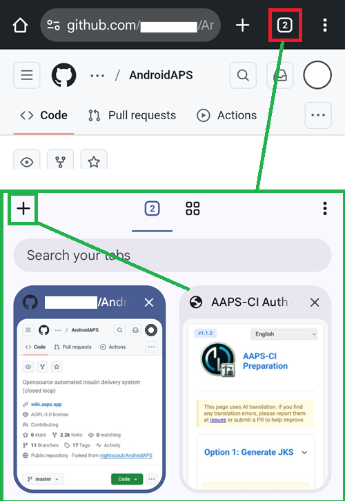

(browser-build)=

# Bygge i webbläsaren

Bygga AAPS med GitHub Actions.

**Lägsta AAPS-version som stöds är 3.3.2.1.**

## Bygg själv i stället för att ladda ned

**AAPS-appen (en apk-fil) finns inte att ladda ned, på grund av reglerna för medicintekniska produkter. Det är lagligt att bygga appen för eget bruk, men du får inte ge en kopia till andra!**

Se sidan [Vanliga frågor](../UsefulLinks/FAQ.md) för mer information.

(Building-APK-without-a-computer)=

## Välj hur du ska bygga

Välj den metod som passar enheten du bygger från:

### På en Android-telefon: AAPS Builder (rekommenderas)

En inställningssida guidar dig genom att skapa ditt eget privata repo för byggen på GitHub. Inget att installera, ingen förberedelsefil, och du startar varje bygge själv. Du laddar ned appen direkt från GitHub. Google Drive är valfritt.

Det fungerar också från webbläsaren på en dator.

**→ [Bygg med AAPS Builder](BrowserBuildAapsBuilder.md)**

### På en dator eller en iPhone / iPad: fork och förberedelsefil

Du gör en kopia (fork) av AAPS källkod på GitHub, skapar din keystore med en förberedelsefil, och den byggda appen sparas i din Google Drive. Följ de fyra stegen nedan.

```{note}
**Bygger du redan med en fork?** Fortsätt att uppdatera den enligt [Uppdatera med bygge i webbläsaren](../Maintenance/UpdateBrowserBuild.md), eller byt till AAPS Builder. För att byta hämtar du först en kopia av din keystore från din fork: se [Om du kommer från det tidigare bygget i webbläsaren](#aaps-builder-from-fork).
```

Du behöver använda flera flikar i webbläsaren och byta mellan dem. Exempel i Chrome:



```{note}
Du kommer att behöva hoppa mellan flikar: börja med alla flikar stängda, så att du inte tappar bort dig när du byter från en flik till en annan.
```

#### Det här behöver du

- Ett **Google-konto**, så att den byggda appen kan sparas i din Google Drive.
- Ett **GitHub-konto** (gratis) – du skapar det i steg 1.
- En **webbläsare** som kan ha flera flikar öppna samtidigt (nedan utgår vi från Chrome).
- Ett litet **hjälpverktyg för att köra förberedelsefilen**. Vilket du behöver beror på enheten du bygger från – du behöver inte installera något nu, steg 2 guidar dig genom det för din enhet:
  - **Dator (Windows / Mac / Linux):** Simple Web Server.
  - **iPhone / iPad:** ingen extra app – du använder den inbyggda appen Filer och webbläsaren.

#### Stegen

Bygget i webbläsaren består av en rad val. Följ de här stegen i ordning:

1. **[Skapa din GitHub-fork](BrowserBuildFork.md)** – gör din personliga kopia av AAPS källkod.
2. **[Skapa din keystore för signering](BrowserBuildKeystore.md)** – det viktiga valet: skapa en ny keystore (alternativ 1) eller ladda upp din befintliga (alternativ 2), och följ sedan sidan för din enhet.
3. **[Auktorisera Google Drive](BrowserBuildGoogleDrive.md)** – låt GitHub spara den byggda appen i din Google Drive.
4. **[Bygg APK-filen](BrowserBuildAPK.md)** – kör arbetsflödet i GitHub Actions och välj version och variant.

Om du får problem, se **[Bygge i webbläsaren: felsökning](../GettingHelp/BrowserBuildTroubleshooting.md)**. För valfria åtgärder med en fork, se [exportera din keystore](#ci-keystore-export) eller [cherry-picka en commit](#github-cherry-pick).

----

**Börja med [Steg 1 – Skapa din GitHub-fork](BrowserBuildFork.md) →**

```{toctree}
:hidden:

AAPS Builder <BrowserBuildAapsBuilder.md>
Steg 1: Skapa din fork <BrowserBuildFork.md>
Steg 2: Skapa din keystore <BrowserBuildKeystore.md>
Steg 3: Auktorisera Google Drive <BrowserBuildGoogleDrive.md>
Steg 4: Bygg APK-filen <BrowserBuildAPK.md>
```
