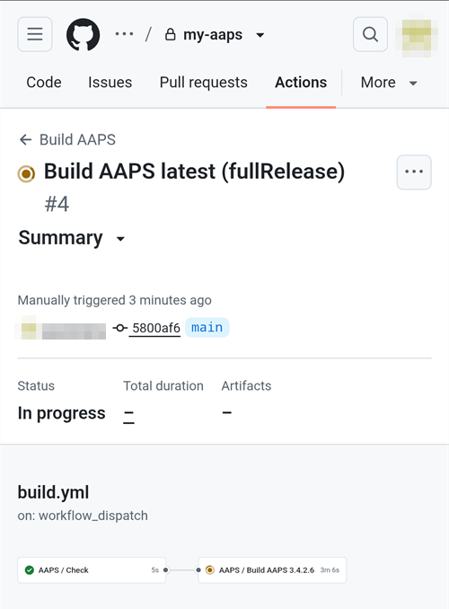
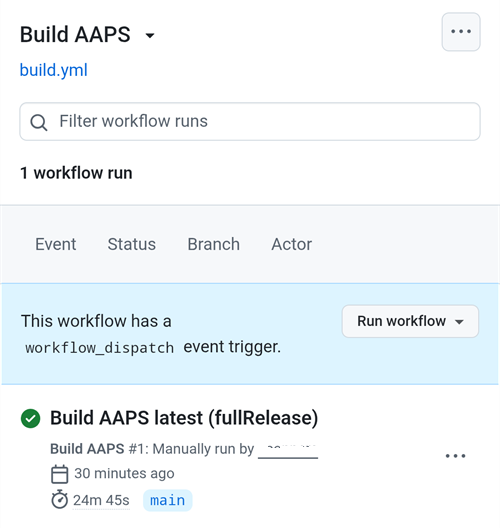

(aaps-builder)=

# Bygge i webbläsaren med AAPS Builder

```{note}
Det här är det rekommenderade sättet att bygga AAPS från en **Android-telefon**. Det fungerar också i webbläsaren på vilken dator som helst. Andra sätt att bygga från en dator eller en iPhone finns i översikten [Bygge i webbläsaren](BrowserBuild.md).
```

```{contents} In this page
:backlinks: entry
:depth: 2
```

**AAPS Builder** bygger AAPS-appen åt dig på GitHub, den kostnadsfria webbplatsen för källkod. Du behöver inte installera något på telefonen, och det finns ingen förberedelsefil att öppna.

En inställningssida guidar dig genom det. Första gången tar det ungefär 10 minuter:

1. Skapa din egen **privata kopia** av AAPS Builder i ditt GitHub-konto: inställningssidan öppnar GitHub med allt ifyllt, du behöver bara bekräfta. Byggarbetsflödet, filen som talar om för GitHub hur AAPS ska byggas, finns redan i den.
2. Skapa eller ladda upp din **signeringsnyckel** (din keystore).
3. Ge nyckeln till ditt repo som en **hemlighet** på GitHub.
4. **Bygg** appen. Ett bygge tar 15 till 30 minuter.
5. **Ladda ned och installera** appen på telefonen.

Du behöver **inte** göra en fork av AndroidAPS: AAPS källkod laddas ned från det officiella AndroidAPS-repot vid varje bygge. Du behöver **inte** heller Google Drive: du laddar ned appen direkt från GitHub.

```{admonition} Where the code comes from
:class: note

Byggarbetsflödet underhålls av AAPS-utvecklarna i repot [nightscout/aaps-builder](https://github.com/nightscout/aaps-builder), och ditt repo är en kopia av det. [Arbetsflödet](https://github.com/nightscout/aaps-builder/blob/main/.github/workflows/build.yml) i din kopia är kort: det kör [byggstegen](https://github.com/nightscout/aaps-builder/blob/main/.github/workflows/aaps-builder.yml) som finns i det repot, så att förbättringar når dig utan att något ändras i ditt repo. Du kan läsa båda filerna. När arbetsflödet bygger laddar det bara ned AAPS officiella källkod och GitHubs egna byggverktyg. Din keystore lämnar aldrig din webbläsare och ditt privata repo.
```

(aaps-builder-before-you-start)=

## Innan du börjar

Du behöver:

- Ett **GitHub-konto** (gratis). Om du inte har något, skapa det först på [github.com](https://github.com/signup).
- En **webbläsare**: Chrome på telefonen, eller valfri webbläsare på en dator. Logga in på github.com i den webbläsaren innan du börjar.
- **Har du GitHub-appen på telefonen?** Du kan behålla den. Vissa knappar på inställningssidan öppnar då appen i stället för Chrome. Byggandet fungerar i appen, men appen **kan inte ladda ned** den färdiga AAPS: [steg 5](#aaps-builder-step5) visar hur du byter till Chrome för nedladdningen.
- Din **befintliga keystore** (`.jks`-fil), dess lösenord och dess alias, om du har byggt AAPS tidigare och vill uppdatera utan att installera om.

```{warning}
**Ditt byggrepo måste vara privat.** Allt som ett bygge skapar syns för alla som kan se repot. Inställningssidan skapar ett privat repo åt dig. Ändra det aldrig till offentligt, och gör inte en **fork** av AAPS Builder i stället: en fork är alltid offentlig.

Ett privat repo får 2000 kostnadsfria minuter i GitHub Actions per månad, vilket räcker till flera byggen.
```

```{warning}
**Ny nyckel eller befintlig nyckel: det avgör om du kan uppdatera AAPS.**

- **Du har redan AAPS på telefonen, byggd med en keystore som du fortfarande har**: välj **I already have a keystore** (jag har redan en keystore) på inställningssidan och ladda upp den. Nästa bygge uppdaterar då den AAPS som redan är installerad. Har du byggt AAPS med det tidigare bygget i webbläsaren (din egen fork)? Din keystore finns i din fork: [hämta först en kopia av den](#aaps-builder-from-fork).
- **Du bygger AAPS för första gången, eller du har tappat bort din keystore eller dess lösenord**: välj **Create a new key** (skapa en ny nyckel). En app som är signerad med en ny nyckel **kan inte uppdatera** en AAPS som är signerad med en annan nyckel. Du måste exportera dina inställningar, kopiera filen till en plats utanför telefonen, avinstallera den gamla AAPS, installera den nya och sedan importera dina inställningar: se [Installera om AAPS med en ny keystore](#reinstall-aaps).

Fortsätt sedan alltid att använda samma nyckel. När du skapar en ny nyckel, ladda ned säkerhetskopian som sidan erbjuder och förvara den tillsammans med lösenordet och aliaset (`key0`) på en säker plats utanför telefonen.
```

(aaps-builder-from-fork)=

## Om du kommer från det tidigare bygget i webbläsaren (fork)

Hoppa över detta avsnitt om du aldrig har byggt AAPS med den tidigare metoden för bygge i webbläsaren (din egen kopia, eller fork, av AndroidAPS på GitHub, med förberedelsefilen och Google Drive).

Din keystore är sparad som hemligheter i din fork. GitHub visar aldrig en hemlighet igen, så du kan inte kopiera den till ditt nya repo. Hämta först en kopia av din keystore och använd den sedan i [steg 2](#aaps-builder-step2) med **I already have a keystore** (jag har redan en keystore).

```{warning}
Välj inte **Create a new key** (skapa en ny nyckel). AAPS som byggs med en ny nyckel kan inte uppdatera AAPS på din telefon.
```

Vilket fall gäller dig?

- **Du använde alternativ 2** (du laddade upp din egen keystore från Android Studio), och du har fortfarande `.jks`-filen, dess lösenord och dess alias: du behöver inte göra något här. Använd den filen i steg 2.
- **Du använde alternativ 1** (förberedelsefilen skapade din nyckel), eller så har du inte längre kvar din keystore-fil: exportera den från din fork enligt nedan.

Så här exporterar du din keystore från din fork:

1. Öppna **Settings** → **Secrets and variables** → **Actions** i din fork och lägg till en hemlighet med namnet `ZIP_PASSWORD`. Välj ett lösenord med bara engelska bokstäver (inte å, ä, ö) och siffror. Det skyddar filen som du nu ska skapa.
2. Öppna fliken **Actions** i din fork, tryck på **CI Keystore Export** och sedan på **Run workflow**. Mer information: [Exportera din keystore](#ci-keystore-export).
3. När körningen har en grön bock, öppna din Google Drive: filen `keystore.zip` ligger i mappen **AAPS** → **KeyStore**. Om körningen misslyckas i steget för Google Drive har din forks åtkomst till Google Drive gått ut: se [Googles uppdateringstoken har gått ut](#aaps-ci-google-token-expired).
4. Ladda ned `keystore.zip` och öppna den med ditt `ZIP_PASSWORD`: på en dator, eller på telefonen med en filhanterarapp som kan öppna lösenordsskyddade ZIP-filer. Den innehåller:
   - `keystore.jks`: din keystore,
   - `keyStoreInfo.txt`: ditt `KEYSTORE_PASSWORD`, `KEY_PASSWORD` och `ALIAS` (oftast `key0`).
5. Kopiera `keystore.jks` till telefonen (eller till Google Drive, så att du kan välja den därifrån).

I [steg 2](#aaps-builder-step2) på inställningssidan:

1. Tryck på **I already have a keystore** (jag har redan en keystore).
2. I **Keystore file** (keystore-fil) väljer du `keystore.jks`.
3. I **Keystore password** (keystore-lösenord) skriver du `KEYSTORE_PASSWORD` från `keyStoreInfo.txt`.
4. I **Key alias** (nyckelns alias) väljer eller skriver du `ALIAS` från `keyStoreInfo.txt`.
5. Om `KEY_PASSWORD` skiljer sig från `KEYSTORE_PASSWORD`, avmarkera **Key password is the same as the keystore password** (nyckelns lösenord är samma som keystore-lösenordet) och skriv `KEY_PASSWORD`.

Förvara `keystore.zip` och dess `ZIP_PASSWORD` på en säker plats utanför telefonen: det är säkerhetskopian av din nyckel.

Om du också vill spara byggen från AAPS Builder i Google Drive, gör [steg 6](#aaps-builder-google-drive): inställningssidan hämtar ett nytt `GDRIVE_OAUTH2` åt dig. Du kan behålla din fork tills AAPS som har byggts med AAPS Builder är installerad på telefonen.

## Öppna inställningssidan

**→ [Öppna inställningssidan för AAPS Builder](#aaps-builder-setup)**

Inställningssidan är en del av denna dokumentation, på ditt språk. Ha också denna sida öppen i en annan flik: avsnitten nedan förklarar varje steg på inställningssidan mer detaljerat, med skärmbilder.

Inställningssidan öppnar varje GitHub-sida i en ny flik i Chrome. För att gå tillbaka till inställningssidan, tryck på flikknappen bredvid adressfältet i Chrome (fyrkanten med en siffra) och välj inställningssidan för AAPS Builder.

Inställningssidan körs helt i din webbläsare: din nyckel och dina lösenord skickas aldrig någonstans, förutom till den GitHub-hemlighet som du själv klistrar in dem i. Bara ditt användarnamn på GitHub skickas till GitHub, för att kontrollera att det finns. Den kommer ihåg ditt användarnamn på GitHub och namnet på ditt repo, så att du när som helst kan gå tillbaka och öppna sidan med dina hemligheter eller dina byggen igen.


(aaps-builder-step1)=

## Steg 1 – Skapa ditt privata byggrepo

Det här steget skapar din egen privata kopia av AAPS Builder i ditt GitHub-konto, med byggarbetsflödet redan på plats. Bara du kan se det och apparna som det bygger.

1. Kontrollera att du är inloggad på github.com i den här webbläsaren.

2. I **Your GitHub username** (ditt användarnamn på GitHub) skriver du ditt användarnamn på GitHub, inte din e-postadress. Sidan kontrollerar det hos GitHub: **✓ GitHub-användaren hittades** betyder att det är rätt.

3. I **Name of your repository** (namnet på ditt repo) behåller du förslaget `my-aaps`. Om du redan har skapat ditt repo med ett annat namn, skriv exakt det namnet.

   ```{note}
   **Har du redan ett repo för AAPS Builder** (skapat med en tidigare version av inställningssidan)? Skapa inte ett nytt: skriv dess exakta namn, hoppa över **Create my private repository** (skapa mitt privata repo) och uppdatera dess arbetsflöde en gång enligt [Uppdatera AAPS](#aaps-builder-updates). Dina hemligheter förblir som de är. Om du ändå vill ha ett nytt repo, välj ett namn som du inte redan har, till exempel `my-aaps-2`, och använd samma keystore i steg 2.

   Skriv inte namnet på din fork av AndroidAPS: en fork är offentlig, och den bygger redan med sitt eget arbetsflöde **AAPS CI**.
   ```

   

4. Kontrollera raden **Your repository:** (ditt repo): den visar `github.com/<your username>/my-aaps`. Inställningssidan kommer ihåg namnet från ditt förra besök: kontrollera det varje gång innan du använder knapparna.

5. Tryck på **Create my private repository** (skapa mitt privata repo).

   

6. GitHub öppnar **Create a new repository** (skapa ett nytt repo) i en ny flik. Allt är redan ifyllt: under **Start with a template** (börja med en mall) mallen `nightscout/aaps-builder` med **Include all branches** avstängt, och under **General** ditt konto som **Owner** (ägare) och namnet som du valde.

   

   Ändra ingenting.

7. Scrolla nedåt: under **Configuration** är **Choose visibility** (välj synlighet) redan **Private** (privat). Tryck på den gröna knappen **Create repository**.

   

   GitHub visar ditt nya repo: det innehåller en mapp `.github` (med byggarbetsflödet) och en fil `README.md`. **Gå tillbaka till fliken med inställningssidan** för steg 2: tryck på flikknappen bredvid adressfältet i Chrome och välj inställningssidan.

```{warning}
**Är ditt nya repo tomt**, utan filer? Det skapades inte från mallen, och det kan inte bygga. Ta bort det (**Settings** → längst ned på sidan → **Delete this repository**) och tryck sedan på **Create my private repository** (skapa mitt privata repo) på inställningssidan igen.
```

(aaps-builder-step2)=

## Steg 2 – Din signeringsnyckel

Appen måste signeras med din egen nyckel. Välj en av de två flikarna. Läs först [varningen om ny eller befintlig nyckel](#aaps-builder-before-you-start).


### Jag har redan en keystore

1. Tryck på **I already have a keystore** (jag har redan en keystore).
2. I **Keystore file** (keystore-fil) väljer du din `.jks`-fil (eller `.keystore`, `.p12`, `.pfx`). På en telefon: kopiera först filen till telefonen eller till Google Drive.
3. I **Keystore password** (keystore-lösenord) skriver du lösenordet för din keystore.
4. I **Key alias** (nyckelns alias) väljer du ditt alias i listan, eller skriver det om det inte finns någon lista. För keystores som har skapats med Android Studio är det oftast `key0`.
5. Om lösenordet för nyckeln skiljer sig från lösenordet för din keystore, avmarkera **Key password is the same as the keystore password** (nyckelns lösenord är samma som keystore-lösenordet) och skriv lösenordet för nyckeln.
6. Tryck på **Check and continue** (kontrollera och fortsätt).

Sidan kontrollerar lösenordet och aliaset på din enhet. **Keystore OK! Fortsätt med steg 3.** betyder att allt är rätt. Om det står att lösenordet kontrolleras när du bygger, fortsätt ändå: bygget säger till om något är fel.

### Skapa en ny nyckel

1. Tryck på **Create a new key** (skapa en ny nyckel).

2. Välj ett lösenord och skriv det två gånger. Regler: minst 8 tecken, bara bokstäverna a–z och A–Z, siffrorna 0–9 och symboler som `! ? #`. Inga mellanslag, inga bokstäver med accent eller prickar (alltså inte å, ä, ö) och inte tecknet `|`.

3. Tryck på **Create key** (skapa nyckel). Det tar några sekunder innan **Key created** (nyckeln har skapats) visas.

   

4. Tryck på **Download backup (aaps-keystore.jks)** (ladda ned säkerhetskopia). Om Chrome frågar **Download file again?** (ladda ned filen igen?) finns redan en äldre säkerhetskopia med samma namn på telefonen: tryck på **Download again** (ladda ned igen). Chrome sparar då den nya nyckeln som `aaps-keystore (1).jks`: det är filen som hör till den här nyckeln, så behåll den och blanda inte ihop den med den äldre.

   Förvara de här tre sakerna tillsammans, på en säker plats utanför telefonen (till exempel din egen molnlagring):

   - filen `aaps-keystore.jks`,
   - ditt lösenord,
   - nyckelns alias: **`key0`**.

   Du behöver alla tre om du någon gång bygger AAPS på ett annat sätt, till exempel med Android Studio. Nycklar som har skapats med en tidigare version av inställningssidan har aliaset `aaps`.

   

(aaps-builder-step3)=

## Steg 3 – Ge nyckeln till ditt repo

Steg 3 låses upp när steg 2 är klart. Din nyckel, dess lösenord och dess alias packas ihop till ett enda värde, hemligheten `KEYSTORE_SET`.

1. Tryck på **Open the secrets page** (öppna sidan för hemligheter).


2. GitHub öppnar sidan **New secret** (ny hemlighet) i ditt repo. På en telefon ligger den under inställningsmenyn: scrolla nedåt.


3. Byt till fliken med inställningssidan och tryck på **Copy name** (kopiera namn). Byt tillbaka till fliken med GitHub och klistra in det i det lilla fältet **Name** (namn). Namnet är `KEYSTORE_SET`.

4. Byt till fliken med inställningssidan och tryck på **Copy secret** (kopiera hemlighet). Byt tillbaka till fliken med GitHub och klistra in den i den stora rutan **Secret** (hemlighet). På en telefon trycker du länge. Hemligheten är en mycket lång kod, tusentals tecken: inställningssidan visar de första tecknen bredvid knappen. Klistra inte in ordet `KEYSTORE_SET` där.

5. Tryck på **Add secret** (lägg till hemlighet). `KEYSTORE_SET` visas nu under **Repository secrets** (hemligheter i repot).


Du behöver bara göra detta en gång.

```{tip}
Visar GitHub **Page not found** (404)? Kontrollera först att du är inloggad på github.com i den här webbläsaren: GitHub visar 404 för privata repon när du inte är inloggad. Annars stämmer inte användarnamnet eller namnet på repot i steg 1 med ditt repo. Kontrollera namnet på github.com, rätta det i steg 1 och tryck på knappen igen.
```

(aaps-builder-step4)=

## Steg 4 – Bygg appen

1. Tryck på **Open the build page** (öppna byggsidan) på inställningssidan. GitHub öppnar sidan **Build AAPS** i ditt repo.

   

   Om **GitHub-appen** öppnas i stället: tryck på **RUN WORKFLOW**, kontrollera version och variant och tryck på **RUN WORKFLOW** igen. Appen kan fortfarande visa **Nothing to see here**: dra ned listan för att uppdatera den och se ditt bygge. Fortsätt sedan med steg 4 nedan.

2. Om GitHub frågar, tryck på den gröna knappen för att aktivera arbetsflöden.

   Listan med arbetsflöden visar två poster: använd **Build AAPS**. Bry dig inte om **AAPS Builder**: det innehåller byggstegen och har ingen knapp **Run workflow**.

3. Tryck på **Run workflow** (kör arbetsflöde). Ett litet formulär öppnas:
   - **Version**: behåll `latest` för att bygga den senaste AAPS-versionen, eller skriv ett versionsnummer, till exempel `4.0.0`.
   - **Variant**: behåll `fullRelease` för normal användning med pump. De andra varianterna förklaras under [byggvarianter](#browserbuild-variant). `aapsclient3Release` bygger **AAPSClient3**, som finns från och med **AAPS** version 4.0 (se [Om AAPSClient, AAPSClient2 och AAPSClient3](#remotecontrol-aapsclient-versions)).
   - Tryck på den gröna knappen **Run workflow**.

   

4. Bygget startar och visar **In progress** (pågår), med två delar: först **AAPS / Check**, sedan **AAPS / Build AAPS**.

   

5. Vänta 15 till 30 minuter. En grön bock betyder att bygget är klart. Ett rött kryss betyder att det misslyckades: öppna bygget och läs meddelandet, och se sedan [felsökning](#aaps-builder-troubleshooting).

   

   ```{tip}
   **E-post när ett bygge är klart:** GitHub skickar bara e-post när ett bygge misslyckas. För att också få e-post när det lyckas: på github.com, öppna din profilbild → **Settings** → **Notifications** → **System** → **Actions** och avmarkera **Only notify for failed workflows**.
   ```

Om det inte finns någon knapp **Build AAPS** eller **Run workflow**:

- Öppna ditt repo och kontrollera att det har en mapp `.github` med filen `workflows/build.yml`. Om repot är tomt skapades det inte från mallen: ta bort det (**Settings** → längst ned på sidan → **Delete this repository**) och gör [steg 1](#aaps-builder-step1) igen med knappen.
- Öppna fliken **Actions**. Om det står att arbetsflöden är inaktiverade, tryck på den gröna knappen för att aktivera dem och tryck sedan på **Build AAPS** i listan.

(aaps-builder-step5)=

## Steg 5 – Installera appen på telefonen

```{warning}
**Före varje uppdatering**: [exportera dina inställningar](#ExportImportSettings-Automating-Settings-Export) i AAPS och kopiera filen **till en plats utanför telefonen** (Google Drive, Dropbox…). Spara också flera äldre exporter och APK-filerna där, så att du alltid kan gå tillbaka.
```

1. Öppna inställningssidan i **Chrome** på telefonen. Logga in på github.com om du blir ombedd.
2. Tryck på **Open my builds** (öppna mina byggen) och sedan på det senaste bygget med en grön bock.

   ```{admonition} The GitHub app opened instead of Chrome?
   :class: note

   GitHub-appen kan inte ladda ned byggen. I appen, öppna det senaste bygget och tryck sedan på **Artifacts ↗**, eller tryck på delningsikonen högst upp och välj **Chrome** (eller **Copy link** och klistra sedan in länken i adressfältet i Chrome). Bygget öppnas i Chrome: fortsätt med nästa steg där.

   För att GitHub-länkar inte ska öppnas i appen: Android **Settings** (Inställningar) → **Apps** (Appar) → **GitHub** → **Open by default** (Öppna som standard) → stäng av **Open supported links** (Öppna länkar som stöds).
   ```

   

3. Scrolla ned till byggsammanfattningen och tryck på länken **Download AAPS** (ladda ned AAPS).

   

   ```{tip}
   Scrolla med fingret på texten, inte på diagrammet med byggstegen: annars flyttas diagrammet i stället för sidan.
   ```

   Du kan också scrolla längre ned till **Artifacts** (artefakter) och trycka på nedladdningsikonen bredvid `aaps-….apk`.

   

4. När nedladdningen är klar, öppna Chromes meny **⋮** → **Downloads** (nedladdningar), tryck på `aaps-….apk` och välj **Install** (installera). Om du blir tillfrågad, tillåt installation av appar från den här källan.

   

`aaps-wear-….apk` är appen för smartklockan. Hoppa över den om du inte använder någon smartklocka.

Appen sparas på byggsidan i **14 dagar**. Den visas inte under **Code** i ditt repo. Kopiera den till en säker plats utanför telefonen, tillsammans med dina exporterade inställningar.

Fler sätt att installera appen finns i [Överföra och installera AAPS](TransferringAndInstallingAaps.md).

```{note}
Från september 2026 kan Googles [verifiering av Android-utvecklare](#android-developer-verification) blockera installationen av APK-filen när du trycker på filen, beroende på vilket land du bor i. Kostnadsfria sätt att komma runt detta förklaras på den sidan.
```

(aaps-builder-google-drive)=

## Steg 6 (valfritt) – Spara också appen i Google Drive

Du kan också låta varje bygge sparas i din Google Drive, i mappen `AAPS/<version>`. Detta är valfritt: appen finns alltid på byggsidan.

Det kräver ytterligare en hemlighet, `GDRIVE_OAUTH2`. Steg 6 på inställningssidan hämtar den från Google åt dig, på en telefon eller en dator. **AAPS** kan då bara se och ändra de filer som den själv skapar i din Google Drive, inget annat.

1. Tryck på **Connect Google Drive** (anslut Google Drive) på inställningssidan. Google öppnas i en ny flik.
2. Välj ditt Google-konto och tillåt åtkomst. Om Google säger att appen inte är verifierad, tryck på **Advanced** (avancerat) och sedan på **Go to …** (gå till …).
3. Den nya fliken visar då ett fel, till exempel **This site can't be reached** eller **127.0.0.1 refused to connect**. **Detta är väntat:** Googles svar finns i adressen till den fliken. Tryck på adressfältet, markera hela adressen (den börjar med `http://127.0.0.1:47913/`) och kopiera den.
4. Gå tillbaka till fliken med inställningssidan inom några minuter: Googles svar gäller bara en kort tid, och bara en gång. Klistra in adressen i **Paste the copied address here** (klistra in den kopierade adressen här) och tryck på **Get GDRIVE_OAUTH2** (hämta GDRIVE_OAUTH2). Sidan visar **GDRIVE_OAUTH2 är klar**.
5. Tryck på **Open the secrets page** (öppna sidan för hemligheter). Tryck på **Copy name** (kopiera namn) och klistra sedan in det i det lilla fältet **Name** (namnet är `GDRIVE_OAUTH2`). Tryck på **Copy secret** (kopiera hemlighet), klistra in den i den stora rutan **Secret** och tryck på **Add secret**.

Från och med nästa bygge sparas APK-filerna också i Google Drive.

Har du redan ett värde för `GDRIVE_OAUTH2` från förberedelsefilen för de andra metoderna för bygge i webbläsaren? Det fungerar också: lägg till det som hemligheten `GDRIVE_OAUTH2`.

Google stänger av åtkomsten om du inte bygger på 6 månader, eller om du byter ditt lösenord för Google. Bygget säger då till: gör om de här stegen. Se [Googles uppdateringstoken har gått ut](#aaps-ci-google-token-expired).

(aaps-builder-updates)=

## Uppdatera AAPS

Ditt repo bygger aldrig något av sig självt: du bestämmer när du bygger, vilken version och vilken variant. När en ny AAPS-version släpps:

1. [Säkerhetskopiera dina inställningar](#aaps-builder-step5) enligt steg 5.
2. Bygg den nya versionen som i [steg 4](#aaps-builder-step4). Behåll `latest` eller skriv versionsnumret.
3. Ladda ned och installera den som i [steg 5](#aaps-builder-step5).

**Uppdateringar av byggstegen** når dig av sig själva: vid varje bygge kör ditt repo de byggsteg som AAPS-utvecklarna har släppt i nightscout/aaps-builder. Ingenting ändras i ditt repo, och inget bygge startar automatiskt.

**Uppdateringar av din arbetsflödesfil** är sällsynta: bara när formuläret **Run workflow** ändras, till exempel för en ny byggvariant, eller en gång om ditt repo skapades med en tidigare version av inställningssidan (ett tomt repo med en kort arbetsflödesfil) eller från den gamla mallen. Sidan [Uppdateringar och ändringar i dokumentationen](../Maintenance/DocumentationUpdate.md) talar om när det behövs. Din hemlighet `KEYSTORE_SET` förblir som den är. Öppna **Updating your copy** (uppdatera din kopia) i slutet av steg 1 på inställningssidan:

1. Tryck på **Open the newest workflow** (öppna det senaste arbetsflödet). På en dator klickar du på **kopieringsikonen** ("Copy raw file") uppe till höger i filen. På en telefon öppnar du i stället **versionen med ren text**, trycker länge på texten och väljer sedan **Markera alla** och **Kopiera**.
2. Tryck på **Open my workflow file** (öppna min arbetsflödesfil).
3. Ersätt hela texten med det kopierade arbetsflödet (tryck länge på en telefon: **Markera alla**, sedan **Klistra in**).
4. Tryck på **Commit changes…** och sedan på **Commit changes**.

Filens första rad visar dess version.

(aaps-builder-troubleshooting)=

## Felsökning

För att se varför ett bygge misslyckades, [läs byggloggen](#aaps-ci-read-the-logs): stegen har andra namn, men du hittar felet på samma sätt. Du kan också [uppdatera en hemlighet](#aaps-ci-update-secret) och [köra bygget igen](#aaps-ci-rerun) på samma sätt.

- **Ingen knapp "Build AAPS" eller "Run workflow", eller repot är tomt**: repot skapades inte från mallen. Ta bort det (**Settings** → längst ned på sidan → **Delete this repository**) och gör [steg 1](#aaps-builder-step1) igen med knappen **Create my private repository** (skapa mitt privata repo).
- **Bygget stoppar med "This repository is PUBLIC"**: öppna **Settings** (inställningar) → **General** → **Danger Zone** → **Change visibility** (ändra synlighet) → **Private** (privat) i ditt repo och bygg sedan igen.
- **"Secret KEYSTORE_SET is missing"**: gör steg 3 på inställningssidan.
- **"The secret is too short"**, **"The secret is not a valid code"** eller **"The secret does not contain a keystore"**: fel text klistrades in i hemligheten, ofta själva ordet `KEYSTORE_SET`, eller bara en del av koden. Öppna **Settings** → **Secrets and variables** → **Actions** i ditt repo, redigera `KEYSTORE_SET` och klistra in den långa koden från **Copy secret** (kopiera hemlighet) igen (gör först om steg 2 på inställningssidan om du har stängt den).
- **"Keystore, password or alias is wrong"**: kontrollera lösenordet och aliaset för din keystore och gör sedan om steg 2 och 3 på inställningssidan.
- **"Version … does not exist"**: versionen som du skrev är ingen AAPS-version. Använd `latest` eller kontrollera versionsnumret.
- **"Variant … is not supported"**: din arbetsflödesfil är en äldre version. Ersätt den enligt [Uppdatera AAPS](#aaps-builder-updates).
- **"Page not found" (404) när inställningssidan öppnar GitHub**: logga in på github.com i samma webbläsare (GitHub visar 404 för privata repon när du inte är inloggad). Om du är inloggad stämmer inte användarnamnet eller namnet på repot i steg 1 på inställningssidan med ditt repo. Skriv de exakta namnen.
- **"Det finns ingen GitHub-användare med det här namnet"** i steg 1: skriv ditt användarnamn på GitHub, så som det visas i din GitHub-profil, inte din e-postadress.
- **Ingen länk Download, eller GitHub-appen öppnades**: GitHub-appen kan inte ladda ned byggen. Öppna bygget i Chrome enligt [steg 5](#aaps-builder-step5). För att GitHub-länkar inte ska öppnas i appen: Android **Settings** (Inställningar) → **Apps** (Appar) → **GitHub** → **Open by default** (Öppna som standard) → stäng av **Open supported links** (Öppna länkar som stöds).
- **"Google Drive access has expired or was revoked"**: gör om [steg 6](#aaps-builder-google-drive) och uppdatera hemligheten `GDRIVE_OAUTH2`.

För andra problem med GitHub och Google Drive, se [Bygge i webbläsaren: felsökning](../GettingHelp/BrowserBuildTroubleshooting.md).

```{toctree}
:hidden:

Inställningssidan för AAPS Builder <BrowserBuildAapsBuilderSetup.md>
```
