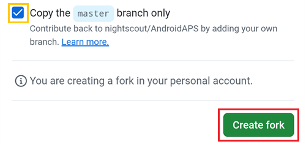

(github-fork)=

# Bygge i webbläsaren – Steg 1: Skapa din GitHub-fork

```{note}
Detta är **steg 1** av [Bygge i webbläsaren](BrowserBuild.md).
```

Du kommer att behöva spara din personliga Android Java-nyckel och information om din Google Drive som hemligheter (secrets) i GitHub (vi förklarar hur längre fram).

Eftersom det inte går att göra i det offentliga repot för AndroidAPS behöver du göra en egen kopia av källkoden (en så kallad fork).

## GitHub-konto

Du behöver [skapa ett GitHub-konto](https://github.com/signup) om du inte redan har ett.  
Du kan registrera dig med din e-postadress eller med Google. Följ stegen för registrering och verifiering.

När du har ett konto, [logga in på GitHub](https://github.com/login).

## Forka AndroidAPS

Öppna det officiella repot för AndroidAPS via [den här länken](https://github.com/nightscout/AndroidAPS).

Tryck på ikonen för fork. Då skapas en kopia i ditt eget konto.


Scrolla ned på nästa skärm och tryck på **Create Fork** (skapa fork).


*Obs! Du kan **avmarkera** "Copy the master branch only" (kopiera bara master-grenen) om du vill bygga utvecklarversioner eller egna anpassningar.*



```{note}
Kan du inte forka och ser du detta?<br/><br/>
**`No available destinations to fork this repository.`**<br/><br/>
<br/><br/>
Det betyder att du redan har en fork av AndroidAPS.<br/>
Se till att den är uppdaterad och fortsätt med förberedelsestegen.
```

```{warning}
**Radera aldrig din fork utan att först ha gjort en säkerhetskopia av dina hemligheter!**
```

GitHub visar nu din personliga kopia av AndroidAPS. Låt den här fliken i webbläsaren vara öppen.


----

**Nästa: [Steg 2 – Skapa din keystore för signering](BrowserBuildKeystore.md) →**
