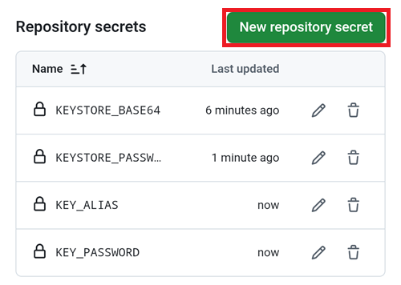

(aaps-ci-google-drive-auth)=

# Bygge i webbläsaren – Steg 3: Auktorisera Google Drive

```{note}
Detta är **steg 3** av [Bygge i webbläsaren](BrowserBuild.md). Gör först klart [Steg 2 – Skapa din keystore för signering](BrowserBuildKeystore.md).
```

```{warning}
Oavsett vilka av de tidigare instruktionerna du följde (Alternativ 1 eller Alternativ 2) MÅSTE du lägga till auktoriseringen för Google Drive för att bygget i webbläsaren ska fungera.
```

Obs! Om du redan har gjort den här delen i videon kan du nu gå direkt till [Steg 4 – Bygg APK-filen](BrowserBuildAPK.md).

```{warning}
Om auktoriseringen hos Google inte startar eller förberedelsesidan misslyckas: stäng förberedelsesidan, öppna `aaps-ci-preparation.html` igen på samma sätt som i steg 2 och börja om med det här steget. Se [felsökning](#aaps-ci-preparation-web).
```

Gå tillbaka till fliken med förberedelsesidan.

Scrolla ned till avsnittet Google Drive Auth och tryck på Start Auth (starta auktorisering).


Välj ditt Google-konto.


Scrolla ned och godkänn åtkomsten. Webbsidan behöver den för att hämta autentiseringsnyckeln för Google Drive.

Tryck på Continue (fortsätt).


Fältet `GDRIVE_OAUTH2` fylls i. Tryck på den övre knappen Copy (kopiera).


Växla tillbaka till fliken med GitHub.

Scrolla ned till Repository secrets (repots hemligheter) och tryck på New repository secret (ny hemlighet för repot).

Om du följde Alternativ 1 bör du se detta:


Om du följde Alternativ 2 finns det fler nycklar:



Klistra in texten som du just kopierade i fältet Name (namn). Tryck länge i textrutan för att visa menyn för att klistra in.


Växla till fliken med förberedelsesidan.

Tryck på den andra knappen Copy.


Växla tillbaka till fliken med GitHub.

1. Klistra in texten som du just kopierade i fältet Secret (hemlighet). Tryck länge i textrutan för att visa menyn för att klistra in.

2. Tryck på Add secret (lägg till hemlighet).


Du bör nu ha antingen två (Alternativ 1) eller fem (Alternativ 2) hemligheter.


När APK-filen för AAPS är byggd kan GitHub nu spara den i din Google Drive.

----

**Nästa: [Steg 4 – Bygg APK-filen](BrowserBuildAPK.md) →**
