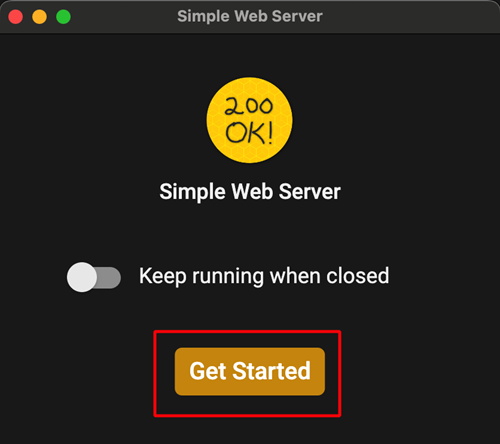
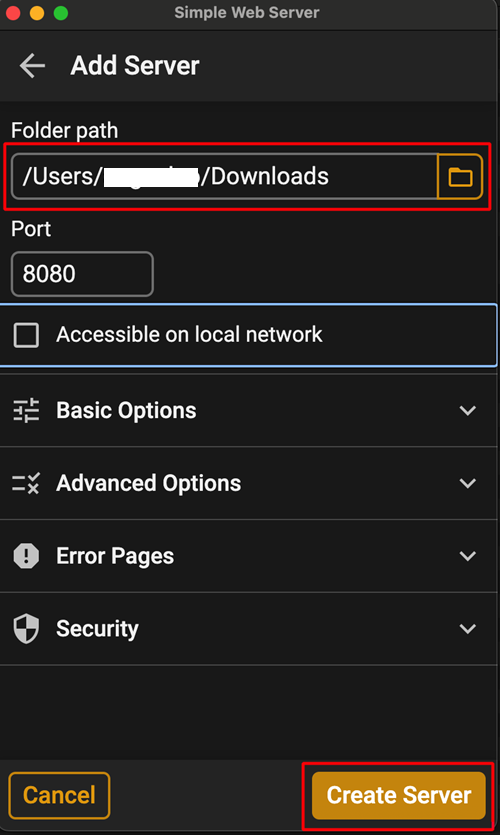

(aaps-ci-option1-computer)=

# Alternativ 1 · Dator – Skapa en ny keystore

```{note}
[Alternativ 1](BrowserBuildO1.md) (skapa en ny keystore) på en **dator** (Windows / Mac / Linux).
```

## 1. Ladda ned förberedelsefilen

:::{include} BrowserBuildDownloadPrep.md
:::

## 2. Starta en lokal server och skapa din keystore

Använd en dator (Windows/Mac/Linux)

Öppna webbsidan [https://simplewebserver.org/download.html](https://simplewebserver.org/download.html)

Installera Simple Web Server<br/> Om du använder Windows eller Mac kan du installera den från Microsoft Store eller Mac App Store.<br/> Om webbläsaren frågar om den ska öppna butiksappen, tillåt det.<br/><br/> <br/>

Exempel på Mac:

- get → install → open (hämta → installera → öppna)<br/><br/> <br/><br/>

- Klicka på Get Started (kom igång)<br/><br/> <br/><br/>

- Klicka på New Server (ny server)<br/><br/> <br/><br/>

- Välj i Folder Path (mappens sökväg) den mapp där aaps-ci-preparation.html finns och klicka sedan på Create Server (skapa server).<br/><br/> <br/><br/>

- När du ser den här skärmen har servern startat.<br/><br/> <br/><br/>

- Stäng inte Simple Web Server. Byt till din webbläsare och öppna<br/> [http://127.0.0.1:8080/aaps-ci-preparation.html](http://127.0.0.1:8080/aaps-ci-preparation.html)<br/><br/>

- För nästa steg, se videon nedan från 1 minut och 37 sekunder.

  <!--crowdin: exclude-->
  <div align="center" style="max-width: 360px; margin: auto; margin-bottom: 2em;">
    <div style="position: relative; width: 100%; aspect-ratio: 9/16;">
      <iframe
        src="https://geo.dailymotion.com/player/x9rdrpy.html?video=x9rdrpy&startTime=97&loop=true&mute=true"
        loading="lazy"
        style="position: absolute; top: 0; left: 0; width: 100%; height: 100%;"
        frameborder="0"
        allowfullscreen>
      </iframe>
    </div>
  </div>

----

**Nästa: [Steg 3 – Auktorisera Google Drive](BrowserBuildGoogleDrive.md) →**
