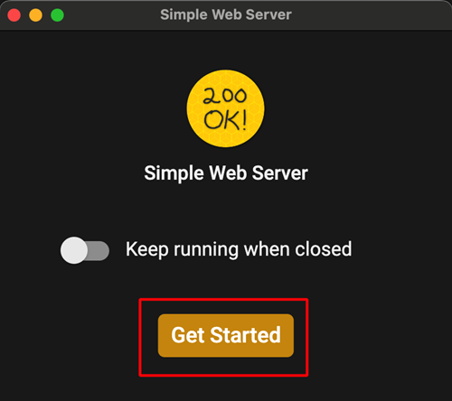
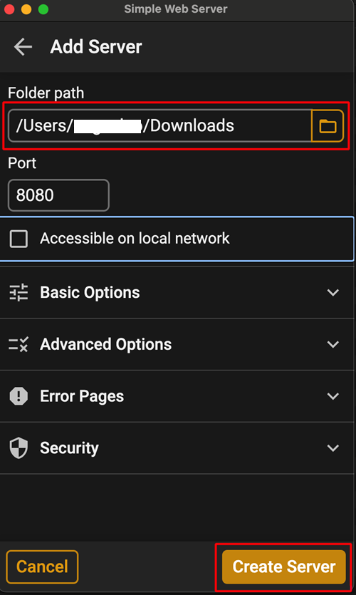

(aaps-ci-option2-computer)=

# Alternativ 2 · Dator – Ladda upp din befintliga keystore

```{note}
[Alternativ 2](BrowserBuildO2.md) (ladda upp en befintlig keystore) på en **dator** (Windows / Mac / Linux).
```

## 1. Ladda ned förberedelsefilen

:::{include} BrowserBuildDownloadPrep.md
:::

## 2. Starta en lokal server och ladda upp din keystore

Använd en dator (Windows/Mac/Linux)

<!--crowdin: exclude-->
<div align="center" style="max-width: 360px; margin: auto; margin-bottom: 2em;">
  <div style="position: relative; width: 100%; aspect-ratio: 9/16;">
    <iframe
      src="https://geo.dailymotion.com/player/x9rdyc6.html?video=x9rdyc6&loop=true&mute=true"
      loading="lazy"
      style="position: absolute; top: 0; left: 0; width: 100%; height: 100%;"
      frameborder="0"
      allowfullscreen>
    </iframe>
  </div>
</div>

Installera Simple Web Server<br/><br/> Om du använder Windows eller Mac kan du installera den från Microsoft Store eller Mac App Store. Om webbläsaren frågar om den ska öppna butiksappen, tillåt det.<br/><br/> <br/><br/>

Exempel på Mac:

- get → install → open (hämta → installera → öppna)<br/><br/> <br/><br/>

- Klicka på Get Started (kom igång)<br/><br/> <br/><br/>

- Klicka på New Server (ny server)<br/><br/> <br/><br/>

- Välj i Folder Path (mappens sökväg) den mapp där aaps-ci-preparation.html finns och klicka sedan på Create Server (skapa server).<br/><br/> <br/><br/>

- När du ser den här skärmen har servern startat.<br/><br/> <br/><br/>

- Stäng inte Simple Web Server. Gå till din webbläsare och öppna<br/><br/> [http://127.0.0.1:8080/aaps-ci-preparation.html](http://127.0.0.1:8080/aaps-ci-preparation.html)<br/><br/>

- För nästa steg, se videon nedan från 2 minuter och 18 sekunder.<br/><br/>
  <!--crowdin: exclude-->
  <div align="center" style="max-width: 360px; margin: auto; margin-bottom: 2em;">
    <div style="position: relative; width: 100%; aspect-ratio: 9/16;">
      <iframe
        src="https://geo.dailymotion.com/player/x9rdvt0.html?video=x9rdvt0&startTime=138&loop=true&mute=true"
        loading="lazy"
        style="position: absolute; top: 0; left: 0; width: 100%; height: 100%;"
        frameborder="0"
        allowfullscreen>
      </iframe>
    </div>
  </div>

----

**Nästa: [Steg 3 – Auktorisera Google Drive](BrowserBuildGoogleDrive.md) →**
