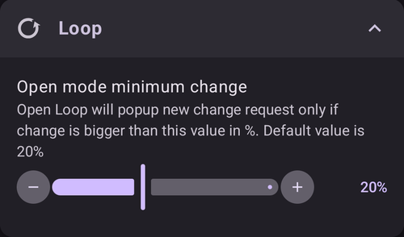
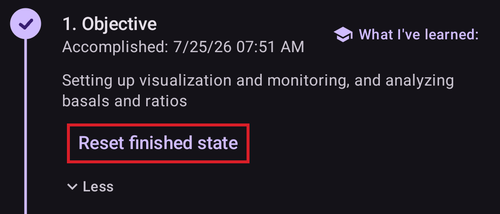

# Slutföra målen

**AAPS** har en serie **Mål** som du måste slutföra. De hjälper dig att gå vidare från enkel öppen loop till hybrid sluten loop och alla funktioner i **AAPS**. Syftet med att slutföra **Mål** är att se till att du har:

* ställt in allt korrekt i din konfiguration av **AAPS**;
* lärt dig de viktigaste funktionerna i **AAPS**; och
* en grundläggande förståelse för vad ditt system kan göra, så att du känner dig trygg när du använder **AAPS**.

När **AAPS** installeras för första gången måste du slutföra varje mål innan du kan gå vidare till nästa. Nya funktioner låses upp steg för steg när du går vidare genom varje **Mål**.

**Mål 1 till 8** leder dig från att ställa in **AAPS** på din smarttelefon till en ”grundläggande” hybrid sluten loop. Det tar ungefär 6 veckor att slutföra. Du kan gå vidare fram till **Mål 5** med en virtuell pump (och under tiden ta insulin på något annat sätt). **Mål 9 och 10** är till för att testa mer avancerade funktioner i **AAPS**, med målet att få bättre kontroll över din diabetes. Det tar upp till 3 månader att slutföra dem, kanske längre. Mer information om hur lång tid varje del ungefär tar finns här: [Hur lång tid tar det?](#preparing-how-long-will-it-take)

Förutom att gå framåt genom **Mål** kan du vid behov också ta bort dina framsteg och [gå tillbaka till ett tidigare mål](#CompletingTheObjectives-go-back-in-objectives).

## Säkerhetskopiera dina inställningar

```{admonition} Note
:class: note

Vi rekommenderar att du exporterar dina **AAPS**-inställningar efter varje slutfört **Mål**!
```

Vi rekommenderar starkt att du [exporterar dina inställningar](../Maintenance/ExportImportSettings.md) efter varje slutfört mål, så att du inte förlorar några framsteg i **AAPS**. Exporten skapar en **inställningsfil** (.json) som du bör spara på ett eller flera säkra ställen (t.ex. Google Drive, hårddisk, bifogad fil i e-post _osv._). På så sätt sparas alla framsteg du har gjort i **AAPS**. Om du tappar bort telefonen eller råkar radera dina framsteg kan du läsa in json-filen i **AAPS** igen genom att importera en nyligen sparad inställningsfil. Du behöver också en säkerhetskopia av **inställningsfilen** om du av någon anledning behöver en ny smarttelefon för **AAPS** (uppgradering, borttappad eller trasig telefon _osv._)

**Inställningsfilen** sparar inte bara dina framsteg i **Mål**, utan också alla dina inställningar i **AAPS**, till exempel **maximal bolus** _osv._

Om du inte har en säkerhetskopia av dina inställningar och något händer med din smarttelefon för **AAPS**, måste du börja om med **Mål** från början. Det tar tid att gå igenom **Mål**, och att behöva göra om dem för att du till exempel har tappat bort din smarttelefon är något du helst vill undvika.

(objectives-objective1)=
## Mål 1: Ställa in visualisering och övervakning, analysera basaler och kvoter

I **Mål 1** ställer du in den grundläggande tekniska konfigurationen i **AAPS**. Du kan inte gå vidare förrän det här steget är slutfört.

- Välj rätt CGM/FGM i [Konfiguration → BG-källa](#Config-Builder-bg-source). Se [BG-källa](../Getting-Started/CompatiblesCgms.md) för mer information.
- Välj rätt pump i [Konfiguration → Pump](#Config-Builder-pump) så att din pump kan kommunicera med **AAPS**. Välj **virtuell pump** om du använder en pumpmodell som saknar drivrutin i **AAPS** för loopning, eller om du vill gå igenom de första **Mål** medan du använder ett annat system för insulintillförsel. Se [insulinpump](../Getting-Started/CompatiblePumps.md) för mer information.
- Om du använder Nightscout:
  - Följ instruktionerna på sidan [Nightscout](../SettingUpAaps/Nightscout.md) så att **Nightscout** kan ta emot och visa data från **AAPS**.
  - Observera att URL:en i **NSClientV3** ska vara **_utan_ "/api/v1/"** i slutet – se [Inställningar → NSClientV3](#Preferences-nsclient).
- Om du använder Tidepool:
  - Följ instruktionerna på sidan [Tidepool](../SettingUpAaps/Tidepool.md) så att **Tidepool** kan ta emot och visa data från **AAPS**.

Obs! *Du kan behöva vänta på nästa glukosvärde från sensorn innan **AAPS** känner igen den.*

(objectives-objective2)=
## Mål 2: Lär dig hur du styr AAPS

**Mål 2** består av flera ”uppgifter” som du ska utföra, se skärmbilden nedan. Varje uppgift visar sin status (**1**): den orange texten "**Inte slutfört ännu**" ändras till "**Slutfört, bra jobbat!**" så fort **AAPS** har registrerat åtgärden. Tryck på **Ledtråd** (**2**) under en uppgift för att öppna dokumentationen om den, om du inte känner till en viss åtgärd ännu.


Uppgifterna för att slutföra **Mål 2** är:
- Ställ in din **profil** på 90 % under 10 min.
  - _Ledtråd_: Tryck på namnet på din profil på huvudskärmen för att öppna skärmen **Profil**. Använd sedan knappen **Aktivera** (▶) och ställ in procent och varaktighet. Mer information finns i [Profilbyte och procent av profil](../DailyLifeWithAaps/ProfileSwitch-ProfilePercentage.md).
  - _Obs!_ **AAPS** accepterar inte basaldoser under 0,05 U/h. Om din **profil** har doser på 0,05 U/h eller lägre måste du skapa en tillfällig **profil** med högre basaldoser innan du utför den här uppgiften. Byt tillbaka till din vanliga **profil** när du har utfört uppgiften.
- Simulera att du ”duschar” genom att [koppla från pumpen](#AapsScreens-loop-status) i **AAPS** under 1 timme.
  - _Ledtråd_: tryck på loopikonen på huvudskärmen för att öppna dialogrutan för loopen, och välj sedan en varaktighet under **Koppla från pumpen**.
- Avsluta "duschen" genom att återansluta pumpen.
  - _Ledtråd_: tryck på ikonen för ”frånkopplad” för att öppna dialogrutan för loopen igen och välj **Återanslut pump**.
- Ställ in ett eget [**Tillfälligt målvärde**](../DailyLifeWithAaps/TempTargets.md) med en varaktighet på 10 min.
  - _Ledtråd_: tryck på målområdet på huvudskärmen för att öppna skärmen för tillfälligt målvärde.
- Visa innehållet i pluginet **Loop**.
  - _Ledtråd_: öppna **Konfiguration → Loop** och tryck på "**Öppna plugin**".
- Skrolla eller zooma i BG-grafen för att se längre eller kortare tidsperioder.


(objectives-objective3)=
## Objective 3: Prove your knowledge

I **Mål 3** ska du klara ett flervalsprov som testar dina kunskaper om **AAPS**.

Vissa användare tycker att **Mål 3** är det svåraste målet att slutföra. Läs dokumentationen för **AAPS** samtidigt som du svarar på frågorna. Om du verkligen har kört fast efter att ha letat i dokumentationen för **AAPS**, sök efter "Objective 3" i gruppen på [Facebook](https://www.facebook.com/groups/AndroidAPSUsers) eller [Discord](https://discord.gg/4fQUWHZ4Mw) (din fråga har troligen redan ställts – och besvarats av gruppen). I de här grupperna kan du få vänliga tips, eller hänvisas till rätt del av dokumentationen för **AAPS**.

Under tiden:
- För att minska antalet aviseringar och beslut (tillfälliga basaldoser) som du måste ta ställning till i öppen loop kan du ställa in ett brett målområde i din **profil**, _t.ex._ 90 - 150 mg/dl eller 5,0 - 8,5 mmol/l.
- Du kan vilja ställa in en vidare övre gräns, eller till och med stänga av öppen loop, på natten.

För att fortsätta med **Mål 3** trycker du på en rad med en fråga för att öppna den. Läs varje fråga noga och välj ditt svar eller dina svar.

Varje fråga kan ha mer än ett rätt svar! Om du väljer ett felaktigt svar låses frågan i 1 timme innan du kan gå tillbaka och svara på den igen. Tänk på att svarens ordning kan ha ändrats nästa gång du försöker svara. Det är för att du ska läsa dem noga och verkligen förstå om varje svar är rätt eller fel.

```{admonition} __What happens if new question(s) are added to an Objective when I update to a newer version of AAPS?__
:class: note
Ibland läggs nya funktioner till i **AAPS**, och då kan en ny fråga behöva läggas till i **Mål**, särskilt i **Mål 3**. Därför markeras varje ny fråga som läggs till i **Mål 3** som ”inte slutförd”, eftersom **AAPS** kräver att du svarar på den. Oroa dig inte: varje **Mål** är oberoende, så du **förlorar inte de funktioner i AAPS som du redan har**, så länge de andra **Mål** fortfarande är slutförda.
```

## Mål 4: Starta med öppen loop

Syftet med **Mål 4** är att du ska förstå hur ofta **AAPS** jämför din basaldos med glukosvärdena och föreslår ändringar av den tillfälliga basaldosen. I det här **Mål** aktiverar du öppen loop för första gången. Du ska acceptera 20 föreslagna ändringar av den tillfälliga basaldosen och vid behov ställa in dem för hand på din pump. Du ska också se hur [**Tillfälliga målvärden**](../DailyLifeWithAaps/TempTargets.md) påverkar. Om du ännu inte vet hur du ställer in en tillfällig basaldos i **AAPS**, se pumpåtgärderna i panelen **Hantera** ([Vart tog fliken Åtgärder vägen?](#screens-action-tab)).

Minsta tid för att slutföra det här målet: **7 dagar**. Det här är en obligatorisk väntetid. Du kan inte gå vidare till nästa **Mål**, även om alla ändringar av basaldosen redan har utförts.

- Välj öppen loop genom att trycka på [loopikonen](#AapsScreens-loop-status) på huvudskärmen och välja **Öppen loop** som körläge.
- Utför minst 20 av förslagen på tillfällig basaldos manuellt under en period på 7 dagar: ställ in dem på din (fysiska) pump och bekräfta i AAPS att du har accepterat dem. Kontrollera att de här ändringarna av basaldosen visas i **AAPS** och **Nightscout**.
- Använd [**Tillfälliga målvärden**](../DailyLifeWithAaps/TempTargets.md) vid behov. Efter att du har behandlat en hypoglykemi kan du använda det förinställda "Tillfälligt målvärde för hypo" så att systemet inte överkorrigerar när blodsockret studsar tillbaka.
- Om du fortfarande använder [Enkelt läge](#preferences-simple-mode) nu, är det troligen ett bra tillfälle att stänga av det.

För att minska antalet föreslagna ändringar av basaldosen i öppen loop kan du fortfarande använda tipsen i [**Mål 3**](#objectives-objective3). Du kan också ändra den minsta procentsatsen för föreslagna ändringar av basaldosen med inställningen "**Minsta ändring i öppen loop**" i **Inställningar → Loop**. Ju högre värde, desto färre aviseringar om ändringar får du.



```{admonition} Note
:class: note

Du behöver inte utföra varenda rekommendation från systemet!
```
(objectives-objective5)=
## Mål 5: Förstå din öppna loop, inklusive förslagen på tillfällig basal

I **Mål 5** börjar du förstå hur förslagen på tillfällig basal tas fram. Det omfattar [hur basalbeslutet tas fram](#aaps-screens-how-predictions-become-a-dosing-decision), att analysera effekten genom att titta på [prognoslinjerna på **Översikt i AAPS**](#aaps-screens-prediction-lines) (eller i Nightscout) och att titta på de detaljerade beräkningarna på skärmen för pluginet **OpenAPS SMB** (**Konfiguration → APS → Öppna plugin**).

Uppskattad tid för att slutföra det här målet: **7 dagar**.

I det här **Mål** ska du bestämma och ställa in värdet ”Maximal basalhastighet” (max-basal) enligt beskrivningen i [OpenAPS-funktioner](#Open-APS-features-max-u-h-a-temp-basal-can-be-set-to). Det här värdet kan ställas in i [Inställningar → OpenAPS SMB](#Preferences-openaps-smb-settings). I [Enkelt läge](#preferences-simple-mode) ställer **AAPS** in värdet automatiskt och du behöver inte ändra det. Om du fortfarande använder en virtuell pump, se till att den här säkerhetsinställningen är gjord både i **AAPS** och i din insulinpump.

Du kanske vill ställa in [BG-målet i din **profil**](#profile-glucose-targets) högre än vanligt tills du känner dig trygg med beräkningarna och inställningarna i **AAPS**. Du kan prova att ställa in ditt **BG-mål** i din **profil** med ett smalare område (t.ex. 1 mmol/l eller mindre [20 mg/dl eller mindre] brett) och se hur systemet beter sig.


```{admonition} If you have been using a virtual pump, change to a real insulin pump now!
:class: note

Om du använder öppen loop med en virtuell pump, **stanna här**. Tryck på **Kontrollera** i slutet av det här **Mål** först när du har bytt till en ”riktig” pump som ger insulin.

```


(objectives-objective6)=
## Mål 6: Börja stänga loopen med Paus vid lågt blodsocker


```{admonition} Closed loop will not correct high **BG** values in **Objective 6** as it is limited to **Low Glucose Suspend** only!
:class: note
Du måste fortfarande själv korrigera höga BG-värden (manuellt med korrektioner med pump eller penna)!
```

I **Mål 6** stänger du loopen och aktiverar läget **Paus vid lågt blodsocker** (LGS) medan [max IOB](#Open-APS-features-maximum-total-iob-openaps-cant-go-over) är satt till noll. Du måste stanna i LGS-läget i 5 dagar för att slutföra det här **målet**. Använd den här tiden till att kontrollera att inställningarna i din **profil** stämmer och att LGS inte utlöses för ofta.

Minsta tid för att slutföra det här målet: **5 dagar**. Det här är en obligatorisk väntetid. Du kan inte gå vidare till nästa **Mål** innan den här tiden har gått.

Det är mycket viktigt att din nuvarande **profil** (basal, ISF, IC) är väl testad innan du stänger loopen i läget **LGS**. Felaktiga inställningar i **profilen** kan leda till hypon som du måste behandla själv. En korrekt **profil** minskar behovet av att behandla låga glukosvärden under de 5 dagarna.

**Om du fortfarande ser låga glukosvärden ofta eller allvarligt, bör du överväga att finjustera [DIA för din insulintyp](#Config-Builder-insulin-dia), basal, ISF och KH-kvoter.** Läs i gruppen på [Facebook](https://www.facebook.com/groups/AndroidAPSUsers) eller [Discord](https://discord.gg/4fQUWHZ4Mw), där detta diskuteras mycket.


Under **Mål 6** sätter **AAPS** inställningen maxIOB till noll. **Detta upphör när du går vidare till Mål 7.**

Det betyder att när du är på **Mål 6** och sensorns glukosvärden sjunker, så minskar **AAPS** din basala insulintillförsel åt dig. Men om sensorns glukosvärden stiger, ökar **AAPS** basaldosen över värdet i din **profil** bara om **basal IOB** är negativ på grund av en tidigare **LGS**. Annars ökar **AAPS** inte basalen över profilens värde, även om glukosvärdena stiger. Denna försiktighet ska förhindra hypon medan du lär dig använda **AAPS**.

**Därför måste du själv korrigera höga glukosvärden med manuella korrektionsbolusar.**

- Om din IOB är negativ (se skärmbilden nedan) kan en tillfällig basaldos (TBR) > 100 % utlösas i **Mål 6**.


- Ställ in ditt målområde lite högre än du brukar sikta på, bara för säkerhets skull och för att få en säkerhetsmarginal.
- Aktivera läget ”Paus vid lågt blodsocker” genom att trycka på loopikonen på huvudskärmen och välja **Paus vid lågt blodsocker** som körläge.
- Följ aktiva tillfälliga basaler genom att titta på den turkosa basaltexten på skärmen Översikt eller den turkosa basalkurvan i grafen på Översikt.
- Du kan tillfälligt få toppar efter behandlade hypoglykemier, eftersom basalen inte kan höjas när blodsockret studsar tillbaka.

(objectives-objective7)=
## Mål 7: Finjustera den slutna loopen, höja maxIOB över 0 och gradvis sänka BG-målen

För att slutföra **Mål 7** måste du stänga loopen och höja din [maxIOB](#Open-APS-features-maximum-total-iob-openaps-cant-go-over). **maxIOB** sattes automatiskt till noll i **Mål 6** på grund av läget Paus vid lågt blodsocker. Så är det inte längre. **AAPS** börjar använda ditt inställda värde för maxIOB för att korrigera höga glukosvärden. I [Enkelt läge](#preferences-simple-mode) ställer **AAPS** in maxIOB automatiskt och du behöver inte ändra det.

Minsta tid för att slutföra det här målet: **1 dag**. Det här är en obligatorisk väntetid. Du kan inte gå vidare till nästa **Mål** förrän den här tiden har gått.

- Välj **Sluten loop** genom att trycka på [loopikonen](#AapsScreens-loop-status) på huvudskärmen och välja **Sluten loop** som körläge. Stanna i **Sluten loop** under 1 dag.

- Höj långsamt ditt 'Max IOB för SMB' (i OpenAPS kallat 'max-iob') över 0, tills du hittar de inställningar som fungerar bäst för dig.

Standardrekommendationen för den här inställningen är ”**genomsnittlig måltidsbolus + 3 x maximal daglig basal**”, där ”maximal daglig basal” är det högsta timvärdet i något tidsavsnitt under dygnet.


Se den här rekommendationen som en startpunkt. Om du använder den här regeln men märker att AAPS ger för mycket insulin när glukosvärdet stiger, kan du behöva:
* sänka värdet "Max IOB för SMB";
* gå igenom inställningarna i din **profil** och gör bara en ändring i taget.

Om du är mycket insulinresistent kan du i stället höja värdet för **maxIOB** mycket försiktigt.

När du vet hur mycket **maxIOB** som passar ditt sätt att loopa kan du sänka dina **BG-mål** till den nivå du önskar.

(objectives-objective8)=
## Mål 8: Justera basaler och kvoter vid behov och aktivera sedan Autosens

I det här **målet** går du igenom hur väl din **profil** fungerar och använder funktionen [Autosens](#Open-APS-features-autosens) som en indikator på felaktiga inställningar.

Minsta tid för att slutföra det här målet: **7 dagar**. Det här är en obligatorisk väntetid. Du kan inte gå vidare till nästa **Mål** förrän den här tiden har gått.

Aktivera [Autosens](../DailyLifeWithAaps/KeyAapsFeatures.md) under 7 dagar (i [Enkelt läge](#preferences-simple-mode) är det aktiverat som standard) och följ [den vita linjen i grafen på **Översikt**](#AapsScreens-section-g-additional-graphs), som visar hur din insulinkänslighet stiger eller sjunker på grund av träning, hormoner osv. Håll ett öga på skärmen för pluginet **OpenAPS SMB** (**Konfiguration → APS → Öppna plugin**), som visar hur **AAPS** justerar känslighet, basaler och mål.

Det här är ett bra tillfälle att gå igenom dina inställningar för [Känslighetsdetektering](#Config-Builder-sensitivity-detection). Du kan se din känslighet på huvudskärmen i en [extra graf](#AapsScreens-section-g-additional-graphs).

Du kan också köra [Autotune](#autotune-how-autotune-calculates-adjustments) en gång för att kontrollera att dina basaler fortfarande stämmer, eller göra ett vanligt basaltest.

(objectives-objective9)=
## Mål 9: Aktivera fler oref1-funktioner för användning på dagtid, till exempel supermikrobolus (SMB)

I **Mål 9** ska du lära dig och börja använda **"Supermikrobolus (SMB)"** som en central funktion. När du har gått igenom den obligatoriska läsningen vet du vad SMB är, hur det fungerar och varför basalen tillfälligt sätts till noll efter att SMB har getts (zero-temping).

Minsta tid för att slutföra det här målet: **28 dagar**. Det här är en obligatorisk väntetid. Du kan inte gå vidare till nästa Mål innan den här tiden har gått.

- [Avsnittet om SMB i den här dokumentationen](#Open-APS-features-super-micro-bolus-smb) och [avsnittet om oref1 i dokumentationen för openAPS](https://openaps.readthedocs.io/en/latest/docs/Customize-Iterate/oref1.html) måste du läsa för att förstå **SMB** och idén med **tillfällig basal på noll**.
- När du är klar kan du [höja maxIOB](#Open-APS-features-maximum-total-iob-openaps-cant-go-over) så att **SMB:er** fungerar bättre. maxIOB omfattar nu all **IOB**, inte bara ackumulerad basal. Den här gränsen pausar **SMB:er** tills IOB sjunker under värdet (_t.ex._ om **maxIOB** är 7 U och du tar en bolus på 8 U till en måltid: då pausas SMB:er och ges inte förrän **IOB** har sjunkit under 7 U). En bra start är att ställa in **maxIOB** = **genomsnittlig måltidsbolus + 3 x maximal daglig basal**, där ”maximal daglig basal” är det högsta timvärdet i något tidsavsnitt under dygnet. Se [mål 7](#objectives-objective7) som referens.
- Utvärdera hur snabbt kolhydraterna tas upp och överväg att ändra parametern ”min_5m_carbimpact” i [Inställningar → Absorptionsinställningar → min_5m_carbimpact](#Preferences-min_5m_carbimpact) om du tycker att det går för långsamt eller för snabbt.

(objectives-objective10)=
## Mål 10: Automation

**Automation** blir tillgänglig när du startar **Mål 10**.

Minsta tid för att slutföra det här målet: **28 dagar**. Det här är en obligatorisk väntetid. Du kan inte gå vidare till nästa Mål innan den här tiden har gått.

Läs först dokumentationssidan [Automation](../DailyLifeWithAaps/Automations.md).

Skapa den enklaste möjliga automationsregeln, till exempel en Android-avisering om några minuter:
- Öppna **Hantera → Automation** och tryck på knappen **+** (**Lägg till regel**).
- Skriv ett **Uppgiftsnamn**, till exempel "Min första automationsavisering".
- Under **Villkor** trycker du på "**ÄNDRA**".
  - Tryck på "**Lägg till utlösare**" och välj "**Tid**". **AAPS** skapar en post för idag med aktuell tid.
  - Ändra tiden så att regeln utlöses om några minuter.
  - Tryck på ikonen **Spara** (uppe till höger) för att gå tillbaka till regeln.
- Under **Åtgärd** trycker du på "**LÄGG TILL**" och väljer "**Avisering**".
  - Skriv ett meddelande i åtgärdskortet, till exempel "Min första automation".
- Tryck på ikonen **Spara** (uppe till höger) och kontrollera att regeln är **Aktiverad**.
- Vänta tills tiden utlöser aviseringen (beroende på din telefon kan den komma några minuter sent)

Sedan kan du prova att ställa in en mer användbar **Automation**. Dokumentationssidan ger några exempel, och du kan söka efter skärmbilder på "Automation" i gruppen på [Facebook](https://www.facebook.com/groups/AndroidAPSUsers). Det finns också en egen kanal i communityn på [Discord](https://discord.gg/4fQUWHZ4Mw).

Om du till exempel äter samma frukost vid samma tid varje morgon före skolan eller jobbet, kan du skapa en **Automation** som "mål-före-frukost" som ställer in ett något lägre **Tillfälligt målvärde** 30 minuter före frukosten. I så fall innehåller ditt villkor troligen "Återkommande tid", där du väljer vissa veckodagar (måndag, tisdag, onsdag, torsdag, fredag) och en viss tid (06:30). Åtgärden är "Starta tillfälligt målvärde" med ett lägre målvärde än vanligt och en varaktighet på 30 minuter.

## När alla mål är slutförda

När du har slutfört alla **Mål** visar listan vart och ett av dem med en bock och datumet då det slutfördes. Posten **Mål** försvinner från den nedre navigeringen. Du kan fortfarande öppna listan via **Konfiguration → Begränsningar → Mål → Öppna plugin**.


Tryck på "**Mer**" under ett mål för att se dess uppgifter igen:


(CompletingTheObjectives-go-back-in-objectives)=
## Go back in objectives

Om du av någon anledning vill gå tillbaka i **Mål**, öppnar du det slutförda **Mål** med "**Mer**" och trycker på "**Nollställ slutfört läge**":



På samma sätt kan du starta om det **Mål** som du arbetar med just nu med "**Nollställ startat läge**".
