<!-- Android Studio Build, FKA Computer Build. Preserve filenames to avoid breaking URLs. -->

# Bygge med Android Studio

Det här är det traditionella sättet att bygga din AAPS-app.

Du kan bygga appen utan dator med metoden [Bygge i webbläsaren](./BrowserBuild.md).

## Bygg själv i stället för att ladda ned

**AAPS-appen (en apk-fil) finns inte att ladda ned, på grund av reglerna för medicintekniska produkter. Det är lagligt att bygga appen för eget bruk, men du får inte ge en kopia till andra!**

Se sidan [Vanliga frågor](../UsefulLinks/FAQ.md) för mer information.

---

(Building-APK-recommended-specification-of-computer-for-building-apk-file)=
## Krav på dator och programvara för att bygga AAPS

* Du kan behöva en viss version av **[Android Studio](https://developer.android.com/studio/)** för att bygga APK:n. Se tabellen nedan:

| AAPS-version            | Rekommenderad<br/>version av<br/>Android Studio | Alternativ<br/>version av<br/>Android Studio | Gradle | JVM |
| ----------------------- | ----------------------------------------------------------- | -------------------------------------------------------- | ------ |:--- |
| 2.6.2                   | 3.6.1                                                       |                                                          | 5.6.4  | 11  |
| 2.8.2.1                 | 4.1.1                                                       |                                                          | 6.1.1  | 13  |
| [3.1.0.3](#version3100) | 2020.3.1                                                    | testad upp till Quail 4                                  | 7.3.3  | 17  |
| [3.2.0.4](#version3204) | Hedgehog (2023.1.1)                                         | testad upp till Quail 4                                  | 8.2    | 17  |
| [3.3.1.3](#version3300) | Ladybug Feature Drop (2024.2.2)                             | testad upp till Quail 4                                  | 8.10   | 21  |
| [3.3.2](#version3300)   | Meerkat (2024.3.1)                                          | testad upp till Quail 4                                  | 8.11.1 | 21  |
| [3.3.2.1](#version3321) | Narwhal (2025.1.2)                                          | testad upp till Quail 4                                  | 8.13   | 21  |
| [3.4.2.6](#version3426) | Panda 2 (2025.3.2)                                          | testad upp till Quail 4                                  | 9      | 21  |
| [4.0.0](#version400)    | Rabbit 2 (2026.2.2)                                         | Senaste                                                  | 9.8    | 21  |

Den "rekommenderade versionen" levereras med rätt JVM-version. Den rekommenderade versionen är också den lägsta version som du kan använda för att bygga **AAPS**. Du kan **INTE** bygga med en version som är äldre än den "rekommenderade". Om du använder en annan version kan du få problem med JVM-versionen. Se sidan [Felsökning av Android Studio](#troubleshooting_androidstudio-uncommitted-changes) för hjälp med att lösa de här problemen. Om din nuvarande version av Android Studio inte finns i tabellen måste du först uppdatera den.

Gradle-versionen hör ihop med källkoden. Du får alltid rätt Gradle-version när du laddar ned eller uppdaterar källkoden. Den nämns här bara som information. Du behöver inte göra något med den.

* [32-bitars Windows](#troubleshooting_androidstudio-unable-to-start-daemon-process) stöds inte av Android Studio. Tänk på att **både 64-bitars processor och 64-bitars operativsystem är ett krav.** Om ditt system INTE uppfyller detta krav måste du byta den maskinvara eller programvara det gäller, eller hela systemet.

<table class="tg">
<tbody>
  <tr>
    <th class="tg-baqh">OS (endast 64-bitars)</th>
    <td class="tg-baqh">Windows 10 eller senare</td>
    <td class="tg-baqh">macOS 12 eller senare</td>
    <td class="tg-baqh">Alla Linux-distributioner som stöder Gnome, KDE eller Unity DE;&nbsp;&nbsp;GNU C Library (glibc) 2.31 eller senare</td>
  </tr>
  <tr>
    <th class="tg-baqh"><p align="center">CPU (endast 64-bitars)</th>
    <td class="tg-baqh">x86_64-processor från 2017 eller nyare (Intel Core i5 av 8:e generationen, AMD Ryzen eller nyare) med <a href="https://developer.android.com/studio/install" target="_blank" rel="noopener noreferrer">stöd för virtualisering</a> (Intel VT-x eller AMD-V) aktiverat i BIOS</td>
    <td class="tg-baqh">Apple Silicon (M1 eller nyare), eller Intel Core av 6:e generationen eller nyare (stödet för Intel-Mac håller på att fasas ut)</td>
    <td class="tg-baqh">x86_64-processor från 2017 eller nyare (Intel Core i5 av 8:e generationen, AMD Ryzen eller nyare) med stöd för virtualisering (Intel VT-x eller AMD-V) aktiverat i BIOS</td>
  </tr>
  <tr>
    <th class="tg-baqh"><p align="center">RAM</th>
    <td class="tg-baqh" colspan="3"><p align="center">16 GB eller mer (8 GB är det absoluta minimum för bara Android Studio, 32 GB rekommenderas)</td>
  </tr>
  <tr>
    <th class="tg-baqh"><p align="center">Disk</th>
    <td class="tg-baqh" colspan="3"><p align="center">Minst 32 GB ledigt utrymme. SSD rekommenderas.</td>
  </tr>
  <tr>
    <th class="tg-baqh"><p align="center">Upplösning</th>
    <td class="tg-baqh" colspan="3"><p align="center">Minst 1280 x 800 (1920 x 1080 rekommenderas)<br></td>
  </tr>
  <tr>
    <th class="tg-baqh"><p align="center">Internet</th>
    <td class="tg-baqh" colspan="3"><p align="center">Bredband</td>
  </tr>
</tbody>
</table>

**Vi rekommenderar starkt (men det är inget krav) att du använder en SSD (Solid State Disk) i stället för en HDD (hårddisk), eftersom det går snabbare att bygga APK-filen för AAPS.**  Du kan ändå använda en HDD när du bygger APK-filen för **AAPS**. Om du gör det kan bygget ta lång tid, men när det väl har startat kan du låta det köra utan tillsyn.

## Hjälp och stöd under bygget

Om du får problem när du bygger appen **AAPS** finns det ett eget avsnitt för [**felsökning av Android Studio**](../GettingHelp/TroubleshootingAndroidStudio.md). Läs det först.

Om du tycker att något i bygginstruktionerna är fel, saknas eller är otydligt, eller om du fortfarande har problem, kontakta andra användare av **AAPS** i gruppen på [Facebook](https://www.facebook.com/groups/AndroidAPSUsers) eller på [Discord](https://discord.gg/4fQUWHZ4Mw). Om du själv vill ändra något (uppdatera skärmbilder _osv._), skicka in en [pull request (PR)](../SupportingAaps/HowToEditTheDocs.md).

## Steg-för-steg-guide för att bygga appen AAPS

```{admonition} WARNING
:class: warning
Om du har byggt AAPS tidigare behöver du inte göra alla följande steg igen.
Gå direkt till [guiden för uppdatering](../Maintenance/UpdateToNewVersion.md)!
```

```{contents} The overall steps for building the **AAPS** apk file
:depth: 1
:local: true
```

I den här guiden hittar du _exempel_ på skärmbilder från bygget av APK-filen för **AAPS**. Eftersom **Android Studio** – programmet som vi använder för att bygga APK-filen för **AAPS** – uppdateras regelbundet, kan skärmbilderna skilja sig något från din installation, men du bör ändå kunna följa dem.

Eftersom **Android Studio** körs på Windows, Mac OS X och Linux kan det också finnas små skillnader i stegen mellan plattformarna.

(install-git-if-you-dont-have-it)=
### Installera Git

```{admonition} Why Git? 
:class: dropdown

Git är ett så kallat ”_versionshanteringssystem_” (Versioning Control System, VCS).\
Git är ett program som låter dig följa ändringar i kod och samarbeta med andra. Du använder Git för att göra en kopia av källkoden för **AAPS** från webbplatsen GitHub till din egen dator. Sedan använder du Android Studio på din dator för att bygga appen **AAPS** (APK). 
```

(BuildingAaps-steps-for-installing-git)=
#### Steg för att installera Git

1.  Kontrollera att du inte redan har **Git** installerat. Det gör du genom att skriva ”git” i sökfältet i Windows – om du ser **”Git bash”** eller någon annan form av Git är det redan installerat, och du kan gå direkt till [installera Android Studio](#Building-APK-install-android-studio):


2. Om du inte har Git installerat, hämta och installera den senaste versionen för ditt system från avsnittet "Download" [**här**](https://git-scm.com/downloads). Alla nya versioner av Git bör fungera. Välj rätt version för ditt system, Mac, Windows eller Linux.

**Obs! för Mac-användare:** webbsidan för Git hänvisar dig också till att installera ett extra program som heter "homebrew" som hjälp vid installationen. Om du installerar Git med homebrew behöver du inte ändra några inställningar.

(Make_a_note_of_Git_path)=

* När du under installationen ombeds att "select destination location" (välja målplats), skriv upp _var_ Git installeras (”**installationssökvägen**”). Du behöver kontrollera den i nästa steg. Den ser ut ungefär så här: "C:\Program Files\Git\cmd\git.exe"

*  Godkänn bara alla standardalternativ i de olika stegen i installationen av Git.

*  Om du glömde att skriva upp var Git installerades kan du hitta det så här efter installationen: skriv "git" i sökfältet i Windows, högerklicka på "Git bash", välj "open file location" (öppna filplatsen) och håll muspekaren över ikonen "Git bash". Då ser du var det är installerat.

* Starta om datorn före nästa steg.

(Building-APK-install-android-studio)=
### Install Android Studio

- **Du måste vara ansluten till internet hela tiden under följande steg, eftersom Android Studio hämtar flera uppdateringar**

```{admonition} What is Android Studio?
:class: dropdown
Android Studio är ett program som körs på din dator. Med det kan du hämta källkod från internet (med Git) och bygga appar för smarttelefoner (och smartklockor). Du kan inte ”förstöra” en aktuell version av **AAPS** som loopar på din smarttelefon genom att bygga en ny eller uppdaterad app på din dator med Android Studio – det är helt separata processer. 
```

En av de viktigaste sakerna när du installerar Android Studio är att **ha tålamod!** Under installationen och konfigurationen hämtar Android Studio mycket data, och det tar tid.

```{admonition} Different UI
:class: warning
Viktigt: Android Studio har ändrat sitt gränssnitt i de senaste versionerna. Den här guiden visar stegen med det *nya gränssnittet*. Skärmbilderna togs med "Ladybug", så nyare versioner kan se lite annorlunda ut. Om du fortfarande använder det äldre gränssnittet kan du först byta Android Studio till det nya gränssnittet enligt [de här instruktionerna](#computerbuild-NewUI).
```

Versionen av Android Studio är mycket viktig. Se [instruktionerna ovan](#Building-APK-recommended-specification-of-computer-for-building-apk-file) för att välja rätt version av Android Studio.

Hämta den [aktuella versionen av Android Studio](https://developer.android.com/studio) eller en äldre version från [**Archives**](https://developer.android.com/studio/archive) (arkivet) och godkänn villkoren för nedladdningen.

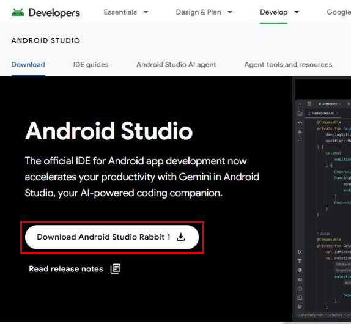

När nedladdningen är klar startar du det nedladdade programmet för att installera det på datorn. Du kan behöva godkänna/bekräfta några varningar från Windows om nedladdade appar!

Installera Android Studio genom att klicka på "Next", som på skärmbilderna nedan. Du behöver **inte** ändra några inställningar!

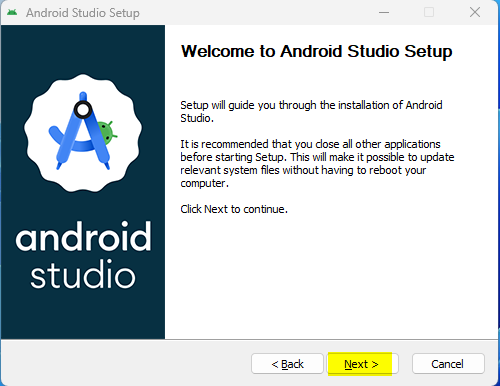

Om du vill spara hårddiskutrymme kan du avmarkera Android Virtual Device: det används inte för att bygga **AAPS**.

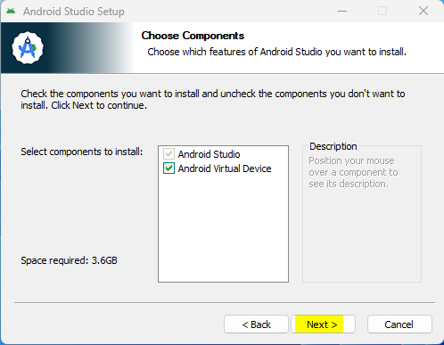


Klicka nu på "Install":


När det är klart trycker du på "Next"


I det sista steget klickar du på "Finish" för att starta Android Studio för första gången.


Du får frågan om du vill hjälpa till att förbättra Android Studio. Välj det alternativ du vill. Det påverkar inte stegen nedan.

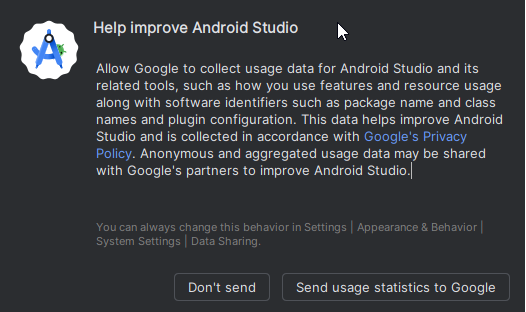

Välkomstskärmen hälsar dig välkommen till installationen av Android Studio. Tryck på "Next".


Välj "Standard" som installationstyp.


Bekräfta inställningarna genom att klicka på "Next" igen.


Nu måste du godkänna licensavtalen. Till vänster finns två avsnitt (1 + 3) som du ska välja ett i taget, och för vart och ett väljer du "Accept" (2 + 4) till höger.

Sedan kan du klicka på knappen "Finish" (5).


Nu laddas några Android-paket ned och installeras. Ha tålamod och vänta.

När det är klart visas följande skärm, där du kan välja "Finish" igen.


Nu visas välkomstskärmen i Android Studio.


(Building-APK-download-AAPS-code)=
### Ladda ned koden för AAPS

```{admonition} Why can it take a long time to download the AAPS code?
:class: dropdown

Första gången **AAPS** hämtas ansluter Android Studio via internet till webbplatsen GitHub för att hämta källkoden för **AAPS**. Det bör ta ungefär 1 minut. 

Sedan använder Android Studio **Gradle** (ett utvecklingsverktyg för Android-appar) för att ta reda på vilka andra komponenter som behövs för att bygga appen på din dator. 
```

På välkomstskärmen i Android Studio, kontrollera att "**Projects**" (1) är markerat till vänster.

Klicka sedan på "**Clone Repository**" (2) till höger:

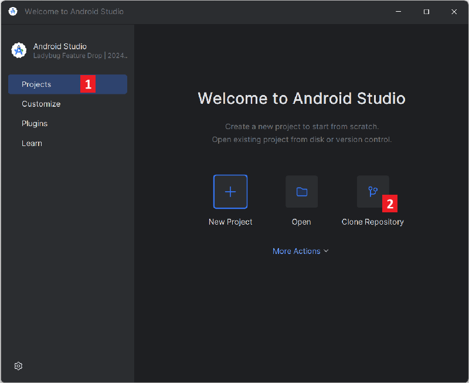

Nu talar vi om för Android Studio var koden ska hämtas från:

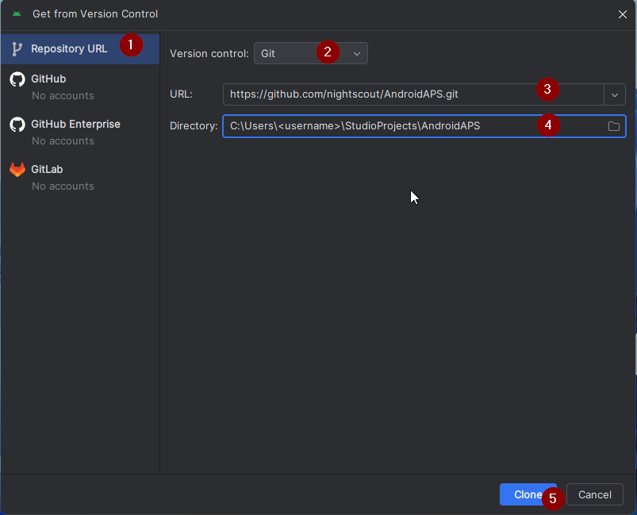

* "Repository URL" ska vara valt (som standard) till vänster (1).
* "Git" ska vara valt (som standard) som versionshantering (2).
* Kopiera nu den här URL:en:
    ```
    https://github.com/nightscout/AndroidAPS.git
    ```
    och klistra in den i textrutan URL (3).

* Kontrollera att (standard)katalogen där den klonade koden ska sparas inte redan finns på din dator (4). Du kan byta till en annan mapp, men kom ihåg var du sparade den!
* Klicka nu på knappen "Clone" (5).

```{admonition} INFORMATION
:class: note
Skriv upp katalogen. Det är där din källkod sparas!
```

Nu visas en skärm som talar om att repot klonas:


Vid något tillfälle stängs Android Studio och startar igen. Du kan få frågan om du litar på projektet. Klicka på "Trust project":

  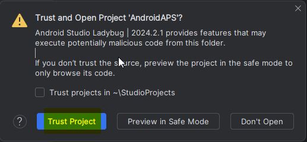


Bara för Windows-användare: om brandväggen ber om behörighet, ge åtkomst:

 

När repot har klonats öppnar Android Studio det klonade projektet.

(computerbuild-NewUI)=
```{admonition} New UI
:class: note
Android Studio har nyligen ändrat sitt gränssnitt. Nya installationer av Android Studio använder det nya gränssnittet som standard!

Bara om ditt Android Studio ser annorlunda ut kan du behöva byta till det nya gränssnittet:
Klicka på hamburgermenyn uppe till vänster och välj sedan **Settings** (eller **Preferences** på Apple-datorer).
I **Appearance & Behavior** går du till **New UI** och markerar **Enable new UI**. Starta sedan om Android Studio för att börja använda det.

Om du inte hittar alternativet **New UI**, oroa dig inte: då använder du det redan!
```


När Android Studio har öppnats, vänta tålmodigt (det kan ta några minuter), och framför allt: uppdatera **inte** projektet som föreslås i popup-fönstret.

Android Studio startar automatiskt en "Gradle project sync", som tar några minuter. Du kan se att den (fortfarande) körs:

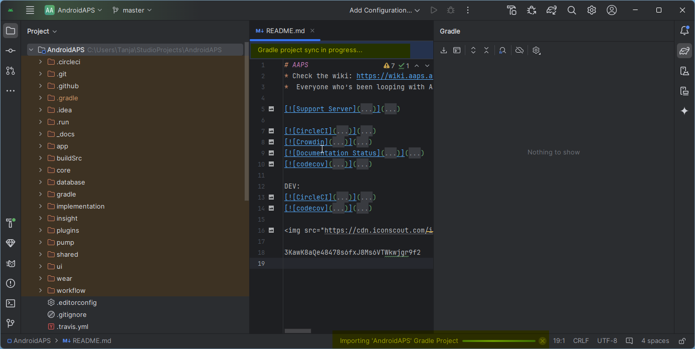

```{admonition} NEVER UPDATE GRADLE!
:class: warning

Android Studio kan rekommendera att du uppdaterar gradle-systemet. **Uppdatera aldrig gradle!** Det leder till problem.
```

Bara på Windows-datorer: Du kan få en avisering om att Windows Defender körs. Klicka på **Automatically** (automatiskt) och bekräfta – då går bygget snabbare!

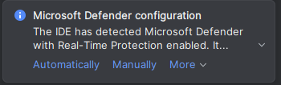


Du kan låta gradle-synkroniseringen köra och redan fortsätta med nästa steg.

(Building-APK-set-git-path-in-preferences)=
### Ange sökvägen till Git i inställningarna i Android Studio

Nu ska vi tala om för Android Studio var Git finns, som du installerade [tidigare](#install-git-if-you-dont-have-it).

* Bara för Windows-användare: Se till att du har startat om datorn efter att du [installerade Git](#install-git-if-you-dont-have-it). Om inte, starta om nu och öppna Android Studio igen

Öppna hamburgermenyn i det övre vänstra hörnet i **Android Studio** och gå till **File** > **Settings** (på Windows) eller **Android Studio** > **Preferences** (på Mac). Då öppnas följande fönster. Klicka för att fälla ut listan **Version Control** (1) och välj **Git** (2)


Kontrollera om **Android Studio** automatiskt hittar rätt **Path to Git executable** (sökväg till Git-programmet) genom att klicka på knappen "Test" (1):


Om den automatiska inställningen lyckas visas din aktuella version av **Git** bredvid sökvägen.

   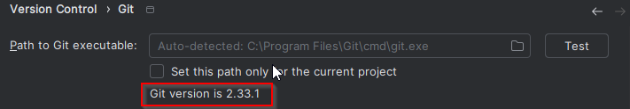


Om **git.exe** inte hittas automatiskt, eller om ett klick på "Test" ger ett fel, kan du antingen
* skriva in sökvägen som du sparade [tidigare](#BuildingAaps-steps-for-installing-git) för hand, eller
* klicka på mappikonen (1) och gå för hand till katalogen där **git.exe** installerades [tidigare](#BuildingAaps-steps-for-installing-git)
* Kontrollera dina inställningar med knappen **Test**!

  

(Building-APK-generate-signed-apk)=
### Bygg den "signerade" APK-filen för AAPS

```{admonition} Why does the AAPS app need to be "signed"?
:class: dropdown

Android kräver att varje app är _signerad_, så att den senare bara kan uppdateras från samma pålitliga källa som släppte den ursprungliga appen. Mer information om detta finns via [den här länken](https://developer.android.com/studio/publish/app-signing.html#generate-key). 

För oss betyder det bara att vi skapar en signeringsfil, en så kallad ”keystore”-fil, och använder den när vi bygger appen **AAPS**.
```


**Viktigt: Se till att gradle-synkroniseringen har slutförts utan fel innan du fortsätter!**


Klicka på hamburgermenyn uppe till vänster för att öppna menyraden. Välj **Build** (1) och välj sedan **Generate Signed App Bundle / APK** (2)

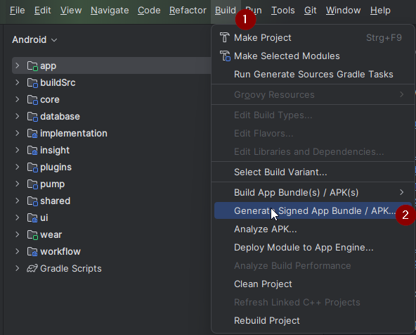

Välj "APK" (1) i stället för "Android App Bundle" och klicka på "Next" (2):


På nästa skärm, kontrollera att "Module" är inställt på "AndroidAPS.app" (1). Delen före ".app" är namnet på mappen som du klonade koden till.

(Building-APK-wearapk)=
```{admonition} INFORMATION!
:class: note
Om du vill skapa APK-filen för din klocka ska du nu välja AndroidAPS.wear!
```


Klicka på "Create new..." (2) för att börja skapa din keystore.

```{admonition} INFORMATION!
:class: note
Du behöver bara skapa din keystore en gång.
Om du har byggt AAPS tidigare ska du INTE skapa en ny keystore, utan välja din befintliga och ange dess lösenord!
```

**_Obs!_** Keystore är en fil där informationen för att signera appen sparas. Den är krypterad och informationen skyddas med lösenord.


* Klicka på symbolen "folder" (1) för att välja en plats på datorn för din keystore.

  Använd **inte** katalogen där du sparade källkoden, utan en katalog som du också skulle flytta över till en ny dator.

```{admonition} WARNING!
:class: warning
Skriv upp var din keystore är sparad. Du behöver den när du bygger nästa uppdatering av AAPS!
```

* Välj nu ett enkelt lösenord (och skriv upp det), skriv in det i lösenordsrutan (2) och bekräfta det (2).

  Lösenorden för keystore och nyckel behöver inte vara avancerade. Om du tappar bort ditt lösenord i framtiden, se [Installera om AAPS med en ny keystore](#reinstall-aaps).

```{warning}
**Undvik specialtecken i dina lösenord.** Använd bara bokstäver och siffror för lösenorden till keystore och nyckel. Använd särskilt inte `$`, backtick, `"` eller `\`. Om du senare byter till [Bygge i webbläsaren](#aaps-ci-option2) och återanvänder den här keystore, kan de här tecknen göra att signeringen misslyckas, se [Bygge i webbläsaren: felsökning](#aaps-ci-password-special-characters).
```

* Standardaliaset (3) för din nyckel är "key0". Ändra inte det.

* Nu behöver du ett lösenord för din nyckel. För att göra det enkelt kan du använda samma lösenord som för din keystore ovan, om du vill. Skriv in ett lösenord (4) och bekräfta det.

```{admonition} WARNING!
:class: warning
Skriv upp de här lösenorden! Du behöver dem när du bygger nästa uppdatering av AAPS!
```

* Giltighetstiden är 25 år som standard. Låt den vara som den är.

* Skriv in ditt förnamn och efternamn (5). Ingen annan information behöver fyllas i, men du får gärna göra det (6-7).

* Klicka på "OK" (8) för att fortsätta:


På sidan **Generate signed App Bundle or APK** visas nu sökvägen till din keystore. Skriv nu in lösenordet för Key Store (1) och lösenordet för Key (2) igen och markera rutan (3) för att komma ihåg lösenorden, så att du inte behöver skriva in dem nästa gång du bygger APK-filen (alltså när du uppdaterar till en ny version av AAPS). Klicka på "Next" (4):


På nästa skärm väljer du byggvarianten "fullRelease" (1) och klickar på "Create" (3). Kom ihåg målmappen som visas vid (2), eftersom du senare hittar din färdiga APK-fil där!

   

Android Studio bygger nu APK-filen för **AAPS**. Längst ned till höger visas "Gradle Build running" (2). Det tar en stund, beroende på din dator och internetanslutning, så **ha tålamod!** Om du vill följa hur bygget går, klicka på den lilla hammaren "build" (1) längst ned i Android Studio:


Nu kan du följa hur bygget går:


Android Studio visar meddelandet "BUILD SUCCESSFUL" när bygget är klart. Du kan få en avisering som du kan klicka på för att välja "locate". Om du missar det, klicka på aviseringsikonen (1) för att visa Notifications (aviseringar), och sedan på **locate** (2):

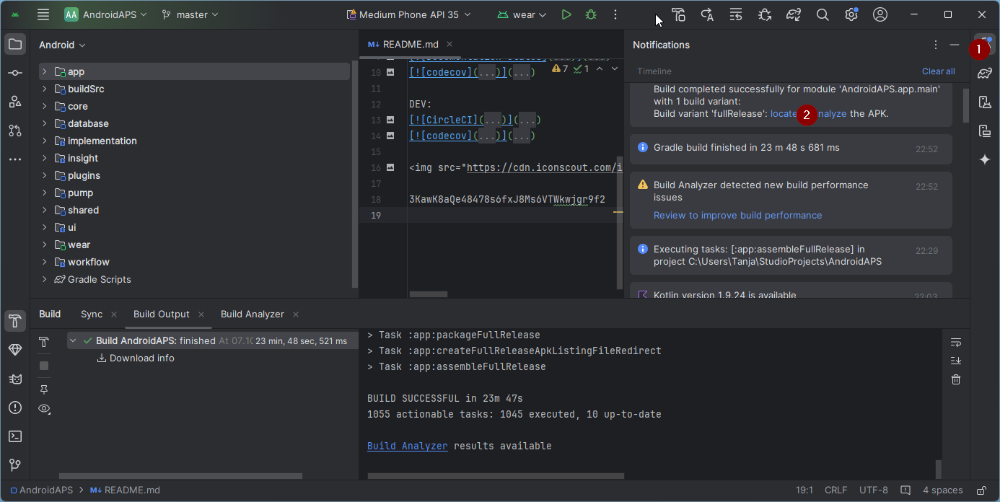

**_Om bygget inte lyckades, se avsnittet [Felsökning av Android Studio](../GettingHelp/TroubleshootingAndroidStudio.md)._**

Klicka på den blå länken "locate" i rutan Notifications:

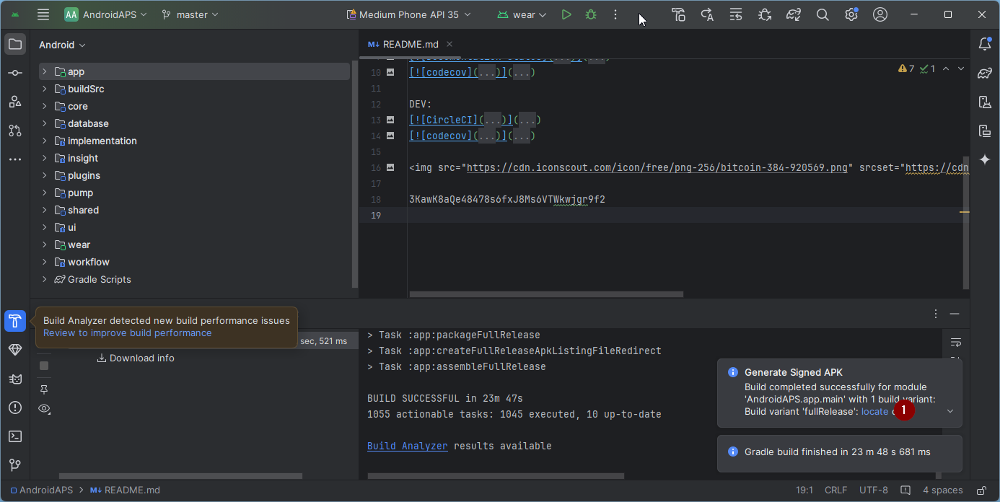 Din filhanterare öppnas och visar APK-filen som du just har byggt.

   

Grattis! Nu har du byggt APK-filen för **AAPS**. I nästa avsnitt av dokumentationen överför du filen till din smarttelefon.

```{tip}
Om du tror att du kanske vill använda en smartklocka med Android Wear i framtiden, är det här det bästa tillfället att bygga Wear-APK:n för AAPS, så att den säkert stämmer överens med din APK för AAPS.
```

Gå vidare till nästa steg: [Överföra och installera **AAPS**](../SettingUpAaps/TransferringAndInstallingAaps.md).


