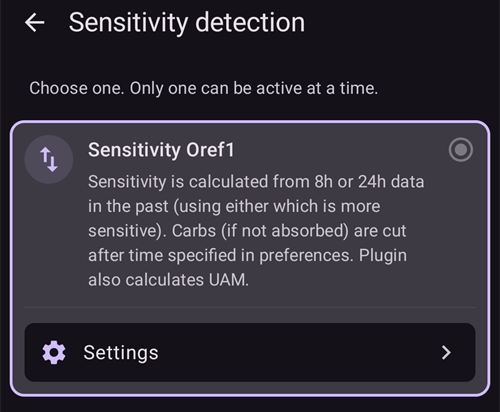
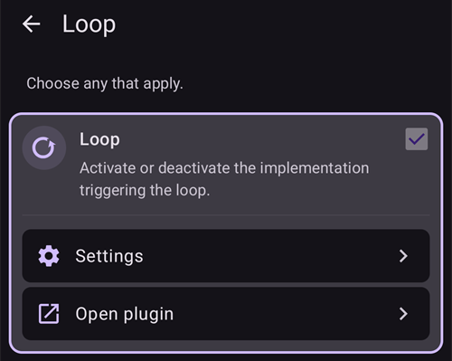

# Konfiguration (Config Builder)

```{admonition} Kommer du från AAPS v3? :class: note **Config Builder** heter nu **Konfiguration** och finns i **menyn** (☰). Se [Vad har ändrats i AAPS v4](#v4-changes).

    <br />I **Konfiguration** väljer du vilka plugins som är aktiva (CGM, pump, APS-algoritm, känslighet, synkronisering, …) och öppnar varje plugin och dess inställningar. [Genomgången](#configuration-v4) finns nedan; resten av sidan beskriver varje avsnitt i detalj.
    
    (configuration-v4)=
    ## Konfiguration i AAPS v4
    
    I **AAPS** v4 trycker du på **menyn** (☰) i det **övre vänstra** hörnet av huvudskärmen och väljer **Konfiguration** (*”Ställ in din konfiguration (CGM, pump, ...) och aktivera funktioner”*).
    
    
    
    Plugins är grupperade i **kategorier** – till exempel *Utjämning*, *Kalibrering*, *Känslighetsdetektering*, *APS*, *Kommunikation* och *Generellt*. Varje rad visar kategorins namn och det plugin som är **aktivt just nu** (t.ex. *APS → OpenAPS SMB*). Tryck på en rad för att öppna en kategori.
    
    
    
    I en kategori ser du de plugins som finns för den. I kategorier med ett enda val väljer du det aktiva pluginet. Vissa kategorier tillåter flera val (*”Välj alla som är tillämpliga”*). Varje plugin har två åtgärder:
    
    - **Öppna plugin** – öppnar pluginets egen skärm.
    - **Inställningar** – öppnar pluginets inställningar (inställningarna kan vara grupperade i utfällbara avsnitt).
    
    
    
    (configuration_sync_icon)=
    ### Mobilikonen – ”synkroniseras från huvudenheten”
    
    En liten **mobilikon (telefonikon)** bredvid en kategori eller inställning betyder att posten **synkroniseras från huvudenheten** – dess värde eller val skickas till den här enheten via kanalen NSClientV3 (Nightscout).
    
    På en **klient** (**AAPSClient**) **hålls de här posterna synkroniserade med huvudenheten**. Ikonen visas bara på en klient, så den syns inte i skärmbilden ovan, som togs i huvudappen **AAPS**. På en klient visas den oftast vid *Utjämning*, *Kalibrering*, *Känslighetsdetektering* och *APS*. Exakt hur huvudenheten och klienterna hålls i takt – och vilka inställningar du kan ändra från vilken sida – beskrivs under [Styrning huvudenhet ↔ klient](#client-master-config-prefs).
    
    Samma ikon visas också **inne i inställningarna**, bredvid de enskilda inställningar som synkroniseras. I exemplet nedan har *Absorptionsgräns* ikonen; inställningar utan ikonen ställs in per enhet:
    
    
    
    Poster **utan** ikonen ställs in **per enhet**. Det viktigaste exemplet är själva anslutningen **NSClientV3 (Kommunikation)** – **Nightscout-URL**, **åtkomsttoken** och **websockets** ställs in på varje telefon för sig, så de visar **inte** mobilikonen.
    
    ---
    
    (Config-Builder-tab-or-hamburger-menu)=
    ## Öppna en pluginskärm
    
    Varje pluginskärm öppnas på ett av dessa sätt (flikarna och ögonrutan i **AAPS** v3 finns inte längre, se [Vad har ändrats i AAPS v4](#v4-changes)):
    
    - **Konfiguration** → pluginets kategori → **Öppna plugin**,
    - panelen **Hantera** i den nedre navigeringen, för de skärmar du använder mest (Profil, Insulininställningar, Pump, Automation, Matdatabas...),
    - en [Snabbstart](../DailyLifeWithAaps/QuickLaunch.md)-knapp som du själv lägger till,
    - **sökfältet** på huvudskärmen.
    
    ```{contents}
    :backlinks: entry
    :depth: 2
    

(ConfigBuilder_Profile)=

## Profil

Den här modulen kan inte inaktiveras eftersom den är en central del av **AAPS**.

Läs [Din AAPS-profil](../SettingUpAaps/YourAapsProfile.md) för att få en grundläggande förståelse för vad som ingår i din **profil**.

(insulin)= (Config-Builder-insulin)=

## Insulin


I **AAPS** 4 är insulinet inte längre ett plugin som väljs i **Konfiguration**. Öppna **Hantera → Insulininställningar** för att ställa in det insulin du använder.

I insulinredigeraren kan du:

* ge insulinet ett namn i **Insulinets smeknamn** så att det är lätt att känna igen,
* ställa in **Topp** (tid till högsta insulinaktivitet, i minuter) och **DIA** (insulinets verkningstid, i timmar), antingen genom att skriva in värdet eller med knapparna **–** / **+**,
* trycka på en förinställningsknapp under **Ladda topp från** – **Novorapid** (75 min), **Fiasp** (55 min) eller **Lyumjev** (45 min) – för att fylla i standardtiden till topp för det insulinet i ett steg.

De tillåtna intervallen är desamma oavsett vilket insulin du använder:

* **DIA**: 5 till 9 timmar (5 till 10 timmar om patienttypen är inställd på **Gravid**). Se [Insulinets verkningstid (DIA) och topp](#Config-Builder-insulin-dia) för att välja ett värde.
* **Topp**: 35 till 120 minuter.

Kurvorna för **IOB** (aktivt insulin) och **Insulinaktivitet** längst ned i redigeraren uppdateras när du ändrar värdena, så att du direkt ser hur dina inställningar formar insulinets verkan.

Mer information om insulinprofilen som den visas i **AAPS** finns [här](#AapsScreens-insulin-profile).

(Config-Builder-insulin-change-active)=

### Byta insulinet som används (DIA eller topp)

Insulinet som är märkt **AKTIV** är det som din aktiva profil använder. Dess fält är nedtonade: du kan inte ändra eller radera det. På så sätt stämmer insulinnamnet som visas i din aktiva profil alltid med de inställningar som faktiskt används.

Så här ändrar du den DIA eller topp som du använder:

1. Öppna **Hantera → Insulininställningar**. Om skärmen öppnas skrivskyddad (en **✏️ penna** i det övre fältet), tryck på pennan och lås upp dina inställningar.
2. Tryck på **+** (*Lägg till nytt insulin*). **AAPS** skapar en kopia av insulinet som visas på skärmen.
3. Ställ in den nya **Topp** och/eller **DIA** och tryck sedan på spara-ikonen (uppe till höger).
4. Tryck på **▶** (*Aktivera insulin*) och bekräfta. Det nya insulinet blir **AKTIV**.

```{admonition} Namnet innehåller topp och DIA :class: note **AAPS** lägger automatiskt till topp, DIA och koncentration i insulinets namn (till exempel *Fiasp 55m 8h U100*), så att du snabbt kan skilja dina konfigurationer åt.

    <br />Du kan radera det gamla insulinet när det inte längre är aktivt.
    
    ### Förinställningarna ”Ladda topp från”
    
    I **AAPS** 4 finns ingen lista med insulintyper att välja mellan. Alla insuliner använder samma exponentiella aktivitetskurva; bara **Topp** och **DIA** skiljer sig. Förinställningarna under **Ladda topp från** i insulinredigeraren fyller i den rekommenderade toppen för de vanligaste insulinerna med ett tryck (den lilla ⓘ bredvid **Ladda topp från** listar dem med deras toppvärden). Du kan fortfarande justera **Topp** och **DIA** efteråt.
    
    Ändra bara toppen från det rekommenderade värdet om du förstår vilken effekt det får. [Grafen över insulinkurvan](#AapsScreens-insulin-profile) hjälper dig att förstå kurvorna.
    
    #### Novorapid
    
    
    
    * rekommenderas för Humalog, Novolog och Novorapid (hette *Rapid-Acting Oref* i **AAPS** v3)
    * Topp = 75 minuter efter injektionen
    
    #### Fiasp
    
    
    
    * rekommenderas för Fiasp (hette *Ultra-Rapid Oref* i **AAPS** v3)
    * Topp = 55 minuter efter injektionen
    
    (Config-Builder-lyumjev)=
    #### Lyumjev
    
    
    
    * rekommenderas för Lyumjev
    * Topp = 45 minuter efter injektionen
    
    #### Egen topp
    
    * Det finns ingen separat insulintyp ”Free-Peak Oref” i **AAPS** 4: ange valfri **Topp** (35 till 120 minuter) direkt i [insulinredigeraren](#Config-Builder-insulin), utan att använda en förinställning.
    * En egen topp är användbar om du använder ett insulin som inte finns i listan, eller en blandning av olika insuliner.
    
    (Config-Builder-insulin-dia)=
    ### Insulinets verkningstid (DIA) och topp
    
    ```{warning}
    När du loopar leder en kortare DIA eller en tidigare topp alltid till att mer insulin ges. DIA fungerar annorlunda i AAPS än i kommersiella AID-system, och slarviga ändringar av de här inställningarna kan ändra insulindoseringen mycket mer eller mycket mindre än väntat.
    

AAPS beskriver insulinets verkan över tid med en matematisk formel, som ställs in med **DIA** och den närliggande inställningen **topp**. DIA är den teoretiska tiden tills IOB når noll, och toppen är den tidpunkt då insulinets effekt är som starkast. Detta ger en IOB-kurva och en aktivitetskurva, som helt enkelt är **hastigheten** med vilken IOB minskar.

Tänk på att det är normalt med perioder med [tillfällig basal på noll](#Open-APS-features-super-micro-bolus-smb) när AAPS loopar. Det basalinsulin som då saknas dras helt av från IOB. Det förklarar varför IOB i praktiken når noll många timmar tidigare än den inställda DIA. Du kan se [bolus-IOB och basal-IOB](#aaps-screens-iob-cob-basal-sens) var för sig från huvudskärmen.

För att ställa in DIA och topp trycker du på **Hantera** på huvudskärmen och sedan på **Insulininställningar**. AAPS visar den aktiva insulinkonfigurationen så här:


I det här exemplet är toppen inställd på 55 minuter, DIA är 8 timmar och [insulinkoncentrationen](#Insulin-Concentration) är standardvärdet 100 IU/ml.

På grund av effekten av tillfällig basal på noll som förklaras ovan, och formeln som AAPS använder för hur IOB minskar, ställer de flesta användare in en klart längre DIA än i kommersiella system. Många tycker att en **DIA** på 9 h fungerar bra för dem. När du har mer erfarenhet av AAPS och en väl finjusterad profil kan du försöka hitta personliga inställningar för DIA och topp med hjälp av informationen nedan.

````{admonition} Detaljer om hur inställningarna för DIA och topp påverkar :class: dropdown

Eftersom basalen indirekt påverkar hur IOB minskar i AAPS, kan för hög basal dölja en för lång DIA, och tvärtom. Det är klokt att först noggrant finjustera basalen innan du justerar DIA och topp. Tänk också på att inställningarna för DIA och topp påverkar varandra: effekten av DIA beror på toppen, och tvärtom.

De här diagrammen visar exakt hur DIA och topp påverkar IOB-kurvorna, över hela intervallet av tillåtna värden.

Justera DIA:

```{image} ../images/iob_remaining_static_peak.png :width: 400px

    <br />Justera topp:
    
    ```{image} ../images/iob_remaining_static_dia.png
    :width: 400px
    

Till sist en jämförelse där DIA och topp justeras samtidigt. Tanken är att båda värdena justeras lika mycket i förhållande till sig själva, så att `49/35 ~ 7/5`. Eller på samma sätt `120/93 ~ 9/7`. Intervallen blir desamma oavsett utgångsvärdet för DIA eller topp, så länge den relativa ändringen är lika stor för båda.

```{image} ../images/iob_remaining_uniform.png :width: 400px

    <br />Observera att när DIA och topp justeras på det här sättet flyttas varje punkt på kurvan lika mycket i förhållande till sitt värde.
    
    ````
    
    #### Mer att läsa om inställning av DIA och topp
    
    * [Tekniska detaljer och historisk bakgrund från föregångaren till AAPS, OpenAPS](https://openaps.readthedocs.io/en/latest/docs/While%20You%20Wait%20For%20Gear/understanding-insulin-on-board-calculations.html#understanding-the-new-iob-curves-based-on-exponential-activity-curves).
    * [Why we are regularly wrong in the duration of insulin action (DIA) times we use, and why it matters…](https://www.diabettech.com/insulin/why-we-are-regularly-wrong-in-the-duration-of-insulin-action-dia-times-we-use-and-why-it-matters/) på Diabettech.
    * [Exponential Insulin Curves + Fiasp](https://web.archive.org/web/20220630154425/http://seemycgm.com/2017/10/21/exponential-insulin-curves-fiasp/) på See My CGM (arkiv).
    * [Revised Humalog model in a closed loop](https://bionicwookiee.com/2022/04/13/revised-humalog-model-in-a-closed-loop/) och andra artiklar på Bionic Wookie, som rekommenderar en DIA på 9 h för Lyumjev, Fiasp, NovoRapid och Humalog.
    
    (Config-Builder-bg-source)=
    ## BG-källa
    Välj den blodsockerkälla du använder. Se sidan [Kompatibla CGM-system](../Getting-Started/CompatiblesCgms.md) för mer information om inställningen.
    
    
    
    Skrolla nedåt för att se de andra källorna:
    
    
    
    
    
    * [xDrip+ BG](../CompatibleCgms/xDrip.md) – även för kompatibla appar som [Juggluco](../CompatibleCgms/Juggluco.md)
    * [NSClient BG](../CompatibleCgms/CgmNightscoutUpload.md) – bara om du vet vad du gör, se [Kompatibla CGM-system](../Getting-Started/CompatiblesCgms.md).
    * [MM640g](../CompatibleCgms/MM640g.md)
    * Glimp – bara version 4.15.57 och nyare stöds
    * [BYODA (Build Your Own Dexcom App)](#DexcomG6-if-using-g6-with-build-your-own-dexcom-app).
    * MicroTech CGM App – för Aidex / LinX CGM
    * [Poctech](../CompatibleCgms/PocTech.md)
    * Tomato (MiaoMiao) – appen Tomato för MiaoMiao-enheten
    * [Glunovo](https://infinovo.com/) – appen Glunovo för CGM-systemet Glunovo
    * Intelligo – appen Intelligo
    * Syai/Ottai – för apparna Syai och Ottai (se [Syai X1](../CompatibleCgms/SyaiTagX1.md) och [Ottai M8](../CompatibleCgms/OttaiM8.md))
    * SI App – patchad SI App eller Sibionics App för Sibionics CGM
    * Sino App – patchad app för Sinocare CGM
    * Läsare för aviseringar – läser glukosvärden från aviseringarna som visas av officiella CGM-appar (Dexcom, Medtronic, Eversense osv.)
    * Instara – appen Instara
    * Slumpmässig BG – skapar slumpmässiga BG-data för test. Den kan bara aktiveras i ett engineering-bygge (utvecklarbygge) med **Virtuell pump**, så i en vanlig **AAPS**-installation går den inte att använda.
    
    ## Utjämning
    
    
    
    Se [Utjämning av blodsockerdata](../CompatibleCgms/SmoothingBloodGlucoseData.md).
    
    ## Kalibrering
    
    Välj hur **AAPS** ska hantera värdena som kommer från din sensor:
    
    - **Ingen kalibrering**: sensorvärdena används som de är. Använd detta när sensorn redan är fabrikskalibrerad och korrekt. Detta är standardvalet.
    - **Linjär kalibrering**: **AAPS** korrigerar sensorvärdena med en lutning och en förskjutning (offset) som räknas ut från dina fingersticksmätningar.
    
    Så här använder du **Linjär kalibrering**:
    
    1. Välj **Linjär kalibrering** i kategorin **Kalibrering**.
    2. När du sätter in en ny sensor ska du logga sensorbytet: använd **Logga sensorbyte** på kalibreringsskärmen, eller registrera en insättning av CGM-sensor i Careportal. Då vet **AAPS** när sensorsessionen startade. Om **AAPS** ser ett glapp på mer än 30 minuter i mätvärdena kan den be dig att markera ett sensorbyte. Den frågan visas bara på mastern, inte på en klient.
    3. Öppna pluginet och tryck på **Lägg till kalibrering**. Ange ditt fingersticksvärde. **AAPS** parar ihop det med sensorvärdet från de senaste 10 minuterna.
    
    En kalibrering godtas bara när:
    
    - ett sensorbyte är loggat och minst **2 timmar** har gått sedan dess (uppvärmning),
    - ditt glukosvärde är stabilt. Om det ändras för snabbt visar dialogen det och anger gränsen,
    - det finns ett CGM-värde från de senaste 10 minuterna,
    - det gäller just nu. Du kan inte ange äldre fingersticksvärden.
    
    Så fungerar korrigeringen:
    
    - **AAPS** drar en rät linje genom paren för den aktuella sensorn: `corrected value = slope × sensor value + offset`.
    - Nyare par väger tyngre än äldre: ett par som är 2 dagar gammalt väger ungefär 37 %, ett par som är 4 dagar gammalt ungefär 14 %. Därför följer linjen sensorn när den driver.
    - Det krävs minst **2 par**.
    - Om paren ligger nära varandra (mindre än 54 mg/dl / 3 mmol/l från varandra) flyttas bara värdena (förskjutning, ingen lutning).
    - Lutningen hålls mellan 0,55 och 1,6. En lutning utanför detta intervall begränsas till närmaste värde.
    - Säkerhetsgräns: om korrigeringen vid 100 mg/dl (5,5 mmol/l) skulle bli mer än ±30 mg/dl (1,7 mmol/l) görs ingen korrigering. Det skyddar dig mot en felaktig mätning.
    
    Vad den ändrar:
    
    - Det korrigerade värdet används överallt: BG på huvudskärmen, grafen och loopen. Själva sensorvärdena ändras inte. Korrigeringen läggs ovanpå, även på tidigare värden från den aktuella sensorn.
    - Ett nytt sensorbyte börjar om från noll. Par från tidigare sensorer räknas inte längre.
    - I grafen visas en kalibrering som en markering vid fingersticksvärdet.
    - Kalibreringar synkroniseras via Nightscout, så att dina klienter visar samma korrigerade värden.
    
    Kontrollera och ta bort mätningar:
    
    - **Öppna plugin** visar status (till exempel *Lutning 0,85, korrektion i mellanområdet -0,4*), ett diagram med dina par och linjen, och listan med mätningar.
    - Om en mätning är fel (till exempel om du hade socker på fingret) trycker du på papperskorgsikonen bredvid den. Linjen beräknas om direkt.
    
    ```{admonition} Använder du xDrip+ som BG-källa?
    :class: note
    xDrip+ har en egen kalibrering. Kalibrera bara på ett ställe, så att sensorvärdena inte korrigeras två gånger.
    

    {admonition} Kalibrera försiktigt
    :class: warning
    Ett felaktigt fingersticksvärde ger felaktiga glukosvärden och därmed felaktig insulindosering. Tvätta händerna innan du mäter, och kalibrera inte när ditt glukosvärde ändras snabbt.


(Config-Builder-pump)=

## Pump

Välj den pump du använder. Se sidan [Kompatibla pumpar](../Getting-Started/CompatiblePumps.md) för mer information om inställningen.


Skrolla nedåt för att se alla pumpdrivrutiner:


När du väljer en annan pump ber **AAPS** dig att bekräfta bytet:


* [Dana R](../CompatiblePumps/DanaR-Insulin-Pump.md)
* Dana R Korea (för den koreanska DanaR-pumpen)
* Dana R v2 (DanaR-pump med inofficiell uppgradering av den fasta programvaran)
* [Dana-i/RS](../CompatiblePumps/DanaRS-Insulin-Pump.md)
* [Accu Chek Insight](../CompatiblePumps/Accu-Chek-Insight-Pump.md)
* [Accu Chek Combo](../CompatiblePumps/Accu-Chek-Combo-Pump-v2.md)
* Omnipod för [Omnipod Eros](../CompatiblePumps/OmnipodEros.md)
* Dash för [Omnipod DASH](../CompatiblePumps/OmnipodDASH.md)
* [Medtronic](../CompatiblePumps/MedtronicPump.md)
* [Diaconn G8](../CompatiblePumps/DiaconnG8.md)
* [EOPatch2](../CompatiblePumps/EOPatch2.md)
* [Medtrum](../CompatiblePumps/MedtrumNano.md)
* [Equil 5.3](../CompatiblePumps/Equil5.3.md)
* [Carelevo](../CompatiblePumps/CareLevo.md)
* Virtuell pump: öppen loop – **AAPS** ger bara förslag 
  * när du tar dina första steg med **AAPS**, under de första [målen](../SettingUpAaps/CompletingTheObjectives.md)
  * för en pump som ännu inte har någon drivrutin

(config-builder-wrong-pump-data)=

### Meddelande: "Data kommer från en annan pump"

**AAPS** kommer ihåg pumpen som den är ansluten till (pumptyp och serienummer). Om den tar emot data från en annan pump, till exempel efter att din pump har bytts ut mot en ny av samma modell, visar den det här meddelandet och ignorerar data från den pumpen:


För att använda den nya pumpen byter du pumpdrivrutin: välj **Virtuell pump**, bekräfta och välj sedan din pump igen. **AAPS** registrerar då pumpen som den är ansluten till nu.

(Config-Builder-sensitivity-detection)=

## Känslighetsdetektering



Välj typ av känslighetsdetektering. Mer information om de olika varianterna [finns här](../DailyLifeWithAaps/SensitivityDetectionAndCob.md). Den analyserar historiska data löpande och gör justeringar om den märker att du reagerar känsligare (eller tvärtom mer resistent) på insulin än vanligt. Mer information om hur själva känslighetskvoten räknas ut finns i [Viktiga funktioner i AAPS > Autosens](#Open-APS-features-autosens).

Du kan se din känslighet på huvudskärmen i en [extra graf](#AapsScreens-section-g-additional-graphs) genom att välja SENS% och titta på den vita linjen. Observera att du måste vara på [Mål 8](#objectives-objective8) för att känslighetsdetektering/[Autosens](#Open-APS-features-autosens) ska kunna justera mängden insulin som ges automatiskt. Innan du når det målet visas Autosens-procenten / linjen i din graf bara som information.

### Absorptionsinställningar

Om du använder Oref1 med **SMB** måste du ändra **min_5m_carbimpact** till 8. Värdet används bara när det saknas **CGM**-värden eller när fysisk aktivitet ”förbrukar” hela den blodsockerökning som annars skulle få **AAPS** att räkna ned COB. När [kolhydratupptagningen](../DailyLifeWithAaps/CobCalculation.md) inte kan räknas ut dynamiskt utifrån hur ditt blodsocker reagerar, används en standardnedräkning av dina kolhydrater. Det är alltså en säkerhetsspärr.

(Config-Builder-aps)=

## APS


Välj vilken APS-algoritm som ska användas för att justera behandlingen. Du kan se aktuella detaljer för den valda algoritmen med **Öppna plugin**.

* OpenAPS AMA 
  * Advanced Meal Assist: äldre algoritm som inte längre rekommenderas.
  * Enkelt uttryckt är fördelen att systemet efter en måltidsbolus snabbare kan ge en hög tillfällig basal, OM du anger kolhydraterna på ett pålitligt sätt.
* [OpenAPS SMB](#Open-APS-features-super-micro-bolus-smb) 
  * Super Micro Bolus: den senaste algoritmen, rekommenderas för alla användare.
  * Till skillnad från AMA använder SMB inte i första hand tillfälliga basaler för att styra glukosnivån, utan främst små **supermikrobolusar** (Super Micro Boluses).
  * Obs! Vi rekommenderar att du använder den här algoritmen från början, även om du inte får några SMB:er förrän du når [Mål 9](#objectives-objective9).
* [Auto ISF](#Open-APS-features-auto-isf) 
  * Experimentell algoritm för avancerade användare. Den visas bara i listan när målen är slutförda.

Om du byter från algoritmen AMA till SMB måste *min_5m_carbimpact* ändras manuellt till **8** (standardvärdet för SMB) i [Inställningar → Absorptionsinställningar](#Preferences-min_5m_carbimpact).

## Loop

Den här modulen kan inte inaktiveras eftersom den är en central del av **AAPS**.



## Begränsningar


### Mål

**AAPS** har ett utbildningsprogram (en serie mål) som du måste klara steg för steg. Det ska leda dig säkert genom inställningen av ett system med sluten loop.

Se sidan [Mål](../SettingUpAaps/CompletingTheObjectives.md) för mer information.

## Kommunikation

I den här kategorin (som hette **Synkronisering** i **AAPS** v3) väljer du om och vart **AAPS** ska skicka dina data.


Skrolla nedåt för att se resten av listan:


### NSClientV3

Kan användas som [rapportserver](../SettingUpAaps/SettingUpTheReportingServer.md) och/eller för [fjärrövervakning](../RemoteFeatures/RemoteMonitoring.md) och [fjärrstyrning](../RemoteFeatures/RemoteControl.md).

Se [Synkronisering med rapportservern](#SetupWizard-synchronization-with-the-reporting-server-and-more) för att ställa in synkronisering med NSClientV3.

### Tidepool

Kan användas som [rapportserver](../SettingUpAaps/SettingUpTheReportingServer.md).

Se [Tidepool](../SettingUpAaps/Tidepool.md).

### xDrip

Används för att **skicka** data som glukosvärden och behandlingar till xDrip+ på samma telefon. I dess inställningar finns också **Skicka status till xDrip+**, en statusrad med IOB och COB som xDrip+ och vissa hjälpappar för klockor visar.

### Open Humans

Se [Open Humans](../SupportingAaps/OpenHumans.md).

(Config-Builder-wear)=

### Klocka (Wear)

Övervaka och styr **AAPS** från en klocka med Wear OS. Hur du ställer in klockan förklaras på [Smartklocka med Wear OS](../WearOS/WearOsSmartwatch.md). När du har aktiverat pluginet väljer du dess alternativ i [Inställningar > Klocka (Wear)](#preferences-wear). Hur du använder klockan förklaras på [Styra AAPS från din smartklocka med Wear OS](../RemoteFeatures/RemoteControlWearOS.md).

(external-companion-apps)=

### Externa hjälpappar

Sänder ut statusdata från **AAPS** på telefonen så att andra appar som är installerade där kan visa dem – till exempel hjälpappar för klockor eller widgets. Sändningen innehåller glukosvärde och trend, IOB, COB, basal och tillfällig basal, profilnamn, loopstatus, telefonens och pumpens batteri, reservoarnivå och bolusförlopp. Aktivera det bara om en hjälpapp som du använder behöver de här data.

Appar som vi vet läser den här sändningen är [WatchDrip+](https://bigdigital.home.blog/) (klockor från Xiaomi och Amazfit), [GlucoDataHandler](https://github.com/pachi81/GlucoDataHandler) (komplikationer och widgets för Wear OS, och Android Auto via GlucoDataAuto) och appen G-Watch. Hur de ställs in beskrivs på [Smartklockor och AAPS](#watches-external-companion-apps). Några av dem använder också **Skicka status till xDrip+** från pluginet **xDrip** ovan för en statusrad med IOB och COB.

I tidigare versioner hette det här pluginet **Samsung Tizen**, efter [appen G-Watch för Samsung Tizen-klockor](#Watchfaces-tizen) som det först gjordes för.

### Garmin

Anslutning till en Garmin-enhet (Fenix, Edge...)

## Treatments

Öppna **menyn** (☰) och välj [Behandlingshistorik](#aaps-screens-treatments) för att se de behandlingar som har loggats. Om du vill ändra eller radera en post (t.ex. om du åt mindre kolhydrater än du trodde) väljer du 'Ta bort' och anger det nya värdet (ändra tiden om det behövs) via **Behandlingar → Kolhydrater** i den nedre navigeringen (se [Kolhydrater](#screens-bolus-carbs)).

## Allmänt

I **AAPS** 4 listar kategorin **Generellt** i **Konfiguration** bara **Autotune**. De andra funktionerna som beskrivs nedan finns alltid och behöver inte längre aktiveras här; varje stycke talar om var du hittar dem.


### Overview

[Huvudskärmen](#AapsScreens-the-homescreen) i **AAPS** är inte längre ett plugin och har inga egna inställningar i **Konfiguration**. Alternativen som tidigare fanns här finns nu i **Inställningar** (kugghjulsikonen): [Visa anteckningar i dialogrutor](#Preferences-show-notes-field-in-treatments-dialogs), [Statuslampor](#Preferences-status-lights) och [Bolusprocent](#Preferences-deliver-this-part-of-bolus-wizard-result) som används av kalkylatorn. Superbolus-alternativet i **AAPS** 3.x är [inte tillgängligt som inställning](#Preferences-advanced-settings-overview) i **AAPS** 4.

(Config-Builder-actions)=

### Actions

Fliken Åtgärder i **AAPS** 3.x finns inte längre. Dess knappar finns nu i panelen **Hantera** – se [Vart tog fliken Åtgärder vägen?](#screens-action-tab).

### Automation

Med **Hantera → Automation** hanterar du dina [automatiseringar](../DailyLifeWithAaps/Automations.md), från och med [Mål 10](#objectives-objective10).

(Config-Builder-sms-communicator)=

### SMS-kommunikation

Gör det möjligt för anhöriga att på distans styra vissa funktioner i **AAPS** via SMS. Se [SMS-kommandon](../RemoteFeatures/SMSCommands.md) för mer information om inställningen.

### Matdatabas

**Hantera → Matdatabas** visar de förinställda livsmedlen som är definierade i matdatabasen i Nightscout, se [Nightscout Readme](https://github.com/nightscout/cgm-remote-monitor#food-custom-foods) för mer information om inställningen.

Obs! Posterna kan inte användas i kalkylatorn i **AAPS**. (Endast visning)

(Config-Builder-autotune)=

### Autotune

Du kan aktivera Autotune, se [här](../AdvancedOptions/Autotune.md).

### Underhåll

Öppna **menyn** (☰) och välj **Underhåll** för att exportera / importera inställningar och hantera loggfiler.


### Config Builder

Heter nu **Konfiguration**: den här sidan.