# Settings

I **AAPS** v4 finns inställningarna på skärmen **Inställningar**. Det finns tre vägar dit – se [Ändra konfigurationen i AAPS](../SettingUpAaps/ChangeAapsConfiguration.md) för mer information:

1. Tryck på ikonen **Inställningar** (kugghjulet) i det övre högra hörnet av huvudskärmen: alla inställningar, grupperade i utfällbara avsnitt.
2. I **Konfiguration** trycker du på "**Inställningar**" under ett aktivt plugin: bara inställningarna för det pluginet.
3. Använd **sökfältet** högst upp på huvudskärmen: börja bara skriva en del av texten som du letar efter. Då hittar du enskilda inställningar (även sådana som inte syns på skärmen Inställningar), dialogrutor och dokumentation.


- **Avsnitten** öppnas och stängs när du trycker på dem. Vilka avsnitt du ser beror på vilka plugins du har aktiverat och på [Enkelt läge](#preferences-simple-mode).


```{contents}
:backlinks: entry
:depth: 2
```

(Preferences-general)=
## Allmänt


**Enheter**

- Ställ in enheten till mmol/l eller mg/dl, beroende på vad du föredrar.

**Språk**

- Som standard följer **AAPS** telefonens språk (rekommenderas).

- Om du vill ha **AAPS** på ett annat språk än telefonen väljer du det här. På Android 13 och nyare registrerar **AAPS** det som sitt eget appspråk i Android, så att alla dess skärmar, huvudskärmen, widgetarna och sättet att skriva tal följer det.

- När du byter språk visas texterna i **AAPS** direkt på det nya språket. Om vissa texter fortfarande visas på det gamla språket startar du om **AAPS**.
- På Android 12 visas inte den här inställningen: **AAPS** använder alltid telefonens språk.
- Inställningen är dold i [enkelt läge](#preferences-simple-mode).

(preferences-simple-mode)= **Enkelt läge**

**Enkelt läge** är aktiverat som standard när du installerar **AAPS** första gången. I **enkelt läge** är många inställningar dolda och ersatta av förinställda värden. Du bör stänga av Enkelt läge när du har blivit van vid gränssnittet och inställningarna i **AAPS**.

**Stöd för insulinkoncentration**

- Aktiverar stöd för olika insulinkoncentrationer (U50, U200, ...). Aktivera detta bara om du verkligen använder en annan koncentration än U100, och läs varningarna noga.
- Inställningen är dold i [enkelt läge](#preferences-simple-mode).

**Håll skärmen påslagen**

- Gör att Android alltid håller skärmen påslagen. Det är användbart till exempel vid presentationer. Men det drar mycket batteri. Därför rekommenderar vi att du ansluter telefonen till en laddare.

**Instansnamn**

- Namnet på personen som använder den här telefonen. Det skiljer den här **AAPS**-instansen från andra i rapporter och vid synkronisering, till exempel om två barn med typ 1-diabetes i din familj använder **AAPS**.
- Används i namnen på exporterade inställningsfiler.
- Visas på [urtavlan Dual](../WearOS/WearOsSmartwatch.md).

(Preferences-skin)=
### Skal (skin)

Valet av skal från **AAPS** 3.x (Original, Low resolution, Large display ...) finns inte längre i **AAPS** 4. Det nya gränssnittet anpassar sig automatiskt till din skärm, och färgschemat kan du ändra under [Utseende](#preferences-appearance).

(preferences-appearance)=
## Utseende


(Preferences-range-for-visualization)=
### Gränsvärden för visualisering

Välj de övre och nedre gränserna för BG-grafen på huvudskärmen i **AAPS** och på smartklockan. Det gäller bara visningen, inte målområdet för ditt BG. Exempel: 70 - 180 mg/dl eller 3,9 - 10 mmol/l

(Preferences-show-notes-field-in-treatments-dialogs)=
### Visa anteckningar i dialogrutor

Ger dig möjlighet att lägga till korta anteckningar till dina behandlingar (kalkylator, kolhydrater, insulin ...)

Inställningen är dold i [enkelt läge](#preferences-simple-mode).

### Appens färgschema

Välj mellan ljust tema, mörkt tema eller att följa telefonens systeminställning.

(Preferences-protection)=
## Skydd


(Preferences-master-password)=
### Huvudlösenord

Krävs för att du ska kunna [exportera inställningar](../Maintenance/ExportImportSettings.md), eftersom de krypteras från och med version 2.7.

If you forgot your master password, see [How to reset the master password?](#FAQ-reset-master-password)

**Biometriskt skydd kanske inte fungerar på OnePlus-telefoner. Detta är ett känt problem hos OnePlus på vissa telefoner.**

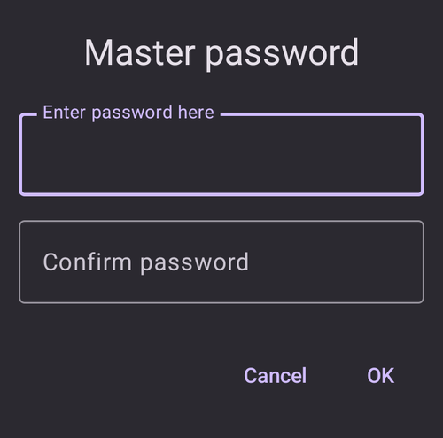

(Preferences-settings-protection)=
### Skydd för inställningar

- Skydda dina inställningar med ett lösenord eller med telefonens biometriska autentisering (t.ex. om [ett barn använder **AAPS**](../RemoteFeatures/RemoteMonitoring.md)). Om du aktiverar den här funktionen måste du autentisera dig varje gång du vill öppna en vy som har med inställningar att göra.

- Hanteringsskärmarna (**Profil**, **Insulininställningar**, **Tillfälligt målvärde**, **Snabbknappar**) öppnas då **skrivskyddade**. Du kan fortfarande aktivera eller använda en post, men att lägga till, redigera, klona och radera är dolt tills du låser upp dina inställningar. Se [Skydd för inställningar låser nu också hanteringsskärmarna](#v4changes-read-only-management).

- Ett eget lösenord ska användas om du vill använda huvudlösenordet bara för att skydda [exporterade inställningar](../Maintenance/ExportImportSettings.md), och ett annat lösenord för att ändra inställningarna.

- Om du använder ett eget lösenord trycker du på raden "Lösenord för inställningar" för att ställa in lösenordet så som beskrivs [ovan](#Preferences-master-password).

### Skydd för app

Om appen är skyddad måste du ange lösenordet eller använda telefonens biometriska autentisering för att öppna **AAPS**, och igen när du går tillbaka till appen efter att [tidsgränsen för skydd](#Preferences-password-and-pin-retention) har gått ut.

**AAPS** stängs direkt om fel lösenord anges – men fortsätter att köra i bakgrunden om appen tidigare har öppnats med rätt lösenord.

### Bolusskydd

- Bolusskydd kan vara användbart om **AAPS** används av ett litet barn och du [ger bolus via SMS](../RemoteFeatures/SMSCommands.md).

- **Bolusskydd** kan bara väljas när **Skydd för inställningar** (nivå 2) är inställt.

- I exemplet nedan använder bolusskyddet **Huvudlösenord**: **AAPS** frågar efter det innan en behandlingsdialog som **Insulin** öppnas. Med **Biometrisk** kan du ange huvudlösenordet i stället om den biometriska autentiseringen inte fungerar.


(Preferences-password-and-pin-retention)=
### Lösenord och PIN-lagring

**Tidsgräns för skydd** anger hur länge (i sekunder) inställningarna eller bolusfunktionerna förblir upplåsta efter att du har angett rätt lösenord.

## Behandlingssäkerhet


(preferences-patient-type)=
### Personens ålder

- Säkerhetsgränserna ställs in utifrån den ålder som du väljer i den här inställningen.
- Om du ofta når dessa fasta gränser (som maximal bolus) är det dags att gå upp ett steg.
- Det är en dålig idé att välja en högre ålder än den verkliga, eftersom det kan leda till överdosering om du anger fel värde i dialogrutan för insulin (till exempel om du missar decimaltecknet).
- Om du vill veta de exakta värdena för dessa fasta säkerhetsgränser kan du scrolla till den algoritmfunktion som du använder på [den här sidan](../DailyLifeWithAaps/KeyAapsFeatures.md).

(Preferences-maximum-bolus)=
### Maximal bolus

- Anger den största mängd bolusinsulin, i insulinenheter, som **AAPS** får ge på en gång.
- Den här inställningen finns som en säkerhetsgräns för att förhindra att en mycket stor bolus ges på grund av en felinmatning eller ett misstag av användaren.
- Vi rekommenderar att du ställer in ett rimligt värde som ungefär motsvarar den största mängd bolusinsulin som du någonsin troligen behöver för en måltid eller en korrektionsdos.
- Den här begränsningen gäller också för resultaten från kalkylatorn.

### Maximalt antal kolhydrater tillåtna

- Anger den största mängd kolhydrater, i gram, som kalkylatorn i **AAPS** får beräkna en dos för.
- Den här inställningen finns som en säkerhetsgräns för att förhindra att en mycket stor bolus ges på grund av en felinmatning eller ett misstag av användaren.
- Vi rekommenderar att du ställer in ett rimligt värde som ungefär motsvarar den största mängd kolhydrater som du någonsin troligen behöver för en måltid.

## BG-källa

Inställningarna för den [BG-källa](#Config-Builder-bg-source) som du har valt visas som ett eget avsnitt. Till exempel med **xDrip+ BG**:

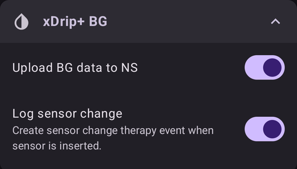

- **Ladda upp BG-data till NS**: låt **AAPS** ladda upp de mottagna BG-värdena till Nightscout. Aktivera detta bara om CGM-appen inte redan laddar upp dem själv.
- **Logga sensorbyte**: skapa automatiskt en behandlingshändelse för sensorbyte när sensorn sätts in.

## Huvudskärmen

I **AAPS** 3.x var dessa inställningar samlade i ett avsnitt som hette "Overview" (Översikt). I **AAPS** 4 ställer du in dem direkt från de delar av huvudskärmen som de hör till.

(Preferences-buttons)=
### Knappar i Snabbstart

Ange vilka åtgärdsknappar som ska synas på huvudskärmen: tryck på det lilla **kugghjulet** längst ner i mitten av huvudskärmen ("Konfigurera Snabbstart") och **Lägg till** de åtgärder som du vill nå snabbt (behandlingar, CGM-åtgärder, Careportal-poster ...).


(Preferences-quick-wizard)=
### Snabbknapp

Skapa egna knappar för vissa vanliga måltider eller mellanmål, som visas på huvudskärmen. Användbart för vanliga måltider som du äter ofta.

För varje knapp anger du kolhydraterna och hur bolusen ska beräknas. Sedan anger du under vilken tidsperiod knappen ska synas på huvudskärmen – bara en knapp per period. Knappen visas inte utanför det angivna tidsintervallet, eller om du har tillräckligt med IOB för att täcka kolhydraterna som är angivna i snabbknappen. Om du anger olika tider för de olika måltiderna har du alltid rätt knapp för en vanlig måltid på huvudskärmen, beroende på tiden på dygnet.

För att hantera dina snabbknappar skriver du "snabbknapp" i sökfältet på huvudskärmen och öppnar **Snabbknappar - Hantera snabbknappar**.

Om du trycker på snabbknappen beräknar **AAPS** en bolus för dessa kolhydrater och föreslår den, utifrån dina aktuella kvoter (med hänsyn till blodsockervärdet eller aktivt insulin, om det är inställt).

Förslaget måste bekräftas innan insulinet ges.

(Preferences-default-temp-targets)=
### Förinställda tillfälliga målvärden

Med [tillfälliga målvärden (TT)](../DailyLifeWithAaps/TempTargets.md) kan du ändra ditt målvärde för blodsocker under en viss tid. När du ställer in förinställda tillfälliga målvärden kan du enkelt ändra ditt målvärde för träning, äta snart osv.

Tryck på **målområdet** på huvudskärmen för att öppna skärmen **Tillfälligt målvärde**. Svep genom korten med förinställningar (Äta snart, Träning, Hypo) och ändra målvärdet och varaktigheten för varje förinställning under **Förinställda inställningar**. De förinställda värdena är:

* Äta snart: målvärde 90 mg/dl / 5,0 mmol/l, varaktighet 45 min
* Träning: målvärde 140 mg/dl / 7,8 mmol/l, varaktighet 90 min
* Hypo: målvärde 160 mg/dl / 8,9 mmol/l, varaktighet 60 min


Läs här hur du [aktiverar tillfälliga målvärden](#TempTargets-where-can-i-select-a-temp-target).

### Standardmängder insulin för förfyllning

Om du vill fylla slangen eller förfylla kanylen via **AAPS** kan du göra det med knapparna för **Förfyllning** i den utfällda statuspanelen på huvudskärmen.

Standardmängderna för de tre fyllningsknapparna kan du ställa in i inställningarna för **Förfyllning**, beroende på hur lång din slang är. Skriv "förfyll" i sökfältet på huvudskärmen för att öppna dem.

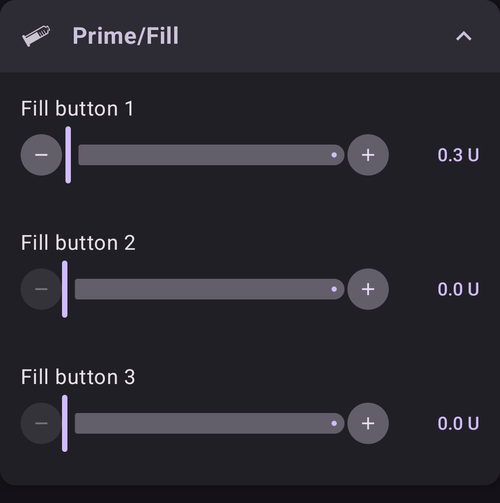

(Preferences-status-lights)=
### Statuslampor

Statuslamporna ger en visuell varning för:

- Sensorålder
- Insulinålder (antal dagar som reservoaren har använts)
- Reservoarnivå (enheter)
- Kanylålder
- Pumpbatteriets ålder
- Pumpbatterinivå (%)

Om varningströskeln överskrids visas värdena i gult. Om den kritiska tröskeln överskrids visas värdena i rött.

För att ändra tröskelvärdena fäller du ut statuspanelen på huvudskärmen (vinkelpilen till höger på statusraden) och trycker på den lilla ikonen **Inställningar** bredvid "Status":


Tryck på en rad (**Kanyl**, **Insulin**, **Sensor** eller **Pumpbatteri**) för att öppna dess tröskelvärden för varning och kritisk nivå:


Med det sista alternativet kan du importera dessa inställningar från Nightscout, om de är angivna där. Se [Nightscout-dokumentationen](https://nightscout.github.io/nightscout/setup_variables/#age-pills) för mer information.

(Preferences-deliver-this-part-of-bolus-wizard-result)=
### Kalkylatorinställningar

Skriv "bolus" i sökfältet på huvudskärmen för att öppna inställningarna för **Kalkylator**:


**Bolusprocent** anger den [förinställda procentandelen](#AapsScreens-section-j) av bolusen som beräknas när du använder kalkylatorn.

Standard är 100 %: ingen korrigering. Även om du ställer in ett annat värde här kan du fortfarande ändra det varje gång du använder kalkylatorn. Om den här inställningen är 75 % och du skulle behöva en bolus på 10 U, föreslår kalkylatorn en måltidsbolus på bara 7,5 enheter.

När de använder [SMB](#objectives-objective9) ger många personer inte 100 % av det insulin som behövs som måltidsbolus, utan bara en del av det (t.ex. 75 %), och låter SMB med UAM (Unattended Meal Detection) sköta resten. Ett värde under 100 % här kan vara användbart:
* för personer med långsam matsmältning: om hela bolusen ges direkt kan det leda till hypo, eftersom insulinet verkar snabbare än maten smälts.
* för att ge **AAPS** mer utrymme att själv hantera en **BG-stigning**. I båda fallen kompenserar **AAPS** för den del av bolusen som saknas med SMB:er, om och när det bedöms lämpligt.

**Använd bolusguide**

När detta är aktiverat och du använder kalkylatorn när du har högt blodsocker, får du en varning som frågar om du vill ge en förbolus och äta senare, när ditt **BG** är tillbaka inom målområdet.

(Preferences-advanced-settings-overview)=
### Superbolus

Alternativet Superbolus från **AAPS** 3.x finns inte som inställning i **AAPS** 4.

## Loop

Se [AAPS-skärmar > Huvudskärmen > Loopstatus](#AapsScreens-loop-status) för hur du byter loopläge nu.

(Preferences-minimal-request-change)=
### Minsta ändring i öppen loop

När du använder **Öppen loop** får du en avisering varje gång **AAPS** rekommenderar en ändring av basaldosen. För att minska antalet aviseringar kan du antingen använda ett [bredare målområde för BG](#profile-glucose-targets) eller öka procentvärdet i inställningen "**Minsta ändring i öppen loop**". Detta anger hur stor relativ ändring som krävs för att en avisering ska visas.


## Advanced Meal Assist (AMA) eller supermikrobolus (SMB)

Beroende på dina inställningar i [Konfiguration > APS](../SettingUpAaps/ConfigBuilder.md) kan du välja mellan två algoritmer:

- [Advanced meal assist (OpenAPS AMA)](#Open-APS-features-advanced-meal-assist-ama) – algoritmens läge år 2017
- [Supermikrobolus (OpenAPS SMB)](#Open-APS-features-super-micro-bolus-smb) – den senaste algoritmen, rekommenderas för nybörjare

Från och med [**AAPS** version 3.3](#version3300) har funktionen [Dynamisk ISF](../DailyLifeWithAaps/DynamicISF.md) flyttats in i OpenAPS SMB.

### OpenAPS AMA

Alla inställningar för OpenAPS AMA beskrivs i avsnittet [Viktiga funktioner i AAPS > Advanced Meal Assist (AMA)](#Open-APS-features-advanced-meal-assist-ama).

(Preferences-openaps-smb-settings)=
### OpenAPS SMB

Alla inställningar för OpenAPS SMB beskrivs i avsnittet [Viktiga funktioner i AAPS > Supermikrobolus (SMB)](#Open-APS-features-super-micro-bolus-smb).

Vilka inställningar du ser beror på hur långt du har kommit med [Mål](../SettingUpAaps/CompletingTheObjectives.md) och på [Enkelt läge](#preferences-simple-mode). Vid en ny installation visas bara **Använd dynamisk känslighet**. När målen är slutförda ser avsnittet ut så här:


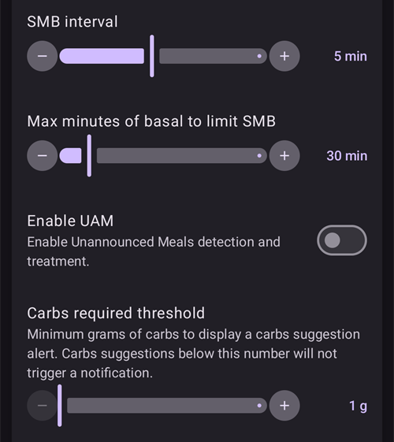

**Avancerade inställningar** längst ner i avsnittet innehåller värden som du normalt inte behöver ändra:


## Absorptionsinställningar


(Preferences-min_5m_carbimpact)=
### SMB KH-absorption per 5 min (min_5m_carbimpact)

Inställningen är dold i [enkelt läge](#preferences-simple-mode).

Algoritmen använder BGI (blodglukospåverkan) för att avgöra när [kolhydraterna tas upp](../DailyLifeWithAaps/CobCalculation.md).

När kolhydratabsorptionen inte kan beräknas dynamiskt utifrån hur ditt blodsocker reagerar, använder **AAPS** en förinställd minskning av dina kolhydrater. Det är alltså en säkerhetsspärr. Det här värdet används bara när det saknas **CGM**-värden, eller när fysisk aktivitet "förbrukar" hela den blodsockerstigning som annars skulle få **AAPS** att minska COB.

Enkelt uttryckt: Algoritmen "vet" hur ditt BG *borde* bete sig när det påverkas av den aktuella insulindosen osv. När det finns en positiv avvikelse från det förväntade förloppet har en del kolhydrater tagits upp eller minskat. Stor ändring = mycket kolhydrater osv.

min_5m_carbimpact anger den förinställda påverkan från kolhydratabsorptionen per 5 minuter. En fullständig beskrivning av parametrarna finns i [OpenAPS-dokumentationen om inställningar och säkerhetsinställningar](https://openaps.readthedocs.io/en/latest/docs/While%20You%20Wait%20For%20Gear/preferences-and-safety-settings.html?highlight=carbimpact#min-5m-carbimpact).

Standardvärdet för AMA är 3, för SMB är det 8.

COB-grafen på huvudskärmen visar när min_5m_carbimpact används genom att sätta orange punkter längs toppen av COB-kurvan.


### Absorptionsgräns

Tiden efter vilken en måltid räknas som helt upptagen; kolhydrater som är kvar tas bort. Om du ofta äter måltider med mycket fett eller protein behöver du öka absorptionstiden för måltider.

### Avancerade inställningar – autosens-kvot

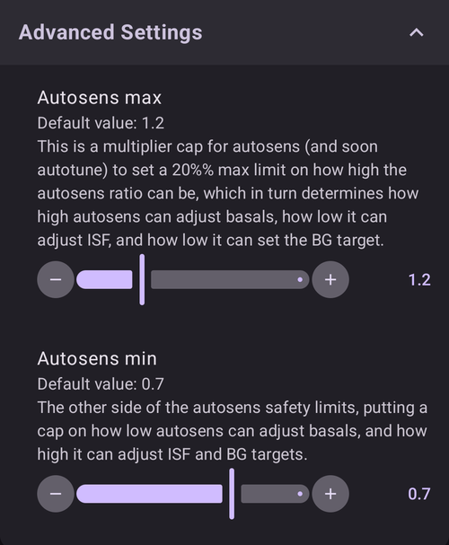

- Ange min- och maxvärde för [autosens](#Open-APS-features-autosens)-kvoten.
- Normalt ska standardvärdena (max. 1,2 och min. 0,7) inte ändras.

## Pump


### BT Watchdog

Aktivera BT Watchdog vid behov (t.ex. för Dana-pumpar). Den stänger av Bluetooth i en sekund om det inte går att ansluta till pumpen. Det kan hjälpa på vissa telefoner där Bluetooth-stacken fryser.

## Pumpinställningar

Alternativen här beror på vilken pumpdrivrutin du har valt i [Konfiguration > Pump](#Config-Builder-pump). Parkoppla och ställ in din pump enligt [instruktionerna för din pump](../Getting-Started/CompatiblePumps.md).

Till exempel med **Virtuell pump** heter avsnittet **Inställningar för Virtuell pump**. Du väljer vilken **Pumptyp** den virtuella pumpen ska efterlikna, och om dess status ska laddas upp till Nightscout:


## Tidepool

Mer information finns på sidan [Tidepool](../SettingUpAaps/Tidepool.md).

(Preferences-nsclient)=
## NSClientV3

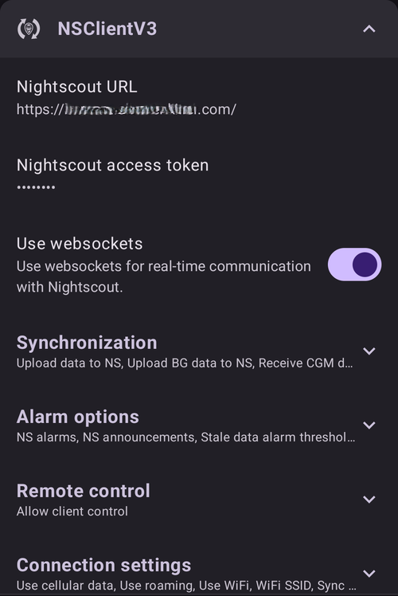

Pluginet NSClient (visas som **NSClientV3** i konfigurationsmenyn) synkroniserar dina data med Nightscout. Det använder Nightscout API v3.

```{admonition} Data uploaders
:class: warning

När du använder NSClientV3 måste alla uppladdare använda Nightscout API v3. Om en annan uppladdare (till exempel din CGM-app) inte stöder API v3, **låt AAPS ladda upp alla data** (BG, behandlingar, ...) till Nightscout och stäng av den uppladdaren.
```

- Ange din *Nightscout-URL* (t.ex. <https://yoursitename.yourplatform.dom>).
- **Se till att URL:en INTE har /api/v1/ i slutet.**
- Skapa en *[administratörstoken](https://nightscout.github.io/nightscout/security/#create-a-token)* i Nightscout (kräver [Nightscout 15](https://nightscout.github.io/update/update/) för att använda V3 API) och ange den i **Nightscout åtkomsttoken** (inte din API-hemlighet!). I **AAPSClient** kan du i stället skanna huvudtelefonens QR-kod, vilket ger klienten en egen token. En klient som parkopplas med PIN-kod får sin egen token från huvudtelefonen efter parkopplingen. Se [Klientens egen Nightscout-token](#client-master-control-own-token).
- Detta gör att data kan läsas och skrivas mellan Nightscout-webbplatsen och **AAPS**.
- Kontrollera noga att det inte finns några skrivfel här om du har fastnat på Mål 1.
- Leave "Use websockets" enabled (recommended). Websockets are **mandatory** for remote control from **AAPSClient**, on both phones.

(Preferences-nsclient-synchronization)=
### Synkronisering

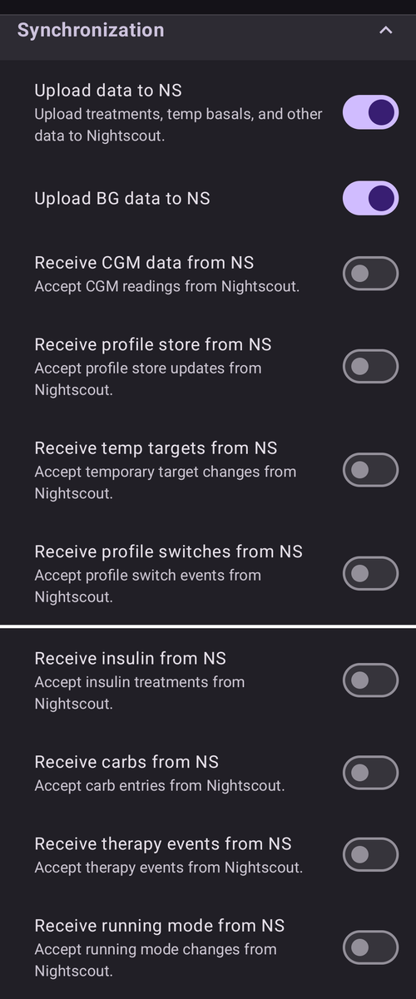

Vilka synkroniseringsval du gör beror på hur du vill använda **AAPS**.

Du kan välja vilka data som du vill [ladda upp till och hämta från Nightscout](#Nightscout-aaps-settings).

När klientstyrning är på (alltid i Enkelt läge) är dessa inställningar dolda: **AAPS** är då i [härdat läge](#client-master-control-hardened-mode), tar inte emot ändringar som görs direkt i Nightscout och laddar upp alla sina data.

### Larminställningar


- Med larminställningarna kan du välja vilka Nightscout-larm som appen ska använda. **AAPS** larmar när ett Nightscout-larm utlöses.
- För att larmen ska ljuda måste du ställa in larmvärdena Urgent High, High, Low och Urgent Low i dina [Nightscout-variabler](https://nightscout.github.io/nightscout/setup_variables/#alarms).
- De fungerar bara när du har anslutning till Nightscout och är avsedda för föräldrar och anhöriga.
- Om du har **CGM**-källan på din telefon (t.ex. xDrip eller BYODA) ska du använda de larmen i stället för Nightscout-larmen.
- NS-notiser visar [meddelanden](https://nightscout.github.io/nightscout/discover/#announcement) från Nightscout bland aviseringarna i **AAPS**.
- Du kan ändra tröskelvärdena för larmen om inaktuell data och akut inaktuell data, som ljuder när inga data har kommit från Nightscout under en viss tid.

### Fjärrstyrning

Brytaren "**Tillåt klientstyrning**" finns inte längre bland dessa inställningar: den finns högst upp i **Hantera → Auktoriserade klienter**, där de parkopplade klienterna hanteras. Se sidan [Styrning huvudenhet ↔ klient](../RemoteFeatures/ClientMasterControl.md), bland annat om [härdat läge](#client-master-control-hardened-mode), som den här brytaren slår på.

### Anslutningsinställningar


- Anslutningsinställningarna anger när anslutningen till Nightscout ska vara aktiverad.
- Begränsa uppladdningen till Nightscout till enbart Wi-Fi, eller till och med till vissa Wi-Fi-SSID:er.
- Om du bara vill använda ett visst Wi-Fi-nätverk kan du ange dess Wi-Fi-SSID.
- Flera SSID:er kan skiljas åt med semikolon.
- För att ta bort alla SSID:er skriver du ett mellanslag i fältet.

(Preferences-advanced-settings-nsclient)=
### Avancerade inställningar (NSClientV3)


Alternativen i de avancerade inställningarna är självförklarande.

## SMS-kommunikation

Mer information finns på sidan [SMS-kommandon](../RemoteFeatures/SMSCommands.md).

(preferences-wear)=
## Klocka (Wear)

Det här avsnittet visas när pluginet **Klocka (Wear)** är aktiverat i [Konfiguration > Kommunikation](#Config-Builder-wear). Mer information finns på sidorna [Smartklocka med Wear OS](../WearOS/WearOsSmartwatch.md) och [Styra AAPS från din smartklocka med Wear OS](../RemoteFeatures/RemoteControlWearOS.md).

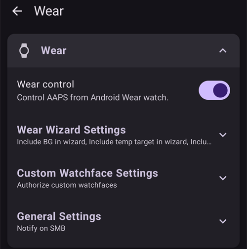

- **Kontrollera från Wear-klocka**: tillåt att behandlingar och andra åtgärder skickas från klockan. Utan den här inställningen visar klockan bara data: telefonen tar inte emot några kommandon från klockan, och om du trycker på en komplikation som skulle öppna en kontrollskärm öppnas i stället menyn för **AAPS** på klockan.

**Inställningar för kalkylatorn på Wear** anger vilka beräkningar som ingår i resultatet från kalkylatorn på klockan. På klockan anger du bara kolhydraterna; de här brytarna ersätter de val som du skulle göra i kalkylatorn på telefonen:

- **Inkludera BG i kalkylatorberäkningar**: lägg till en korrigering för skillnaden mellan ditt aktuella blodsocker och ditt målvärde.
- **Inkludera tillfälligt målvärde i kalkylatorberäkningar**: använd det aktiva tillfälliga målvärdet i stället för profilens målvärde för den här korrigeringen.
- **Inkludera trend i kalkylatorberäkningar**: ta hänsyn till den aktuella blodsockertrenden.
- **Inkludera COB i kalkylatorberäkningar**: lägg till insulin för de kolhydrater som fortfarande är aktiva.
- **Inkludera IOB i kalkylatorberäkningar**: dra av det insulin som fortfarande är aktivt.


**Inställningar för anpassad urtavla** innehåller **Tillåt anpassade urtavlor**. En fil med en anpassad urtavla kan innehålla värden för vissa klockinställningar. När den här brytaren är på får en sådan urtavla ändra dessa inställningar på klockan när den laddas; när den är av laddas urtavlan, men inställningarna förblir som de är:


**Generella inställningar** innehåller **Avisera vid SMB**, så att du får en avisering på klockan varje gång en SMB ges:


## Autotune

Det här avsnittet visas när pluginet **Autotune** är aktiverat i [Konfiguration > Generellt](#Config-Builder-autotune). Inställningarna beskrivs på sidan [Autotune](../AdvancedOptions/Autotune.md).


## Automation


Välj vilken platstjänst som ska användas:

- Använd passiv plats: **AAPS** hämtar bara platsen när andra appar begär den
- Använd nätverksplats: platsen för ditt Wi-Fi
- Använd GPS-plats (Observera! Kan dra mycket batteri!)

## Lokala larm


Inställningarna bör vara självförklarande.

**Ignorera Stör ej-läge** (på som standard): larmen i **AAPS** ringer även när telefonen är ljudlös eller i Stör ej-läge. Stäng av den om **AAPS** ska respektera dessa lägen: då ringer larmen inte, och i Stör ej-läge vibrerar de bara, på telefonen och på klockan. Loopförslag som kommer under Stör ej-läge visas utan ljud.

When an alarm rings, the alarm screen offers **Mute for 5 minutes**, **Silence alarm** (the screen stays open, so you can read the message) and **Silence and close**. Om du sveper bort larmaviseringen i aviseringsfältet tystas larmet. När du öppnar **AAPS** senare visas ett larm som du inte har svarat på igen.

(preferences-alarm-sound-volume-vibration)=
### Alarm sound, volume and vibration

- **Sound**: the **AAPS** alarm sounds are built in and cannot be changed.
- **Volume**: **AAPS** has no volume setting of its own. With **Override Do Not Disturb mode** on, the alarms follow the phone's alarm volume. With it off, they follow the notification volume.
- **Gradually increase notification volume** (on by default): the alarm starts quietly and gets louder. Turn it off to ring at full volume right away.
- **Vibration**: in the phone's settings, go to **Apps** > **AAPS** > **Notifications**. The **AAPS alarms** list appears there after the first alarm. Tap an alarm to turn its **Vibration** on or off. Keep these alarms turned on.

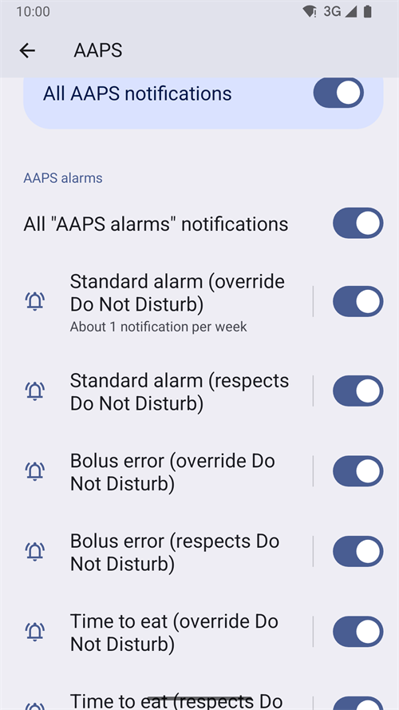 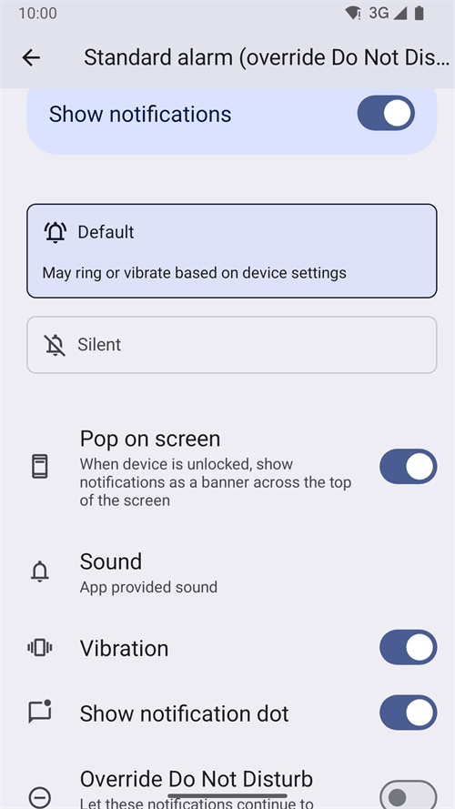

- Glucose alarms (high, low, no data) come from your CGM app or Nightscout: set their sound and vibration there.

(preferences-maintenance-settings)=
## Underhållsinställningar


**E-postmottagare**: Standardmottagare av loggar är <logs@aaps.app>.

**Antal loggar att skicka**: hur många av de senaste loggfilerna som bifogas när du skickar loggar.

**Dataval**

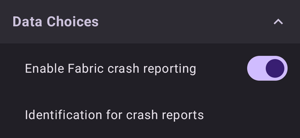

Du kan hjälpa till att utveckla **AAPS** genom att skicka kraschrapporter till utvecklarna.

**Automatisk export av inställningar**<br/> När du aktiverar den här funktionen tillåter du **AAPS** att exportera inställningar utan att du behöver göra något. För detta sparas huvudlösenordet säkert på din telefon (och bara där) vid nästa manuella export. Det sparade lösenordet används i upp till 4 veckor. Efter 4 veckor får du en avisering om att lösenordet snart går ut. Under en tidsfrist på 1 vecka kan du sedan förnya lösenordet genom att exportera inställningarna manuellt från menyn Underhåll.

När tidsfristen på 1 vecka har gått ut slutar det sparade lösenordet att gälla, och varje automatisk export av inställningar avbryts med en avisering till användaren som ber om att lösenordet anges igen. [(**Automatiska exporter av inställningar**)](../DailyLifeWithAaps/Automations.md#automating-preference-settings-export) loggas i listorna 'Careportal' och 'Angivet av användare' under Behandlingar i **AAPS**.

När du har aktiverat det här alternativet ska du göra en manuell export av inställningarna, där du ombeds ange ditt lösenord, så att **AAPS** kan spara det.

### Loggfiler

AAPS sparar loggar för felsökning.

Stäng inte av den här funktionen: den hjälper till att förstå orsaken om något går fel.

Om du behöver skicka loggarna till utvecklarna ska du beskriva problemet noggrant i e-postmeddelandet. Skicka helst loggar bara när någon har bett dig om det, efter en [felrapport på GitHub](https://github.com/nightscout/AndroidAPS/issues).

Du hittar AAPS-loggarna i telefonens minne -> Android -> data -> info.nightscout.androidaps -> files.

Hantering av loggar (logginställningar, skicka och radera loggar) och filhantering finns på skärmen **Underhåll**, som du öppnar från **menyn** (☰) i det övre vänstra hörnet av huvudskärmen:


(preferences-maintenance-logdirectory)=

### Ställa in den lokala AAPS-katalogen

Skärmen **Underhåll** innehåller också **AAPS-katalog**. Med den här inställningen kan du välja en katalog på din telefon där **AAPS** sparar inställningar, loggar och andra filer. När en katalog har valts visas dess sökväg (till exempel `Documents/AAPS`) under **AAPS-katalog**, så att du alltid kan se var dina filer sparas.

Vi rekommenderar starkt att du använder en katalog direkt i roten av telefonens minne. Standard är AAPS.


Om du väljer en underkatalog till AAPS visas ett felmeddelande. Tryck på "OK" och försök igen, och välj rätt katalog (en nivå upp). Välj inte "AVFÄRDA" om du inte vet exakt vad du gör.


Android kan utan förvarning ta bort behörigheten till katalogen, till exempel när du installerar om **AAPS** eller rensar appens lagring. När det händer visar **AAPS** en bestående avisering **Behörigheten till AAPS-katalogen är borta**, och lokal export av inställningar slutar fungera tills du kommer tillbaka hit och väljer katalogen igen. Gör det snabbt, annars uppdateras inte längre dina säkerhetskopior på telefonen.

(preferences-maintenance-cloud)=

### Ställa in en molnkatalog

Du kan exportera dina inställningar, loggar och CSV-data till en molntjänst.

1. Öppna **menyn** (☰), välj **Underhåll** och tryck på **Molnkatalog** (under **Filhantering**).

   

2. I **Välj lagringstyp** väljer du **Google Drive**.

   

3. En inloggningssida från Google öppnas. Välj det Google-konto som ska spara dina säkerhetskopior (du kan använda ett [eget Google-konto för AAPS](../UsefulLinks/DedicatedGoogleAccountForAaps.md)).

   

4. Kontrollera att det är rätt konto och tryck på **Continue** (Fortsätt) för att ge **AAPS** åtkomst. Om du har ställt in molnkatalogen tidigare står det på sidan att **AAPS** redan har viss åtkomst.

   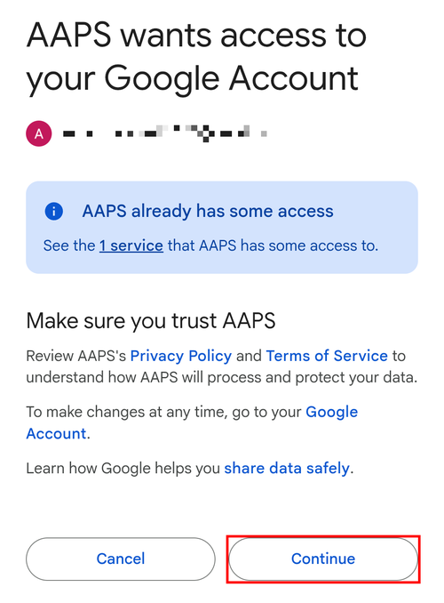

5. Tillbaka i **AAPS** visas meddelandet **Autentisering av molnlagring lyckades** längst ner på huvudskärmen:

   

   I menyn **Underhåll** har **Molnkatalog** nu en grön punkt, och knapparna **Moln** bredvid **Skicka loggar**, **Exportera inställningar**, **Importera inställningar** och **Exportera användarposter till Excel (csv)** går att använda.

   

För att sluta exportera till molnet trycker du på ikonen **✕** (**Rensa inställningar**) i slutet av raden **Molnkatalog** i menyn **Underhåll** (den visas när en molntjänst är inställd) och bekräftar **Rensa molninställningar**. Då går appen tillbaka till lokal lagring och behörigheten tas bort.

## Open Humans

Du kan hjälpa communityn genom att donera dina data till forskningsprojekt! Detaljerna beskrivs på [sidan om Open Humans](../SupportingAaps/OpenHumans.md).

I **Inställningar → Open Humans** kan du ange när data ska laddas upp
- endast vid anslutning till Wi-Fi
- endast vid laddning
