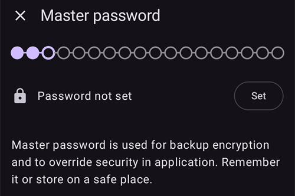
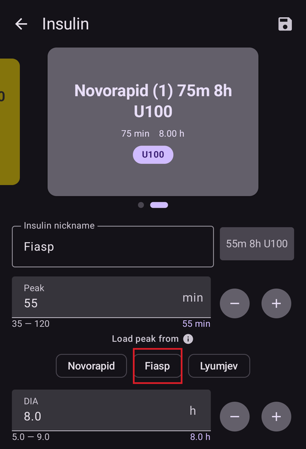
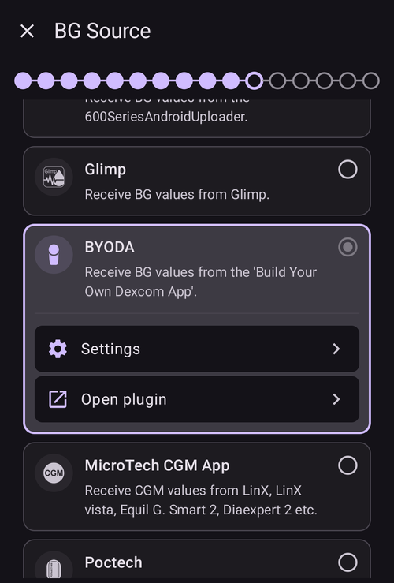
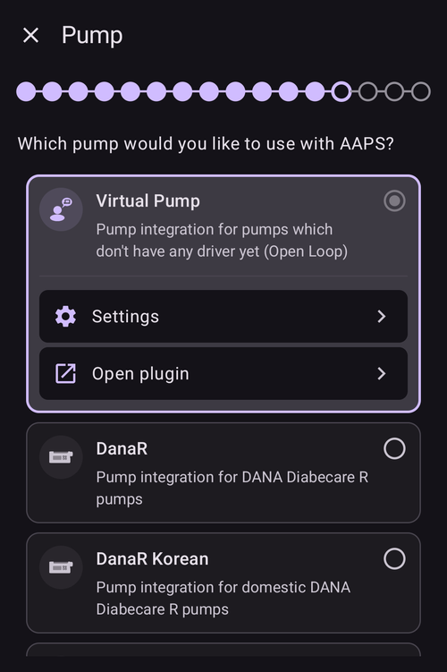
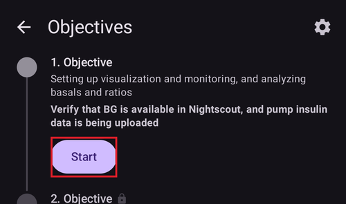

# Installationsguiden i AAPS

```{contents} In this page
:backlinks: entry
:depth: 2
```

När du startar **AAPS** första gången guidas du av "**Installationsguiden**", så att du snabbt kan göra alla grundinställningar i appen på en gång. **Installationsguiden** leder dig steg för steg, så att du inte glömmer något viktigt. Till exempel är **behörighetsinställningarna** grundläggande för att ställa in **AAPS** rätt.

Men du behöver inte ställa in allt helt första gången du använder **Installationsguiden**. Du kan lätt lämna guiden och komma tillbaka till den senare. Efter **Installationsguiden** finns tre sätt att optimera eller ändra konfigurationen vidare. De förklaras i nästa avsnitt. Så det gör inget om du hoppar över några punkter i installationsguiden. Du kan enkelt ställa in dem senare.

Under och direkt efter **Installationsguiden** märker du kanske inga stora förändringar i **AAPS**. För att aktivera din **AAPS**-loop måste du följa stegen i **Mål** och aktivera en funktion i taget. Du startar **Mål 1** i slutet av Installationsguiden. Det är du som styr **AAPS**, inte tvärtom.

```{admonition} Preview Objectives
:class: note
Om du vill veta hur målen är uppbyggda kan du läsa [Slutföra målen](../SettingUpAaps/CompletingTheObjectives.md), men kom sedan tillbaka hit och kör Installationsguiden först.

```

Vi vet av erfarenhet att nya användare ofta stressar sig själva för att ställa in **AAPS** så snabbt som möjligt. Det kan leda till frustration, eftersom det finns mycket att lära sig.

Ta därför god tid på dig när du ställer in din loop. Fördelarna med en väl fungerande **AAPS**-loop är stora.

```{admonition} Ask for Help
:class: note
Om det finns ett fel i dokumentationen, eller om du har en bättre idé om hur något kan förklaras, kan du be communityn om hjälp, se [Kontakta andra användare](../GettingHelp/WhereCanIGetHelp.md).
```
## Välkomstmeddelande

När Installationsguiden öppnas visar den ett kort välkomstmeddelande och direkt en panel, "**Behörigheter krävs**", längst ned på skärmen (se nästa avsnitt).

När du har beviljat behörigheterna stängs panelen och välkomstskärmen visar knappen "**Nästa**". Tryck på "**Nästa**" för att fortsätta:


## Behörigheter som krävs

**AAPS** behöver några behörigheter för att fungera rätt. Guiden samlar dem i en panel, "**Behörigheter krävs**", och var och en har en egen knapp "**Bevilja**". Bevilja dem en i taget. Ikonen bredvid varje rad blir en bock när den är klar.


### Batterioptimering

Batteriförbrukningen på smartphones är viktig att tänka på, eftersom batteriernas prestanda fortfarande är ganska begränsad. Därför är Android-systemet på din smartphone restriktivt med att låta appar köras och använda processortid och därmed batteri.

Men **AAPS** måste köras regelbundet, _t.ex._ för att ta emot glukosvärdena med några minuters mellanrum och sedan använda algoritmen för att bestämma hur dina glukosnivåer ska hanteras, utifrån dina inställningar. Därför måste appen undantas från batterioptimering.

Tryck på "**Bevilja**" bredvid "**Batterioptimering**" och välj sedan "**Allow**" (Tillåt) i dialogrutan "Let app always run in background?" (Vill du låta appen alltid köras i bakgrunden?):


(SetupWizard-StoragePermission)=

### AAPS-katalog

**AAPS** måste spara sina inställningar och logginformation i telefonens permanenta lagring. Permanent lagring betyder att informationen finns kvar även efter att du har startat om telefonen. Annan information går helt enkelt förlorad, eftersom den inte sparas permanent.

Tryck på "**Bevilja**" bredvid "**AAPS-katalog**". Då öppnas filsystemet på telefonen, och du kan välja var **AAPS** sparar sin information.

```{tip}
Vi rekommenderar att du väljer standardkatalogen AAPS.</br>
Välj **inte** en underkatalog till AAPS.
```

Standardkatalogen är **AAPS**, men du kan använda vilken egen katalog du vill. Skapa katalogen om det behövs, öppna den och välj "**USE THIS FOLDER**" (ANVÄND DEN HÄR MAPPEN):


Bekräfta med "**ALLOW**" (TILLÅT) att du vill ge **AAPS** åtkomst till den valda katalogen:


### Aviseringar

Android kräver en särskild behörighet för appar som vill skicka aviseringar till dig.

Det kan vara bra att stänga av aviseringar, _t.ex._ från sociala medier, men det är mycket viktigt att du låter **AAPS** skicka aviseringar till dig.

Tryck på "**Bevilja**" bredvid "**Aviseringar**" och välj "**Allow**" (Tillåt) i systemfrågan:


### Alarm och påminnelser

På **Android 14 och senare** behöver **AAPS** behörigheten "**Alarm och påminnelser**", så att larm kan väcka skärmen medan **AAPS** körs i bakgrunden, och så att påminnelser (till exempel från en **Automation**) ljuder i rätt tid.

Den här raden visas bara när den behövs. När **AAPS** är undantagen från batterioptimering (se ovan) beviljar Android exakta alarm automatiskt, och raden försvinner. Om den fortfarande finns i listan, tryck på "**Bevilja**" bredvid "**Alarm och påminnelser**". Då öppnas en skärm i systeminställningarna för **AAPS**. Slå på reglaget och gå tillbaka till **AAPS**. På Android 13 och äldre visas inte den här raden, och du behöver inte göra något.

När alla behörigheter visar en bock (tre, eller fyra på Android 14 och senare) stängs panelen "**Behörigheter krävs**" av sig själv, och du kan trycka på "**Nästa**" på välkomstskärmen för att fortsätta.

(setup-wizard-bluetooth-battery-optimisation)=
### Batterioptimering för Bluetooth

```{admonition} Extra Android setting, not part of the Wizard
:class: note
Följande är extra Android-inställningar som görs utanför Installationsguiden. Det är inte en av knapparna "Bevilja" ovan, men det är viktigt för en stabil pumpanslutning.
```

Nyare Android-versioner har lagt till batterioptimering även för systemappen Bluetooth.

Förutom att stänga av batterioptimering för **AAPS** behöver du troligen också stänga av den för systemappen Bluetooth. Om du inte gör detta kan pumpanslutningen brytas och andra problem kan uppstå.

***OBS! xDrip-dokumentationen beskriver hur du gör detta här: [xDrip-dokumentation](https://navid200.github.io/xDrip/docs/BluetoothBatteryOpt.html)***

Följ de här stegen på Android 16. Andra versioner skiljer sig lite från skärmbilderna:

1. Öppna Android-inställningarna, sök efter **Apps** (Appar) och öppna inställningarna för appar.

   

2. Du ser nu appinställningarna, men vi måste visa alla appar. Klicka på **See all apps** (Visa alla appar).

   

3. Bluetooth-appen är en systemapp och är därför dold som standard, så vi måste visa systemappar. Klicka på **de tre prickarna** (⋮) uppe till höger (1). Klicka sedan på **Show system** (Visa system) (2).

   

4. Sök efter appen `Bluetooth` och klicka på `Bluetooth` och/eller `Legacy Bluetooth`. Om båda finns, gör stegen för båda.

   ***OBS! Du kan ignorera `Bluetooth MIDI Service`. Den används inte av AAPS***

           

   1. På Android 12 klickar du på `Battery` (Batteri), på Android 13+ på `App battery usage` (Appens batterianvändning).

      

5. På Android 12+ väljer du alternativet `Unrestricted` (Obegränsad). På Android 15+ måste du först fälla ut inställningen `Allow background usage` (Tillåt användning i bakgrunden): klicka på området som är markerat med rött och följ sedan steg 6 för att slutföra.

       

6. På Android 16 väljer du `Unrestricted` (Obegränsad)

   

## Licensavtal

Licensavtalet för slutanvändare innehåller viktig information om de juridiska aspekterna av att använda **AAPS**. Läs det noga.

Om du inte förstår eller inte kan godkänna licensavtalet för slutanvändare ska du inte använda **AAPS** alls!

Om du förstår och godkänner, tryck på knappen "**JAG FÖRSTÅR OCH GODKÄNNER**" och följ Installationsguiden:


Knappen "**Nästa**" visas när du har godkänt. Tryck på "**Nästa**".

Nästa skärm, "**Behörigheter**", visar behörigheterna igen. Alla bör visa en bock, eftersom du beviljade dem i början. Om någon saknas, tryck på "**Bevilja**" bredvid den. Tryck på "**Nästa**" för att fortsätta:


## Huvudlösenord

Eftersom konfigurationen av **AAPS** innehåller känsliga data (_t.ex._ åtkomsttoken till din Nightscout-server) krypteras den med ett lösenord som du ställer in här.

Guiden visar "**Lösenord inte inställt**". Tryck på "**Ställ in**":



Då öppnas skärmen "**Skydd**". Tryck på "**Huvudlösenord**" (visas som "Lösenord inte inställt"):


Ange samma lösenord i båda fälten och tryck på "**OK**":


Gå tillbaka med pilen i det övre vänstra hörnet. Guiden visar nu "**Lösenord sparat!**":


```{admonition} Do not lose your Master Password
:class: danger
**TAPPA INTE BORT DITT HUVUDLÖSENORD**. Skriv ner det, _t.ex._ på Google Drive. Det är ett bra ställe, eftersom Google säkerhetskopierar det åt dig. Din telefon eller dator kan krascha, och då kanske du inte har någon aktuell kopia. Om du glömmer ditt huvudlösenord kan det vara svårt att senare återställa din profilkonfiguration och dina framsteg i **Mål**.
```

När du är klar, tryck på "**Nästa**" för att gå till nästa skärm.

(setup-wizard-import-settings)=
## Import settings

Den här skärmen visas bara när **AAPS** hittar tidigare exporterade inställningar i **AAPS**-katalogen ("Tidigare sparade inställningar hittade"), till exempel när du installerar om appen eller byter till en ny telefon.

- Om du vill återställa din tidigare konfiguration, tryck på "**Importera inställningar**" — se [Skapa och återställa säkerhetskopior](../Maintenance/ExportImportSettings.md).
- Om du vill börja med en ny konfiguration, tryck på "**Nästa**" och fortsätt med guiden.


## Enheter (mg/dl <-> mmol/l)

Välj om dina glukosvärden ska visas i mg/dl eller mmol/l och tryck sedan på knappen "**Nästa**":


## Visningsinställningar

Här ställer du in "**LÅG-markering**" och "**HÖG-markering**" för visningen av sensorns glukosvärden. Glukosvärden mellan dessa två markeringar visas som "inom målområdet". Du kan behålla standardvärdena (72 och 180 mg/dl) tills vidare och ändra dem senare.

Värdena du väljer påverkar bara hur diagrammet visas, inget annat.

_T.ex._ ställs ditt målvärde för glukos in separat i din profil.

Området för att analysera TIR (tid inom målområdet) ställer du in separat i din rapportserver.

Justera markeringarna med knapparna "−" / "+" vid behov och tryck sedan på knappen "**Nästa**":


(SetupWizard-synchronization-with-the-reporting-server-and-more)=
## Kommunikation

Skärmen "**Kommunikation**" visar de plugin som används för att ladda upp, synkronisera och sända ut dina data:

- **SMS-kommunikation** – fjärrstyrning av **AAPS** med SMS-kommandon
- **NSClientV3** – synkroniserar dina data med Nightscout via API v3
- **Tidepool** – laddar upp data till Tidepool
- **xDrip** – skickar data till xDrip
- **Open Humans** – ladda upp och donera dina diabetesdata till vetenskapliga projekt
- **Klocka (Wear)** – övervaka och styr **AAPS** från en Wear OS-klocka
- **Externa hjälpappar** – sänder ut data till olika externa appar
- **Garmin** – anslutning till en Garmin-enhet


Skrolla nedåt för att se resten av listan:


Du kan ställa in flera av dessa nu, men första gången fokuserar vi bara på rapportservern. Om du inte kan ställa in den just nu, hoppa över den så länge — du kan ställa in den senare.

I det här exemplet använder vi Nightscout som rapportserver. Markera rutan till höger om "**NSClientV3**" för att aktivera den. För Tidepool är det ännu enklare, eftersom du bara behöver dina personliga inloggningsuppgifter.

När den är aktiverad, tryck på "**Inställningar**" under NSClientV3 för att ställa in den:


Här ställer du in Nightscout-rapportservern. Inställningarna för NSClientV3 visas som en sida som du kan rulla:


Tryck på "**Nightscout-URL**" och ange adressen till din egen Nightscout-server (den URL som du själv har ställt in eller har fått från din tjänsteleverantör). Bekräfta med "**OK**".

Tryck på "**Nightscout åtkomsttoken**" och ange åtkomsttoken för din Nightscout-server. Utan denna token fungerar inte åtkomsten. Om du inte har den ännu, läs dokumentationen om hur du ställer in rapportservern.

Leave "**Use websockets**" enabled for real-time communication with Nightscout. Websockets are **mandatory** for remote control from **AAPSClient**, on both phones.

Övriga avsnitt kan ha kvar sina standardvärden tills vidare. De beskrivs här så att du vet var du hittar dem senare:

**Larminställningar** — Nightscout-larm, notiser och gränser för inaktuell data. Låt reglagen vara av tills vidare. Vi öppnar dem bara så att du känner till alternativen.

**Anslutningsinställningar** — välj hur data överförs. Anhöriga måste slå på "**Använd mobildata**". Annars kan telefonen hos den de tar hand om (_t.ex._ ett barn) inte ladda upp utanför Wi-Fi-räckvidd, _t.ex._ på väg till skolan. Andra användare kan stänga av överföring via mobilnätet för att spara data eller batteri. Om du är osäker, låt allt vara på.


**Avancerade inställningar** — slå på "**Logga appstart**" om du vill se i Nightscout när appen startar om (bra för anhöriga). Låt "**Skapa notiser vid fel**" och "**Skapa notiser vid behov av kolhydrater**" vara på. Låt "**Använd långsam synkronisering**" vara av. Du behöver det bara om Nightscout-servern är långsam med att hantera stora mängder data.


Gå tillbaka till listan med plugin och tryck på "**Nästa**" för att gå till nästa skärm.

## Klientkontroll

Från **AAPS** version 4 kan klientenheter som kör **AAPSClient** **parkopplas** med den här telefonen (**huvudenheten**) och styra den med signerade kommandon som skickas via Nightscout. Detta är det nya rekommenderade sättet att styra **AAPS** på distans — se [Styrning huvudenhet ↔ klient](../RemoteFeatures/ClientMasterControl.md) för hela förklaringen och inställningen.

Du behöver inte ställa in något på den här skärmen nu. Du kan parkoppla klienter när som helst senare från **Hantera → Auktoriserade klienter**. Där lägger du till en klient med en **QR-kod** (den ställer också in Nightscout på klienten) eller med en **PIN-kod**, och ger den en **roll**.

- "**Auktoriserade klienter**" — hantera de parkopplade klientenheter som får styra den här huvudenheten.
- "**Godkännande av Nightscout-data**" — att ta emot behandlingar och data som matas in direkt i Nightscout (det gamla, mindre säkra sättet) är nu avstängt som standard. Öppna bara de här inställningarna om du fortfarande behöver det, _t.ex._ för att mata in data via Nightscout eller appar från tredje part.

När klientstyrning redan är på — alltid i [Enkelt läge](#preferences-simple-mode) — är den här telefonen i [härdat läge](#client-master-control-hardened-mode): den tar bara emot ändringar från parkopplade klienter. Därför förklarar skärmen härdat läge i stället för att visa inställningarna "**Godkännande av Nightscout-data**".


"**Godkännande av Nightscout-data**" öppnar inställningarna för "**Synkronisering**", där varje typ av data som tas emot från Nightscout har ett eget reglage:


Tryck på "**Nästa**" för att gå till nästa skärm.

(setup-wizard-instance-name)=
## Vem använder den här telefonen?

Här anger du namnet på personen som använder den här telefonen. Namnet skiljer den här **AAPS**-instansen från andra i rapporter och vid synkronisering, till exempel om två barn i din familj använder **AAPS**. Det används också i namnen på exporterade inställningsfiler och visas på klockan.

Det kan vara vad som helst. Du kan ändra det senare i **Inställningar → Generellt → Instansnamn**.

Tryck på "**Nästa**" för att gå till nästa skärm.


## Patienttyp

Här väljer du "Patienttyp". Det är viktigt, eftersom **AAPS** har olika gränser beroende på patientens ålder. Det är viktigt av säkerhetsskäl.

Här ställer du också in **Maximal bolus** för en måltid. Alltså den största bolus du behöver ge för att täcka dina vanliga måltider. Det är en säkerhetsfunktion som hjälper dig att undvika att råka ge för mycket insulin när du tar bolus för en måltid.

Den andra gränsen fungerar på liknande sätt, men gäller den största mängd kolhydrater du räknar med att äta.

När du har ställt in dessa värden, tryck på "**Nästa**" för att gå till nästa skärm:


## Insulin

Här ställer du in insulinet som används i din pump. Nya insulinprofiler kräver en **DIA på minst 5 h**.

Tryck på knappen "**Insulin**" för att öppna insulinredigeraren:


I redigeraren kan du ge insulinet ett **smeknamn** och ställa in dess **Topp** (i minuter) och **DIA** (i timmar). Det snabbaste sättet är att läsa in en förinställning med "**Ladda topp från**" — välj **Novorapid**, **Fiasp** eller **Lyumjev** — så fylls toppen i åt dig. Grafen längst ned visar en förhandsvisning av insulinets aktivitetskurva.


Välj den förinställning som passar ditt insulin, till exempel **Fiasp**:



```{admonition} Use your insulin brand's preset peak
:class: danger
Ändra inte toppen om du inte är expert — de förinställda värdena fungerar oftast bra för varje insulinmärke.
```

Om du är ny **AAPS**-användare, ställ in **DIA** på 9 timmar — se [Insulinets verkningstid (DIA) och topp](#Config-Builder-insulin-dia) för att förstå varför.

```{admonition} "Insulin configuration changed" dialog
:class: note
Om en parkopplad klient (_t.ex._ en annan telefon) har ändrat insulinkonfigurationen visas en dialogruta. Tryck på **OK** för att läsa in ändringarna, eller på **Avbryt** för att fortsätta redigera (nästa gång du sparar skrivs deras ändringar över).
```


Tryck på spara-ikonen (uppe till höger) och tryck sedan på "**Nästa**" för att gå till nästa skärm.

## BG-källa

Här väljer du varifrån **AAPS** får sina glukosdata. Läs dokumentationen för din [BG-källa](../Getting-Started/CompatiblesCgms.md).

Det finns många källor — rulla genom listan och välj den som du använder:


När du väljer en källa fälls dess kort ut och visar två knappar: "**Inställningar**" för att justera hur data tas emot, och "**Öppna plugin**" för att öppna källans egen skärm. I exemplet nedan är **BYODA** vald. Vissa källor har inget att ställa in i det här steget, så du kan oftast gå direkt till nästa skärm:



När du har gjort ditt val, tryck på "**Nästa**" för att gå till nästa skärm.

(setup-wizard-profile)=
## Profil

Nu kommer vi till en mycket viktig del av installationsguiden.

Läs dokumentationen om [profiler](../SettingUpAaps/YourAapsProfile.md) innan du försöker ange dina profiluppgifter på nästa skärm.

```{admonition} Working profile required - no exceptions here !
:class: danger
En korrekt profil krävs för att **AAPS** ska fungera säkert.

Du måste ha tagit fram och diskuterat din profil med din läkare, och den måste ha visat sig fungera genom lyckade tester av basal, ISF och KH-kvot!

Om en robot får felaktig indata blir resultatet fel – varje gång. **AAPS** kan bara arbeta med den information som den får. Om din profil är för stark riskerar du hypoglykemi, och om den är för svag riskerar du hyperglykemi. 
```

Tryck på knappen "**Profil**" för att öppna profilredigeraren:


Redigeraren öppnas tom ("Inga poster tillgängliga"). Tryck på knappen "**+**" längst ned för att skapa en ny profil:


Du kan ha flera profiler på längre sikt om det behövs. Här skapar vi bara en.

```{admonition} Profile only for tutorial - not for your usage
:class: note
Exempelprofilen här visar bara hur du matar in data.

Den är inte tänkt att vara en korrekt eller väl optimerad profil, eftersom varje persons behov är så olika.

Använd den inte för att loopa på riktigt!
```

Den nya profilen (till exempel "**LocalProfile1**") har fyra flikar: **IC**, **ISF**, **BAS** och **MÅL**. Tryck på pennan bredvid profilnamnet för att byta namn på profilen. Fyll i alla flikar — en flik förblir röd och visar ett felmeddelande tills den innehåller giltiga värden:


Tryck på "**IC**" och ange dina värden för [KH-kvot](#your-aaps-profile-insulin-to-carbs-ratio). Använd knappen "**+**" för att lägga till fler tidsblock:


Tryck på "**ISF**" och ange dina [ISF-värden](#your-aaps-profile-insulin-sensitivity-factor):


Tryck på "**BAS**" och ange dina [basalvärden](#your-aaps-profile-basal-rates):


Tryck på "**MÅL**" och ange dina målvärden för blodsocker.

Vid öppen loop kan målet vara ett bredare intervall. Annars ber **AAPS** dig hela tiden att ändra den tillfälliga basalen eller någon annan inställning, och det kan bli tröttsamt.

Senare, med sluten loop, har du oftast bara ett värde för övre och nedre gräns. Det gör det lättare för **AAPS** att nå målet och ger dig bättre diabeteskontroll totalt sett.


När alla fyra flikar är giltiga blir **spara-ikonen** (uppe till höger) aktiv. Tryck på den för att spara profilen:


Stäng redigeraren med "**X**" i det övre vänstra hörnet. Profilsammanfattningen visar sedan namnet, den totala basalen per dygn (∑), enheterna och värdena för KH-kvot och ISF med sina grafer:


```{admonition} Several defined but only one active profile
:class: note
Du kan ha flera profiler, men bara en aktiverad profil åt gången.
```

Tryck på knappen "**▶**" (aktivera) längst ned till höger. Skärmen "**Aktivera**" öppnas. Eftersom inget insulin används ännu ber den dig först välja det insulin du använder, så att profilbytet kan registrera det. Knappen "**Aktivera**" är gråtonad tills du har gjort det:


Tryck på "**Välj insulin**" och välj det insulin som du ställde in tidigare. Låt procenten vara 100 % och tryck på "**Aktivera**":


En dialogruta för profilbyte visas. Låt den vara som den är förinställd i det här fallet och bekräfta med "**OK**":

```{admonition} Profile switch dialog
:class: note
Senare lär du dig hur du använder den här allmänna dialogrutan i situationer som sjukdom eller träning, när du behöver ändra din profil efter omständigheterna.
```


Din profil är nu aktiv. Tryck på "**Nästa**" för att gå till nästa skärm.

## Insulinpump

Nu väljer du din insulinpump. Läs dokumentationen för din [insulinpump](../Getting-Started/CompatiblePumps.md).

Rulla i listan och välj din pump. I det här exemplet använder vi "**Virtuell pump**". Den är bra medan du fortfarande lär dig och inte har anslutit en riktig pump än:



Många pumpar stöds — rulla nedåt för att hitta din:


När du väljer en riktig pump ber **AAPS** om en bekräftelse, eftersom basaldoserna i din profil då kopieras till pumpen och skriver över de basaldoser som finns sparade där. Tryck bara på "**OK**" om basaldoserna i din **AAPS**-profil är rätt. Annars trycker du på "**Avbryt**" och byter till pumpen senare:


Om pumpen du väljer kommunicerar via Bluetooth ber **AAPS** om behörighet att ansluta till enheter i närheten när du har slutfört guiden (se [Bluetooth-behörighet](#setup-wizard-bluetooth-permission)).

Om du redan har ställt in din profil och vet hur du ansluter din pump kan du gärna ansluta den nu. Annars låter du den stå på **Virtuell pump** så länge — du kan ändra det när som helst, eller lämna Installationsguiden med pilen i det övre vänstra hörnet och låta **AAPS** först visa dig några blodsockervärden.

Tryck på "**Nästa**" för att gå till nästa skärm.

## APS-algoritm

Använd algoritmen OpenAPS SMB som din APS-algoritm. Trots namnet är algoritmens SMB-funktion avstängd tills du känner till AAPS och har gått igenom de första målen. OpenAPS SMB är ändå nyare och i allmänhet bättre än OpenAPS AMA.

SMB är avstängd i början eftersom SMB-funktionen reagerar snabbare på en blodsockerökning. Den använder en supermikrobolus i stället för att höja basalens procent. Eftersom din profil oftast inte är lika bra i början som efter en tids erfarenhet är funktionen avstängd från början.

```{admonition} Only use the older algorithm **OpenAPS AMA** if you know what you are doing
:class: note
OpenAPS AMA är den mest grundläggande algoritmen och stöder inte mikrobolusar för att korrigera höga värden. Det kan finnas situationer där det är bättre att använda den här algoritmen, men det är inte rekommendationen.
```

Välj "**OpenAPS SMB**" och tryck sedan på "**Inställningar**" för att se detaljerna:


Det enda alternativet här är "**Använd dynamisk känslighet**". Låt det vara av och ändra inget just nu — läs bara texten.

På grund av begränsningarna i **Mål** kan du ändå inte använda "sluten loop" eller "SMB-funktioner" just nu.

Gå tillbaka och tryck på "**Nästa**" för att gå till nästa skärm:


## Känslighetsdetektering

Låt "**Oref1**" vara valt som standardplugin för känslighet:


Om du trycker på "**Inställningar**" kan du se absorptionsinställningarna. Standardvärdena (_t.ex._ en absorptionsgräns på 6 h) räcker för tillfället.


Tryck på "**Nästa**" för att gå till nästa skärm.

## Starta Mål 1

Nu kommer du till målen — kvalificeringen för att få tillgång till fler funktioner i **AAPS**.

Tryck på "**Öppna mål**":


Här startar vi Mål 1, även om vår konfiguration ännu inte är helt klar för att slutföra det här Målet. Men det är början.

Tryck på knappen "**Starta**" för **Mål 1**:



Målet fälls ut och visar sina enskilda kontroller. Du ser att du redan har gjort vissa framsteg, medan andra punkter återstår:


Gå tillbaka och tryck sedan på "**Slutför**" för att slutföra Installationsguiden:


När du har tryckt på "**Slutför**" kommer du till huvudskärmen i **AAPS**. En panel, "**Avisering**", kan öppnas med informationsmeddelanden, till exempel om profilbytet du just gjorde — tryck på "**Avfärda**" under varje meddelande för att ta bort det.

Om du råkar lämna Installationsguiden någon gång kan du antingen starta om guiden eller ändra [konfigurationen av AAPS-loopen](../SettingUpAaps/ChangeAapsConfiguration.md) manuellt.

(setup-wizard-bluetooth-permission)=
## Bluetooth-behörighet

Om du väljer en pump som ansluter via Bluetooth (till exempel **Omnipod Dash**) påminner en banner dig om att **AAPS** behöver Bluetooth-behörighet. Du kan trycka på "**Avfärda**" tills vidare — behörigheten beviljas när du har slutfört guiden:


När Installationsguiden är klar visar huvudskärmen i **AAPS** en panel, "**Behörigheter krävs**". De andra behörigheterna är redan beviljade. Tryck på "**Bevilja**" bredvid "**Bluetooth**":


Välj "**Allow**" (Tillåt) så att **AAPS** kan hitta och ansluta till din pump:


Om din **AAPS**-loop nu är helt inställd, gå vidare till nästa avsnitt ["Slutföra målen"](../SettingUpAaps/CompletingTheObjectives.md).
