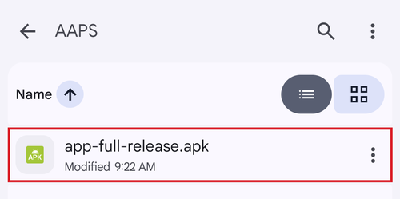
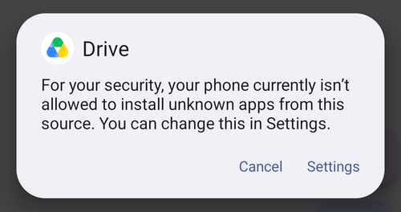

# Överföra och installera AAPS på din telefon

I det förra avsnittet, [bygga **AAPS**](../SettingUpAaps/BuildingAaps.md), byggde du **AAPS**-appen (en .apk-fil) på en dator.

Nästa steg är att **överföra** APK-filen för **AAPS** (och andra appar som du kan behöva, t.ex. BYODA, xDrip eller en annan app för CGM-mottagning) till din Android-telefon och sedan **installera** appen eller apparna. När **AAPS** är installerat på telefonen kan du gå vidare till att [**konfigurera AAPS-loopen**](../SettingUpAaps/SetupWizard.md).

Den här sidan förklarar också [verifiering av Android-utvecklare](#android-developer-verification) (Android developer verification), en ändring som Google inför från september 2026. Den påverkar installationen av appar som du byggt själv. Sidan visar också de [kostnadsfria installationsmetoderna](#android-developer-verification-free-methods) som fortsätter att fungera efter ändringen.

```{contents} Table of contents
:depth: 1
:local: true
```

## Installera AAPS genom att trycka på APK-filen

I dag installerar du **AAPS** genom att överföra APK-filen till telefonen och öppna den (”trycka” på den). Det finns flera sätt att överföra APK-filen för **AAPS** från datorn till telefonen. Här förklarar vi två olika sätt:

* Alternativ 1 – Använd din Google Drive (Gdrive)
* Alternativ 2 – Använd en USB-kabel

Observera att överföring via e-post kan ge problem och avråds.

```{admonition} Android developer verification
:class: warning
Google inför [verifiering av Android-utvecklare](#android-developer-verification) från september 2026 (först i Brasilien, Indonesien, Singapore och Thailand; i hela världen 2027). Där kravet gäller blockeras installation av en APK-fil genom att trycka på filen, så som beskrivs i båda alternativen nedan. Använd i så fall en av de [kostnadsfria installationsmetoderna](#android-developer-verification-free-methods) längre ned på den här sidan.
```

### Alternativ 1. Överför filer med Google Drive

Öppna [Google.com](https://www.google.com/) i webbläsaren och logga in på ditt Google-konto.

Välj appen Drive i Google-menyn uppe till höger.


Klicka på **New** (Ny) uppe till vänster (eller högerklicka på en tom yta under dina filer och mappar) och välj **File upload** (Ladda upp fil).


APK-filen ska nu vara uppladdad till Google Drive.

#### Använd appen Google Drive för att öppna APK-filen och installera den

Byt till telefonen och starta appen Google Drive. Den är förinstallerad och finns där de andra Google-apparna finns, eller så kan du söka efter appens namn.


Starta installationen genom att trycka på filnamnet i Google Drive-appen på telefonen.



Om du får ett säkerhetsmeddelande om att du just nu inte får installera appar från Google Drive, tryck på "Settings" (Inställningar) och tillåt det en kort stund. Förbjud det sedan igen, eftersom det är en säkerhetsrisk att låta det vara på hela tiden.




När installationen är klar är du klar med det här steget.

Du ska nu se ikonen för **AAPS** och kunna öppna appen.

```{warning}
**VIKTIG SÄKERHETSINFORMATION**
Kom du ihåg att förbjuda installation från Google Drive igen?
```

Fortsätt med att [konfigurera AAPS-loopen](../SettingUpAaps/SetupWizard.md).

### Alternativ 2. Överför filer med en USB-kabel

Det andra sättet att överföra apk-filen för AAPS är med en [USB-kabel](https://support.google.com/android/answer/9064445?hl=en).

Flytta filen från dess plats på datorn till mappen "Nedladdningar" på telefonen.

På telefonen måste du tillåta installation från okända källor. Hur du gör detta förklaras på internet (_t.ex._ [här](https://www.expressvpn.com/de/support/vpn-setup/enable-apk-installs-android/) eller [här](https://www.androidcentral.com/unknown-sources)).

När du har överfört filen genom att dra den till telefonen, öppna mappen "Downloads" (Nedladdningar) på telefonen och tryck på apk-filen för AAPS:


Första gången säger Android att telefonen inte får installera okända appar från den här källan. Tryck på "**Settings**" (Inställningar):


Slå på "**Allow from this source**" (Tillåt från den här källan) och gå sedan tillbaka:


Tryck på apk-filen igen och välj "**Install**" (Installera):


När installationen är klar, tryck på "**Open**" (Öppna) för att starta **AAPS**, eller på "**Done**" (Klar) för att öppna appen senare:


```{warning}
**VIKTIG SÄKERHETSINFORMATION**
Kom ihåg att stänga av "Allow from this source" igen efter installationen, eftersom det är en säkerhetsrisk att låta det vara på hela tiden.
```

Fortsätt med att [konfigurera AAPS-loopen](../SettingUpAaps/SetupWizard.md).

(transferring-installing-play-protect-warning)=
## Varning från Google Play Protect

När du installerar **AAPS** kan Google Play Protect varna dig för att appen är osäker, att den byggdes för en äldre version av Android och att den inte har de senaste integritetsskydden.


Det är normalt för en app som du byggt själv. Tryck på **More details** (Mer information) och sedan på **Install anyway** (Installera ändå).

Om installationen **blockeras** med ett meddelande om en overifierad utvecklare (inte bara en varning), se [verifiering av Android-utvecklare](#android-developer-verification) nedan.

(android-developer-verification)=

## Verifiering av Android-utvecklare

Google inför **verifiering av Android-utvecklare** (Android developer verification): på de flesta Android-telefoner installeras appar bara om de har registrerats hos Google av en verifierad utvecklare. Det gäller också appar som installeras från en APK-fil (”sidladdning”, sideloading). Det är så du installerar **AAPS**-appen som du byggt själv.

### Vad ändras

När du installerar **AAPS** på en telefon med Googles tjänster (en ”certifierad” Android-enhet, alltså nästan alla telefoner som säljs med Play Butik), kontrollerar Android om appen kommer från en utvecklare som är registrerad hos Google. Om inte, blockeras den vanliga installationen genom att trycka på APK-filen.

**Kontrollen görs när en app installeras eller uppdateras.** Den tar inte bort appar som redan är installerade och körs.

Google inför detta stegvis:

| När               | Vad händer                                                                                                                                                                          |
| ----------------- | ----------------------------------------------------------------------------------------------------------------------------------------------------------------------------------- |
| Augusti 2026      | Kostnadsfria utvecklarkonton för ”begränsad distribution” (limited distribution) öppnar i hela världen, och det ”avancerade flödet” (advanced flow) börjar rullas ut till telefoner |
| 30 september 2026 | Verifieringen krävs i **Brasilien, Indonesien, Singapore och Thailand** för appar som installeras från Google Play och några andra appbutiker                                       |
| 2027              | Kravet utökas till **resten av världen** och till **alla installationer**, även APK-filer                                                                                           |

Google publicerar detaljerna på sidorna om [Android developer verification](https://developer.android.com/developer-verification), bland annat en [FAQ](https://developer.android.com/developer-verification/guides/faq). Google kan fortfarande ändra datum och detaljer. Den här sidan uppdateras medan utrullningen pågår.

### Påverkar detta mig?

- **Att bygga AAPS påverkas inte alls.** [Bygge i webbläsaren](#browser-build), [bygge med Android Studio](ComputerBuild.md) och [bygge från kommandoraden](CLIBuild.md) fungerar precis som förut, och din keystore ändras inte.
- **Ditt nuvarande AAPS fortsätter att köras.** Verifieringen kontrolleras bara när en app installeras eller uppdateras.
- **Om du bor i Brasilien, Indonesien, Singapore eller Thailand:** från 30 september 2026 krävs verifiering för appar som installeras från Google Play och några andra appbutiker. Google säger att direkt installation av en APK-fil inte omfattas av detta första steg, så **AAPS** bör fortfarande installeras som vanligt. Förbered ändå redan nu en av de [kostnadsfria installationsmetoderna](#android-developer-verification-free-methods) nedan, så att du inte blir överraskad om detta ändras.
- **Om du bor någon annanstans:** ingenting ändras för dig före 2027, och det är ett rimligt val att inte göra något just nu. Men ställ in en av de [kostnadsfria installationsmetoderna](#android-developer-verification-free-methods) nedan medan allt fungerar. Att upptäcka blockeringen den dag en uppdatering nekas, med [det avancerade flödets](#android-developer-verification-advanced-flow) väntetid på 24 timmar framför dig, är fel tillfälle.
- **Gamla telefoner:** verifieringen gäller telefoner med Android 7 eller senare, alltså alla telefoner som kan köra **AAPS**.

(android-developer-verification-free-methods)=

## Kostnadsfria sätt att installera AAPS

Du behöver **inte** betala något till Google för att fortsätta använda **AAPS**. Det finns flera kostnadsfria metoder. Välj den som passar din situation.

```{admonition} Which method should I use?
:class: tip
- Du har en **dator** (oavsett hur du byggde **AAPS**): använd [ADB](#android-developer-verification-adb) eller, om du vill slippa kommandoraden, [webbinstalleraren](#android-developer-verification-web). Båda är undantagna från verifieringen, har inga begränsningar och kräver inget Google-konto.
- Du har **ingen dator alls**: använd [det avancerade flödet](#android-developer-verification-advanced-flow) på telefonen.
- Du vill hellre registrera dig hos Google så att den vanliga installationen (”tryck på APK-filen”) fortsätter att fungera: det finns ett [kostnadsfritt konto för begränsad distribution](#android-developer-verification-limited-account), men det är inte testat med **AAPS**.
```

(android-developer-verification-adb)=

### Alternativ 1: Installera med ADB (dator krävs)

ADB (Android Debug Bridge) är Googles officiella verktyg för att installera appar från en dator till en telefon via en USB-kabel. Google har bekräftat att **appar som installeras med ADB inte kräver verifiering**. Det finns ingen väntetid, ingen gräns för antal enheter och ingen registrering.

Förberedelse (en gång):

1. Slå på de dolda utvecklaralternativen på telefonen: gå till **Settings** (Inställningar) > **About phone** (Om telefonen) (på vissa telefoner **Software information** (Programvaruinformation)) och tryck sju gånger på **Build number** (Versionsnummer) tills telefonen bekräftar att du är utvecklare.
1. Gå tillbaka till huvudmenyn **Settings**, öppna det nya alternativet **Developer options** (Utvecklaralternativ) och slå på **USB debugging** (USB-felsökning).
1. Se till att ADB finns på datorn:
   - Om du använder **Android Studio** är ADB redan installerat med det.
   - Annars laddar du ned Googles kostnadsfria [SDK Platform Tools](https://developer.android.com/tools/releases/platform-tools) och packar upp mappen. Ingen installation behövs. ADB är programmet `adb` i den mappen.

Installera (och senare uppdatera) **AAPS**:

1. Anslut telefonen till datorn med en USB-kabel. Du behöver inte först överföra APK-filen till telefonen: ADB skickar den direkt från datorn.
1. På telefonen, godkänn frågan **Allow USB debugging?** (Vill du tillåta USB-felsökning?) (bara första gången).
1. Öppna en terminal (kommandotolk) på datorn i mappen som innehåller ADB och APK-filen för **AAPS**, och kör:

   ```
   adb install -r app-full-release.apk
   ```

   Ersätt `app-full-release.apk` med det verkliga namnet på din APK-fil. Alternativet `-r` uppdaterar ett redan installerat **AAPS** och behåller alla data och inställningar.

1. Vänta tills `Success` visas. **AAPS** är nu installerat på telefonen.

Samma kommando används för alla framtida uppdateringar. [Sidorna om Wear OS](../WearOS/WearOsSmartwatch.md) använder redan ADB på samma sätt för att installera klockappen.

Om du hellre vill slippa kabeln: på Android 11 och senare kan **wireless debugging** (Trådlös felsökning, finns också under **Developer options**) göra samma sak via Wi-Fi, efter en engångsparkoppling med en kod som visas på telefonen.

(android-developer-verification-web)=

### Alternativ 2: Installera från en webbsida (dator, ingen kommandorad)

Om kommandoraden inte passar dig kan en webbsida göra precis samma sak som ADB, direkt från webbläsaren. Eftersom sidan pratar med telefonen via samma mekanism som ADB har den **samma undantag från verifieringen**. Men du behöver inte ladda ned något, inte packa upp någon mapp och inte skriva något kommando.

Det här är det enklaste sättet om du använde [bygge i webbläsaren](#browser-build) och aldrig har öppnat en kommandorad.

1. Slå på **USB debugging** på telefonen (steg 1 och 2 i [ADB-metoden](#android-developer-verification-adb) ovan, görs en gång).
1. Öppna **[AAPS webbinstallerare](#web-installer)** i webbläsaren.
1. Anslut telefonen med en USB-kabel och följ instruktionerna på sidan: anslut, välj din APK-fil och installera.

Tre saker att veta:

- Det fungerar bara i **Chrome, Edge eller Opera**. Firefox och Safari kan inte prata med USB-enheter.
- Bara ett program åt gången kan använda telefonens ADB-anslutning, så **stäng Android Studio** (eller annat som använder ADB) innan du ansluter.
- En webbsida som är ansluten på det här sättet får full kontroll över telefonen. **Använd bara adressen ovan**, från dokumentationen för **AAPS**. Använd aldrig en installationssida som du hittat via en sökmotor. **AAPS** webbinstallerare körs helt i webbläsaren: din APK-fil laddas inte upp någonstans.

```{admonition} No computer? A second phone works too
:class: tip
Webbinstalleraren fungerar också från **Chrome på en annan Android-telefon** med en USB-C till USB-C-kabel. Så kan en förälder installera **AAPS** på ett barns telefon utan någon dator i hemmet.
```

(android-developer-verification-advanced-flow)=

### Alternativ 3: Det ”avancerade flödet” på telefonen (ingen dator behövs)

Google erbjuder en nödutgång för erfarna användare som förstår riskerna med att installera overifierade appar. Den kallas **det avancerade flödet** (advanced flow). Google började rulla ut det till telefoner i augusti 2026, före kravet, så du kan ställa in det redan nu. Det är en inställning som görs en gång på själva telefonen, och det **tar 24 timmar** att slutföra den:

1. Slå på de dolda utvecklaralternativen (se steg 1 i ADB-metoden ovan) och öppna sedan **Settings** > **Developer options** > **Apps from unverified developers** (Appar från overifierade utvecklare).
1. Slå på **Allow apps from unverified developers** (Tillåt appar från overifierade utvecklare). Telefonen ber om ditt skärmlås för att bekräfta att det är du.
1. Telefonen frågar om någon ber dig att slå på den här inställningen, och förklarar att banker, myndigheter eller polisen aldrig skulle be dig att göra det. Läs varningen och bekräfta att ingen pressar eller styr dig (detta är ett skydd mot bedragare).
1. **Starta om telefonen.** Detta startar en **väntetid på 24 timmar** som bara behövs en gång.
1. Efter 24 timmar, gå tillbaka till **Settings** > **Developer options** > **Apps from unverified developers** för att slutföra inställningen.
1. Välj om overifierade appar ska tillåtas i **7 days** (7 dagar) eller **indefinitely** (tills vidare). Välj **indefinitely** för **AAPS**, annars blockeras din nästa uppdatering när de 7 dagarna har gått.

Efter den här inställningen fungerar installation eller uppdatering av APK-filen för **AAPS** som i dag, med en extra varning om att appen kommer från en overifierad utvecklare. Tryck på **Install anyway**.

Bra att veta:

- Du kan stänga av **Developer options** igen efteråt: det avancerade flödet förblir påslaget. Google ger inte heller appar (t.ex. bankappar) något sätt att upptäcka att det avancerade flödet är påslaget.
- Om du stänger av det avancerade flödet blockeras installation **eller uppdatering** av **AAPS** igen (ditt installerade **AAPS** fortsätter att köras). Du har 10 minuter på dig att slå på det igen. Efter det börjar väntetiden på 24 timmar om från början.
- Att ändra telefonens klocka gör inte väntetiden kortare, och ADB kan inte hoppa över den.
- Google säger att ditt val följer med ditt Google-konto till dina andra enheter, så en ny telefon bör inte innebära ännu en väntetid på 24 timmar.
- Om du inte hittar **Apps from unverified developers** i utvecklaralternativen har din telefon inte fått funktionen ännu. Den levereras av en systemkomponent som heter **Android Developer Verifier**, som Google rullar ut stegvis via Play Butik. Du kan skynda på det genom att öppna **Android Developer Verifier** i Play Butik.

```{note}
Google beskriver detta som en första version och kan fortfarande ändra skärmar och steg. Det här avsnittet uppdateras med skärmbilder när den slutliga versionen finns.
```

(android-developer-verification-limited-account)=

### Alternativ 4: Registrera dig hos Google (kostnadsfritt konto för begränsad distribution)

Google erbjuder en **kostnadsfri** typ av utvecklarkonto för hobbybruk och personligt bruk, som kallas **konto för begränsad distribution** (limited distribution account). Det är öppet för alla sedan augusti 2026:

- **Ingen id-handling från myndighet** och **ingen avgift** (till skillnad från det betalda utvecklarkontot, som inte behövs för personlig användning av **AAPS**). Du behöver ett Google-konto med tvåstegsverifiering, en betalningsprofil hos Google med ditt juridiska namn och din adress, samt en e-postadress för kontakt.
- Du registrerar appens paketnamn i Googles Android Developer Console och godkänner de telefoner som appen får installeras på, upp till **20 enheter**. Det görs genom en handskakning med en QR-kod eller länk mellan telefonen och konsolen.
- När appen är registrerad fungerar den vanliga installationen (tryck på APK-filen) igen på de godkända telefonerna, utan ADB och utan det avancerade flödet.
- Ett konto för begränsad distribution kan senare uppgraderas till ett fullständigt konto, men inte tvärtom.

```{warning}
Google har inte förklarat hur registreringen fungerar när många personer bygger samma app med öppen källkod: varje egenbyggt **AAPS** använder samma paketnamn (`info.nightscout.androidaps`) med en annan signeringsnyckel. Googles FAQ säger att ett paketnamn som redan används av andra inte kan tas över direkt och kräver en extra granskning. Resultatet av en sådan granskning är okänt, och det betalda utvecklarkontot (25 USD och en id-handling från myndighet) hjälper inte här: att betala tar bara bort gränsen på 20 enheter, inte granskningen av paketnamnet.

Därför går det ännu inte att skriva instruktioner steg för steg. Det här avsnittet blir klart när registreringen har testats med **AAPS**. Under tiden är ADB, webbinstalleraren och det avancerade flödet ovan pålitliga alternativ.
```

## Vad ändras inte

- Att bygga **AAPS** själv, med någon av de tre [byggmetoderna](BuildingAaps.md).
- Ditt GitHub-konto, ditt byggrepo (AAPS Builder) eller din fork, och din keystore.
- Din installerade **AAPS**-app, dina inställningar och dina [mål](CompletingTheObjectives.md).
- Telefoner utan Googles tjänster, och [installationer med ADB](#android-developer-verification-adb) i allmänhet.

## Var du kan få hjälp

1. **Läs** Googles [FAQ om utvecklarverifiering](https://developer.android.com/developer-verification/guides/faq) för frågor om själva verifieringen.
2. **Fråga** i kanalen *#AAPS* på [Discord](https://discord.gg/4fQUWHZ4Mw), eller i någon av de andra [community-kanalerna](../GettingHelp/WhereCanIGetHelp.md), om en installation blockeras.
3. När du ber om hjälp, ange telefonens märke och modell, Android-version, ditt land och det exakta meddelandet som visas när installationen misslyckas.

```{toctree}
:hidden:

AAPS webbinstallerare <WebInstaller.md>
```
