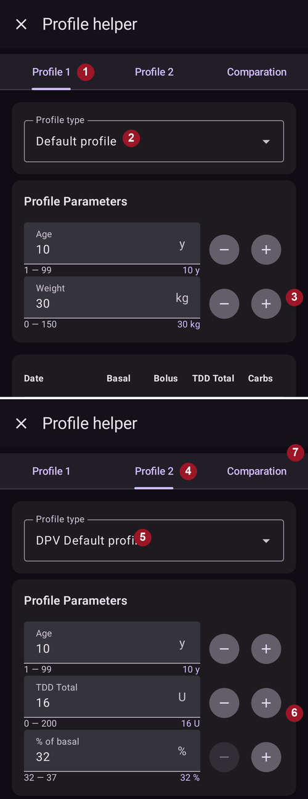
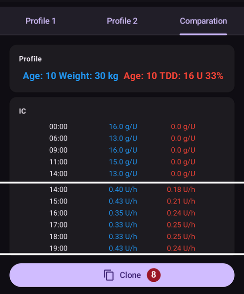
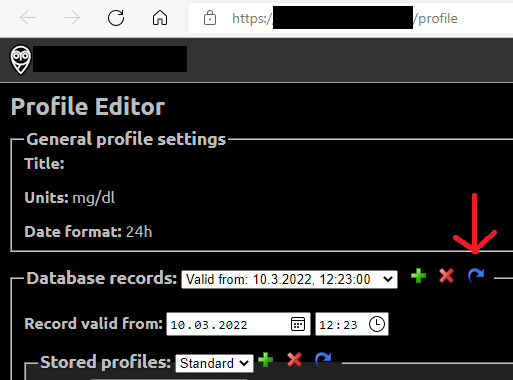
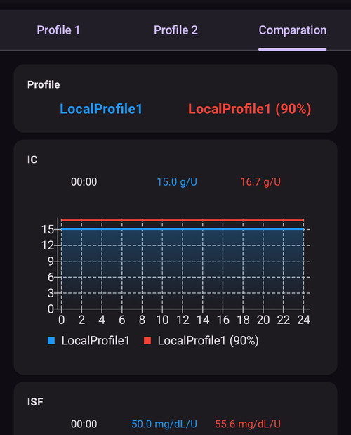

# Din AAPS-profil

Din **AAPS-profil** är en uppsättning med fyra viktiga parametrar som bestämmer hur **AAPS** ska ge insulin utifrån dina glukosvärden från sensorn. Detta är de viktigaste parametrarna som **AAPS** bygger på. När du går vidare genom **Målen** låser du upp fler parametrar som du kan ändra (som SMB-inställningar), men hur bra dessa funktioner fungerar beror på att din grundläggande **Profil** är rätt. **Profilen** innehåller:
* [glukosmålvärden](#profile-glucose-targets),
* [basaldoser](#your-aaps-profile-basal-rates) (BR),
* [insulinkänslighetsfaktorer](#your-aaps-profile-insulin-sensitivity-factor) (ISF) och
* [kolhydratkvoter](#your-aaps-profile-insulin-to-carbs-ratio) (IC eller ICR).

```{admonition} Where did DIA go?
:class: note
**Insulinets verkningstid (DIA)** är inte längre en del av din **Profil**. Den ställs i stället in för varje insulin – se [Hantera → Insulininställningar](#Config-Builder-insulin-dia).
```

Som en del av att sköta **AAPS** bör du hela tiden bedöma och granska hur korrekta inställningarna i din **Profil** är. Vi rekommenderar att du ställer in värdena i den ordning de visas här. Försök få en inställning rätt innan du ändrar nästa. Arbeta i små steg i stället för att göra stora ändringar på en gång. Glöm inte att aktivera den nya profilen efter varje ändring. [Säkerhetskopiera inställningarna i din **Profil**](#YourAapsProfile_Profile-backup) regelbundet genom att exportera dina inställningar.

Inställningarna i din **Profil** påverkar varandra – du kan ha ”fel” inställningar som fungerar bra tillsammans i vissa situationer men inte i andra. Till exempel om en för hög basal råkar sammanfalla med en för hög **KH-kvot**. Därför måste du se på varje inställning för sig och kontrollera att de fungerar bra tillsammans i många olika situationer.

Du kan använda [Autotune](https://autotuneweb.azurewebsites.net/) som stöd när du funderar, men följ det inte blint: det kanske inte fungerar bra för dig eller i alla situationer.

```{admonition} Your diabetes may vary
:class: note
**Profiler** skiljer sig mycket från person till person.

För basaldoser (BR), insulinkänslighetsfaktorer (ISF) och kolhydratkvoter (IC eller ICR) skiljer sig de absoluta värdena och insulinbehovets variation mycket från person till person. Det beror på din biologi, ditt kön, din ålder, din kondition osv., men också på kortsiktiga faktorer som sjukdom och nyligen gjord träning. Mer vägledning finns i boken [“Bright Spots and Landmines”](https://diatribe.org/bright-spots-and-landmines/) av Adam Brown, som är mycket läsvärd.

```

De fyra sista parametrarna (glukosmålvärden, basaldoser, insulinkänslighetsfaktorer och kolhydratkvoter) kan ställas in på olika värden under dygnet och vid behov ändras varje timme.


Skärmbilder från **AAPS** med en _exempelprofil_ visas nedan. Observera att exempelprofilen nedan har väldigt många tidpunkter. När du börjar med **AAPS** är din profil troligen mycket enklare.


(profile-glucose-targets)=
## Glukosmålvärden

### Beskrivning

Ditt **BG-målvärde** är ett grundvärde, och alla beräkningar i **AAPS** bygger på det. Det är inte samma sak som det målområde där du brukar försöka hålla dina blodsockervärden. Målvärdet används i beräkningarna i **AAPS**: om **AAPS** förutser att ditt **BG** hamnar utanför målområdet, gör det något för att få tillbaka dig inom området.

Målvärdena kan ställas in inom dessa gränser:

|         | _Lågt_ målvärde           | _Högt_ målvärde             |
| ------- | ------------------------- | --------------------------- |
| Minimum | 4,4 mmol/l eller 80 mg/dl | 5 mmol/l eller 90 mg/dl     |
| Maximum | 10 mmol/l eller 180 mg/dl | 11,1 mmol/l eller 200 mg/dl |

### Påverkan

Om målvärdet i din **Profil** är väldigt brett (t.ex. 3 mmol/l eller mer [50 mg/dl eller mer]), märker du ofta att **AAPS** gör lite. Det beror på att **BG** förutsägs hamna någonstans i det breda området, och därför är det inte troligt att **AAPS** sätter tillfälliga basaldoser.

### Så ställer du in det

**Bilden nedan** visar ett exempel på hur målvärdet kan ställas in i en profil i **AAPS**.


**BG**-målvärden ställs in efter dina egna önskemål och behov. Om du till exempel är orolig för hypon på natten kan du sätta ditt målvärde lite högre, 117 mg/dl (6,5 mmol/l), från kl. 21 till 7. Om du vill vara säker på att ha mycket aktivt insulin (IOB) på morgonen innan du tar bolus till frukosten, kan du ställa in ett lägre målvärde på 81 mg/dl (4,5 mmol/l) kl. 7–8.

I [Öppen loop](#KeyAapsFeatures-OpenLoop), särskilt medan du går igenom [de första målen](../SettingUpAaps/CompletingTheObjectives.md), kan ett brett målområde vara ett bra val medan du lär dig hur **AAPS** beter sig och justerar din **Profil**.<br/> I [Sluten loop](#KeyAapsFeatures-ClosedLoop) (från och med **[Mål 6](#objectives-objective6)**) rekommenderas att du minskar området tills du har ett enda målvärde för varje tid på dygnet (_Lågt_ målvärde = _Högt_ målvärde), så att **AAPS** reagerar snabbt på ändringar i **BG**.

(your-aaps-profile-basal-rates)=

## Basaldoser

### Beskrivning

Din basaldos (enheter/timme) ger bakgrundsinsulin, som håller glukosvärdet stabilt när du inte äter eller tränar.

Insulinpumpen ger små mängder snabbverkande insulin med några minuters mellanrum, så att levern inte släpper ut för mycket glukos och så att glukosen kan tas upp i kroppens celler. Basalinsulin är oftast 40–50 % av din totala dygnsdos (TDD), beroende på vad du äter, och följer ofta en dygnsrytm med en topp och en dal i insulinbehovet under 24 timmar. Mer information finns i kapitel 6 i [“Think like a Pancreas”](https://amzn.eu/d/iVU0RGe) av Gary Scheiner, som är mycket användbar.

De flesta diabetesutbildare för typ 1-diabetes (och personer med typ 1-diabetes!) är överens om att du ska få dina basaldoser rätt innan du försöker optimera ISF och KH-kvot.

### Påverkan

Med rätt basaldoser vaknar du inom målområdet och kan hoppa över måltider, eller äta tidigare eller senare under dagen, utan att gå högt eller lågt.

För hög basaldos kan leda till lågt BG. Och tvärtom.

**AAPS** utgår från standardbasaldosen som baslinje. Om basaldosen är för hög räknas en ”tillfällig basal på noll” som en större negativ IOB än den borde. Det gör att **AAPS** ger fler korrigeringar efteråt än det borde, för att till slut få IOB till noll.

En för hög basaldos ger alltså lågt **BG** både med standarddosen och några timmar senare, när **AAPS** korrigerar mot målvärdet.

Omvänt kan en för låg basaldos leda till högt BG och till att nivåerna inte går ner till målvärdet.

### Så ställer du in det

**Bilden nedan** visar ett exempel på hur basaldoserna kan ställas in i en profil i **AAPS**.


Att få rätt basaldoser görs genom att prova sig fram, och det ska göras tillsammans med ditt diabetesteam.

Det finns metoder för basaltest som oftast går ut på att följa dina basaldoser och ditt insulinbehov under en <u>periodvis</u> fasta under ett dygn (24 timmar). Även om du behöver testa dina basaldoser för hela dygnet är det inte rekommenderat att fasta 24 timmar i sträck. Det beror på att kroppen sätter igång mekanismer, till exempel hormoner, för att kompensera. Ett rekommenderat sätt är att fasta 8 timmar åt gången under 3 olika dagar.

Den rekommenderade metoden är att pausa loopen (för säkerhets skull kan du ställa AAPS på [**Paus vid lågt blodsocker (LGS)**](#KeyAapsFeatures-LGS) för att undvika låga värden, som när du klarar [mål 6](#objectives-objective6)). Då går pumpen tillbaka till din vanliga standardbasaldos. Se hur ditt **BG** ändras: om det sjunker är basaldosen för hög. Och tvärtom.<br/> Ett annat sätt (kan vara svårare) är att låta loopen vara igång och se hur **IOB** ändras. Om **IOB** är negativ är din basaldos för hög. Och tvärtom. Tänk på att den här metoden förlitar sig på **ISF** för att korrigera **BG**, och därför måste andra värden vara rimligt rätt inställda för att den ska fungera.<br/> Ett annat sätt att justera dina basaldoser är att följa loopens åtgärder under natten, när alla COB har tagits upp. Metoden passar särskilt bra för barn, när det är svårt att fasta eller när insulinbehovet ändras ofta. [Dr Saleh Adi från Tidepool](https://www.youtube.com/watch?v=-fpWnGRhLSo) visar användbara sätt att analysera BG-kurvor under natten för att optimera dina basaldoser.

Se [här](../GettingHelp/ProfileTuning.md) hur du finjusterar din basalprofil genom att analysera mönster med sluten loop.

När du ändrar något utifrån resultatet av ditt basaltest ska ändringarna i **Profil** göras 1 till 2 timmar (beror på din insulintyp) före ökningen/minskningen. Upprepa testet vid behov tills du känner dig trygg med inställningarna för dina **basaldoser**.

(your-aaps-profile-basal-not-compatible)=
#### Meddelande: "Basaldosen är inte kompatibel med den aktiva pumpen"

Varje pump har gränser: en lägsta och en högsta basaldos som den kan ge, och för vissa pumpar (till exempel Dana, Accu-Chek Combo, Medtronic och Diaconn G8) kan basaldoserna bara ändras vid hel timme. **AAPS** kontrollerar din profil mot pumpen du använder, **efter** att procenten du valt har räknats in.

Om en basaldos ligger utanför dessa gränser visar skärmen **Aktivera** det här meddelandet och knappen **Aktivera** förblir grå:


Med till exempel en basaldos på 0,10 U/h på natten och en procent av profil på 35 % skulle **AAPS** behöva ge 0,035 U/h. Det är mindre än en Dana-pump kan ge (0,04 U/h).

Lös det genom att antingen:

* välja en annan procent: en **högre** om en basaldos blir för låg, en **lägre** om en basaldos blir för hög, eller
* [redigera profilen](#your-aaps-profile-create-and-edit-profiles) och ändra basaldosen.

I profilredigeraren kan basaldoser bara börja vid hel timme. En basaldos som börjar t.ex. kl. 06:30 kan bara komma från en äldre profil, till exempel efter att du bytt till en pump som inte stöder det.

(your-aaps-profile-insulin-sensitivity-factor)=

## Insulinkänslighetsfaktor (ISF)

### Beskrivning

Insulinkänslighetsfaktorn (ibland kallad korrektionsfaktor) visar hur mycket ditt blodsocker sänks av 1 enhet insulin.

**Med enheten mg/dl:** Om du har en **ISF** på 40 sänker varje enhet insulin ditt blodsocker med cirka 40 mg/dl (till exempel sjunker ditt blodsocker från 140 mg/dl till 100 mg/dl).

**Med enheten mmol/l:** Om du har en **ISF** på 1,5 sänker varje enhet insulin ditt blodsocker med cirka 1,5 mmol/l (till exempel från 8 mmol/l till 6,5 mmol/l).

Av exemplen ser du att ju _mindre_ värdet på **ISF** är, desto mindre känslig är du för insulin. Om du alltså sänker din ISF från 40 till 35 (mg/dl) eller från 1,5 till 1,3 (mmol/l), kallas det ofta att du gör din **ISF** starkare. Omvänt, om du höjer värdet för **ISF** från 40 till 45 (mg/dl) eller från 1,5 till 1,8 (mmol/l), gör du din **ISF** svagare.

### Påverkan

En **lägre / starkare ISF** (t.ex. 40 i stället för 50) betyder att insulinet sänker ditt **BG** mindre per enhet. Det leder till en mer aggressiv / starkare korrigering från loopen med **mer insulin**. Om din **ISF** är för stark (litet värde) kan det leda till lågt **BG**.

En **högre / svagare ISF** (t.ex. 45 i stället för 35) betyder att insulinet sänker ditt **BG** mer per enhet. Det leder till en mindre aggressiv / svagare korrigering från loopen med **mindre insulin**. Om din **ISF** är för svag (stort värde) kan det leda till högt **BG**.

**Exempel:**
* **BG** är 190 mg/dl (10,5 mmol/l) och målvärdet är 100 mg/dl (5,6 mmol/l).
* Du vill alltså korrigera med `190 - 100 = 90 mg/dL` eller `10.5 - 5.6 = 4.9 mmol/L`
* Om `ISF = 30` -> `90 / 30 = 3` eller `ISF = 1.63` -> `4.9 / 1.63 = 3`: 3 enheter insulin
* Om `ISF = 45` -> `90 / 45 = 2` eller `ISF = 2.45` -> `4.9 / 2.45 = 2`: 2 enheter insulin

En **ISF** som är för låg (och därför mer aggressiv, vilket inte är ovanligt) kan ge ”överkorrigeringar”, eftersom **AAPS** räknar ut att du behöver mer insulin för att korrigera ett högt **BG** än vad som faktiskt behövs. Det kan ge ett BG som går upp och ner som en ”berg-och-dalbana” (särskilt vid fasta), som bilden nedan visar. I så fall ska värdet för **ISF** höjas så att **AAPS** blir mindre aggressivt. Då ger **AAPS** mindre korrigeringsdoser och undviker att överkorrigera ett högt **BG** så att det blir ett lågt **BG**.


Omvänt kan en för hög **ISF** ge underkorrigeringar, vilket betyder att ditt **BG** stannar över målvärdet – det märks särskilt under natten.

### Så ställer du in det

Se **bilden nedan** för ett exempel på hur ISF-värden kan ställas in i en profil i **AAPS**.


En enkel startpunkt för att ta fram din ISF för dagtid är att utgå från din totala dygnsdos (TDD) med 1700 (94)-regeln. Mer information finns i kapitel 7 i [“Think like a Pancreas”](https://amzn.eu/d/iVU0RGe) av Gary Scheiner.

| 1700 (om du mäter i mg/dl) eller 94 (mmol/l) / TDD = ungefärlig ISF.<br/><br/>Exempel: TDD = 40 U<br/>Ungefärlig ISF (mg/dl) = 1700/40 = 43<br/>Ungefärlig ISF (mmol/l) = 94/40 = 2,4 |
| ------------------------------------------------------------------------------------------------------------------------------------------------------------------------------------------------------------- |
|                                                                                                                                                                                                               |

Om dina basaldoser är rätt kan du testa detta genom att pausa loopen, kontrollera att **IOB** är noll och ta några druvsockertabletter för att komma upp till en stabil ”hög” nivå.

Ta sedan en uppskattad mängd insulin (enligt nuvarande 1/ISF) för att nå ditt BG-målvärde.

Var försiktig, för det här värdet ställs ofta in för lågt. För lågt betyder att 1 U sänker BG snabbare än väntat.

(your-aaps-profile-insulin-to-carbs-ratio)=

## Kolhydratkvot (ICR)

### Beskrivning

**KH-kvoten** anger hur många gram kolhydrater som täcks av en enhet insulin.

Vissa använder också **I:C** som förkortning i stället för **ICR**, eller talar om kolhydratkvot: **CR**.

En kolhydratkvot på 1 till 10 (1:10) betyder till exempel att du tar 1 enhet insulin för varje 10 gram kolhydrater du äter. En måltid med 25 g kolhydrater skulle behöva 2,5 enheter insulin.

Om din **KH-kvot** är svagare (högre värde), kanske 1:20, behöver du bara 0,5 U insulin för att täcka 10 g kolhydrater. En måltid med 25 g kolhydrater skulle behöva 25/20 = 1,25 enheter insulin.

Det är vanligt att ha olika **KH-kvot** vid olika tider på dygnet, på grund av hormonnivåer och fysisk aktivitet. Många märker att de har sin lägsta/starkaste **KH-kvot** runt frukost, eftersom de ofta är mer insulinresistenta då. En vuxen användares **KH-kvot** kan till exempel vara 1:8 till frukost, 1:10 till lunch och 1:10 till middag. Men de här mönstren gäller inte alla, och vissa är mer insulinresistenta vid middagstid och behöver då en starkare/mindre **KH-kvot**.

> **OBS:**
> 
> I vissa europeiska länder användes brödenheter för att bestämma hur mycket insulin som behövs till maten. Från början var 1 brödenhet lika med 12 g kolhydrater, senare bytte vissa till 10 g kolhydrater.
> 
> I den modellen var mängden kolhydrater fast och mängden insulin varierade. (”Hur mycket insulin behövs för att täcka en brödenhet?”)
> 
> Med **KH-kvot** är mängden insulin fast och mängden kolhydrater varierar. (”Hur många gram kolhydrater kan täckas av en enhet insulin?”)
> 
> Exempel:
> 
> Brödenhetsfaktor (BU = 12 g kolhydrater): 2,4 U/BU -> Du behöver 2,4 enheter insulin när du äter en brödenhet.
> 
> Motsvarande **KH-kvot**: 12 g / 2,4 U = 5,0 g/U -> 5,0 g kolhydrater kan täckas med en enhet insulin.
> 
> BU-faktor 2,4 U / 12 g   ===>   IC = 12 g / 2,4 U = 5,0 g/U
> 
> Omräkningstabeller finns på nätet, t.ex. [här](https://www.mylife-diabetescare.com/files/media/03_Documents/11_Software/FAS/SOF_FAS_App_KI-Verha%CC%88ltnis_MSTR-DE-AT-CH.pdf).

### Påverkan

En **lägre / starkare KH-kvot** betyder mindre mat per enhet, alltså får du mer insulin för en fast mängd kolhydrater. Kan också kallas ”mer aggressiv”. Om din IC är för stark får du för mycket insulin, och det kan leda till lågt **BG**.

En **högre / svagare KH-kvot** = mer mat per enhet, alltså får du mindre insulin för en fast mängd kolhydrater. Kan också kallas ”mindre aggressiv”. Om din IC är för svag får du mindre insulin än du behöver, och det kan leda till högt **BG**.

### Så ställer du in det

**Bilden nedan** visar ett exempel på en användares **KH-kvot** och hur den kan ställas in i en **AAPS-profil**. När du anger värdena skriver du in den sista delen av kvoten, så en KH-kvot på 1:3,5 anges helt enkelt som ”3,5”.


Om ditt **BG** ligger högre än före maten när måltiden har smälts och **IOB** har gått tillbaka till noll, är din **KH-kvot** troligen för svag (_dvs._ talet är för högt och bör sänkas stegvis). Omvänt, om ditt **BG** är lägre än före maten är **KH-kvoten** för stark (_dvs._ talet är för litet och bör höjas stegvis).

Om dina basaldoser är rätt kan du testa genom att kontrollera att **IOB** är noll och att du ligger inom målområdet, äta en exakt känd mängd kolhydrater och ta en uppskattad mängd insulin utifrån din nuvarande KH-kvot. Det bästa är att äta mat som du brukar äta vid den tiden på dygnet och räkna kolhydraterna noga.

## Vanliga frågor om profilen

```{contents} Common questions related to the Profile
:depth: 1
:local: true
```

### Om varför det är viktigt att profilen är rätt

**Varför ska jag försöka få rätt inställningar i min profil? Kan inte loopen bara sköta det?**

En hybrid sluten loop _kan_ försöka justera insulintillförseln för att minska dålig glukoskontroll som beror på felaktiga värden i din **Profil**. Det kan till exempel ske genom att insulinleveransen hålls inne om du är på väg mot en hypoglykemi. Men du får mycket bättre glukoskontroll om inställningarna i din **Profil** redan ligger så nära det din kropp behöver som möjligt. Det är ett av skälen till att **AAPS** använder mål i steg för att gå från pumpbehandling med öppen loop till hybrid sluten loop. Dessutom kommer det att finnas tillfällen när du behöver öppna loopen (sensorns uppvärmning, sensorfel _osv._), ibland mitt i natten, och då vill du att dina inställningar är rätt.

Om du börjar med **AAPS** efter att ha använt ett annat pumpsystem med öppen eller sluten loop, har du redan en ganska bra bild av vilka värden du ska använda för basaldoser (**BR**), insulinkänslighetsfaktorer (**ISF**) och kolhydratkvoter (**ICR**).

Om du går från injektioner (MDI) till **AAPS** är det en bra idé att först läsa på om hur man byter från MDI till pump, och att planera och göra bytet noga tillsammans med ditt diabetesteam. ["Pumping insulin"](https://amzn.eu/d/iaCsFa2) av John Walsh & Ruth Roberts och [“Think like a Pancreas”](https://amzn.eu/d/iVU0RGe) av Gary Scheiner är mycket användbara.

### Vad orsakar höga toppar efter måltid med sluten loop?
Kontrollera först din basaldos och gör ett basaltest utan kolhydrater. Om den är rätt och ditt **BG** sjunker till målvärdet när kolhydraterna har tagits upp helt, kan du prova att sätta ett tillfälligt målvärde ”Äta snart” i **AAPS** en stund före måltiden, eller fundera på en lämplig tid för förbolus tillsammans med din diabetesläkare. <br/> Om ditt **BG** är för högt efter måltiden och fortfarande för högt när kolhydraterna har tagits upp helt, kan du tillsammans med din diabetesläkare överväga att sänka din **KH-kvot**. Om ditt **BG** är för högt medan det finns **COB** och för lågt när kolhydraterna har tagits upp helt, kan du tillsammans med din diabetesläkare fundera på att höja din **KH-kvot** och på en lämplig tid för förbolus.

### Mitt BG ligger kvar högt och loopen får inte ner det
Möjliga orsaker till att **AAPS** inte ger tillräckligt med insulin är:
* **ISF** är inte tillräckligt stark
* Basaldosen kanske inte är tillräckligt stark
* En säkerhetsinställning kan slå till, till exempel **maxIOB**. Eller så är **SMB** avstängt vid den tiden, beroende på dina inställningar.
* En automation har ställts in och har tagit över styrningen från **AAPS**.

Se även [Finjustera AAPS-profilen](../GettingHelp/ProfileTuning.md).

### Jag har negativ IOB, är det ett problem?
Negativ **IOB** betyder att den absoluta mängden insulin (basal + bolus) i din kropp är mindre än basalen. Det gör att **AAPS** ger mer insulin så fort **BG** börjar stiga, eftersom det anser att insulin saknas. Det kan ge lågt **BG** senare.

Här är några orsaker till att du kan ha negativ IOB, och vad du kan göra:
* för stark basal: justera din **Profil**
* för mycket bolus till förra måltiden: justera din **Profil** eller kontrollera att du tar bolus vid rätt tidpunkt.
* DIA för din insulintyp är för kort inställd, vilket gör att insulin staplas: justera det i [Hantera → Insulininställningar](#Config-Builder-insulin-dia)
* fysisk aktivitet: överväg nästa gång att använda en lägre [procent av profil](../DailyLifeWithAaps/ProfileSwitch-ProfilePercentage.md) under aktiviteten, eftersom känsligheten ökar.

## Hantera dina profiler

```{contents} Operations that you can perform on your **Profiles** in **AAPS**
:depth: 1
:local: true
```
(your-aaps-profile-create-and-edit-profiles)=
### Skapa och redigera profiler

I **AAPS** v4 finns dina profiler på skärmen **Hantera** (nedre navigeringen) → **Profil**. De visas som en karusell med kort som du kan svepa mellan, med ett åtgärdsfält (**➕ Lägg till**, **✏️ Redigera**, **⧉ Klona**, **🗑️ Radera**, **▶ Aktivera**). Hur du hanterar och aktiverar en profil beskrivs i [Hantera och aktivera profiler](#ProfileSwitch-manage-v4). Kommer du från **AAPS** v3, där profilerna hade en egen flik? Se [Vad har ändrats i AAPS v4](#v4changes-manage).

Tryck på **✏️ Redigera** för att öppna redigeraren. Ange profilens **namn** och **enheter** och fyll sedan i de fyra schemana med hjälp av flikarna:

- **IC** – kolhydratkvot (g/U)
- **ISF** – insulinkänslighetsfaktor
- **BAS** – basaldoser
- **MÅL** – målområde


Varje schema är en lista med **tidsblock**: lägg till ett block, ställ in starttid och värde och tryck sedan på **Spara**.

Om du ändrar något i din **Profil**, se till att du redigerar rätt **Profil**: kortet för profilen som används är märkt **AKTIV**, men kortet som är valt på skärmen kan vara ett annat.

(your-aaps-profile-profile-from-scratch-for-a-kid)=
### Skapa en profil från början för ett barn

[Profilguiden](#aaps-screens-profile-helper) (menyn ☰ → **Profilguide**) kan hjälpa dig att skapa en profil för ett barn (upp till 18 år).

**Viktigt:**

**Profilguiden är tänkt att hjälpa dig att hitta en första profil för ditt barn. Även om den bygger på data från två olika sjukhus ska du alltid prata med ditt vårdteam innan du använder en ny profil!**

Profilguiden har data från två olika sjukhus som hjälper dig att hitta en första profil för ditt barn upp till 18 år.



1. Se till att du är på fliken **Profil 1**.
2. Under **Profiltyp**, se till att "Standardprofil" är vald.
3. Justera Standardprofil (bygger på data från ett sjukhus) genom att ange barnets ålder och antingen TDD totalt **eller** vikt.
4. Byt till fliken **Profil 2**.
5. Tryck på **Profiltyp** och välj "DPV-standardprofil".
6. Justera DPV-standardprofil (bygger på data från ett annat sjukhus) genom att ange barnets ålder, TDD totalt och procent av basal. Observera att DPV-datan bara ger **basaldoser**, så IC och ISF visas som noll för den här profilen.
7. Öppna fliken **Jämförelse**. En jämförelse av de två justerade profilerna visas (se skärmbilden nedan).
8. Om du vill börja finjustera din profil utifrån ett av förslagen, använd knappen **Klona** längst ner i jämförelsen.



### Byt profil

Se [Profilbyte och procent av profil](../DailyLifeWithAaps/ProfileSwitch-ProfilePercentage.md).

(your-aaps-profile-clone-profile-switch)=
### Klona ett profilbyte till en ny profil


[Behandlingshistorik](#aaps-screens-treatments) visar alla tidigare **Profilbyten**. På fliken **Profilbyte** kan du använda ett tidigare **Profilbyte** som grund för att skapa en ny **Profil**. I så fall används tidsförskjutningen och procenten i den nya lokala profilen. Använd knappen **Klona** på rad **2**.

Nu kan du gå till [profilskärmen](#your-aaps-profile-create-and-edit-profiles) (**Hantera → Profil**) för att redigera den nya profilen.

(YourAapsProfile_Profile-backup)=
### Säkerhetskopia av profiler

Dina **Profiler** är en grundinställning i ditt loopsystem. De är mycket känsliga, och du vill verkligen inte förlora dem.

* Dina **Profiler** sparas i databasen i **AAPS**.
* När **NSClientV3** är inställt (se [Synkronisering](#SetupWizard-synchronization-with-the-reporting-server-and-more)) laddas dina **Profiler** också upp till Nightscout automatiskt.
* De ingår också i [exporterade inställningar](../Maintenance/ExportImportSettings.md). Se därför till att ha en säkerhetskopia på ett säkert ställe.

### Redigera profiler från Nightscout

Om det är aktiverat kan ändringar i **Profil** som görs direkt i Nightscout tas emot i **AAPS**. Inställningen heter "**Ta emot profiler från NS**" och hör till alternativen under **Godkännande av Nightscout-data** (att ta emot data från Nightscout är avstängt som standard, se [steget Klientkontroll i installationsguiden](../SettingUpAaps/SetupWizard.md)). Du hittar den snabbt med **sökfältet** på huvudskärmen. Medan klientstyrning är på är inställningen dold och **AAPS** tar inte emot några profiländringar från Nightscout ([härdat läge](#client-master-control-hardened-mode)). Redigera i stället profilen på en parkopplad klient, eller ladda den en gång med **Full synkronisering**.

Det kan vara bra när du ska göra stora ändringar i en mer omfattande **Profil**. De kan lättare matas in via webbgränssnittet, _t.ex._ för att kopiera data för hand från ett kalkylblad.

För att göra det är det dock viktigt att klona hela **databasposten**, som består av flera profiler, i Nightscouts redigerare (blå pil på skärmbilden nedan). De nya databasposterna får då dagens datum. När du har sparat kan den ändrade/nya **Profilen** aktiveras i **AAPS** med ett vanligt [Profilbyte](../DailyLifeWithAaps/ProfileSwitch-ProfilePercentage.md).



(your-aaps-profile-compare-profiles)=
### Jämför två profiler

Du kan också använda [Profilguiden](#aaps-screens-profile-helper) (menyn ☰ → **Profilguide**) för att jämföra två olika profiler eller profilbyten (procent av en av dina profiler som du tidigare har använt i ett [profilbyte](../DailyLifeWithAaps/ProfileSwitch-ProfilePercentage.md)).


1. Se till att du är på fliken **Profil 1**.
2. Under **Profiltyp**, välj "Tillgänglig profil" för att välja bland alla sparade **Profiler**.
3. Välj den **Profil** du vill jämföra från.
4. Byt till fliken **Profil 2**.
5. Under **Profiltyp**, välj "Profilbyte" för att välja i historiken över alla dina **Profilbyten**.
6. Välj det **Profilbyte** du vill jämföra med.
7. Öppna fliken **Jämförelse**. En jämförelse av de två profilerna visas (se skärmbilden nedan).


