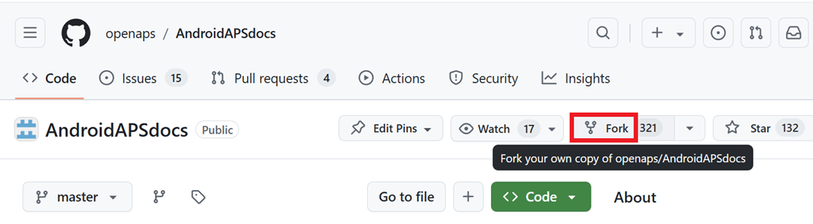
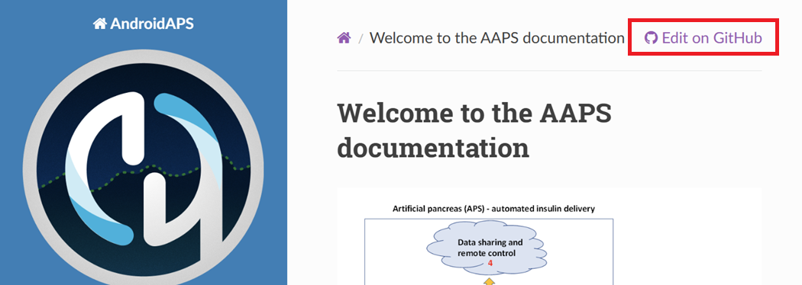
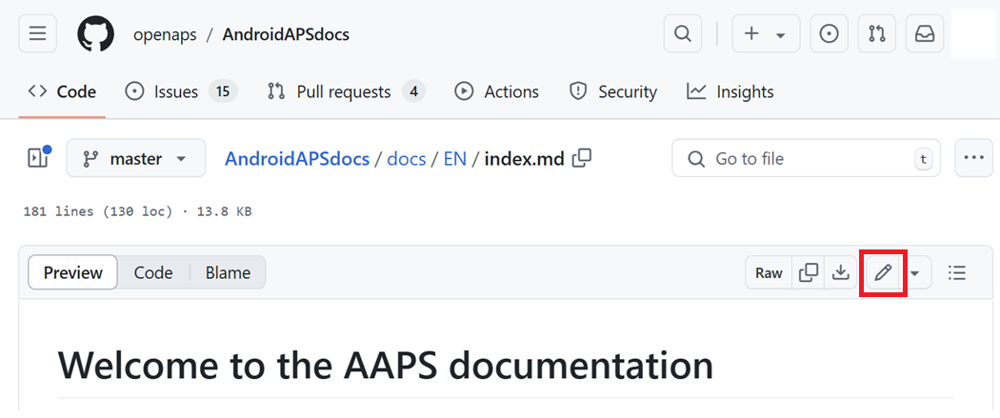
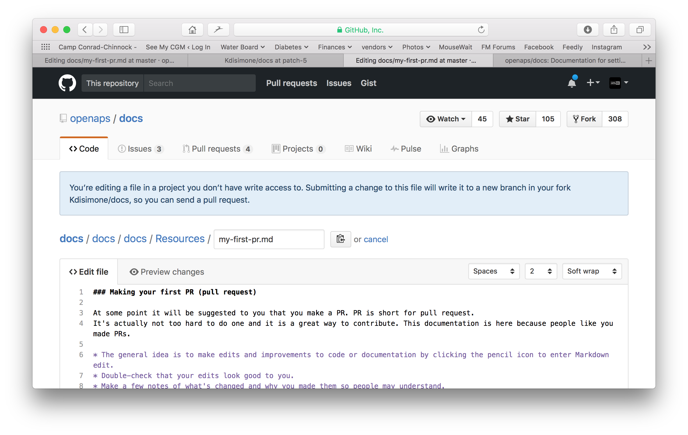
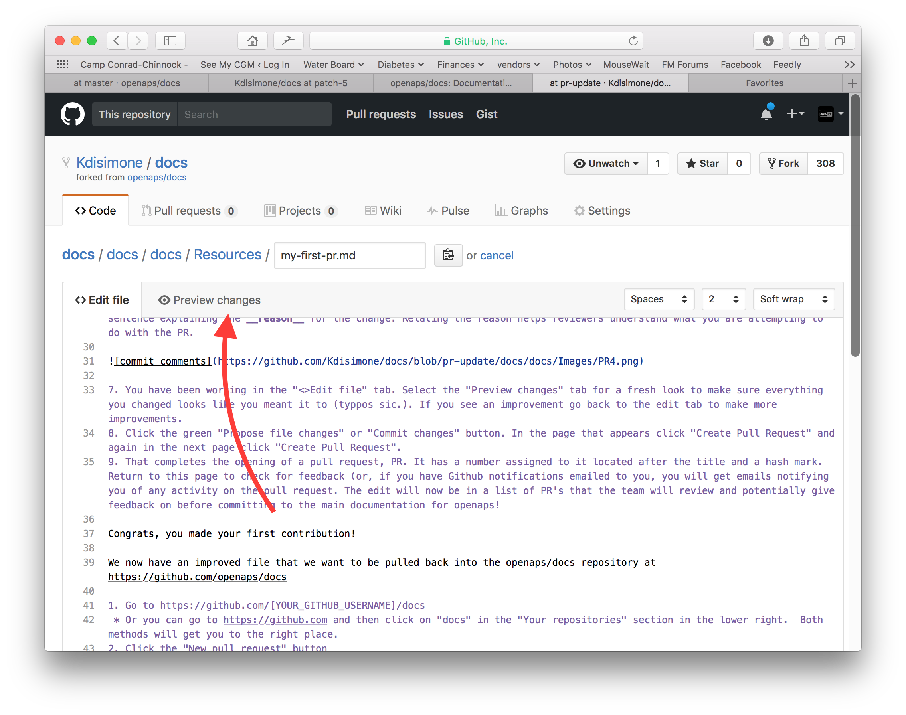
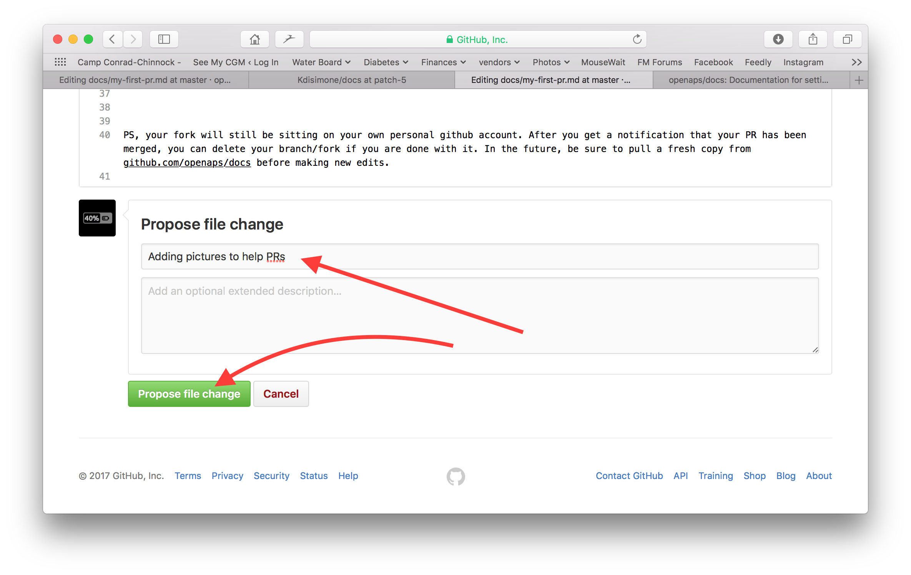
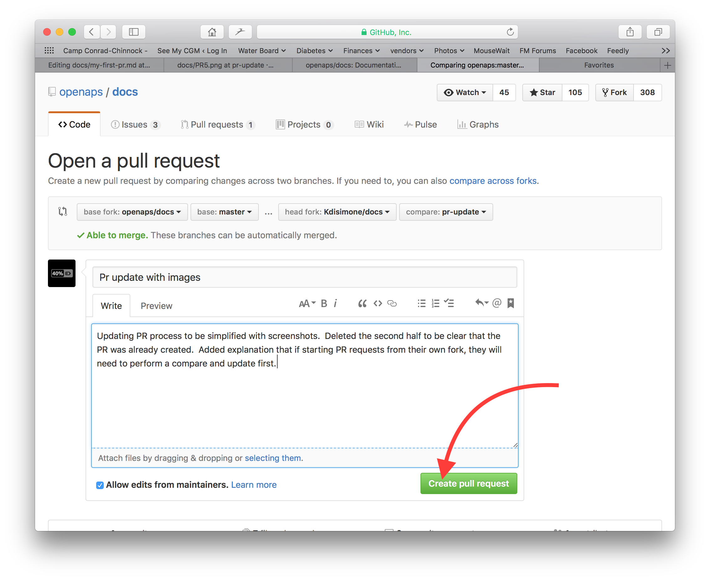
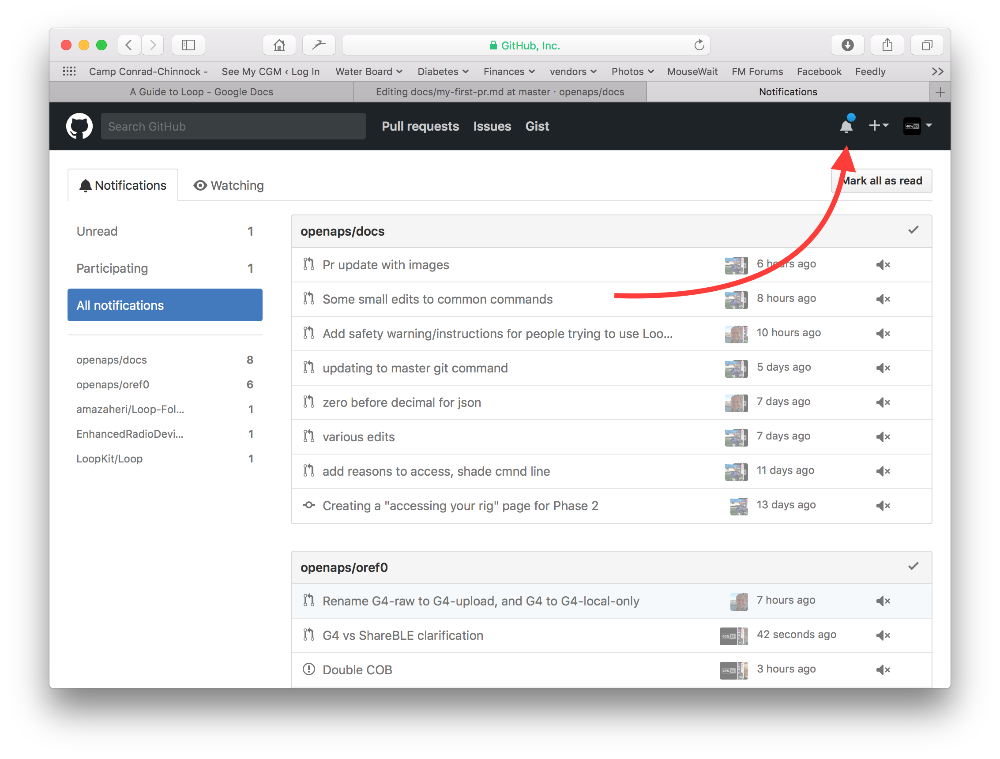
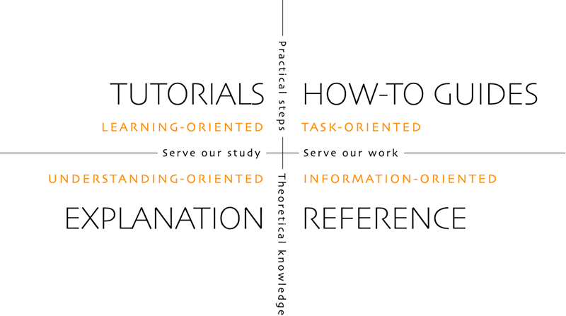

# Så redigerar du dokumentationen

**Den här beskrivningen gäller bara redigering av den engelska dokumentationen. All ny information måste först läggas till på engelska. Om du vill översätta till andra språk (tack!), använd [crowdin](https://crowdin.com/project/androidapsdocs).**

Tips om hur du formaterar text (rubrik, fetstil ...) och lägger in länkar finns i avsnittet ["Kodsyntax"](#edit-the-docs-code-syntax) på den här sidan.

## Allmänt

Om du har frågor, återkoppling eller nya idéer kan du kontakta dokumentationsteamet via [discord](https://discord.gg/4fQUWHZ4Mw).

Förr eller senare kommer någon att föreslå att du gör en pull request (PR). Det är så dina ändringar i dokumentationen faktiskt hamnar på AAPS webbsidor, som lagras på GitHub. Det är faktiskt inte så svårt att göra en PR, och det är ett bra sätt att bidra. Du läser den här dokumentationen just nu tack vare att personer som du har gjort PR:er. Var inte orolig för att göra fel eller råka redigera fel dokument. Dina ändringar granskas innan de slås ihop med det "officiella" repot för AAPS-dokumentationen. Du kan inte förstöra originalen av misstag under processen. Processen i stora drag:

- Gör ändringar och förbättringar i koden eller dokumentationen genom att redigera det befintliga innehållet.
- Kontrollera en gång till att dina ändringar ser bra ut.
- Skriv några korta anteckningar om vad som har ändrats, så att andra kan förstå ändringarna.
- Skapa en pull request. Den ber administratörerna att ta in dina ändringar.
- De granskar ändringarna och gör sedan något av följande: (1)slår ihop (merge) dina ändringar, (2)skriver en kommentar till dig om ändringarna eller (3)startar ett nytt dokument med dina ändringar.

(Tips: Om du lär dig bäst genom att se, finns det en YouTube-video [här](https://youtu.be/4b6tsL0_kzg) som visar hur en PR går till.)

I vårt exempel gör vi en ändring i AndroidAPSdocs. Det här kan göras på vilken Windows-dator, Mac osv. som helst. (vilken dator som helst med internetanslutning).

1. Gå till <https://github.com/openaps/AndroidAPSdocs> och tryck på Fork (forka) uppe till höger för att göra en egen kopia av repot.



2. Gå till valfri sida och navigera till den sida du vill redigera. Du kan klicka på länken "Edit in GitHub" (redigera i GitHub) uppe till höger. Det går bara på engelska sidor. 



Eller klicka på pennikonen som visas i den övre listen på sidan som du vill redigera. Du måste redan vara inloggad på ditt GitHub-konto för att göra detta (om du inte har ett konto är det enkelt att skapa ett).



3. Båda alternativen i steg 2 skapar en ny gren (branch) i DITT repo där dina ändringar sparas. Gör dina ändringar i filen.

Vi använder markdown för sidorna i dokumentationen. Filerna har filändelsen ".md". Markdown-specifikationen är inte fast, och just nu använder vi myst_parser för våra markdown-filer. Var noga med att använda rätt syntax, som [beskrivs nedan](#edit-the-docs-code-syntax).



4. Du har arbetat i fliken "<>Edit file" (redigera filen). Välj fliken "Preview changes" (förhandsgranska ändringarna) för att se med nya ögon att allt du har ändrat ser ut som du tänkt dig (kontrollera även stavfel). Om du ser något mer som behöver förbättras går du tillbaka till redigeringsfliken och gör fler ändringar. 



5. När du är klar med dina ändringar scrollar du längst ner på sidan. I rutan längst ner skriver du dina kommentarer i textfältet med texten "Add an optional extended description..." (lägg till en valfri utförlig beskrivning). Standardrubriken innehåller filnamnet. Försök att skriva en mening som förklarar **varför** du gör ändringen. När du anger orsaken förstår granskarna lättare vad du vill uppnå med din PR.



6. Klicka på den gröna knappen "Propose file changes" (föreslå filändringar) eller "Commit changes" (spara ändringarna). På sidan som visas klickar du på "Create Pull Request" (skapa pull request), och på nästa sida klickar du igen på "Create Pull Request".



7. Nu har du öppnat en pull request (PR). GitHub ger din PR ett nummer. Det står efter rubriken och ett #-tecken. Gå tillbaka till den här sidan för att se om du har fått återkoppling (eller, om du får GitHub-aviseringar via e-post, får du e-post om allt som händer med din PR). Ändringen finns nu i en lista med PR:er som teamet granskar. De kan ge återkoppling innan ändringen tas in i den officiella dokumentationen för AAPS! Om du vill följa hur det går med din PR kan du klicka på klockikonen uppe till höger i ditt GitHub-konto och se alla dina PR:er.



PS: Din fork och din gren finns kvar på ditt eget GitHub-konto. När du har fått en avisering om att din PR har slagits ihop (merged) kan du ta bort din gren om du inte behöver den längre (aviseringsområdet i steg 7 visar en länk för att ta bort grenen när den har stängts eller slagits ihop). Om du följer den här metoden nästa gång du redigerar, börjar dina ändringar alltid från en uppdaterad version av AndroidAPSdocs-repona. Om du väljer ett annat sätt att starta en PR (till exempel att börja redigera från master-grenen i ditt forkade repo) måste du först se till att ditt repo är uppdaterat. Gör då en "compare" (jämförelse) och slå ihop alla ändringar som har kommit sedan du senast uppdaterade din fork. Eftersom många glömmer att uppdatera sina repon rekommenderar vi att du använder PR-metoden ovan tills du är van vid att göra en "compare".

(edit-the-docs-code-syntax)=

## Kodsyntax

Vi använder markdown för sidorna i dokumentationen. Filerna har filändelsen ".md".

Markdown är ett mycket enkelt språk för textformatering som skiljer textinnehållet från formateringen.

Den som skriver markerar bara till exempel en rubrik som rubrik på nivå 1, och markdown-processorn skapar den HTML-kod som behövs för att visa rubriken i HTML.

Tanken bakom detta är att

- den som skriver ska tänka på texten först och inte på formateringen,
- markdown-texten kan användas i olika markdown-verktyg, i stället för i till exempel slutna verktyg som Microsoft Word, och
- du kan skapa flera utdataformat från en och samma markdown-fil.

Markdown är inte en helt fast standard, och vi försöker hålla oss så nära standarden som möjligt för att

- vi ska kunna byta markdown-verktyg när det behövs eller när utvecklingen av markdown-verktyg och markdown-tjänster (SaaS) tvingar oss till det, och
- vi ska kunna använda översättningstjänster för att översätta den engelska texten till ett annat språk, till exempel franska eller tyska. De kan hantera markdown men inte komplicerade formateringskoder, eftersom de inte kan skilja innehåll från layout. Det kan vara förödande.

### Rubriker

- Rubrik 1: `# headline`
- Rubrik 2: `## headline`
- Rubrik 3: `### headline`
- Rubrik 4: `#### headline`

Vi försöker undvika fler rubriknivåer än så.

### Textformat

- **fet**: `**text**`
- *kursiv*: `*text*`
- ***fet kursiv***: `***text***`

### Numrerad lista

    1. första
    1. andra
    1. tredje
    

1. första
2. andra
3. tredje

### Punktlista

    - ett element
    - ett annat element
    - och ännu ett element
    

- ett element
- ett annat element
- och ännu ett element

### Lista med flera nivåer

Du kan lägga listor i listor genom att dra in nästa nivå 4 mellanslag längre åt höger än nivån före.

    1. första
    1. andra
    1. tredje
      1. ett element
      1. ett annat element
      1. och ännu ett element
    1. fyra
    1. fem
    1. sex
    

1. första
2. andra
3. tredje 
    1. ett element
    2. ett annat element
    3. och ännu ett element
4. fyra
5. fem
6. sex

### Bilder

För att lägga in bilder använder du den här markdown-syntaxen.

- bilder: ``

Bilden ska vara av typen PNG eller JPEG.

Bildnamn ska följa en av följande namnregler. I exemplet använder jag png som filändelse. Om du använder JPEG ska du i stället använda jpeg som filändelse.

- `filename-image-xx.png` där xx är ett unikt tvåsiffrigt nummer för bilderna i den här filen.
- `filename-image-xx.png` där xx är ett beskrivande namn som författaren av md-filen väljer.

Bilderna ligger i mappen images för det engelska språket och förs automatiskt över till de andra språken av Crowdin. Du behöver inte göra något för detta!

Vi översätter inte bilder just nu: bilder ska innehålla **så lite text som möjligt** så att de fungerar även för läsare som inte kan engelska.

(make-a-PR-image-size)= Använd en rimlig storlek på bilderna. De måste gå att läsa på dator, surfplatta och mobil.

- Skärmbilder från webbsidor ska vara högst **1050 pixlar breda**.
- Diagram över processflöden ska vara högst **1050 pixlar breda**.
- Skärmbilder från appen ska vara högst **500 pixlar breda**. Placera dem inte bredvid varandra om det inte behövs.
- Skärmbilder från klockan (**Wear OS**) ska vara högst **360 pixlar breda**. Förstora aldrig en skärmbild som är mindre.

### Länkar

#### Externa länkar

Externa länkar är länkar till externa webbplatser.

- extern länk: `[alt text](www.url.tld)`

#### Interna länkar till början av en md-fil

Interna länkar till sidor är länkar till början av en md-fil som ligger på vår egen server.

- intern länk till .md-sida: `[alt text](../folder/file.md)`

#### Interna länkar till namngivna referenser i texten

Interna länkar till namngivna referenser i texten är länkar till valfri plats i en md-fil som ligger på vår egen server, där en referens har satts att länka till.

Lägg till en namngiven referens på det ställe i md-målfilen som du vill hoppa till.

`(name-of-my-md-file-this-is-my-fancy-named-reference)=`

Den namngivna referensen måste vara unik i alla md-filer i AndroidAPSDocs, inte bara i den md-fil där den finns!

Därför är det bra att börja med filnamnet och sedan det referensnamn du väljer.

Använd bara små bokstäver och bindestreck mellan orden.

Länka sedan till den här referensen i texten du skriver med en länk av följande typ.

- Interna länkar till namngivna referenser i texten: `[alt text](name-of-my-md-file-this-is-my-fancy-named-reference)`

### Anteckningar, varningar, hopfällbara anteckningar

Du kan lägga till rutor med anteckningar och varningar i dokumentationen.

Du kan också lägga till hopfällbara anteckningar för detaljerad information, så att användare som inte är intresserade av detaljerna inte avskräcks från att läsa texten. Använd dem med försiktighet, eftersom dokumentationen ska vara så lätt att läsa som möjligt.

#### Anteckningar

    ```{admonition} Rubrik för anteckningen
    :class: note
    Det här är en anteckning.
    ```
    

```{admonition} Rubrik för anteckningen :class: note Det här är en anteckning.

    <br />#### Varningar
    
    ````
    ```{admonition} Varning
    :class: warning
    Det här är en varning.
    

    ```{admonition} Rubrik för varningen
    :class: warning
    Det här är en varning.
    ```
    
    #### Hopfällbara anteckningar
    
    

    {admonition} fördjupning för intresserade läsare
    :class: dropdown
    
    Den här rutan är hopfälld,
    vilket betyder att du kan lägga till längre innehåll här
    utan att det tar för mycket plats på sidan.
    

````

```{admonition} fördjupning för intresserade läsare :class: dropdown Den här rutan är hopfälld, vilket betyder att du kan lägga till längre innehåll här utan att det tar för mycket plats på sidan.

```

## Tabeller

Undvik tabeller med långa texter. Innehållet är svårt att ställa upp i Markdown, tabellerna får oftast inte plats på bredden av en mobilskärm och de ser troligen inte likadana ut efter översättningen.

## Stilguide

### Innehåll

1. Tips för att skriva på engelska

2. Skrivtips som gäller AAPS

3. Användbara referenser

###  1\. Tips för att skriva på engelska

#### Använd ett språk som passar läsaren

Använd enkel engelska (plain English) när det går. Det hjälper läsare som inte har engelska som modersmål och gör det också lättare att översätta AAPS-dokumentationen till andra språk. Skriv som om du pratar med användaren. Föreställ dig att du sitter vid ett bord mitt emot personen du skriver för. Kom ihåg att de flesta som använder AAPS inte är programmerare. Diabetes har också mycket fackspråk och många förkortningar. Tänk på att en del kanske nyligen har fått sin diagnos, inte har lika mycket erfarenhet av diabetes som du eller har fått en annan diabetesutbildning. Om du använder en kortform eller förkortning ska du skriva ut den i sin helhet första gången och sätta förkortningen direkt efter inom parentes, till exempel “super micro bolus (SMB)”. Länka också till ordlistan. Fackord som läsaren kanske inte känner till kan också läggas till inom parentes.

I stället för: *“What causes high postprandial BG peaks in closed loop?”*

Skriv: *“What causes a high BG peak **after lunch** (postprandial) in closed loop?”*

##### Använd enkla ord som alla förstår

Här finns en lista från A till Ö med enklare ord som gör din text lättare att förstå:

<https://www.plainenglish.co.uk/the-a-z-of-alternative-words.html>

#### Integritet och licenser:

Särskilt om du spelar in video eller tar skärmbilder: se till att du inte visar privata uppgifter (API-nyckel, lösenord). Se till att YouTube-innehåll inte är offentligt listat, utan att man behöver en länk från dokumentationen för att se det. Dra inte uppmärksamhet till material som bryter mot upphovsrätten (BYODA osv.).

#### Skriv korta meningar och kom till saken

- En tydlig text har i genomsnitt 15 till 20 ord per mening.

- Det betyder inte att alla meningar ska vara lika långa. Var kärnfull. Variera texten genom att blanda korta meningar (som den förra) med längre meningar (som den här).

- Håll dig till en huvudtanke per mening, och kanske en sak till som hör ihop med den.

- Ibland skriver du ändå en lång mening, särskilt när du försöker förklara något komplicerat. Men de flesta långa meningar kan delas upp på något sätt.

- Ta bort svaga ord: “you can”, “there is/are/were”, “in order to”.

- Sätt nyckelord nära början av rubriker, meningar och stycken.

- Var visuell! Visa ett kort diagram, en skärmbild eller en video när det går.

#### Var inte rädd för att ge instruktioner

Uppmaningar är det snabbaste sättet att ge instruktioner, men ibland är skribenter rädda för att ge uppmaningar och skriver “you should do this” (du borde göra detta) i stället för bara “do this” (gör detta). Kanske är man orolig att uppmaningar låter för hårda. Ofta kan du lösa det genom att sätta ordet 'please' (snälla, var vänlig) först. Men om något måste göras är det bäst att inte skriva ‘please’, eftersom det ger läsaren möjlighet att säga nej.

I stället för: *“You should just think of it as a complete statement.”*

Skriv: *“Think of it as a complete statement.”*

#### Använd oftast aktiva verb i stället för passiva verb

Exempel på ett **aktivt verb**:

- *“The pump (subject) delivers (verb) the insulin (object).”*

“delivers” är här ett aktivt verb. Meningen säger först vad som ger något, och sedan vad som ges.

Exempel på ett **passivt verb**:

- *“The insulin (subject) is delivered (verb) by the pump (object).”*

*“delivered”* är här ett passivt verb. Subjekt och objekt har bytt plats jämfört med meningen med aktivt verb. Vi har fått göra meningen längre genom att lägga till “is” och “by the”. Fundera också på att börja med det aktiva verbet.

I stället för: *“You can connect your pump with the phone through the AAPS pump menu, and there are a number of pumps available for you to connect with.”*

Skriv: *“Connect your desired pump to the phone through the AAPS pump menu.”*

Passiva verb kan ställa till problem:

- De kan vara förvirrande.

- De gör ofta texten mer långrandig.

- De gör texten mindre levande.

##### När passiv form passar bra

Ibland kan det vara lämpligt att använda passiv form.

- För att göra något mindre fientligt – 'this bill has not been paid' (passiv: den här räkningen har inte betalats) är mjukare än 'you have not paid this bill' (aktiv: du har inte betalat den här räkningen).

- För att slippa ta på sig skulden – 'a mistake was made' (passiv: ett misstag begicks) i stället för 'You made a mistake' (aktiv: du gjorde ett misstag).

- När du inte vet vem eller vad som utför handlingen – 'the England team has been picked' (Englands lag har tagits ut).

- Om det helt enkelt låter bättre.

#### Undvik nominaliseringar

En nominalisering är namnet på något som inte är ett fysiskt föremål, till exempel en process, en teknik eller en känsla. Nominaliseringar bildas av verb.

Till exempel:

| Verb      | Nominalisering |
| --------- | -------------- |
| complete  | completion     |
| introduce | introduction   |
| provide   | provision      |
| fail      | failure        |

De används ofta **i stället** för de verb som de kommer från, men de kan få det att låta som om ingenting faktiskt händer. För många av dem kan göra texten mycket tråkig och tung att läsa.

I stället för: *“The implementation of the method has been done by a team.”*

Skriv: *“A team has implemented the method.”*

#### Använd listor när det passar

Listor är utmärkta för att dela upp information. Det finns två huvudtyper av listor:

- En sammanhängande mening där flera punkter lyfts fram i början, mitten eller slutet.

- Separata punkter med en inledande mening.

I punktlistan ovan är varje punkt en hel mening, så varje punkt börjar med stor bokstav och slutar med punkt. Använd punkter i stället för siffror eller bokstäver. De drar uppmärksamheten till varje punkt utan att ge dig extra information att ta in.

#### Myter som inte stämmer

- Du kan börja en mening med **and, but, because, so eller however**.

- Du kan dela infinitiver (split infinitives). Du kan alltså skriva **“to boldly go”**.

- Du kan avsluta en mening med en preposition. Det är faktiskt något **we should stand up for** (som vi bör stå upp för).

- Och **du** kan använda samma **ord** två gånger i en mening om **du** inte hittar ett bättre **ord**.

#### Anpassa skrivstilen efter syftet

För att hålla dokumentationen tydlig och kort skriver vi olika delar av dokumentationen i olika stilar.

Stilen “förklaring” (explanation) används för delarna med introduktion, bakgrund och fördjupad kunskap.

Stilen “instruktion” (how-to guide), med så lite förklaring som möjligt, används för att bygga och konfigurera AAPS och för en del av felsökningsavsnitten.

En handledning (tutorial) hjälper eleven att få grundläggande kunskaper. Användaren kommer att **lära sig genom att göra**.



#####  Handledningar (tutorials, t.ex. att lära ett barn att vispa äggvitor)

- berättaren talar direkt till läsaren: In this tutorial **you** will (we) kan i sällsynta fall användas för att förmedla känslan “vi gör det här tillsammans”

- Futurum -> för att visa det slutliga målet

- Imperativ -> för att utföra uppgifterna -> Konkreta steg – undvik abstrakta begrepp

- Preteritum/perfekt -> för att visa utförda uppgifter -> Snabba och direkt synliga resultat

- Så lite förklaring som möjligt -> bara det som krävs för att slutföra uppgiften - **vad och varför**

- Strunta i alternativ/valmöjligheter/…. Inga oklarheter

- Övergångar mellan steg: avsluta ett steg med en mening som leder vidare till nästa steg i ett logiskt flöde. Exempel: *You have now installed the Let’s Encrypt client, but before obtaining certificates, you need to make sure that all required ports are open. To do this, you will update your firewall settings in the next step.*

- **Handledning**: rubrik (rubrik på nivå 1)

- Introduktion (ingen rubrik)

- Förutsättningar (rubrik på nivå 2)

- Steg:

- Steg 1 – Gör det första (rubrik på nivå 2)

- Steg 2 – Gör nästa sak (rubrik på nivå 2)

- Steg n – Gör det sista (rubrik på nivå 2)

- Sammanfattning (rubrik på nivå 2)
    
    - **Språket i handledningar**
        
        *In this tutorial, you will… (I den här handledningen kommer du att…)*
        
        Beskriv vad eleven kommer att åstadkomma (obs – inte: “you will learn…”, du kommer att lära dig…).
        
        *First, do x. (Gör först x.) Now, do y. (Gör nu y.) Now that you have done y, do z. (Nu när du har gjort y, gör z.)*
        
        Inget utrymme för oklarheter eller tvivel.
        
        *We must always do x before we do y because… (see Explanation for more details). (Vi måste alltid göra x före y eftersom… (se förklaringen för mer information).)*
        
        Förklara handlingarna så lite som möjligt och med så enkelt språk som möjligt. Länka till en mer utförlig förklaring.
        
        *The output should look something like this… (Resultatet bör se ut ungefär så här…)*
        
        Ge eleven tydliga förväntningar.
        
        *Notice that… Remember that… (Lägg märke till att… Kom ihåg att…)*
        
        Ge eleven många ledtrådar som hjälper eleven att se att hen är på rätt väg och att hitta rätt.
        
        *You have built a secure, three-layer hylomorphic stasis engine… (Du har byggt en säker hylomorfisk stasmotor i tre lager…)*
        
        Beskriv (och beundra, på ett försiktigt sätt) vad eleven har åstadkommit (obs – inte: “you have learned…”, du har lärt dig…)

#####  Instruktioner (how-to guides, t.ex. ett recept)

Syftet med en instruktion är att hjälpa en användare som redan kan grunderna att utföra en viss uppgift rätt.

- HUR man gör

- berättaren talar direkt till läsaren: In this guide **you** will

- Futurum -> för att visa det slutliga målet

- Villkorlig imperativ -> för att få X, gör Y -> Konkreta steg – undvik abstrakta begrepp

- Så lite förklaring som möjligt -> bara det som krävs för att slutföra uppgiften -> **vad och varför**

- Strunta i alternativ/valmöjligheter/…. Inga oklarheter, men du kan länka till referensavsnittet eller förklaringen

- **Instruktion**: rubrik (rubrik på nivå 1)

- Inledande stycke

- Förutsättningar, valfritt (stycke, eller rubrik på nivå 2 om det finns fler än 1)

- Steg:

- Steg 1 – Gör det första (rubrik på nivå 2)

- Steg 2 – Gör nästa sak (rubrik på nivå 2)

- Steg n – Gör det sista (rubrik på nivå 2)

- Avslutande stycke
    
    - **Språket i instruktioner**
        
        *This guide shows you how to… (Den här guiden visar hur du…)*
        
        Beskriv tydligt det problem eller den uppgift som guiden visar hur användaren löser.
        
        *If you want x, do y. (Om du vill ha x, gör y.) To achieve w, do z. (För att uppnå w, gör z.)*
        
        Använd villkorlig imperativ.
        
        *Refer to the x reference guide for a full list of options. (Se referensguiden för x för en fullständig lista med alternativ.)*
        
        Fyll inte din praktiska instruktion med allt som användaren möjligen kan göra med x.

#####  Förklaring (explanation, t.ex. vetenskapen bakom varför äggvitor blir fasta när man vispar dem)

En förklaring gör läsarens förståelse av ett ämne tydligare, djupare och bredare.

- VARFÖR

- Börja med **Om** (About)

- Ge sammanhang och länka till ALLA relevanta referenser

- Diskutera val och alternativ

- Ge inga instruktioner och ingen referensinformation (länka till dem)

- Berätta om det som är okänt eller ändras osv…

- **Om**: rubrik (rubrik på nivå 1)

- Introduktion (ingen rubrik)

- Förutsättningar, valfritt (rubrik på nivå 2)

- Delämne 1 (rubrik på nivå 2)

- Sammanfattning (rubrik på nivå 2)
    
    - **Språket i förklaringar**
    
    *The reason for x is because historically, y… (Orsaken till x är att historiskt sett y…)*
    
    Förklara.
    
    *W is better than z, because… (W är bättre än z, eftersom…)*
    
    Ge bedömningar och till och med åsikter där det passar.
    
    *An x in system y is analogous to a w in system z. (Ett x i system y motsvarar ett w i system z.) However… (Men…)*
    
    Ge sammanhang som hjälper läsaren.
    
    *Some users prefer w (because z). (En del användare föredrar w (eftersom z).) This can be a good approach, but… (Det här kan vara ett bra sätt, men…)*
    
    Väg alternativen mot varandra.
    
    *An x interacts with a y as follows:… (Ett x samverkar med ett y på följande sätt:…)*
    
    Visa hur maskineriet fungerar på insidan, så att läsaren förstår varför något gör det det gör.

### 2\. Skrivtips för att skriva och uppdatera AAPS-dokumentationen

#### Författare & redaktör

Tänk på att det finns två steg när du skriver eller uppdaterar AAPS-dokumentationen. De kan göras av samma person vid olika tillfällen, eller av flera personer.

En **författare (t.ex. du!)** skriver eller redigerar ett avsnitt av dokumentationen i en kort och samtalsaktig ton och lämnar det sedan till redaktören.

**Redaktören (t.ex. en annan AAPS-användare eller den person som tar emot din pull request)** kontrollerar att stilguiden följs och redigerar avsnittet så att det blir tydligt och lättillgängligt. Redaktören tar bort så många ord som möjligt (särskilt i handledningar och instruktioner). Det kan hjälpa att läsa texten högt.

#### Allmänt om AAPS

- Ange alltid både mg/dl och mmol/l för glukosvärden varje gång de förekommer (tänk också på detta för skärmbilder, om det går).

- Skriv “AAPS” i stället för “Android APS”, så att det blir enhetligt.

- Ange tydligt vilken version av Android Studio eller AAPS du skriver för, eller som skärmbilderna kommer från.

### 3\. Användbara referenser

<https://dev.readthedocs.io/en/latest/style-guide.html>

[Diátaxis (diataxis.fr)](https://diataxis.fr/)

[Technical Writer Style Guide Examples | Technical Writer HQ](https://technicalwriterhq.com/writing/technical-writing/technical-writer-style-guide/)

[DigitalOcean's Technical Writing Guidelines | DigitalOcean](https://www.digitalocean.com/community/tutorials/digitalocean-s-technical-writing-guidelines)

[Top 10 tips for Microsoft style and voice - Microsoft Style Guide | Microsoft Learn](https://learn.microsoft.com/en-us/style-guide/top-10-tips-style-voice?source=recommendations)

<https://www.plainenglish.co.uk/how-to-write-in-plain-english.html>

<https://developers.google.com/style>

<https://www.mongodb.com/docs/meta/style-guide/screenshots/screenshot-guidelines/>