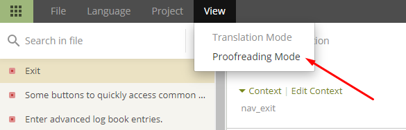

# Så översätter du texter i AAPS-appen eller dokumentationen

* För texterna i appen går du till <https://crowdin.com/project/androidaps> och loggar in med ditt GitHub-konto
* För dokumentationen går du till <https://crowdin.com/project/androidapsdocs> och loggar in med ditt GitHub-konto

* Skicka en förfrågan om att gå med i dokumentationsteamet. Klicka på flaggan för det språk du vill översätta och sedan på knappen "Join" (gå med) uppe till höger på nästa sida. Ange språk, berätta lite om dig själv och din erfarenhet av AAPS och om du vill bli översättare eller korrekturläsare (bara för personer med vana att översätta och avancerade AAPS-användare).

```{admonition} Tid för godkännande :class: note

Godkännandet görs för hand. Vi är en ideell organisation och lovar inga svarstider (SLA), men oftast godkänns du inom 1 dag. Om inte, kontakta dokumentationsteamet via Facebook eller Discord.

    <br />* När vi har godkänt dig klickar du på flaggan
       
    
    ## Översättning av appen
    
    (translations-translate-strings-for-AAPS-app)=
    ### Översätta texter i AAPS-appen
    
    * Om du inte har någon önskan om vilka texter du översätter väljer du bara knappen "Translate All" (översätt alla) för att börja. Du ser då de texter som behöver översättas.
    
       
    
    * Om du vill översätta en viss fil söker du efter filen i sökrutan eller i trädstrukturen och klickar på filnamnet för att börja översätta texterna i den filen.
    
       
    
    * Översätt meningarna till vänster genom att skriva en ny översättning, eller använd och redigera ett förslag 
    
       
    
    
    ### Korrekturläsa texter i AAPS-appen
    
    * Korrekturläsare börjar med att välja "Proofread" (korrekturläs) på språkets startsida.
    
        
    
    
      och godkänner översatta texter 
    
       
    
    När en korrekturläsare godkänner en översättning kommer den med i nästa version av AAPS.
    
    (translations-translation-of-the-documentation)=
    ## Översättning av dokumentationen
    
    * Klicka på namnet på den sida i dokumentationen som du vill översätta
    
    
    
    
    * Översätt mening för mening
    
        1. Den gula texten är den text du arbetar med just nu.
    
        1. Den gröna texten är redan översatt. Den behöver du inte översätta igen.
    
        1. Den röda texten är den text som återstår att översätta.
    
        1. Det här är källtexten som du arbetar med just nu
    
        1. Det här är översättningen som du skriver. Du kan kopiera texten ovanför eller välja ett av förslagen nedanför.
    
        1. Det här är förslag till översättning. Här ser du särskilt hur bra Crowdin bedömer att förslaget passar, eller om texten redan har översatts tidigare och bara kom tillbaka för att den flyttades, inte ändrades.
        1. Tryck på knappen "Save" (spara) för att spara ett förslag till översättning. Den skickas sedan till en korrekturläsare för en sista kontroll.
    
    
    
    * En översatt sida publiceras inte i dokumentationen förrän
    
        1. översättningen är korrekturläst
    
        1. synkroniseringen mellan Crowdin och GitHub är klar (en gång i timmen) och har skapat en PR i GitHub.
    
        1. PR:en i GitHub har godkänts.
    
    Oftast tar det 1–3 dagar, men under helger och semestrar kan det ta lite längre tid.
    
    ### Översätta länkar
    
    ```{admonition} Länkar översätts inte längre
    :class: note
    
    Länkar översätts inte längre. Tidigare fanns ett avsnitt om detta här, men det behövs inte längre. Vid flytten till Markdown och myst_parser skapar vi uttryckligen etiketter (labels) i den engelska texten, och de förs automatiskt vidare till de andra språken.
    
    

Du översätter den text som visas som länk. Var noga med att **inte** ta bort länken. Den visas som ett par taggar `<0></0>` (eller med andra siffror om det finns flera länkar i samma stycke).

Det är korrekturläsarens uppgift att särskilt kontrollera detta!

### Korrekturläsning

* Korrekturläsare måste byta till läget för korrekturläsning
    
    
    
    och godkänna översatta texter
    
    

* När en korrekturläsare godkänner en översättning kommer den med i nästa bygge av dokumentationen. Det görs vid behov utan fast schema, men ungefär en gång i veckan, utom under semestrar. För att det ska gå snabbare kan du meddela dokumentationsteamet om nya översättningar.