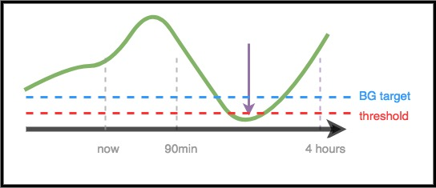

# För vårdpersonal – en allmän introduktion och guide till AAPS

```{note}
Den här sidan är en översiktlig introduktion för vårdpersonal. Den granskades senast i juni 2026. AAPS utvecklas hela tiden. Den mest exakta och aktuella informationen finns alltid i [den fullständiga AAPS-dokumentationen](../index.md).
```

Den här sidan är skriven för vårdpersonal som är intresserad av teknik för artificiell bukspottkörtel med öppen källkod, som AAPS, eller för patienter som vill dela sådan information med sin vårdpersonal.

Guiden ger en översikt över DIY-system med sluten loop och särskilt över hur AAPS fungerar. Mer information om alla dessa ämnen finns i den [fullständiga AAPS-dokumentationen online](../index.md). Om du har frågor kan du be din patient om mer information. Du är också alltid välkommen att kontakta communityn med dina frågor. (Om du inte finns på sociala medier (t.ex. [Twitter](https://twitter.com/kozakmilos) eller Facebook) kan du skicka e-post till developers@aaps.app). [Här hittar du också några av de senaste studierna och data om behandlingsresultat](https://openaps.org/outcomes/).

## Stegen för att bygga en DIY-sluten loop:

För att börja använda AAPS behöver man ta följande steg:

* Skaffa en [kompatibel pump](../Getting-Started/CompatiblePumps.md), en [kompatibel Android-enhet](../Getting-Started/Phones.md) och en [kompatibel CGM-källa](../Getting-Started/CompatiblesCgms.md).
* [Ladda ner källkoden för AAPS och bygg programvaran](../SettingUpAaps/BuildingAaps.md).
* [Ställ in programvaran så att den kommunicerar med patientens diabetesenheter, och ange inställningar och säkerhetsinställningar](../SettingUpAaps/SetupWizard.md).

## Så fungerar en DIY-sluten loop

Utan ett system med sluten loop samlar en person med diabetes själv in data från sin pump och CGM, bestämmer vad som ska göras och utför det.

Med automatiserad insulintillförsel gör systemet samma sak: det samlar in data från pumpen, CGM och från andra ställen där information loggas (till exempel Nightscout). Det använder informationen för att räkna ut och bestämma hur mycket mer eller mindre insulin som behövs (över eller under den grundläggande basaldosen). Sedan använder det tillfälliga basaldoser för att göra de ändringar som behövs, så att blodsockret (BG) stannar i målområdet eller till slut kommer tillbaka dit.

Om enheten som kör AAPS går sönder eller kommer utom räckhåll för pumpen, återgår pumpen till att vara en vanlig pump med de förprogrammerade basaldoserna när den senaste tillfälliga basaldosen har tagit slut.

## Så samlas data in:

Med AAPS kör en Android-enhet en särskild app som gör beräkningarna. Enheten kommunicerar via Bluetooth med en pump som stöds. AAPS kan kommunicera med andra enheter och med molnet via wifi eller mobildata. Så kan den samla in mer information och rapportera till patienten, anhöriga och närstående vad den gör och varför.

Android-enheten behöver:

* kommunicera med pumpen och läsa historiken - hur mycket insulin som har getts
* kommunicera med CGM (antingen direkt eller via molnet) - för att se hur BG ändrar sig och har ändrat sig

När enheten har samlat in dessa data körs algoritmen. Den fattar beslut utifrån inställningarna (ISF, KH-kvot, DIA, målvärde osv.). Om det behövs skickar den sedan kommandon till pumpen för att ändra insulintillförseln.

Den samlar också in all information om bolusar, intag av kolhydrater och tillfälliga målvärden från pumpen eller från Nightscout och använder den för att beräkna insulintillförseln.

## Hur vet den vad den ska göra?

Programvaran med öppen källkod är gjord för att enheten enkelt ska kunna göra det arbete som människor tidigare gjorde (manuellt) för att räkna ut hur insulintillförseln ska justeras. Först samlar den in data från alla anslutna enheter och från molnet, förbereder data och gör beräkningarna. Den gör prognoser för hur BG förväntas utvecklas under de närmaste timmarna i olika scenarier, och räknar ut vilka justeringar som behövs för att BG ska stanna i målområdet eller komma tillbaka dit. Sedan skickar den de justeringar som behövs till pumpen. Därefter läser den tillbaka data och gör om samma sak, gång på gång.

Eftersom den viktigaste indataparametern är blodsockervärdet från CGM är det viktigt att ha CGM-data av hög kvalitet.

AAPS är gjort för att öppet registrera all indata som den samlar in, den rekommendation som blir resultatet och varje åtgärd som utförs. Därför är det lätt att när som helst svara på frågan ”varför gör den X?” genom att granska loggarna.

## Exempel på hur algoritmen i AAPS fattar beslut:

AAPS använder samma grundläggande algoritm och samma funktioner som OpenAPS. Algoritmen gör flera prognoser (utifrån inställningarna och situationen) som visar olika scenarier för vad som kan hända framöver. I Nightscout visas de som ”lila linjer”. AAPS använder olika färger för att skilja dessa [prognoslinjer](#aaps-screens-prediction-lines) åt. I loggarna beskrivs vilken av dessa prognoser och vilken tidsram som styr de åtgärder som behövs.

### Här är exempel på de lila prognoslinjerna och hur de kan skilja sig åt:


(clinicianguide-dosing-scenarios)=

### Här är exempel på olika tidsramar som påverkar de justeringar av insulintillförseln som behövs:

### Scenario 1 - Tillfällig basal på noll för säkerhets skull

I det här exemplet stiger BG på kort sikt, men på längre sikt förväntas det bli lågt. BG förväntas faktiskt gå under målvärdet *och* under säkerhetsgränsen. För att förhindra det låga värdet ger AAPS av säkerhetsskäl en tillfällig basal på noll (tillfällig basaldos på 0 %) tills eventualBG (slutligt BG, i någon tidsram) ligger över gränsen.



### Scenario 2 - Tillfällig basal på noll för säkerhets skull

I det här exemplet förväntas BG bli lågt på kort sikt, men till slut förväntas det ligga över målvärdet. Men eftersom det kortsiktiga låga värdet faktiskt ligger under säkerhetsgränsen ger AAPS en tillfällig basal på noll, tills ingen punkt på prognoslinjen längre ligger under gränsen.


### Scenario 3 - Mer insulin behövs

I det här exemplet visar en kortsiktig prognos en dipp under målvärdet. Men BG förväntas inte gå under säkerhetsgränsen. Slutligt BG ligger över målvärdet. Därför avstår AAPS från att ge insulin som skulle bidra till ett lågt värde på kort sikt (alltså insulin som skulle få prognosen att gå under gränsen). Den överväger då att ge mer insulin för att få ner den lägsta nivån av slutligt förväntat BG till målvärdet, när det är säkert att göra det. *(Beroende på inställningarna och på hur mycket insulin som behövs och när, kan insulinet ges som tillfälliga basaldoser eller som SMB (supermikrobolusar)).*


### Scenario 4 - Låg tillfällig basal för säkerhets skull

I det här exemplet ser AAPS att BG stiger kraftigt, långt över målvärdet. Men på grund av när insulinet gavs finns det redan tillräckligt med insulin i kroppen för att till slut få BG inom målområdet. BG förväntas faktiskt till slut hamna under målvärdet. Därför ger AAPS inget extra insulin, så att det inte bidrar till ett lågt värde på längre sikt. Även om BG är högt eller stiger är en låg tillfällig basaldos sannolik här.


## Optimera inställningar och göra ändringar

Som vårdpersonal har du kanske ingen erfarenhet av AAPS eller DIY-system med sluten loop. Då kan det vara svårt att hjälpa din patient att optimera inställningarna eller göra ändringar som förbättrar resultaten. I communityn finns flera verktyg och [guider](https://openaps.readthedocs.io/en/latest/docs/Customize-Iterate/optimize-your-settings.html) som hjälper patienter att göra små, testade justeringar för att förbättra sina inställningar.

Det viktigaste för patienter är att göra en ändring i taget och sedan följa effekten i 2–3 dagar innan de ändrar eller justerar nästa inställning (om det inte uppenbart är en dålig ändring som gör det sämre – då ska de genast gå tillbaka till den tidigare inställningen). Människor tenderar att vrida på alla rattar och ändra allt på en gång. Men om någon gör så kan det leda till ännu sämre inställningar framöver, och det kan bli svårt att komma tillbaka till ett känt bra läge.

Ett av de mest kraftfulla verktygen för att ändra inställningar är ett automatiskt beräkningsverktyg för basaldoser, ISF och KH-kvot. Det kallas ”[Autotune](#autotune-how-autotune-calculates-adjustments)”. Det är gjort för att låta data vägleda dig eller din patient när ni gör stegvisa ändringar av inställningarna. Det är god praxis i communityn att först köra (eller granska) Autotune-rapporter innan man försöker justera inställningarna manuellt. Autotune finns inbyggt i AAPS som ett plugin (**Konfiguration** → **Generellt** → **Autotune**); se [Autotune](../AdvancedOptions/Autotune.md). Det kan köras vid behov eller automatiskt. Eftersom dessa parametrar är en förutsättning både för vanlig insulintillförsel med pump och för insulintillförsel med sluten loop, är en genomgång av Autotune-resultaten och justering av parametrarna den naturliga kontaktpunkten med vårdpersonalen.

Dessutom påverkar mänskligt beteende (inlärt från manuell diabetesbehandling) ofta resultatet, även med ett DIY-system med sluten loop. Om BG till exempel förväntas bli lågt och AAPS minskar insulinet på vägen ner, kan det räcka med en liten mängd kolhydrater (t.ex. 3–4 g kolhydrater) för att höja BG från 70 mg/dl (3,9 mmol/l). Men i många fall kan någon välja att behandla med betydligt mer kolhydrater (t.ex. genom att hålla fast vid 15-regeln). Det ger en snabbare blodsockertopp efteråt, både på grund av den extra glukosen och för att insulintillförseln har minskats under tiden fram till det låga värdet.

## OpenAPS

**Den här guiden bygger på [The clinician's guide to OpenAPS](https://openaps.readthedocs.io/en/latest/docs/Resources/clinician-guide-to-OpenAPS.html).** OpenAPS är ett system som är utvecklat för att köras på en liten bärbar dator (som brukar kallas ”riggen”). AAPS använder många av de tekniker som finns i OpenAPS och delar mycket av logiken och algoritmerna. Därför är den här guiden mycket lik den ursprungliga guiden. Mycket av informationen om OpenAPS kan lätt tillämpas på AAPS. Den största skillnaden är vilken hårdvara de olika programdelarna körs på.

## Sammanfattning

Det här är en översikt över hur AAPS fungerar. För mer information kan du fråga din patient, kontakta communityn eller läsa den fullständiga AAPS-dokumentationen online.

Rekommenderad läsning:

* Den [fullständiga AAPS-dokumentationen](../index.md)
* [OpenAPS Reference Design](https://OpenAPS.org/reference-design/), som förklarar hur OpenAPS är utformat för säkerhet: https://openaps.org/reference-design/
* Den [fullständiga OpenAPS-dokumentationen](https://openaps.readthedocs.io/en/latest/index.html) 
  * Se [hur AAPS gör om prognoser till ett doseringsbeslut](#aaps-screens-how-predictions-become-a-dosing-decision) i den här dokumentationen, eller [OpenAPS dokumentation om determine-basal](https://openaps.readthedocs.io/en/latest/docs/While%20You%20Wait%20For%20Gear/Understand-determine-basal.html#understanding-the-determine-basal-logic) för alla tekniska detaljer om den underliggande algoritmen