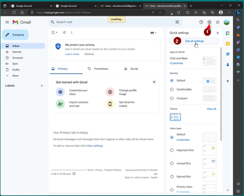

# Ett separat Google-konto för AAPS (valfritt)

Vissa **AAPS**-användare föredrar att använda sitt vanliga e-postkonto även för **AAPS**. Andra **AAPS**-användare (eller deras anhöriga) skapar ett separat e-postkonto bara för **AAPS**. Det är valfritt. Nedan visar vi ett exempel på hur du gör.

Om du inte vill skapa ett separat Gmail-konto för **AAPS** kan du gå direkt till nästa avsnitt, [Bygga AAPS](../SettingUpAaps/BuildingAaps.md).

```{admonition} Advantages of a dedicated Google account for AAPS
:class: dropdown

- Med ett separat utrymme på Google Drive riskerar du inte att fylla upp gränsen för din personliga Google Drive med **Exportera inställningar**.
- Varje version av **AAPS** (och hjälpappar som xDrip, BYODA med flera) sparas på ett enda ställe, oberoende av din datorhårdvara. Om din dator eller telefon blir stulen, försvinner eller går sönder har du fortfarande åtkomst.
- När alla har samma upplägg och liknande mappstruktur blir det enklare att få hjälp online.
- Beroende på upplägget (se nedan) får du en separat identitet, ett alias, som du kan använda i communityn. Det kan skydda din integritet. 
- Barn med typ 1-diabetes kan behålla sitt eget ”vardagliga” e-postkonto som minderåriga, samtidigt som de använder **AAPS** och tillhörande funktioner som kräver ett konto för vuxna.
- Gmail låter dig registrera upp till 4 konton med samma telefonnummer.
```

## Så skapar du ett separat Google-konto för AAPS

(⌛Cirka 10 minuter)


Krav:

* Du har en Windows-dator (Windows 10 eller nyare) och en Android-telefon (Android 12 eller nyare) där appen **AAPS** ska köras. Båda har de senaste säkerhetsuppdateringarna, internetåtkomst och administratörsbehörighet, eftersom några steg kräver att du laddar ned och installerar program.
* Android-telefonen är redan inställd med din personliga ”vardagliga” e-postadress, till exempel ett Gmail-konto.

```{admonition} Things to consider when setting up your new account
:class: dropdown
- Av integritetsskäl kan du använda ett annat namn än ditt eget, ett namn som passar kontot (till exempel t1dsuperstar). Du kan sedan använda det i offentliga forum om **AAPS** och ändå hålla din egen identitet privat. Eftersom Google kräver en e-postadress och ett telefonnummer för återställning går kontot ändå att spåra.
- Det nya **AAPS**-kontot använder samma telefonnummer för verifiering som ditt ”_vardagliga_” konto. Det använder den ”vardagliga” e-postadressen för verifiering;
- Vi ställer in vidarebefordran av e-post så att all e-post som skickas till det nya AAPS-kontot vidarebefordras till ditt huvudkonto (då behöver du inte kontrollera två olika inkorgar);
- Använd olika lösenord för ditt _vardagliga_ Gmail-konto och Gmail-kontot för AAPS
- Om du använder Googles ”2-step verification” (tvåstegsverifiering, även kallat multifaktorautentisering) för ett av Gmail-kontona kan du lika gärna göra det för båda.
- Om du tänker använda Googles ”Passkeys” (nycklar för inloggning), se till att du registrerar flera enheter. Då riskerar du inte att låsa ute dig själv. Gör det bara på enheter som ingen annan har åtkomst till (_alltså_ inte på en dator med ett delat konto som andra personer kan låsa upp).
```


```{admonition} Video Walkthrough!
:class: note
Klicka [här](<https://drive.google.com/file/d/1dMZTIolO-kd2eB0soP7boEVtHeCDEQBF/view?usp=drive_link>) för en videogenomgång av hur du skapar ett separat Google-konto.
```

 Det här är stegen som visas i videon:

I det här exemplet: 
- Ditt befintliga ”_vardagliga_” Google-konto är <donald.muck42@gmail.com>; 
- Ditt nya ”_AAPS_”-Gmail-konto blir: <donald.muck42.aaps@gmail.com>; 


### Gå till <https://myaccount.google.com> 

 Om du redan är inloggad på Google kommer du till sidan **My Account** (Mitt konto) för ditt ”vardagliga” konto. (1) Klicka på din profilbild uppe till höger på sidan (i det här fallet en enkel ) (2) välj ”_add another account_” (lägg till ett annat konto).


### Ange uppgifterna för ditt NYA separata konto: 

- Ange uppgifterna för det nya kontot: 
- Create account (Skapa konto)
- for my personal use (för mitt personliga bruk). 


### Ange dina personuppgifter:
 - Ange förnamn
 - efternamn
 - födelsedatum (du måste vara vuxen)

### Välj din NYA e-postadress och ditt lösenord

I det här exemplet läggs ”.AAPS” till efter Donald Mucks befintliga adress…\
Välj ett lösenord

### Ange ett telefonnummer som kan ta emot SMS för verifiering

Gmail skickar nu en unik kod som du ska ange för att verifiera kontot.

### Ange e-postadressen för återställning

I det här fallet blir det din befintliga ”_vardagliga_” e-postadress…

### Slutför konfigurationen av kontot

Gmail visar kontonamnet. Du blir ombedd att godkänna Gmails användarvillkor och bekräfta dina inställningar för anpassning.

### Anpassa hur den nya profilen visas

Nu bör du vara på Gmails sida MyAccount (Mitt konto), som visar ditt nya e-postkonto för **AAPS**. Profilbilden är som standard den första bokstaven i ditt namn. Ändra den till något unikt för att undvika förväxling… i det här exemplet har Donald.Muck.AAPS ersatt  med .

\


### Öppna Gmail-webbplatsen i båda fönstren för att ställa in det nya kontot

Så att du inte behöver hålla koll på ett separat e-postkonto: vidarebefordra all e-post från det nya **AAPS**-kontot till ditt vardagliga konto\
Den här delen kan vara lite förvirrande, eftersom du måste växla fram och tillbaka mellan de två kontona. För att göra det enklare kan du öppna 2 separata webbläsarfönster ovanför varandra:

1. Flytta ditt befintliga webbläsarfönster till skärmens överkant och ändra storleken så att det bara tar upp ungefär den övre halvan av skärmen…
2. Högerklicka på webbläsarens ikon i aktivitetsfältet
3. Välj ”New Window” (Nytt fönster) i menyn… och anpassa det så att det bara tar upp den nedre halvan av skärmen.

Öppna <https://gmail.com> i båda webbläsarfönstren. Se till att ditt personliga konto är överst och att det nya **AAPS**-kontot är nederst och lätt känns igen på profilbilden uppe till höger. Vid behov kan du alltid byta konto genom att klicka på profilbilden och välja rätt konto.


Dina Gmail-startsidor bör se ut så här:\


 ### Öppna Gmail-inställningarna i det nya Gmail-kontot (det nedre fönstret)…

- Klicka på kugghjulet till vänster om profilbilden
- välj sedan ”**See all Settings**” (Visa alla inställningar)



### Ställ in vidarebefordran…

- Klicka på fliken “Forwarding and POP/IMAP” (Vidarebefordran och POP/IMAP) i inställningarna
- Klicka på “add a forwarding address” (lägg till en adress för vidarebefordran)
- Lägg till din ”vardagliga” e-postadress
- Gmail skickar en verifieringskod till din ”vardagliga” e-postadress.
- Byt tillbaka till din vardagliga profil och klicka på länken för att bekräfta att du godkänner vidarebefordran (eller hämta koden från Gmails verifieringsmejl i fönstret med ditt ”vardagliga” Gmail och klistra in den i fönstret med ditt ”nya separata AAPS”-Gmail).

Det blir en del växlande mellan fönstren, men på så sätt ser du även mejlen som vidarebefordras från ditt separata AAPS-konto, till exempel Gmail-varningar, när du läser mejlen i ditt ”vardagliga” konto.


### Bekräfta adressen för vidarebefordran

- I det ”vardagliga” Gmail-kontot (det övre fönstret) får du e-postmeddelandet ”Gmail forwarding Confirmation” (bekräftelse av vidarebefordran).
- Öppna mejlet och klicka på länken för att bekräfta begäran (“click the link to confirm the request”)

### Arkivera vidarebefordrade mejl i det nya separata Gmail-kontot (nedre fönstret)

<!---->

1. Uppdatera det nedre fönstret
2. Markera “forward incoming email” (vidarebefordra inkommande e-post)
3. Och arkivera Gmails kopia (så att den nya separata inkorgen hålls ren)
4. Scrolla ända ner till botten för att spara ändringarna\
   


Grattis! Nu har du skapat ett separat Google-konto för AAPS. Nästa steg är [Bygga AAPS](../SettingUpAaps/BuildingAaps.md).