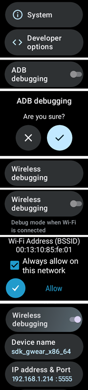

# Ställ in AAPS på din klocka med Wear OS

Instruktionerna nedan gäller **AAPS Wear**-apk:n som du behöver bygga. Om du inte har byggt den än, se guiden som länkas [här](../WearOS/BuildingAapsWearOS.md). När du bygger ska du använda samma keystore-fil som du använde för **AAPS**-apk:n för telefonen.

En del av informationen gäller också Wear-apk:n för **AAPSClient** och **PumpControl** **Wear**. Varje **Wear**-app kommunicerar med sin matchande telefonapp. Exempel: appen **AAPSClient Wear** kan användas för att visa data från **AAPSClient**, inte data från **AAPS**. När flera klientvarianter (**AAPSClient**, **AAPSClient2**, **AAPSClient3**) är installerade samtidigt har brickorna för varje variant en liten rubrik i variantens egen accentfärg, så att du kan skilja dem åt när du sveper.

## Wear OS-versioner och kompatibilitet

(wearos-watchface-changes)=

### Ändringar av urtavlor i Wear OS (påverkan på AAPS-urtavlor)

```{admonition} Why newer Wear OS watches break AAPS watchfaces
:class: warning

I juni 2025 [meddelade Google ändringar](https://android-developers.googleblog.com/2025/06/upcoming-changes-to-wear-os-watch-faces.html) som fasar ut den gamla motorn för urtavlor (AndroidX / Wearable Support Library, eller ”WSL”) till förmån för det nyare deklarativa **Watch Face Format**. De anpassade urtavlorna för **AAPS** är byggda på den gamla motorn. Ju nyare Wear OS-version, desto troligare är det att en AAPS-urtavla fungerar dåligt eller slutar fungera.

Detta gäller bara **urtavlorna**. AAPS **komplikationer**, brickor och fjärrstyrningsfunktioner påverkas inte. Det är också anledningen till att **en uppdatering av firmware/system på en klocka med Wear OS kan förstöra AAPS-urtavlor**, och en klocka kan inte återställas till en äldre Wear OS-version efteråt. Om din AAPS-urtavla fungerar nu: **stäng av automatiska uppdateringar av klockan**.
```

Tabellen nedan sammanfattar hur Googles ändring påverkar AAPS-urtavlorna (gammal motor) i olika Wear OS-versioner:

| Wear OS-version         | Grundläggande Android-version | API-nivå | Påverkan på AAPS-urtavlor (gammal motor)                                                                                                                                                       |
| ----------------------- | ----------------------------- | -------- | ---------------------------------------------------------------------------------------------------------------------------------------------------------------------------------------------- |
| Wear OS 6               | Android 16                    | 36       | **Gamla urtavlor finns inte längre** – AAPS installerar i stället en [urtavla i Watch Face Format](#wearos-aaps-v4-watchface): din anpassade urtavla eller urtavlan AAPS V4 med komplikationer |
| Wear OS 5               | Android 14                    | 34       | **Allvarlig** – aktivt (interaktivt) läge fungerar ofta inte, komplikationer fryser, animationer stannar                                                                                       |
| Wear OS 4               | Android 13                    | 33       | **Måttlig** – strypning, missade uppdateringar, delvisa fel                                                                                                                                    |
| Wear OS 3.0 / 3.2 / 3.5 | Android 11                    | 30       | **Låg** – den gamla motorn stöds fortfarande                                                                                                                                                   |

Om din klocka har en version där AAPS-urtavlor inte fungerar pålitligt kan du i stället visa AAPS-data med **komplikationer** på en kompatibel urtavla, eller använda [GlucoDataHandler](https://play.google.com/store/apps/details?id=de.michelinside.glucodatahandler) med en komplikation som får data från pluginet [Externa hjälpappar](#external-companion-apps) i **AAPS**. På **Wear OS 6 och nyare** installerar AAPS en ersättande urtavla som är byggd i det nya formatet – se nedan.

(wearos-aaps-v4-watchface)=

### Wear OS 6 och nyare – urtavlan som AAPS installerar

Klockor med **Wear OS 6 eller nyare** kan inte köra de klassiska AAPS-urtavlorna som urtavlor. För dessa klockor har AAPS-appen på klockan med sig två urtavlor som är byggda i Googles nya **Watch Face Format**. Wear OS låter en app installera bara **en** urtavla, så du väljer vilken av de två som ska finnas på klockan:

- **Anpassad urtavla** (standard): visar den anpassade urtavla som du har laddat från telefonen med **Ladda urtavla** (se [Byta till en AAPS-urtavla](#WearOS_changing-to-AAPS-watchface)). Klockan ritar din design som en bild, så alla befintliga anpassade urtavlor fungerar. Komplikationsplatserna som en anpassad urtavla kan ha är **inte tillgängliga** i den här bilden, eftersom Wear OS bara skickar komplikationsdata till en riktig urtavla. Tryck länge på urtavlan för att komma till dess enda inställning: om skärmen i alltid på-läge ska visa en enkel klocka eller din egen design, nedtonad.
- **Urtavla med komplikationer** (urtavlan **AAPS V4**): dess **sju komplikationsplatser** är **förinställda med AAPS-data**: BG-värde, IOB, COB, [komplikationen BG-graf](#Watchfaces-complications), basaldos / tillfälligt målvärde och ikonen för **Körläge** på platsen uppe till vänster (tryck på den för att byta loopläge från klockan). Tryck på tiden högst upp för att öppna klockans alarmapp. Du kan ändra vad varje plats visar i klockans redigerare för urtavlor.

Du väljer på telefonen: öppna pluginet **Klocka (Wear)** och välj en av de två under **Urtavla installerad på klockan**. Det här kortet visas bara när en klocka med Wear OS 6 eller nyare är ansluten. **AAPS** ber dig bekräfta, eftersom klockan byter urtavla direkt. Om du byter från **Urtavla med komplikationer** återställs också de komplikationer som du har ändrat i redigeraren för urtavlor till standardvärdena, och bekräftelsen säger det. När **Urtavla med komplikationer** är vald är knapparna för anpassad urtavla dolda, och en förhandsvisning av urtavlan visas i stället. Om du laddar en anpassad urtavla när **Urtavla med komplikationer** är vald påminner **AAPS** dig om att byta till **Anpassad urtavla** för att se den på klockan.

- Den valda urtavlan **installeras och aktiveras automatiskt** första gången AAPS-appen körs på en sådan klocka, och den **uppdateras automatiskt** tillsammans med klockappen.
- Om du har tagit bort urtavlan visas posten **Installera urtavla** längst ned i **Huvudmeny** i AAPS-appen på klockan – tryck på den för att installera om.

När en klocka med Wear OS 5 eller äldre är ansluten visas kortet **Urtavla installerad på klockan** inte alls (funktionen som det bygger på kräver Wear OS 6). Där fungerar de klassiska urtavlorna som förut.

(wearos-complications-watchface-setup)=

### Urtavla med komplikationer – rekommenderad inställning

**Urtavla med komplikationer** har sju komplikationsplatser. Tryck länge på urtavlan, tryck på **Customize** (Anpassa) och välj en datakälla för varje plats. Platserna är numrerade som i redigeraren för urtavlor: **1** vänster, **2** mitten, **3** höger, **4** grafen, **5** nederst, **6** uppe till vänster och **7** uppe till höger.

| Standardinställning                                                                                      | Alternativ inställning                                                                                          |
| -------------------------------------------------------------------------------------------------------- | --------------------------------------------------------------------------------------------------------------- |
|  |  |

| Plats | Placering         | Standard                                                                   | Alternativ                             |
| ----- | ----------------- | -------------------------------------------------------------------------- | -------------------------------------- |
| 1     | Vänster           | IoB-ikon                                                                   | CoB & IoB                              |
| 2     | Mitten            | Blodsocker                                                                 | Blodsocker                             |
| 3     | Höger             | CoB-ikon                                                                   | BR & mål                               |
| 4     | Graf              | BG-graf                                                                    | BG-graf                                |
| 5     | Nederst           | BR & mål                                                                   | Uppladdare/telefonbatteri              |
| 6     | Uppe till vänster | Körläge                                                                    | Körläge                                |
| 7     | Uppe till höger   | Uppladdare/telefonbatteri, eller en appgenväg till **AAPS Snooze-varning** | Appgenväg till **AAPS Snooze-varning** |

Genvägen **AAPS Snooze-varning** väljs bland klockans egna komplikationer av typen **App shortcut** (appgenväg). När du trycker på den snoozas larmet som ljuder på telefonen.

```{tip}
Slå på **Always-on display** (alltid på-skärm) på klockan (**Settings** (Inställningar) > **Display** (Skärm)). Då fortsätter urtavlan att visa ditt glukosvärde när armen är nere, i stället för en tom skärm eller en enkel klocka.
```

```{admonition} No complication data while the watch is locked
:class: note
Om ett **Lock type** (låstyp) är inställt under **Settings** (Inställningar) > **Security and privacy** (Säkerhet och integritet) döljer klockan komplikationsdata när den är låst, och urtavlan visar tomma platser tills du låser upp den. Stäng av **Hide information** (Dölj information) i samma meny för att data ska fortsätta att synas.
```

### Wear OS 3

Installera **AAPS Wear**-apk:n med [Wear Installer 2](https://youtu.be/abgN4jQqHb0?si=5L7WUeYMSd_8IdPV), Easy Fire Tools (beskrivs nedan) eller ADB.  
Inga begränsningar i funktionerna i **AAPS Wear**.

(BuildingAapsWearOs-WearOS5)=

### Wear OS 4 och Wear OS 5

Exempel: Galaxy Watch 4, 5, 6, 7 och Ultra eller Pixel Watch som **inte** har uppdaterats till Wear OS 6 än. Kontrollera versionen under **Settings** (Inställningar) > **About watch** (Om klockan) > **Software** (Programvara).

Installera **AAPS Wear**-apk:n med [Wear Installer 2](https://youtu.be/abgN4jQqHb0?si=5L7WUeYMSd_8IdPV) (för Wear OS 5, följ [den här videon](https://www.youtube.com/watch?v=yef_qGvcCnk)). Alla funktioner i **AAPS Wear** fungerar, men de klassiska urtavlorna för **AAPS** är begränsade enligt tabellen ovan: strypta på Wear OS 4 och fungerar ofta inte på Wear OS 5.

```{admonition} Wear OS 5
:class: warning
På Wear OS 5 måste AAPS-urtavlan väljas med Wear Installer 2 direkt efter att Wear-appen har installerats: installationsprogrammet erbjuder urtavlan **AAPS (anpassad)** i slutet av installationen. Om du råkar byta till en annan urtavla, gör om installationen. Det kan hända att du inte kan ändra inställningarna för urtavlan (Mörkt, Matchande avdelare osv.).

Om den klassiska urtavlan fungerar för dig nu: **stäng av automatiska uppdateringar av klockan**. Nästa uppdatering av firmware kommer troligen att förstöra den. Om du ändå uppdaterar till Wear OS 6, läs avsnittet ovan: **AAPS** installerar då en egen urtavla i det nya formatet.
```

Om urtavlan inte fungerar pålitligt nog kan du i stället använda [GlucoDataHandler](https://play.google.com/store/apps/details?id=de.michelinside.glucodatahandler) med en komplikation. Det kräver att pluginet [Externa hjälpappar](#external-companion-apps) är aktiverat i **AAPS**.

### Wear OS 6 och nyare

Exempel: Galaxy Watch 4 och nyare med One UI 8 Watch, Pixel Watch efter uppdateringen 2025. De flesta Galaxy- och Pixel-klockor har fått den här uppdateringen.

Installera **AAPS Wear**-apk:n med [Wear Installer 2](https://youtu.be/abgN4jQqHb0?si=5L7WUeYMSd_8IdPV). De klassiska urtavlorna finns inte. **AAPS** installerar automatiskt den urtavla som är vald på telefonen, se [urtavlan som AAPS installerar](#wearos-aaps-v4-watchface). Inga begränsningar i funktionerna i **AAPS Wear**.

## Så ställer du in en smartklocka Samsung Galaxy Watch 4 med **AAPS**

Det här avsnittet utgår från att du är helt ny med smartklockor. Det ger en grundläggande introduktion till en populär klocka, **Galaxy Watch 4**, och sedan en steg-för-steg-guide för att ställa in **AAPS** på klockan.

_Den här guiden skrevs för en Galaxy Watch med Wear OS 3._ På Wear OS 4 och senare ber klockan om en **parkopplingskod** när en telefon eller dator ansluter via ADB. Både Wear Installer 2 och arbetssättet med terminalen [nedan](#BuildingAapsWearOs-WearOS5-TShoot) stöder det.

Här finns grundläggande installationsguider för [Galaxy Watch 5](https://www.youtube.com/watch?v=Y5upzOIxwTU) och [Galaxy Watch 6](https://www.youtube.com/watch?v=D6bq20KzPW0)

## Grundläggande kunskap om smartklockor

När du har gjort grundinställningen av klockan enligt videon ovan går du till Play Butik på telefonen och laddar ner följande appar: "Galaxy Wearable", “Samsung” och antingen “Easy Fire tools” eller "Wear Installer 2".

Det finns många YouTube-videor från andra som hjälper dig att lära känna din nya smartklocka, till exempel:

[https://www.youtube.com/watch?v=tSVkqWNmO2c](https://www.youtube.com/watch?v=tSVkqWNmO2c)

Appen “Galaxy Wearable” har också en bruksanvisning. Öppna Galaxy Wearable på telefonen, sök efter klockan och försök parkoppla klockan med telefonen. Beroende på din version kan du bli ombedd att installera ytterligare en app, “galaxy watch 4 plugin”, från Play Butik (det tar en stund att ladda ner). Installera den på telefonen och försök sedan parkoppla klockan och telefonen igen i Wearable-appen. Gå igenom ett antal menyer och kryssa i olika inställningar.

## Skapa ett Samsung-konto

Se till att e-postkontot som du använder för Samsung-kontot har ett födelsedatum som gör användaren minst 13 år. Annars är det mycket svårt att godkänna Samsungs behörigheter. Om du har gett ditt barn under 13 år ett Gmail-konto och använder den e-postadressen, kan du inte bara ändra det till ett vuxenkonto. Ett sätt att komma runt detta är att ändra födelsedatumet så att åldern blir 12 år och 364 dagar. Nästa dag omvandlas kontot till ett vuxenkonto, och du kan fortsätta att skapa Samsung-kontot.

(remote-control-transferring-the-aaps-wear-app-onto-your-aaps-phone)=

## Överföra Wear-appen för **AAPS** till din **AAPS**-telefon

Du kan överföra Wear.apk från Android Studio till telefonen på ett av följande sätt:

a)  med en USB-kabel lägger du apk-filen för **AAPS** Wear på telefonen och ”sidladdar” den sedan till klockan. Överför Wear.apk till telefonen via USB, till mappen för nedladdningar, eller

b)  klipp ut och klistra in Wear.apk från Android Studio på din Google Drive.


För att sidladda AAPS till klockan kan du använda något av följande: 1) Wear Installer 2 2) Easy Fire tools 3) Android Debug Bridge (ADB) Här rekommenderar vi Wear Installer 2, eftersom instruktionerna och förloppet i videon är så tydliga och väl förklarade. Om Wear Installer 2 inte fungerar för dig, prova Easy Fire Tools eller ADB. Båda beskrivs nedan.

### Använda Wear Installer 2 för att sidladda **AAPS** Wear från telefonen till klockan

 

Wear Installer 2, som är utvecklad av [Malcolm Bryant](https://www.youtube.com/@Freepoc), kan laddas ner från Google Play till telefonen. Med den kan du sidladda Wear-appen för AAPS till klockan. Appen innehåller en praktisk [video](https://youtu.be/abgN4jQqHb0?si=5L7WUeYMSd_8IdPV) om hur du sidladdar (”how to sideload”).

```{tip}
För klockor med Wear OS 5, följ [den här videon](https://www.youtube.com/watch?v=yef_qGvcCnk).
Se felsökningstipsen [nedan](#BuildingAapsWearOs-WearOS5-TShoot).
```

Där finns alla detaljer som behövs (öppna gärna videon på en annan enhet så att du kan titta på den medan du ställer in telefonen).

Som det sägs i videon: när du är klar ska du stänga av ADB debugging (ADB-felsökning) på klockan, så att klockans batteri inte töms.

Som alternativ, men inte för Wear OS 5, kan du:

### Använda Easy Fire tools för att sidladda **AAPS** Wear till klockan

1)   Ladda ner _[Easy Fire Tools](https://play.google.com/store/apps/details?id=de.agondev.easyfiretools&hl=en)_ från Play Butik till telefonen


2)  Gör dig själv till utvecklare på klockan (när den är inställd och ansluten till telefonen):

Gå till **Settings** (Inställningar) > **System** > **About** (Om) > **Versions** (Versioner) (menynamnen skiljer sig mellan olika klockmärken – på vissa klockor är det **About watch** (Om klockan) > **Software info** (Programvaruinformation) > **Software version** (Programvaruversion)).


Tryck snabbt flera gånger på **Build number** (Versionsnummer) (eller **Software version**) tills ett meddelande säger att du nu är utvecklare.


Gå tillbaka till **Settings** > **System**: en ny meny, **Developer options** (Utvecklaralternativ), visas nu.

I **Developer options** slår du på **ADB debugging** (ADB-felsökning) och **Wireless debugging** (Trådlös felsökning) och bekräftar frågorna. Wireless debugging visar sedan klockans **IP address & Port** (IP-adress och port), ungefär så här: **192.168.1.214** : 5555. Du behöver bara IP-adressen (här **192.168.1.214**), inte portnumret efter kolonet. Observera att IP-adressen kan ändras, till exempel varje gång du byter till en ny telefon för AAPS.



STEG 3)     Ange IP-adressen, _t.ex._ **192.168.1.214**, i Easy Fire tools på telefonen (öppna hamburgermenyn till vänster, gå till inställningarna och ange IP-adressen).


Klicka sedan på ikonen med eluttaget uppe till höger. Den blir grön när den är ansluten.


STEG 4) Följ instruktionerna [här](https://wearablestouse.com/blog/2022/01/04/install-apps-apk-samsung-galaxy-watch-4/?utm_content=cmp-true) för att sidladda (dvs. överföra) aaps-wear.apk till smartklockan med Easy Fire tools


(BuildingAapsWearOs-WearOS5-TShoot)=

### Använda terminalen
Anslut smartklockan och datorn till samma Wi-Fi-nätverk.

- Ladda ner ADB härifrån för att installera det: https://developer.android.com/tools/releases/platform-tools
- Öppna en terminal.
- På Windows skapar du en ny mapp med namnet `adb` på din disk `C:`. Öppna filen `platform-tools-latest-windows.zip` som du laddade ner ovan. Kopiera alla filer i `platform-tools` till `C:\adb` och öppna mappen i en kommandotolk (högerklicka och välj Open in Terminal (Öppna i terminal)). Skriv kommandot nedan för att ställa in sökvägen till mappen där ADB finns: `setx PATH "%PATH%;C:\adb"`
- På Mac kan du använda Homebrew i stället för att installera manuellt: `brew install android-platform-tools`

På klockan:
- Gå till Settings (Inställningar) → About watch (Om klockan) → **Software Information** (Programvaruinformation)
- Tryck 7 gånger på Software version (Programvaruversion) tills du ser Developer mode enabled (utvecklarläget är aktiverat).
- Gå till Settings (Inställningar) → Developer options (Utvecklaralternativ). Slå på **ADB debugging** (ADB-felsökning)
- Gå till Settings (Inställningar) → Developer options (Utvecklaralternativ) → Wireless debugging (Trådlös felsökning) → **Pair new device** (Parkoppla ny enhet)

En Wi-Fi-parkopplingskod, IP-adress och port visas:


- I terminalen: `adb pair ipaddress:port` Till exempel: `adb pair 10.10.1.125:36299`
- Du blir ombedd att ange parkopplingskoden. Ange den.
- Du får ett svar:<br> `Successfully paired to 10.10.1.125:36299 [guid=adb-RXXXW20LMKJY-eh5zBj]`<br>
- Skriv i terminalen: <br>`adb devices`.<br> Du bör se något i stil med:<br> `List of devices attached`<br> `10.10.1.125:36299  offline`<br> `adb-RFAW20LMKJY-eh5zBj._adb-tls-connect._tcp   device`<br>

- Gå nu till mappen på datorn där Wear-apk:n finns och skriv<br> `adb install wear-full.apk` <br>där du ersätter wear-full.apk med namnet på din apk-fil.
- Du ser:<br> `Performing Streamed Install`<br> `Success`


(wear-os-5-troubleshooting)=

### Allmänna felsökningsråd för Wear OS 5

- Använd inte Wi-Fi-delning (Wi-Fi Tethering). Det fungerar inte.
- Du behöver inte slå på ADB-felsökning på telefonen (bara på klockan). Stäng av ADB-felsökning på telefonen.
- Se till att du ansluter till ditt lokala nätverk, där telefonen och klockan kan se varandra (använd inte ditt Wi-Fi-gästnätverk).
- Se till att klockan och telefonen är på samma nätverk och samma Wi-Fi-enhet. Särskilt Wi-Fi-repeatrar eller åtkomstpunkter kan orsaka problem.
- Var nära din huvudrouter och starta sedan om både telefonen och klockan.

**Parkoppling:**

- Klockan: Wireless debugging (Trådlös felsökning): anteckna IP-adressen.
- Wear Installer: ange IP-adressen i appen Wear Installer.
- Välj Pair new (Parkoppla ny), anteckna parkopplingskoden och portnumret som visas.
- Wear Installer: ange parkopplingskoden + mellanslag + portnumret.
- Wear Installer ska visa att parkopplingen lyckades. Om den inte gör det: stäng Wear Installer och försök igen.

När enheterna är parkopplade ska du kunna installera AAPS Wear-apk:n:

- Stäng Wear Installer och starta den sedan igen.
- Under Wireless debugging (Trådlös felsökning): anteckna IP-adressen och portnumret, och se till att du kontrollerar/anger IP-adressen och portnumret i Wear Installer.
- Obs! Portnumret är ett annat än det som används för parkopplingen!

## Ställa in anslutningen mellan klockan och telefonen i **AAPS**

Det sista steget är att ställa in **AAPS** på telefonen så att den samarbetar med **Wear.apk** på klockan. För att göra detta aktiverar du pluginet Klocka (Wear):

* Gå till appen **AAPS** på telefonen

* Öppna **menyn** (☰) uppe till vänster och gå till **Konfiguration** > **Kommunikation**

* Kryssa i rutan **Klocka (Wear)**


För att ge bolus eller göra andra åtgärder från klockan, slå också på **Kontrollera från Wear-klocka** i [Inställningar > Klocka (Wear)](#preferences-wear).

För att byta till en annan urtavla för **AAPS** trycker du länge på urtavlan på klockans startskärm och trycker på **Customize** (Anpassa). Svep sedan åt höger tills du kommer till alla urtavlor för **AAPS**.

Om Wear.apk för **AAPS** har sidladdats till smartklockan ser det ut så här:


För vissa smartklockor, till exempel Samsung Galaxy, måste 'Remote Connection' (fjärranslutning) under Samsung Galaxys Advanced Features (Avancerade funktioner) vara **påslaget** för att du ska kunna använda **Wear.apk** och **AAPS** på distans via Wi-Fi.


(wear-os-watch-phone-communication)=

### Felsökning av kommunikationen mellan **AAPS**-klockan och **AAPS**-telefonen

1.  Om EasyFire tools inte ansluter eller om du får ‘authorisation failed’ (behörighet nekad) > kontrollera att IP-adressen är rätt inmatad.
2.  Kontrollera att smartklockan är ansluten till internet (och inte bara till telefonen via Bluetooth).
3.  Kontrollera att **AAPS**-telefonen och smartklockan är parkopplade eller länkade i Samsung-appen.
4.  Det kan också hjälpa att starta om telefonen och smartklockan helt (det vill säga stänga av och slå på telefonen)
5.  Om du har lyckats ladda ner Wear.apk till telefonen men inte får några BG-data, _kontrollera_ att du har sidladdat rätt Wear-apk för **AAPS** till klockan: klockappen från en webbläsarbyggd version är filen `aaps-wear-….apk`, se [Bygga Wear-appen för AAPS](../WearOS/BuildingAapsWearOS.md). Om filen som du installerade är någon av följande: a) en Wear-apk för **AAPSClient** (medan telefonen kör **AAPS**), b) en `.aab`-fil, eller c) en fil med ordet ‘debug’ i namnet, så har du inte valt rätt Wear OS-apk när du byggde.
6.  Kontrollera att din router inte isolerar enheterna från varandra.

Fler felsökningstips finns [här](https://freepoc.org/wear-installer-help-page/#:~:text=If%20you%20are%20having%20problems,your%20phone%20and%20your%20watch.)

(WearOS_changing-to-AAPS-watchface)=

## Byta till en AAPS-urtavla på din klocka med Wear OS

Det finns flera urtavlor i standardbygget av apk-filen för AAPS Wear OS. De blir tillgängliga när du har installerat AAPS Wear-apk:n på klockan. Så här väljer du en av dem:

1. På klockan (om den har Wear OS): tryck länge på den aktuella urtavlan för att öppna väljaren för urtavlor. Bläddra hela vägen åt höger tills du ser knappen "Add Watch Face" (Lägg till urtavla) och välj den


2. Bläddra i listan tills du hittar "AAPS (anpassad)" (beroende på klockan visas urtavlorna från installerade appar under rubriken "Downloaded" (Nedladdade) eller grupperade per app). Klicka mitt på bilden för att lägga till den i din korta lista med aktuella urtavlor. Bry dig inte om hur urtavlan "AAPS (anpassad)" ser ut just nu. Du väljer det utseende du vill ha i nästa steg.


3. Öppna nu AAPS på telefonen och öppna pluginet Klocka (Wear): **Konfiguration** > **Kommunikation** > **Klocka (Wear)** > **Öppna plugin** (kryssa först i **Klocka (Wear)** om det inte är aktiverat).


4. Klicka på knappen "Ladda urtavla" och välj den urtavla som du vill ha


5. Titta på klockan. Urtavlan "AAPS (anpassad)" ska nu visa det utseende som du har valt. Vänta några sekunder tills den har uppdaterats. Skärmen **Klocka (Wear)** på telefonen visar nu namnet på den laddade urtavlan och en förhandsvisning av den. **Info om urtavla** visar detaljer om urtavlan och vilka fält den innehåller, och **Fler urtavlor** öppnar [utbytessidan](../ExchangeSiteCustomWatchfaces/index.md) där du kan ladda ner andra anpassade urtavlor. Nu kan du anpassa komplikationerna med mera: tryck länge på urtavlan och tryck sedan på knappen "Customize" (Anpassa) på bilden av urtavlan.

```{admonition} Complications on a custom watchface
:class: note
Anpassade urtavlor som är gjorda med version 3.0 eller nyare av formatet för anpassade urtavlor kan ha upp till fem komplikationsplatser, med position och storlek bestämda av urtavlan (**Komplikationslayout**). På klockan: tryck länge på urtavlan, tryck på **Customize** (Anpassa) och tryck på **Komplikation 1** till **Komplikation 5** för att välja vilken datakälla som visas på varje plats. Samma rader finns i AAPS-appen på klockan under **Inställningar** > **AAPS (anpassad)**. Om du trycker på en av dem där öppnas samma väljare. **Prioritering av komplikationstyp** bestämmer om en plats ska föredra ett värde eller en mätare, text eller en ikon när datakällan erbjuder flera. En ändrad prioritet gäller först nästa gång du väljer en datakälla för den platsen.

Dessa platser fungerar bara på klockor med **Wear OS 5 eller äldre**, där den anpassade urtavlan körs som en riktig urtavla. På **Wear OS 6 och nyare** visas den anpassade urtavlan som en bild utan sina komplikationsplatser, och steg 1 och 2 ovan behövs inte: se till att **Anpassad urtavla** är vald under **Urtavla installerad på klockan** i pluginet **Klocka (Wear)** på telefonen (se [urtavlan som AAPS installerar](#wearos-aaps-v4-watchface)).
```

## Urtavlan AAPSv2 – förklaring


A – tid sedan senaste loopkörning

B – CGM-värde

C – minuter sedan senaste CGM-värde

D – ändring jämfört med förra CGM-värdet (i mmol/l eller mg/dl)

E – genomsnittlig ändring av CGM-värdet de senaste 15 minuterna

F – telefonens batteri

G – basaldos (visas i U/h vid standarddos och i % vid tillfällig basal, TBR)

H – BGI (blood glucose impact, insulinets påverkan på blodsockret) -> hur mycket BG ”borde” stiga eller sjunka enbart på grund av insulinaktiviteten.

I – kolhydrater (aktiva kolhydrater | e-carbs i framtiden)

J – aktivt insulin (från bolus | från basal)
