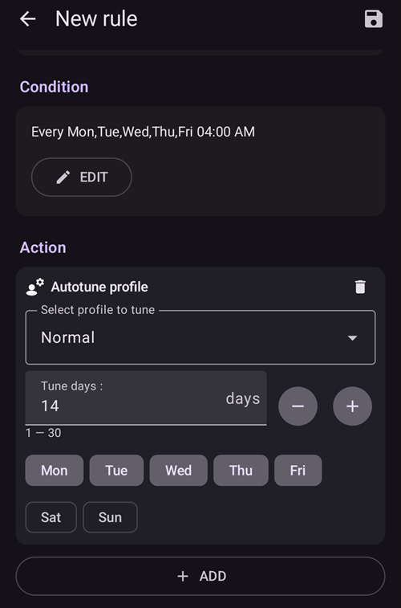

# How to use Autotune plugin

Autotune plugin is an implementation of OpenAPS autotune algorithm within AAPS. It analyzes your recent AAPS history to suggest adjustments to your basal rates, ISF and carb ratio.

Autotune Plugin is available in AAPS releases since [3.4](#version3400) but is hidden by default.

(autotune-how-autotune-calculates-adjustments)=
## How Autotune calculates adjustments

Autotune looks back over your recent AAPS history — CGM readings, boluses, carbs and temporary basal rates — and works out where your **Profile** (basal rates, ISF, carb ratio) doesn't quite match what actually happened to your BG.

For each 5-minute data point, it compares your **actual BG change** to the change your Profile predicted, and sorts the resulting deviation into one of three buckets:

* deviations that happened with no carbs on board and no insulin activity (used to tune **basal rates**, hour by hour),
* deviations that happened after a bolus/correction with no carbs (used to tune **ISF**), or
* deviations that happened while carbs were absorbing (used to tune **carb ratio**).

It then looks at the pattern of deviations in each bucket (using percentiles rather than a simple average, so a few noisy data points don't skew the result) and proposes a new value for that hour/parameter.

To keep any single run from overcorrecting, each Autotune run only ever moves a value a fraction of the way towards what the data suggests: up to 10% for ISF and carb ratio, and up to 20% for each basal segment. Overall drift is further capped by the **Max autosens ratio** / **Min autosens ratio** settings (see [Other settings](#autotune-other-settings) below) — the same bounds that limit Autosens. This is why Autotune is meant to be run repeatedly (day after day, or nightly) rather than trusted after a single run: results should converge gradually, and a big jump on one run is a sign to double check your data (missed carbs, a bad sensor day, _etc._) rather than to trust it blindly.

Autotune can be run three ways: manually as a one-off from within the plugin (as described below), automatically every night via an [automation rule](#autotune-run-autotune-with-an-automation-rule), or — outside of AAPS entirely — as a standalone command-line tool against exported data, which is how some community guides describe using it without a phone actively running AAPS.

*For the underlying oref0 algorithm in full mathematical detail, see [OpenAPS's Autotune documentation](https://openaps.readthedocs.io/en/latest/docs/Customize-Iterate/autotune.html).*

## Show the Autotune plugin

Create an empty file named `enable_autotune` in the `extra` subfolder of your phone [AAPS directory](#preferences-maintenance-settings).

***NOTE: Ensure you check in the AAPS settings where your AAPS Directory is, and that you placed the file in the correct one. Several users have put the file into the wrong folder.***


Restart **AAPS**. Then open the **menu** (☰), select **Configuration**, then the **General** category, and tick **Autotune**. The card then shows **Settings** and **Open plugin**:


## Otoayar kullanıcı arabirimi

Tap **Open plugin** on the **Autotune** card to open the Autotune screen:


- Ayarlamak istediğiniz giriş profilini Profil açılır menüsünden seçebilirsiniz (varsayılan olarak mevcut etkin profiliniz seçilidir)
  - Note: each time you select a new profile, previous results will be removed and the **Number of days of data** will be set to its default value
- Then **Number of days of data** (called **Tune days** in older versions) is to select the number of days used in calculation to tune your profile. Minimum değer 1 gün ve maksimum değer 30 gündür. Doğru yinelemeli ve sorunsuz sonuçlar elde etmek için bu sayı çok küçük olmamalıdır (her hesaplama için 7 günden fazla)
  - Note: each time you change the **Number of days of data**, previous results will be removed
- Son Çalıştırma, en son geçerli hesaplamanızı kurtaran bir bağlantıdır. If you didn't launch Autotune on current day, or if previous results was removed with a modification of calculation parameter above, then you can recover parameters and results of the latest successful run.
- Uyarı size örneğin seçilen profil hakkında bazı bilgiler gösterir (birkaç Kİ değeriniz veya birkaç İDF değeriniz varsa)
  - Not: Otomatik ayar hesaplaması yalnızca tek bir Kİ ve tek bir İDF değeriyle çalışır. There is currently no existing Autotune algorithm to tune a circadian IC or circadian ISF. Giriş profilinizin birkaç değeri varsa, profilinizi ayarlamak için dikkate alınan ortalama değeri uyarı bölümünde görebilirsiniz.
- Check Input Profile button open the Profile Viewer to allow you a quick verification of your profile (Units, IC, ISF, basal and target)
  - Not: OtoAyar, yalnızca Kİ (tek değer), İDF (tek değer) ve bazal (sirkadiyen varyasyonlu) ayarlarınızı yapacaktır. Units and target will remain unchanged in output profile.

- "Run Autotune" will launch Autotune calculation with selected profile and the selected number of days of data
  - Not: Otomatik ayar hesaplaması uzun sürebilir. Başlatıldıktan sonra, başka bir görünüme (ev, ...) geçebilir ve sonuçları görmek için daha sonra otoayar eklentisinde geri dönebilirsiniz

  

- Ardından çalıştırma sırasında aşağıda ara sonuçları göreceksiniz

  - Not: Çalıştırma sırasında ayarlar kilitlenir, bu nedenle artık seçilen giriş profilini veya gün sayısını değiştiremezsiniz. Diğer parametrelerle başka bir çalıştırma başlatmak istiyorsanız mevcut hesaplamanın bitmesini beklemeniz gerekecektir.

  

- OtoAyar hesaplaması bittiğinde, sonucu (Ayarlanmış profil) ve aşağıda dört buton göreceksiniz.

  

- Girdi profilini ("Profil" sütunu), çıktı profilini ("Ayar" sütunu) ve her değer için varyasyon yüzdesini ("%" Sütunu) her zaman karşılaştırmak önemlidir.

- Bazal oranlar için "kayıp gün" sayısına da sahipsiniz. Otoayarın bu dönemde bazal oranı ayarlamak için "Bazal" olarak kategorize edilmiş yeterli veriye sahip olmadığı durumlarda (örneğin, her yemekten sonra karbonhidrat emilimi durumunda) eksik günleriniz olacaktır. Bu sayı, özellikle bazal önemli olduğunda (örneğin gece veya öğleden sonra) mümkün olduğunca düşük olmalıdır.

- "Profilleri karşılaştır" butonu, profil karşılaştırıcı görünümünü açar. Giriş profili mavi ve çıkış profili ("Ayarlanmış" olarak adlandırılır) kırmızıdır.

  - Not: Aşağıdaki örnekte, giriş profilinin Kİ ve İDF için sirkadiyen değişimi vardır, ancak hesaplanan çıktı profilinin tek bir değeri vardır. If it's important for you to get a circadian output profile see [Circadian IC or ISF profile](#autotune-circadian-ic-or-isf-profile) below.

  

- Sonuçlara güveniyorsanız, (giriş profili ile çıktı profili arasında düşük yüzdeli farklılık) "Profili etkinleştir" düğmesine tıklayabilir ve ardından doğrulamak için Tamam'a tıklayabilirsiniz.

  - Activate Tuned profile will automatically create a new profile "Tuned" in your profile list (**Manage → Profile**).
  - If you already have a profile named "Tuned" in **Manage → Profile**, then this profile will be updated with calculated Autotune profile before the activation

  

- Ayarlanmış profilin gerektiğini düşünüyorsanız (örneğin, bazı varyasyonların çok önemli olduğunu düşünüyorsanız), "Yerel profile kopyala" düğmesine tıklayabilirsiniz.

  - A new profile with the prefix "Tuned" and the date and time of the run will be created in **Manage → Profile**

  

- You can then edit the Tuned profile: open **Manage** > **Profile**, swipe to the card named "Tuned" with the date and time of the run, and tap the **Edit** (pencil) button

  - the values in the profile will be rounded in the user interface to your pump capabilities

  

- Giriş profilinizi Otoayar sonuçlarıyla değiştirmek isterseniz, "Giriş profilini güncelle" düğmesine tıklayın ve açılan pencereyi Tamam ile onaylayın

  - Note: if you click on "Activate profile" after "Update input profile", then you will activate your updated profile and not the default "Tuned" profile.

  

- Giriş profilinizi güncellediyseniz, "Giriş profilini güncelle" butonunun yerini "Giriş profilini geri al" butonu alır (aşağıdaki ekran görüntüsüne bakın). You can that way immediately see if your current input profile in **Manage → Profile** already includes the result of last run or not. You also have the possibility to recover your input profile without autotune result with this button

  


## OtoAyar ayarları

(autotune-plugin-settings)=

### Otoayar eklenti ayarları

  

```{admonition} Only DEV
:class: note
The **Auto switch profile** feature is only available in Dev/Engineering mode.
```

- **Auto switch profile** (default Off): see [Run Autotune with an automation rule](#autotune-run-autotune-with-an-automation-rule) below. Bu ayarı Açık olarak değiştirirseniz, giriş profili Ayarlanmış profil tarafından otomatik olarak güncellenecek ve etkinleştirilecektir.
  - **Be Careful, you must trust and verify during several following days, that after an update and activation of Tuned profile without modification, it improves your loop**

- **Categorize UAM as basal** (default Off): This setting is for the users using AndroidAPS without any carbs entered (Full UAM). (Kapalı olduğunda) UAM'ın bazal olarak kategorize edilmesini önleyecektir.
  - Not: Bir gün boyunca tespit edilen en az bir saatlik karbonhidrat emiliminiz varsa, bu ayar ne olursa olsun (Açık veya Kapalı) "UAM" olarak sınıflandırılan tüm veriler bazal olarak kategorize edilir.
- **Default tune days** (default 5): You can define the default value with this setting. Each time you select a new profile in the Autotune plugin, the **Number of days of data** will be replaced by this default value
- **Use circadian IC/ISF** (default Off): see [Circadian IC or ISF profile](#autotune-circadian-ic-or-isf-profile) below.

(autotune-other-settings)=
### Other settings

- Autotune also uses Max autosens ratio and Min autosens ratio to limit variation. You can see and adjust these values in [**Settings** > **Absorption settings** > **Advanced Settings**](../SettingUpAaps/Preferences.md) (**Autosens max** and **Autosens min**).

  


## Gelişmiş özellik

(autotune-circadian-ic-or-isf-profile)=

### Sirkadiyen Kİ veya İDF profili

- If you have important variation of IC and/or you ISF in your profile, and you fully trust in your circadian time and variation, then you can enable **Use circadian IC/ISF** (called "Apply average result in circadian IC/ISF" in older versions)

  - Otoayar hesaplamasının her zaman tek bir değerle yapılacağını ve sirkadiyen varyasyonun Otoayar tarafından ayarlanmayacağına dikkat edin. Bu ayar yalnızca sirkadiyen değerlerinizde Kİ ve/veya İDF için hesaplanan ortalama değişimi uygular.

- Ortalama varyasyonu uygula Kapalı (solda) ve Açık (sağda) ile Ayarlanmış profilin altındaki ekran görüntüsüne bakın

  


### Tune specific days of the week

- If you tap the **eye** icon on the right of the **Number of days of data** field, you will see the day selection. You can specify which day of the week should be included in Autotune calculation (in screenshot below you can see an example for "working days" with Saturday and Sunday removed from autotune calculation)
  - If the number of days included in Autotune calculation is lower than the **Number of days of data**, then you will see how many days will be included on the right of the days selector (10 days in the example below)
  - This setting gives good results only if the number of remaining days is not too small (for example if you Tune a specific profile for week end days with only Sunday and Saturday selected, you should set **Number of days of data** to at least 21 or 28 to have 6 or 8 days included in Autotune calculation)

  

- During Autotune calculation, you can see the progress of the calculations ("Partial result day 1 / 4 tuned" in the example below, with Saturday and Sunday excluded)

  


(autotune-run-autotune-with-an-automation-rule)=

## Otomasyon kuralı ile Otoayar çalıştırma

```{admonition} Only DEV
:class: note
The **Auto switch profile** feature is only available in Dev/Engineering mode.
```

İlk adım, otomasyon kuralı için doğru tetikleyiciyi Otoayar tanımlamaktır:

Note: for more information on how to set an automation rule, see [here](../DailyLifeWithAaps/Automations.md).

- You should select Recurring time trigger: only run Autotune once per day, and autotune is designed to be run daily (each new run you shift one day later and quickly profile modification should be tiny)

  

- Sonuçları kontrol edebilmek için Otoayarı gün boyunca çalıştırmak daha iyidir. Gece boyunca Otoayarı çalıştırmak istiyorsanız, bir sonraki Otoayar hesaplamasına şu anki gün de dahil tetikleme için saat 4 veya daha sonrasını seçmeniz gerekir.

  

- Then you can select the **Autotune profile** action (in the **Loop & insulin** group)

  

- You can then adjust the parameters of the action for your run. In a new action, **Select profile to tune** shows the first profile of your local profile list, the **Tune days** field is empty and all days are selected. Choose the profile to tune and enter the number of **Tune days** (1 to 30).

  

- After a few days, if you fully trust Autotune results and percentage of modification is low, you can modify [Autotune settings](#autotune-plugin-settings) "**Auto switch profile**" to enabled to automatically update and activate profile tuned after calculation.

Note: if you want to automatically tune profiles for specific days of the week (for example a profile for "Weekend days" and another one for "Working days"), then create one rule for each profile, select the same days in Trigger and in Autotune Action, Tune days must be high enough to be sure tuning will be done with at least 6 or 8 days, and don't forget to select time after 4AM in trigger...

- See below an example of rule that runs every working day (Monday to Friday) at 04:00 and tunes the profile "Normal" with 14 **Tune days**, working days only (so only 10 days are included in the Autotune calculation).

  


## Ipuçları ve Püf noktaları

Otoayar, veritabanınızda bulunan bilgilerle çalışır, bu nedenle AAPS yeni bir telefona henüz yüklendiyse, ilgili sonuçları almak için yeterli günle Otoayarı başlatmadan önce birkaç gün beklemeniz gerekecektir.

Otoayar sadece bir yardımdır, hesaplanan profille hemfikir olup olmadığınızı düzenli olarak kontrol etmek önemlidir. Herhangi bir şüpheniz varsa, Otoayar (örneğin gün sayısını) ayarlarını değiştirin veya yerel profildeki sonuçları kopyalayın ve kullanmadan önce profili ayarlayın.

Always use Autotune several days manually to check results before applying them. Ve yalnızca, Otoayar sonuçlarına tam olarak güvendiğinizde ve önceki profil ile hesaplanan profil arasında değerler, otomasyonu kullanmaya başladığınızdan bu yana küçükse kullanın. (Daha önce değil)

- Otoayar, bazı kullanıcılar için çok iyi çalışabilir ve bazıları için çalışmaz, bu nedenle ** Otoayara güvenmiyorsanız, kullanmayın **

It's also important to analyze Autotune results to understand (or try to understand) why Autotune proposes these modifications

- Profil direncinizin bir artışı veya azalması olabilir (örneğin, İDF ve Kİ değerlerinin azalmasıyla ilişkili toplam bazal artışı). it could be associated to several following days with autosens correction above 100% (more aggressivity required) or below 100% (you are more sensitive)
- Sometimes Autotune proposes a different balance between basal rates and IC/ISF (for ex lower basal and more aggressive IC/ISF)

Aşağıdaki durumlarda Otoayar kullanmayı tavsiye etmiyoruz:

- Tüm karbonhidratları girmiyorsanız
  - If you don't enter carbs correction for hypoglycemia, Autotune will see an unexpected increase of your BG value and will increase your basal rates 4 hours earlier, it could be the opposite of what you need to avoid hypo, especially if it's in the middle of the night. That's why it's important to enter all carbs, especially correction for hypo.
- You have a lot of periods with UAM detected during the day.
  - Do you have entered all your carbs and correctly estimated your Carbs?
  - Tüm UAM dönemleri (bir gün boyunca karbonhidrat girmezseniz ve bazal devre dışı bırakıldığı için UAM kategorize edilmezse) bazal olarak kategorize edilir ve bu bazalınızı çok artırabilir (gerekenden çok daha fazla)

- Karbonhidrat emiliminiz çok yavaş: Karbonhidrat emiliminizin çoğu min_5m_carbimpact parametresi ile hesaplanıyorsa (bu periyotları AKRB eğrisinin üst kısmında küçük bir turuncu nokta ile görebilirsiniz), AKRB hesaplaması yanlış olabilir ve yanlış sonuçlara yol açabilir.
  - When you practice sport, you are generally more sensitive and your BG doesn't rise a lot, so during or after an exercise, it's usual to see some periods with slow carbs. Ancak çok sık beklenmedik yavaş karbonhidrat emiliminiz varsa, o zaman bir profil ayarlamasına (daha yüksek Kİ değeri) veya biraz yüksek bir min_5m_carbimpact'e ihtiyacınız olabilir.
- You have "very bad days", for example stuck several hours in hyperglycemia with a huge amount of insulin to be able to go down within the range, or after a sensor change you have long periods of wrong BG values. If during the past weeks you only have one or 2 "bad days", you can disable manually these days in autotune calculation to exclude them from calculation, and again **check carefully if you can trust the results**
- Değişiklik yüzdesi çok önemliyse
  - Daha sorunsuz sonuçlar almak için gün sayısını artırmayı deneyebilirsiniz.
