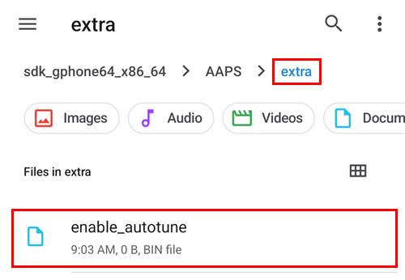
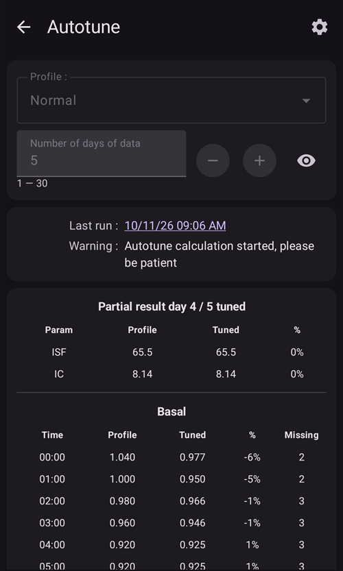
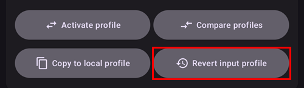
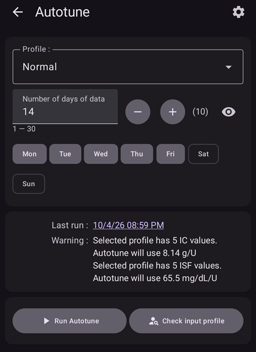
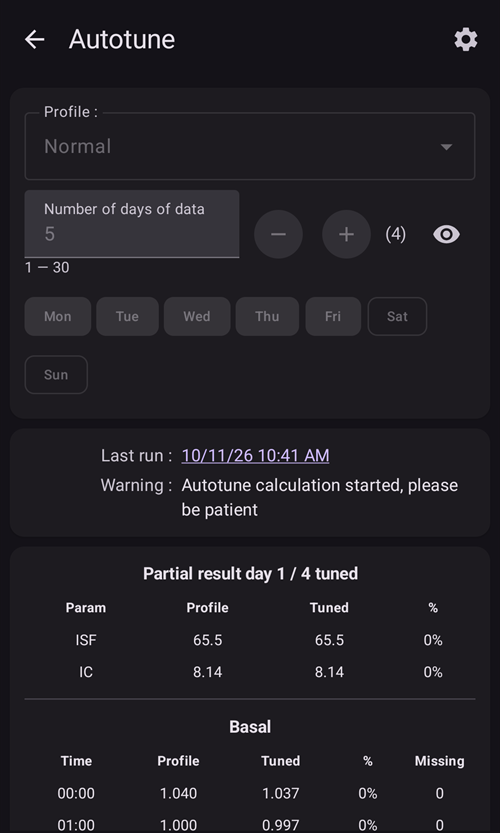

# OtoAyar eklentisi nasıl kullanılır?

OtoAyar eklentisi, OpenAPS autotune algoritmasının AAPS içindeki bir uygulamasıdır. Son AAPS geçmişinizi inceleyerek bazal oranlarınız, İDF ve karbonhidrat oranınız için düzeltmeler önerir.

OtoAyar eklentisi [3.4](#version3400) sürümünden beri AAPS sürümlerinde vardır, ancak varsayılan olarak gizlidir.

(autotune-how-autotune-calculates-adjustments)=
## OtoAyar düzeltmeleri nasıl hesaplar

OtoAyar son AAPS geçmişinize (CGM ölçümleri, boluslar, karbonhidratlar ve geçici bazal oranlar) bakar ve **Profil** değerlerinizin (bazal oranlar, İDF, karbonhidrat oranı) KŞ'nizde gerçekte olanla nerede tam uyuşmadığını hesaplar.

Her 5 dakikalık veri noktası için **gerçek KŞ değişiminizi** profilinizin öngördüğü değişimle karşılaştırır ve ortaya çıkan sapmayı üç gruptan birine ayırır:

* aktif karbonhidrat ve insülin etkisi olmadan oluşan sapmalar (saat saat **bazal oranları** ayarlamak için kullanılır),
* karbonhidrat olmadan bir bolus/düzeltmeden sonra oluşan sapmalar (**İDF** ayarlamak için kullanılır) veya
* karbonhidratlar emilirken oluşan sapmalar (**karbonhidrat oranını** ayarlamak için kullanılır).

Ardından her gruptaki sapmaların düzenine bakar (birkaç gürültülü veri noktası sonucu bozmasın diye basit ortalama yerine yüzdelikler kullanır) ve o saat/parametre için yeni bir değer önerir.

Tek bir çalıştırmanın aşırı düzeltme yapmasını önlemek için her OtoAyar çalıştırması bir değeri, verinin önerdiği değere doğru yalnızca bir kısım kadar değiştirir: İDF ve karbonhidrat oranı için en fazla %10, her bazal dilimi için en fazla %20. Toplam kayma ayrıca **Maks otoduyarlılık oranı** / **Min otoduyarlılık oranı** ayarlarıyla sınırlanır (aşağıdaki [Diğer ayarlar](#autotune-other-settings) bölümüne bakın). Bunlar Otoduyarlılık'ı sınırlayan sınırların aynısıdır. Bu yüzden OtoAyar tek bir çalıştırmadan sonra güvenilmek için değil, tekrar tekrar (her gün veya her gece) çalıştırılmak için tasarlanmıştır: sonuçlar yavaş yavaş yakınsamalıdır. Bir çalıştırmada büyük bir sıçrama, ona körü körüne güvenmek için değil, verilerinizi tekrar kontrol etmek için bir işarettir (girilmemiş karbonhidratlar, kötü bir sensör günü _vb._).

OtoAyar üç şekilde çalıştırılabilir: eklentinin içinden tek seferlik olarak elle (aşağıda anlatıldığı gibi), her gece bir [otomasyon kuralı](#autotune-run-autotune-with-an-automation-rule) ile otomatik olarak veya tamamen AAPS dışında, dışa aktarılmış veriler üzerinde bağımsız bir komut satırı aracı olarak. Bazı topluluk kılavuzları, AAPS'i aktif olarak çalıştıran bir telefon olmadan bu son yolu anlatır.

*Temeldeki oref0 algoritmasının tam matematiksel ayrıntıları için [OpenAPS Autotune dokümantasyonuna](https://openaps.readthedocs.io/en/latest/docs/Customize-Iterate/autotune.html) bakın.*

## OtoAyar eklentisini gösterme

Telefonunuzdaki [AAPS dizininin](#preferences-maintenance-settings) `extra` alt klasöründe `enable_autotune` adlı boş bir dosya oluşturun.

***NOT: AAPS ayarlarında AAPS dizininizin nerede olduğunu kontrol ettiğinizden ve dosyayı doğru dizine koyduğunuzdan emin olun. Birkaç kullanıcı dosyayı yanlış klasöre koymuştur.***



**AAPS**'i yeniden başlatın. Ardından **menüyü** (☰) açın, **Konfigürasyon** seçin, sonra **Genel** kategorisini seçin ve **OtoAyar** kutusunu işaretleyin. Kartta bu durumda **Ayarlar** ve **Eklentiyi aç** görünür:


## OtoAyar kullanıcı arabirimi

OtoAyar ekranını açmak için **OtoAyar** kartındaki **Eklentiyi aç** düğmesine dokunun:


- Ayarlamak istediğiniz giriş profilini Profil açılır menüsünden seçebilirsiniz (varsayılan olarak mevcut etkin profiliniz seçilidir)
  - Not: Her yeni profil seçtiğinizde önceki sonuçlar silinir ve **Veri gün sayısı** varsayılan değerine ayarlanır
- Ardından **Veri gün sayısı** (eski sürümlerde **Ayar günleri**) ile, profilinizi ayarlamak için hesaplamada kullanılacak gün sayısını seçersiniz. Minimum değer 1 gün ve maksimum değer 30 gündür. Doğru yinelemeli ve sorunsuz sonuçlar elde etmek için bu sayı çok küçük olmamalıdır (her hesaplama için 7 günden fazla)
  - Not: **Veri gün sayısı** değerini her değiştirdiğinizde önceki sonuçlar silinir
- Son Çalıştırma, en son geçerli hesaplamanızı kurtaran bir bağlantıdır. OtoAyar'ı bugün başlatmadıysanız veya önceki sonuçlar yukarıdaki bir hesaplama parametresi değiştirildiği için silindiyse, son başarılı çalıştırmanın parametrelerini ve sonuçlarını geri alabilirsiniz.
- Uyarı size örneğin seçilen profil hakkında bazı bilgiler gösterir (birkaç IC değeriniz veya birkaç İDF değeriniz varsa)
  - Not: OtoAyar hesaplaması yalnızca tek bir IC ve tek bir İDF değeriyle çalışır. Şu anda sirkadiyen IC veya sirkadiyen İDF ayarlayabilen bir OtoAyar algoritması yoktur. Giriş profilinizin birkaç değeri varsa, profilinizi ayarlamak için dikkate alınan ortalama değeri uyarı bölümünde görebilirsiniz.
- Giriş profilini kontrol edin düğmesi, profilinizi hızlıca kontrol edebilmeniz için profil görüntüleyiciyi açar (Birimler, IC, İDF, bazal ve hedef)
  - Not: OtoAyar yalnızca IC (tek değer), İDF (tek değer) ve bazal (sirkadiyen değişimli) değerlerinizi ayarlar. Birimler ve hedef, çıktı profilinde değişmeden kalır.

- "OtoAyar'ı Çalıştır", seçilen profil ve seçilen veri gün sayısı ile OtoAyar hesaplamasını başlatır
  - Not: OtoAyar hesaplaması uzun sürebilir. Başlattıktan sonra başka bir görünüme (ana ekran, ...) geçebilir ve sonuçları görmek için daha sonra OtoAyar eklentisine geri dönebilirsiniz

  

- Ardından çalıştırma sırasında aşağıda ara sonuçları göreceksiniz

  - Not: Çalıştırma sırasında ayarlar kilitlenir, bu nedenle artık seçilen giriş profilini veya gün sayısını değiştiremezsiniz. Diğer parametrelerle başka bir çalıştırma başlatmak istiyorsanız mevcut hesaplamanın bitmesini beklemeniz gerekecektir.

  

- OtoAyar hesaplaması bittiğinde, sonucu (Ayarlanmış profil) ve aşağıda dört buton göreceksiniz.

  

- Girdi profilini ("Profil" sütunu), çıktı profilini ("Ayarlandı" sütunu) ve her değer için değişim yüzdesini ("%" sütunu) her zaman karşılaştırmak önemlidir.

- Bazal oranlar için "eksik gün" sayısını da görürsünüz. OtoAyar'ın bu dönemde bazal oranı ayarlamak için "Bazal" olarak kategorize edilmiş yeterli veriye sahip olmadığı durumlarda (örneğin, her yemekten sonra karbonhidrat emilimi durumunda) eksik günleriniz olacaktır. Bu sayı, özellikle bazal önemli olduğunda (örneğin gece veya öğleden sonra) mümkün olduğunca düşük olmalıdır.

- "Profilleri karşılaştırın" düğmesi profil karşılaştırma görünümünü açar. Giriş profili mavi, çıkış profili ("Ayarlandı" adlı) kırmızıdır.

  - Not: Aşağıdaki örnekte giriş profilinde IC ve İDF için sirkadiyen değişim vardır, ancak hesaplanan çıktı profilinde tek bir değer vardır. Sizin için sirkadiyen bir çıktı profili almak önemliyse, aşağıdaki [Sirkadiyen IC veya İDF profili](#autotune-circadian-ic-or-isf-profile) bölümüne bakın.

  

- Sonuçlara güveniyorsanız (giriş profili ile çıktı profili arasında düşük değişim yüzdesi), "Profil etkinleştir" düğmesine tıklayabilir ve ardından onaylamak için Tamam'a tıklayabilirsiniz.

  - "Profil etkinleştir", profil listenizde (**Yönet → Profil**) otomatik olarak "Ayarlandı" adlı yeni bir profil oluşturur.
  - **Yönet → Profil** içinde zaten "Ayarlandı" adlı bir profiliniz varsa, bu profil etkinleştirmeden önce hesaplanan OtoAyar profiliyle güncellenir

  

- Ayarlanmış profilin düzeltilmesi gerektiğini düşünüyorsanız (örneğin bazı değişimlerin çok büyük olduğunu düşünüyorsanız), "Yerel profile kopyala" düğmesine tıklayabilirsiniz

  - **Yönet → Profil** içinde "Ayarlandı" ön ekli ve çalıştırmanın tarih ve saatini içeren yeni bir profil oluşturulur

  

- Ardından Ayarlanmış profili düzenleyebilirsiniz: **Yönet** > **Profil** açın, çalıştırmanın tarih ve saatini taşıyan "Ayarlandı" adlı karta kaydırın ve **Düzenle** (kalem) düğmesine dokunun

  - profildeki değerler, kullanıcı arayüzünde pompanızın yeteneklerine göre yuvarlanır

  

- Giriş profilinizi OtoAyar sonuçlarıyla değiştirmek isterseniz, "Giriş profilini güncelle" düğmesine tıklayın ve açılan pencereyi Tamam ile onaylayın

  - Not: "Giriş profilini güncelle" düğmesinden sonra "Profil etkinleştir" düğmesine tıklarsanız, varsayılan "Ayarlandı" profilini değil, güncellenmiş profilinizi etkinleştirirsiniz.

  

- Giriş profilinizi güncellediyseniz, "Giriş profilini güncelle" butonunun yerini "Giriş profilini geri al" butonu alır (aşağıdaki ekran görüntüsüne bakın). Böylece **Yönet → Profil** içindeki mevcut giriş profilinizin son çalıştırmanın sonucunu içerip içermediğini hemen görebilirsiniz. Bu düğme ile giriş profilinizi OtoAyar sonucu olmadan geri alma olanağınız da vardır

  


## OtoAyar ayarları

(autotune-plugin-settings)=

### OtoAyar eklenti ayarları

  

```{admonition} Only DEV
:class: note
**Profil otomatik geçişi** özelliği yalnızca Dev/Mühendislik modunda (Engineering mode) vardır.
```

- **Profil otomatik geçişi** (varsayılan Kapalı): aşağıdaki [Otomasyon kuralı ile OtoAyar çalıştırma](#autotune-run-autotune-with-an-automation-rule) bölümüne bakın. Bu ayarı Açık olarak değiştirirseniz, giriş profili Ayarlanmış profil tarafından otomatik olarak güncellenecek ve etkinleştirilecektir.
  - **Dikkatli olun: Ayarlanmış profili değiştirmeden güncelleyip etkinleştirdikten sonraki birkaç gün boyunca bunun döngünüzü iyileştirdiğine güvenmeli ve bunu doğrulamalısınız**

- **UAM'yi bazal olarak sınıflandır** (varsayılan Kapalı): Bu ayar, AAPS'i hiç karbonhidrat girmeden kullananlar (Tam UAM) içindir. (Kapalı olduğunda) UAM'ın bazal olarak kategorize edilmesini önleyecektir.
  - Not: Bir gün boyunca tespit edilen en az bir saatlik karbonhidrat emiliminiz varsa, bu ayar ne olursa olsun (Açık veya Kapalı) "UAM" olarak sınıflandırılan tüm veriler bazal olarak kategorize edilir.
- **Varsayılan ayar günleri** (varsayılan 5): Bu ayarla varsayılan değeri belirleyebilirsiniz. OtoAyar eklentisinde her yeni profil seçtiğinizde **Veri gün sayısı** bu varsayılan değerle değiştirilir
- **Sirkadiyen IC/İDF kullanın** (varsayılan Kapalı): aşağıdaki [Sirkadiyen IC veya İDF profili](#autotune-circadian-ic-or-isf-profile) bölümüne bakın.

(autotune-other-settings)=
### Other settings

- OtoAyar, değişimi sınırlamak için Maks otoduyarlılık oranını ve Min otoduyarlılık oranını da kullanır. Bu değerleri [**Ayarlar** > **Emilim ayarları** > **Gelişmiş Ayarlar**](../SettingUpAaps/Preferences.md) içinde görebilir ve değiştirebilirsiniz (**Otoduyarlılık maks** ve **Otoduyarlılık min**).

  


## Gelişmiş özellik

(autotune-circadian-ic-or-isf-profile)=

### Sirkadiyen IC veya İDF profili

- Profilinizde IC ve/veya İDF değerleriniz arasında büyük farklar varsa ve sirkadiyen zamanlamanıza ve değişiminize tam olarak güveniyorsanız, **Sirkadiyen IC/İDF kullanın** ayarını etkinleştirebilirsiniz (eski sürümlerde "Apply average result in circadian IC/ISF" adıyla)

  - OtoAyar hesaplamasının her zaman tek bir değerle yapılacağını ve sirkadiyen varyasyonun OtoAyar tarafından ayarlanmayacağına dikkat edin. Bu ayar yalnızca IC ve/veya İDF için hesaplanan ortalama değişimi sirkadiyen değerlerinize uygular

- Aşağıdaki ekran görüntüsünde, ortalama değişimi uygulama Kapalı (solda) ve Açık (sağda) iken Ayarlanmış profili görebilirsiniz

  


### Haftanın belirli günleri için ayarlama

- **Veri gün sayısı** alanının sağındaki **göz** simgesine dokunursanız gün seçimini görürsünüz. Haftanın hangi gününün OtoAyar hesaplamasına dahil edileceğini belirleyebilirsiniz (aşağıdaki ekran görüntüsünde Cumartesi ve Pazar günleri otoayar hesaplamasından çıkarılmış "çalışma günleri" örneğini görebilirsiniz)
  - OtoAyar hesaplamasına dahil edilen gün sayısı **Veri gün sayısı** değerinden düşükse, kaç günün dahil edileceğini gün seçicinin sağında görürsünüz (aşağıdaki örnekte 10 gün)
  - Bu ayar yalnızca kalan gün sayısı çok küçük değilse iyi sonuç verir (örneğin yalnızca Pazar ve Cumartesi seçili olarak hafta sonu günleri için belirli bir profili ayarlıyorsanız, OtoAyar hesaplamasına 6 veya 8 gün dahil olması için **Veri gün sayısı** değerini en az 21 veya 28 yapmalısınız)

  

- OtoAyar hesaplaması sırasında hesaplamaların ilerlemesini görebilirsiniz (aşağıdaki örnekte Cumartesi ve Pazar hariç tutulmuş olarak "Kısmi sonuç günü 1 / 4 ayarlandı")

  


(autotune-run-autotune-with-an-automation-rule)=

## Otomasyon kuralı ile OtoAyar çalıştırma

```{admonition} Only DEV
:class: note
**Profil otomatik geçişi** özelliği yalnızca Dev/Mühendislik modunda (Engineering mode) vardır.
```

İlk adım, OtoAyar için bir otomasyon kuralına doğru tetikleyiciyi tanımlamaktır:

Not: Bir otomasyon kuralının nasıl ayarlanacağı hakkında daha fazla bilgi için [buraya](../DailyLifeWithAaps/Automations.md) bakın.

- Yinelenen zaman tetikleyicisini seçmelisiniz: OtoAyar'ı günde yalnızca bir kez çalıştırın. OtoAyar her gün çalıştırılmak için tasarlanmıştır (her yeni çalıştırmada bir gün ileri kayarsınız ve profil değişikliği hızla çok küçük olmalıdır)

  

- Sonuçları kontrol edebilmek için başlangıçta OtoAyar'ı gündüz çalıştırmak daha iyidir. Gece boyunca OtoAyar'ı çalıştırmak istiyorsanız, bir sonraki OtoAyar hesaplamasına şu anki gün de dahil tetikleme için saat 4 veya daha sonrasını seçmeniz gerekir.

  

- Ardından **OtoAyar'ı Çalıştır** eylemini seçebilirsiniz (**Döngü & insülin** grubunda)

  

- Ardından eylemin parametrelerini çalıştırmanız için ayarlayabilirsiniz. Yeni bir eylemde **Ayarlanacak profili seçin** yerel profil listenizin ilk profilini gösterir, **Ayar günleri** alanı boştur ve tüm günler seçilidir. Ayarlanacak profili seçin ve **Ayar günleri** sayısını girin (1 ile 30 arası).

  

- Birkaç gün sonra, OtoAyar sonuçlarına tam olarak güveniyorsanız ve değişiklik yüzdesi düşükse, hesaplamadan sonra ayarlanmış profili otomatik olarak güncellemek ve etkinleştirmek için [OtoAyar ayarlarında](#autotune-plugin-settings) "**Profil otomatik geçişi**" seçeneğini etkinleştirebilirsiniz.

Not: Profilleri haftanın belirli günleri için otomatik olarak ayarlamak istiyorsanız (örneğin "Hafta sonu günleri" için bir profil ve "Çalışma günleri" için başka bir profil), her profil için bir kural oluşturun, Tetikleyicide ve OtoAyar Eyleminde aynı günleri seçin. Ayar günleri, ayarlamanın en az 6 veya 8 günle yapılacağından emin olmak için yeterince yüksek olmalıdır. Tetikleyicide saat 4:00'ten sonraki bir zamanı seçmeyi unutmayın...

- Aşağıda, her iş günü (Pazartesi - Cuma) saat 04:00'te çalışan ve "Normal" profilini 14 **Ayar günleri** ile, yalnızca iş günlerini kullanarak ayarlayan bir kural örneği görebilirsiniz (böylece OtoAyar hesaplamasına yalnızca 10 gün dahil edilir).

  


## İpuçları ve püf noktaları

OtoAyar, veritabanınızda bulunan bilgilerle çalışır, bu nedenle AAPS yeni bir telefona henüz yüklendiyse, ilgili sonuçları almak için yeterli günle OtoAyar'ı başlatmadan önce birkaç gün beklemeniz gerekecektir.

OtoAyar sadece bir yardımdır, hesaplanan profille hemfikir olup olmadığınızı düzenli olarak kontrol etmek önemlidir. Herhangi bir şüpheniz varsa, OtoAyar ayarlarını (örneğin gün sayısını) değiştirin veya sonuçları yerel profile kopyalayıp kullanmadan önce profili düzeltin.

Sonuçları uygulamadan önce kontrol etmek için OtoAyar'ı her zaman birkaç gün elle kullanın. Otomasyonu ancak OtoAyar sonuçlarına tam olarak güvendiğinizde ve önceki profil ile hesaplanan profil arasındaki değişim çok küçük olduğunda kullanmaya başlayın (asla daha önce değil)

- OtoAyar bazı kullanıcılar için çok iyi çalışabilir, bazıları için çalışmayabilir, bu nedenle **OtoAyar sonucuna güvenmiyorsanız, kullanmayın**

OtoAyar'ın bu değişiklikleri neden önerdiğini anlamak (veya anlamaya çalışmak) için OtoAyar sonuçlarını incelemek de önemlidir

- profilinizin gücünde genel bir artış veya azalma olabilir (örneğin toplam bazalda artış ile birlikte İDF ve IC değerlerinde azalma). bu, sonraki birkaç gün boyunca otoduyarlılık düzeltmesinin %100'ün üzerinde (daha fazla agresiflik gerekir) veya %100'ün altında (daha duyarlısınız) olmasıyla ilişkili olabilir
- OtoAyar bazen bazal oranlar ile IC/İDF arasında farklı bir denge önerir (örneğin daha düşük bazal ve daha agresif IC/İDF)

Aşağıdaki durumlarda OtoAyar kullanmayı tavsiye etmiyoruz:

- Tüm karbonhidratları girmiyorsanız
  - Hipoglisemi için düzeltme karbonhidratlarını girmezseniz, OtoAyar KŞ değerinizde beklenmedik bir artış görür ve bazal oranlarınızı 4 saat önceden artırır. Bu, özellikle gecenin ortasındaysa, hipoyu önlemek için ihtiyacınız olanın tersi olabilir. Bu yüzden tüm karbonhidratları, özellikle hipo için düzeltmeleri girmek önemlidir.
- Gün içinde UAM algılanan çok sayıda döneminiz var.
  - Tüm karbonhidratlarınızı girdiniz mi ve karbonhidratlarınızı doğru tahmin ettiniz mi?
  - Tüm UAM dönemleri (bir gün boyunca hiç karbonhidrat girmediğiniz ve UAM'yi bazal olarak sınıflandırma kapalı olduğu durum hariç) bazal olarak sınıflandırılır, bu da bazalınızı çok artırabilir (gerekenden çok daha fazla)

- Karbonhidrat emiliminiz çok yavaş: Karbonhidrat emiliminizin çoğu min_5m_carbimpact parametresi ile hesaplanıyorsa (bu periyotları AKRB eğrisinin üst kısmında küçük bir turuncu nokta ile görebilirsiniz), AKRB hesaplaması yanlış olabilir ve yanlış sonuçlara yol açabilir.
  - Spor yaptığınızda genellikle daha duyarlı olursunuz ve KŞ'niz çok yükselmez. Bu yüzden egzersiz sırasında veya sonrasında yavaş karbonhidrat emilimi olan bazı dönemler görmek olağandır. Ancak çok sık beklenmedik yavaş karbonhidrat emiliminiz varsa, o zaman bir profil ayarlamasına (daha yüksek IC değeri) ihtiyacınız olabilir veya min_5m_carbimpact biraz fazla yüksek olabilir.
- "Çok kötü günleriniz" var; örneğin aralığa geri inebilmek için çok büyük miktarda insülinle birkaç saat hiperglisemide kaldığınız günler veya sensör değişiminden sonra uzun süre yanlış KŞ değerleri olan dönemler. Son haftalarda yalnızca bir veya 2 "kötü gününüz" varsa, bu günleri hesaplamanın dışında tutmak için OtoAyar hesaplamasında elle devre dışı bırakabilirsiniz ve yine **sonuçlara güvenip güvenemeyeceğinizi dikkatlice kontrol edin**
- Değişiklik yüzdesi çok büyükse
  - Daha sorunsuz sonuçlar almak için gün sayısını artırmayı deneyebilirsiniz.
