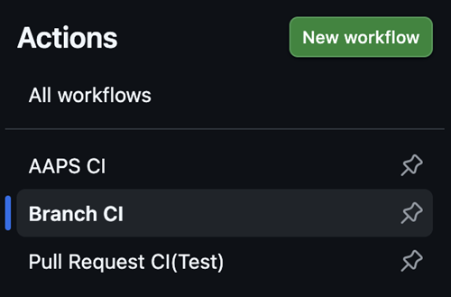
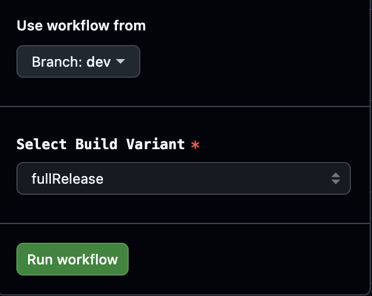
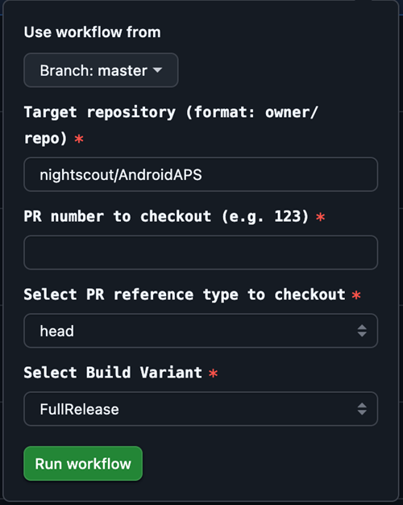

# Geliştirme dalı

```{warning}
Dev dalı yalnızca AAPS'in daha fazla geliştirilmesi içindir. Test için ayrı bir telefonda kullanılmalıdır, <font color="#FF0000">**gerçek döngü için değil!**</font>
```

Kullanılacak en kararlı AAPS sürümü [Master dalındaki](https://github.com/nightscout/AndroidAPS/tree/master) sürümdür. Gerçek döngü kullanımı için Master dalında kalmanız önerilir.

AAPS'in dev sürümü yalnızca geliştiriciler ve test yapanlar içindir: stacktrace'lerle uğraşmayı, günlük dosyalarını incelemeyi ve gerekirse hata ayıklayıcıyı (debugger) çalıştırarak geliştiricilere yararlı hata raporları hazırlamayı bilen kişiler (kısacası: yardım almadan ne yaptığını bilen kişiler!). Therefore many unfinished features are disabled. Bu özellikleri etkinleştirmek için /AAPS/extra dizininde `engineering_mode` adlı bir dosya oluşturarak **Mühendislik modu**'na (Engineering Mode) girin. Geliştirici modunu etkinleştirmek döngüyü tamamen bozabilir.

Bununla birlikte Dev dalı, hangi özelliklerin test edildiğini görmek, hataları gidermeye yardım etmek ve yeni özelliklerin pratikte nasıl çalıştığı hakkında geri bildirim vermek için iyi bir yerdir. İnsanlar Dev dalını, kararlı olduğundan emin olana kadar çoğu zaman eski bir telefonda ve pompada test eder. Her türlü kullanımın riski size aittir. Herhangi bir yeni özelliği test ederken, hâlâ geliştirilmekte olan bir özelliği test etmeyi seçtiğinizi unutmayın. Bunu kendi riskinizle & kendinizi güvende tutmak için gereken özeni göstererek yapın.

Dev dalını kullanırken bir hata bulursanız veya bir şeyin yanlış gittiğini düşünürseniz, başka birinin bunu bulup bulmadığını görmek için [issues sekmesine](https://github.com/nightscout/AndroidAPS/issues) bakın; bulunmadıysa kendiniz ekleyin. Burada ne kadar çok bilgi paylaşırsanız o kadar iyidir ([günlük dosyalarınızı](../GettingHelp/AccessingLogFiles.md) paylaşmanız gerekebileceğini unutmayın). Yeni özellikler [discord](https://discord.gg/4fQUWHZ4Mw) üzerinde de tartışılabilir.

Bir dev sürümünün son kullanma tarihi vardır. Sürümü sorunsuz kullanırken bu rahatsız edici görünebilir, ancak bir amaca hizmet eder. Ortada tek bir dev sürümü dolaşırken, insanların bildirdiği hataları takip etmek daha kolaydır. Geliştiriciler, ortada dev'in üç farklı sürümünün olduğu, hataların bazılarında düzeltilip bazılarında düzeltilmediği ve insanların zaten düzeltilmiş hataları bildirmeye devam ettiği bir durumda olmak istemez.

(branch-ci-test)=

## Belirli bir dalı test etme (branch-ci)

Bir test dalını oluşturmak için branch-ci seçin. Bu seçenek, APK oluşturmak için belirli bir dalı seçmenizi sağlar. Dev dalını test etmeniz gerektiğinde bu yöntemi kullanabilirsiniz.





(github-pr-test)=

## Bir pull request'teki değişiklikleri test etme (GitHub CI actions ile dağıtım)

3.3.2.1.dev sürümünden itibaren kullanılabilir

- Test yapanlar veya teste yardım edenler için uygundur.

```{eval-rst}
.. raw:: html

    <!--crowdin: exclude-->
    <div align="center" style="max-width: 360px; margin: auto; margin-bottom: 2em;">
      <div style="position: relative; width: 100%; aspect-ratio: 9/16;">
        <iframe
          src="https://geo.dailymotion.com/player/x9rdx1q.html?video=x9rdx1q&loop=true&mute=true"
          loading="lazy"
          style="position: absolute; top: 0; left: 0; width: 100%; height: 100%;"
          frameborder="0"
          allowfullscreen>
        </iframe>
      </div>
    </div>
```



- Target repository: PR'ı içeren depo, owner/repo biçiminde. Başka bir depo kullanmanız söylenmediyse varsayılan **nightscout/AndroidAPS** değerini bırakın (bunu yalnızca geliştiriciler yapmalıdır).

- PR number: Lütfen test etmek istediğiniz PR numarasını girin.

- PR reference types: PR referans türlerinde iki seçenek vardır:
    
    - head:
    - PR yazarının dalındaki asıl içeriği alır (yani hiçbir birleştirme (merge) işlemi olmadan orijinal commit geçmişini).
    - Bu, PR dalının orijinal durumuna eşittir; sanki doğrudan bir fork'tan veya özellik dalından alınmış gibi.
    
    - merge:
    
    - GitHub'ın PR'ı hedef dala (ör. dev) önceden denediği birleştirmenin sonucunu alır.
    - Bu, GitHub'ın otomatik olarak oluşturduğu sanal bir birleştirme (merge) commit'idir.
    - Bu commit yalnızca PR'da çakışma yoksa ve PR birleştirilebilir durumdaysa vardır.
    
    - variant:
    
    - Lütfen [varyant](#browserbuild-variant) bölümüne bakın