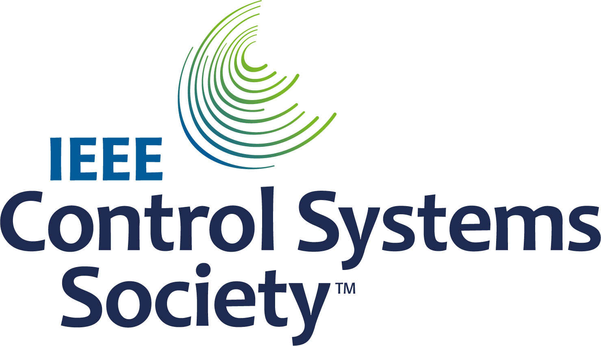
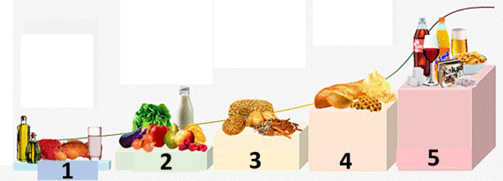

# Tam Kapalı Döngü

```{contents} In this page
:backlinks: entry
:depth: 2
```

Tam Kapalı Döngünün (**FCL**) asıl çekiciliği, yapay pankreası taklit etme potansiyeline sahip olması ve öğünler için bolus yapma ihtiyacı olmadan günlük yönetimi kolaylaştırmasıdır.

**Hibrit kapalı döngü** ('HCL') algoritma tabanlı olsa da, kullanıcının öğünlerden önce bolusları elle vermesini gerektirir. Bunun sonucunda döngü, aşırı insülin verilmesini önlemek için geçici bir kapatmaya (geçici sıfır bazal) girebilir.

**FCL** ile öğün boyutuna bağlı bolus artık gerekmez: bunu algoritmaya bırakın!  **AAPS**, kullanıcı hiç bolus vermeden ve karbonhidrat girmeden öğünleri ‘bildirilmemiş öğünler’ **(‘UAM’)** adı verilen bir modda yönetebilir. **UAM**, daha agresif davranarak **AAPS**'in hatalı karbonhidrat girişlerini daha iyi tolere etmesini sağlar.

## Ne beklemeli?

**FCL** ile elde edilebilecek olumlu sonuçlar hakkında yayımlanmış birçok çalışma vardır. Daha fazla bilgi için aşağıdakilere bakın:

1)   National Library of Medicine, PubMed [First Use of Open-Source Automated Insulin Delivery AndroidAPS in Full Closed-Loop Scenario: Pancreas4ALL Randomized Pilot Study](https://pubmed.ncbi.nlm.nih.gov/36826996/);

2)  ClinicalTrials.gov National Library of Medicine, Clinical Trial [Feasibility and Safety Study of the Automated Insulin Delivery Closed Loop System Pancreas4ALL (ASAP)](https://www.clinicaltrials.gov/study/NCT04835350?term=Feasibility%20and%20Safety%20Study%20of%20the%20Automated%20Insulin%20Delivery%20Closed%20Loop%20System%20Pancreas4ALL%20(ASAP)&rank=1)

**FCL** ile başarı için kullanıcının şunları yapması gerekir:

- **FCL** ön koşullarını karşılayıp karşılamadığını kontrol etmek;
- günlük yönetim ihtiyaçlarına göre uyarlanmış **Otomasyonlar** kurmak; ve
- **AAPS** ayarlarını (özellikle **Otomasyonları**) ince ayarlamak ve uyarlamak.


## HCL'den FCL'ye geçmenin (veya geçmemenin) nedenlerine ilişkin genel değerlendirmeler

**FCL** herkes için değildir:

- Bazı **FCL** kullanıcıları %90 civarında TIR (70-180) ve %6'nın altında HbA1c elde eder, ancak diğer kullanıcılar daha sıkı kontrolü tercih eder. Özellikle, hızlı karbonhidratlı diyetlerde 140 mg/dL üzerindeki değerleri en aza indirmek muhtemelen ön bolus gerektirir.
- **AAPS** ayarı zorlu olabilir. AAPS karşısında kendini bunalmış hisseden kullanıcılar için değildir.  **FCL** ayarlarınızı uyarlamak ve ince ayar yapmak için birkaç hafta ayırmanız gerekecek. Bu zamanı ayırmak daha iyi sonuçlar ve daha iyi **KŞ** kontrolü sağlayabilir.
- Öğün yönetimi kolaylaşabilir, ancak **FCL** ile egzersiz yine de zor olabilir. Çoğumuz vücut ağırlığını kontrol etmek için spor sırasındaki atıştırmalıkları sınırlamak isteriz.
- Çocuklar için **FCL** kurmak hâlâ zordur (aşağıda ele alınmıştır).


## İyi ayarlanmış hibrit kapalı döngü

**FCL** kullanımına geçmeyi düşünmeden önce iyi ayarlanmış bir **HCL** kurmanız önerilir.  **FCL** ile başarı, kullanıcının ayarlarının son derece kişisel olarak ayarlanmasını gerektirir; böylece **AAPS**, SİZİN başarılı hibrit kapalı döngü modunuzu yakından taklit edecek şekilde insülin verebilir.

**FCL**, kullanıcının **Otomasyonlarını** kurmasını ve ayarlamasını gerektirir. Ancak kullanıcı, **FCL** kullanmaya başlamadan önce kendi insülin yönetimi ihtiyaçlarını güvenle anlamalıdır. Hatalar, karşı hatalarla gizlenebilir. Bu, kararsız bir **FCL** sistemi oluşturabilir ve daha sonra düzeltmeyi zorlaştırabilir. FCL ile, bugün **HCL** ile gördüğünüze benzer bir %TIR değerine ulaşmayı beklemelisiniz.

**FCL, kullanıcının ayarlarını yaparken hem başarılı HCL hem de ilk FCL deneyiminden elde ettiği verileri analiz ederek belirlediği, kendin-yap (DIY) bir Otomasyon kurulumudur.**

## Hızlı insülin (Lyumjev, Fiasp)

**FCL** hızlı insülin gerektirir.  Bu, öğünle ilgili **KŞ** yükselişinin başında **FCL**'nin **KŞ** değerini aralıkta (genel tanıma göre 180 mg/dL (10 mmol/L) altında) tutabilmesi içindir.

Bir modelleme çalışması (ayrıntılar için bkz. LINK FullLoop V2/March2023; orada bölüm 2.2), *daha hızlı insülinlerin* şunları yaptığını sayısal olarak gösterebilir:

Source:

 


IEEE Control Systems Magazine, ResearchGate [The Artificial Pancreas and Meal Control: An Overview of Postprandial Glucose Regulation in Type 1 Diabetes](https://www.researchgate.net/publication/322866519_The_Artificial_Pancreas_and_Meal_Control_An_Overview_of_Postprandial_Glucose_Regulation_in_Type_1_Diabetes);

- daha yavaş insülinlere göre belirgin şekilde daha düşük **KŞ** tepelerine yol açar;
- ilk öğün bolusunun birkaç dakika gecikmesini, kabul edilemez tepe yükseklikleri oluşmadan tolere eder; ve
- farklı karbonhidrat yüklerinin (öğün boyutlarının) **KŞ** tepesi üzerindeki etkisini en aza indirir.

Kullanıcı çok ılımlı ila düşük karbonhidratlı bir diyette değilse, **FCL** büyük olasılıkla Lyumjev veya Fiasp dışındaki insülinlerle etkili olmaz.

Ancak Fiasp veya Lyumjev, iğne uzunluğu gibi şeyler optimize edildikten sonra bile sık pompa tıkanıklıklarına yol açabilir. Kanül veya pod süresine dikkat etmek önemlidir. Birçok kullanıcı, kanül/pod arızası başlamadan önceki insülin etkinlik sınırının 48 saat olduğunu görür.

## Prerequisites

**AAPS**'in değerli zaman kaybetmeden en iyi şekilde çalışabilmesi için **KŞ** değerleri ve kararlı Bluetooth bağlantısı gereklidir. **FCL**, 7/24 teknik olarak kararlı bir sistem gerektirir:

- **CGM performansınız**. CGM'niz, **FCL** tarafından başlayan bir öğünün işareti olarak yanlış yorumlanabilecek sıçramalı **KŞ** değerleri üretmemelidir. Benzer şekilde, **CGM** kalibrasyonları da sıçramalı sonuçlar üretebilir.
- herhangi bir **CGM** yumuşatmasının nasıl ve nerede yapıldığı ve bunun ayarlarınız için ne anlama gelebileceği. Özellikle deltanın nasıl tanımlandığı ve AAPS'in bunu başlayan bir öğünün işareti olarak tanıması.
- pompa ve CGM için Bluetooth kararlılığı;
- pompa tıkanıklığından kaçınmak (veya en azından erken fark etmek);
- veri akışı, telefonunuzda kullanılan uygulamalar ve sensör kullanım günleri arasındaki farklar;
- tüm **AAPS** bileşenlerini iyi şarjlı tutmak ve yedek parçaları yakında bulundurmak; ve
- tıkanma riskini azaltmak için kanül (veya pod) değişimlerini her zaman yeterince erken yapmak;

Yukarıdakiler, **AAPS** bileşen sisteminize ve yaşam tarzınıza göre değişecektir.

## Öğünle ilgili sınırlamalar

- **FCL** kurmak, beslenmesinde **KŞ** üzerinde hızlı ve yüksek etkili besin bileşenleri olmayan ve öğün düzeni günden güne çok değişmeyen kişiler için daha kolay olabilir. Bu, mutlaka düşük karbonhidrat anlamına gelmez.

- Yağ veya protein açısından zengin diyetler ya da yavaş sindirim/gastroparezi, **FCL** için işleri zorlaştırmaz, aksine kolaylaştırır; çünkü geç gelen karbonhidratlar, tepe zamanı civarında gereken bolusun kaçınılmaz geç etki “kuyruklarını” güzelce karşılar.

### Glisemik indeks ve kan şekerine etki

**UAM** modu için zorluk, 'Kan Şekerine Etki' ('EBG') arttıkça artar

- Ilımlı/düşük başlayın ve **Profilinizin** ayarlarını yapın. Yalnızca bundan sonra yüksek **EBG** içeren öğünleri "test edin".
- Çok yüksek **EBG** içeren yiyecekler tüketiyorsanız < %50 başlangıç bolusu düşünün.

1) **EBG yok**: ör. taze et, balık, yumurta, pastırma, yağlar, peynir. 2) **Düşük EBG**: ör. taze sebzeler ve orman meyveleri, mantar, kuruyemiş, süt, yoğurt, lor peyniri. 3) **Orta EBG**: ör. tam tahıllı ekmek/erişte, patates, yabani pirinç, yulaf, kuru meyveler. 4) **Yüksek EBG**: ör. buğday ekmekleri, baget, tost ekmeği, waffle, kurabiye, patates püresi, erişte, pirinç. 5) **Çok yüksek EBG**: ör. şeker, şekerli içecekler, meyve suları, mısır gevreği, şekerleme, tatlılar, patates cipsi, tuzlu kraker çubukları.



**FCL** için en zor öğünler, yalnızca çok yüksek ve yüksek **EBG** bileşenlerinden oluşan yiyeceklerdir (resimde kırmızı ile gösterilenler): Bu durumda **KŞ** yalnızca hızla yükselmekle kalmaz; yüksek glikozu erken kontrol etme girişimleriyle gelecek kaçınılmaz insülin etkisi “kuyruğunu” dengeleyecek yağ/protein/lif bileşeni de azdır.

Hızlı emilen karbonhidratlarla dolu atıştırmalıkların ve şekerli içeceklerin düzensiz tüketimi **FCL** için sorunludur.


## Aktivite/spora hazırlık

Egzersiz yaparken veya hareketliyken, pompa ya da hibrit kapalı döngü ile kullanıcının egzersizden önce **AİNS** miktarını azaltması önerilir.

**FCL** ile algoritma, **UAM** durumlarını algılayacak ve **KŞ** yükselişlerine karşı otomatik olarak insülin verecek şekilde ayarlanmıştır.  Herhangi bir aktiviteden çok önce yüksek bir **Geçici Hedef** ve daha düşük bir **Profil yüzdesi** (öğün başlangıcı civarında zaten etkili olacak şekilde) ayarlanmalıdır.

Alışılmadık veya düzensiz egzersiz düzeyleri **FCL** için zorluk yaratır. Egzersiz için önceden plan yapmak gerekir (özellikle spor sırasındaki düşüklerde kurtarma karbonhidratı/atıştırmalık ihtiyacını azaltmak istiyorsanız). Aktif bir günden sonra, akşam yemeği tamamen sindirildikten sonra gece için daha düşük bir **Profil yüzdesi** ayarlanması önerilir: **Otomasyonlarda** yükseltilmiş (>100 mg/dL) bir **KŞ** hedefi ayarlayın ve **AAPS** **Ayarlar** bölümünde **Yüksek geçici hedefte SMB'yi etkinleştir** kapalı olsun.

## Çocuklar için engeller

**FCL**, çocuklar için ek zorluklar getirebilir; bunlar şunlardır:

- Lyumjev veya Fiasp bulunamayabilir veya iyi tolere edilmeyebilir.
- Saatlik bazal oran çok düşük olabilir; bu da büyük **SMB**'ler için zayıf bir temel oluşturur.
- Beslenme tatlı bileşenler açısından zengin olabilir. Küçük bir vücudun tipik düşük kan hacmi nedeniyle çok yüksek **KŞ** sıçramalarına güçlü bir eğilim vardır.
- Büyüme hormonları ve insülin duyarlılığındaki belirgin değişiklikler, **FCL** ayarlarını doğru tutmayı zorlaştırır.


## Güçlendirilmiş SMB'leri etkinleştirme: güvenlik

**HCL** modunda, döngünün otomatik olarak verebileceği bolus boyutlarıyla ilgili güvenlik kısıtlamaları uygulanır.

**FCL** kullanıcılarının artık öğün başlangıcında büyük bir bolus vermesine gerek yoktur. Bunun sonucu olarak, döngünün yeterince büyük **SMB**'ler verebilmesi için **SMB** boyut sınırlarındaki kısıtlamaların genişletilmesi gerekir.

**AAPS**'in master sürümünü kullanıyorsanız, **FCL**'nin verebileceği **SMB** boyutu için **AAPS** **Ayarlar** bölümünde izin verilen en yüksek değerin ayarlanması önerilir (maxUAMSMBBasalMinutes=120, yani günün o saatindeki 2 saatlik bazal miktarı).

Bazal oranınız çok düşükse, ortaya çıkan **SMB** sınırları, öğün sonrası **KŞ** yükselişleriyle başa çıkmak için yeterli kontrole izin vermeyecek kadar düşük olabilir. Olası bir çözüm, güçlü **KŞ** sıçramalarına neden olan diyetlerden kaçınmaktır. [OtoİDF](#Open-APS-features-auto-isf) algoritması (yalnızca mühendislik modu açık bir dev sürümünde kullanılabilir), standart en fazla 2 saatlik bazal miktarını >1 bir faktörle genişleten bir **SMB maks menzil genişletme** ayarına sahiptir ve varsayılan %50 olan **SMB iletim oranı** değerini artırmanıza izin verir.

**AAPS'in bolusunuzu birkaç SMB ile taklit edebilmesi için talimatları izleyin**.

Öğün başlangıçları civarında döngünün ihtiyaç duyduğu insülini verebilmek için **SMB**'lerinize yeterli boyutta izin verilip verilmediğini görmek amacıyla **APS** eklenti ekranını (**Konfigürasyon → APS (YPS) → Eklentiyi aç**) düzenli olarak kontrol edin.

Aksi halde ayar çabalarınız bazen boşa gidebilir!


```{admonition} Boosting **ISF** can become dangerous
:class: danger

Yemeğiniz başladıktan kısa süre sonraki **SMB** boyutlarını dikkatle gözlemleyin/analiz edin. Adım adım ayarlayın ve aynı anda 1 veya 2 parametreden fazlasını değiştirmeyin.

**AAPS** ayarlarınız, sizin (!) öğün çeşitliliğinizle başa çıkacak şekilde yeterince iyi kurulmuş olmalıdır.
```

## Öğün algılama/güçlendirme için Otomasyonlarınız

Başarılı bir **FCL** için temel ayar parametresi **İDF**'dir. **AAPS** master sürümünü ve **Otomasyonları** kullanırken, **öğün tanındığında (glikoz deltaları ile) otomatik olarak > %100 profil değişikliği tetiklenmeli** ve keskinleştirilmiş **İDF** sağlanmalıdır.

**AAPS** master sürümü, **HCL** modunda %130'a kadar geçici **Profil** kullanımına izin verir. **İDF**'yi güçlendirme 3 adımda yapılır:

- Adım 1 - **Profil** içinde bu öğün saati için geçerli olan **İDF**'yi gözden geçirin ve örneğin Otoduyarlılık'ın, vücudun güncel (son birkaç saatteki) insülin duyarlılığı durumunu dikkate alan bir değişiklik önerip önermediğine bakın.
- Adım 2 - **İDF**'yi güçlendirmek için bir faktör uygulayın (**Otomasyon** içinde ayarlandığı gibi 1/Profil%).
- Adım 3 - önerilen **İDF**'nin belirlenen güvenlik sınırları içinde kalıp kalmadığını kontrol edin.

### FCL Otomasyon şablonları

En üstte işaretlenecek kutular. Şu seçeneğiniz var:

- **Otomasyon** listenizde onay işaretini (her alanın solunda) KAPALI yapabilirsiniz => Bu, o **Otomasyonu** devre dışı bırakır. Örneğin bunu kahvaltıyla ilgili tüm **FCL** **Otomasyonları** için yaparak kahvaltı(lar) için **HCL** moduna geçebilirsiniz.

- Her **Otomasyon** kuralı için Kullanıcı eylemi kutusunu işaretleyebilirsiniz => bu durumda tanımlanan Eylemler, Koşullar sağlandığında otomatik olarak yürütülmez. Bunun yerine, **FCL** otomatik olarak bir **SMB** verecek olduğunda **AAPS** ana ekranı sizi uyarır. O zaman ‘evet’ veya ‘hayır’ deme fırsatınız olur. Bu, ayar aşamanızda son derece faydalıdır.

Bu özellik, sabah kalkarken **KŞ** değerinde ani bir yükseliş olan “ayak yere basma” (foot to floor) sendromu gibi bazı durumlarda faydalı olabilir; burada kullanıcı tam otomatik bir “kahvaltı başladı” yanıtını önlemek ister.

Aşağıdaki bölüm, **Otomasyon** Koşullarının nasıl bir araya getirileceğini ve **AAPS**'in insülin iletimini artırması (veya azaltması) gereken durumlarla nasıl başa çıkılacağını açıklar. **İDF** doğrudan ayarlanamadığından, **Profil yüzdesini** %100'ün üzerine çıkarmak bizim amacımız için aynı işi görür.

### KŞ yükselişinde otomatik büyük SMB'ler

Başarılı **FCL** için anahtar şudur: **öğünlerden kaynaklanan KŞ artışlarının başında, döngü mümkün olduğunca hızlı bir şekilde çok büyük otomatik SMB'ler vermelidir**; böylece gereken **AİNS** “yakalanır” (benzer bir öğün için **HCL** modunda verdiğiniz tipik bolusla karşılaştırın!)

Bunu başarmak için, **HCL** verileriniz analiz edilerek hangi **deltaların** öğünle ilgili olmayabileceği ve hangilerinin öğünle ilgili olabileceği belirlenmelidir.

- **Otomasyonu** önceden tanımlanmış bir zaman penceresi içinde tanımlayabildiğiniz için yalnızca orayı analiz etmeniz yeterlidir.
- Çok farklı türde öğünler yiyorsanız (ör. oldukça yüksek karbonhidratlı bir kahvaltı, ama düşük karbonhidratlı bir öğle yemeği), her zaman aralığı için iki farklı **Otomasyon** (seti) oluşturmayı seçebilirsiniz.
- Sıkışmaya bağlı düşüklerden (compression low) kaynaklanan ara sıra sıçramalar görüyorsanız geceleri hariç tutun.
- Genellikle son 5 dakikanın deltasını kullanmak yeterlidir.
- Ancak ortalama deltalardan birini de kullanabilirsiniz. **Otomasyonlarınızın** koşullarındaki deltaları karşılaştırarak, **KŞ**'nin hızlanarak yükselip yükselmediğine bağlı olarak farklı agresiflikte eylemler bile tanımlayabilirsiniz.

> ( delta – kısa ortalama delta )>n   ifadesi, yükselen **KŞ**'nin en erken işaretinde ilk **SMB**'yi tetiklemek için ivme algılamada kullanılabilir. -                                                                             
> Dikkat: kötü veya aşırı yumuşatılmış **CGM** değerleriyle kullanılamaz!

Verileri kesintili olan bir **CGM**, kullanıcıyı zor durumda bırakır; çünkü güvenli tarafta kalmak için, hangi deltanın kesinlikle başlamış bir öğünün işareti olduğu tanımınızı „ihtiyatlı“ tutmanız gerekir. Bu şu anlama gelir:

- **FCL** ek zaman kaybeder; bu da daha yüksek **KŞ** tepelerine ve daha düşük %**TIR** değerine yol açar;
- **FCL** ile kullanıcı bolusunun yerini alması beklenen **SMB**'leri öğün olmadan da tetikleyebilecek daha erken veya daha küçük bir delta kullanamazsınız.

Ayrıca, bir öğünden sonraki ilk yükselişlerde mevcut **AİNS düşüktür**. Bunu göz önünde bulundurarak, akşam yemeği için bir Otomasyon (#1) şöyle görünebilir:


Otomasyon #1

Koşullar sağlanırsa, **AAPS** sonraki 12 dakika içinde, ayarlanan yükseltilmiş **Profil yüzdesine** göre güçlendirilmiş bir **İDF** kullanarak 1 veya 2 **SMB** verir (örnekte insulinReq %30 artırılır). Bu Koşullar geçerli olduğu sürece, **Otomasyon** kuralı 12 dakika daha uzar. Düşük karbonhidratlı bir öğünde **KŞ** daha yavaş yükselebilir. Daha düşük bir deltada devreye giren ve daha zayıf bir insülin artışı veren başka bir Otomasyon (#2) da faydalı olur.


Aynı **Otomasyon**, Otomasyon #1'de tanımlanan dik yükseliş bittikten sonra, muhtemelen daha yüksek karbonhidratlı öğünlerde de devreye girer.

Bu iki (+ belki üçüncü) **Otomasyonu**, öğünlerinizde (ve çeşitliliğinde) gördüğünüze uyacak şekilde “kademelendirmeniz” gerekir => Uygun sıçrama boyutlarını, **AİNS** kriterlerini ve güçlendirmeleri belirlemek, tekrar tekrar yapılan bir ayar süreci olacaktır.  Ayrıca Koşullara uygun zaman aralıkları eklerseniz, farklı günlük öğün zamanlarınız (kahvaltı, öğle yemeği, akşam yemeği) için kolayca farklı Otomasyonlar oluşturabilirsiniz.

Hâlâ yükselme evresindeyken (!) **AİNS** "taşmasının" engellenmesi gerektiğini unutmayın; böylece **insülinin** geç etkileri (3-5 saat sonraki "**kuyruk**"), döngünün sıfır geçici bazal ile (hipo riskini azaltmak için bazalı “geri alarak”) frenleme kapasitesini aşmaz.

Büyük öğünlerde **bazen ikinci bir yükseliş** olur. O zamana kadar genellikle AİNS de biraz düşmüştür ve daha agresif Otomasyonlar yeniden devreye girer. (Bunun olabilmesi için Otomasyon #2'deki AİNS koşulunuzun çok düşük ayarlanmadığını kontrol edin).

Birkaç ilk **SMB** verildikten kısa süre sonra, ılımlı insülin iletiminin emilen ek karbonhidratları karşılaması gereken bir **dengeli evre** gelir. (Döngünün çok zayıf bir **KŞ** yükselişi görebileceği ve hemen şimdiden sıfır geçici bazala geçebileceği düşük karbonhidratlı öğünler hariç).

**AAPS** ana ekranı (**UAM** tam döngüde AKRB=0 gördüğünüz yer) bu evrede daha fazla karbonhidrat gerektiğini söyleyebilir. **UAM** modunda bu basitçe şu anlama gelir: Kabaca bir akla yatkınlık kontrolü yapabilirsiniz: Yaklaşık bir saat önceki (döngünüze hiçbir bilgi vermediğiniz) öğününüzden bu kadar karbonhidrat hâlâ emilmemiş olarak vücudunuzda olabilir mi?


### AİNS eşiği

Çoğu zaman **Otomasyon** #1 ve/veya #2, AİNS değerini **sizin** öğünleriniz için genellikle yeterli olan seviyelere çıkarır. Kişisel ayar için **HCL** verilerinizde, iyi yönetilen öğünlerde (çoğu zaman: öğün bolusunuzla) oluşan en yüksek AİNS değerlerine ve hangi büyüklüğün üzerinde sonunda hipo (veya ek karbonhidrat ihtiyacı) oluştuğuna bakın.

Döngünüzün agresifliğini azaltmanız gereken makul **AİNS eşikleri** her öğün için aynı olmayabilir. Ancak özellikle, **UAM** modunda çok kritik olan öğün başlangıcından sonraki ilk saatte. Bu her kullanıcı için farklı olacaktır. Bazı kullanıcılarda saatte yalnızca yaklaşık 30 g emilir ve öğünden bağımsız anlamlı bir **AİNS** değeri tanımlamak mümkün olabilir.

İstisnai öğünler için veya ardından spor yapılacaksa düşürmek için, **AİNS** eşiği **Otomasyonunuzda** hızla farklı ayarlanabilir.

Otomasyon (#3), "iobTH reached => **SMBs** off” (iobTH aşıldı, SMB kapalı), agresif **SMB** güçlendirmesini sonlandırmak (veya karbonhidratla ilgili başka bir yükselme dalgası gelene kadar duraklatmak) için tanımlanır.


Otomasyon #3

Döngüye, ayarladığınız **AİNS eşiğinin** üzerinde artık **SMB** kullanmamanın daha iyi olduğunu söyler

- Verilen örnek bunu GH=111 ayarlayarak yapar (bu biraz keyfidir; otomatik **SMB** kapatmanız olarak kolayca tanıyacağınız >100 bir sayı seçin)
- **AAPS** [Ayarlar → OpenAPS SMB](#Preferences-openaps-smb-settings) bölümünde, genel olarak yükseltilmiş hedefte **SMB** kullanımına izin vermeyin.                                                                                                                   
  Gereken insülin bu durumda **geçici bazal oranı (GBO)** darboğazı üzerinden çok daha temkinli verilmek zorunda kalacaktır

**Dikkat: Otomasyon #3 yalnızca etkin bir GH yokken çalışır.** Bu nedenle EatingSoonTT kullandıysanız, o zamana kadar sona ermiş olmalıdır; bu genellikle öğün başlangıcından 30-40 dakika sonradır.

Bunu yapmanın bir yolu, çalışmakta olan bir EatingSoonTT'yi **AİNS**>%65 * iobTH Koşulu altında sonlandıran bir **Otomasyon** Koşulu kurmaktır.
> EatingSoonTT ile çalışma yolları Bazı kullanıcılar, düşük bir başlangıç **KŞ** değerini ve biraz artmış bir **AİNS** değerini garanti etmek için öğün başlangıcından yaklaşık bir saat veya daha önce (GH düğmesine basarak veya yemek zamanları oldukça sabitse düşürülmüş bir **Profil** **KŞ** hedefi ile otomatik olarak) bir EatingSoonTT ayarlar. Ancak **FCL** her zaman hedefe doğru ilerliyorsa, bu pek bir şey kazandırmayabilir ve öğün başlangıcı tanındığında (glikoz deltası veya ivme = delta > ortalama delta) bir EatingSoonTT ayarlayan bir **Otomasyon** tanımlamayı tercih edebilirsiniz. Bu aşamada düşük bir **GH** önemlidir; çünkü her **SMB** döngünüz tarafından (tahmin edilen glikoz eksi GH)/sens kullanılarak hesaplanır, bu nedenle küçük bir GH, ortaya çıkan insulinReq değerini büyütür.

İlk güçlendirilmiş **SMB**'ler verildikten sonra, ayarladığınız iobTH ve **Otomasyon** #3, glikoz tepesini sınırlamak ile öğünden sonra hipoya yol açmamak arasında iyi bir denge kurmalıdır.

Kahvaltınız karbonhidrat içeriği bakımından ortalama akşam yemeğinizden önemli ölçüde farklıysa, günün ilgili saatlerinde geçerli olan ve farklı **iobTH** (muhtemelen farklı deltalar ve farklı **Profil yüzdesi**) ayarlarına sahip **Otomasyonlar** tanımlamak faydalı olabilir. Hem siz (öğün yelpazenizi ve ayarlarınızı, özellikle **iobTH** değerini tanımlarken) hem de döngü (gelişen **KŞ** eğrisini yönetirken), **SMB**'lerin **İES** sürelerinin sonuna doğru hipo tehlikesini azaltmak için belirli tepe yüksekliklerini kabul etmelidir.

### Yüksek KŞ değerlerinde durgunluk

“Zengin” bir öğünden sonra **yüksek KŞ** değeriyle uzun süren bir durgunluk görülürse, **Otomasyon** #4 (aşağıda), “post-meal High” (öğün sonrası yüksek), yağ asidi direnciyle başa çıkmaya yardımcı olur: Çok çeşitli yemekler, büyük yağlı pizza veya raclette akşamı sonrasında glikoz eğrisi iki tümsek ya da çok sık olarak uzun bir yüksek plato oluşturabilir.


Otomasyon #4


Otomasyon #5

Otomasyon #4, “post-meal High” (öğün sonrası yüksek), hibrit kapalı döngüde de kullanılabilir.

Ek olarak, glikoz değeri düşmeye başlar başlamaz insülin verme agresifliğinin azaltılması için bir sonlandırma Otomasyonu #5, “Stop pmH”, gereklidir. (Ancak tahmin edilen glikoz zaten düşük seyrettiği için döngü, hipoyu önlemek amacıyla çoğu zaman ek insülini zaten sınırlayacaktır).

## Hipo önleme

Temel sorun şudur: **UAM** **FCL** (karbonhidrat girişi olmadan) emilim için **hâlâ kaç gram karbonhidrat bulunduğunu bilemez**; oysa bu karbonhidratlar o “kuyruk” insülinini, sizi hipoya sokmadan tüketebilir.

Güçlendirilmiş **SMB**'lerle **FCL**, eskiden öğün bolusu ile yaptığımızı “yakaladı”. Ancak **insülin etkisinin “kuyruk” kısmında hipoyu önlemek ciddi bir konu olabilir**.

**FCL** öncesi hazırlık olarak kullanıcı, tipik öğünler için **AİNS değerinin zaman içindeki seyrine** daha yakından bakmalı ve **bunun ne zaman fazla olduğunu ve Otomasyonlarınızı ayarlayarak bunu nasıl yakalayabileceğinizi** değerlendirmelidir. Bu mümkündür, çünkü birkaç ayar vidamız var. Bunu doğru yapmak zor olabilir

Genel olarak, ayarları tek bir öğün türü için optimize etmeye devam etmenin anlamı yoktur. Örneğin sık yediğiniz bir öğle yemeği türü için yeterince iyi bir ayarınız olduğunda, bunun diğer türlerle nasıl çalıştığını ve nasıl bir “uzlaşma” yapacağınızı test edin.

Öğünden sonraki 3 – 5. saatlerde hipoyu önlemek için, çok fazla AİNS birikmeden önce agresifliği azaltın. Özel yaklaşımlar:

- Otomasyon örnekleri #1 ve #2'de verildiği gibi, glikoz yükselişi sırasında bile **İDF** ile giderek daha ılımlı olun.
- **AAPS**'in belirgin şekilde daha temkinli hâle getirildiği AİNS eşiğini tanımlayın (yukarıdaki Otomasyon #3). Bu **AİNS** değerinin, eşik devreye girmeden önceki son **SMB** ile aşılabileceğini ve döngü insulinReq görürse geçici bazallarla (GBO) daha da aşılabileceğini unutmayın. Emilen karbonhidratlar, AİNS değerini düşürecek yönde bir karşı hareket sağlar.
- AİNS eşiği öğünlere göre farklılaştırılabilir: Otomasyonları kopyalayarak kahvaltı, öğle ve akşam yemeği zaman aralıkları için (hatta şirket kafeteryası veya kayınvalidenizin evi gibi coğrafi konumlar için) kolayca farklılaştırabilirsiniz
> Bu zaman aralıkları içinde düşük karbonhidrat ile hızlı karbonhidrat vb. için farklı GH'ler ayarlayarak daha da farklılaştırabilir, böylece günün bu saatinde olabilecek farklı öğün sınıflarını “kodlayabilir” ve bunları özel olarak ayarlanmış **Otomasyonlar** ile çağırabilirsiniz. Beslenme alışkanlıklarınız çok değişmiyorsa bu muhtemelen gerekli değildir.

Özel bir öğün öncesinde, doğrudan AAPS telefonunuzda (**Yönet → Otomasyon**) 5 saniyeden kısa sürede **AİNS** eşiğinizi yükseltebilir veya Otomasyonlarınızdan herhangi birinde başka bir değişiklik yapabilirsiniz.

Öğünden birkaç saat sonraki hipo tehlikesi temelde şu soruya bağlıdır: Öğününüzün bileşimi, **karbonhidratların büyük kısmıyla mücadele eden insülinin kuyruklarının** **“yayma karbonhidratlar” tarafından tüketileceği** (fazla/gecikmiş karbonhidrat emilimi/protein/yağ/lif) şekilde miydi?

Zamanla kalıpları öğrenecek, Otomasyonlarınızı ayarlayacak, belki yeme alışkanlıklarınızı da biraz değiştireceksiniz. Örneğin ara sıra geç saatte küçük(!) bir atıştırmalığın tadını çıkarın; bu, öğünün **tüm** (sindirim, emilim) süresi boyunca iyi bir **insülin etkisi ve karbonhidrat emilimi dengesi** sağlamaya yardımcı olabilir ve böylece döngünüzün (ve sizin) işini kolaylaştırır.

### Programlanmış Otomasyonların sırası

**Otomasyonlarda** çakışan tanımlarla sorunlar ortaya çıkabilir. Örnek: Sorun, delta >8'in aynı zamanda delta >5 olmasıdır, yani birbiriyle yarışan iki **Otomasyon** olabilir. Döngü o zaman ne yapar? Döngü her zaman, **Otomasyonlarınızın** **Yönet → Otomasyon** içinde görünme sırasına göre karar verir.  Örnek: delta > +8 kuralı önce gelmelidir (ve tüm koşullar sağlanırsa en güçlü artışı başlatmalıdır); ardından delta >5 kontrolü (ve daha ılımlı bir yanıt) gelir. Tersi yapılırsa, delta>5 zaten geçerli olduğu için delta>8 kuralı hiçbir zaman devreye girmez, konu kapanır.
> Otomasyonlar için ipucu: Sırayı değiştirmek çok kolaydır. **Yönet → Otomasyon** içinde, bir kuralın sağındaki **=** tutamacına dokunup basılı tutun ve onu başka bir konuma sürükleyin.

Ayrıca herhangi bir koşulu veya eylemi istediğiniz zaman, saniyeler içinde, doğrudan AAPS akıllı telefonunuzda değiştirmek çok kolay ve hızlıdır; örneğin çok özel bir yemek etkinliğine gidiyorsanız. (Ancak ertesi gün için normale döndürmeyi unutmayın).

(full-closed-loop-troubleshooting)=

## Troubleshooting

### Hibrit Kapalı Döngüye nasıl geri dönülür

**FCL** ile ilgili **Otomasyonların** onay kutularının işaretini kaldırabilir, öğünler için yeniden bolus yapmaya ve karbonhidrat girmeye dönebilirsiniz. Ana ekranınızdan **İnsülin** veya **Hesaplayıcı** düğmelerini kaldırdıysanız, bunları [Hızlı Başlatma araç çubuğu](#quicklaunch) yapılandırmasında geri ekleyin (alt gezinme çubuğundaki **Tedaviler** altında her zaman kullanılabilir kalırlar). Artık öğünler için bolus yapmanın yeniden size bağlı olduğunu unutmayın.

**FCL** kullanımını yalnızca **Otomasyonların** tam olarak tanımlandığı ve işaretli olduğu öğünler (zaman aralıkları) için yapmak ve yalnızca **HCL** kullanmak istediğiniz (veya geçiş döneminizde henüz Otomasyon tanımlamadığınız) diğer öğün zamanları için olanların işaretini kaldırmak akıllıca olabilir.

Örneğin, akşam yemeği zaman aralıkları için **Otomasyonlar** tanımlandıktan sonra hiçbir ek adım olmadan, kahvaltı ve öğle yemeği alıştığınız gibi **HCL** ile yapılırken yalnızca akşam yemekleri için **FCL** kullanmak tamamen mümkündür.


### FCL için ön koşullar hâlâ sağlanıyor mu?

- Temel **Profil** hâlâ doğru mu?
- **CGM** kalitesi kötüleşti mi
- Ön koşullara bakın (yukarıda).

### Glikoz çok yükseliyor

- Öğünler yeterince erken tanınmıyor
    - Bluetooth bağlantısının kararlılığını kontrol edin
    - İlk **SMB**'yi tetiklemek için daha küçük deltalar ayarlayıp ayarlayamayacağınızı kontrol edin
    - Öğün başlangıcından birkaç dakika önce bir aperatif veya çorba ile deneme yapın
- SMB'ler çok zayıf
    - **Otomasyonların** sırasını kontrol edin (ör.: büyük delta küçük deltadan önce)
    - **APS** eklenti ekranında (gerçek zamanlı olarak) saatlik profil bazalının ve ayarlanan dakikaların (en fazla 120) izin verilen SMB boyutunu sınırlayıp sınırlamadığını kontrol edin
    - **APS** eklenti ekranında (gerçek zamanlı olarak) profil yüzdesinin daha büyük ayarlanması gerekip gerekmediğini kontrol edin
- Tüm ayarlarınız sınırdaysa, geçici yüksek değeri kabullenmeniz veya beslenmenizi değiştirmeniz gerekebilir.
> Bir dev sürümü test etmeye hazırsanız, [OtoİDF](#Open-APS-features-auto-isf) daha da büyük SMB boyutlarına izin verir. Bazı kullanıcılar “FCL” kullanırken küçük bir ön bolus da yapar. Ancak bu, glikoz eğrisinin ve dolayısıyla yükselişlerin algılanmasının ve tetiklenen **SMB**'lerin davranışını etkiler; bu nedenle genel olarak ikna edici bir faydayla uygulanması kolay değildir.
- Pilot kullanıcıların önemli bir gözlemi şudur: Glikoz ve AİNS eğrilerinizin öğün başlangıcına nasıl yaklaştığı, karbonhidratlardan sonra tepenin ne kadar yüksek olacağı için çok önemlidir: Aşağı inmek (ör. ayarlanmış bir EatingSoonTT hedefine doğru), biraz AİNS oluşturmak ve eğrinin zaten güçlü pozitif ivmeye doğru kıvrılıyor olması, tepeleri düşük tutmaya çok yardımcı görünüyor.

### Glikoz çok düşüyor

- Öğünler yanlışlıkla tanınıyor
    - İlk **SMB**'yi tetiklemek için daha büyük deltalar ayarlayıp ayarlayamayacağınızı kontrol edin
    - İlgili Otomasyonda “Kullanıcı eylemi” seçeneğini işaretleyin; böylece gelecekte, öğünle ilgili değilse Otomasyonun yürütülmesini o anda engellemeye karar verebilirsiniz
    - Atıştırmalıkların bir öğündeki gibi **SMB** tetiklemesini önlemek için, atıştırırken GH>100 ayarlayın (zaten sporda ve hipo önleyici atıştırmalıklarda yapacağınız gibi)
- SMB'ler toplamda çok fazla insülin veriyor
    - **APS** eklenti ekranında (gerçek zamanlı olarak) **SMB maks menzil genişletme** değerinin daha küçük ayarlanması gerekip gerekmediğini kontrol edin
    - **APS** eklenti ekranında (gerçek zamanlı olarak) **Profil yüzdesi** değerinin daha küçük ayarlanması gerekip gerekmediğini kontrol edin
    - SMB iletim oranı muhtemelen daha küçük ayarlanabilir. Bu durumda bunun tüm **SMB**'ler (tüm zaman aralıkları) için genel olarak geçerli olduğunu unutmayın,
- Öğünlerden sonra insülin “kuyruğu” ile ilgili sorunlar
    - Bir atıştırmalık (hipo tahmini görüyorsanız) veya glikoz tableti (zaten hipo bölgesindeyseniz) almanız gerekebilir. Ancak döngünün bir noktada size söyleyebileceği gerekli karbonhidrat miktarının büyük olasılıkla abartılı olduğunu unutmayın; çünkü döngünün, aldığınız karbonhidrat ve hâlâ emilmeyi bekleyen miktar hakkında (siz bunu yağ ve proteinler dahil tahmin edebilirsiniz) hiçbir bilgisi yoktur.
    - Değerli bir bilgi, sorunun büyük ölçüde zaten KŞ yükselme evresinde başlayıp başlamadığıdır. O zaman daha düşük bir iobTH ayarlamak kolay bir çözüm olabilir.
    - Ek karbonhidrat ihtiyacı sık oluyorsa, kaç gram gerektiğini not edin (sonunda fazla alıp yeniden ek insülin gerektiren kısmı saymadan).  Ardından profilinizdeki IC değerini kullanarak **SMB**'nin ne kadar daha az insülin vermesi gerektiğini tahmin edin ve bu bilgiyle ayarlarınıza devam edin (**Otomasyonlardaki** **Profil yüzdesi** veya belki ayarladığınız iobTH ile ilgili). Bu, glikoz yüksekken verilen **SMB**'lerle veya **KŞ** yükselişi sırasındaki **SMB**'lerle de ilgili olabilir.
    - Düşüğe girmemek için daha yüksek **KŞ** tepelerini kabul etmeniz gerekebilir. Ya da beslenmenizi daha az karbonhidrat ve daha fazla protein ve yağ içeren bir şeyle değiştirin.


### Daha fazla bilgi

Diğer **FCL** kullanıcılarıyla iletişimde kaldığınızdan emin olun.

Otomasyonlarla Tam Kapalı Döngü tartışması:

- İngilizce:   [Discord Kanalı](https://discord.gg/ChXj8BaKwA)

- Almanca:  [German Looper Community](https://de.loopercommunity.org/t/ueber-die-kategorie-full-loop/10107)
