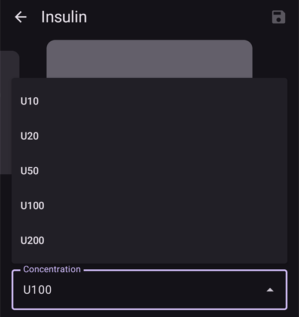
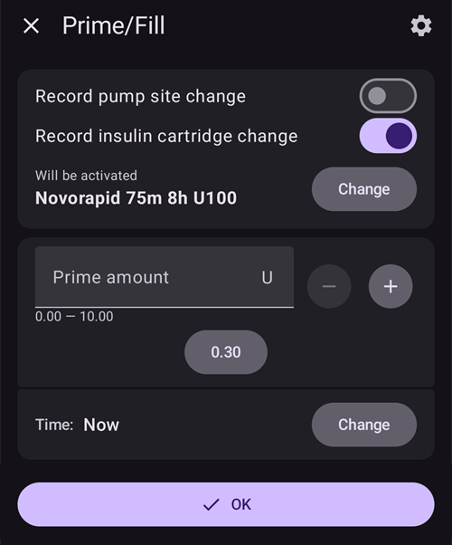

(Insulin-Concentration)=
# İnsülin Konsantrasyonu

```{warning}
Tüm ticari pompalar **YALNIZCA** U100 insülin ile kullanılmak için tasarlanmıştır. Pompada başka bir insülin konsantrasyonu kullanmak tehlikeli olabilir. Gittikçe daha fazla kullanıcı AAPS'i başka konsantrasyonlarla kullansa da dönüştürme her zaman yönetilmelidir ve sık sık hatalara yol açar (çok deneyimli kullanıcılarda bile!).
```

## İnsülinle ilgili temel bilgilerin hatırlatılması

Bu bölüm, insülinin ölçülmesi ve verilmesiyle ilgili temel kavramları anlatır.

### İnsülin birimi: bir etki ölçüsü

İnsülin **Uluslararası Birim (IU)** ile ölçülür. Bu birim, yalnızca fiziksel kütleyi değil, insülinin biyolojik etkisini (kan şekerini düşürme gücünü) ölçer.

- **Tanım:** 1 IU, belirli bir miktar insülinin etkisine karşılık gelir ve **yaklaşık 0,04167 mg** olarak standartlaştırılmıştır.
- **Önemli nokta:** Bir "birim", tüm insülin türlerinde aynı biyolojik etki demektir. Böylece dozlama tutarlı olur.

### İnsülin konsantrasyonları

İnsülin farklı güçlerde gelir. Güç, mililitre (ml) başına birim sayısı ile tanımlanır.

- **U100:** Dünya standardıdır, **100 IU/ml** içerir.
- **U200-U500:** Daha küçük enjeksiyon hacimleri için daha konsantre insülinler (örneğin U200, 200 IU/ml içerir).
- **U40/U50:** Daha az yaygın, eski konsantrasyonlar (40 IU/ml ve 50 IU/ml). **U40 için U40'a özel şırıngalar gerekir.**
- **Elle seyreltme:** Yenidoğanlarda kullanım veya aşırı duyarlılık gibi nadir durumlar için çok seyreltik insülin (örneğin U50, U10) hazırlamaya yönelik klinik bir uygulamadır. Bu, eczanede çok dikkatli bir hazırlık gerektirir.

```{admonition} Critical Warning
:class: danger
Bir konsantrasyonu ona uygun olmayan bir cihazla kullanmak son derece tehlikelidir ve ciddi aşırı doza veya yetersiz doza neden olabilir. **İnsülin konsantrasyonunun şırınga, kalem veya pompa özellikleriyle uyumlu olduğunu her zaman üç kez kontrol edin.**
```

## Standart dışı bir konsantrasyon ne zaman kullanılır?

İnsülin pompaları U100 insülin için tasarlanmış olsa da bazı özel tıbbi durumlar standart dışı konsantrasyonlar gerektirir. Bu durumlar çok büyük dikkat ve titiz bir yönetim gerektirir.

### Kullanım durumu 1: çok düşük dozlar için seyreltilmiş insülin

- **Senaryo:** Çok küçük bebeklerde ve yürümeye başlayan çocuklarda tip 1 diyabetin yönetimi.
- **Sorun:** İnsülin ihtiyaçları o kadar düşüktür ki pompanın verebildiği en küçük doz (örneğin 0,05 Ü) bile çok büyük olabilir. Bu da kan şekerini hassas biçimde kontrol etmeyi zorlaştırır ve hipoglisemi riskini yükseltir.
- **Çözüm:** Çok seyreltilmiş insülin kullanın (örneğin U10, yani 10 IU/ml).
- **Etki:** Bu, insülin birimi başına verilen sıvı hacmini artırır. İnsülin "paketlerini" hacim olarak daha büyük ama konsantrasyon olarak daha zayıf yapar. Böylece pompanın mevcut ayarlarıyla çok daha ince ayarlar ve daha doğru dozlama mümkün olur.

```{admonition} Critical Safety Note on Dilution
:class: danger
İnsülin seyreltme yüksek riskli bir işlemdir ve özel eğitim ve tıbbi gözetim olmadan asla evde denenmemelidir. Bu işlem, bir sağlık profesyoneli veya eğitimli bir bakıcı tarafından, o insülin türü için özel olarak üretilmiş steril seyreltici kullanılarak yapılmalıdır. **Asla musluk suyu, serum fizyolojik veya başka bir sıvı kullanmayın**, çünkü bunlar insülini etkisiz hale getirebilir, etkisini değiştirebilir ve tehlikeli kirleticiler ekleyebilir.
```

### Kullanım durumu 2: yüksek insülin ihtiyacı veya belirgin insülin direnci için konsantre insülin

- **Senaryo:** Belirgin insülin direnci olan yetişkinlerin veya ergenlerin ya da standart insülindeki katkı maddeleri nedeniyle bölgesel ağrı yaşayan kişilerin yönetimi.
- **Sorun:**
  1. **Yüksek ihtiyaç:** Çok yüksek günlük insülin ihtiyacı, pompanın en yüksek bolus veya günlük verme sınırlarını aşabilir.
  1. **Ağrı:** İnsülindeki koruyucu maddeler, infüzyon sırasında batma veya tahrişe neden olabilir.
- **Çözüm:** U200 (200 IU/ml) gibi daha konsantre bir insülin kullanın.
- **Etki:** Gereken insülin dozu yarı hacimde verilir. Kullanıcı için, iki kat konsantrasyonu hesaba katmak ve doğru sayıda birimin verilmesini sağlamak amacıyla pompanın iç ayarları değiştirilmelidir (örneğin bazal oranlar ve boluslar yarıya indirilir). Bu, deri altına verilen ve tahriş edebilecek sıvı hacmini de azaltır.

## AAPS ile insülin konsantrasyonu nasıl yönetilir (AAPS 3 ve öncesi)?

Bir AAPS döngüsünde U100 dışı insülin kullanmak, yazılımın hesaplarını gerçekte verilen insülinle uyumlu hale getirmek için titiz bir yapılandırma gerektirir. Yaygın yöntemlerden biri "Değiştirilmiş bir profil kullanmak"tır.

### Değiştirilmiş bir profil kullanma

Bu yöntemde AAPS, hastanın insülin ihtiyacının gerçekte olduğundan daha düşük olduğuna inandırılır. Böylece pompanın, tasarlandığından daha konsantre insülin vermesi dengelenir. Aşağıdaki kullanım durumu, U100 için tasarlanmış pompaya U200 konsantrasyonu konulması içindir.

- **Temel sorun:** U100 için tasarlanmış bir pompa, **1 birim** için **10 µL** verecek şekilde ayarlanmıştır. Pompayı U200 ile doldurursanız (1 birim U200, **5 µL** insüline karşılık gelir), pompada **1 birim** seçtiğinizde pompa **10 µL** insülin verir, ancak bu hacim artık **2 birim U200 insülin** içerir. Bu, %100 aşırı doza yol açar.
- **"Profil değişimi %50" çözümü:** Bunu düzeltmek için hastanın tüm tedavi profili AAPS içinde "iki kat zayıf" olacak şekilde ölçeklenir.
  1. Kullanıcı, standart U100 profiline dayanan yeni bir profil oluşturur ve bunun için "Profil değişimi **%50**" işlevini kullanır.
  1. Bu, şu özelliklere sahip yeni bir profil oluşturur:
     - **Bazal oranlar** yarıya iner.
     - **Karbonhidrat İnsülin Oranı (IC)** iki katına çıkar (örneğin 1:10 g, 1:20 g olur).
     - **İnsülin Duyarlılık Faktörü (İDF)** iki katına çıkar (örneğin "1 birim KŞ'yi 50 mg/dL (2,8 mmol/L) düşürür", "1 birim KŞ'yi 100 mg/dL (5,6 mmol/L) düşürür" olur).
- **Düzeltilmiş sonuç:** AAPS artık hastanın yalnızca yarı kadar insüline ihtiyaç duyduğunu düşünür. AAPS **1 birimlik** bir bolus hesaplayıp komut verdiğinde, pompa (U100 için tasarlanmış ama U200 ile doldurulmuş) **10 µL** verir. Bu hacim **2 gerçek birim U200 insülin** içerir. AAPS bu dozu "yarı güçte" bir profile göre hesapladığı için bu **2 gerçek birimlik** verme doğru ve istenen dozdur. Döngünün "yarı güç" hesabı, pompanın "iki kat güç" ile vermesiyle uyumlu hale gelir.

```{admonition} Critical Risks and Common Errors
:class: caution

Bu yöntem, uygulamanın verileri ile fiziksel gerçeklik arasında sürekli bir kopukluk yarattığı için önemli riskler getirir.

**Asıl hata: "Harici bolus" uyumsuzluğu**

En sık yapılan hata, insülin AAPS-pompa sisteminin **dışında** verilip kaydedildiğinde olur.

- **Senaryo:** Değiştirilmiş profili kullanan AAPS, bir öğün için **5 birimlik** bir bolus hesaplar. Kullanıcı bunu U200 kalemle enjekte eder.
- **İkili hata:**
  1. **Yanlış doz seçimi:** Kullanıcı "AAPS 5 birim hesaplıyor" diye düşünür ve U200 kalem nedeniyle hiçbir dönüştürme yapmadan **5 gerçek birim U200** vermeyi bekler. Ancak profil yarıya indirildiği için vücudun gerçekte **10 gerçek birime** ihtiyacı vardır. Bu **%50 yetersiz dozdur** ve hiperglisemiye yol açabilir.
  1. **Yanlış Aktif İnsülin (AİNS) hesabı (fazla tahmin edilen AİNS):** Kullanıcı bu harici bolusu AAPS'e kaydederken **5 birim** girer. Bu yanlıştır. AAPS profili U200 için olduğundan, **AAPS'te 1 birim 2 gerçek birime eşittir**. Bu nedenle kalemle verilen 5 gerçek birim, uygulamada **2,5 birim** olarak kaydedilmelidir. 5 birim kaydeden kullanıcı, AİNS'i %100 fazla tahmin eder. AAPS artık vücutta 5 "konsantre birim" (10 gerçek birime eşit) olduğunu düşünür, oysa yalnızca 5 gerçek birim etkindir. Bu, döngünün bazal insülini durdurmasına veya sonraki bolusları azaltmasına neden olabilir. Böylece ilk yetersiz dozdan gelen hiperglisemi riski daha da artar.

**Diğer riskler:**

- **Yanıltıcı veriler ve raporlar:** AAPS veya Nightscout içindeki tüm veriler (AİNS, günlük toplam doz (GTD) ve geçmiş raporlar dahil) "konsantre birim" cinsindendir. Bu, kullanıcıya ve sağlık ekibine çarpık bir tablo sunar. Bir raporu inceleyen doktor 30 birimlik bir GTD görebilir ve hastanın gerçekte 60 gerçek birim aldığını fark etmeyebilir. Bu da tedavinin yanlış değerlendirilmesine yol açar.
- **Değişen zihinsel model:** Uzun süre kullandıktan sonra kullanıcı, uygulamanın yarıya indirilmiş değerleriyle "düşünmeye" başlar. İDF'sinin 100 mg/dL (5,6 mmol/L) veya bazalının 0,5 Ü/sa olduğunu benimser ve bunların "konsantre" değerler olduğunu unutur. Bu, sisteme tehlikeli bir bağımlılık yaratır ve kişinin gerçek insülin ihtiyacıyla bağını koparır. Bu bağ, pompa arızası veya uygulama sorunlarında güvenlik için çok önemlidir.

**Sonuç:** Bu yöntem mutlak bir dikkat gerektirir ve kullanıcıyı, uygulamadaki "konsantre dünya" ile fiziksel dünya arasında sürekli dönüştürme yapmaya zorlar. Herhangi bir harici insülin verme veya veri incelemesi bu zihinsel modeli bozar ve ciddi bir risk oluşturur. Sistemdeki her sayının anlamını temelden değiştirir.
```

## Konsantrasyon parametresini kullanma (AAPS 4.0'daki yeni özellik)

Değiştirilmiş profil kullanmanın risklerini azaltmak için yeni bir özellik, insülin konsantrasyonunu doğrudan AAPS içinde yönetir. Bu özellik dönüştürmeleri otomatik olarak yapar. Böylece ana uygulama her zaman **Gerçek Uluslararası Birim (IU)** ile çalışır.

### Nasıl çalışır: otomatik dönüştürme

Temel ilke, uygulamanın mantığı ile pompa iletişimi arasındaki net ayrımdır:

- **AAPS Uluslararası Birim kullanır:** AAPS'in ana veritabanı, algoritmaları, raporları ve günlükleri **her zaman Gerçek IU kullanır**. Yani AİNS, GTD ve tedavi ayarlarınız (bazal, İDF, IC) gerçek biyolojik insülin birimlerini gösterir.
- **Pompa sürücüsü Konsantre Birim kullanır:** Pompa sürücüsüne gönderilen veya ondan alınan tüm değerler, seçilen konsantrasyona göre pompa sürücüsü içinde "Konsantre Birim" olarak otomatik dönüştürülür.
  - **U200 ile örnek:** Kullanıcı **1 birimlik bolus** istediğinde, pompa sürücüsü bunu pompaya göndermeden önce **0,5 CU (Konsantre Birim)** olarak alır. Pompa (U100'e ayarlı) bu durumda **5 µL** verir. Bu hacim **1 IU U200 insülin** içerir.

### Faydalar ve kalan riskler

**Faydaları:**

- Değiştirilmiş profile ve onunla gelen zihinsel dönüştürme hatalarına gerek kalmaz.
- Kullanıcılar her zaman Gerçek IU ile "düşünebilir".
- Kalemle harici bolus için kalemde beklenen insülin miktarını seçmeniz yeterlidir (kullanılan kalem ve insülin konsantrasyonu ne olursa olsun). Dönüştürme gerekmez, çünkü U100 ve U200 kalemler birim seçiminde her zaman IU kullanır.
- Tüm AAPS raporları ve verileri (GTD, AİNS) Gerçek IU cinsindendir. Bu, kullanıcı ve sağlık ekibi için netlik sağlar.
- Harici bolusların yanlış hesaplanma riskini ortadan kaldırır, çünkü bunlar Gerçek IU olarak kaydedilir.

**Kalan riskler:**

- **Zihinsel modele geçiş:** "Değiştirilmiş profil" yönteminden geçen kullanıcılar profillerini doğru gerçek profile geri çevirmelidir (yani U200'den geliyorlarsa iki kat güçlü). Ayrıca **zihinsel modellerini** uyarlamak için zamana ihtiyaçları vardır. Uygulamada "Konsantre" değerlere alıştıktan sonra, her yerde gösterilen **gerçek, gizlenmemiş IU değerlerine** güvenmeyi yeniden öğrenmeleri gerekir. Bu uyum dönemi yanlış yorumlama riski taşır.
- **Pompadan elle bolus:** Pompanın kendi bolus işlevini kullanmak (AAPS'i atlayarak) %100 aşırı doza yol açar, çünkü pompa U200 insülini U100 hacim hesaplarıyla verir.
- **Genel uyarı:** Standart dışı konsantrasyonların kullanımı riskli, ileri düzey bir işlem olmaya devam eder ve resmi olarak önerilmez.

```{admonition} Never use the pump's own interface (tube pump users) to deliver a bolus manually
:class: danger
Asla unutmamak için pompanızın üzerine kalıcı bir **"U200 İnsülin"** notu yapıştırın!
```

### Kullanıcı arayüzündeki gösterim

Netlik sağlamak için kullanıcı arayüzü, gerektiğinde hem gerçek hem de konsantre birimleri gösterir. Mevcut insülin U100 ise kullanıcı arayüzünün değişmediğini unutmayın.

**Gösterim örnekleri:**

- **Bolus ilerleme penceresi:**
  - Bolus ilerleme penceresi AAPS ana uygulamasının içindedir. Bu nedenle yalnızca IU cinsinden bilgi gösterilir (kullanıcının seçimiyle uyumlu olarak): **`2,50 Ü / 10,00 Ü iletildi`**
- **Pompa sürücüsü arayüzü (mevcut durum):**
  - Pompa genel bakış ekranında verilen miktar iki birimde de gösterilir. Örneğin `U200` seçiliyse: **`Son Bolus: 10 Ü (5 CU) (10')`**

**Lütfen dikkat:** Her iki birim (Ü ve CU) yalnızca ana Pompa genel bakış ekranında görünür. Pompanıza bağlı olarak, yalnızca Konsantre Birimlerin gösterildiği başka ekranlar da olabilir. Pompa sürücülerindeki geçmiş veriler genellikle "Konsantre Birim" olarak kalır.

### Özelliği etkinleştirme

Taşıdığı güvenlik riskleri nedeniyle bu parametre varsayılan olarak etkin değildir. Etkinleştirmek için 3. Görevi bitirin ve Genel ayarlarda **İnsülin konsantrasyonu desteği** seçeneğini açın.

### Başka bir konsantrasyonla yeni insülin oluşturma

Başka bir konsantrasyonla insülin oluşturmak için önce **Yönet → İnsülin ayarları** ekranını açın.

- Ekranın altındaki "+" simgesine tıklayın.
- Açılır menüden beklenen yeni konsantrasyonu seçin (U10, U20, U50, U100, U200 kullanılabilir).
  - U10, U20 veya U50 gibi seyreltilmiş konsantrasyonlar, bazal oranları çok düşük olan çocuklar içindir.
  - U200 daha çok, insülin ihtiyacı yüksek olan yetişkinler içindir.

  

- Tepe zamanını ve İnsülin Etki Süresini (İES) ayarlayın, isterseniz İnsülinin takma adını değiştirin.
- Ekranın sağ üstündeki kaydet düğmesini kullanın.

Bu adımda insülin oluşturulmuştur, ancak doğrudan **İnsülin ayarları** ekranından seçilemez.

### Konsantrasyonu U100'den Uxxx'e değiştirme (AAPS 4)

```{admonition} Switching concentration is only allowed during a reservoir or patch/pod change
:class: warning
Güvenlik nedeniyle AAPS, konsantrasyon değişikliğini yalnızca Rezervuar Değişimi veya Patch/Pod Değişimi sırasında kaydeder.
```

U100 insülinle başlıyorsanız profiliniz, geçmiş verileriniz ve raporlarınızın tümü Uluslararası Birim standardıyla uyumludur. Bu nedenle değişiklik çok "kolaydır":

- Patch/Pod pompada, pompayı değiştirirken içine koyduğunuz insülini seçmek için özel bir adım vardır.
- Hortumlu pompada Genel Bakış ekranında (genişletilmiş durum çubuğu görünümü) Hazırla/doldur düğmesine (İnsülin Değişimi için) tıklayın, ardından "Değiştir" düğmesine tıklayın.

1. Açılır menüden hedef konsantrasyonu seçin (örneğin `U200`).
1. Ardından aşağıdan doğru insülini seçin. Siz onaylayana kadar adının üstündeki başlıkta **Etkinleştirilecek** yazar (**Şu anda aktif** yerine).

   

1. **Önemli:** Konsantrasyon değişikliği, AAPS içinde ancak Profil değişimi pompaya uygulandıktan sonra kaydedilir.
   - Bu adım tüm Patch/Pod pompalar için zorunludur.
   - Hortumlu pompalarda Profil değişiminin pompaya uygulanmasını bekleyin veya bunu **Yönet → Profil** ya da **İnsülin ayarları** içinden yapın.

Hepsi bu kadar!

İnsülini değiştirdiğinizde geçici bir **Profil değişimi** (süresi olan) çalışıyorsa, yeni insülin, geçici değişim bittiğinde geri gelen profile de verilir. Eski insülin geri gelmez.

### %50 profille birlikte U200 insülin kullananlar için konsantrasyonu değiştirme (AAPS 4)

Pompanızda zaten U200 kullanıyor ancak bunu %50 profille birlikte kullanıyorsanız, U100 insülinden standart değişikliğe göre ek adımlar yapmanız gerekir.

Unutmayın: En zor kısım büyük olasılıkla değişikliği AAPS içinde doğru yönetmek değil, beyninizi yeniden "CU" yerine "IU" ile düşünmeye alıştırmak olacaktır. Bolusların tüm standart değerleri (kahvaltı, öğle yemeği, akşam yemeği...) iki kat yüksek olacaktır. Aynısı GTD'leriniz, bazal oranlarınız vb. için de geçerlidir. Uluslararası Birim ile "yeniden düşünmeye" başlayana kadar ilk birkaç hafta hata yapmamak için çok dikkatli olmalısınız.

- Önce tüm değerleri Uluslararası Birim ile uyumlu yeni bir profil hazırlayın:
  - Standart çalışan profilinizin %200'ü ile geçici bir Profil değişimi yapın.
  - Menüyü (☰) açın → **Tedaviler**, **Profil değişimi** sekmesine gidin ve yeni %200 profili klonlayın (bkz. [Profil değişimini klonlama](#your-aaps-profile-clone-profile-switch)).
  - Bir sonraki Rezervuar veya Patch değişimine kadar standart profilinize geri dönün.
  - **Yönet → Profil** ekranına gidin ve bu yeni profile açık bir ad verin (bu, AAPS 4'te ayarlanan U200 insülinle kullanacağınız gelecekteki profiliniz olacak).
- Dinamik İDF özelliğini kullanıyorsanız, onu en az bir hafta kapatmanız gerekir:
  - AAPS veya Nightscout içinde kaydedilen tüm geçmişiniz yanlış birimdedir (CU), yani Uluslararası Birim cinsinden gerçek değerin yarısıdır. Yeniden açmadan önce U200 insülin çalışırken en az bir hafta bekleyin.
- Artık bir sonraki İnsülin Değişimi veya Pod Değişiminde insülini değiştirmeye hazırsınız (**İnsülin ayarları** içinde tanımlanmış yeni bir U200 ile).
- Yeni U200 insülin doğru şekilde uygulandığında, ilk adımda tanımlanan yeni standart profili uygulamayı unutmayın.

## Farklı kalemlerle harici boluslar nasıl yönetilir?

### %50 profille birlikte U200 insülin ile (AAPS 3)

Unutmayın: Tüm kalem ölçek çizgileri Uluslararası Birim cinsindendir. Bu nedenle hangi kalemi kullanırsanız kullanın (U100, U200), harici bolus için kalem kullanıyorsanız dönüştürmeyi iki yönde de yönetmeniz gerekir:

- AAPS'ten kaleme: Hesaplayıcı bir bolus önerirse veya aklınızda belirli bir miktar varsa, kalemde miktarı seçerken AAPS'ten verilen aynı bolusa göre 2 ile çarpın.
- Kalemden AAPS'e: Harici bolus vermek için kalemde bir miktar seçtiyseniz, AİNS'nin CU (Konsantre Birim) cinsinden doğru hesaplanması için AAPS'te doğru miktarı kaydederken (İnsülin düğmesi, harici bolus) bu miktarı 2'ye bölün.

### AAPS 4'teki konsantrasyon yönetimini kullanan U200 insülin ile

AAPS içindeki konsantrasyon yönetimiyle işler çok daha basittir: Kalemde beklenen miktarı seçin (kullanılan kalem ve insülin ne olursa olsun) ve bunu AAPS'e kaydedin.

- İnsülin düğmesinde harici bolus seçerseniz, **İnsülin ayarları** içinde tanımlanmış herhangi bir insülin türünü seçebilirsiniz (kalemler için çoğunlukla U100, U200). Böylece kalemle kullanılan insülinin tepe zamanı/İES'si pompada kullanılandan çok farklı olsa bile çok doğru hesaplanmış bir AİNS elde edersiniz.
