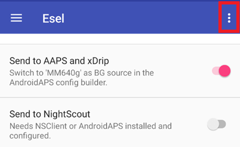

# Eversense

Eversense ölçümlerine erişmenin dört farklı yolu vardır:

- ESEL companion modu
- ESEL yamalı mod
- xDrip yardımcı uygulama (companion app)
- Bildirim okuyucu (**AAPS**'e yerleşik)

## ESEL

[ESEL uygulamasını](https://github.com/BernhardRo/Esel/tree/master/apk) indirin ve bu [talimatlara](https://github.com/BernhardRo/Esel?tab=readme-ov-file#esel) göre yükleyin.

- ESEL'de sağ üstteki üç nokta menüsünü (⋮) açın ve **Settings** seçeneğini seçin (☰ menüsünden de açılabilir). Ayarlarda:
  - "Send to AAPS and xDrip" seçeneğini açın
  - "Send to Nightscout" seçeneğini **kapatın**
  - Eversense'in KŞ verileri gürültülü olabileceğinden ESEL'de "Smooth Data" seçeneğini açmanız önerilir.



### Companion modu

Verileri Eversense uygulamasının bildirimlerinden okur (standart Eversense uygulamasıyla çalışır, ESEL 3.0.1 sürümünden beri vardır).

1. Google Play Store'daki resmi Eversense uygulamasını kullanın
   - İsteğe bağlı, ancak eksik verileri doldurmak (backfill) için gereklidir: Eversense hesabınıza giriş yapın
   - Sync bölümünde Auto synchronization seçeneğini açın
2. ESEL yapılandırması:
   - "Get data from patched Eversense App" ayarını kapatın
   - Eksik verileri doldurmak için: "Fill missing data from eversensedms.com" seçeneğini açın
   - E-posta adresi ve parola olarak Eversense giriş bilgilerinizi girin
3. [**Konfigürasyon → KŞ kaynağı**](#Config-Builder-bg-source) içinde KŞ kaynağı olarak "MM640g" seçin.

### Yamalı Eversense uygulaması

 Eversense uygulamasının yamalı bir sürümünü gerektirir (eksik verilerin doldurulması dahil tamamen çevrimdışı çalışır).

1. Eversense uygulamasını kaldırın (Uyarı: 1 haftadan eski yerel geçmiş verileriniz kaybolur!)

2. [Yamalı Eversense uygulamasını](https://cr4ck3d3v3r53n53.club) yükleyin ve sağlayıcının anlattığı şekilde kullanın

   - Eversense uygulamasını başlatın, giriş yapın, vericinize bağlanın ve normal uygulama gibi kullanın.

3. ESEL yapılandırması:

   - "Get data from patched Eversense App" ayarını açın


ESEL'i Eversense'in yeni bir kurulumuyla ilk kez çalıştırırsanız ilk değerlerinizin xDrip'te görünmesi 15 dakikaya kadar sürebilir!

4. [**Konfigürasyon → KŞ kaynağı**](#Config-Builder-bg-source) içinde KŞ kaynağı olarak "MM640g" seçin.

## xDrip

xDrip, ESEL gibi üretici uygulamasının bildirimlerini okuyabilir. Eksik verileri doldurma (backfill) yoktur.

- xDrip'i indirin ve yükleyin: [xDrip](https://github.com/NightscoutFoundation/xDrip)
- xDrip'te veri kaynağı olarak “Companion App” seçilmelidir.
- [**Konfigürasyon → KŞ kaynağı**](#Config-Builder-bg-source) içinde xDrip'i seçin.
- xDrip ayarlarını, xDrip ayarları sayfasındaki açıklamalara göre yapın: [xDrip ayarları](../CompatibleCgms/xDrip.md).
- AAPS'te [Üstel yumuşatma](../CompatibleCgms/SmoothingBloodGlucoseData.md) seçeneğini açın.

## Bildirim okuyucu

**AAPS**, glikoz değerlerini arada başka bir uygulama olmadan doğrudan resmi Eversense uygulamasının bildirimlerinden okuyabilir. Eksik verileri doldurma (backfill) yoktur.

- [**Konfigürasyon → KŞ kaynağı**](#Config-Builder-bg-source) içinde **Bildirim okuyucu** seçeneğini seçin ve sorulduğunda **AAPS**'e bildirim erişimi verin.
- Eversense uygulamasının bildiriminde güncel glikoz değerini gösterdiğinden emin olun.

```{warning}
KŞ değerlerinin okunma sıklığı her zaman 5 dakika değildir ve yinelenen değerler oluşabilir.
```