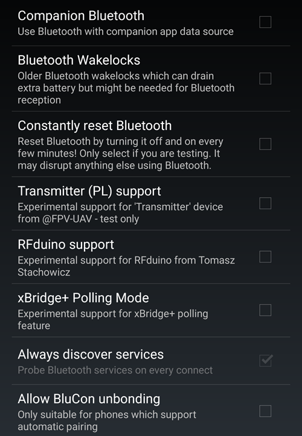
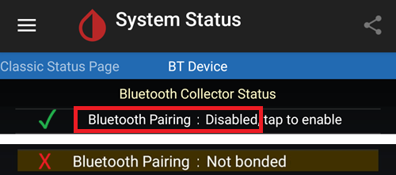
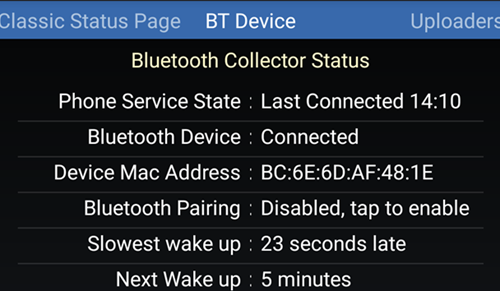
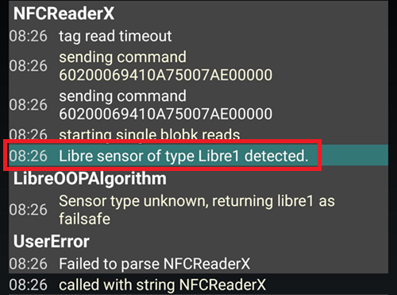

# xDrip'te yerleşik Bluetooth bağlantısını kullanmak için FSL 2 ve OOP2 nasıl kurulur

[MinimalL00per](https://www.minimallooper.com/post/how-to-setup-freestyle-libre-2-and-oop2-to-use-a-native-Bluetooth-connection-in-xdrip) sitesinden markdown'a aktarıldı ve **gözden geçirildi/güncellendi**: 25 Ağustos 2025, psonnera

Bu belgenin sonunda bir tanımlar listesi vardır. Bilmediğiniz bir terim veya kısaltma görürseniz açıklama için *[aşağıya](#minimallooper-definitions)* gidebilirsiniz.

 

## Configuration

### Donanım

- *FSL2 ve 2+* **NOT: US, CAN, NZ, AUS sürümleri DESTEKLENMEZ**

**(İSTEĞE BAĞLI) Okuyucu** (FSL2+ ile uyumlu değildir)

- Okuyucu 1 (ürün yazılımı güncellenmiş)

- Okuyucu 2

*NOT: Bu çözümde Okuyucuyu kullanmayı planlıyorsanız, sensörü MUTLAKA ÖNCE OKUYUCU İLE BAŞLATMALISINIZ. Bunu yapmazsanız, okuyucu ile etkinleştirilmiş sensörden değer okuyamazsınız. Sensör ısındıktan sonra LL uygulamasından veya xDrip'ten değer alabilirsiniz.*

### Yazılım

**OOP** - Out of Process Algorithm (süreç dışı algoritma), kan şekeri değerlerini elde etmek için ham sensör verilerini almaya yardım eden harici bir Android APK uygulaması. xDrip, topladığı FSL2 BT ham verilerini OOP'ye gönderir ve kan şekeri değerleri xDrip'e geri döner.

- **OOP2**

  - **Yalnızca Avrupa FSL2/2+ sensörleriyle çalışır**

  - Kapalı kaynak (GitHub'da yoktur)

  - Amacı, şifreli ham sensör değerlerinin şifresini çözmek ve bunları xDrip'e geri göndermektir. Sonra xDrip ya kalibrasyon gerektiren ham verilerle kullanılabilir ya da Okuyucu 1'e benzer glikoz değerleri verebilir.

[***xDrip***](https://jamorham.github.io/)

- [*Nightly*](https://github.com/NightscoutFoundation/xDrip/releases): her gece oluşturulan en son kaynak kodu. Tam olarak test edilmemiştir

- [*Stable*](https://xdrip-plus-updates.appspot.com/stable/xdrip-plus-latest.apk): test edilmiş en son kararlı sürüm.

- **NOT: Yeni sensörler güncellenmiş bir OOP2 uygulaması gerektirir. Bunun için en son OOP2 ile uyumlu olan, en az en son xDrip yayınını (Stable) kullanmanız önerilir.**

 

## İşlem

- *Önce aşağıdaki uygulamaları indirin ve kurun*
- *Çakışabilecek uygulamaları kaldırın*
- *LL ve xDrip kullanarak bir FSL2 sensörü yerleşik Bluetooth modunda nasıl başlatılır
  - [*Adım 1: Uygulama kurulumu ve yapılandırması*](#minimallooper-step1)
  - [*Adım 2: xDrip ayarlarının yapılandırılması*](#minimallooper-step2)
  - [*Adım 3: Sensörü fiziksel olarak takın*](#minimallooper-step3)
  - [*Adım 4: LL uygulamasını açın ve sensörü ilk NFC taramasıyla başlatın*](#minimallooper-step4)
  - [*Adım 5: xDrip'i açın ve FSL2 sensörünü NFC ile TARAYIN*](#minimallooper-step5)
  - [*Adım 6: Yeni sensörü xDrip'te başlatın*](#minimallooper-step6)
  - [*Adım 7: 60 saniye bekleyin ve sensörü yeniden NFC ile tarayın*](#minimallooper-step7)
  - [*Adım 8: 3 ila 15 dakika arası veri toplama*](#minimallooper-step8)
  - [*Adım 9: Sensörün bağlı olduğunu ve veri gönderdiğini doğrulayın*](#minimallooper-step9)

- *[Notes](#minimallooper-notes)*
- *[Avantajlar](#minimallooper-advantages)*
- *[Dezavantajlar](#minimallooper-disadvantages)*
- <u>*\[Sorun giderme\](#minimallooper-troubleshooting)*</u>

## Başlamadan önce

Bu işlemi **yeni bir sensör** ile yapmanız kesinlikle önerilir. Çalışan bir sensörle de bağlantı kurulabildiği bildirilmiştir (***[aşağıya](#minimallooper-started-sensor) bakın***), ancak bağlantı sırasında LL uygulamasının veya Okuyucunun iletişim için yeni bir özel paylaşılan anahtar oluşturması çok olasıdır. Bu, bağlanmadan (bonding) sonra xDrip'in yeni anahtardan haberi olmadığı ve sensörle iletişim kuramayacağı anlamına gelir. Çalışan bir sensörle bağlantıyı riski size ait olmak üzere, tercihen sensörün ömrünün sonuna doğru deneyin.

### Önce aşağıdaki uygulamaları indirin ve kurun

(Libre2_OOP2)=

- **OOP2** - oop2 sürümlerini burada bulabilirsiniz:

  (*Not: bağlantıyı açmak için Google'da oturum açmış olmanız gerekir.*)

*[oop2.apk](https://drive.google.com/file/d/1106h2s12b3Ev9gKCTU2G75q8h9ChHjcz/view?usp=sharing)* - OOP2_21_09_25 (05d1989) **2025.09.21** (en son sürüm)

- **xDrip** - **<u>en son sürüm</u>** (en az 2025.09.26 sürümü) burada bulunabilir:

[*xDrip.apk*](https://github.com/NightscoutFoundation/xDrip/releases)

(minimallooper-started-sensor)=

### Sensörüm zaten başlatılmışsa ne olur? xDrip'te yine de değer alabilir miyim? EVET!

Birçok kişi bu yöntemin zaten etkin olan bir sensörle kullanılıp kullanılamayacağını sordu. Cevabım kesin bir **EVET**: çalışan bir sensörü de başlatabilirsiniz.

1.  **ÖNCE**, xDrip'te yapılandırma değişikliklerini ve ayarları yaptığınızdan ve OOP2'yi aşağıda gösterildiği gibi kurup yapılandırdığınızdan emin olun.

2.  **SONRA** *Adım 5* ile devam edin ve başlamadan önce LL uygulamasını zorla durdurduğunuzdan **EMİN OLUN**. Ardından işlemi sonuna kadar izleyin.

*NOT: Etkinleştirilmiş FSL2 sensörünüz önce FSLReader ile başlatılmadıysa, onu FSLReader ile kullanamazsınız. Sensör önce FSLReader ile başlatıldıysa, sensörü **tarayabilir** ve değerleri HEM sensörden HEM DE LL ve xDrip gibi uygulamalardan alabilirsiniz.*

## LL ve xDrip kullanarak bir FSL2 sensörü yerleşik Bluetooth modunda nasıl başlatılır

*NOT: Ekran görüntülerinde özellikle bir KUTU ile işaretlenmemiş ve İŞARETSİZ (yani kapalı) olan ayarlar varsa, LÜTFEN BUNLARI KAPALI BIRAKIN. Ekran görüntüleri, gösterilen TÜM ayarlar için çalışan bir yapılandırmayı gösterir. Sensörünüz çalıştıktan sonra başka özellikleri açıp kapatarak denemek isterseniz, bunu riski size ait olmak üzere yapabilirsiniz.*

(minimallooper-step1)=

### Adım 1: Uygulama kurulumu ve yapılandırması

**OOP2'yi kurun ve yapılandırın**, sonra uygulamayı açarak çalıştığını kontrol edin.


**Ayarlar**

- *Use service* **on**

- *Use foreground service* **on**

- *Timer Duration* **5 minutes**

  - Sonuçları yeterince hızlı almıyorsanız **1 sec** olarak değiştirin (aşağıdaki ekran görüntüsü bu ayarı gösterir).

**Sürüm 2: 93e5cac-2020.12.08 (en son sürüm)**


**xDrip'i kurun**, en düşük sürüm: en son yayın. xDrip kurulumu ve ayarları hakkında daha fazla bilgiyi [*burada*](../CompatibleCgms/xDrip.md) bulabilirsiniz.

(minimallooper-step2)=

### Adım 2: xDrip ayarlarının yapılandırılması

**Hardware Data Source**: Libre Bluetooth


**NFC Scan features**: *belirtilmeyen ayarların kapalı olduğu varsayılır.*

- *Use NFC feature*: **on**
- *Sensor Age or Expiry*: **on**
- *Scan when not in xDrip*: **on**
- *Use Any-tag optimized reading method*: **off**, ama tarama zorluğu olursa **on** deneyin


- *Starting Bluetooth connection with FSL2 sensor*: **Always connect to libre2 sensors**


- *Smooth libre 3 data when using xxx method*: varsayılan değerde bırakın. Gürültülü sensörlerde değeri artırın, kararlı sensörlerde azaltın.


**Less Common Settings -\> Bluetooth Settings** (*bunlar önemlidir ve telefonunuza/kurulumunuza göre değişebilir*)

- *Turn Bluetooth on*: **on**
- *Trust Auto-Connect*: **on**
- *Use Background Scans*: **on**
- *Always discover services*: **on**

xDrip'i aşağıdaki QR kodu ile kurabilirsiniz. Kodu xDrip -> Auto Configure içinde taramanız (veya resmi yüklemeniz) gerekir.

```{admonition} QR Code
:class: dropdown


```




Yukarıdaki QR kodunu taradıktan sonra, Samsung telefonunuz varsa (bu birçok Çin markası için de faydalıdır), daha güvenilir bir bağlantı için ayarları değiştirmek üzere aşağıdaki diğer QR kodunu tarayın:

- *Trust Auto-Connect*: **off**
- *Use Background Scans*: **off**

```{admonition} QR Code
:class: dropdown


```


**Advanced settings for FSL2** (*isteğe bağlı ama faydalı*)

- *show Raw values in Graph*: **on**

- *show Sensor info in Status*: **on**


**Extra Logging Settings** (*düzgün çalışmazsa hata ayıklamak için gerekir*)

- *Extra tags for logging*: şu değeri girin

`BgReading:d,jamorham librereceiver:v,LibreOOPAlgorithm:v,jamorham nsemulator:v,DexCollectionService:v`


(minimallooper-OOPsettings)=

**Less Common Settings -\> Other misc options**

> **OOP2 yapılandırması için ayarlar**

- *Out of process Libre algorithm*: **OFF**

(*OOP2 İÇİN BUNUN **OFF** (KAPALI) OLDUĞUNDAN EMİN OLUN, YOKSA DEĞER ALAMAZSINIZ!*)


(minimallooper-step3)=

### Adım 3: Sensörü fiziksel olarak takın

(minimallooper-step4)=

### Adım 4: LL uygulamasını açın ve sensörü ilk NFC taramasıyla başlatın

LL uygulamasını açın, yeni takılan sensörü tarayın, sonra LL uygulamasını kapatın ve devre dışı bırakın ya da kaldırın. **Devam etmeden ve sensörü xDrip'te başlatmadan önce sensörün ısınması için yine de 60 dakikanın tamamını beklemeniz gerekir**. Bundan önceki değerlere güvenmeyin; sensör hâlâ kendi içinde kalibre oluyor ve değerler çok değişkendir.

#### Adım 4a (İSTEĞE BAĞLI, FSLReader kullanımı):

**FSL2 (2+ değil) sensörünü FSLReader ile ilk NFC taramasıyla tarayarak başlatın**

FSL2 sensöründen değer okumak için LL uygulamasının veya xDrip'in yanında **FSLReader**'ı da kullanmak istiyorsanız, **yeni takılan FSL2 sensörünü ÖNCE FSL Reader ile taramanız gerekir.** Sensörün ısınması bittikten sonra değer taramak için LL uygulamasını veya xDrip'i kullanabilirsiniz.

*NOT: LL uygulaması yalnızca sensör takıldıktan sonraki İLK NFC taraması için gereklidir. Isınma başlangıç sinyalini göndermeye yarar; bundan sonra uygulama MUTLAKA devre dışı bırakılmalı (uygulama ayarları-\>zorla durdur) veya kaldırılmalıdır. Yamalı (patched) 2.3 uygulamasını veya resmi sürümleri kullanabilirsiniz, fark etmez. Asıl önemli olan, xDrip sensörle BT bağlanma işlemini başlatmaya çalışırken LL uygulamasının çalışmasını önlemektir; çünkü LL uygulaması iletişimi bozarak Bluetooth yeniden bağlanma işlemini engeller.*

*LL uygulamasının bağlantıyı bozmasını önlemek için, Android sistem ayarlarında LL uygulamasının **konum iznini** kapatmanın yeterli olduğu bildirilmiştir. Birkaç kullanıcı bunun işe yaradığını bildirmiştir. Yine de **uygulamayı devre dışı bırakmanızı veya kaldırmanızı öneririm**, ama denemek isterseniz bunu deneyebilirsiniz.*

(minimallooper-step5)=

### Adım 5: xDrip'i açın ve FSL2 sensörünü NFC ile TARAYIN

(*Hatırlatma! LL'nin devre dışı (konum kapalı) veya kaldırılmış olduğundan VE sensörün ısınması ve kendi içinde kalibre olması için 60 dakikanın tamamını beklediğinizden emin olun.*)

FSL2 sensörünü xDrip ile **NFC İLE TARAYIN**. Bu, bağlanma (bonding) işlemini başlatmak için sensöre Bluetooth eşleştirmesini açması için bir sinyal gönderir. FSL 2 sensörünün NFC taraması başarılı olunca, xDrip ana ekranının altında kısa bir süre **Scanning** yazan küçük bir bildirim, ardından **Scanned OK!** bildirimi görünür.


(minimallooper-step6)=

### Adım 6: Yeni sensörü xDrip'te başlatın

**xDrip ana ekranında** sol üst köşedeki **hamburger menüye** basın. Sonra **Start Sensor** seçin.

**Start New Sensor** ekranında **Start Sensor** düğmesine basın. **Did you insert it today?** (Bugün mü taktınız?) sorusu çıkar. **NOT TODAY** düğmesine basarak yanıt verin.


*NOT: Yanlışlıkla "YES, TODAY" seçeneğine bastıysanız, xDrip ana menüsünden "stop sensor" seçip ardından Adım 5'ten yeniden başlayarak "start sensor" yapmanız gerekir.*

(minimallooper-step7)=

### Adım 7: 60 saniye bekleyin ve sensörü yeniden NFC ile tarayın

Sensörü, xDrip'in değerleri alacağı Bluetooth cihazı olarak **EKLEMEK** için ikinci bir NFC taraması gerekir. İşlem bitince **NEW SENSOR STARTED** yazan bir bildirim görürsünüz.


Bu işlem sırasında sensör dakikada bir defadan fazla taranamadığı için 60 saniyelik bir bekleme süresi zorunludur. Sensör çok erken taranırsa, xDrip ana ekranında **Not so quickly, wait 60 seconds** uyarısı gösterilir.


xDrip olay günlüklerini (event logs) açın ve sensörün xDrip ile doğru eşleştiğini kontrol edin.


(minimallooper-step8)=

### Adım 8: 3 ila 15 dakika arası veri toplama

3 ila 15 dakika içinde ilk değerleri göstermek için yeterli veri toplanır. *Bu sürenin sonunda hâlâ değer almıyorsanız, telefonu yeniden başlatmak bazen işe yarar.*

Samsung (veya birçok Çin markası) telefon kullanıyorsanız ve veri almada sorun yaşıyorsanız, aşağıdaki QR kodunu xDrip -> Auto Configure içinde tarayın.

```{admonition} QR Code
:class: dropdown


```

Bu kod xDrip Bluetooth ayarlarını şöyle değiştirir:

- *Trust Auto-Connect*: **off**
- *Use Background Scans*: **off**

(minimallooper-step9)=

### Adım 9: Sensörün bağlı olduğunu ve veri gönderdiğini doğrulayın

xDrip ana ekranının sol üstündeki hamburger menüye basın ve **System Status** seçin. System Status ekranında etkin **Bluetooth Device:** alanı, FSL2'nin Bluetooth adlandırma biçimini gösterir: **ABB___XXXXXXXXXXX**. Burada X'ler sensörün seri numarasıdır. **Connection Status** alanında **Connected** görünür ve **Sensor Start:** alanı sensörün başlatıldığı zamanı gösterir.


**BT Device** ekranında (sola kaydırın) sensörün diğer bağlantı ayrıntılarını kontrol edebilir ve bu ekranı bağlantı sorunlarını gidermek için kullanabilirsiniz. Aşağıda, bağlantı sorunlarını gidermeye yardım eden alanların ve amaçlarının bir listesi vardır.

*NOT: Bu pencerede **Bluetooth Pairing ayarına <u>DOKUNMAYIN</u> VE <u>Disabled</u> durumundan DEĞİŞTİRMEYİN**. Bunu yaparsanız doğrudan eşleştirme denenir, başarısız olur (Not bonded) ve işleme Adım 5'ten yeniden başlamanız gerekir.*



- **Phone Service State:** Telefonun sensöre son BT bağlantısını kurduğu zaman (5 dakikadan kısa bir süre önce olmalıdır)
- **Bluetooth Device:** Bağlantının güncel durumunu gösterir (**Connected** veya **Disconnected**)
- **Device Mac Address**: Sensörün donanım kimliğidir
- **Bluetooth Pairing**: Burada **<u>Disabled, tap to enable</u>** yazmalıdır. Buna DOKUNMAMAYA dikkat edin. Yanlışlıkla dokunursanız, yeniden disabled durumuna gelene kadar tekrar dokunun.
- **Slowest wake up**: Bunu yok sayabilirsiniz. xDrip zamanını değer bekleyerek geçirmez: değerleri belirli bir süre sonra (genelde 5 dakika) beklemeye başlar. O sırada veri gelmezse "Woke up early" yazısını görürsünüz. Bu, xDrip'in verinin hazır olmasını beklediği ama veri olmadığı anlamına gelir. Slowest wake up, normalde veri alınmadan önce görülen en uzun gecikmedir.
- **Next Wake up**: 5 dakika göstermelidir



(minimallooper-notes)=

### Notes

- **xDrip'te bağlanma/eşleştirme tamamlandıktan SONRA LL NFC taramalarını kullanma**: NFC taramaları yapabilirsiniz, ancak önce xDrip ile bağlanma/eşleştirme işleminin tamamlanması gerekir. Her zaman xDrip'e bakın ve 5 dakikalık değer zamanına yakın olup olmadığını görün (ör. 4 dakika önce). 5 dakikaya yakınsa yeni BT değerinin gelmesini bekleyin, sonra NFC taramasını yapın. Yanlış zamana denk gelirse xDrip'teki BT işlemini bozar ve BT değerleri alınamaz. Yeniden bağlanıp tekrar veri göndermesi biraz zaman alabilir ve bazen sensörün BT bağlantısı LL tarafından "çalınabilir". Ancak bu BT okumaları arasında bir NFC taraması yapıp hemen ardından uygulamayı devre dışı bırakmakta hiç sorun yaşamadım. LL'nin her seferinde devre dışı bırakılması gerekip gerekmediğinden emin değilim, ama güvende olmak için devre dışı bırakıyorum.

- **Ne oluyor?** Bir Bluetooth bağlantısı kurulduğunda, sensör ile bağlanan uygulama/cihaz arasında iletişim için gereken özel paylaşılan bir anahtar oluşturulur. Bağlantı sırasında LL uygulamasının veya Okuyucunun iletişim için yeni bir özel paylaşılan anahtar oluşturma olasılığı yüksektir. Bu, bağlanmadan (bonding) sonra xDrip'in yeni anahtardan haberi olmadığı ve sensörle iletişim kuramayacağı anlamına gelir.

  - Birkaç kullanıcı, sensör başarıyla başlatılıp xDrip'te değer alınmaya başladıktan sonra LL uygulamasının yeniden açılabildiğini bildirmiştir. LL uygulamasının Android izinlerinde yalnızca **Allow Location** (konuma izin ver) ayarını kapatmanız yeterlidir. Bu yapıldıktan sonra LL uygulamasını ve xDrip'i aynı anda kullanabilmeniz gerekir. NFC taraması için varsayılan bir uygulama seçmemenizi ve her NFC taramasında sensörü hangi uygulamanın okuyacağını seçmenizi öneririm. Ayrıca, bir sonraki sensör değişiminde, yeni sensördeki ilk ısınma NFC taramasından sonra LL uygulamasını zorla durdurmayı UNUTMAYIN. Sensör yapılandırılıp xDrip'te değer almaya başladıktan sonra LL uygulamasını yeniden açabilirsiniz.

&nbsp;

- **Telefonu yeniden başlatma**: Yeniden başlatmadan sonra, uygulamayı devre dışı bıraktıktan veya zorla durdurduktan sonra, LL uygulamasının ÇALIŞMADIĞINI kontrol etmeyi UNUTMAYIN. LL'nin otomatik olarak yeniden başlayıp başlamadığını görmek için bir yeniden başlatmayı denemenizi öneririm. Telefonunuzdaki Android uygulama ayarlarında LL uygulamasının ayarlarına bakabilirsiniz. Hâlâ etkinse LL uygulamasını yeniden devre dışı bırakın. Bunu önlemenin tek yolu LL uygulamasını kaldırmak olabilir. Bu, LL'nin BT bağını yanlışlıkla "çalmasını" önlemek içindir. Ayrıca, yeniden başlatmadan sonra sensörden BT değerleri almak yine 3-15 dakika sürer. Bolus, yemek vb. için KŞ değerine ihtiyaç duyacağınız zamanlara yakın bir yeniden başlatma yapacaksanız sabırlı olun ve bunu planlayın.

&nbsp;

- **Pil optimizasyonu ayarları**: Bu uygulamaları telefonunuzun pil optimizasyonu ayarlarının DIŞINDA bıraktığınızdan emin olun

  - xDrip

  - OOP 2

  - LL

  - AAPS

&nbsp;

- **Uçak modunu kullanma:** Bazı durumlarda uçak modunu açmanız gerekir (uçağa bindiğinizde ;-) veya gece uyurken telefonunuz başınıza yakınken Wi-Fi ya da mobil bağlantı sinyallerinin çalışmasını istemediğinizde). Uçak modunun açılması Bluetooth iletişiminde sorunlara yol açabilir. Telefonda uçak modu açılıp ardından Bluetooth etkinleştirildiğinde kan şekeri değerleri kaybolur. Tek geçici çözüm, xdrip+ -\> System Status -\> Classic Status Page içinde toplayıcıyı (collector) yeniden başlatmaktır. Toplayıcı yeniden başlatıldıktan sonra kan şekeri değerleri yeniden göründü.

 

(minimallooper-advantages)=

### Avantajlar

- **Yamalı LL uygulamasına artık gerek yok** FSL2 sensöründen değer almak için artık LL uygulamasının yamalı bir sürümüne ihtiyacınız yoktur. Yamalı LL uygulamasını kullanabilirsiniz, ancak LL uygulamasının resmi sürümleri de ilk NFC başlatma taramasını yamalı uygulama ile aynı şekilde yapabilir. Sensörü başlatmak için yapılan NFC başlatma taraması açısından hiçbir fark yoktur.

&nbsp;

- **Üçüncü taraf NFC tarama cihazına artık gerek yok** Sensör artık değerleri tek başına Bluetooth ile gönderebildiği için, değer toplamak için (Miaomiao, Bubble veya Blucon gibi) üçüncü taraf NFC tarama cihazlarına artık gerek yoktur *(ama yine de kullanılabilirler)*. Daha az donanım; daha az arıza, şarj edilecek daha az cihaz ve daha sade bir kurulum demektir.

&nbsp;

- **FSL2 sensörü ÖNCE FSL Reader ile başlatıldıysa, FSL2 Okuyucu (ürün yazılımı güncellenmiş sürüm 1 veya sürüm 2) ile NFC taraması yaparak değer okumaya devam edebilirsiniz.** Sensör Bluetooth ile xDrip'e bağlandıktan sonra da ayrı FSL2 okuyucu etkin sensörden değer taramak için kullanılabilir.

  - Sensör ısınmasını başlatmak için sensörü ilk NFC taramasıyla **ÖNCE FSL Reader ile** başlatmanız **GEREKİR**. Bu noktadan sonra diğer uygulamalar da artık etkinleştirilmiş sensörden NFC ile değer okuyabilir.
- Anladığım kadarıyla FSL2 sensörü (bağlantı kurmadığı veya kurmaya çalışmadığı sürece) varlığını (ve kullanılabilir olduğunu) BLE üzerinden tam olarak her 2 dakikada bir duyurur (Bluetooth cihazlarını tarayabilen her Bluetooth cihazında görünür). Bu duyuruya ilk yanıt veren cihaz yarışı kazanır ve sensöre bağlanıp onu okuyabilen *tek* cihaz olur, çünkü NFC tarama bağlantı işlemi sırasında FSL 2 iletişiminin şifresini çözmek için kullanılan özel paylaşılan bir anahtar oluşturulur. Bundan sonra sensör, bu özel paylaşılan anahtara sahip olmayan ve bağlanmaya çalışıyor olabilecek diğer cihazlar için kullanılamaz. Görünüşe göre FSL 2 okuyucu, "rakip" kim olursa olsun bu yarışı her zaman kazanır.

&nbsp;

- **En az donanımla kurulum** Amacım her zaman vücuduma takılı tıbbi cihazların sayısını en aza indirmek oldu. FSL2, Omnipod sistemiyle birlikte bu amaca ulaştı. Bu durum seyahat ettiğimde (kısa veya uzun mesafe) daha da önemlidir, çünkü eşya sayısı ve bunlar için set değişimleri azalır; bu da bavulumda başka eşyalar için daha fazla yer kalması demektir. Umarım gelecekte yalnızca rezervuarı değiştirilebilen bir patch pompa çıkar ve çip ile motor sistemi saklanabilir/yeniden kullanılabilir bir parça olarak yapılır. Bu, atığı ve bölge değişimleri için ambalajı azaltır; bu da yine bavulumda başka şeyler için daha fazla yer demektir.

&nbsp;

- **Sensör değişirken artık bir saatlik boşluk yok** Yeni bir sensörü LL uygulamasıyla ilk NFC taramasını yaparak başlatabildiğiniz için, mevcut sensör aynı anda çalışmaya ve Bluetooth ile değer göndermeye devam edebilir. 20 dakika sonra yeni sensörden değer alabilirsiniz, ancak sensörün kendi içinde düzgün kalibre olması için 1 saat beklemek en iyisidir. Bu, mevcut sensörü durdurup yenisini (bir saat önce takılıp LL NFC taramasıyla ısıtıldıktan sonra) başlatabileceğiniz ve 3 ila 15 dakika içinde ilk kalibrasyonlarınızı ve değerlerinizi alacağınız anlamına gelir.

&nbsp;

(minimallooper-disadvantages)=

### Dezavantajlar

- **Telefonun yeniden başlatılması:** Telefon yeniden başladığında Bluetooth işleminin de yeniden başlaması gerektiğinden, önce LL uygulamasını (kaldırmadıysanız) elle devre dışı bıraktığınızdan emin olmalı ve ilk değerlerin gelmesi için sabırla beklemelisiniz (3 ila 15 dk). Bu nedenle telefonu, düzeltme bolusları veya yemek ve ara öğün zamanları gibi kritik zamanlara denk gelmeyecek şekilde yeniden başlatın.

&nbsp;

- **Bluetooth değerleri için LL ve xDrip'i aynı anda çalıştıramazsınız**. LL, sensöre olan Bluetooth bağlantısını ve bağı her zaman "çalmaya" çalışır. Bu olursa, sensörün ömrünün geri kalanında LL'ye bağlı kalırsınız. Yani uygulamaları aynı anda çalıştırmak her zaman işe yaramaz. Aşağıda da belirttiğim gibi, LL değerini almak için (karşılaştırmak, kendiniz için geçmişi almak veya endokrinolog raporları için) LL uygulamasını etkinleştirip bir NFC taraması yapabilirsiniz. Ancak değeri alır almaz uygulamayı devre dışı bırakmalısınız ve bunu xDrip'in Bluetooth değerini alacağı zamandan önceki bir dakika içinde denememelisiniz. Bu sırada FSL2 okuyucunun nasıl çalıştığından emin değilim, ama bunu daha sonra test edeceğim.
- Birkaç kullanıcı, sensör başarıyla başlatılıp xDrip'te değer alınmaya başladıktan sonra LL uygulamasının yeniden açılabildiğini bildirmiştir. LL uygulamasının Android izinlerinde yalnızca **Allow Location** (konuma izin ver) ayarını kapatmanız yeterlidir. Bu yapıldıktan sonra LL uygulamasını ve xDrip'i aynı anda kullanabilmeniz gerekir. NFC taraması için varsayılan bir uygulama seçmemenizi ve her NFC taramasında sensörü hangi uygulamanın okuyacağını seçmenizi öneririm. Ayrıca, bir sonraki sensör değişiminde, yeni sensördeki ilk ısınma NFC taramasından sonra LL uygulamasını zorla durdurmayı UNUTMAYIN. Sensör yapılandırılıp xDrip'te değer almaya başladıktan sonra LL uygulamasını yeniden açabilirsiniz.

&nbsp;

- **Üçüncü taraf NFC tarama cihazları hâlâ kullanılabilir**. Evet, bunu bir dezavantaj olarak yazdım, ama şunu da belirtmek istedim: sensörde bir sorun olursa ve LL kontrolü ele geçirirse, xDrip'te değer almak için her zaman sensörün üzerine bir NFC tarama cihazı yerleştirme yoluna dönebilirsiniz. Üçüncü taraf bir NFC tarama cihazıyla (Miaomiao, Bubble, Blucon) kurulmuş bir sistem size daha rahat geliyorsa, doğrudan Bluetooth bağlantısı yerine bu cihazı da kullanabilirsiniz. Bazı telefonlar, sensörle yerleşik Bluetooth bağlanması ve veri alma konusunda iyi çalışmaz. Bu cihazları yedek olarak veya normal kullanım için kullanabilirsiniz; her iki durumda da bu seçenek elinizdedir.
- Değer okumak için **FSL Reader**'ı bir NFC tarama cihazı olarak kullanmayı planlıyorsanız, sensörü ısıtmak için FSL2 sensörünü **İLK NFC taramasıyla** **ÖNCE OKUYUCU İLE** başlatmanız GEREKİR.

&nbsp;

- **LV verileri otomatik olarak yüklenmez** LL uygulamasının sürekli bir Bluetooth bağlantısı olmadığı için (sensör Bluetooth ile değer göndermeye başladıktan sonra LL, xDrip ile aynı anda çalışmamalıdır), sensörden otomatik olarak değer almaz. Bu, kan şekeri verilerinin LV'ye ve dolayısıyla LL kullanan diğer telefonlara otomatik olarak yüklenmediği anlamına gelir. Bunu bir dezavantaj olarak belirtiyorum, çünkü birçok ebeveynin ve sağlık ekibi için LV raporlarını kullanmak zorunda olan kişilerin bu işleve güvendiğini biliyorum. Sensördeki geriye dönük verileri LL'ye almak için LL uygulamasını açıp her 8 saatte bir tarama yapabilirsiniz (günde 3 kez, en az her 8 saatte bir; ancak 24 saatin tüm verilerini almak için muhtemelen daha fazla tarama gerekir). Ancak bu da elle yapılan bir işlemdir.

&nbsp;

(minimallooper-definitions)=

### Tanımlar

- **BT** - Bluetooth

- **BLE** - Bluetooth Low Energy (düşük enerjili Bluetooth)

- **FSL** - FreeStyle Libre
  - **Libre 1 (FSL1)** - Yalnızca NFC. Sensörün ilk sürümü

  - **Libre 2 (FSL2)** - Bluetooth ve NFC. Sensörün ikinci sürümü.

  - **Libre 3 (FSL3)** - Bluetooth ve NFC. Sensörün üçüncü, daha küçük sürümü. OOP2 tarafından desteklenmez (Juggluco'ya bakın).

- **LL** - LibreLink, sensörü ilk NFC taramasıyla başlatmak için kullanılan **uygulama**

- **LV** - LibreView, verileri diyabet ekibinizle paylaşmak için bulut hizmeti (Tidepool veya Nightscout kullanmayı düşünün)

- **MM** - MiaoMiao: Değerleri Bluetooth ile xDrip'e gönderen üçüncü taraf bir NFC tarama cihazının adı ve üreticisi.

- **NFC** - Near Field Communication (yakın alan iletişimi): Bir değer okumak için telefonunuzdaki NFC algılayıcısını sensörünüze yaklaştırdığınız fiziksel işlem. Buna çoğu zaman "sensörü tarama", "sensör taraması" veya "NFC taraması" denir. Bu işlem hiçbir şekilde Bluetooth kullanmaz.

- **OOP1** - Out of Process Algorithm sürüm 1: Ham değerleri alan (sensörden Bluetooth veya NFC taramasıyla xDrip'e gelen), sonra bu ham değerleri bir algoritma ile işleyen (sensör çipindeki donanım algoritmasına çok benzer) ve xDrip'e kalibre edilmiş (xDrip'in kendi kalibrasyonlarıyla değil, OOP1 algoritmasıyla) bir kan şekeri değeri döndüren üçüncü taraf uygulama. Bu değer xDrip'te gösterilir veya gerekirse xDrip'in kalibrasyonu ile (parmaktan kan ölçümüyle kalibrasyon) ayrıca işlenir.

- **OOP2** - Out of Process Algorithm sürüm 2: FSL 2 sensöründen (Bluetooth veya NFC taramasıyla) gelen şifreli verileri alan ve bu şifreli verilerin şifresini çözen üçüncü taraf uygulama. Şifresi çözüldükten sonra veriler xDrip'e gönderilir.

 

(minimallooper-troubleshooting)=

### Troubleshooting

#### Sensör NFC ile taranamıyor

- Telefonunuzun NFC okuyucusunun Android ayarlarında açık olduğundan emin olun.
- NFC okuyucu **ISO 15693** etiketleriyle uyumlu olmalıdır. Bazı Cubot telefonlarla kullanım çok zordur.
- Telefonunuzun NFC anteninin yerini öğrenmek için telefonunuzun belgelerine bakın. Telefonu sensöre yaklaştırın ve 10 saniye üzerinde tutun: xDrip NFC okuması, üretici uygulamasından veya okuyucudan daha uzun sürer.
- Sensörü taramadan önce xDrip'i kapatmayı deneyin.
- Sensörü okumak isteyen başka bir uygulama olmadığından emin olun (tarama sırasında farklı uygulamaların listelendiği bir seçim görebilirsiniz: xDrip'i seçin ama telefonu hareket ettirmeyin).
- xDrip NFC ayarlarından *Use faster multi-block reading method* ve *Use Any-tag optimized reading method* seçeneklerinin tüm kombinasyonlarını deneyin. NFC taramaları genellikle bu iki seçenek **off** iken daha güvenilirdir.

#### İlk değerler toplanırken takılı kalıyor

*Not: Elle kalibre edildiğinde FSL 2 güvenilir bir veri kaynağı olarak tanınmaz.*

Her şey çalışana kadar [OOP2 kalibrasyon](#minimallooper-OOPsettings) stratejisini "No calibration" olarak ayarlayın.

Sonra kalibre edip etmemeye karar verebilirsiniz.


#### Sensör FSL1 olarak görünüyor



xDrip ve OOP2'nin en son sürümlerini kullandığınızdan emin olun.

#### Sensöre bağlantı başarısız oluyor

- OOP1'in kapalı olduğunu kontrol edin ([buraya](#minimallooper-OOPsettings) bakın)


- OOP2'nin telefonun pil tasarrufu uygulamaları ve ayarları tarafından uyku moduna alınmadığını kontrol edin
- Google Play Protect'in kapalı olduğunu kontrol edin, çünkü OOP2'yi kapatır
- System Status içinde Bluetooth Pairing ayarını değiştirdiniz mi? **<u>Disabled</u>** durumuna geri getirmek için ona yeniden dokunun


#### Kaçırılan değerler

OOP2'nin 0 veya -1 olmayan değerler gösterdiğinden emin olun; aksi halde bu, sensörünüzün bozulmakta olduğunun bir işareti olabilir (aşağıdaki örnek mmol/L cinsindendir).


Sensör yaşının ilerlememesi de sensörünüzde sorun olduğunun bir işareti olabilir. Bu, xDrip'in bir değer aldığı, ancak kabul edilebilir olmadığı için (sensör hatası) attığı anlamına gelir.


#### Sensör eşleştirmesini baştan yeniden başlatın

1. xDrip menüsü -> Stop sensor (FSL2'yi durdurmaz, yalnızca xDrip'in durumunu "başlatılmadı" olarak değiştirir)
2. xDrip menüsü -> System status -> Forget device
3. Sensörü xDrip NFC ile tarayın. En az bir dakika bekleyin
4. xDrip menüsü -> Start sensor. En az bir dakika bekleyin
5. Sensörü xDrip NFC ile birkaç kez tarayın, iki tarama arasında her zaman en az bir dakika bekleyin.
