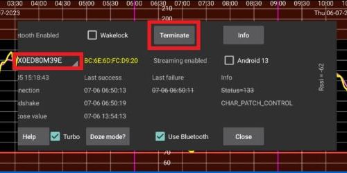

# **Freestyle Libre 3** ve 3+

Freestyle Libre 3 (FSL3), KŞ değerlerini AAPS'e almak için özel bir kurulum gerektirir. Freestyle Libre 3 (FSL3) değerlerini AAPS'e almanın iki yolu vardır.

Aşağıdaki yöntemler, ayrı bir uygulama olan Juggluco'yu kullanır. Sensörden ham, 1 dakika aralıklı verileri almak için Juggluco'yu kullanır; bu veriler sonra xDrip'e veya AAPS'e iletilir. Yeni sensörler Libre 3 uygulamasıyla ya da doğrudan Juggluco'da başlatılabilir. Aşağıdaki kılavuz, bir sensörün Juggluco uygulamasıyla nasıl başlatılacağını anlatır. Sensör, bir LibreView hesabında oturum açıkken başlatıldıysa, alıcı olarak Juggluco ile Libre 3 uygulaması arasında geçiş yapmak da mümkündür.

Sensör Libre 3 uygulamasıyla başlatıldıysa Juggluco, verileri sağlık uzmanlarıyla paylaşmak için LibreView'a da gönderebilir.

xDrip'te sensör, elle yapılan bir ölçüm cihazı değeri ile sensör değerleri arasındaki farkları dengelemek için -40 mg/dL ile +20 mg/dL (-2,2 mmol/L ile +1,1 mmol/L) aralığında kalibre edilebilir.

## Yöntem 1: 1 dakikalık ölçümleri doğrudan kullanma
**AAPS** 5 dakikalık ölçümler için tasarlanmıştır. Bu nedenle 1 dakikalık değerlerin işlenmesinin zaman zaman sınırlamaları vardır.

[Buraya](#juggluco-to-aaps) bakın.

## Yöntem 2: 1 dakikalık ölçümleri xDrip ile 5 dakikalık değerlere dönüştürme
Bu yöntem, sensörden ham, 1 dakika aralıklı verileri almak için Juggluco'yu kullanır; bu veriler xDrip'e iletilir, orada 5 dakika aralıklı verilere yumuşatılır ve AAPS'e gönderilir.

### 1. Adım: Juggluco'yu kurun
Juggluco uygulamasını [buradan](https://www.juggluco.nl/Juggluco/download.html) indirip kurun. [Buradaki](https://www.juggluco.nl/Juggluco/libre3/) talimatları izleyin

Glikoz değerlerini xDrip'e gönderdiğinizden emin olun: Juggluco'nun ayarlarında, Juggluco'yu glikoz değerini diğer uygulamalara gönderecek şekilde ayarlayabilirsiniz. Juggluco bu tür yayınların üç türünü gönderebilir: **Patched Libre broadcast** aslında yamalı Librelink uygulaması tarafından kullanılıyordu ve glikoz değerlerini xDrip'e göndermek için kullanılabilir.

### 2. Adım: xDrip'i kurun

Kan şekeri değerleri akıllı telefondaki xDrip uygulaması tarafından alınır.

- Henüz kurulmadıysa [xDrip](https://github.com/NightscoutFoundation/xDrip)'i indirin ve [xDrip ayarları sayfasındaki](../CompatibleCgms/xDrip.md) talimatları izleyin.
- xDrip'te veri kaynağı olarak "Libre2 (patched app)" seçin.
- Gerekirse Less Common Settings → Extra Logging Settings → Extra tags for logging altına "BgReading:d,xdrip libre_receiver:v" girin. Bu, sorun giderme için ek hata mesajları kaydeder.

- Teknik olarak güncel kan şekeri değeri her dakika xDrip'e iletilir. Ağırlıklı ortalama filtresi, varsayılan olarak son 25 dakika için yumuşatılmış bir değer hesaplar. Bu süreyi NFC Scan features menüsünde değiştirebilirsiniz.

  → Hamburger menu → Settings → NFC Scan features → Smooth libre 3 data when using xxx method

  

### 3. Adım: Sensörü xDrip'te başlatın

xDrip'te sensörü "Start Sensor" ve "not today" ile başlatın. Cep telefonunu sensörün üzerinde tutmanız gerekmez. Aslında "Start Sensor" hiçbir Libre 3 sensörünü fiziksel olarak başlatmaz ve hiçbir şekilde sensörle etkileşime girmez. Bu yalnızca xDrip'e, yeni bir sensörün kan şekeri değerleri gönderdiğini bildirir. Varsa, ilk kalibrasyon için kandan ölçülmüş iki değer girin. Artık kan şekeri değerleri xDrip'te her 5 dakikada bir gösterilmelidir. Atlanan değerler, örneğin telefonunuzdan çok uzakta olduğunuz için, sonradan doldurulmaz.

Hâlâ veri yoksa en az 15-20 dakika bekleyin.

Sensör değişiminden sonra xDrip yeni sensörü otomatik olarak algılar ve tüm kalibrasyon verilerini siler. Aktivasyondan sonra kan şekerinizi kontrol edip yeni bir ilk kalibrasyon yapabilirsiniz.

### 4. Adım: AAPS'i yapılandırın

- [Buraya](#juggluco-to-xdrip) bakın ve geri gelin.

- Telefon uçak modundayken **AAPS** KŞ değerlerini almıyorsa "Identify receiver" ayarını kullanın
- Yumuşatmayı kapatın (xDrip'te zaten yapılıyor)

## Sonraki sensör değişimleri

1. Juggluco'yu açın ve mevcut sensörün seri numarasını not edin

2. Şimdi yeni sensörünüzü telefonunuzun NFC okuyucusuyla taramanız yeterlidir. İşlem başarıyla başlatıldıysa Juggluco bir bildirim gösterir.
3. Eski sensörü devre dışı bırakmaya hazır olduğunuzda, ekranın sol üst köşesindeki boş alanda herhangi bir yere tıklayarak Juggluco menüsünü açın.
4. Süresi dolan sensörü seçin ve "Terminate"e dokunun

Not: İki sensör etkin olduğunda Juggluco, iki sensörden hangisi en yeni değeri verdiyse onu xDrip'e gönderir. Sensörler KŞ'yi benzer şekilde ölçecek biçimde kalibre edilmemişse, bu durum xDrip'e zıplayan KŞ değerlerinin gönderilmesine yol açabilir. Yanlış sensörü sonlandırırsanız, sensörü yeniden tarayarak tekrar etkinleştirebilirsiniz.

## Sensörü Libre 3 ile Juggluco uygulaması arasında değiştirme

Sensör, bir LibreView hesabında oturum açıkken başlatıldıysa, alıcı olarak Juggluco ile Libre 3 uygulaması arasında geçiş yapmak da mümkündür. Bunun için şu adımlar gerekir:

1. Libre 3 uygulamasını Google Play Store'dan kurun
2. Libre 3 uygulamasını, sensörün etkinleştirildiği LibreView hesabıyla kurun.
3. Android ayarlarında Juggluco uygulamasını zorla durdurun.
4. Libre 3 menüsünde "Start Sensor"a tıklayın, "Yes" ve "Next" seçin ve sensörünüzü tarayın.
5. Birkaç dakika sonra KŞ değerleri Libre 3 uygulamasında görünmelidir.

Libre 3 uygulamasından Juggluco'ya geçmek için Libre 3 uygulamasını Android ayarlarından zorla durdurmanız ve 1. ve 2. Adımlarla devam etmeniz gerekir.

(libre3-experiences-and-troubleshooting)=
## Deneyimler ve Sorun Giderme

### Libre3 -> Juggluco bağlantısında sorun giderme

- Juggluco uygulamasının güncel bir sürümünü kullandığınızdan emin olun
- Ayarlarınızı bu kılavuza göre kontrol edin
- Bazen Libre 3 uygulamasını ve Juggluco'yu zorla durdurup yeniden başlatmanız gerekebilir.
- Bluetooth'u kapatıp yeniden açın
- Bir süre bekleyin veya Juggluco'yu kapatmayı deneyin
- Juggluco'nun eski sürümleri (2.9.6'dan eski), Libre3 sensöründen gelen sonraki verileri bağlı cihazlara (örneğin WearOS üzerindeki Juggluco) göndermez. Yamalı Libre3 uygulamasında (Juggluco menüsü) "Resend data"ya tıklamanız gerekebilir.

### Daha fazla yardım

Original instructions: [jkaltes website](https://www.juggluco.nl/Juggluco/libre3/)

Ek GitHub deposu: [GitHub bağlantısı](https://github.com/maheini/FreeStyle-Libre-3-patch)
