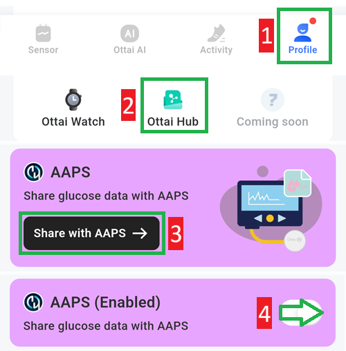

# Ottai M8

## M8'i Ottai uygulamasıyla kullanma

-   Apk dosyasını <https://play.google.com/store/apps/details?id=com.ottai.seas> adresinden indirip kurun. Ottai'nin Çin sürümü için <https://ottai.com.cn/70ICjxAI4i> adresini kullanın

-   Sensörü başlatın

- [**Konfigürasyon → KŞ kaynağı**](#Config-Builder-bg-source) içinde **Syai/Ottai** seçin.

Ottai uygulamasında yayını etkinleştirin:

1. Profile (profil) sekmesini seçin
2. Ottai hub
3. Share with AAPS'e dokunun, üçüncü taraf veri aktarımı sözleşmesini kabul edin
4. Share glucose data with AAPS seçeneğini etkinleştirin

