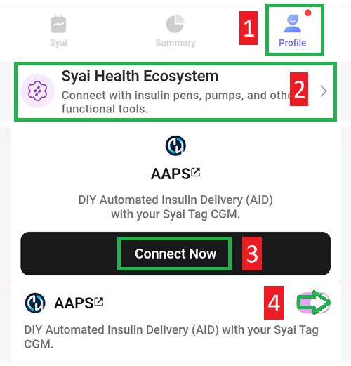

# Syai X1

## X1'i Syai Tag uygulamasıyla kullanma

-   Uygulamayı (apk) <https://play.google.com/store/apps/details?id=com.syai.tag> adresinden yükleyin.

-   X1 sensörünü başlatın

- [**Konfigürasyon → KŞ kaynağı**](#Config-Builder-bg-source) içinde **Syai/Ottai** seçin.

Syai uygulamasında yayını (broadcast) etkinleştirin:

1. Profile (profil) sekmesini seçin
2. Syai Health Ecosystem
3. "Connect Now with AAPS" (AAPS ile şimdi bağlan) seçeneğine dokunun, üçüncü taraf veri aktarımı sözleşmesini kabul edin
4. "Enable share data with AAPS" (AAPS ile veri paylaşımını etkinleştir) seçeneğini açın

