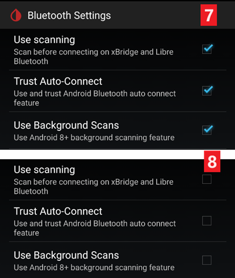

# xDrip ayarları

Henüz kurulmadıysa en son xDrip sürümünü [xDrip sürümler sayfasından](https://github.com/NightscoutFoundation/xDrip/releases) indirip yükleyin.

xDrip uygulaması için pil optimizasyonunu devre dışı bırakın ve arka plan etkinliğine izin verin.

## Tüm CGM & FGM sistemleri için temel ayarlar

### Nightscout yüklemesini devre dışı bırakın

Başka hiçbir uygulamanın Nightscout'a veri (kan şekeri ve tedaviler) yüklemesine izin vermemelisiniz.

→ Hamburger Menu (1) → Settings (2) → Cloud Upload (3) → Nightscout Sync (REST-API) (4) → `Enabled` seçeneğini **KAPALI** konuma getirin (5)

#### Otomatik kalibrasyonu ve tedavileri devre dışı bırakın

`Automatic Calibration` (7) seçeneğinin devre dışı olduğundan emin olun. `Automatic Calibration` onay kutusu işaretliyse `Download treatments` (6) seçeneğini bir kez etkinleştirin, ardından `Automatic Calibration` onay kutusunun işaretini kaldırın ve `Download treatments` seçeneğini yeniden devre dışı bırakın.

`Extra Options` öğesine dokunun (8)

    {admonition} Güvenlik uyarısı
    :class: warning
    xDrip'te "Upload treatments" seçeneğini devre dışı bırakmalısınız. Aksi halde tedaviler AAPS'te iki kez kaydedilebilir ve AKRB ile AİNS yanlış olur.

`Upload treatments` (9) seçeneğini devre dışı bırakın ve `Back-fill data` (11) seçeneğini **KULLANMAYACAĞINIZDAN** emin olun.

`Alert on failures` seçeneği de devre dışı bırakılmalıdır (10). Aksi halde Wi-Fi/mobil ağ sorunlarında veya sunucuya ulaşılamadığında her 5 dakikada bir alarm alırsınız.

### **Inter-app Settings** (uygulamalar arası ayarlar, yayın)

AAPS kullanıyorsanız, verilerin AAPS'e iletilmesi için xDrip'in Inter-App settings bölümünde yayını (broadcast) etkinleştirmeniz gerekir.

→ Hamburger Menu (1) → Settings (2) → Inter-app settings (3) → Broadcast locally **AÇIK** (4)

AAPS'teki değerlerin xDrip'tekilerle aynı olması için `Send the displayed glucose value` (5) seçeneğini etkinleştirmelisiniz.

Compatible Broadcast seçeneğini etkinleştirin (6).

xDrip'te `Accept treatments` ve AAPS xDrip eklentisinde `Enable broadcasts to xDrip` seçeneklerini de etkinleştirdiyseniz xDrip, AAPS'ten insülin, karbonhidrat ve bazal oran bilgilerini alır.

`Accept Calibrations` seçeneğini etkinleştirirseniz xDrip, AAPS'teki kalibrasyonları kullanır. Bu özelliği Dexcom sensörleriyle kullanırken dikkatli olun: önce [bunu](https://navid200.github.io/xDrip/docs/Calibrate-G6.html) okuyun.

AAPS her bazal/profil değişikliği gönderdiğinde xDrip'in zil sesi çalmaması için Import Sounds seçeneğini devre dışı bırakmayı unutmayın.

(xdrip-identify-receiver)=

#### Alıcı tanımlama

- Yerel yayınla ilgili sorunlar fark ederseniz (AAPS, xDrip'ten KŞ değerlerini almıyorsa) → Hamburger Menu (1) Settings (2) → Inter-app settings (3) → Identify receiver (7) yolunu izleyin ve AAPS sürümü için `info.nightscout.androidaps` girin (PumpControl sürümünü kullanıyorsanız bunun yerine `info.nightscout.aapspumpcontrol` girin!!).
- Lütfen Dikkat: Otomatik düzeltme bazen i'yi büyük harfe çevirme eğilimindedir. `info.nightscout.androidaps` yazarken **yalnızca küçük harf kullanmalısınız** (veya PumpControl için `info.nightscout.aapspumpcontrol`). Büyük I harfi, uygulamanın xDrip'ten KŞ değerlerini almasını engeller.
    
    

## xDrip'te kalibrasyon için AAPS'i kullanma

- Kalibrasyon için AAPS'i kullanabilmek istiyorsanız xDrip'te Settings → Interapp Compatibility → Accept Calibrations yolunu izleyin ve ON (açık) seçin. 
- Settings → Less Common Settings → Advanced Calibration Settings içindeki seçenekleri de gözden geçirmek isteyebilirsiniz.

## Dexcom sensors

Dexcom sensörü ve vericisiyle ilgili her şey (başlatma, durdurma, değiştirme, kalibrasyon, sorun giderme) [xDrip Dexcom belgelerinde](https://navid200.github.io/xDrip/docs/Dexcom_page.html) anlatılır ve güncel tutulur. Sensör için bu talimatları izleyin; xDrip'i **AAPS**'e bağlayan ayarlar (bu sayfada yukarıda anlatılanlar) AAPS'e özgü olan tek kısımdır.

### Dexcom G6 ve ONE

- xDrip'i [önerilen ayarlara](https://navid200.github.io/xDrip/docs/G6-Recommended-Settings.html) göre kurun.
- Dexcom G6 ve ONE vericileri aynı anda Dexcom alıcısına (veya t:slim pompaya) ve telefonunuzdaki bir uygulamaya bağlanabilir.
- xDrip'i alıcı olarak kullanırken önce Dexcom uygulamasını kaldırın. **xDrip'i ve Dexcom uygulamasını aynı anda vericiye bağlayamazsınız!**
- Clarity'ye ihtiyacınız varsa ve xDrip özelliklerinden yararlanmak istiyorsanız, xDrip'e yerel yayın ile [Build Your Own Dexcom App](#DexcomG6-if-using-g6-with-build-your-own-dexcom-app) kullanın veya xDrip'i resmi Dexcom uygulamasından bildirim alan bir yardımcı uygulama (companion app) olarak kullanın (KŞ ölçümlerinde gecikmeler olabilir).

#### Sensörü yeniden başlatma

- xDrip, güncel vericilerde her zaman vericinin [yerleşik algoritmasını](https://navid200.github.io/xDrip/docs/Native-Algorithm.html) kullanır; bunu kapatmak için bir neden yoktur.
- [Önleyici yeniden başlatmalar](https://navid200.github.io/xDrip/docs/Preemptive-Restart.html) yalnızca eski vericilerde (ürün yazılımı 1.6.5.25 veya daha eski) çalışır; bu vericilerde sensörün 10 gün sonra durmasını önlemek için gereklidir. Yeni (Firefly) vericiler bunları yok sayar.
- Firefly vericide bir sensörü yeniden başlatmak için [vericiyi çıkarmanız](https://navid200.github.io/xDrip/docs/Remove-transmitter.html) gerekir. Yeniden başlatmadan sonra ölçümler ciddi şekilde hatalı olabilir ve bu, döngü kullanırken tehlikelidir: [Sensörü yeniden başlatma](https://navid200.github.io/xDrip/docs/Restart-G6-sensor.html) sayfasını baştan sona okuyun ve [dikkatle kalibre edin](https://navid200.github.io/xDrip/docs/Calibrate-after-G6Restart.html).

(xdrip-connect-g6-transmitter-for-the-first-time)=

#### Sensörleri başlatma, durdurma ve değiştirme

Talimatları izleyin:

- [G6 veya ONE vericiyi başlatma](https://navid200.github.io/xDrip/docs/Starting-G6.html)
- [G6 veya ONE sensörü durdurma ve başlatma](https://navid200.github.io/xDrip/docs/Dexcom/StartG6Sensor.html)
- [Vericiyi sensörden çıkarma](https://navid200.github.io/xDrip/docs/Remove-transmitter.html)
- [Verici ömrü](https://navid200.github.io/xDrip/docs/Transmitter-lifetime.html) yalnızca pili yenilenmiş veya modifiye edilmiş vericilerde uzatılabilir ([donanımsal sıfırlama](https://navid200.github.io/xDrip/docs/Hard-Reset.html)), Firefly vericilerde uzatılamaz.

(xdrip-replace-transmitter)=

#### Vericiyi değiştirme

- Orijinal Dexcom alıcısını (kullanıyorsanız) kapatın ve xDrip ölçümleri gösterene kadar yeniden açmayın.
- Cihazı xDrip'te (System Status → Forget Device) VE akıllı telefonun Bluetooth ayarlarında unutun (DexcomXX olarak görünür; XX, verici seri numarasının son iki hanesidir).
- Yeniden bağlanmayı önlemek için eski vericiyi Bluetooth menzilinin dışında tutun.
- Ardından [G6 veya ONE vericiyi başlatma](https://navid200.github.io/xDrip/docs/Starting-G6.html) talimatlarını izleyin.

### Dexcom G7, ONE+ ve Stelo

- [G7, ONE+ ve Stelo talimatlarını](https://navid200.github.io/xDrip/docs/Dexcom/G7.html) izleyin (güncel bir xDrip sürümü gerekir — bağlantılı sayfaya bakın).
- **AAPS** ile kullanılabilecek kurulumlar için [Dexcom G7, ONE+ ve Stelo sayfasına](../CompatibleCgms/DexcomG7.md) da bakın.

(xdrip-troubleshooting-dexcom-g5-g6-and-xdrip)=

### Dexcom ve xDrip sorun giderme

- [G6/ONE bağlantı sorunlarını giderme](https://navid200.github.io/xDrip/docs/Connectivity-troubleshoot.html)
- [G7/ONE+/Stelo sorun giderme](https://navid200.github.io/xDrip/docs/Dexcom/G7_Troubleshooting.html)
- [Yeni bir sensörü başlatırken sorun](https://navid200.github.io/xDrip/docs/Dexcom/SensorFailedStart.html)
- Tam liste: [xDrip Dexcom sayfasındaki](https://navid200.github.io/xDrip/docs/Dexcom_page.html) **Troubleshooting** (sorun giderme) bölümüne bakın.

## Libre 1

- xDrip'te NFC-Bluetooth köprünüzü kurun
    
    → Hamburger Menu (1) → Settings (2) → Less common settings (3) → Bluetooth Settings (4)

- Bluetooth Settings içinde onay kutularını aşağıdaki ekran görüntülerinde olduğu gibi tam olarak ayarlayın (5)
    
    - Watchdog seçeneklerini devre dışı bırakın, çünkü bunlar telefonun Bluetooth'unu sıfırlar ve pompa bağlantınızı keser.
    
    

- Aşağıdaki ayarları etkinleştirmeyi deneyebilirsiniz (7)
    
    - Taramayı kullan
    - Trust Auto-Connect
    - Use Background Scans

- Köprüyle bağlantınız kolayca kopuyorsa veya bağlantıyı yeniden kurmakta zorlanıyorsanız **BUNLARI DEVRE DIŞI BIRAKIN** (8).
    
    

- Neden etkinleştirmek istediğinizi bilmiyorsanız diğer tüm seçenekleri devre dışı bırakın.
    
    

### Libre akıllı okuyucu pil seviyesi

- MiaoMiao ve Bubble gibi köprülerin pil seviyesi AAPS'te gösterilebilir (Blucon hariç).
- Ayrıntıları [ekran görüntüleri sayfasında](#screens-sensor-level-battery) bulabilirsiniz.

### Libre Vericiyi Bağla & sensörü başlat

- Sensörünüz gerektiriyorsa (Libre 2 EU ve Libre 1 US) en son out of process algoritmasını (OOP) yükleyin.

- Sensörünüz üretici uygulaması veya okuyucu ile önceden başlatılmış olmalıdır (xDrip, Libre sensörlerini başlatamaz veya durduramaz).

- Veri kaynağını Libre Bluetooth olarak ayarlayın.
    
    → Hamburger Menu (1) → Settings (2) → Hardware Data source içinde Libre Bluetooth seçin (3)
    
    

- Bluetooth taraması yapın ve köprüyü bağlayın.
    
    → Hamburger Menu (1) → Scan Bluetooth (2) → Scan (3)
    
    - xDrip köprüyü bulamazsa köprünün üretici uygulamasına bağlı olmadığından emin olun. Köprüyü şarja takın ve sıfırlayın.
    
    

- Sensörü xDrip'te başlatın.
    
        {admonition} Güvenlik uyarısı
        :class: warning
        Bir saatlik ısınma süresi bitmeden sensör verilerini kullanmayın: değerler aşırı yüksek olabilir ve AAPS'in yanlış kararlar vermesine neden olabilir.
    
    → Hamburger Menu (1) → Start sensor (2) → Start sensor (3) → Sensörü okuyucu veya üretici uygulamasıyla başlattığınız tam zamanı ayarlayın. Sensörü bugün başlatmadıysanız "Not Today" yanıtını verin (4).

(xdrip-libre2-patched-app)=

## Libre 2 yamalı uygulama

- Veri kaynağını Libre patched app (yamalı uygulama) olarak ayarlayın.
    
    → Hamburger Menu (1) → Settings (2) → Hardware Data source içinde Libre (patched App) seçin (3)
    
    

- `BgReading:d,xdrip libre_receiver:v` değerini Less Common Settings->Extra Logging Settings->Extra tags for logging altına ekleyebilirsiniz. Bu, sorun giderme için ek hata mesajlarını günlüğe kaydeder.

