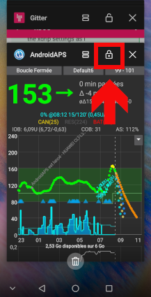

# Huawei telefon nasıl yapılandırılır

**Bu sayfanın kapsadığı telefonlar:** **EMUI 12 ile EMUI 15** arası sürümleri çalıştıran Huawei telefonlar. Bunların tümü, **AAPS**'in güncel sürümü için en düşük gereksinim olan Android 12'ye dayanır. Daha eski EMUI sürümüne sahip bir telefonda yalnızca [daha eski bir AAPS sürümü](#maintenance-android-version-aaps-version) kullanabilirsiniz.

```{admonition} HarmonyOS NEXT / HarmonyOS 5 telefonlar :class: warning

Çin'de satılan yeni Huawei telefonlar HarmonyOS NEXT (HarmonyOS 5 ve üstü) çalıştırır. Bu sistem artık Android değildir ve **AAPS**'i çalıştıramaz. ```

Huawei telefonlar arka planda çalışan uygulamaları çok agresif şekilde kapatır. Aşağıdaki tüm ayarları **AAPS**'e ve CGM uygulamanıza (örneğin xDrip+ veya Juggluco) uygulayın. Aksi halde ekran kapalıyken döngü ve glikoz ölçümleri durabilir.

Menü adları modeller arasında biraz farklı olabilir. Bir ayarı bulamazsanız adını **Settings** (Ayarlar) ekranının üstündeki arama çubuğuna yazın.

Aşağıdaki ekran görüntüleri daha eski bir EMUI sürümüne aittir. Ayarlar EMUI 12 ile 15 arasında aynıdır.

## Pil optimizasyonunu yoksay

1. **Settings > Apps > Apps** (Ayarlar > Uygulamalar > Uygulamalar) yolunu açın.
2. Sağ üst köşedeki **⋮** menüsüne dokunun ve **Special access > Battery optimization** (Özel erişim > Pil optimizasyonu) seçin.
3. Listenin üstündeki oka dokunun ve **All apps** (Tüm uygulamalar) seçin.
4. **AAPS** uygulamasını seçin ve **Don't allow** (İzin verme) seçeneğini seçin. Huawei artık bu listedeki uygulamaları optimize etmez.
5. CGM uygulamanız için de tekrarlayın.


## Uygulama başlatma: arka planda çalışmaya izin verin

1. **Settings > Battery > App launch** (Ayarlar > Pil > Uygulama başlatma) yolunu açın (veya **Settings > Apps > Apps >** uygulamayı seçin **> Battery > App launch**).
2. **AAPS** uygulamasını bulun ve **Manage automatically** (Otomatik yönet) seçeneğini kapatın.
3. **Manage manually** (Elle yönet) penceresinde üç seçeneğin tümünü açın: 
    - **Auto-launch (otomatik başlatma)**
    - **Secondary launch** (ikincil başlatma: başka uygulamalar tarafından başlatılabilir)
    - **Run in background (arka planda çalıştır)**
4. CGM uygulamanız için de tekrarlayın.


## AAPS'i son uygulamalar listesinde kilitleyin

Son uygulamalar listesini temizlediğinizde kilitli uygulamalar kapatılmaz.

1. Son uygulamalar listesini açın.
2. **AAPS** kartını aşağı kaydırın. Kartta bir kilit simgesi görünür.
3. CGM uygulamanız için de aynısını yapın.



## Güç tasarrufu modu

**Power saving mode** (güç tasarrufu modu) ve **Ultra power saving** (ultra güç tasarrufu) seçeneklerini kapalı tutun (**Settings > Battery**). Bu modlar, yukarıdaki ayarlardan bağımsız olarak arka plandaki uygulamaları kapatır.

## AAPS hâlâ arka planda duruyorsa

Huawei'ye özgü daha fazla çözüm için [Don't kill my app](https://dontkillmyapp.com/huawei) sitesine bakın.

## Honor telefonlar

Honor artık ayrı bir markadır ve telefonları EMUI yerine MagicOS çalıştırır. Arka plan ayarları çok benzerdir: uygulamanın pil ayarlarında **App launch** seçeneğini bulun, **Manage automatically** seçeneğini kapatın ve üç seçeneğin tümüne izin verin, ardından uygulamayı pil optimizasyonundan çıkarın.