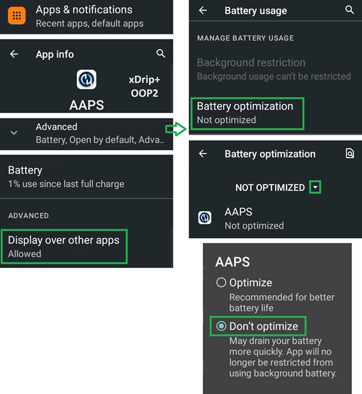

# Jelly

## Jelly Star Mini

**Features**

* Android 13
* 8 GB RAM

**Advantages**

* Gerçekten küçük.
* İnsanlara söyleseniz bile, onu normal bir akıllı telefon olarak görmeyebilirler ve normalde telefonlara izin verilmeyen yerlerde bir istisna olması daha kolay olacaktır.

**Disadvantages**

* Yalnızca deneyimli AAPS kullanıcıları için önerilir (bazı ayarlar tanınmayabilir, AAPS büyük Android telefon deneyiminizden, neyin nerede ve nasıl olduğunu bilmeniz gerekir.) Bazı AAPS butonlarına dokunmak zordur. (kalın parmakla kullanımı zorlar)
* Sadece döngü telefonu olarak kullanılabilir. Cebinizde normal kullanım için bir akıllı telefon olması daha iyidir. 

### Battery life optimization

The Jelly comes with strong optimization features that **must** be disabled for AAPS (and other DIY apps like BYODA, xDrip, OOP2, Juggluco, etc...).

You can leave Intelligent assistance enabled, but it **must be disabled for DIY apps**.

You can enable NFC for Libre sensors.

### Battery life optimization

To avoid interference with **AAPS**, the Jelly Star 'battery usage' should be disabled by selecting 'unrestricted' (and other **DIY apps** like BYODA, xDrip, OOP2, Juggluco, etc...).

### Google Play Protect

Remember to disable Google Play Protect.

### Remote Connection for Wear apk

For certain smart watches, like the Samsung Galaxy, 'Remote Connection' under Samsung Galaxy's Advanced Features must be switched **on** to use the Jelly, **Wear.apk** & **AAPS** remotely via Wi-Fi.

