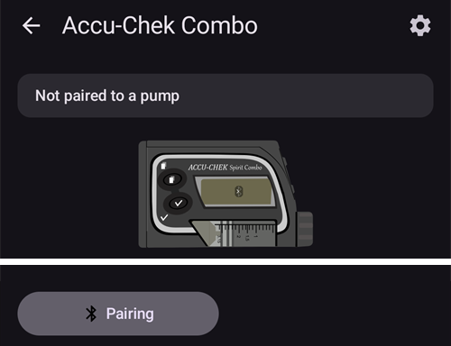
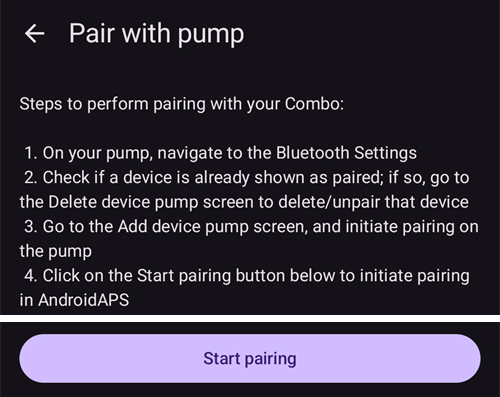
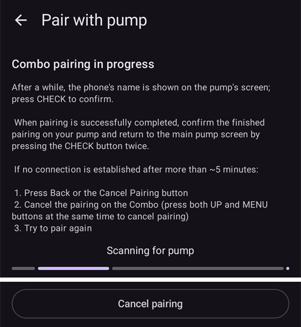
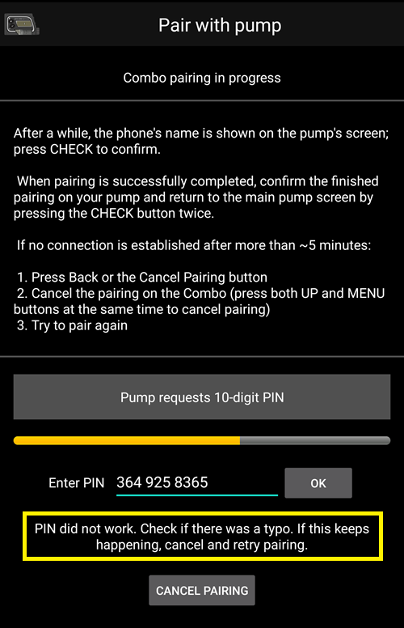

# Accu-Chek Combo

**Bu yazılım bir DIY (Kendin Yap) çözümünün parçasıdır ve bir ürün değildir, ancak nasıl kullanılacağı da dahil olmak üzere sistemi okumanızı, öğrenmenizi ve anlamanızı gerektirir. Tüm diyabet yönetimini sizin için yapan bir şey değildir, ancak gerekli zamanı ayırmaya istekliyseniz diyabetinizi ve yaşam kalitenizi iyileştirmenize izin verir. Acele etmeyin, ancak öğrenmek için kendinize zaman tanıyın. Yazılımla yaptıklarınızdan yalnızca siz sorumlusunuz.**

```{admonition} Accu-Chek Combo is being phased out
:class: note

Roche, diyabet ürünlerini Accu-Chek SmartGuide CGM üzerinde yoğunlaştırmak için insülin pompası pazarından çekiliyor. Roche, hem Accu-Chek Combo hem de Accu-Chek Insight pompalarının satışının sona erdiğini duyurdu; kalan Accu-Chek Solo mikro pompası da aşamalı olarak kaldırılıyor (Almanya'da son teslimatlar 2025 sonunda). Bu değişiklik bölge bölge uygulanıyor; Almanya'da başladı, diğer Avrupa pazarlarının da izlemesi bekleniyor. Bu pompaya güveniyorsanız, desteklenen bir pompaya geçişi önceden planlayın.
```

```{contents} Table of contents
:depth: 1
:local: true
```

## AAPS ile pompa özellikleri

* **AAPS** ile telefonunuzun yerleşik Bluetooth'u üzerinden, ek bir iletişim cihazı olmadan iletişim kurar.
* Yaz saati (DST) ve saat dilimi değişiklikleri otomatik olarak yönetilir.

## Donanım ve yazılım gereksinimleri

* Roche Accu-Chek Combo pompa (tüm pompa yazılımlarında çalışır).
* Pompayı yapılandırmak için 360 Yapılandırma Yazılımı ile birlikte bir Smartpix veya Realtyme cihazı. (Roche, Smartpix cihazlarını ve konfigürasyon yazılımını talep üzerine müşterilerine ücretsiz olarak göndermektedir.)
* Android 12 veya daha yeni bir sürümü çalıştıran uyumlu bir telefon. Ayrıntılar için [sürüm notlarına](#maintenance-android-version-aaps-version) bakın.
* Telefonunuzda yüklü **AAPS** uygulaması.

Bazı telefonlar, Bluetooth desteğinin kalitesine, çok agresif güç tasarrufu mantığına sahip olup olmadıklarına bağlı olarak diğerlerinden daha iyi çalışabilir. Telefonların bir listesini [Telefonlar](#Phones-list-of-tested-phones) sayfasında bulabilirsiniz. Lütfen bunun tüm telefonların bir listesi olmadığını ve kişisel kullanıcı deneyimini yansıttığını unutmayın. Siz de kendi deneyiminizi ekleyerek başkalarına yardım etmeye davetlisiniz (bu projelerin özü, aldığınız yardımı başkalarına aktarmaktır).

(combov2-before-you-begin)=
## Başlamadan önce

**ÖNCE GÜVENLİK** - bu işlemi bir hatadan kurtulamayacağınız bir ortamda denemeyin. 360 Konfigürasyon Yazılımı ile birlikte Smartpix / Realtyme cihazınızı el altında bulundurun. Her şeyi ayarlamak ve her şeyin düzgün çalışıp çalışmadığını kontrol etmek için yaklaşık bir saat ayırın.

Aşağıdaki sınırlamaların farkında olun:

* Yayma bolus ve çok dalgalı bolus şu anda desteklenmemektedir (bunun yerine [Yayma karbonhidratlar](../DailyLifeWithAaps/ExtendedCarbs.md) kullanabilirsiniz).
* Yalnızca bir temel profil (ilki) desteklenir.
* **Profil**inizdeki en düşük bazal oran 0,05 Ü/sa olabilir. **AAPS**, daha düşük bir oran içeren bir **Profil**i kabul etmez. Combo, bazal oranları kendi adımlarına yuvarlar (1 Ü/sa altında 0,01 Ü/sa, 10 Ü/sa değerine kadar 0,05 Ü/sa, bunun üstünde 0,1 Ü/sa). **AAPS**, pompanın gerçekten verdiği oranları kullanır.
* Geçici bazal oranlar, mevcut bazal oranın %500'ü ile sınırlıdır. **AAPS** bu sınırı dikkate alır.
* Pompadaki o anda etkin olan profil, profil no.1 değilse döngü devre dışı bırakılır. Bu durum, 1 numaralı profil etkin hale getirilene kadar devam eder; bu yapıldığında AAPS bir sonraki bağlantıda (bir süre sonra kendiliğinden veya Accu-Chek Combo pompa ekranında **Yenile**'ye dokunduğunuz için) 1 numaralı profilin geçerli profil olduğunu fark eder ve döngüyü yeniden etkinleştirir.
* Döngü çalışan bir GBO'nun iptal edilmesini talep ederse, Combo bunun yerine 15 dakika boyunca %90 veya %110'luk bir GBO ayarlayacaktır. Bunun nedeni, bir GBO'nun fiilen iptal edilmesinin pompa üzerinde çok fazla titreşime neden olan bir uyarıya neden olması ve bu titreşimlerin devre dışı bırakılamamasıdır.
* Bluetooth bağlantı kararlılığı, farklı telefonlara göre değişir ve artık pompaya bağlantının kurulmadığı durumlarda "pompaya erişilemiyor" uyarılarına neden olur. Bu hata oluşursa Bluetooth'un açık olduğundan emin olun, sorunun geçici bir aksaklıktan kaynaklanıp kaynaklanmadığını görmek için pompa ekranında (**Yönet** > **Pompa**) **Yenile**'ye dokunun; hâlâ bağlantı kurulamıyorsa telefonu yeniden başlatın, bu genellikle sorunu çözer.
* Yeniden başlatmanın işe yaramadığı başka bir sorun daha vardır: bu durumda pompa telefondan gelen bağlantıları tekrar kabul etmeden önce pompadaki bir düğmeye basılması gerekir (bu, pompanın Bluetooth yığınını sıfırlar).
* Döngü GBO'ların kontrolünü üstlendiğinden, pompada herhangi bir GBO ayarlamaktan kaçınılmalıdır. Pompada yeni bir GBO'nun algılanması 20 dakika kadar sürebilir ve GBO'nun etkisi yalnızca algılandığı andan itibaren hesaba katılır, bu nedenle en kötü durumda AİNS'e yansıtılmayan 20 dakikalık bir GBO olabilir.

Sürücü şu anda Combo'da aşağıdaki dilleri destekleyecek şekilde yazılmıştır. (Bunun AAPS program dili ile ilgisi yoktur - Combo pompanızın LCD ekranında gösterilen dildir.)

* İngilizce
* İspanyolca
* Fransızca
* İtalyanca
* Rusça
* Türkçe
* Polonyaca
* Çekçe
* Macarca
* Slovakça
* Romence
* Hırvatça
* Flemenkçe
* Yunanca
* Fince
* Norveçce
* Portekizce
* İsveççe
* Danca
* Almanca
* Slovence
* Litvanyaca

**Önemli**: Pompanız bu listede olmayan bir dile ayarlanmışsa, lütfen geliştiricilerle iletişime geçin ve pompanın dilini bu listedeki bir dile ayarlayın. Aksi takdirde, sürücü düzgün çalışmayacaktır.

## Telefon Kurulumu

Pil optimizasyonlarının kapalı olduğundan emin olmak çok önemlidir. AAPS, bu optimizasyonlara ne zaman tabi olduğunu zaten otomatik olarak algılar ve kullanıcı arayüzünde bunların kapatılmasını ister. Ancak, modern Android telefonlarda Bluetooth _kendisi_ bir uygulamadır (bir sistem uygulaması). Ve genellikle, bu "Bluetooth uygulaması" _varsayılan olarak pil optimizasyonları açıkken_ çalışır. Sonuç olarak Bluetooth, telefon güç tasarrufu yapmayı amaçladığında Bluetooth uygulamasını kapattığı için yanıt vermeyi reddedebilir. Bu, söz konusu Bluetooth sistem uygulamasının ayarlarında pil optimizasyonlarının da kapatılması gerektiği anlamına gelir. Ne yazık ki, Bluetooth sistem uygulamasının nasıl bulunabileceği telefonlar arasında farklılık gösteriyor. Stok Android'de Ayarlar -> Uygulamalar -> Tüm N uygulamayı görün (N = telefonunuzdaki uygulama sayısı). Ardından, sağ üst köşedeki menüyü açın, "Sistemi göster" veya "Sistem uygulamalarını göster" veya "Tüm uygulamalar" üzerine dokunun. Şimdi, yeni genişletilmiş uygulama listesinde bir "Bluetooth" uygulaması arayın. Onu seçin ve "Uygulama bilgileri" ekranında "Pil" üzerine dokunun. Burada, pil optimizasyonlarını devre dışı bırakın (bazen "pil kullanımı" olarak adlandırılır).

## Combo kurulumu

* Accu-Chek 360 Yapılandırma Yazılımını kullanarak pompayı yapılandırın. Yazılıma sahip değilseniz, lütfen Accu-Chek yardım hattınızla iletişime geçin. Genellikle kayıtlı kullanıcılara "360° Pompa Yapılandırma Yazılımı" ve bir SmartPix USB kızılötesi bağlantı cihazı içeren bir CD gönderirler (eğer varsa Realtyme cihazı da çalışır).

  - **Gerekli ayarlar** (ekran görüntülerinde yeşil olarak işaretlenmiştir):

     * Menü yapılandırmasını "Standart" olarak ayarlayın/bırakın; bu yalnızca pompada desteklenen menüleri/eylemleri gösterecek ve desteklenmeyenleri (yayma/çoklu yayma bolus, çoklu bazal oranları) gizleyecektir, bu da kullanıldığında döngü işlevselliğinin kısıtlanmasına neden olur çünkü kullanıldığında döngüyü güvenli bir şekilde çalıştırmak mümkün değildir.
     * _Hızlı Bilgi Metni_'nin "QUICK INFO" olarak ayarlandığını doğrulayın (tırnak işaretleri olmadan, _İnsülin Pompası Seçenekleri_ altında bulunur).
     * GBO _Maksimum Ayarı_ %500 olarak ayarlayın
     * _Geçici Bazal Oranının Sonu Sinyali_'ni Devre Dışı Bırakın
     * GBO _Süre artışını_ 15 dk olarak ayarlayın
     * Bluetooth'u Etkinleştirin

  - **Önerilen ayarlar** (ekran görüntülerinde mavi olarak işaretlenmiştir)

     * Rezervuar düşük alarmını istediğiniz gibi ayarlayın
     * Yazılımdaki hatalara karşı koruma sağlamak için tedavinize uygun bir maksimum bolus yapılandırın
     * Benzer şekilde, bir koruma olarak maksimum GBO süresini yapılandırın. En az 3 saate izin verin, çünkü pompayı 3 saat ayırma seçeneği 3 saat boyunca %0 ayarlar.
     * Özellikle pompa daha önce manuel kullanıldığında ve hızlı bolus verme bir alışkanlık olduğunda, pompadan bolus vermeyi önlemek için tuş kilidini etkinleştirin.
     * Ekran zaman aşımını ve menü zaman aşımını sırasıyla en düşük değerler olan 5,5 ve 5 olarak ayarlayın. Bu, AAPS'in hata durumlarından daha hızlı kurtulmasını sağlar ve bu tür hatalar sırasında meydana gelebilecek titreşim sayısını azaltır

  

  

  

  

## Sürücüyü etkinleştirme ve Combo ile eşleştirme

* Sol üst köşedeki **menüyü** (☰) açın, [**Konfigürasyon** > **Pompa**](../SettingUpAaps/ConfigBuilder.md) bölümüne gidin ve **Accu-Chek Combo**'yu seçin.

  

  Seçildikten sonra **Accu-Chek Combo** kartında iki düğme görünür: **Ayarlar** ve **Eklentiyi aç**:

  

  **Ayarlar**, Accu-Chek Combo sürücüsünün ayarlarını açar (aşağıdaki [Ayarlar](#combov2-preferences) bölümüne bakın):

  

  **Eklentiyi aç** (veya **Yönet** > **Pompa**), Accu-Chek Combo pompa ekranını açar. Bir pompa eşleştirilmeden önce ekranda **Bir pompayla eşleştirilmedi** yazar:

  

* Pompa ekranında **Eşleştirme**'ye dokunun. **Pompayla eşleştir** ekranı açılır. Ekranda gösterilen adımları izleyin, ardından **Eşleştirmeye başla**'ya dokunun. Android, telefonu diğer Bluetooth cihazlarına görünür yapmak için izin istediğinde **İzin ver**'e dokunun. Sonunda Combo kendi ekranında 10 haneli bir eşleştirme PIN'i gösterir ve **AAPS** bu PIN'i ister. Bu PIN'i **10-haneli PIN** alanına girin.

  

  

  

  Sonraki resimler eski bir **AAPS** sürümünden alınmıştır. Adımlar ve metinler aynıdır, ancak ekranlar biraz farklı görünür.

  

  

  

* PIN yanlış girilirse **AAPS** şu mesajı gösterir: **PIN çalışmadı. Yazım hatası olup olmadığını kontrol edin. Bu tekrar olursa eşleştirmeyi iptal edin ve yeniden deneyin.**

  

* **Combo ile başarıyla eşlendi** mesajı görünce **Tamam**'a dokunun. Pompa ekranına geri dönersiniz; bu ekran artık pompa durumunu gösterir (aşağıdaki [Accu-Chek Combo pompa ekranının içeriği](#combov2-tab-contents) bölümüne bakın). **Eşleştirme** düğmesinin yerini **Eşleşmeyi Kaldır** alır.

* Kurulumunuzu doğrulamak için (güvenli olması için pompanın herhangi bir kanülden **bağlantısı kesilerek**!) AAPS'i kullanarak 15 dakika boyunca %500'lük bir GBO ayarlayın ve bir bolus verin. Pompanın şimdi çalışan bir GBO'su ve geçmişte bolus olması gerekir. AAPS ayrıca aktif GBO'yu ve iletilen bolusu göstermelidir.

* Combo'da, özellikle pompa daha önce manuel kullanıldıysa ve "hızlı bolus" özelliğini kullanmak bir alışkanlık olduysa, pompadan bolus verilmesini önlemek için tuş kilidinin etkinleştirilmesi önerilir.

## Eşleştirme hakkında notlar

Accu-Chek Combo, Bluetooth 4.0 piyasaya sürülmeden önce ve ilk Android sürümünün piyasaya sürülmesinden sadece bir yıl sonra geliştirildi. Bu nedenle, diğer cihazlarla eşleştirme yöntemi, bugün Android'de yapıldığı şekliyle %100 uyumlu değildir. Bunun üstesinden gelmek için AAPS'in yalnızca sistem uygulamaları için mevcut olan sistem düzeyinde izinlere ihtiyacı olacaktır. Bunlar, telefon üreticileri tarafından telefona yüklenir - kullanıcılar sistem uygulamalarını yükleyemez.

Bunun sonucu olarak eşleştirme hiçbir zaman %100 sorunsuz olmayacaktır. Özellikle eşleştirme sırasında, Android'in Bluetooth PIN iletişim kutusu kısa bir süreliğine görünebilir ve otomatik olarak kaybolabilir. Ancak bazen ekranda kalıyor ve 4 haneli bir PIN istiyor. (Bu, 10 haneli Combo eşleştirme PIN'i ile karıştırılmamalıdır.) Hiçbir şey girmeyin, sadece iptal düğmesine basın. Eşleştirme devam etmezse, eşleştirme girişimini yeniden denemek için ekrandaki talimatları izleyin.

(combov2-tab-contents)=
## Accu-Chek Combo pompa ekranının içeriği

Pompa ekranını açmak için **Yönet** > **Pompa**'ya gidin. Bir pompa eşleştirildikten sonra ekran aşağıdaki bilgileri gösterir (öğeler yukarıdan aşağıya doğru sıralanmıştır):


1. **Sürücü durumu**: Sürücü aşağıdaki durumlardan birinde olabilir:
   - **Bağlantı kesildi**: Bluetooth bağlantısı yoktur; sürücü çoğu zaman bu durumdadır ve pompaya yalnızca gerektiğinde bağlanır - bu güç tasarrufu sağlar
   - **Bağlanıyor**
   - **Pompa kontrol ediliyor**: pompa bağlıdır, ancak sürücü şu anda her şeyin yolunda ve güncel olduğundan emin olmak için güvenlik kontrolleri yapmaktadır
   - **Hazır**: sürücü AAPS'ten komut almaya hazırdır
   - **Askıya Alındı**: pompa askıya alınmıştır (Combo'da "stopped" olarak gösterilir)
   - Yürütülmekte olan komutun açıklaması, örneğin **Bazal profil ayarlanıyor** veya **Pompa durumu güncelleniyor**
   - **Hata**: bir hata oluştu; bağlantı sonlandırıldı, devam eden her komut iptal edildi
2. **Son bağlantı**: Sürücünün Combo'ya kaç dakika önce başarıyla bağlandığı; bu süre 30 dakikayı geçerse bu öğe kırmızı renkte gösterilir
3. **Pil**: Pil seviyesi; Combo yalnızca **Dolu**, **Düşük** veya **Boş** bilgisini verir ve daha kesin bir değer (örneğin yüzde) sunmaz, bu nedenle burada yalnızca bu üç seviye gösterilir
4. **Rezervuar**: Combo'nun rezervuarında şu anda kaç Ü insülin olduğu
5. **Son bolus**: Son bolusun kaç dakika önce verildiği; AAPS başlatıldıktan sonra henüz bolus verilmediyse gösterilmez
6. **Geçici Bazal**: Şu anda etkin olan geçici bazalın ayrıntıları; şu anda etkin bir geçici bazal yoksa gösterilmez
7. **Temel bazal oranı**: Şu anda etkin olan temel bazal oran ("temel", bazal oran çarpanını etkileyen bir geçici bazal olmadan geçerli olan bazal oran anlamına gelir)
8. **Seri numarası**: Pompanın bildirdiği Combo seri numarası (Combo'nun arkasında yazan seri numarasıyla aynıdır)
9. **Bluetooth adresi**: Combo'nun `XX:XX:XX:XX:XX:XX` biçiminde gösterilen 6 baytlık Bluetooth adresi

Sürücü bir işlem yaparken (örneğin bazal profil ayarlarken), listenin altındaki bir kutu o anki işlemi açıklar ve ince bir ilerleme çubuğu ilerlemeyi gösterir.

Combo, Bluetooth aracılığıyla _uzak terminal_ modunda veya _komut_ modunda çalıştırılabilir. Uzak terminal modu, Combo'nun kan şekeri ölçüm cihazındaki "uzaktan kumanda modu"na karşılık gelir; bu mod pompanın LCD ekranını ve dört düğmesini taklit eder. Komut modunda karşılıkları olmadığı için bazı komutların sürücü tarafından bu modda gerçekleştirilmesi gerekir. Bu ikinci mod çok daha hızlıdır, ancak söylendiği gibi kapsamı sınırlıdır. Uzak terminal modu etkin olduğunda, o anki uzak terminal ekranı Combo çiziminin hemen üstündeki alanda gösterilir. Ancak sürücü komut moduna geçtiğinde bu alan boştur.

(Bunu siz etkilemezsiniz; hangi modun kullanılacağına tamamen sürücü kendisi karar verir. Bu yalnızca bu alanda neden bazen Combo ekran görüntüleri gördüğünüzü bilmeniz için bir nottur.)

En altta şu düğmeler bulunur:

- **Yenile**: Pompa durumunu hemen günceller. Ayrıca daha önce bulunan bir hatanın artık giderildiğini ve AAPS'in her şeyin yolunda olup olmadığını yeniden kontrol edebileceğini AAPS'e bildirmek için de kullanılır (bununla ilgili ayrıntılar aşağıda, [uyarılarla ilgili bölümde](#combov2-alerts)). Bu düğmeye yalnızca sürücünün bağlantısı kesikken, askıya alınmışken veya hata durumundayken dokunabilirsiniz.
- **Eşleşmeyi Kaldır**: **Pompa eşleştirmesini kaldırmak istiyor musunuz?** sorusunu onayladıktan sonra eşleştirilmiş Combo'nun **AAPS** ve Android ile eşleşmesini kaldırır. Eşleştirilmiş bir pompa yokken bu düğmenin yerinde **Eşleştirme** düğmesi bulunur.

(combov2-preferences)=
## Ayarlar

Combo sürücüsü için şu ayarlar vardır (**Konfigürasyon** > **Pompa** > **Accu-Chek Combo** > **Ayarlar** veya pompa ekranındaki ayarlar simgesi (dişli çark)). Öğeler yukarıdan aşağıya doğru sıralanmıştır:

1. **Keşif süresi (saniye)**: Eşleştirme sırasında sürücü, telefonu pompa tarafından bulunabilir hale getirir. Bu keşfedilebilirliğin ne kadar süreceğini kontrol eder. Varsayılan olarak maksimum (300 saniye = 5 dakika) seçilidir. Android, keşfedilebilirliğin süresiz olarak devam etmesine izin vermez, bu nedenle bir süre seçilmelidir.
2. **İnsülin rezervuar değişikliğini otomatik olarak algıla ve otomatik olarak gir**: Etkinleştirilirse, normalde sizin **Yönet** > **Hazırla/doldur** ile girdiğiniz "rezervuar değişimi" kaydını sürücü girer. Bu konu [aşağıda daha ayrıntılı olarak](#combov2-autodetections) açıklanmıştır.
3. **Pil değişimini otomatik olarak algıla ve otomatik olarak gir**: Etkinleştirilirse, normalde sizin **Yönet** > **Pompa Pil Değişimi** ile girdiğiniz "pil değişimi" kaydını sürücü girer. Bu konu [aşağıda daha ayrıntılı olarak](#combov2-autodetections) açıklanmıştır.
4. **Ayrıntılı Combo günlüğünü etkinleştir**: Bu, sürücünün yaptığı günlük kaydının miktarını büyük ölçüde artırır. **DİKKAT**: Bir geliştirici tarafından istenmedikçe bunu etkinleştirmeyin. Aksi halde bu, **AAPS** günlüklerine çok fazla gereksiz bilgi ekleyebilir ve günlüklerin işe yararlığını azaltabilir.

Eşleştirme ve eşleşmeyi kaldırma ayarlarda değil, pompa ekranında yapılır (yukarıya bakın).

(combov2-autodetections)=
## Pil ve rezervuar değişikliklerini otomatik algılama ve otomatik olarak girme

Sürücü, pil ve rezervuar seviyelerini takip ederek pil ve rezervuar değişikliklerini tespit edebilir. Pompa durumu son güncellendiğinde pil seviyesi Combo tarafından düşük olarak bildirildiyse ve yeni pompa durumu güncellemesi sırasında pil seviyesi normal görünüyorsa, sürücü kullanıcının pili değiştirmiş olması gerektiği sonucuna varır. Rezervuar seviyesi için de aynı mantık kullanılır: Şimdi öncekinden daha yüksekse, bu rezervuar değişikliği olarak yorumlanır.

Bu yalnızca, pil ve rezervuar seviyeleri düşük olarak bildirildiğinde değişim yapılırsa _ve_ pil ve rezervuar yeterince doluysa çalışır.

Bu otomatik algılamalar sürücü [ayarlarında](#combov2-preferences) kapatılabilir.

(combov2-alerts)=
## Alarmlar (uyarılar ve hatalar) ve bunların nasıl işlendiği

Combo, uyarıları uzak terminal ekranları olarak gösterir. Uyarılar "Wx" koduyla (x bir rakamdır) ve kısa bir açıklamayla gösterilir. Bir örnek "W7", "TBR OVER". Hatalar benzerdir ancak bunun yerine bir "Ex" koduyla gösterilir.

Belirli uyarılar sürücü tarafından otomatik olarak kapatılır. Bunlar:

- W1 "reservoir low" : sürücü bunu AAPS ana ekranında gösterilen bir "rezervuar düşük" uyarısına dönüştürür
- W2 "battery low" : sürücü bunu AAPS ana ekranında gösterilen bir "pil düşük" uyarısına dönüştürür
- W3, W6, W7, W8 : bunların tümü kullanıcı için yalnızca bilgi amaçlıdır, bu nedenle sürücünün bunları otomatik olarak kapatması güvenlidir

Diğer uyarılar otomatik olarak _kapatılmaz_. Ayrıca, hatalar _asla_ otomatik olarak kapatılmaz. Bunların her ikisi de aynı şekilde ele alınır: Sürücünün AAPS Kullanıcı Arabirimi üzerinde bir uyarı iletişim kutusu oluşturmasına ve ayrıca devam eden herhangi bir komut yürütmeyi iptal etmesine neden olurlar. Sürücü daha sonra "hata" durumuna geçer (bkz. [yukarıdaki Accu-Chek Combo pompa ekranının içeriği](#combov2-tab-contents)). Bu durum, herhangi bir komut yürütülmesine izin vermez. Kullanıcının pompadaki hatayı gidermesi gerekir; örneğin, bir tıkanıklık hatası kanülün değiştirilmesini gerektirebilir. Kullanıcı hatayı giderdikten sonra, Accu-Chek Combo pompa ekranında **Yenile**'ye dokunarak normal çalışmaya devam edilebilir. Sürücü daha sonra Combo'ya bağlanır ve durumunu günceller, ekranda hâlâ bir hata gösterilip gösterilmediğini vb. kontrol eder. Ayrıca, sürücü bir süre sonra pompa durumunu otomatik olarak yeniler, bu nedenle bu butona manuel olarak basmak zorunlu değildir.

Bolus özel bir durumdur. Bir uyarının göründüğünü bolus ortasında rapor etmeyen Combo'nun komut modunda yapılır. Sonuç olarak, sürücü bir bolus _sırasında_ uyarıları otomatik olarak kapatamaz. Bu ne yazık ki, bolus bitene kadar pompanın bip sesi çıkaracağı anlamına gelir. En yaygın bolus ortası uyarısı tipik olarak W1 "rezervuar düşük" uyarısıdır. Bolus sırasında Combo uyarılarını pompanın kendisinde elle **kapatmayın**. Bolusu kesintiye uğratma riskiniz vardır. Bolus bittiğinde sürücü uyarıyı dikkate alacaktır.

Sürücü Combo'ya bağlı değilken meydana gelen uyarılar, sürücü tarafından fark edilmeyecektir. Combo'nun bu uyarıyı otomatik olarak telefona göndermesinin bir yolu yoktur; bağlantıyı her zaman telefonun başlatması gerekir. Sonuç olarak, sürücü pompaya bağlanana kadar uyarı devam eder. Bir bağlantı başlatmak ve sürücünün uyarıyı hemen ele almasını sağlamak için pompa ekranında **Yenile**'ye dokunabilirsiniz (AAPS'in kendisinin bir bağlantı başlatmaya karar vermesini beklemek yerine).

**ÖNEMLİ**: Bir hata oluşursa veya otomatik olarak kapatılanlardan biri olmayan bir alarm görüntülenirse, sürücü hata durumuna geçer. Bu durumda, pompa durumu yenilenene kadar döngü **DEVRE DIŞI OLACAKTIR**! Pompa durumu güncellendikten sonra (**Yenile**'ye dokunarak veya sürücünün kendi otomatik güncellemesiyle) ve artık hata gösterilmiyorsa engel kalkar.

## Combo kullanırken dikkat edilmesi gerekenler

* Bunun bir ürün olmadığını unutmayın; özellikle başlangıçta kullanıcının sistemi, sınırlamalarını ve nasıl başarısız olabileceğini izlemesi ve anlaması gerekir. Kullanan kişi sistemi tam olarak anlayamamışsa bu sistemi KULLANMAMANIZ şiddetle tavsiye edilir.
* Combo'nun uzaktan kumanda işlevselliğinin çalışma şekli nedeniyle, bazı işlemler (özellikle bazal profili ayarlamak) diğer pompalara kıyasla yavaştır. Bu, Combo'nun üstesinden gelinemeyecek talihsiz bir sınırlamasıdır.
* Pompa üzerinden bir GBO (geçici bazal oran) ayarlamayın veya iptal etmeyin. Döngü, GBO'nun kontrolünü programda üstlenir. Aksi takdirde kullanıcı tarafından pompada ayarlanan bir GBO'nun başlangıç zamanını belirlemek mümkün olmadığından güvenilir şekilde çalışamaz.
* AAPS pompa ile iletişim kurarken pompa üzerinde herhangi bir düğmeye basmayın (AAPS bağlandığında pompada Bluetooth logosu görünür). Bunu yapmak, Bluetooth bağlantısını kesecektir. Bunu yalnızca bağlantı kurmada sorun varsa yapın (bkz. [yukarıdaki "Başlamadan önce" bölümü](#combov2-before-you-begin)).
* Pompa bolus yaparken herhangi bir butona basmayın. Özellikle uyarıları pompa butonlarına basarak kapatmaya çalışmayın. Nedenine ilişkin daha ayrıntılı bir açıklama için [uyarılarla ilgili bölüme](#combov2-alerts) bakın.

## Combo ile bağlantı kurulamadığında kontrol listesi

Sürücü, Combo'ya bağlanmak için elinden gelenin en iyisini yapıyor ve güvenilirliği en üst düzeye çıkarmak için birkaç numara kullanıyor. Yine de bazen bağlantı kurulamayabilir. İşte bu durumu düzeltmek için atmanız gereken bazı adımlar.

1. Combo'da bir düğmeye basın. Bazen, Combo'nun Bluetooth aygıtı yanıt vermemeye başlar ve artık bağlantıları kabul etmez. Combo üzerindeki bir düğmeye basıp LCD'nin bir şey göstermesini sağlayarak, Bluetooth aygıtı sıfırlanır. Çoğu zaman bağlantı sorunlarını çözmek için gereken tek adım budur.
2. Telefonunuzu yeniden başlatın. Telefonun Bluetooth bağlantısıyla ilgili bir sorun varsa bu gerekli olabilir.
3. Combo'nun pil kapağı eskiyse değiştirmeyi düşünün. Eski pil kapakları, Combo'nun güç kaynağında Bluetooth'u etkileyen sorunlara neden olabilir.
4. Bağlantı denemeleri hâlâ başarısız oluyorsa, eşleştirmeyi kaldırıp ardından pompayı yeniden eşleştirmeyi deneyebilirsiniz.

(combov2-tips-for-basic-usage)=
## Temel kullanım için ipuçları

### Sorunsuz kullanım nasıl sağlanır

* Her zaman **akıllı telefonunuzu yanınızda bulundurun**, geceleri yatağınızın yanında bırakın. Uyurken pompanız vücudunuzun arkasında veya altında kalabileceğinden, telefonu daha yüksek bir yere (raf veya rafa benzer bir yüzey) koymak en iyi sonucu verir.
* Her zaman pompa pilinin mümkün olduğunca dolu olduğundan emin olun. Pille ilgili ipuçları için pil bölümüne bakın.
* Mümkün olduğunda pompayı yalnızca AAPS uygulaması üzerinden kullanın. Bunu kolaylaştırmak için pompada **PUMP SETTINGS / KEY LOCK / ON** altından tuş kilidini etkinleştirin. Sadece rezervuar veya pilin değiştirilmesi gerektiğinde pompanın düğmelerini kullanmak gerekir.


### Pompaya erişilemiyor. Ne yapmalı?

#### Pompaya ulaşılamıyor alarmını etkinleştirin
* **AAPS**'te ana ekranın sağ üstündeki **Ayarlar** (dişli) simgesine dokunun, **Yerel uyarılar**'a gidin, **Pompa ulaşılamıyorsa uyar** seçeneğini etkinleştirin ve **Pompa ulaşılamaz eşiği**ni **31** dakikaya ayarlayın.
* Bu telefonunuz masanın üzerindeyken odadan çıkarken alarmı tetiklememek için size yeterli süreyi verir, ancak geçici bir bazal oran süresini aşan bir süre boyunca pompaya ulaşılamazsa sizi bilgilendirir.

#### Pompaya yeniden erişim sağlayın

* AAPS bir **pompaya ulaşılamıyor** alarmı verdiğinde, önce tuş kilidini açın ve **pompada herhangi bir tuşa basın** (örneğin "aşağı" düğmesi). Pompa ekranı kapanır kapanmaz Accu-Chek Combo pompa ekranında (**Yönet** > **Pompa**) **Yenile**'ye dokunun. Çoğunlukla iletişim tekrar çalışır.
* Bu işe yaramazsa, akıllı telefonunuzu yeniden başlatın. Yeniden başlatmadan sonra AAPS tekrar etkinleşir ve pompayla yeni bir bağlantı kurulur.

* Farklı akıllı telefonlarla yapılan testler, bazı akıllı telefonların "pompaya ulaşılamıyor" hatasını diğerlerinden daha sık tetiklediğini göstermiştir. Başarıyla test edilmiş akıllı telefonlar için [Telefonlar](#Phones-list-of-tested-phones) sayfasına bakın.

#### Sık iletişim hatalarının temel nedenleri ve sonuçları
* **Belleği az** olan (veya **agresif güç tasarrufu** ayarları olan) telefonlarda AAPS sık sık kapatılır. Bunu, AAPS'i açtığınızda sistem başlatılmakta olduğu için ana ekrandaki tedavi düğmelerinin (Hızlı Başlatma araç çubuğu) gösterilmemesinden anlayabilirsiniz. Bu, başlangıçta "pompaya ulaşılamıyor" alarmlarını tetikleyebilir. Pompa ekranının (**Yönet** > **Pompa**) **Son bağlantı** alanında AAPS'in pompayla en son ne zaman iletişim kurduğunu kontrol edebilirsiniz.


* Uygulama yeniden başlatıldığında bazal profil pompadan okunduğu için bu hata pompanın pilini daha hızlı tüketebilir.
* Ayrıca pompa üzerindeki bir düğmeye basılana kadar pompanın gelen tüm bağlantıları reddetmesine neden olan hataya neden olma olasılığını da artırır.

### Geçici bazal oranın iptali başarısız
* Bazen AAPS bir **TBR CANCELED** uyarısını otomatik olarak kapatamaz. Bu durumda ya Accu-Chek Combo pompa ekranında **Yenile**'ye dokunmanız ya da pompadaki alarmı onaylamanız gerekir.

### Pompa pili ile ilgili hususlar

#### Pili değiştirme
* Bir **düşük pil** alarmından sonra, telefon pompadan daha uzakta olsa bile akıllı telefonla güvenilir bir Bluetooth iletişimi için her zaman yeterli enerji olması amacıyla pil mümkün olan en kısa sürede değiştirilmelidir.
* Bir **düşük pil** alarmından sonra bile pil önemli bir süre kullanılabilir. Ancak "düşük pil" alarmı çaldıktan sonra her zaman yanınızda yeni bir pil bulundurmanız önerilir.
* Pili değiştirmeden önce ana ekrandaki **Döngü** simgesine basın ve 1 saat için **Döngüyü askıya al**'ı seçin.
* Telefonun pompayla iletişim kurmasını ve pompadaki Bluetooth logosunun kaybolmasını bekleyin.


* Pompa üzerindeki tuş kilidini serbest bırakın, pompayı durdurma moduna getirin, muhtemelen iptal edilmiş bir geçici bazal oranı onaylayın ve pili hızlı bir şekilde değiştirin.
* Pil değişiminden sonra pompanın saatini yeniden ayarlamanız gerekmez: AAPS pompanın tarih ve saatini otomatik olarak günceller.
* Ardından pompayı tekrar çalışma moduna alın ve ana ekrandaki **Döngü askıya alındı** simgesine basarak **Devam et**'i seçin.
* AAPS, bir sonraki kan şekeri değeri geldiğinde gerekli geçici bazal oranı yeniden ayarlar.

(Accu-Chek-Combo-Tips-for-Basic-usage-battery-type-and-causes-of-short-battery-life)=
#### Pil tipi ve kısa pil ömrünün nedenleri
* Yoğun Bluetooth iletişimi çok fazla enerji tükettiğinden yalnızca Energizer Ultimate Lithium, "büyük" Accu-Chek servis paketindeki "Power One" piller gibi **yüksek kaliteli piller** kullanın; şarj edilebilir pil tercih ediyorsanız Eneloop pilleri kullanın.

 

Farklı pil türlerinin tipik kullanım ömrü aralıkları aşağıdaki gibidir:
* **Energizer Ultimate Lithium**: 4 ila 7 hafta
* Servis paketindeki **Power One Alkaline** (Varta): 2 ila 4 hafta
* **Eneloop şarj edilebilir** piller (BK-3MCCE): 1 ila 3 hafta

Pil ömrünüz yukarıda belirtilen aralıklardan önemli ölçüde kısaysa, lütfen aşağıdaki olası nedenleri kontrol edin:
* Pilleri kısmen kısa devre yapan ve hızlı bir şekilde boşaltan Combo pompanın vidalı pil kapağının bazı çeşitleri vardır. Bu sorunu olmayan kapaklar, altın metal kontaklardan tanınabilir.
* Pompa saati kısa bir pil değişiminde "hayatta kalmazsa", kısa bir elektrik kesintisi sırasında saati çalıştıran kapasitör arızalı olabilir. Bu durumda, pompanın Roche tarafından değiştirilmesi yardımcı olabilir, bu garanti süresi boyunca bir sorun teşkil etmez.
* Akıllı telefonun donanımı ve yazılımı (Android işletim sistemi ve Bluetooth yığını) da pompanın pil ömrünü etkiler, ancak etkili faktörler henüz tam olarak bilinmemektedir. İmkanınız varsa, başka bir akıllı telefon deneyin ve pil ömürlerini karşılaştırın.

### Yayma bolus, çok dalgalı bolus
OpenAPS algoritması paralel yayma bolusu veya çok dalgalı bolusu desteklemez. Ancak aşağıdaki alternatiflerle benzer bir tedavi sağlanabilir:
* Karbonhidrat girerken veya Bolus sihirbazını kullanırken **yKarb** kullanın: tüm öğünün karbonhidratını ve karbonhidratların kanınıza glikoz olarak ulaşmasını beklediğiniz süreyi girin. Sistem daha sonra tüm süreye eşit olarak dağıtılmış küçük karbonhidrat miktarları hesaplar; bu da algoritmanın kan şekeri seviyesinin genel yükselişini/düşüşünü sürekli kontrol ederken eşdeğer insülin dozu vermesini sağlar. Çok dalgalı bolusa benzer bir yaklaşım için daha küçük bir anlık bolusu yKarb ile de birleştirebilirsiniz.
* Yemekten önce, birkaç saat için 80 mg/dL (4,4 mmol/L) değerinde geçici bir **Yakında Yenecek** hedefi ayarlayın (ana ekrandaki hedefe basın veya **Yönet** > **Geçici Hedef**). Süre, yayma bolus için seçeceğiniz aralığa göre belirlenmelidir. Bu, hedefinizi normalden daha düşük tutar ve böylece verilen insülin miktarını artırır.
* Ardından öğünün tüm karbonhidratını girmek için **Bolus sihirbazı**nı kullanın, ancak önerdiği değerleri doğrudan uygulamayın. Çok dalgalı bolusa benzer bir bolus verilecekse insülin dozunu azaltın. Yemeğe bağlı olarak, algoritmanın artık kan şekerindeki artışı önlemek için ek SMB'ler veya daha yüksek geçici bazal oranlar sağlaması gerekiyor. Burada bazal oranın güvenlik sınırları (maks. Ü/sa, maksimum bazal AİNS) çok dikkatli bir şekilde denenmeli ve gerekirse geçici olarak değiştirilmelidir.

* Yayma veya çok dalgalı bolusu doğrudan pompada kullanmayın. Sürücü bunları desteklemez (bkz. [Başlamadan önce](#combov2-before-you-begin)); yine de pompada çok dalgalı bolus verilirse **AAPS** bunu pompa geçmişinden normal bir bolus artı bir yayma bolus olarak kaydeder, böylece AİNS'e dahil edilir. Yayma bolus kapalı döngü ortamında çalışmaz (ayrıntılar için [bu sayfaya](#extended-bolus-and-why-they-wont-work-in-closed-loop-environment) bakın).

### Bolus iletiminde uyarılar
* Her bolustan sonra sürücü pompanın bolus geçmişini okur. Bu, bolus doğrudan pompadan verildiğinde bile aktif insülini (AİNS) doğru hesaplamak için bir güvenlik mekanizmasıdır.
* Bir bolustan önce pompa geçmişinde **AAPS**'in bilmediği bir bolus varsa (örneğin doğrudan pompada verilen bir bolus), istenen bolus **verilmez**, çünkü bu bolus o insülin hesaba katılmadan hesaplanmıştır. **AAPS** şu mesajı gösterir: **Pompa geçmişinde AAPS'in bilgisi dahilinde olmayan bir bolus bulunuyor. Talep edilen bolus uygulanmadı...** Pompadaki bolus geçmişini ve AİNS değerinizi kontrol edin. Hâlâ bolus gerekiyorsa yeniden hesaplayın. Bu durum, bilinmeyen bolus yeni bir bağlantıda bulunduğunda da geçerlidir.
* Bolus verildiyse ancak pompa geçmişinde **AAPS**'in bilmediği başka boluslar da varsa, bunlar şimdi kaydedilir ve **AAPS** bir sonraki bolustan önce AİNS'i kontrol etmenizi ister.
* Bolus **sırasında** pompa bağlantısı kesilirse **AAPS** 0 Ü kaydetmez: pompanın o ana kadar ne kadar verdiğini gösterir ve pompanın geri kalanını hâlâ verebileceği konusunda uyarır. **Tekrar bolus vermeyin.** **AAPS**, bir sonraki bağlantıda gerçek miktarı pompa geçmişinden okur.
* **AAPS** bolusu gönderirken bağlantı kesilirse, pompanın bolusu alıp almadığı bilinmez. Bir sonraki bolustan önce pompadaki bolus geçmişini kontrol edin.
* **AAPS** bir bolusun verildiğini doğrulayamazsa şu mesajı gösterir: **Bolus iletimi başarısız oldu. Bolus verilmemiş görünüyor. Çift bolus gönderimini önlemek için lütfen pompayı kontrol edin ve gerekirse tekrar bolus gönderin.** Boluslar hiçbir zaman otomatik olarak yeniden denenmez.

## Nereden yardım alabilirsiniz?

Combo sürücüsünün geliştirilmesi topluluk tarafından **gönüllü** olarak yapılmaktadır. Yardım istemeden önce lütfen:

1. Özelliğin nasıl çalışması gerektiğini doğrulamak için bu dokümantasyonun ilgili bölümünü **okuyun**.
2. [Discord](https://discord.gg/4fQUWHZ4Mw)'daki *#AAPS* kanalında veya diğer [topluluk kanallarından](../GettingHelp/WhereCanIGetHelp.md) birinde **sorun**.
3. [Mevcut sorunları](https://github.com/nightscout/AndroidAPS/issues) arayarak **hata bildirin**; sizinki listede yoksa [yeni bir sorun (issue)](https://github.com/nightscout/AndroidAPS/issues) açın ve [günlük dosyalarınızı](../GettingHelp/AccessingLogFiles.md) ekleyin.

Yardım isterken telefonunuzun markasını ve modelini, Android sürümünü, **AAPS** sürümünü ve sorunun sade bir açıklamasını (ne değişti, en son ne zaman çalıştı) ekleyin.
