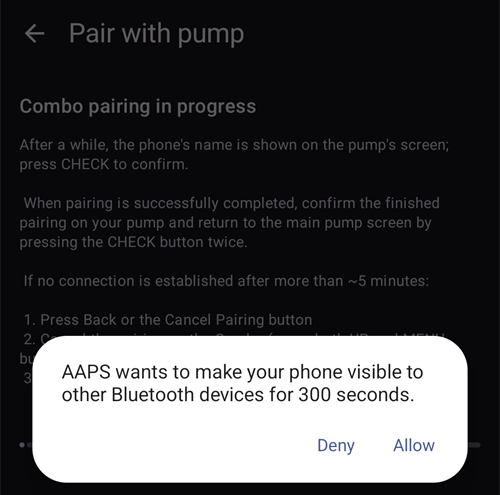

# Accu-Chek Combo

**Bu yazılım bir DIY (Kendin Yap) çözümünün parçasıdır ve bir ürün değildir, ancak nasıl kullanılacağı da dahil olmak üzere sistemi okumanızı, öğrenmenizi ve anlamanızı gerektirir. Tüm diyabet yönetimini sizin için yapan bir şey değildir, ancak gerekli zamanı ayırmaya istekliyseniz diyabetinizi ve yaşam kalitenizi iyileştirmenize izin verir. Acele etmeyin, ancak öğrenmek için kendinize zaman tanıyın. Yazılımla yaptıklarınızdan yalnızca siz sorumlusunuz.**

```{admonition} Accu-Chek Combo is being phased out
:class: note

Roche is withdrawing from the insulin pump market to refocus its diabetes portfolio on the Accu-Chek SmartGuide CGM. It has communicated the end of sales of both the Accu-Chek Combo and Accu-Chek Insight pumps; its remaining Accu-Chek Solo micropump is also being wound down (last deliveries in Germany at the end of 2025). The change is being rolled out by region, starting in Germany, with other European markets expected to follow. If you rely on this pump, plan ahead for a transition to a supported pump.
```

```{contents} Table of contents
:depth: 1
:local: true
```

## Pump capabilities with AAPS

* Communicates with **AAPS** over your phone's native Bluetooth, without an additional communication device.
* Automatic DST and timezone handling.

## Donanım ve yazılım gereksinimleri

* Roche Accu-Chek Combo pompa(tüm pompa yazılımlarında çalışır).
* Pompayı yapılandırmak için 360 Yapılandırma Yazılımı ile birlikte bir Smartpix veya Realtyme cihazı. (Roche, Smartpix cihazlarını ve konfigürasyon yazılımını talep üzerine müşterilerine ücretsiz olarak göndermektedir.)
* A compatible phone running Android 12 or newer. See [release notes](#maintenance-android-version-aaps-version) for details.
* The **AAPS** app installed on your phone.

Bazı telefonlar, Bluetooth desteğinin kalitesine, çok agresif güç tasarrufu mantığına sahip olup olmadıklarına bağlı olarak diğerlerinden daha iyi çalışabilir. A list of phones can be found in the [AAPS Phones](#Phones-list-of-tested-phones) document. Lütfen bunun tüm telefonların bir listesi olmadığını ve kişisel kullanıcı deneyimini yansıttığını unutmayın. Siz de kendi deneyiminizle katılmaya ve böylece başkalarına yardım etmeye teşvik ediliyorsunuz (bu projeler tamamen ileriye dönük ödeme yapılmasıyla ilgilidir).

(combov2-before-you-begin)=
## Başlamadan önce

**ÖNCE GÜVENLİK** - bu işlemi bir hatadan kurtulamayacağınız bir ortamda denemeyin. 360 Konfigürasyon Yazılımı ile birlikte Smartpix / Realtyme cihazınızı el altında bulundurun. Her şeyi ayarlamak ve her şeyin düzgün çalışıp çalışmadığını kontrol etmek için yaklaşık bir saat ayırın.

Aşağıdaki sınırlamaların farkında olun:

* Extended bolus and multiwave bolus are currently not supported (you can use [Extended Carbs](../DailyLifeWithAaps/ExtendedCarbs.md) instead).
* Yalnızca bir temel profil (ilki) desteklenir.
* The lowest basal rate in your **Profile** is 0.05 U/h. **AAPS** refuses a **Profile** with a lower rate. The Combo rounds basal rates to its own steps (0.01 U/h below 1 U/h, 0.05 U/h up to 10 U/h, 0.1 U/h above). **AAPS** uses the rates the pump really gives.
* Temporary basal rates are limited to 500% of the current basal rate. **AAPS** takes this limit into account.
* Pompadaki o anda etkin olan profil, profil no.1 değilse döngü devre dışı bırakılır. This continues until profile no. 1 is made the active one; when that is done, the next time AAPS connects (either on its own after a while or because you tap **Refresh** on the Accu-Chek Combo pump screen), it will notice that profile no. 1 is the current one, and enable the loop again.
* Döngü çalışan bir GBO'nun iptal edilmesini talep ederse, Combo bunun yerine 15 dakika boyunca %90 veya %110'luk bir GBO ayarlayacaktır. Bunun nedeni, bir GBO'nun fiilen iptal edilmesinin pompa üzerinde çok fazla titreşime neden olan bir uyarıya neden olması ve bu titreşimlerin devre dışı bırakılamamasıdır.
* Bluetooth bağlantı kararlılığı, farklı telefonlara göre değişir ve artık pompaya bağlantının kurulmadığı durumlarda "pompaya erişilemiyor" uyarılarına neden olur. If that error occurs, make sure Bluetooth is enabled, tap **Refresh** on the pump screen (**Manage** > **Pump**) to see if this was caused by an intermittent issue and if still no connection is established, reboot the phone which should usually fix this.
* There is another issue where a restart doesn't help but a button on the pump must be pressed (which resets the pump's Bluetooth stack), before the pump accepts connections from the phone again.
* Döngü GBO'ların kontrolünü üstlendiğinden, pompada herhangi bir GBO ayarlamaktan kaçınılmalıdır. Pompada yeni bir GBO'nın algılanması 20 dakika kadar sürebilir ve GBO'nın etkisi yalnızca algılandığı andan itibaren hesaba katılır, bu nedenle en kötü durumda, Aktif İnsüline yansıtılmayan 20 dakikalık bir GBO olabilir.

The driver is currently written to support the following languages on the Combo. (Bunun AAPS program dili ile ilgisi yoktur - Combo pompanızın LCD ekranında gösterilen dildir.)

* İngilizce
* İspanyolca
* Fransızca
* İtalyanca
* Rusça
* Türkçe
* Polonyaca
* Çekçe
* Macarca
* Slovakça
* Romence
* Hırvatça
* Flemenkçe
* Yunanca
* Fince
* Norveçce
* Portekizce
* İsveççe
* Danca
* Almanca
* Slovakça
* Litvanyaca

**Önemli**: Pompanız bu listede olmayan bir dile ayarlanmışsa, lütfen geliştiricilerle iletişime geçin ve pompanın dilini bu listedeki bir dile ayarlayın. Aksi takdirde, sürücü düzgün çalışmayacaktır.

## Telefon Kurulumu

Pil optimizasyonlarının kapalı olduğundan emin olmak çok önemlidir. AAPS, bu optimizasyonlara ne zaman tabi olduğunu zaten otomatik olarak algılar ve kullanıcı arayüzünde bunların kapatılmasını ister. Ancak, modern Android telefonlarda Bluetooth _kendisi_ bir uygulamadır (bir sistem uygulaması). Ve genellikle, bu "Bluetooth uygulaması" _varsayılan olarak pil optimizasyonları açıkken_ çalışır. Sonuç olarak Bluetooth, telefon güç tasarrufu yapmayı amaçladığında Bluetooth uygulamasını kapattığı için yanıt vermeyi reddedebilir. Bu, söz konusu Bluetooth sistem uygulamasının ayarlarında pil optimizasyonlarının da kapatılması gerektiği anlamına gelir. Ne yazık ki, Bluetooth sistem uygulamasının nasıl bulunabileceği telefonlar arasında farklılık gösteriyor. Stok Android'de Ayarlar -> Uygulamalar -> Tüm N uygulamayı görün (N = telefonunuzdaki uygulama sayısı). Ardından, sağ üst köşedeki menüyü açın, "Sistemi göster" veya "Sistem uygulamalarını göster" veya "Tüm uygulamalar" üzerine dokunun. Şimdi, yeni genişletilmiş uygulama listesinde bir "Bluetooth" uygulaması arayın. Onu seçin ve "Uygulama bilgisi" kullanıcı arayüzünde "Pil" üzerine dokunun. Burada, pil optimizasyonlarını devre dışı bırakın (bazen "pil kullanımı" olarak adlandırılır).

## Combo kurulumu

* Accu-Chek 360 Yapılandırma Yazılımını kullanarak pompayı yapılandırın. Yazılıma sahip değilseniz, lütfen Accu-Chek yardım hattınızla iletişime geçin. Genellikle kayıtlı kullanıcılara "360° Pompa Yapılandırma Yazılımı" ve bir SmartPix USB kızılötesi bağlantı cihazı içeren bir CD gönderirler (eğer varsa Realtyme cihazı da çalışır).

  - **Gerekli ayarlar** (ekran görüntülerinde yeşil olarak işaretlenmiştir):

     * Menü yapılandırmasını "Standart" olarak ayarlayın/bırakın; bu yalnızca pompada desteklenen menüleri/eylemleri gösterecek ve desteklenmeyenleri (yayma/çoklu yayma bolus, çoklu bazal oranları) gizleyecektir, bu da kullanıldığında döngü işlevselliğinin kısıtlanmasına neden olur çünkü kullanıldığında döngüyü güvenli bir şekilde çalıştırmak mümkün değildir.
     * _Hızlı Bilgi Metni_'nin "HIZLI BİLGİ" olarak ayarlandığını doğrulayın (tırnak işaretleri olmadan, _İnsülin Pompası Seçenekleri_ altında bulunur).
     * GBO _Maksimum Ayarı_ %500 olarak ayarlayın
     * _Geçici Bazal Oranının Sonu Sinyali_'ni Devre Dışı Bırakın
     * GBO _Süre artışını_ 15 dk olarak ayarlayın
     * Bluetooth'u Etkinleştirin

  - **Önerilen ayarlar** (ekran görüntülerinde mavi olarak işaretlenmiştir)

     * Rezervuar düşük alarmını istediğiniz gibi ayarlayın
     * Yazılımdaki hatalara karşı koruma sağlamak için tedavinize uygun bir maksimum bolus yapılandırın
     * Benzer şekilde, bir koruma olarak maksimum GBO süresini yapılandırın. Pompayı 3 saat ayırma seçeneği 3 saat için %0'ı ayarladığından, en az 3 saat bekleyin.
     * Özellikle pompa daha önce manuel kullanıldığında ve hızlı bolus verme bir alışkanlık olduğunda, pompadan bolus vermeyi önlemek için tuş kilidini etkinleştirin.
     * Ekran zaman aşımını ve menü zaman aşımını sırasıyla minimum 5.5 ve 5 olarak ayarlayın. Bu AAPS'nin hata durumlarından daha hızlı kurtulmasını sağlar ve bu tür hatalar sırasında meydana gelebilecek titreşim sayısını azaltır

  

  

  

  

## Sürücüyü etkinleştirme ve Combo ile eşleştirme

* Open the **menu** (☰) in the top-left corner, go to [**Configuration** > **Pump**](../SettingUpAaps/ConfigBuilder.md) and select **Accu-Chek Combo**.

  

  Once it is selected, the **Accu-Chek Combo** card shows two buttons, **Settings** and **Open plugin**:

  

  **Settings** opens the settings of the Accu-Chek Combo driver (see [Settings](#combov2-preferences) below):

  

  **Open plugin** (or **Manage** > **Pump**) opens the Accu-Chek Combo pump screen. Before a pump is paired it shows **Not paired to a pump**:

  

* On the pump screen, tap **Pairing**. The **Pair with pump** screen opens. Follow the steps shown on screen, then tap **Start pairing**. When Android asks for permission to make the phone visible to other Bluetooth devices, tap **Allow**. Eventually, the Combo shows a 10-digit pairing PIN on its screen, and **AAPS** asks for it. Enter that PIN in the **10-digit PIN** field.

  

  

  

  The next pictures are from an older **AAPS** version. The steps and texts are the same, but the screens look slightly different.

  

  

  

* If the PIN is entered incorrectly, **AAPS** shows **PIN did not work. Check if there was a typo. If this keeps happening, cancel and retry pairing.**

  

* When **Successfully paired with Combo** is shown, tap **OK**. You return to the pump screen, which now shows the pump status (see [Accu-Chek Combo pump screen contents](#combov2-tab-contents) below). The **Pairing** button is replaced by **Unpair**.

* Kurulumunuzu doğrulamak için (güvenli olması için pompanın herhangi bir kanülden **bağlantısı kesilerek**!) AAPS'i kullanarak 15 dakika boyunca %500'lük bir GBO ayarlayın ve bir bolus verin. Pompanın şimdi çalışan bir GBO'su ve geçmişte bolus olması gerekir. AAPS ayrıca aktif GBO'yu ve iletilen bolusu göstermelidir.

* Combo'da pompada özellikle bolusu önlemek için tuş kilidinin etkinleştirilmesi önerilir. Özellikle pompa daha önce manuel kullanıldığında ve hızlı bolus verme bir alışkanlık olduğunda.

## Eşleştirme hakkında notlar

Accu-Chek Combo, Bluetooth 4.0 piyasaya sürülmeden önce ve ilk Android sürümünün piyasaya sürülmesinden sadece bir yıl sonra geliştirildi. Bu nedenle, diğer cihazlarla eşleştirme yöntemi, bugün Android'de yapıldığı şekliyle %100 uyumlu değildir. Bunun üstesinden gelmek için AAPS'in yalnızca sistem uygulamaları için mevcut olan sistem düzeyinde izinlere ihtiyacı olacaktır. Bunlar, telefon üreticileri tarafından telefona yüklenir - kullanıcılar sistem uygulamalarını yükleyemez.

The consequence of this is that pairing will never be 100% without problems. Özellikle eşleştirme sırasında, Android'in Bluetooth PIN iletişim kutusu kısa bir süreliğine görünebilir ve otomatik olarak kaybolabilir. Ancak bazen ekranda kalıyor ve 4 haneli bir PIN istiyor. (Bu, 10 haneli Combo eşleştirme PIN'i ile karıştırılmamalıdır.) Hiçbir şey girmeyin, sadece iptal düğmesine basın. Eşleştirme devam etmezse, eşleştirme girişimini yeniden denemek için ekrandaki talimatları izleyin.

(combov2-tab-contents)=
## Accu-Chek Combo pump screen contents

To open the pump screen, go to **Manage** > **Pump**. Once a pump is paired, it shows the following information (items are listed from top to bottom):


1. **Driver state**: The driver can be in one of the following states:
   - **Disconnected**: There is no Bluetooth connection; the driver is in this state most of the time, and only connects to the pump when needed - this saves power
   - **Connecting**
   - **Checking pump**: the pump is connected, but the driver is currently performing safety checks to ensure that everything is OK and up to date
   - **Ready**: the driver is ready to accept commands from AAPS
   - **Suspended**: the pump is suspended (shown as "stopped" in the Combo)
   - A description of the command being executed, for example **Setting basal profile** or **Updating pump status**
   - **Error**: an error occurred; the connection was terminated, any ongoing command was aborted
2. **Last connection**: How many minutes ago the driver successfully connected to the Combo; if this goes beyond 30 minutes, this item is shown with a red color
3. **Battery**: Battery level; the Combo only indicates **Full**, **Low** or **Empty**, and does not offer anything more accurate (like a percentage), so only these three levels are shown here
4. **Reservoir**: How many IU are currently in the Combo's reservoir
5. **Last bolus**: How many minutes ago the last bolus was delivered; if none was delivered yet after AAPS was started, this is not shown
6. **Temp basal**: Details about the currently active temporary basal; if none is currently active, this is not shown
7. **Base basal rate**: Currently active base basal rate ("base" means the basal rate without any active TBR influencing the basal rate factor)
8. **Serial number**: Combo serial number as indicated by the pump (this corresponds to the serial number shown on the back of the Combo)
9. **Bluetooth address**: The Combo's 6-byte Bluetooth address, shown in the `XX:XX:XX:XX:XX:XX` format

While the driver is doing something (for example, setting a basal profile), a box below the list describes the current activity, with a thin progress bar showing the progress.

Combo, Bluetooth aracılığıyla _uzak terminal_ modunda veya _komut_ modunda çalıştırılabilir. Uzak terminal modu, pompanın LCD ekranını ve dört düğmeyi taklit eden Combo sayacındaki "uzaktan kumanda modu"na karşılık gelir. Komut modunda karşılıkları olmadığı için bazı komutların sürücü tarafından bu modda gerçekleştirilmesi gerekir. Bu ikinci mod çok daha hızlıdır, ancak söylendiği gibi kapsamı sınırlıdır. When the remote-terminal mode is active, the current remote-terminal screen is shown in the field that is located just above the Combo drawing. Ancak sürücü komut moduna geçtiğinde bu alan boştur.

(You do not influence this; the driver fully decides on its own what mode to use. This is merely a note for you to know why sometimes you can see Combo frames in that field.)

At the bottom, there are these buttons:

- **Refresh**: Triggers an immediate pump status update. It is also used to let AAPS know that a previously discovered error is now fixed and that AAPS can check again that everything is OK (more on that below in [the section about alerts](#combov2-alerts)). You can only tap it when the driver is disconnected, suspended or in the error state.
- **Unpair**: Unpairs the paired Combo from **AAPS** and Android, after you confirm **Do you really want to unpair the pump?**. When no pump is paired, this button is replaced by **Pairing**.

(combov2-preferences)=
## Ayarlar

These settings are available for the Combo driver (**Configuration** > **Pump** > **Accu-Chek Combo** > **Settings**, or the settings icon (cog wheel) on the pump screen). Items are listed from top to bottom:

1. **Discovery duration (in seconds)**: When pairing, the driver makes the phone discoverable by the pump. Bu keşfedilebilirliğin ne kadar süreceğini kontrol eder. Varsayılan olarak maksimum (300 saniye = 5 dakika) seçilidir. Android, keşfedilebilirliğin süresiz olarak devam etmesine izin vermez, bu nedenle bir süre seçilmelidir.
2. **Autodetect and automatically enter insulin reservoir change**: If enabled, the driver enters the "reservoir change" that you would normally enter yourself with **Manage** > **Prime/Fill**. This is explained [in further detail below](#combov2-autodetections).
3. **Autodetect and automatically enter battery change**: If enabled, the driver enters the "battery change" that you would normally enter yourself with **Manage** > **Pump Battery Change**. This is explained [in further detail below](#combov2-autodetections).
4. **Enable verbose Combo logging**: This greatly expands the amount of logging done by the driver. **DİKKAT**: Bir geliştirici tarafından istenmedikçe bunu etkinleştirmeyin. Otherwise, this can add a lot of noise to **AAPS** logs and lessen their usefulness.

Pairing and unpairing are done on the pump screen, not in the settings (see above).

(combov2-autodetections)=
## Pil ve rezervuar değişikliklerini otomatik algılama ve otomatik olarak girme

Sürücü, pil ve rezervuar seviyelerini takip ederek akü ve rezervuar değişikliklerini tespit edebilir. Pompa durumu son güncellendiğinde pil seviyesi Combo tarafından düşük olarak bildirildiyse ve yeni pompa durumu güncellemesi sırasında pil seviyesi normal görünüyorsa, sürücü kullanıcının pili değiştirmiş olması gerektiği sonucuna varır. Rezervuar seviyesi için de aynı mantık kullanılır: Şimdi öncekinden daha yüksekse, bu rezervuar değişikliği olarak yorumlanır.

Bu yalnızca, pil ve rezervuar seviyelerinin düşük olarak bildirildiği durumlardan sonra değişim yapılıp _ve_ batarya ve rezervuarın da yeterince dolu olduğu durumlarda çalışır.

These autodetections can be turned off in the driver [settings](#combov2-preferences).

(combov2-alerts)=
## Alarmlar (uyarılar ve hatalar) ve bunların nasıl işlendiği

Combo uyarıları uzak terminal ekranları olarak gösterilir. Warnings are shown with a "Wx" code (x is a digit), along with a short description. Bir örnek "W7", "GBO OVER". Hatalar benzerdir ancak bunun yerine bir "Ex" koduyla gösterilir.

Belirli uyarılar sürücü tarafından otomatik olarak reddedilir. Bunlar:

- W1 "reservoir low" : the driver turns this into a "low reservoir" warning that is shown on the AAPS main screen
- W2 "battery low" : the driver turns this into a "low battery" warning that is shown on the AAPS main screen
- W3, W6, W7, W8 : bunların tümü kullanıcı için tamamen bilgi amaçlıdır, bu nedenle sürücünün bunları otomatik olarak reddetmesi güvenlidir

Diğer uyarılar otomatik olarak _yok sayılmaz_. Ayrıca, hatalar _asla_ otomatik olarak reddedilmez. Bunların her ikisi de aynı şekilde ele alınır: Sürücünün AAPS Kullanıcı Arabirimi üzerinde bir uyarı iletişim kutusu oluşturmasına ve ayrıca devam eden herhangi bir komut yürütmeyi iptal etmesine neden olurlar. The driver then switches to the "error" state (see [the Accu-Chek Combo pump screen contents above](#combov2-tab-contents)). Bu durum, herhangi bir komut yürütülmesine izin vermez. Kullanıcının pompadaki hatayı halletmesi gerekir; örneğin, bir tıkanma hatası sebebiyle kanülün değiştirilmesini gerekebilir. Once the user took care of the error, normal operation can be resumed by tapping **Refresh** on the Accu-Chek Combo pump screen. Sürücü daha sonra Combo'ya bağlanır ve durumunu günceller, ekranda hala bir hata gösterilip gösterilmediğini vb. kontrol eder. Ayrıca, sürücü bir süre sonra pompa durumunu otomatik olarak yeniler, bu nedenle bu butona manuel olarak basmak zorunlu değildir.

Bolus özel bir durumdur. Bir uyarının göründüğünü bolus ortasında rapor etmeyen Combo'nun komut modunda yapılır. Sonuç olarak, sürücü bir bolus _sırasında_ uyarıları otomatik olarak kapatamaz. Bu ne yazık ki, bolus bitene kadar pompanın bip sesi çıkaracağı anlamına gelir. En yaygın bolus ortası uyarısı tipik olarak W1 "rezervuar düşük" uyarısıdır. **Don't** dismiss Combo warnings on the pump itself manually during a bolus. Bolusu kesintiye uğratma riskiniz vardır. Bolus bittiğinde sürücü uyarıyı dikkate alacaktır.

Sürücü Combo'ya bağlı değilken meydana gelen uyarılar, sürücü tarafından fark edilmeyecektir. Combo'nun bu uyarıyı otomatik olarak telefona göndermesinin bir yolu yoktur; bağlantıyı her zaman telefonun başlatması gerekir. Sonuç olarak, sürücü pompaya bağlanana kadar uyarı devam eder. You can tap **Refresh** on the pump screen to trigger a connection and let the driver handle the alert right then and there (instead of waiting until AAPS itself decides to initiate a connection).

**ÖNEMLİ**: Bir hata oluşursa veya otomatik olarak kapatılanlardan biri olmayan bir alarm görüntülenirse, sürücü hata durumuna geçer. Bu durumda, pompa durumu yenilenene kadar döngü **DEVRE DIŞI OLACAKTIR**! It is unblocked after the pump status is updated (either by tapping **Refresh** or by the driver's eventual auto-update) and no error is shown anymore.

## Combo kullanırken dikkat edilmesi gerekenler

* Özellikle bu sürücünün bir ürün olmadığını unutmayın. Başlarken, kullanıcının sistemi, sınırlamalarını ve başarısız olabileceğini izlemesi ve anlaması gerekir. Kullanan kişi sistemi tam olarak anlayamamışsa bu sistemi KULLANMAMANIZ şiddetle tavsiye edilir.
* Combo'nun uzaktan kumanda işlevselliğinin çalışma şekli nedeniyle, bazı işlemler (özellikle bazal profili ayarlamak) diğer pompalara kıyasla yavaştır. Bu, Combo'nun üstesinden gelinemeyecek talihsiz bir sınırlamasıdır.
* Pompa üzerinden bir GBO (geçici bazal oran) ayarlamayın veya iptal etmeyin. Döngü, GBO'nun kontrolünü programda üstlenir. Aksi takdirde kullanıcı tarafından pompada ayarlanan bir GBO'nun başlangıç zamanını belirlemek mümkün olmadığından güvenilir şekilde çalışamaz.
* AAPS pompa ile iletişim kurarken pompa üzerinde herhangi bir düğmeye basmayın (AAPS bağlandığında pompada Bluetooth logosu görünür). Bunu yapmak, Bluetooth bağlantısını kesecektir. Only do that if there are problems with establishing a connection (see [the "Before you begin" section above](#combov2-before-you-begin)).
* Pompa bolus yaparken herhangi bir butona basmayın. Özellikle uyarıları pompa butonlarına basarak kapatmaya çalışmayın. See [the section about alerts](#combov2-alerts) for a more detailed explanation why.

## Combo ile bağlantı kurulamadığında kontrol listesi

Sürücü, Combo'ya bağlanmak için elinden gelenin en iyisini yapıyor ve güvenilirliği en üst düzeye çıkarmak için birkaç numara kullanıyor. Yine de bazen bağlantı kurulamayabilir. İşte bu durumu düzeltmek için atmanız gereken bazı adımlar.

1. Combo'da bir düğmeye basın. Bazen, Combo'nun Bluetooth aygıtı yanıt vermemeye başlar ve artık bağlantıları kabul etmez. Combo üzerindeki bir düğmeye basıp LCD'nin bir şey göstermesini sağlayarak, Bluetooth aygıtı sıfırlanır. Çoğu zaman bağlantı sorunlarını çözmek için gereken tek adım budur.
2. Telefonunuzu yeniden başlatın. Telefonun Bluetooth bağlantısıyla ilgili bir sorun varsa bu gerekli olabilir.
3. Combo'nun pil kapağı eskiyse değiştirmeyi düşünün. Eski pil kapakları, Combo'nun güç kaynağında Bluetooth'u etkileyen sorunlara neden olabilir.
4. Bağlantı denemeleri hala başarısız oluyorsa, eşleştirmeyi kaldırıp ardından pompayı yeniden eşleştirmeyi deneyebilirsiniz.

(combov2-tips-for-basic-usage)=
## Tips for basic usage

### How to ensure smooth operations

* Always **carry the smartphone with you**, leave it next to your bed at night. As your pump may lay behind or under your body while you sleep, a higher position (on a shelf or board) works best.
* Always make sure that the pump battery is as full as possible. See the battery section for tips regarding the battery.
* Whenever possible, only operate the pump via the AAPS app. To facilitate this, activate the key lock on the pump under **PUMP SETTINGS / KEY LOCK / ON**. Only when changing the battery or the cartridge, it is necessary to use the pump's keys.


### Pump not reachable. What to do?

#### Activate pump unreachable alarm
* In **AAPS**, tap the **Settings** (gear) icon at the top right of the main screen, go to **Local alerts**, activate **Alert if pump is unreachable** and set **Pump unreachable threshold** to **31** minutes.
* This will give you enough time to not trigger the alarm when leaving the room while your phone is left on the desk, but informs you if the pump cannot be reached for a time that exceeds the duration of a temporary basal rate.

#### Restore reachability of the pump

* When AAPS reports a **pump unreachable** alarm, first release the keylock and **press any key on the pump** (e.g. "down" button). As soon as the pump display has turned off, tap **Refresh** on the Accu-Chek Combo pump screen (**Manage** > **Pump**). Mostly then the communication works again.
* If that does not help, reboot your smartphone. After the restart, AAPS will be reactivated and a new connection will be established with the pump.

* The tests with different smartphones have shown that certain smartphones trigger the "pump unreachable" error more often than others. See [AAPS Phones](#Phones-list-of-tested-phones) for successfully tested smartphones.

#### Root causes and consequences of frequent communication errors
* On phones with **low memory** (or **aggressive power-saving** settings), AAPS is often shut down. You can tell by the fact that the treatment buttons (QuickLaunch toolbar) on the main screen are not shown when opening AAPS because the system is initializing. This can trigger "pump unreachable alarms" at startup. In the **Last connection** field of the pump screen (**Manage** > **Pump**), you can check when AAPS last communicated with the pump.


* This error can drain the pump's battery faster because the basal profile is read from the pump when the app is restarted.
* It also increases the likelihood of causing the error that causes the pump to reject all incoming connections until a button on the pump is pressed.

### Cancellation of temporary basal rate fails
* Occasionally, AAPS cannot automatically cancel a **TBR CANCELED** alert. Then you have to either tap **Refresh** on the Accu-Chek Combo pump screen or the alarm on the pump will need to be confirmed.

### Pump battery considerations

#### Changing the battery
* After a **low battery** alarm, the battery should be changed as soon as possible to always have enough energy for a reliable Bluetooth communication with the smartphone, even if the phone is within a wider distance of the pump.
* Even after a **low battery** alarm, the battery might be used for a significant amount of time. However, it is recommended to always have a fresh battery with you after a "low battery" alarm rang.
* Before changing the battery, press on the **Loop** symbol on the main screen and select **Suspend loop** for 1 hour.
* Wait for the phone to communicate with the pump and for the Bluetooth logo on the pump to fade.


* Release the key lock on the pump, put the pump into stop mode, confirm a possibly canceled temporary basal rate, and change the battery quickly.
* You don't need to re-set the pump's clock after the battery change: AAPS automatically updates the pump's date and time.
* Then put the pump back in run mode and select **Resume** when pressing on the **Suspended Loop** icon on the main screen.
* AAPS will re-set a necessary temporary basal rate with the arrival of the next blood sugar value.

(Accu-Chek-Combo-Tips-for-Basic-usage-battery-type-and-causes-of-short-battery-life)=
#### Battery type and causes of short battery life
* As intensive Bluetooth communication consumes a lot of energy, only use **high-quality batteries** like Energizer Ultimate Lithium, the "power one"s from the "large" Accu-Chek service pack, or if you are going for a rechargeable battery, use Eneloop batteries.

 

Ranges for typical life time of the different battery types are as follows:
* **Energizer Ultimate Lithium**: 4 to 7 weeks
* **Power One Alkaline** (Varta) from the service pack: 2 to 4 weeks
* **Eneloop rechargeable** batteries (BK-3MCCE): 1 to 3 weeks

If your battery life is significantly shorter than the ranges given above, please check the following possible causes:
* There are some variants of the screw-on battery cap of the Combo pump, which partially short circuit the batteries and drain them quickly. The caps without this problem can be recognized by the golden metal contacts.
* If the pump clock does not "survive" a short battery change, it is likely that the capacitor is broken which keeps the clock running during a brief power outage. In this case, a replacement of the pump by Roche might help, which is not a problem during the warranty period.
* The smart phone hardware and software (Android operating system and Bluetooth stack) also impact the battery lifetime of the pump, even though the exact factors are not completely known yet. If you have the opportunity, try another smartphone and compare battery lifetimes.

### Extended bolus, multiwave bolus
The OpenAPS algorithm does not support a parallel extended bolus or multiwave bolus. But a similar treatment can be achieved by the following alternatives:
* Use **e-Carbs** when entering carbs or using the Bolus wizard by entering the carbs of the full meal and the duration you expect the carbs to arrive as glucose in your blood. The system will then calculate small carbs equally distributed over the whole duration which will cause the algorithm to provide equivalent insulin dosing while still permanently checking the overall rise/decrease of the blood glucose level. For a multiwave bolus approach, you can also combine a smaller immediate bolus with e-carbs.
* Before eating, set a temporary **Eating Soon** target with glucose 80 for several hours (press the target on the main screen, or **Manage** > **Temp Target**). The duration should be based on the interval you would choose for an extended bolus. This will keep your target lower than usual and therefore increase the amount of insulin delivered.
* Then use the **Bolus wizard** to enter the full carbs of the meal, but do not directly apply the values it suggests. If a multiwave-like bolus is to be delivered, correct the insulin dosage down. Depending on the meal, the algorithm now has to deliver additional SMBs or higher temporary basal rates to counteract the increase in blood sugar. Here, the safety limitation of the basal rate (Max U/h, Maximum basal IOB) should be very carefully experimented with and, if necessary, temporarily changed.

* Don't use the extended or multiwave bolus directly on the pump. The driver does not support them (see [Before you begin](#combov2-before-you-begin)); if a multiwave bolus is given on the pump anyway, **AAPS** records it from the pump history as a normal bolus plus an extended bolus, so it is counted in IOB. An extended bolus does not work in a closed loop environment (see [this page](#extended-bolus-and-why-they-wont-work-in-closed-loop-environment) for details).

### Alarms at bolus delivery
* After each bolus, the driver reads the pump's bolus history. This is a safety mechanism to correctly calculate insulin on board (IOB), even when a bolus is delivered directly from the pump.
* Before a bolus, if the pump history has a bolus that **AAPS** did not know about (for example, a bolus given directly on the pump), the requested bolus is **not given**, because it was calculated without that insulin. **AAPS** shows **The pump history has a bolus that AAPS did not know about. The requested bolus was not given...** Check the bolus history on the pump and your IOB. If a bolus is still needed, calculate it again. This also applies when the unknown bolus is found on a new connection.
* If the bolus was given but the pump history also had other boluses that **AAPS** did not know about, they are recorded now and **AAPS** asks you to check IOB before the next bolus.
* If the connection to the pump is lost **during** a bolus, **AAPS** does not record 0 U: it shows how much the pump had given by then and warns that the pump may still give the rest. **Do not bolus again.** **AAPS** reads the real amount from the pump history at the next connection.
* If the connection is lost while **AAPS** sends the bolus, it is not known whether the pump got it. Check the bolus history on the pump before the next bolus.
* If **AAPS** cannot confirm that a bolus was delivered, it shows **Bolus delivery failed. It appears no bolus was delivered. To be sure, please check the pump to avoid a double bolus and then bolus again.** Boluses are never retried automatically.

## Where to get help

Development of the Combo driver is done by the community on a **volunteer** basis. Before requesting help, please:

1. **Read** the relevant section of this documentation to confirm how the feature is meant to work.
2. **Ask** on the *#AAPS* channel on [Discord](https://discord.gg/4fQUWHZ4Mw), or in one of the other [community channels](../GettingHelp/WhereCanIGetHelp.md).
3. **Report a bug** by searching the [existing issues](https://github.com/nightscout/AndroidAPS/issues); if yours is not listed, open a [new issue](https://github.com/nightscout/AndroidAPS/issues) and attach your [log files](../GettingHelp/AccessingLogFiles.md).

When asking for help, include your phone make and model, Android version, **AAPS** version, and a plain-English description of the problem (what changed, when it last worked).
