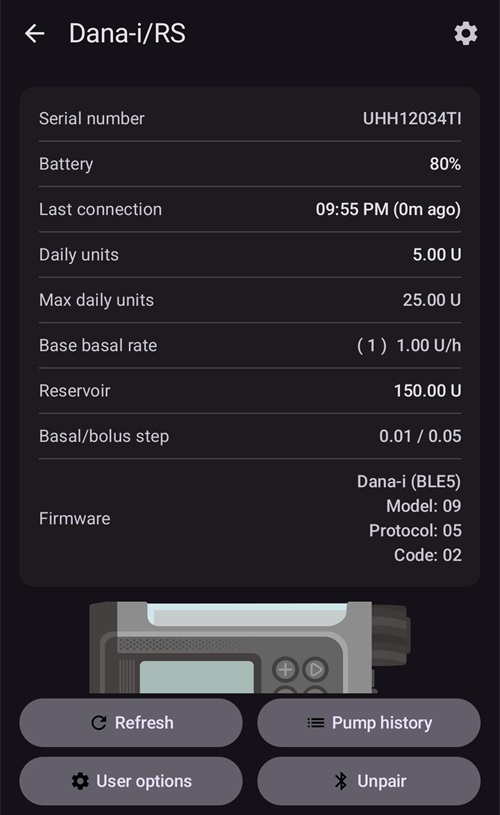

# DanaRS, Dana-i ve Dana-i2

*Bu talimatlar, 2017 ve sonrası bir DanaRS, bir Dana-i veya bir Dana-i2 pompanız varsa uygulamayı ve pompanızı yapılandırmak içindir. Bunun yerine orijinal DanaR pompanız varsa [DanaR İnsülin Pompası](./DanaR-Insulin-Pump.md) sayfasına bakın.*

**Dana-i2, AAPS 4.0 sürümünden itibaren kullanılabilir.** Dana-i ile aynı **Dana-i/RS** sürücüsünü kullanır.

* DanaRS/i/i2 pompasında uygulama "BASAL A" profilini kullanır. Mevcut veriler üzerine yazılır.

    {contents} İçindekiler
    :depth: 1
    :local: true

## AAPS ile pompa özellikleri

* Ek bir iletişim cihazı olmadan, telefonunuzun yerleşik Bluetooth'u üzerinden **AAPS** ile iletişim kurar.
* Yaz saati (DST) ve saat dilimi değişiklikleri elle yapılmalıdır (bkz. [Saat dilimi değiştirerek seyahat](#timezone-traveling-danarv2-danars)).

(DanaRS-Insulin-Pump-pairing-pump)=

## Pompa eşleştirme

* **AAPS** ana ekranının sol üst köşesindeki **menüyü** (☰) açın ve **Konfigürasyon** seçeneğini seçin.
* **Pompa** seçeneğine dokunun ve **Dana-i/RS** seçeneğini seçin.
    
    
    
    Seçildikten sonra **Dana-i/RS** kartında iki düğme görünür: **Ayarlar** ve **Eklentiyi aç**:
    
    
    
    **Ayarlar**, Dana-i/RS sürücüsünün ayarlarını açar:
    
    
    
    **Eklentiyi aç** (veya **Yönet** > **Pompa**), Dana-i/RS pompa ekranını açar. Pompa eşleştirilmeden önce ekran şöyle görünür:
    
    

* Pompa ekranında **Eşleştirme** düğmesine dokunun. **AAPS** yakındaki pompaları tarar.

* Listede pompanızın kaydına dokunun.
    
    

* **Eşleştirmeyi pompada onaylamanız gerekir!** Bu, bildiğiniz diğer Bluetooth eşleştirmeleriyle aynı şekilde çalışır (örneğin akıllı telefon ve araba ses sistemi).
    
    

* Pompanızın tipine ve yazılımına göre eşleştirme sürecini takip edin:
    
    * DanaRS v1 için **AAPS**, **Pompa şifresi (yalnızca v1)** ister. Pompa parolanızı girin (bkz. [Varsayılan parola](#DanaRS-Insulin-Pump-default-password)).
    * DanaRS v3 için **AAPS**, pompada OK düğmesine basmanızı ve pompada gösterilen 2 sayı ve harf dizisini yazmanızı ister. İşiniz bitene kadar eksi düğmesine basarak pompa ekranını açık tutun. Ardından **Tamam** düğmesine dokunun.
    * Dana-i ve Dana-i2 için standart Android eşleştirme penceresi açılır. Pompada gösterilen 6 haneli sayıyı girin.

* **Eşleştirme başarılı!** yazısı görününce **Tamam** düğmesine dokunun.
    
    
    
    Pompa ekranına geri dönersiniz; bu ekran artık pompanızın durumunu gösterir.
    
    

* Varsayılan bolus hızını (12 sn/Ü, 30 sn/Ü veya 60 sn/Ü) değiştirmek için **Ayarlar** içinde **Bolus hızı** seçeneğini seçin.

* Doktor menüsünü kullanarak pompadaki bazal adımını 0,01 Ü/sa olarak ayarlayın (pompa kullanım kılavuzuna bakın).
* Doktor menüsünü kullanarak pompadaki bolus adımını 0,05 Ü olarak ayarlayın (pompa kullanım kılavuzuna bakın). **AAPS** bazal ve bolus adımlarını pompadan okur ve her bolus için kullanır; böylece bolus her zaman pompada ayarlanan adıma uyar. Pompa ekranı bunları **Bazal/bolus adımı** satırında gösterir.
* Pompada yayma bolusları etkinleştir

### Yalnızca bazı modellerde gösterilen seçenekler

* **Otomatik Kilit**: Dana-i2'de **Kullanıcı seçenekleri** ekranında (pompa ekranında, **Yönet** > **Pompa**) pompanın otomatik kilit ayarı için bir **Otomatik Kilit** anahtarı vardır. Değiştirdikten sonra **Seçenekleri pompaya kaydet** düğmesine basın.
* **Kolay mod**: Kolay menü modu olan pompa modellerinde pompa ekranı **Açık** veya **Kapalı** değerli bir **Kolay mod** satırı gösterir.
* Bir Dana-i2 bolusu reddederse **AAPS** nedenini gösterir, örneğin *Pompa hazırlanmamış*, *Rezervuarda yeterli insülin yok* veya *Pompada Easy sleep modu açık*.

(DanaRS-Insulin-Pump-default-password)=

### Varsayılan parola

* Pompa yazılımı v1 ve v2'ye sahip DanaRS için varsayılan parola 1234'tür.
* v3 cihaz yazılımlı DanaRS veya Dana-i'ye sahip olanlar için varsayılan parola üretim tarihinden çıkarılır ve MMDD olarak hesaplanır; burada MM ay, DD ise pompanın üretildiği gündür (yani '0124', 01. ayı ve 24. günü temsil eder).
    
    * MAIN MENU'den REVIEW'u seçin, ardından alt menüden SHIPPING INFORMATION'ı açın
    * 3 numara üretim tarihidir. 
    * v3/i için bu parola sadece pompada menüyü kilitlemek için kullanılır. İletişim için kullanılmaz ve AAPS'e girilmesi gerekmez.

(DanaRS-Insulin-Pump-change-password-on-pump)=

## Pompa parolasını değiştirme

* Pompadaki OK düğmesine basın
* Ana menüde "OPTION" (seçenek) öğesini seçin (sağ ok düğmesine birkaç kez basarak sağa hareket edin)
    
    

* Seçenekler menüsünde "USER OPTION" (kullanıcı seçeneği) öğesini seçin
    
    

* Ok düğmesiyle aşağı inerek "11. password" seçeneğine gidin
    
    

* Eski parolayı girmek için OK düğmesine basın.

* **Eski parolayı** girin (varsayılan parola için [yukarıya](#DanaRS-Insulin-Pump-default-password) bakın) ve OK düğmesine basın
    
    

* Buraya yanlış parola girilirse, başarısız olduğunuzu belirten bir mesaj almayacaksınız!

* **Yeni parola** belirleyin (+ & - düğmeleriyle sayıları değiştirin / sağa gitmek için sağ ok butonuna basın).
    
    

* OK butonu ile onaylayın.

* Ayarı kaydetmek için OK'e basın.
    
    

* Aşağı inerek "14. EXIT" seçeneğine gelin ve çıkmak için OK düğmesine basın.
    
    

(DanaRS-Insulin-Pump-dana-rs-specific-errors)=

## Dana RS'e özgü hatalar

### İnsülin iletimi sırasında hata

Bolus insülin iletimi sırasında AAPS ile Dana RS arasındaki bağlantının kesilmesi durumunda (yani, Dana RS insülin iletirken telefondan uzaklaşırsanız) bir mesaj görecek ve bir alarm sesi duyacaksınız.

* Çoğu durumda bu sadece bir iletişim sorunudur ve doğru miktarda insülin verilir.
* Doğru bolusun verildiğini pompa geçmişinden kontrol edin. Bunu pompanın kendisinde veya **AAPS**'te pompa ekranında (**Yönet** > **Pompa**) > **Pompa geçmişi** > **Boluslar** bölümünde yapabilirsiniz.
* İsterseniz hatalı kaydı [tedaviler](#screens-bolus-carbs) içinden silin.
* Gerçek miktar bir sonraki bağlantıda okunur ve kaydedilir. Bunu hemen yaptırmak için pompa ekranında **Yenile** düğmesine dokunun veya bir sonraki bağlantıyı bekleyin.

## Telefon değiştirirken özel not

Yeni bir telefona geçerken aşağıdaki adımları yapmanız gerekir:

* Eski telefonunuzda [ayarları dışa aktarın](../Maintenance/ExportImportSettings.md)
* Ayarları eski telefondan yeni telefona aktarın

### DanaRS v1

* Dana RS'i yeni telefonla **manuel olarak eşleştirin**
* İçe aktarırken **Pompa ayarlarını da değiştir** seçeneğini işaretlerseniz pompa bağlantı ayarları da içe aktarılır ve yeni telefonunuzdaki AAPS pompayı zaten "tanır", bu yüzden Bluetooth taraması başlatmaz. Bu nedenle yeni telefon ve pompa manuel olarak eşleştirilmelidir.
* AAPS'i yeni telefona yükleyin.
* Yeni telefonunuzda [ayarları içe aktarın](../Maintenance/ExportImportSettings.md)

### DanaRS v3, Dana-i, Dana-i2

* Eşleştirme işlemini [yukarıda](#DanaRS-Insulin-Pump-pairing-pump) anlatıldığı gibi başlatın.
* Bazen önce **AAPS**'teki eşleştirme bilgilerini silmeniz gerekebilir. Pompa ekranında (**Yönet** > **Pompa**) **Eşleşmeyi Kaldır** düğmesine dokunun ve **Eşleştirme bilgileri sıfırlansın mı?** sorusunu onaylayın. Ardından yeniden **Eşleştirme** düğmesine dokunun.

## DanaRS, Dana-i ve Dana-i2 pompalarıyla saat dilimi değiştirerek seyahat

Saat dilimleri arasında seyahat hakkında bilgi için [Pompalarla saat dilimi değiştirerek seyahat](#timezone-traveling-danarv2-danars) bölümüne bakın.

## Nereden yardım alabilirsiniz?

DanaRS/Dana-i/Dana-i2 sürücüsünün geliştirilmesi topluluk tarafından **gönüllü** olarak yapılır. Yardım istemeden önce lütfen:

1. Özelliğin nasıl çalışması gerektiğini doğrulamak için bu dokümantasyonun ilgili bölümünü **okuyun**.
2. [Discord](https://discord.gg/4fQUWHZ4Mw)'daki *#AAPS* kanalında veya diğer [topluluk kanallarından](../GettingHelp/WhereCanIGetHelp.md) birinde **sorun**.
3. [Mevcut sorunlar](https://github.com/nightscout/AndroidAPS/issues) arasında arama yaparak **bir hata bildirin**; sizinki listede yoksa [yeni bir sorun (issue)](https://github.com/nightscout/AndroidAPS/issues) açın ve [günlük dosyalarınızı](../GettingHelp/AccessingLogFiles.md) ekleyin.

Yardım isterken telefonunuzun markasını ve modelini, Android sürümünü, **AAPS** sürümünü ve sorunun sade bir açıklamasını (ne değişti, en son ne zaman çalıştı) ekleyin.