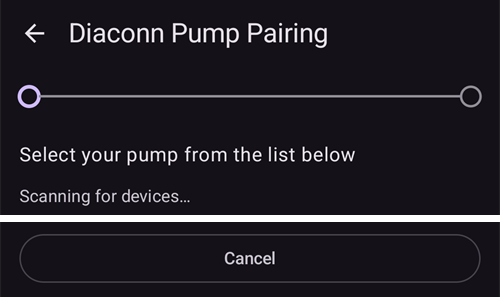
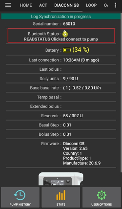

# Diaconn G8

```{contents} Table of contents
:depth: 1
:local: true
```

## AAPS ile pompa özellikleri

* **AAPS** ile telefonunuzun yerleşik Bluetooth'u üzerinden, ek bir iletişim cihazı olmadan iletişim kurar.
* Yaz saati (DST) ve saat dilimi değişiklikleri elle yapılmalıdır.

## İnsülin Pompası Bluetooth Eşleştirme

- Sol üst köşedeki **menüye** (☰) dokunun.


- **Konfigürasyon** > **Pompa** seçeneğine dokunun ve **Diaconn G8**'i seçin.


Seçildikten sonra **Diaconn G8** kartında iki düğme görünür: **Ayarlar** ve **Eklentiyi aç**:


**Ayarlar**, Diaconn G8 sürücüsünün ayarlarını açar (aşağıda [Diaconn G8 insülin pompası seçenek ayarları](#diaconn-g8-insulin-pump-option-setting) bölümüne bakın).

**Eklentiyi aç** (veya **Yönet** > **Pompa**), Diaconn G8 pompa ekranını açar. Pompa eşleştirilmeden önce ekran şöyle görünür:


```{admonition} Older screenshot
:class: note
Yukarıdaki ekran görüntüsü eski bir **AAPS** sürümüne aittir. **AAPS** 4'te eşleştirme, pompa ekranındaki **Eşleştir** düğmesiyle başlar; **Seçilen pompa** ayarı yoktur.
```

- Pompa ekranında **Eşleştir** düğmesine dokunun. **Diaconn Pompa Eşleştirme** ekranı açılır ve **AAPS** yakındaki pompaları arar.
- İnsülin pompanızın model numarası listede görünce ona dokunun (örneğin **DIACONN-65010**).



- Model numaranızı kontrol etmek için iki seçenek vardır:

1. Pompanın arkasındaki SN numarasının son 5 hanesi.
2. Pompada O düğmesine basın > Information > BLE > son 5 hane.


- Pompanızı seçtikten sonra PIN kodu isteyen bir pencere açılır. Bağlantıyı tamamlamak için pompanızda gösterilen PIN numarasını girin.

 

- **Eşleştirme başarılı!** mesajı görünce pompa ekranına dönmek için **Tamam** düğmesine dokunun.

## Pompa durum kontrolü ve günlük senkronizasyonu

- Pompanız bağlandıktan sonra pompa ekranını açın (**Yönet** > **Pompa**). Bu ekran pompanın durumunu gösterir (pil, rezervuar, son bağlantı, son bolus, bazal oran ve diğerleri).
- Pompaya bağlanmak, durumu güncellemek ve günlükleri senkronize etmek için **Yenile** düğmesine dokunun.
- Pompadan okunan geçmişi görmek için **Pompa geçmişi** düğmesine dokunun.



```{admonition} Older screenshot
:class: note
Yukarıdaki ekran görüntüsü eski bir **AAPS** sürümüne aittir. **AAPS** 4'te pompa durumu pompa ekranında (**Yönet** > **Pompa**) gösterilir ve **Yenile** düğmesiyle senkronize edilir.
```

(diaconn-g8-bluetooth-troubleshooting)=

## Bluetooth Sorun Giderme

**What to do in the case of an unstable Bluetooth connection with the pump.**

### Yöntem 1) AAPS'i yeniden başlatın, sonra pompayı tekrar kontrol edin

- Sol üst köşedeki **menüye** (☰) dokunun.
- Menünün en altındaki **Çıkış** seçeneğine dokunun.


- **AAPS**'i yeniden başlatın ve pompa bağlantısını kontrol edin.

### Yöntem 2) İlk yöntem işe yaramazsa Bluetooth bağlantısını kesin ve yeniden bağlanın.

- Üstteki Bluetooth düğmesini yaklaşık 3 saniye basılı tutun.


- Eşleştirilmiş Diaconn G8 İnsülin pompasındaki ayar butonuna tıklayın.


- Eşleştirmeyi kaldır.


- **AAPS**'te pompa ekranını açın (**Yönet** > **Pompa**), **Eşleşmeyi Kaldır** düğmesine dokunun ve **Eşleştirme bilgileri sıfırlansın mı?** sorusunu onaylayın.
- Pompa için Bluetooth eşleştirme işlemini tekrarlayın (yukarıya bakın).

## Daha fazla bilgi

(diaconn-g8-insulin-pump-option-setting)=

### Diaconn G8 İnsülin pompası seçenek ayarları

- **Konfigürasyon** > **Pompa** > **Diaconn G8** > **Ayarlar**
- Veya pompa ekranında (**Yönet** > **Pompa**) sağ üst köşedeki ayarlar simgesine (dişli çark) dokunun.


- **Bolus hızı**, pompanın bolusu ne kadar hızlı ileteceğini belirler.
- **Rezervuar değişikliğini günlüğe kaydet** seçeneği etkinse, bir "İnsülin Değişimi" olayı olduğunda ilgili bilgiler careportal'a otomatik olarak yüklenir.
- **Kanül değişikliğini günlüğe kaydet** seçeneği etkinse, bir "Kanül Değişimi" olayı olduğunda ilgili bilgiler careportal'a otomatik olarak yüklenir.
- **Hortum değişimini günlüğe kaydet** seçeneği etkinse, bir "Hortum Değişimi" olayı olduğunda ilgili bilgiler otomatik olarak not olarak eklenir.
- **Pil değişimini günlüğe kaydet** seçeneği etkinse, bir "Pil Değişimi" olayı olduğunda ilgili bilgiler careportal'a otomatik olarak yüklenir. Pil değişimini **Yönet** > **Pompa Pil Değişimi** ile kendiniz de kaydedebilirsiniz. (Not: Pili değiştirmek için lütfen önce devam eden tüm enjeksiyon işlevlerini durdurun.)
- **Diaconn Bulut Senkronizasyonu**, pompa günlüklerini Diaconn Cloud'a gönderir.


```{admonition} Older screenshot
:class: note
Yukarıdaki ekran görüntüsü eski bir **AAPS** sürümüne aittir. **AAPS** 4'te pil değişimi **Yönet** > **Pompa Pil Değişimi** ile kaydedilir; **Eylemler** sekmesi yoktur.
```

### Yayma Bolus işlevi

- Yayma bolus kullanırsanız, kapalı döngü devre dışı bırakılır.
- Yayma bolusun kapalı döngüde neden çalışmadığını öğrenmek için [bu sayfaya](#extended-bolus-and-why-they-wont-work-in-closed-loop-environment) bakın.

## Nereden yardım alabilirsiniz?

Diaconn G8 sürücüsü topluluk tarafından **gönüllü** olarak geliştirilmektedir. Yardım istemeden önce lütfen:

1. Özelliğin nasıl çalışması gerektiğini doğrulamak için bu dokümantasyonun ilgili bölümünü **okuyun**.
2. [Discord](https://discord.gg/4fQUWHZ4Mw)'daki *#AAPS* kanalında veya diğer [topluluk kanallarından](../GettingHelp/WhereCanIGetHelp.md) birinde **sorun**.
3. [Mevcut sorunları](https://github.com/nightscout/AndroidAPS/issues) arayarak **hata bildirin**; sizinki listede yoksa [yeni bir sorun (issue)](https://github.com/nightscout/AndroidAPS/issues) açın ve [günlük dosyalarınızı](../GettingHelp/AccessingLogFiles.md) ekleyin.

Yardım isterken telefonunuzun markasını ve modelini, Android sürümünü, **AAPS** sürümünü ve sorunun sade bir açıklamasını (ne değişti, en son ne zaman çalıştı) ekleyin.
