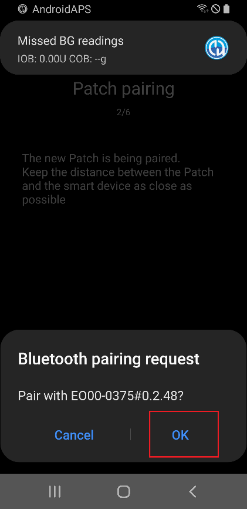
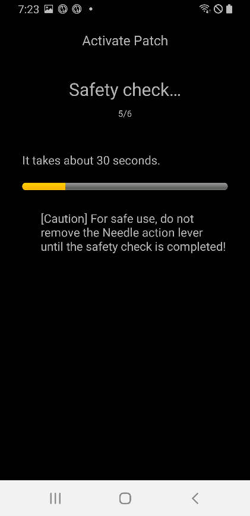
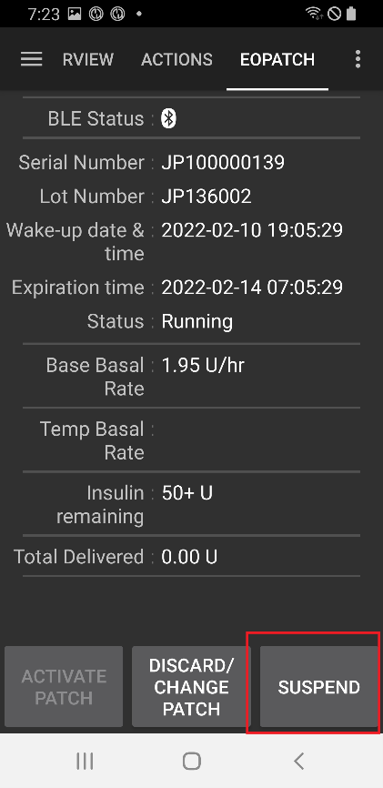
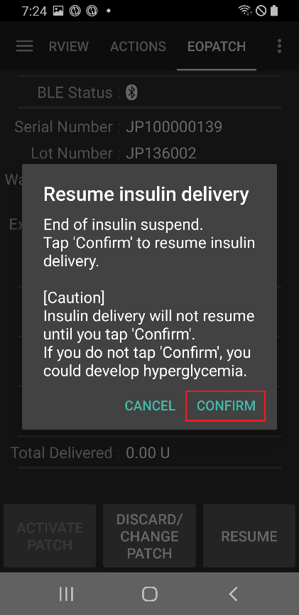

# EOPatch2

Patch, NovoRapid veya Humalog gibi hızlı etkili U-100 insülin gerektirir. Doktorunuzun size reçete ettiği hızlı etkili insülini kullanın.

Patch'in verebileceği en küçük doz 0,05 Ü'dir. **Profil** içindeki her bazal oranı en az 0,05 Ü/sa olacak şekilde ve 0,05 Ü/sa'lik adımlarla ayarlayın. Aksi halde **AAPS** her oranı en yakın 0,05 Ü/sa değerine yuvarlar (asla 0'a yuvarlamaz) ve Patch'in gerçekten verdiği oranları kullanır; bu yüzden günlük toplam insülin **Profil** değerinden biraz farklı olur. Aynı şekilde bolusların da en az 0,05 Ü olması gerekir.

```{contents} Table of contents
:depth: 1
:local: true
```

## AAPS ile pompa özellikleri

* **AAPS** ile telefonunuzun yerleşik Bluetooth'u üzerinden, ek bir iletişim cihazı olmadan iletişim kurar.
* Yaz saati (DST) ve saat dilimi değişiklikleri elle yapılmalıdır.

## Pompa kurulumu

1. **AAPS** ana ekranının sol üst köşesindeki **menüyü** (☰) açın ve **Konfigürasyon** seçeneğini seçin.
1. **Pompa** bölümünde **EOPatch2**'yi seçin.
1. Ana ekrana dönmek için Geri tuşuna basın.

 

Seçildikten sonra **EOPatch2** kartında iki düğme görünür: **Ayarlar** ve **Eklentiyi aç**:


## Ayarlar

EOPatch2 ayarlarını iki yoldan biriyle açın:

* **Konfigürasyon** içindeki **EOPatch2** kartında **Ayarlar** düğmesine basın veya
* pompa ekranını açın (**Yönet** → **Pompa**) ve sağ üst köşedeki dişli simgesine basın.

Üç ayar vardır:


### Düşük rezervuar Uyarısı

Patch'te kalan insülin bu miktara veya altına düştüğünde bir uyarı görünür. Bunu 10 ile 50 Ü arasında, 5 Ü'lik adımlarla ayarlayabilirsiniz. Varsayılan değer 10 Ü'dir.

### Patch Süre Sonu Hatırlatıcısı

Mevcut Patch'in süresi dolmadan önce ne kadar zaman kaldığını size hatırlatır. Bunu 1 ile 24 saat arasında, 1 saatlik adımlarla ayarlayabilirsiniz. Varsayılan değer 4 saattir.

### Patch Sesli Hatırlatıcıları

Bu ayar açıkken Patch; bir bolus, yayma bolus veya geçici bazal başladığında ve bittiğinde bip sesi çıkarır. Normal bazalınızı etkilemez. Varsayılan değer kapalıdır.

## Yeni bir Patch'i etkinleştirme

### Etkinleştirme sihirbazını açın

Pompa ekranını **Yönet** → **Pompa** ile açın (veya **Konfigürasyon** içindeki **EOPatch2** kartında **Eklentiyi aç** düğmesine basın). Etkin bir Patch yokken ekranda **Etkinleştirilmedi** yazısı ve altta bir **Patch'i Etkinleştir** düğmesi görünür.

Sihirbazı başlatmak için **Patch'i Etkinleştir** düğmesine basın.


Sihirbaz size her adımda yol gösterir. Üstteki nokta sırası ne kadar ilerlediğinizi gösterir.

```{note}
**AAPS**'te daha önce hiç **Profil** etkinleştirmediyseniz, sihirbaz önce bir **Profil gerekli** sayfası gösterir. Kullanılacak profili seçin ve **Profil etkinleştir** düğmesine basın.
```

### İnsülin Doldurma

Şırınganın iğnesini Patch üzerindeki insülin doldurma girişine sokun. Patch'i doldurmak için pistonu yavaşça itin. Patch'te 80 Ü'den fazla insülin olduğunda bir kez bip sesi çıkarır ve çalışmaya başlar (açılır).

Bip sesini duyunca **Eşleştirmeye başla** düğmesine basın.


```{warning}
- Sihirbaz söyleyene kadar iğne hareket kolunu çevirmeyin. Kolu çok erken çevirmek, doldurma veya güvenlik kontrolü sırasında ciddi sorunlara yol açabilir.
- Patch 80 ile 200 Ü arası insülin alır. 80 Ü'den az koyarsanız Patch çalışmaz.
- Oda sıcaklığına gelmesi için insülini doldurmadan 15 ile 30 dakika önce buzdolabından çıkarın. İnsülin en az 10°C olmalıdır.
```

### Patch eşleştirme

**AAPS** şimdi Patch ile otomatik olarak eşleşmeye çalışır. Eşleştirme sırasında iki Android Bluetooth eşleştirme isteği görünür. Birincisinde **Tamam** düğmesine basın. Bir geçiş anahtarı (passkey) gösteren ikincisinde de tekrar **Tamam** düğmesine basın.

```{warning}
- Eşleştirme sırasında Patch ile telefonunuz arasındaki mesafe 30 cm'den fazla olmasın.
- Patch açıldıktan sonra eşleştirme tamamlanana kadar her 3 dakikada bir bip sesi çıkarır.
- Patch'i etkinleştirme işlemini, Patch açıldıktan sonraki 60 dakika içinde bitirmelisiniz. Bitiremezseniz Patch'i çıkarın.
```

  

```{admonition} Older screenshot
:class: note
İki Bluetooth eşleştirme ekran görüntüsü daha eski bir **AAPS** sürümüne aittir: Android eşleştirme isteğinin arkasındaki **AAPS** ekranı **AAPS** 4'te farklı görünür.
```

### İnsülin seçin

Patch'i doldurduğunuz insülini seçin ve **İleri** düğmesine basın. **AAPS**, etkinleştirmeden sonra bu insülinle bir Profil değişimi uygular.

### Patch'i takmaya hazırlanın

Patch'in yapışkan bandını çıkarın, ardından **İleri** düğmesine basın.

Bir iğne dışarı çıkıyorsa veya Patch ıslak, kirli ya da yapışkan bandı katlanmışsa, bunun yerine **Çıkar** düğmesine basın ve yeni bir Patch kullanın.


### Bölge konumu

Bu adım yalnızca bölge rotasyonu ayarlarında **Pompa bölge rotasyonunu yönetin** açıksa görünür. Vücut şemasında Patch'i takacağınız yere dokunun ve **İleri** düğmesine basın ya da **Atla** düğmesine basın.

### Patch'i takın

İnsülin, deri altında yağ dokusu olan ama az sinir ve kan damarı bulunan bir yere gitmelidir. Karın, kol veya uyluk iyi seçeneklerdir. Bölgeyi temizleyip kurulayın, ardından Patch'i cildinize yapıştırın.

İnfüzyon bölgesini kontrol edin, ardından **Güvenlik kontrolünü başlat** düğmesine basın.

```{warning}
- Patch'in tamamı cildinize sıkıca yapışması için Patch bandının kenarlarına eşit şekilde bastırın.
- Patch tam yapışmazsa Patch ile cildiniz arasına hava girebilir. Bu, Patch'in yapışmasını ve suya dayanıklılığını zayıflatır.
```


### Güvenlik kontrolü

Güvenlik kontrolü yaklaşık 30 saniye sürer. Bittiğinde Patch bir kez bip sesi çıkarır. Başarısız olursa **Tekrar dene** düğmesine basın.

```{warning}
Güvenli kullanım için güvenlik kontrolü tamamlanana kadar iğne hareket kolunu çevirmeyin.
```

 

```{admonition} Older screenshot
:class: note
**Patch'i takmaya hazırlanın** ile **Güvenlik kontrolü** arasındaki ekran görüntüleri daha eski bir **AAPS** sürümüne aittir ve **AAPS** 4'te farklı görünebilir.
```

### İğneyi yerleştirme

Patch'i sıkıca tutun. İğneyi yerleştirmek için iğne hareket kolunu 100°'den fazla yukarı doğru çevirin. İğne doğru yerleştirildiğinde Patch bir kez bip sesi çıkarır. Ardından kolu çıkarmak için sonuna kadar çevirmeye devam edin. **İleri**'ye basın.

```{caution}
Bip sesini duymadan bir sonraki adıma geçerseniz bir **İğne yerleştirme Hatası** görünür. Bip sesini kontrol edin ve **Tekrar dene** düğmesine basın. Hata devam ederse Patch'i devre dışı bırakmak için **Çıkar** düğmesine basın.
```

### Patch etkinleştirme tamamlandı

Son sayfa, Patch'in etkin olduğunu ve süresinin dolmasına yakın sizi uyaracağını onaylar. Pompa ekranına dönmek için **Bitir** düğmesine basın.

## Patch'in çıkarılması

Patch'teki insülin azaldığında, süresi dolduğunda veya arızalı olduğunda Patch'i değiştirin. Her Patch'i, açıldıktan sonra en fazla 84 saat kullanmanızı öneririz.

1. Pompa ekranını açın (**Yönet** → **Pompa**). Bir Patch etkinken **Patch'i Çıkar** düğmesine basın.
1. **Patch'i Çıkar** sayfası, Patch'te kalan süreyi ve kalan insülini gösterir. **Patch'i Çıkar** düğmesine basın.
1. Bir iletişim kutusu onay ister. Tekrar **Patch'i Çıkar** düğmesine basın.
1. Patch devre dışı bırakıldığında sihirbaz **Patch atma işlemi tamamlandı.** mesajını gösterir. Patch'i vücudunuzdan çıkarın ve **Onayla** düğmesine basın.

Bundan sonra sihirbaz doğrudan yeni bir Patch'i etkinleştirme adımlarına geçer (yukarıya bakın). Burada durmak istiyorsanız geri okuna basın.

Etkin bir Patch yokken **AAPS** pompayı askıya alınmış olarak gösterir ve 0 Ü/sa'lik bir geçici bazal kaydeder; böylece bir sonraki Patch etkinleştirilene kadar AİNS'te hiç bazal insülin sayılmaz.

   

```{admonition} Older screenshot
:class: note
Yukarıdaki ekran görüntüleri daha eski bir **AAPS** sürümüne aittir. **AAPS** 4'te pompa ekranını **Yönet** → **Pompa** ile açarsınız ve oradaki düğmenin adı **Patch'i Çıkar** olur.
```

```{admonition} If the patch does not respond
:class: warning
**AAPS** Patch'e ulaşamazsa, Patch'in alarmını elle kapatmayı anlatan bir sayfa gösterebilir: Patch'i vücudunuzdan çıkarın, yapışkan bandı soyun ve bir ataşla insülin doldurma girişinin yanındaki deliğe kuvvetlice bastırın.

**Patch'i Çıkar** sayfasında ayrıca bir **Zorla sıfırla** düğmesi vardır. Bu düğme Patch'e hiçbir komut göndermeden Patch'i yalnızca **AAPS**'ten siler. Patch, pili bitene veya siz onu elle kapatana kadar insülin vermeye devam eder. Bunu yalnızca normal çıkarma işlemi başarısız olursa kullanın ve Patch'i vücudunuzdan çıkarın.
```

## İnsülin iletimini askıya alma ve devam ettirme

İnsülin iletimini askıya almak, devam eden yayma bolusu ve geçici bazalı da iptal eder. Devam ettirdiğinizde bunlar yeniden **başlatılmaz**. İnsülin iletimi askıya alınmışken Patch her 15 dakikada bir bip sesi çıkarır.

### İnsülin iletiminin askıya alınması

1. Pompa ekranını açın (**Yönet** → **Pompa**) ve **Pompayı askıya al** düğmesine basın.
1. Bir iletişim kutusu neyin askıya alınacağını açıklar. **Onayla** düğmesine basın.
1. **Bazal Askıya Alma Süresi** iletişim kutusunda ne kadar süre askıya alınacağını seçin: 30 dk, 1 sa, 1 sa 30 dk veya 2 sa. **Onayla** düğmesine basın.

İnsülin iletimi seçtiğiniz süre boyunca askıya alınır.

  

```{admonition} Older screenshot
:class: note
Yukarıdaki ekran görüntüleri daha eski bir **AAPS** sürümüne aittir. **AAPS** 4'te pompa ekranını **Yönet** → **Pompa** ile açarsınız ve oradaki düğmenin adı **Pompayı askıya al** olur.
```

### İnsülin iletimini devam ettirme

1. Pompa ekranını açın (**Yönet** → **Pompa**) ve **Pompayı devam ettir** düğmesine basın.
1. **İnsülin iletimini devam ettir** iletişim kutusunda **Onayla** düğmesine basın.

 

```{admonition} Older screenshot
:class: note
Yukarıdaki ekran görüntüleri daha eski bir **AAPS** sürümüne aittir. **AAPS** 4'te pompa ekranını **Yönet** → **Pompa** ile açarsınız ve oradaki düğmenin adı **Pompayı devam ettir** olur.
```

```{warning}
Askıya alma süresi bittiğinde **AAPS** bir **İnsülin askıya alma işleminin sonu** uyarısı gösterir. Siz onaylayana kadar insülin iletimi yeniden **başlamaz**. Onaylamazsanız hiperglisemi gelişebilir.
```

(eopatch2-alarms-and-warnings)=

## Alarmlar ve uyarılar

### Alarmlar

Alarmlar acil, en yüksek öncelikli durumlar içindir ve hemen müdahale etmenizi gerektirir. **AAPS**, siz onaylayana kadar devam eden bir alarm çalar ve mesajı **Genel Bakış** ekranında bir bildirim olarak gösterir. Alarm, kullanılan Patch'te bir sorun olduğu anlamına gelir. Çoğu durumda Patch'in çıkarılması ve yenisiyle değiştirilmesi gerekir.

Bildirimdeki **Onayla** düğmesine bastığınızda **AAPS** alarmı işler. Çoğu alarmda bu işlem Patch'i devre dışı bırakır. **Uygun olmayan sıcaklık** alarmında düğme **Tekrar dene** olur.

 

```{admonition} Older screenshot
:class: note
Alarm ekran görüntüleri daha eski bir **AAPS** sürümüne aittir ve **AAPS** 4'te farklı görünebilir.
```

Farklı alarmlar aşağıda açıklanmıştır.

| Alarm                         | Açıklama                                                                                                                                              |
| ----------------------------- | ----------------------------------------------------------------------------------------------------------------------------------------------------- |
| Rezervuar boş                 | Patch'teki insülin bitti.                                                                                                                             |
| Patch süresi doldu            | Patch'in kullanım süresi doldu ve artık insülin veremez.                                                                                              |
| Tıkanma                       | Patch'in insülin yolu tıkanmış görünüyor.                                                                                                             |
| Açılışta otomatik test hatası | Patch, açıldıktan sonraki kendi kendine testi sırasında beklenmeyen bir hata buldu.                                                                   |
| Uygun olmayan sıcaklık        | Patch, siz onu etkinleştirirken veya kullanırken normal çalışma sıcaklığının dışında. Patch'i uygun sıcaklıkta (4,4 ile 37°C arası) bir yere götürün. |
| İğne yerleştirme Hatası       | Etkinleştirme sırasında iğne doğru yerleştirilmedi. Patch'in iğne yerleştirme kenarı ile iğne hareket kolunun düz bir çizgide olduğunu kontrol edin.  |
| Patch pil hatası              | Patch'in dahili pili bitmek üzere ve Patch kapanacak.                                                                                                 |
| Patch etkinleştirme Hatası    | Patch, açıldıktan sonraki 60 dakika içinde tam olarak etkinleştirilmedi.                                                                              |
| Patch Hatası                  | Patch, etkinleştirilirken veya kullanılırken beklenmeyen bir hata buldu.                                                                              |

### Uyarılar

Uyarılar orta veya düşük öncelikli durumlar içindir. Uyarı, **Genel Bakış** ekranında bir bildirim olarak görünür.


```{admonition} Older screenshot
:class: note
Bu ekran görüntüsü daha eski bir **AAPS** sürümüne aittir: **AAPS** 4'te uyarı, farklı görünen ana ekranda gösterilir.
```

Farklı uyarılar aşağıda açıklanmıştır.

| Uyarı                     | Açıklama                                                                                                                                      |
| ------------------------- | --------------------------------------------------------------------------------------------------------------------------------------------- |
| İnsülin askıya alma sonu  | Seçtiğiniz askıya alma süresi bitti. İnsülin iletimini yeniden başlatmak için bildirimdeki **Pompayı devam ettir** düğmesine basın.           |
| Düşük rezervuar           | Patch'te kalan insülin, **Düşük rezervuar Uyarısı** ayarındaki miktarın altında.                                                              |
| Patch çalışma ömrü doldu  | Patch'in kullanım süresi doldu.                                                                                                               |
| Patch yakında sona erecek | Patch 1 saat içinde çıkarılmalıdır.                                                                                                           |
| Eksik Patch Etkinleştirme | Patch etkinleştirmesi, eşleştirmeden sonra 3 dakikadan uzun süre yarıda kaldı. Pompa ekranını açın ve Patch'i etkinleştirme işlemini bitirin. |
| Patch pili zayıf          | Patch'in pili zayıf.                                                                                                                          |

## Nereden yardım alabilirsiniz?

EOPatch2 sürücüsü topluluk tarafından **gönüllü** olarak geliştirilmektedir. Yardım istemeden önce lütfen:

1. Özelliğin nasıl çalışması gerektiğini doğrulamak için bu dokümantasyonun ilgili bölümünü **okuyun**.
2. [Discord](https://discord.gg/4fQUWHZ4Mw)'daki *#AAPS* kanalında veya diğer [topluluk kanallarından](../GettingHelp/WhereCanIGetHelp.md) birinde **sorun**.
3. [Mevcut sorunları](https://github.com/nightscout/AndroidAPS/issues) arayarak **hata bildirin**; sizinki listede yoksa [yeni bir sorun (issue)](https://github.com/nightscout/AndroidAPS/issues) açın ve [günlük dosyalarınızı](../GettingHelp/AccessingLogFiles.md) ekleyin.

Yardım isterken telefonunuzun markasını ve modelini, Android sürümünü, **AAPS** sürümünü ve sorunun sade bir açıklamasını (ne değişti, en son ne zaman çalıştı) ekleyin.
