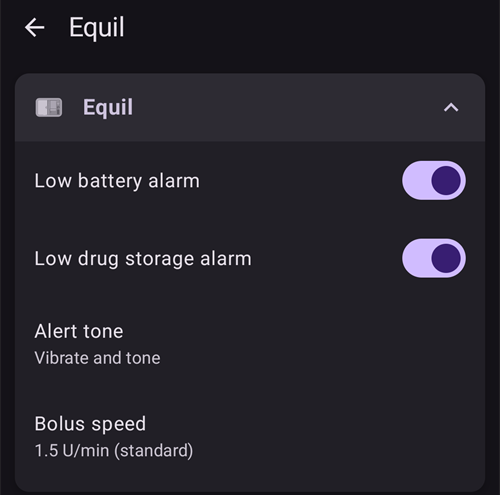
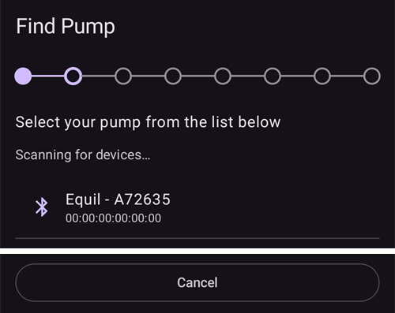
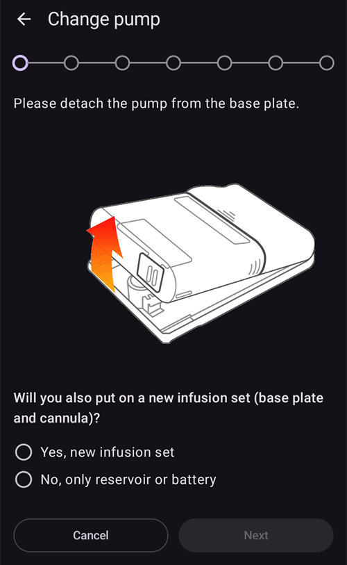

# Equil

Bu talimatlar Equil insülin pompasının yapılandırılması içindir.

```{contents} Table of contents
:depth: 1
:local: true
```

## AAPS ile pompa özellikleri

* Telefonunuzun yerleşik Bluetooth'u üzerinden, ek bir iletişim cihazı olmadan **AAPS** ile iletişim kuran hortumsuz Patch pompa.
* **AAPS**, Equil'i 200 Ü rezervuarlı bir Patch pompa olarak ele alır: ana ekran Patch pompa durum ışıklarını gösterir ve **Hazırla/doldur** ile **Pompa Pil Değişimi** sunulmaz. Doldurma, hazırlama (prime) ve pil değiştirme pompa sihirbazlarında yapılır.
* Pompa askıya alınmışken veya durmuşken **AAPS** 0 Ü/sa'lik bir geçici bazal kaydeder; böylece AİNS'te hiç bazal insülin sayılmaz.
* Yaz saati (DST) ve saat dilimi değişiklikleri elle yapılmalıdır.

## Donanım ve yazılım gereksinimleri
* **Uyumlu Equil donanımı**

  Şu anda Equil 5.3 ve 5.4 desteklenmektedir.

* [APK oluşturma](../SettingUpAaps/BuildingAaps.md) talimatlarına göre oluşturulmuş ve kurulmuş **AAPS**

## Kurulum

### Equil pompayı seçin

Sol üst köşedeki **menüyü** (☰) açın, **[Konfigürasyon](#Config-Builder-pump)** seçeneğini seçin ve **Pompa** altında **Equil**'i seçin.

Seçildikten sonra **Equil** kartında iki düğme görünür: **Ayarlar** ve **Eklentiyi aç**:


**Eklentiyi aç** (veya **Yönet** → **Pompa**), Equil pompa ekranını açar. Pompa eşleştirilmeden önce ekran şöyle görünür:


### Ayarlar

Equil ayarlarını **Equil** kartındaki **Ayarlar** düğmesiyle veya pompa ekranının sağ üst köşesindeki dişli simgesiyle açın.



* **Düşük pil uyarısı**: pompa pili zayıf olduğunda sizi uyarır.
* **Düşük rezervuar uyarısı**: rezervuardaki insülin azaldığında sizi uyarır.
* **Uyarı tonu**: pompanın sizi nasıl uyaracağı: **Sessiz**, **Sadece titreşim**, **Sadece ses** veya **Titreşim ve ses**.
* **Bolus hızı**: bolusun ne kadar hızlı verileceği: **1,5 Ü/dk (standart)**, **3 Ü/dk**, **6 Ü/dk** veya **12 Ü/dk**. Hızlı bolus iletimi, daha fazla tıkanıklık alarmına yol açabilir.


```{admonition} Max basal and max bolus on the patch
:class: note
Patch, **AAPS**'in kendisine programladığı en yüksek değerin üzerindeki her bazal oranı reddeder. **AAPS**, **maks bazal** [ayarınızdan](../SettingUpAaps/Preferences.md) ve **Profil** içindeki en yüksek saatlik bazal orandan büyük olanı alır; böylece Patch profilinizi ve döngünün istediği geçici bazalları her zaman kabul eder. **AAPS** ayrıca izin verilen en yüksek bolus miktarınızı da Patch'e gönderir.

**Maks bazal** veya **maks bolus** değerinizi değiştirdiğinizde **AAPS** yeni değerleri Patch'e otomatik olarak gönderir. Bu değerler her profil değişiminde de gönderilir. Patch üzerinde ayarlanacak bir şey yoktur.
```

### Pompayı eşleştirin

Pompa ekranında **Eşleştir** düğmesine basın. Bir sihirbaz size her adımda yol gösterir. Üstteki nokta sırası ne kadar ilerlediğinizi gösterir.

Android, **AAPS**'in yakındaki cihazları bulup onlara bağlanıp bağlanamayacağını sorarsa **İzin ver** düğmesine basın. **AAPS**'in pompayı bulması için bu gereklidir.


Sihirbazın adımları şunlardır. İlerlemek için **İleri** düğmesine, sihirbazdan çıkmak için **Vazgeç** düğmesine basın.

1. **Profil gerekli**: yalnızca **AAPS**'te daha önce hiç **Profil** etkinleştirmediyseniz gösterilir. Kullanılacak profili seçin ve **Profil etkinleştir** düğmesine basın.
1. **Pompayı birleştirin**: pompayı, dolu rezervuarı ve şarjlı pili birleştirin.

   

1. **Pompa Bul**: **AAPS** yakındaki Equil pompaları arar. Listeden pompanızı seçin.

   
1. **Cihazı eşleştir**: **Eşleştirme parolasını belirleyin** alanına bir eşleştirme parolası girebilirsiniz. Parola 4 karakter uzunluğunda olmalı ve `ABCDEF0123456789` karakterlerinden seçilmelidir. **Eşleştir** düğmesine basın.

   

1. **İnsülin Seçin**: yalnızca birden fazla insülin ayarladıysanız gösterilir. Rezervuardaki insülini seçin.
1. **Hazırla / Doldur**: pompa tabanının üzerinde **olmamalıdır**. **Hazırla/doldur** düğmesine basın ve iğne ucunda bir damla insülin görünene kadar rezervuarı doldurun (prime). **İleri**'ye basın.

   
1. **Bölge Rotasyonu**: yalnızca bölge rotasyonu ayarlarında **Pompa bölge rotasyonunu yönetin** açıksa gösterilir. Pompayı takacağınız yere dokunun veya **Atla** düğmesine basın.
1. **Pompayı takın**: pompayı tabanına takın.

   
1. **Kanül dolumu**: pompa tabana takıldıktan sonra kanüldeki havayı çıkarmak için **Havayı temizleyin** düğmesine basın. **İleri**'ye basın.

   

1. **Onayla**: pompayı vücudunuza yerleştirin ve **Bitir** düğmesine basın.

   

```{warning}
Kendi eşleştirme parolanızı belirlediyseniz (güvenliğiniz için önerilir), onu güvenli bir yerde saklayın. Parola pompada kaydedilir. Pompa, siz onu **AAPS**'te düzgün bir şekilde eşleşmeden çıkarana kadar her yeni eşleştirmede bu parolayı ister. O zamana kadar pompa, orijinal el kumandasıyla (PDA) da kullanılamaz.
```

### Eşleştirmeden sonra pompa ekranı

Pompa eşleştirildikten sonra pompa ekranında şu düğmeler görünür:

* **Yenile**: pompanın durumunu ve geçmişini hemen okur.
* **Askıya al** / **İletime devam et**: insülin iletimini durdurur veya yeniden başlatır.
* **Rezervuarı Değiştir**: pompayı ayırma, yeni bir rezervuar (ve gerekirse yeni bir pil) takma, hazırlama (prime) ve pompayı yeniden takma adımlarında size yol gösterir. İlk adım şunu sorar: *Ayrıca yeni bir infüzyon seti (pompa tabanı ve kanül) de takacak mısınız?*
  * **Evet, yeni infüzyon seti**: bölgeyi seçersiniz, kanül doldurulur ve **AAPS** bir insülin değişimi ile bir kanül değişimi kaydeder.
  * **Hayır, yalnızca rezervuar veya pil**: kanül doldurulmaz ve **AAPS** yalnızca bir insülin değişimi kaydeder.

  Rezervuar değişiminden sonra pil seviyesi, **AAPS** onu pompadan tekrar okuyana kadar **-** olarak görünür.

  

* **Geçmiş**: pompanın kaydettiği olayları gösterir.
* **Cihaz Eşleşmesini Kaldır**: pompayı ayırma ve **AAPS** ile eşleşmesini kaldırma adımlarında size yol gösterir. Bu işlem insülin iletimini durdurur, pompa pistonunu en alta geri çeker ve eşleştirmeyi siler.

### Alarmlar

* Düşük insülin alarmı her seviyede (10 Ü, 5 Ü ve 2 Ü) ve rezervuar boşaldığında birer kez çalar. Düşük pil alarmı %10'da bir kez ve %5'te bir kez çalar. Her seviye, bir sonraki rezervuar değişimine kadar yalnızca bir kez alarm verir.
* Pompa alarmları ve durmaları, pompanın kaydettiği zamanda tedavilere duyuru olarak da kaydedilir; böylece pompanın ne zaman ve neden durduğunu daha sonra görebilirsiniz.
* Bolus sırasında rezervuar boşalırsa **AAPS** yalnızca o ana kadar verilen insülini kaydeder ve size her iki miktarı da bildirir.

## Nereden yardım alabilirsiniz?

Equil sürücüsü topluluk tarafından **gönüllü** olarak geliştirilmektedir. Yardım istemeden önce lütfen:

1. Özelliğin nasıl çalışması gerektiğini doğrulamak için bu dokümantasyonun ilgili bölümünü **okuyun**.
2. [Discord](https://discord.gg/4fQUWHZ4Mw)'daki *#AAPS* kanalında veya diğer [topluluk kanallarından](../GettingHelp/WhereCanIGetHelp.md) birinde **sorun**.
3. [Mevcut sorunları](https://github.com/nightscout/AndroidAPS/issues) arayarak **hata bildirin**; sizinki listede yoksa [yeni bir sorun (issue)](https://github.com/nightscout/AndroidAPS/issues) açın ve [günlük dosyalarınızı](../GettingHelp/AccessingLogFiles.md) ekleyin.

Yardım isterken telefonunuzun markasını ve modelini, Android sürümünü, **AAPS** sürümünü ve sorunun sade bir açıklamasını (ne değişti, en son ne zaman çalıştı) ekleyin.
