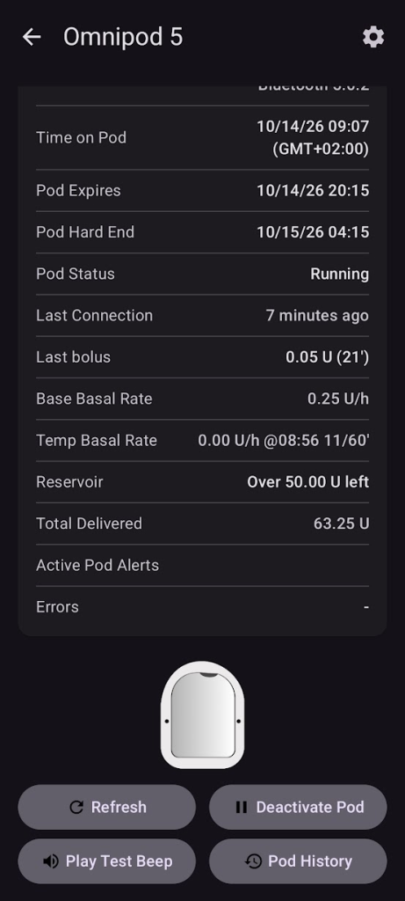

# Gelecekteki (olası) Pompa Sürücüleri

Bu, piyasadaki bazı pompaların, diğer döngü sistemlerinde desteklenme durumlarının ve AAPS'teki durumlarının bir listesidir. Sonda, bir pompanın "Döngü özellikli" olması için nelere ihtiyaç duyduğuyla ilgili bazı bilgiler vardır.

    {contents} İçindekiler
    :depth: 1
    :local: true

## AAPS'e entegrasyon aşamasındaki pompalar

**Yakında:** bu pompaların sürücüleri geliştirilme aşamasında ve test sürümlerinde zaten çalışıyor.

Omnipod 5 ([Ana Sayfa](https://www.omnipod.com/))

Tandem: t:Mobi ([Ana Sayfa](https://www.tandemdiabetes.com/))

## Döngü yapılabilen Pompalar

### Kaleido ([Homepage](https://www.hellokaleido.com/))

**Döngü durumu:** Pompa bir döngü adayı, ancak protokol şu anda bilinmiyor. Üretici açık kaynakla ilgilenmiyor.

**Hardware requirement for AAPS:** None. Bluetooth özellikli görünüyor.

### Tandem: t:slim X3 ([Ana Sayfa](https://www.tandemdiabetes.com/about-us/pipeline))

**Döngü durumu:** Gelecekte olası döngü adayı. t:slim X3'ün telefondan tam kontrole izin vermesi ve böylece AAPS desteğini mümkün kılması umuluyor, ancak zaman planı ve özellikler henüz bilinmiyor.

**Hardware requirement for AAPS:** None. Bluetooth özellikli olması bekleniyor.

**Yorumlar:** Henüz piyasaya çıkmadı. t:slim X3, Tandem'in yol haritasında t:Mobi (hortumsuz bir sürümü dahil) ve Sigi (Patch pompaları) lehine tekrar tekrar geri plana atılmış görünüyor.

### Twiist ([Ana Sayfa](https://www.twiist.com/))

**Döngü durumu:** Döngü adayı.

**Hardware requirement for AAPS:** None. Bluetooth özelliklidir.

### Willcare Insulin pump ([Homepage](http://shinmyungmedi.com/en/))

**Döngü durumu:** Şu anda döngü adayı değil, ancak çalışanları bizimle iletişime geçti ve pompayı döngüye uygun hale getirmekle ilgileniyorlar (görünüşe göre yalnızca profil alma/ayarlama komutları eksik).

**Hardware requirement for AAPS:** None. Bluetooth özellikli görünüyor.

**Yorumlar:** Şirket AAPS ile entegrasyonla ilgilendiği için entegrasyonu kendileri yapabilir.

### Ypsopump ([Ana Sayfa](https://www.ypsomed.com/))

**Döngü durumu:** Döngü adayı. Pompanın Bluetooth protokolü topluluk tarafından tersine mühendislikle çözüldü, bu yüzden pompayla iletişim kurmak prensipte mümkündür.

**Hardware requirement for AAPS:** None. Bluetooth özelliklidir.

**Yorumlar:** Ypsopump, Bluetooth iletişimini üçüncü tarafın güçlü şifrelemesiyle korur. Bununla çalışmak teknik olarak zordur ve bu da güvenilir bir sürücü geliştirmeyi ve bakımını yapmayı zorlaştırır. Henüz kullanıma hazır bir AAPS sürücüsü yoktur.

## Artık satılmayan pompalar (şirketler artık faaliyette değil)

### Animas Vibe

### Animas Ping

### Cellnovo

### Accu-Chek Insight

**Yorumlar:** Desteğin sonu Mart 2025.

## Döngü yapılamayan pompalar

### Medtronic Bluetooth

**Yorumlar:** Medtronic [çekildi](https://www.tidepool.org/blog/tidepool-loop-partner-update-ace-pumps).

### Tandem: t:slim X2 ([Homepage](https://www.tandemdiabetes.com/))

**Yorumlar:** Tandem Bluetooth protokolü tersine mühendislikle çözüldü, ancak t:slim X2'de yalnızca bolus verilebilir — bazal iletimi kontrol edilemez — bu yüzden döngü için güvenli şekilde kullanılamaz. Tandem, X2'nin telefondan tam kontrolüne izin vermedikçe bunun değişmesi pek olası değildir; bu tür bir kontrol daha çok t:slim X3 ile gelecektir.

### Accu-Chek Solo

**Yorumlar:** Topluluk, Solo pompa ile iletişim kurmayı başaramadı.

## Döngü yapılabilecek pompalar için gereksinimler

**Prerequisite**

- Pompanın bir çeşit uzaktan kumandayı desteklemesi gerekir. (BT, Radyo frekansı, vb)
- Protokol çözülmüş (hack)/belgelenmiş vb. olmalıdır.

**Minimal requirement**

- Geçici Bazal Oranı Ayarla
- Durum Al
- Geçici Bazal Oranı İptal Et

**oref1 (SMB) veya bolus vermek için:**

- Bolusu Ayarla

**Olması iyi olanlar**

- Bolusu İptal Etme
- Bazal Profili Alma (neredeyse zorunlu)
- Bazal Profili Ayarlama (olması güzel)
- Geçmişi Okuma 

**Other (not required but good to have)**

- Yayma Bolusu Ayarlama
- Yayma Bolusu iptal etme
- Geçmişi Okuma
- GTD'yi okuma

### Diğer pompaların desteği

Durumunu görmek istediğiniz başka pompalar varsa lütfen Discord üzerinden bizimle iletişime geçin.