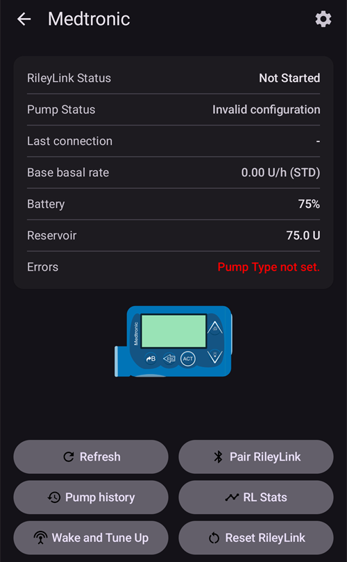

# Medtronic Pompaları

AAPS sürücüsü, G ile biten (530G, 600 serisi [630G, 640G, 670G], 700 serisi [770G, 780G] vb.) tüm modellerde ve daha yeni modellerde çalışmaz.

Aşağıdaki modeli ve yazılımı belirtilen pompa kombinasyonları uyumludur:

- 512/712 (herhangi bir pompa yazılımı sürümü)
- 515/715 (herhangi bir pompa yazılımı sürümü)
- 522/722 (herhangi bir pompa yazılımı sürümü)
- 523/723 (pompa yazılımı 2.4A veya altı)
- 554/754 AB sürümü (pompa yazılımı 2.6A veya altı)
- 554/754 Kanada sürümü (pompa yazılımı 2.7A veya altı)

[OpenAPS dokümantasyonu](https://openaps.readthedocs.io/en/latest/docs/Gear%20Up/pump.html#how-to-check-pump-firmware-check-for-absence-of-pc-connect) veya [Döngü Dokümantasyonunda](https://loopkit.github.io/loopdocs/build/step3/#medtronic-pump-firmware) pompalardaki yazılım versiyonunu nasıl öğreneceğinizi bulabilirsiniz.

    {contents} Table of contents
    :depth: 1
    :local: true

## Pump capabilities with AAPS

* Requires a RileyLink-compatible device to communicate with **AAPS**.
* Automatic DST and timezone handling.

## Donanım ve yazılım gereksinimleri

- **Telefon:** Medtronic sürücüsü, Bluetooth bağlantılarını destekleyen herhangi bir android telefonla çalışmalıdır. **ÖNEMLİ: Telefon üreticilerinin Bluetooth uygulamaları değişebileceği için her bir telefon modelinin davranış biçimi farklı olabilir. Örneğin, bazı telefonlar Bluetooth'u etkinleştirmeyi/devre dışı bırakmayı farklı şekilde ele alacaktır. This can impact the user experience when AAPS needs to reconnect to your Rileylink type device.**
- **RileyLink Compatible Device:** Android phones cannot communicate to Medtronic pumps without a separate device to handle communications. Bu cihaz, Bluetooth aracılığıyla telefonunuzla ve uyumlu bir radyo bağlantısı aracılığıyla pompanızla bağlantı kuracaktır. Bu tür ilk cihaza Rileylink adı verildi, ancak artık ek işlevsellik sunabilen başka seçenekler de mevcuttur.
    
    - Rileylink'i [getrileylink.org](https://getrileylink.org/product/rileylink916) adresinde bulabilirsiniz.
    - Orangelink, [getrileylink.org](https://getrileylink.org/product/orangelink) adresinde
    - Emalink (birkaç model opsiyonuyla) [github.com](https://github.com/sks01/EmaLink) adresinde
    - Gnarl (Kendin yap araçlarına ihtiyacınız olacak) detaylar için [github.com](https://github.com/ecc1/gnarl) adresine başvurabilirsiniz.

A comparison chart for the various Rileylink compatible devices can be found at [getrileylink.org](https://getrileylink.org/rileylink-compatible-hardware-comparison-chart)

(MedtronicPump-configuration-of-the-pump)=

## Pompa Konfigürasyonu

The following settings should be configured on the pump in order for AAPS to remotely send commands. Medtronic 715'te değişikliği yapmak için gerekli adımlar, her ayar için parantez içinde gösterilmiştir. Adımlar, pompa tipine ve/veya pompa yazılım sürümüne göre değişebilir.

- **Pompada uzak modu etkinleştir** Pompada Act'ye basın ve Yardımcı Programlar (Utilities) -> Uzak Seçenekler'e (Remote Options) gidin, Açık'ı (ON) seçin ve sonraki ekranda Kimlik Ekle'yi (Add ID) yapın ve 1111111 gibi herhangi bir rastgele kimlik ekleyin. Pompanın uzaktan iletişim beklemesi için Remote ID listesinde en az bir ID olmalıdır.
- **Set Max Basal** (On the pump press Act and go to Basal and then select Max Basal Rate) As an example setting this value to four times your maximum standard basal rate would allow a 400% Temporary Basal Rate. Pompa tarafından izin verilen maksimum değer saatte 34,9 ünitedir.
- **Set Max Bolus** (On the pump press Act and go to Bolus and then select Max Bolus) This is the largest bolus that the pump will accept. Pompa tarafından izin verilen maksimum değer 25'tir.
- **Profili Standart olarak ayarlayın**. (On the pump press Act and go to Basal and then Select Patterns) The pump will only need one profile as AAPS will manage different profiles on your phone. Başka bazal modeli gerekli değildir.
- **Geçici Bazal Oranı türünü ayarlayın** (Pompada ACT'ye basın ve Bazal'a ve ardından Geçici Bazal Türü'ne gidin). Mutlak'ı (Absolute) seçin (Yüzdeyi değil).

## Medtronic Configuration of Phone/AAPS

- **Do not pair RileyLink compatible device with the Bluetooth menu on your phone.** Pairing via the Bluetooth menu on your phone will stop AAPS from seeing your Rileylink Compatible device when you follow the instructions below.
- Telefonunuzda otomatik ekran döndürmeyi devre dışı bırakın. Belirli cihazlarda otomatik ekran döndürme, Bluetooth oturumlarının yeniden başlamasına neden olur ve bu da Medtronic pompanız için sorunlara neden olabilir. 
- There are two ways to configure your Medtronic pump in AAPS:

1. Yeni bir kurulumun parçası olarak kurulum sihirbazını kullanma
2. In **Configuration** > **Pump**, by selecting **Medtronic**
    
    
    
    Once it is selected, the **Medtronic** card shows two buttons, **Settings** and **Open plugin**:
    
    
    
    **Settings** opens the settings of the Medtronic driver:
    
    
    
    **Open plugin** (or **Manage** > **Pump**) opens the Medtronic pump screen. Before a pump is paired it looks like this:
    
    

When configuring your Medtronic pump with the setup wizard it is possible that you will be prevented from completing setup because of Bluetooth issues (e.g. you cannot successfully connect to the pump). Böyle bir durumda, yapılandırmayı tamamlamak ve 2. seçeneği kullanarak daha fazla sorun giderebilmek için ilk önce sanal pompa seçeneğini seçmelisiniz.

While setting up AAPS to work with your medtronic pump you need to set the following items in **Settings** (see the settings picture above):

- **Pompa Seri Numarası**: Pompanızın arkasında yer alır ve SN ile başlar. You should only enter the 6 numbers shown without any alphabetic characters (e.g. 123456).
- **Pompa Tipi**: Kullandığınız pompa modeli (ör. 522). 
- **Pompa Frekansı**: Pompanızın ilk dağıtıldığı yere bağlı olarak iki seçenek vardır. Please check the [FAQ](#MedtronicPump-faq) if you are unsure which option to select): 
    - for US & Canada, frequency used is 916 MHz
    - for Worldwide, frequency used is 868 MHz
- **Pompadaki Maks Bazal (Ü/s)**: Bunun, pompanızda ayarlanan değerle eşleşmesi gerekir (yukarıdaki pompa konfigürasyonuna bakın). Again this setting must be carefully selected as it will determine how much AAPS can deliver via your basal rate. Bu değer maksimum geçici bazal oranını etkin bir şekilde ayarlayacaktır. Örnek olarak, bu değeri maksimum standart bazal oranınızın dört katına ayarlamak %400 Geçici Bazal Oranına izin verir. Pompa tarafından izin verilen maksimum değer saatte 34,9 ünitedir.
- **Pompadaki Maks Bolus (Ü)** (bir saat içinde): Bunun, pompanızda ayarlanan değerle eşleşmesi gerekir (yukarıdaki pompa konfigürasyonuna bakın). This setting should be carefully considered as it determines how large a bolus AAPS can ever set.
- **Bolus göndermeden önceki bekleme süresi (sn)**: Bolus verildikten sonra, komut gerçekten pompaya gönderilmeden önce geçen saniye sayısı. Bu süre, bir bolus komutunun yanlışlıkla gönderilmesi durumunda kullanıcının bolusu iptal etmesine olanak tanır. It is not possible to cancel a bolus that has started via AAPS. Halihazırda başlamış bir bolusu iptal etmenin tek yolu, pompayı manuel olarak askıya almak ve ardından devam ettirmektir.
- **Medtronic Kodlama**: Medtronic kodlamasının gerçekleştirilip gerçekleştirilmediğini belirler. Donanım kodlamasının seçilmesi (Rileylink uyumlu cihaz tarafından gerçekleştirilir) tercih edilir çünkü bu daha az veri gönderilmesine neden olur. Selecting Software encoding (i.e. carried out by AAPS) can help in the event frequent disconnects are seen. Rileylink cihazlarında yazılım sürümü 0.x ise bu ayar yok sayılır.
- **Pil Türü (Güç Görünümü)**: Kalan pil gücü seviyesini doğru bir şekilde belirlemek için kullanımda olan AAA pil tipini seçmelisiniz. When a value other than simple view is selected AAPS will display the remaining calculated battery percentage level and volts. Aşağıdaki seçenekler mevcuttur:
    
    - Seçilmedi (Basit görünüm)
    - Alkali (Genişletilmiş görünüm)
    - Lityum (Genişletilmiş görünüm)
    - NiZn (Genişletilmiş görünüm)
    - NiMH (Genişletilmiş görünüm)
- **Use Scanning**: Activates Bluetooth scanning before connecting with your Rileylink Compatible devices. Bu seçenek cihazla bağlantınızın güvenilirliğini artırabilir.

- **Show battery level reported by OrangeLink/EmaLink/DiaLink**: This feature is only supported on newer link devices such as the EmaLink or OrangeLink. The value is shown as **RileyLink Battery** on the Medtronic pump screen.
- **Set neutral temp basals**: By default Medtronic pumps beep on the hour when a temporary basal rate is active. Enabling this option can help reduce the number of beeps heard by interrupting a temporary basal at the hour change in order to suppress the beep.

(pairing-your-rileylink-compatible-device)=

### Pairing your RileyLink compatible device

Your RileyLink compatible device is paired from the Medtronic pump screen, not from the Bluetooth menu of your phone:

- Open the pump screen (**Manage** > **Pump**, or **Open plugin** on the Medtronic card in **Configuration** > **Pump**).
- Tap **Pair RileyLink**. **AAPS** scans for nearby RileyLink compatible devices.
- Tap your device in the list. When **RileyLink paired successfully** is shown, tap **OK**.

## Medtronic pump screen

To open the Medtronic pump screen, go to **Manage** > **Pump**. The pump screen displays the current pump status information along with some Medtronic specific actions (see the pump screen picture above).

- **RileyLink Durumu**: Telefonunuz ve Rileylink uyumlu cihaz arasındaki bağlantının mevcut durumu. Bu satır her zaman "Bağlı" olarak görünmelidir. Diğer herhangi bir durum, kullanıcı müdahalesini gerektirebilir. 
- **RileyLink Pili**: EmaLink veya OrangeLink cihazınızın mevcut pil seviyesi. Only shown if **Show battery level reported by OrangeLink/EmaLink/DiaLink** is enabled in the Medtronic settings.
- **Pompa Durumu**: Pompa bağlantısının mevcut durumu. Pompa sürekli bağlı olmayacağından, burada genellikle uyku simgesi görünecektir. There are a number of possible other status including "Waking Up" when AAPS is trying to issue a command or other possible pump commands such as "Get Time", "Set TBR", etc.
- **Battery**: Shows battery status based on the value chosen for **Battery Type (Power View)** in the Medtronic settings.
- **Last connection**: How long ago the last successful pump connection happened.
- **Last Bolus**: How long ago the last successful bolus was delivered.
- **Temel Bazal Oranı**: Aktif Profilinizde şu anda pompada çalışan temel bazal orandır.
- **Geçici Bazal**: Şu anda saatte 0 ünite de olabilen teslim edilen geçici bazal.
- **Rezervuar**: Rezervuarda ne kadar insülin olduğu gösterir.(saatte bir güncellenir).
- **Hatalar**: Sorun varsa hata dizesi (çoğunlukla yapılandırmada hata olup olmadığını gösterir).

At the bottom of the screen there are these buttons:

- **Yenile**: Pompanın mevcut durumunu yenilemek içindir. Bu buton komple veri yenilediğinden (geçmişi al, zamanı al/ayarla, profil al, pil durumunu al, vb.) yalnızca bağlantı uzun bir süre boyunca kopmuşsa kullanılmalıdır.
- **Pair RileyLink**: Finds and pairs your RileyLink compatible device (see [above](#pairing-your-rileylink-compatible-device)).
- **Pump history**: Shows pump history (see [below](#MedtronicPump-pump-history)).
- **RL Stats**: Shows RL Stats (see [below](#MedtronicPump-rl-status-rileylink-status)).
- **Wake and Tune Up** and **Reset RileyLink**: See [Actions](#medtronic-actions) below.
- **Clear Bolus Block**: Only shown for a short time after a bolus, while **AAPS** waits for the pump to finish delivering it. Tapping it ends this wait.

(MedtronicPump-pump-history)=

## Pompa geçmişi

Pompa geçmişi her 5 dakikada bir alınır ve yerel olarak saklanır. Yalnızca 24 saatlik geçmiş değerler depolanır. This allows for a convenient way to see pump behavior should that be required. The only items stored are those relevant to AAPS and will not include a configuration function that has no relevance.

Tap **Pump history** on the pump screen to open it. By default **All** is selected. Tap one of the filter buttons at the top (for example **Boluses**, **Basals** or **Alarms**) to show only one type of entry.

(MedtronicPump-rl-status-rileylink-status)=

## RL Durumu (RileyLink Durumu)

 

RL Durumu iletişim kutusunda iki sekme bulunur:

- **Ayarlar**: RileyLink ile ilgili ayarları gösterir: Yapılandırılmış Adres, Bağlı Cihaz, Bağlantı Durumu, Bağlantı Hatası ve RileyLink yazılımı sürümleri. Cihaz Tipi her zaman Medtronic Pompa, Model kullandığınız model, Seri numarası konfigüre edilmiş seri numarası, Pompa Frekansı hangi frekansı kullandığınızı gösterir. Son Frekans en son kullanılan frekanstır.
- **Geçmiş**: İletişim geçmişini gösterir. RileyLink satırları, RileyLink için durum değişikliklerini, Medtronic satırları ise pompaya hangi komutların gönderildiğini gösterir.

(medtronic-actions)=

## Eylemler

When the Medtronic driver is used, two additional actions are available on the pump screen (**Manage** > **Pump**):

- **Wake and Tune Up** - In the event that AAPS hasn't connected to your pump for a sustained period (it should connect every 5 minutes), you can force a Tune Up. Bu buton pompanız tarafından kullanılan tüm olası radyo frekanslarını arayarak pompanızla iletişim kurmaya çalışacaktır. In the event a successful connection is made the successful frequency will be set as the default. While the tune-up runs, the RileyLink status on the pump screen shows it. If a tune-up fails (for example because the pump was out of range), **AAPS** tries again by itself about every 10 minutes.
- **Reset RileyLink** - If you reset your RileyLink compatible device you may need to use this action so that device can be reconfigured (frequency set, frequency type set, encoding configured).

## Önemli notlar

### Special attention in NS configuration needed

AAPS is using serial number for synchronization and serial number is exposed to NS. Because knowledge of serial number of old Medtronic pump can be used to control the pump remotely take special care to hardening NS site preventing leakage of SN of your pump. See https://nightscout.github.io/nightscout/security/

### OpenAPS users

OpenAPS users should note that AAPS with Medtronic uses a completely different approach than OpenAPS. Using AAPS the primary method of interacting with the pump is via your phone. In normal use cases it is likely that the only time it is required to use the pump menu is when changing reservoirs. This is very different when using OpenAPS where at least some of a bolus is usually delivered via the quick bolus buttons. In the event the pump is used to manually deliver a bolus there can be issues if AAPS attempts to deliver one at the same time. There are checks to try and prevent issues in such cases but this should still be avoided where possible.

### Logging

In the event you need to troubleshoot your Medtronic pump function select the menu icon in the upper left corner of the screen, select Maintenance and Log Settings. For troubleshooting any Medtronic issues Pump, PumpComm, PumpBTComm should be checked.

### Medtronic CGM

Medtronic CGM is currently NOT supported.

### Manual use of pump

You should avoid manually bolusing or setting TBRs on your pump. All such commands should be sent via AAPS. In the event manual commands are used there must be a delay of at least 3 minutes between them in order to reduce the risk of any issues.

### Timezone changes and DST (Daylight Saving Time) or Traveling with Medtronic Pump and AAPS

AAPS will automatically detect Timezone changes and will update the Pump's time when your phone switches to the new time.

Traveling east means you are going to be adding hours to the current time (ex. from GMT+0 to GMT+2), which will not result in any issues as there will be no overlap (e.g. it won't be possible to have the same hour twice). Traveling west, however, can result in issues as you are effectively going back in time, which can result in incorrect IOB data.

The issues seen when traveling west are known to the developers and work on a possible solution is ongoing. See https://github.com/andyrozman/RileyLinkAAPS/issues/145 for more detail. For now, please be aware that this issue may occur and carefully monitor when changing time zones.

### Is a GNARL a fully compatible Rileylink compatible device?

The GNARL code fully supports all of the functions used by the Medtronic driver in AAPS which means it is fully compatible. It is important to note that this will require additional work as you will have to source compatible hardware and then load the GNARL code on to the device.

**Note from author:** Please note that the GNARL software is still experimental and lightly tested, and should not be considered as safe to use as a RileyLink.

(MedtronicPump-faq)=

## SSS

(MedtronicPump-what-to-do-if-i-loose-connection-to-rileylink-and-or-pump)=

### What to do if I lose connection to RileyLink and/or pump?

There are a number of options to try and resolve connectivity issues.

- Tap **Wake and Tune Up** on the pump screen (**Manage** > **Pump**) as detailed above.
- Telefonunuzda Bluetooth'u devre dışı bırakın, 10 saniye bekleyin ve ardından tekrar etkinleştirin. Bu işlem Rileylink cihazını telefona yeniden bağlanmaya zorlayacaktır.
- Rileylink cihazını sıfırlayın. You must then tap **Reset RileyLink** on the pump screen (**Manage** > **Pump**).
- Kullanıcılar, diğer yöntemlerin olmadığı durumlarda tekrar bağlantı için aşağıdaki adımların etkili olduğunu bulmuşlardır: 
    1. Telefonunuzu yeniden başlatın
    2. *Telefon yeniden başlatılırken* Rileylink cihazınızı yeniden başlatın
    3. Open AAPS and allow the connection to restore

### How to determine what Frequency my pump uses

On the back of the pump you will find a line detailing your model number along with a special 3 letter code. The first two letters determine the frequency type and the last one determines color. Here are possible values for Frequency:

- NA - Kuzey Amerika (frekans seçiminde "ABD ve Kanada (916 MHz)" seçeneğini seçmeniz gerekir)
- CA - Kanada (frekans seçiminde "ABD ve Kanada (916 MHz)" seçeneğini seçmeniz gerekir)
- WW - Worldwide (in frequency selection you need to select "Worldwide (868 MHz)")

(MedtronicPump-pump-unreachable)=

### How to fix the "pump unreachable" error

Some Medtronic pumps report a "pump unreachable" error after an **AAPS** update. To fix it, change the encoding type:

1. Go to **Configuration** > **Pump** and tap **Settings** on the **Medtronic** card.
2. Set **Medtronic Encoding** to **Hardware 4b6b Encoding**.

## Where to get help

Development of the Medtronic driver is done by the community on a **volunteer** basis. Before requesting help, please:

1. **Read** the relevant section of this documentation to confirm how the feature is meant to work.
2. **Ask** on the *#AAPS* channel on [Discord](https://discord.gg/4fQUWHZ4Mw), or in one of the other [community channels](../GettingHelp/WhereCanIGetHelp.md).
3. **Report a bug** by searching the [existing issues](https://github.com/nightscout/AndroidAPS/issues); if yours is not listed, open a [new issue](https://github.com/nightscout/AndroidAPS/issues) and attach your [log files](../GettingHelp/AccessingLogFiles.md).

When asking for help, include your phone make and model, Android version, **AAPS** version, and a plain-English description of the problem (what changed, when it last worked).