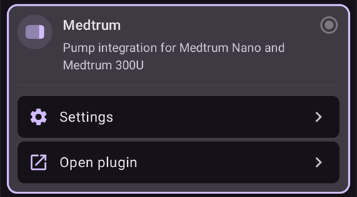
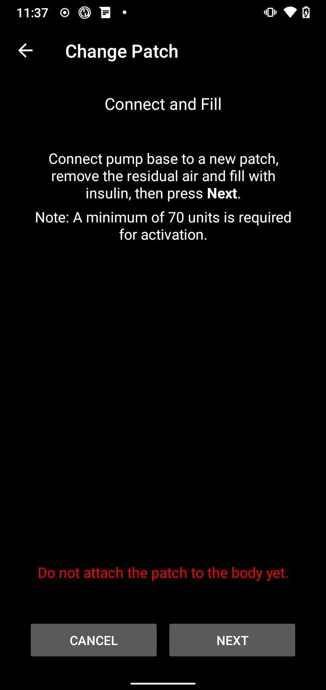
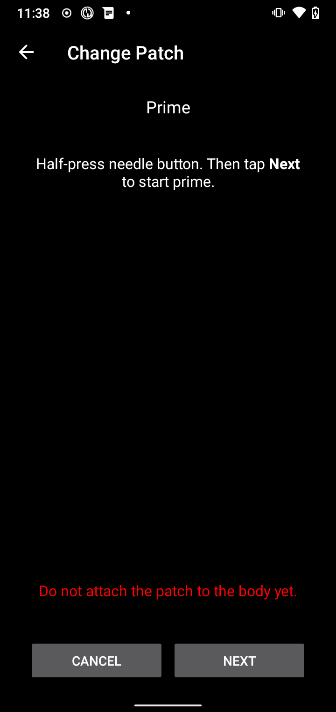
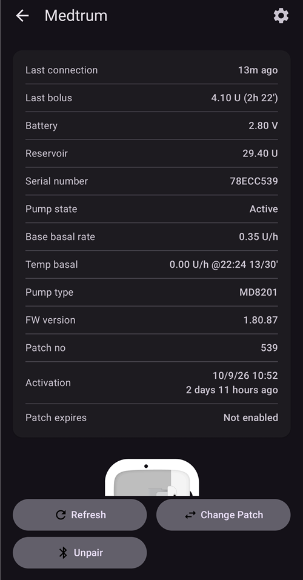

(medtrum-nano-300u)=
# Medtrum Nano 200U / 300U

Bu talimatlar Medtrum insülin pompasının yapılandırılması içindir.

```{contents} Table of contents
:depth: 1
:local: true
```

## AAPS ile pompa özellikleri
* Tüm döngü işlevleri desteklenir (SMB, GBO vb.)
* Otomatik yaz saati (DST) ve saat dilimi yönetimi
* Yayma bolus AAPS sürücüsü tarafından desteklenmez

## Donanım ve yazılım gereksinimleri
* **Uyumlu Medtrum pompa tabanı ve rezervuar Patch'leri**
    - Şu anda desteklenenler:
        - Pompa tabanı referansları **MD0201** ve **MD8201** olan Medtrum TouchCare Nano 200U.
        - Pompa tabanı referansı **MD8301** olan Medtrum TouchCare 300U.
        - Desteklenmeyen bir modeliniz varsa ve donanım bağışlamak veya testlere yardım etmek istiyorsanız lütfen discord üzerinden [buradan](https://discordapp.com/channels/629952586895851530/1076120802476441641) bizimle iletişime geçin.
* [APK oluşturma](../SettingUpAaps/BuildingAaps.md) talimatlarına göre **oluşturulmuş ve kurulmuş AAPS**.
* BLE Bluetooth bağlantısına sahip **Uyumlu Android telefon**
    - AAPS [Sürüm notlarına](../Maintenance/ReleaseNotes.md) bakın

## Başlamadan önce

**ÖNCE GÜVENLİK** Bu işlemi, bir hatayı düzeltemeyeceğiniz bir ortamda denemeyin (yedek Patch'ler, insülin ve pompa kontrol cihazları mutlaka yanınızda olmalıdır).

**PDM ve Medtrum uygulaması, AAPS ile etkinleştirilen bir Patch ile çalışmaz.** Daha önce pompanıza komut göndermek için PDM'nizi veya Medtrum uygulamasını kullanmış olabilirsiniz. Güvenlik nedeniyle etkinleştirilmiş Patch'i yalnızca onu etkinleştiren cihaz veya uygulama ile kullanabilirsiniz.

*Bu, PDM'nizi atmanız gerektiği anlamına GELMEZ. Acil durumlar için, örneğin telefonunuz kaybolursa veya AAPS düzgün çalışmazsa, PDM'yi yedek olarak güvenli bir yerde saklamanız önerilir.*

**Pompanız AAPS'e bağlı olmadığında insülin vermeyi durdurmaz** Varsayılan bazal oranları, o anda etkin olan profilde tanımlandığı şekilde pompaya programlanır. AAPS çalıştığı sürece, en fazla 120 dakika süren geçici bazal oranı komutları gönderir. Pompa herhangi bir nedenle yeni komut almazsa (örneğin pompa ile telefon arasındaki mesafe nedeniyle iletişim kesildiği için), geçici bazal oranı bittiğinde pompa, üzerinde programlı olan varsayılan bazal oranına geri döner.

**AAPS Profili 30 dakikalık bazal oranı zaman dilimini desteklemez** AAPS'te yeniyseniz ve bazal oranı profilinizi ilk kez ayarlıyorsanız, yarım saatte başlayan bazal oranlarının desteklenmediğini unutmayın; bazal oranı profilinizi saat başında başlayacak şekilde ayarlamanız gerekir. Örneğin, 09:30'da başlayan ve 11:30'da biten 2 saatlik bir süresi olan 1,1 birimlik bir bazal oranınız varsa, bu çalışmayacaktır. You will need to change this 1.1 unit basal rate to a time range of either 9:00-11:00 or 10:00-12:00. Medtrum pompa donanımı 30 dakikalık bazal oranı profil adımlarını desteklese de AAPS şu anda bunları algoritmalarında dikkate alamaz.

**0 Ü/sa profil bazal oranları AAPS'te DESTEKLENMEZ** Medtrum pompa sıfır bazal oranını desteklese de AAPS, otomatik tedaviyi belirlemek için profil bazal oranının katlarını kullanır; bu nedenle sıfır bazal oranıyla çalışamaz. Profildeki en düşük bazal oranı 0,05 Ü/sa olabilir.

Geçici sıfır bazal oranı, "Pompa bağlantısını kes" işleviyle ya da Döngüyü devre dışı bırak/Geçici bazal oranı veya Döngüyü askıya al/Geçici bazal oranı birleşimiyle elde edilebilir.

## Kurulum

```{caution}
**AAPS** ile bir Patch etkinleştirdiğinizde, Medtrum pompa tabanıyla iletişim kurabilen diğer tüm cihazları (örneğin etkin bir PDM'yi veya Medtrum uygulamasını) **MUTLAKA** kapatmalısınız.
```

### 1. Adım: Medtrum pompayı seçin

#### Option 1: New installations

**AAPS**'i ilk kez kuruyorsanız **Kurulum Sihirbazı** size kurulum boyunca yol gösterir. **Pompa** adımına geldiğinizde **Medtrum**'u seçin.

Emin değilseniz **Sanal pompa**'yı da seçebilir ve **AAPS**'i kurduktan sonra **Medtrum**'u seçebilirsiniz (bkz. seçenek 2).


#### Seçenek 2: Konfigürasyon ekranı

Mevcut bir kurulumda **Medtrum** pompayı [Konfigürasyon > Pompa](#Config-Builder-pump) içinde seçebilirsiniz:

Sol üst köşedeki **menüyü** (☰) açın, **Konfigürasyon** > **Pompa** seçeneğine dokunun ve **Medtrum** kartını seçin. Aynı anda yalnızca bir pompa etkin olabilir.


Seçildikten sonra **Medtrum** kartında iki düğme görünür: **Ayarlar** ve **Eklentiyi aç**:



**Eklentiyi aç** (veya **Yönet → Pompa**) Medtrum pompa ekranını açar. Patch'leri değiştirmek ve pompa durumunu görmek için bu ekranı kullanırsınız. Bir Patch etkinleştirilmeden önce ekran şöyle görünür:


(medtrum-step-2)=
### 2. Adım: Medtrum ayarlarını değiştirin

**Konfigürasyon** > **Pompa** içindeki **Medtrum** kartında **Ayarlar**'a dokunun. Medtrum pompa ekranının sağ üst köşesindeki dişli simgesine de dokunabilirsiniz. Bu, **Medtrum pompa ayarları** ekranını açar:


```{note}
Artık **Seri numarası** ayarı yoktur. **AAPS**, ilk kez bir Patch etkinleştirdiğinizde pompa tabanınızı Bluetooth taramasıyla bulur (bkz. [3. Adım](#medtrum-activate-patch)) ve seri numarasını hatırlar. Farklı bir pompa tabanı kullanmak için bkz. [Eşleşmeyi Kaldır](#medtrum-unpair).
```

#### Alarm Ayarları

***Varsayılan: Bip sesi.***

Bu ayar, bir uyarı veya hata olduğunda pompanın sizi uyarma şeklini değiştirir.

- **Bip sesi**: Patch, alarm ve uyarılarda bip sesi çıkarır.
- **Sessiz**: Patch, alarm ve uyarılarda sizi uyarmaz.

Not: Sessiz modda **AAPS**, telefonunuzun ses ayarlarına bağlı olarak alarmı yine de çalar. Alarma yanıt vermezseniz Patch sonunda bip sesi çıkarır.

#### Notification on pump warning

***Varsayılan: Etkin.***

Bu ayar, **AAPS**'in kritik olmayan pompa uyarıları için bildirimleri gösterme şeklini değiştirir. Etkinleştirildiğinde, şu pompa uyarılarından biri oluşursa telefonda bir bildirim gösterilir:
- Low battery
- Düşük rezervuar (20 Ü)
- Patch'in süresi yakında doluyor

Pompa alarmları **Sessiz** olarak ayarlandığında bu ayarı etkin bırakmanızı öneririz. Her iki durumda da bu uyarılar Medtrum pompa ekranında [Aktif alarmlar](#medtrum-active-alarms) altında da gösterilir.

(medtrum-patch-expiration)=
#### Patch Expiration

***Varsayılan: Etkin.***

Bu ayar Patch'in davranışını değiştirir. Etkinleştirildiğinde Patch'in süresi 3 gün sonra dolar ve ses açıksa sesli bir uyarı verir. 3 gün 8 saat sonra Patch çalışmayı durdurur.

Bu ayar devre dışıysa Patch, durmadan önce sizi uyarmaz. Yeni pompa tabanı üretici yazılımıyla bir Patch en fazla 5 gün çalışır.

#### Pompa sona erme süresi uyarısı [saat]

***Varsayılan: 72 saat.***

Bu ayar, süre sonu uyarısının zamanını değiştirir. [Patch süre sonu](#medtrum-patch-expiration) etkinse **AAPS**, etkinleştirmeden bu kadar saat sonra bir bildirim gösterir.

#### Saatlik Maksimum İnsülin [Ü]

***Varsayılan: 25 Ü.***

Bu ayar, bir saatte verilebilecek en yüksek insülin miktarını değiştirir. Bu sınır aşılırsa Patch askıya alınır ve alarm verir. Alarmı pompa ekranındaki **Alarmları sıfırla** düğmesiyle sıfırlayabilirsiniz, bkz. [Alarmları sıfırla](#nano-reset-alarms).

Bunu insülin ihtiyacınıza uygun bir değere ayarlayın.

#### Günlük Maksimum İnsülin [Ü]

***Varsayılan: 80 Ü.***

Bu ayar, bir günde verilebilecek en yüksek insülin miktarını değiştirir. Bu sınır aşılırsa Patch askıya alınır ve alarm verir. Alarmı pompa ekranındaki **Alarmları sıfırla** düğmesiyle sıfırlayabilirsiniz, bkz. [Alarmları sıfırla](#nano-reset-alarms).

Bunu insülin ihtiyacınıza uygun bir değere ayarlayın.

#### Bağlantı hatasında tara

***Varsayılan: Kapalı.***

**Gelişmiş Ayarlar** altında bulunur.

Bunu yalnızca bağlantı sorunlarınız varsa etkinleştirin. Etkinleştirildiğinde sürücü, pompaya yeniden bağlanmayı denemeden önce pompayı tekrar tarar. **AAPS** için Konum izninin "Her zaman izin ver" olarak ayarlandığından emin olun.

### 2b. Adım: AAPS uyarı ayarları

Bu ayarlar Medtrum sürücüsünün bir parçası değildir. Bunları ana ekranın sağ üst köşesindeki **Ayarlar** (dişli) simgesinden açın. Daha fazla bilgi için [Ayarlar](../SettingUpAaps/Preferences.md) sayfasına bakın.

#### BT Watchdog

**Ayarlar** > **Pompa** bölümünü açın:


**BT Watchdog**, **AAPS** pompaya bağlanamazsa telefonun Bluetooth'unu bir saniyeliğine kapatır. Bu, Bluetooth'un donduğu bazı telefonlarda yardımcı olabilir.

Pompanızla sık sık bağlantı sorunu yaşıyorsanız bu ayarı etkinleştirin.

#### Yerel uyarılar

**Ayarlar** > **Yerel uyarılar** bölümünü açın:


##### Alert if pump is unreachable

***Varsayılan: Etkin.***

Medtrum sürücüsü etkinken bu ayar zorunlu olarak açıktır. Pompaya ulaşılamadığında sizi uyarır. Bu durum, pompa menzil dışındayken veya hatalı bir Patch ya da pompa tabanı nedeniyle yanıt vermediğinde (örneğin pompa tabanı ile Patch arasına su sızdığında) oluşabilir.

Güvenlik nedeniyle bu ayar devre dışı bırakılamaz.

##### Pompa ulaşılamaz eşiği

***Varsayılan: 30 dk.***

Bu ayar, **AAPS**'in pompaya ulaşılamadığını size bildirmeden önce ne kadar bekleyeceğini değiştirir.

Medtrum pompayı kullanırken bu ayarı değiştirebilirsiniz, ancak güvenlik nedeniyle 30 dakikada bırakmanızı öneririz.

(medtrum-activate-patch)=
### 3. Adım: Patch'i etkinleştirin

**Devam etmeden önce:**
- Medtrum pompa tabanınızı ve yeni bir rezervuar Patch'ini hazır bulundurun.
- Medtrum pompayla iletişim kurabilen diğer cihazları (PDM ve Medtrum uygulaması) kapatın.
- En iyisi, **AAPS**'in kurulu olduğundan ve [bir profilin etkinleştirildiğinden](../DailyLifeWithAaps/ProfileSwitch-ProfilePercentage.md) emin olun. Etkin profil yoksa etkinleştirme, etkinleştirilecek profili seçtiğiniz bir **Profil gerekli** adımıyla başlar.

#### Etkinleştirmeyi başlatın

[Medtrum pompa ekranını](#nano-overview) (**Yönet → Pompa**) açın ve **Patch'i Değiştir** düğmesine dokunun. [Ayarların güvenliğini](#Preferences-protection) ayarladıysanız önce parolanızı veya PIN'inizi girmeniz gerekir.

Zaten etkin bir Patch varsa önce onu devre dışı bırakmanız istenir, bkz. [Patch'i devre dışı bırakma](#nano-deactivate-patch).

Etkinleştirme, adım adım ilerleyen bir sihirbazdır. Yeni bir Patch'i doldurmak ve etkinleştirmek için ekrandaki yönergeleri izleyin. Durdurmak için herhangi bir adımda **Vazgeç** düğmesine dokunun.

```{important}
Patch'i vücudunuza yalnızca sihirbaz söylediğinde (hazırlama tamamlandıktan sonra) takın ve kanülü yerleştirin.
```

Gördüğünüz ilk adımlar kurulumunuza bağlıdır:

1. **Profil gerekli**: yalnızca etkin profil yoksa. Uygulanacak profili seçin ve devam edin.
2. **Pompa Bul**: yalnızca ilk kez veya [Eşleşmeyi Kaldır](#medtrum-unpair) düğmesini kullandıktan sonra. Pompa tabanını çalıştırmak için yeni bir Patch'e bağlayın. **AAPS** yakındaki Medtrum pompa tabanlarını tarar (adları `MT` ile başlar). Listede kendi pompa tabanınıza dokunun. **AAPS** seri numarasını kaydeder, ardından doğrudan Patch'in doldurulmasına geçer.

   

3. **Patch'i Etkinleştir**: yalnızca **AAPS** pompa tabanınızı zaten tanıyorsa. Ekranda şu yazı görünür: "Aktif patch yok. Etkinleştirme işlemine başlamak için **İleri**'ye basın." Pompa tabanının henüz Patch'e bağlı **olmadığından** emin olun, ardından **İleri**'ye dokunun.


#### Patch'i bağlayın ve doldurun



Pompa tabanını Patch'e bağlayın, kalan havayı çıkarın ve Patch'i insülinle doldurun. Etkinleştirme için en az 70 Ü gereklidir. Ekranda rezervuar seviyesi gösterilir. Patch'i henüz vücudunuza takmayın.

Patch algılanıp doldurulduğunda **İleri** düğmesi görünür. Bu düğmeye dokunun.

#### İnsülin seçin

Bu adım yalnızca **AAPS**'te birden fazla insülin ayarladıysanız görünür. Patch'i doldurduğunuz insülini seçin. **AAPS**, etkinleştirmeden sonra bu insülinle bir Profil değişimi uygular.

#### Patch'i hazırlayın (prime)



Güvenlik kilidini **çıkarmayın**. Patch üzerindeki iğne düğmesine yarım basın, ardından hazırlamayı (prime) başlatmak için **İleri**'ye dokunun.


Hazırlamanın tamamlanmasını bekleyin.


Hazırlama tamamlandığında devam etmek için **İleri**'ye dokunun.

#### Bölge Rotasyonu

Bu adım yalnızca pompa bölgelerini [Bölge Rotasyonu](#Aapsscreens-site-rotation) ile yönetiyorsanız görünür (**Pompa bölge rotasyonunu yönetin** ayarı). Patch'i vücudunuzda nereye yerleştireceğinizi seçin veya bu adımı atlayın.

#### Patch'i Takın


Cildi temizleyin ve yapışkan yüzeyin koruyucu kağıtlarını çıkarın. Güvenlik kilidini çıkarın, Patch'i vücudunuza takın ve kanülü yerleştirmek için iğne düğmesine basın.

Patch'i etkinleştirmek için **İleri**'ye dokunun.

#### Patch'i Etkinleştir


**AAPS** pompayı etkinleştirir ve başlangıç bazal oranını ayarlar. Lütfen bekleyin. Etkinleştirme tamamlandığında şu ekran görünür:


```{admonition} Older screenshot
:class: note
**Pompa Bul** dışında, yukarıdaki etkinleştirme ekran görüntüleri daha eski bir **AAPS** sürümüne aittir ve **AAPS** 4'te farklı görünebilir.
```

Ekran, Patch'te kalan insülin miktarını (Ü) gösterir. Pompa ekranına dönmek için **Tamam**'a dokunun.

```{tip}
Yeni bir etkinleştirmeden sonra [ayarlarınızı dışa aktarın](../Maintenance/ExportImportSettings.md). Böylece bu Patch oturumunu daha sonra, örneğin yeni bir telefonda, kurtarabilirsiniz.
```

(nano-deactivate-patch)=

### Patch'i devre dışı bırakma

Etkin Patch'i devre dışı bırakmak için [Medtrum pompa ekranını](#nano-overview) (**Yönet → Pompa**) açın ve **Patch'i Değiştir** düğmesine dokunun.


Mevcut Patch'i devre dışı bırakmak istediğinizi onaylamanız istenir. **Bu işlem geri alınamaz.** Devre dışı bırakmak için **İleri**'ye, pompa ekranına dönmek için **Vazgeç**'e dokunun.


**AAPS** Patch'i devre dışı bırakamazsa (örneğin pompa tabanı Patch'ten zaten çıkarıldığı için), mevcut Patch oturumunu unutmak için **Çıkar**'a dokunun. Ardından yeni bir Patch etkinleştirebilirsiniz.


Devre dışı bırakma tamamlandığında iğneyi geri çekin ve Patch'i vücudunuzdan çıkarın. Pompa tabanını çıkarın ve kullanılmış Patch'i atın. Pompa ekranına dönmek için **Tamam**'a, yeni bir Patch'i etkinleştirmeye başlamak için **İleri**'ye dokunun.

(nano-resume-interrupted-activation)=

### Yarıda kalan etkinleştirmeyi sürdürme

Bir Patch etkinleştirmesi yarıda kalırsa (örneğin telefonun pili biterse) etkinleştirmeyi sürdürebilirsiniz. [Medtrum pompa ekranını](#nano-overview) (**Yönet → Pompa**) açın ve **Patch'i Değiştir** düğmesine dokunun.


Etkinleştirmeyi sürdürmek için **İleri**'ye dokunun. Etkinleştirme durumunu sıfırlayıp yeni bir Patch etkinleştirebilmek için **Çıkar**'a dokunun.


```{admonition} Older screenshot
:class: note
**Patch'i devre dışı bırakma** ve **Yarıda kalan etkinleştirmeyi sürdürme** bölümlerindeki ekran görüntüleri daha eski bir **AAPS** sürümüne aittir ve **AAPS** 4'te farklı görünebilir.
```

Sürücü, etkinleştirme durumunu pompadan okur. Bu başarılı olursa sihirbaz, durduğu adımdan devam eder.

(nano-overview)=

## Pompa ekranı

Medtrum pompa ekranı (**Yönet → Pompa**) Medtrum Patch'inin güncel durumunu gösterir. Ekranda ayrıca Patch'i değiştirmek, alarmları sıfırlamak ve durumu yenilemek için düğmeler vardır. Üstteki bir şerit önemli durumları gösterir; örneğin **Patch etkinleştirilmedi** veya **Pompa askıya alındı**.



Ekranda şu satırlar görünebilir. Bazı satırlar yalnızca bir değerleri olduğunda görünür.

- **Son bağlantı**: **AAPS**'in pompaya en son ne kadar zaman önce bağlandığı.
- **Son bolus**: verilen son bolus.
- **Pil**: Patch'in güncel pil gerilimi.
- **Rezervuar**: güncel rezervuar seviyesi.
- **Seri numarası**: pompa tabanınızın seri numarası.
- **Pompa durumu**: pompanın güncel durumu. Örneğin **Etkin** (Patch etkinleştirildi ve normal çalışıyor) veya **Durduruldu** (Patch etkinleştirilmedi).
- **Temel bazal oranı**: profilinizde şu anda geçerli olan bazal oranı.
- **Geçici Bazal**: çalışıyorsa geçici bazal oranı.
- **Aktif bolus**: şu anda verilmekte olan bolus.
- **Aktif alarmlar**: [aşağıya](#medtrum-active-alarms) bakın.
- **Pompa tipi**: pompa tabanınızın modeli.
- **Üretici yazılımı sürümü**: pompa tabanının üretici yazılımı sürümü.
- **Patch no**: etkinleştirilen Patch'in sıra numarası. Her yeni Patch etkinleştirdiğinizde bir artar.
- **Etkinleştirme**: Patch'in etkinleştirildiği tarih ve saat ile bunun ne kadar zaman önce olduğu.
- **Patch süresi doluyor**: Patch'in süresinin dolacağı tarih ve saat. [Patch süre sonu](#medtrum-patch-expiration) kapalıysa **Etkin değil** gösterir.

(medtrum-active-alarms)=
### Aktif alarmlar

Bu satır şu anda etkin olan alarmları gösterir; örneğin düşük rezervuar veya süresi dolmak üzere olan bir Patch.

### Yenile

Bu düğme Patch'in durumunu yeniler. Yalnızca bir Patch etkinken ve **AAPS** o anda pompaya bağlı değilken kullanılabilir.

### Patch'i Değiştir

Bu düğme, Patch'i değiştirmek için sihirbazı başlatır. Daha fazla bilgi için [Patch'i etkinleştirin](#medtrum-activate-patch) bölümüne bakın.

(medtrum-unpair)=
### Eşleşmeyi Kaldır

Bu düğme yalnızca **AAPS** bir pompa tabanını tanıyorsa görünür. Kayıtlı pompa tabanı seri numarasını siler ve bağlantıyı keser. Bir sonraki Patch etkinleştirmenizde **AAPS** yeniden pompa tabanı arar (**Pompa Bul** adımı). Farklı bir pompa tabanına geçerseniz bunu kullanın. Bunu yalnızca etkin Patch yokken yapın.

(nano-reset-alarms)=

### Reset alarms

**Alarmları sıfırla** düğmesi, pompa ekranında yalnızca Patch kendini askıya aldığında görünür; örneğin günlük maksimum insülin alarmından sonra. Alarmları sıfırlamak ve insülin iletimini sürdürmek için bu düğmeye dokunun.


```{admonition} Older screenshot
:class: note
Yukarıdaki ekran görüntüsü eski bir **AAPS** sürümüne aittir. **AAPS** 4'te pompa ekranı farklı görünür, ancak **Alarmları sıfırla** düğmesi aynı şekilde çalışır.
```

## Telefon değiştirme, ayarları dışa/içe aktarma

Yeni bir telefona geçtiğinizde şunları yapın:
* Eski telefonunuzda [ayarları dışa aktarın](../Maintenance/ExportImportSettings.md).
* Ayar dosyasını eski telefondan yeni telefona aktarın ve **AAPS**'e içe aktarın. İçe aktarma ekranında **Pompa ayarlarını da değiştir** seçeneğini işaretleyin; aksi halde Patch oturumu yeni telefona aktarılmaz.

İçe aktarılan ayar dosyası şu anda kullandığınız Patch oturumuna ait olmalıdır; aksi halde Patch bağlanmaz (bkz. [Hortumsuz pompalar](#ExportImportSettings-tubeless-pumps)).

Ayarlar içe aktarıldıktan sonra sürücü, geçmişi pompayla senkronize eder. Bu işlem, ayar dosyasının ne kadar eski olduğuna bağlı olarak biraz zaman alabilir. İlerleme ("Kayıtlar senkronize ediliyor, ... kaldı") ana ekranda gösterilir:


(medtrum-nano-troubleshooting)=

## Troubleshooting

### Bağlantı sorunları

Bağlantı zaman aşımları veya başka bağlantı sorunları yaşıyorsanız:
- **AAPS** için Android uygulama ayarlarında Konum iznini "Her zaman izin ver" olarak ayarlayın.
- **Bağlantı hatasında tara** (Medtrum ayarları > **Gelişmiş Ayarlar**) ve **BT Watchdog** (**Ayarlar** > **Pompa**) ayarlarını etkinleştirmeyi deneyin, bkz. [2. Adım](#medtrum-step-2).

### Bluetooth sorunları
Bluetooth bağlantılarıyla, pompa/Pod bağlantısının kopmasıyla veya etkinleştirme ve bağlantı sorunlarıyla ilgili bilinen sorunlar için: [Bluetooth sorunlarını giderme](../GettingHelp/BluetoothTroubleshooting.md)

### Etkinleştirme yarıda kaldı

Etkinleştirme yarıda kalırsa (örneğin telefon pili bittiği veya telefon çöktüğü için) etkinleştirmeyi sürdürebilirsiniz. Pompa ekranında **Patch'i Değiştir** düğmesine dokunun ve [Yarıda kalan etkinleştirmeyi sürdürme](#nano-resume-interrupted-activation) bölümündeki adımları izleyin.

### Patch hatalarını önleme

Patch çeşitli hatalar verebilir. Sık hataları önlemek için:
- Pompa tabanının Patch'e düzgün oturduğundan ve görünür bir boşluk olmadığından emin olun.
- Patch'i doldururken pistona aşırı kuvvet uygulamayın. Patch'i, modeliniz için geçerli olan en yüksek miktarın üzerinde doldurmaya çalışmayın.

## Nereden yardım alabilirsiniz?

Medtrum sürücüsünün tüm geliştirme çalışmaları topluluk tarafından **gönüllü** olarak yapılmaktadır; yardım istemeden önce bunu hatırlamanızı ve aşağıdaki kurallara uymanızı rica ediyoruz:

-  **Seviye 0:** Sorun yaşadığınız işlevin nasıl çalışması gerektiğini anladığınızdan emin olmak için bu dokümantasyonun ilgili bölümünü okuyun.
-  **Seviye 1:** Bu belgeyi kullanarak çözemediğiniz sorunlar yaşamaya devam ediyorsanız lütfen [bu davet bağlantısını](https://discord.gg/4fQUWHZ4Mw) kullanarak **Discord**'daki *#Medtrum* kanalına gidin.
-  **Seviye 2:** Sorununuzun daha önce bildirilip bildirilmediğini görmek için [Issues](https://github.com/nightscout/AAPS/issues) sayfasındaki mevcut sorunları arayın. Sorun zaten varsa lütfen onaylayın, yorum yazın veya sorununuzla ilgili bilgi ekleyin. Yoksa lütfen [yeni bir sorun (issue)](https://github.com/nightscout/AndroidAPS/issues) oluşturun ve [günlük dosyalarınızı](../GettingHelp/AccessingLogFiles.md) ekleyin.
-  **Sabırlı olun - topluluğumuzun üyelerinin çoğu iyi huylu gönüllülerden oluşur ve sorunları çözmek genellikle hem kullanıcılar hem de geliştiriciler için zaman ve sabır gerektirir.**