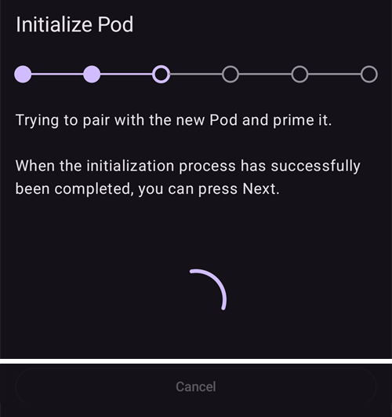
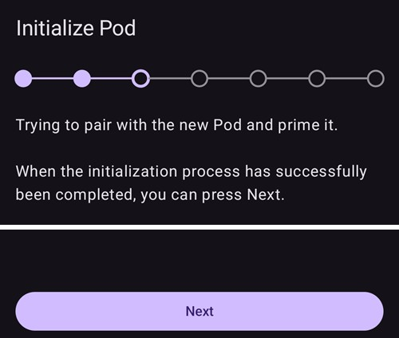
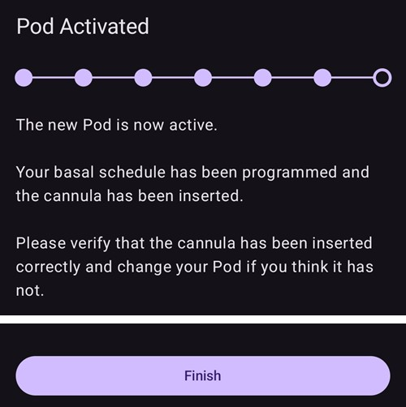
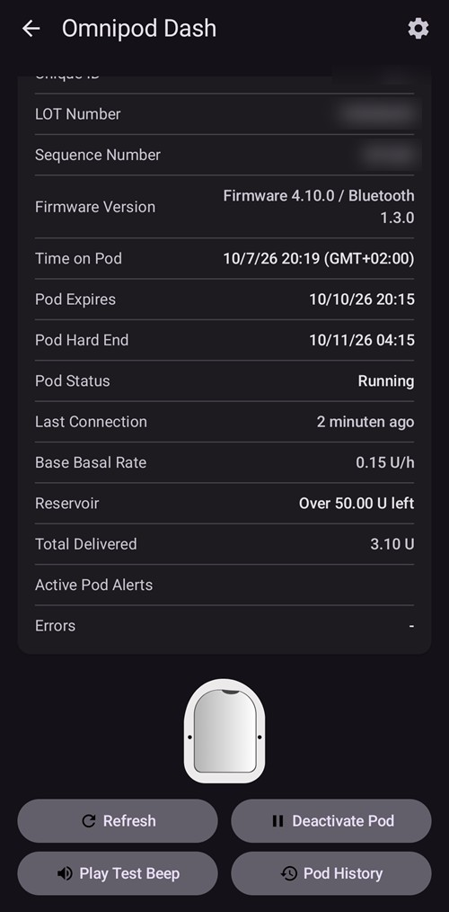
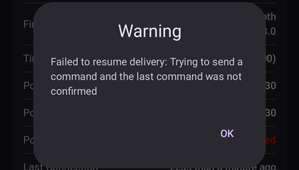
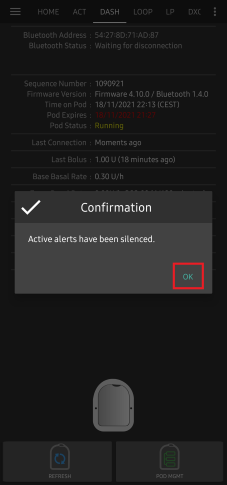
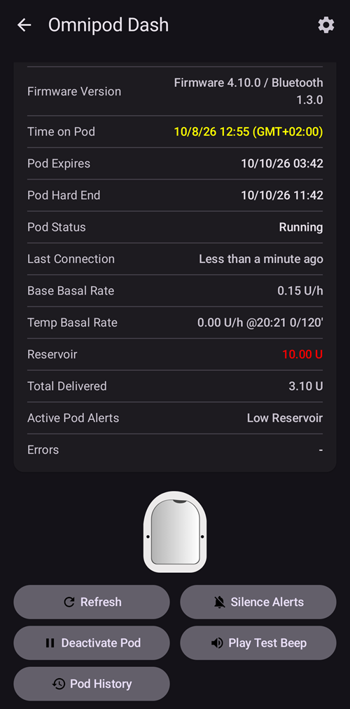
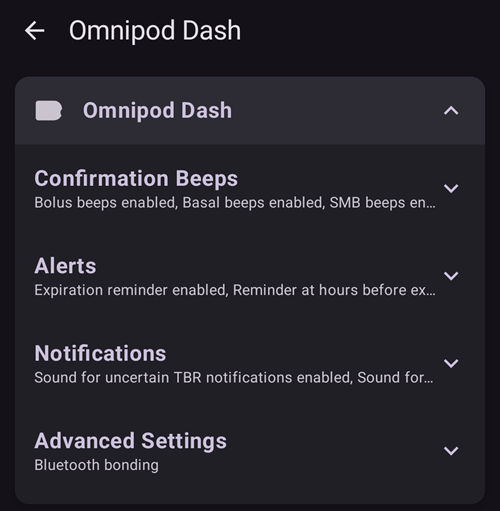
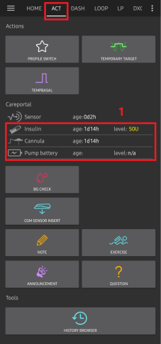

# Omnipod DASH

Bu talimatlar **Omnipod DASH** nesli pompayı **(Omnipod Eros DEĞİL)** yapılandırmak içindir. DASH sürücüsü, Omnipod ile döngü kurmanın iyice yerleşmiş bir yoludur.

```{contents} Table of contents
:depth: 1
:local: true
```

## Omnipod DASH özellikleri

**Omnipod DASH**'in ('DASH') temel özellikleri:

- DASH Pod'ları **mavi iğne kapağından** tanınır (eski EROS Pod'unun iğne kapağı şeffaftır). Bunun dışında Pod'lar fiziksel boyut olarak birbirinin aynıdır.
- DASH için bir BLE bağlantı/köprü cihazı gerekmez (RileyLink, OrangeLink veya EmaLink GEREKMEZ).
- DASH'in Bluetooth bağlantısı yalnızca bir komut gönderilirken (ör. bir Bolus) kullanılır ve komut verildikten hemen sonra kesilir.
- **AAPS**, komut göndermek için Pod'a erişilebilir olmasını bekler.
- Pod etkinleştirilirken **AAPS** yeni bir DASH Pod'u bulur ve ona bağlanır.
- Telefondan beklenen menzil: 5-10 metre (duruma göre değişebilir).

(omnipod-dash-constraints)=

## Omnipod DASH: AAPS'teki bilinen kısıtlamalar/sorunlar
- Genel öneri, **AAPS**'i Android 14 veya 16'da çalıştırmaktır. Android 15 ile ilgili topluluktan bildirilen birçok [sorun](https://github.com/nightscout/AndroidAPS/issues/3471) vardır. Ancak Android 15 kullanıyorsanız, Pod'ları başarıyla etkinleştirmek ve kullanmak için büyük olasılıkla **Bluetooth eşleşmesi** ayarını açmanız gerekecek ([Dash ayarlarının](#omnipod-dash-advanced-settings) **Gelişmiş Ayarlar** bölümünde); eşleşme (bonding) ayarları hakkında daha fazla bilgi için [Genel sorun giderme](../GettingHelp/GeneralTroubleshooting.md) sayfasına bakın.
- Yaz saati (DST) ve saat dilimi değişiklikleri otomatik olarak uygulanmaz. Saat değiştikten sonra Pod'u elle güncellemeniz gerekir: DASH pompa ekranında **Yenile**'ye, ardından **Saati ayarla**'ya basın (Pod ile telefonun saat dilimleri farklı olduğunda görünür) veya bir **Profil değişimi** yapın (bkz. [Omnipod Dash için saat dilimi değişikliği](#timezone-traveling-with-pumps)).
- Dash, bazal oranı yalnızca 0,05 Ü/sa adımlarla destekler. **AAPS profilinizde** bazalı 0,01 adımlarla ayarlamaya çalışırsanız, Pod oranı 0,05 adımlara yuvarlasa da AAPS uyarı vermez. DASH pompa ekranında **Pod Geçmişi**'ni açarsanız, 0,05 bazal ayarlandığını gösterir. Bu aynı zamanda **AAPS**'te DASH için izin verilen en düşük bazal oranın 0,05 Ü/sa olduğu anlamına gelir.
- Ayar dosyası etkin Pod oturumunu içerir. Her Pod etkinleştirmesinden sonra ayarlarınızı dışa aktarın ve ayarları içe aktarmadan önce [Ayarları dışa ve içe aktarma](#omnipod-dash-export-import) bölümüne bakın.
- Yeni bir bazal profil ayarlanırken DASH, yeni bazal **Profili** ayarlamadan önce iletimi askıya alır. İletişim kesilirse veya bir hata olursa bazal profil kendiliğinden yeniden başlamaz. Ayrıntılar için [İnsülin İletimine Devam Etme](#omnipod-dash-resuming-insulin-delivery) bölümüne bakın.
- Alarmlar yapılandırılmışsa ve Pod'un süresi dolmak üzereyse, alarmlar susturulana kadar Pod bip sesi çıkarmaya devam eder; ayrıntılar için [Pod Alarmlarını Susturma](#omnipod-dash-silencing-pod-alerts) bölümüne bakın.
- Pod etkinleştirme sorunlarına yol açabilen, Bluetooth ile ilgili bir dizi bilinen sorun vardır. Bilinen sorun ve bu sorunların çözümleri için [Bluetooth sorunlarını giderme](../GettingHelp/BluetoothTroubleshooting.md) sayfasına bakın.

(hardware-software-requirements)=

(omnipod-dash-hardware-software-requirements)=
## Donanım ve yazılım gereksinimleri

- Omnipod DASH, mavi iğne kapağından tanınır.


- Bluetooth Low Energy (BLE) destekli **uyumlu bir Android telefon** (daha fazla bilgi için [Telefonlar](../Getting-Started/Phones.md) sayfasına bakın). Ayrıca aşağıdaki bilgiler, DASH'i uyumlu bir telefonda başarıyla etkinleştirmek ve kullanmak için dikkat etmeniz gereken diğer önemli konularda size yol gösterecektir:
    -  **AAPS** Omnipod Dash sürücüsü, DASH Pod'una Bluetooth ile bağlanır.  
      **AAPS**, bir komut göndermesi gerektiğinde (ör. bir Bolus) her seferinde Pod ile otomatik olarak yeni bir Bluetooth bağlantısı kurar; komutu gönderdikten sonra Bluetooth bağlantısı hemen kesilir.
       - **NOT:**
         - Bluetooth bağlantısı, **AAPS**'i çalıştıran telefona bağlı kulaklık gibi diğer Bluetooth cihazları tarafından kesilebilir veya bozulabilir. Bu tür cihazlar bazı telefon modellerinde bağlantı hatalarına veya Pod etkinleştirme sorunlarına neden olabilir. Omnipod DASH kurulumu için telefon seçerken, çalıştığı bilinen yapılandırmalar için [test edilmiş donanım kurulumları](https://docs.google.com/spreadsheets/u/1/d/e/2PACX-1vScCNaIguEZVTVFAgpv1kXHdsHl3fs6xT6RB2Z1CeVJ561AvvqGwxMhlmSHk4J056gMCAQE02sAWJvT/pubhtml?gid=683363241&single=true) listesine göz atmanız iyi olur.
         - Pod etkinleştirme sorunlarına yol açabilen, Bluetooth ile ilgili bir dizi bilinen sorun vardır (diğer Bluetooth sorunlarıyla ilgili öneriler için [Sorun giderme](#omnipod-dash-troubleshooting) bölümüne bakın), özellikle de [Bluetooth ile ilgili sorunlar](#omnipod-dash-bluetooth-related-issues) bölümüne.
    - Telefonda **Android 12 veya daha yenisi** çalışmalı ve **AAPS**, [**APK oluşturma**](../SettingUpAaps/BuildingAaps.md) talimatlarına göre oluşturulup kurulmalıdır. Her zaman yayınlanmış en son sürümü kullanın.
- Desteklenen bir [**Sürekli Glikoz Monitörü (CGM)**](../Getting-Started/CompatiblesCgms.md)

Aşağıdaki talimatlar, **AAPS** ile yeni bir Pod oturumunun nasıl etkinleştirileceğini açıklar. Mevcut Pod'unuzun süresi dolmak üzere olana kadar beklemelisiniz, çünkü **AAPS** ile yeni bir Pod etkinleştirmeniz gerekecek. Bir Pod devre dışı bırakıldıktan sonra yeniden kullanılamaz veya yeniden etkinleştirilemez; devre dışı bırakma kesindir.

## Başlamadan önce

Bilinen bir sorunla karşılaşmamak için bu kılavuzun tamamını, **Başlamadan Önce** bölümünü ve **[Omnipod ve AAPS Kısıtlamaları ve Sorunları](#omnipod-dash-constraints)** bölümünü okuyup anladığınızdan emin olun.

### **ÖNCE GÜVENLİK** - Aşağıdakilerin tümüne erişiminiz olmadan **AAPS**'i bir Pod'a ilk kez bağlamaya **ÇALIŞMAMALISINIZ**:
1. Ek Pod'lar (3 veya daha fazla yedek)
2. Yedek insülin ve MDI (kalem/şırınga ile tedavi) malzemeleri
3. Çalışan bir Omnipod PDM (**AAPS** çalışmazsa diye)
4. Desteklenen telefonlar şarttır! (Bkz. [Donanım/Yazılım Gereksinimleri](#hardware-software-requirements))
5. AAPS'in doğru sürümü oluşturulmuş ve kurulmuş olmalı

### AAPS Dash sürücüsü Pod'unuzu etkinleştirdikten sonra Omnipod Dash PDM'niz gereksiz hale gelir.
- **AAPS**'i kullanmadan önce siz veya bakımınızı yapan kişi, DASH'inize komut göndermek (ör. bir Bolus) için Pod'u Omnipod PDM ile (veya bazı bölgelerde bir telefon uygulamasıyla) yönetiyordunuz.
- DASH, yönetim ve komut gönderme için yalnızca tek bir Bluetooth cihazıyla (ör. PDM veya telefon) bağlantı kurabilir.
- Pod'u başarıyla etkinleştiren cihaz, o andan itibaren o Pod ile iletişim kurmasına izin verilen tek cihazdır. Bu, DASH'i Android telefonunuzda **AAPS** ile etkinleştirdiğinizde **o Pod ile artık PDM'nizi kullanamayacağınız** anlamına gelir! Pod etkin olduğu sürece Android telefonunuzda çalışan **AAPS** Dash sürücüsü, Pod'unuzun yeni PDM'sidir.
- **PDM'nizi ATMAYIN!** Yedek olarak ve acil durumlar için, örneğin telefonunuz kaybolursa veya **AAPS** düzgün çalışmazsa, saklamanız önerilir.

### Pod'unuz AAPS'e bağlı olmadığında insülin iletimini **DURDURMAZ**.
Varsayılan bazal oranlar, etkinleştirme sırasında o anda etkin olan [**Profilde**](../SettingUpAaps/YourAapsProfile.md) tanımlandığı şekilde Pod'a programlanır.  
**AAPS** çalıştığı sürece, en fazla 120 dakika süren bazal oran ayarlama komutları gönderir.  
Pod herhangi bir nedenle yeni komut almazsa (örneğin Pod ➜ telefon mesafesi nedeniyle iletişim kesildiği için), Pod otomatik olarak [**Profilinizde**](../SettingUpAaps/YourAapsProfile.md) tanımlanan varsayılan bazal oranlara geri döner.

### AAPS Profilleri 30 dakikalık bazal oran zaman dilimlerini desteklemez
**AAPS**'te yeniyseniz ve bazal oran [**Profilinizi**](../SettingUpAaps/YourAapsProfile.md) ilk kez ayarlıyorsanız, yarım saatte başlayan bazal oranların desteklenmediğini unutmayın. Örneğin Omnipod PDM'nizde 09:30'da başlayan ve 2 saat sürüp 11:30'da biten 1,1 ünitelik bir bazal oranınız varsa, bu Bazal **Profilini** **AAPS**'te birebir aynı şekilde oluşturmak mümkün değildir.  
Bu 1,1 ünitelik bazal oranın zaman aralığını 9:00-11:00 veya 10:00-12:00 olarak değiştirmeniz gerekir. DASH donanımı 30 dakikalık bazal oran **Profil** adımlarını desteklese de **AAPS** bu özelliği DESTEKLEMEZ.

### 0 Ü/sa Profil bazal oranları AAPS'te DESTEKLENMEZ
DASH sıfır bazal oranını desteklese de **AAPS**, otomatik tedaviyi belirlemek için kullanıcının **Profil** bazal oranının katlarını kullanır; bu nedenle sıfır bazal oranıyla çalışamaz.  
Bunun yerine geçici sıfır bazal oranı, "Pompa bağlantısını kes" işleviyle ya da Döngüyü devre dışı bırak/Geçici bazal oranı veya Döngüyü askıya al/Geçici bazal oranı birleşimiyle elde edilebilir.  
**NOT:** **AAPS**'te DASH için izin verilen en düşük bazal oran 0,05 Ü/sa'tir.

## AAPS'te Dash'i seçme

**AAPS**'te Omnipod DASH sürücüsünü seçmenin **iki** yolu vardır:

### Option 1: New installations

**AAPS**'i ilk kez kurduğunuzda **Kurulum Sihirbazı**, **AAPS**'in temel özellikleri ve kurulum gereksinimleri konusunda size yol gösterir. **Pompa** adımına geldiğinizde **Omnipod Dash**'i seçin.


Henüz emin değilseniz, şimdilik **Sanal pompa**'yı seçebilir ve **AAPS**'i kurduktan sonra **Omnipod Dash**'i seçebilirsiniz (bkz. Seçenek 2).

(omnipod-dash-option-2-config-builder)=
### Seçenek 2: Konfigürasyon ekranı

Mevcut bir kurulumda **Omnipod Dash** pompasını **Konfigürasyon** ekranından seçebilirsiniz:

1. Ana ekranın sol üst köşesindeki **menüyü** (☰) açın ve **Konfigürasyon**'u seçin.
2. **Pompa**'ya dokunun ve **Omnipod Dash** seçenek düğmesini seçin (*"Omnipod Dash için pompa entegrasyonu (mavi iğne başlıklı, Bluetooth özellikli model)."*).

3. Seçildikten sonra **Omnipod Dash** kartında iki düğme görünür:
   - **Ayarlar**, [Dash ayarlarını](#omnipod-dash-settings) açar.
   - **Eklentiyi aç**, [DASH pompa ekranını](#omnipod-dash-tab) açar.

   

### Verification of Omnipod Driver Selection

**Omnipod Dash**'in seçili olduğunu kontrol etmek için **Yönet**'i (ana ekranın alt gezinme çubuğu) açın ve **Pompa**'ya dokunun. Bir sonraki bölümde gösterildiği gibi DASH pompa ekranı açılır.

(omnipod-dash-tab)=

## DASH pompa ekranı

DASH pompa ekranı, Pod'larınızı yönettiğiniz yerdir: Pod'ları etkinleştirir ve devre dışı bırakır, Pod durumunu yeniler, alarmları susturur ve Pod geçmişine bakarsınız. Bu ekranı **Yönet** > **Pompa** ile veya **Konfigürasyon** > **Pompa** içindeki **Omnipod Dash** kartında **Eklentiyi aç** ile açın.

Etkin Pod olmadığında ekran şöyledir:


Etkin bir Pod varken ekran şöyledir:


Sağ üst köşedeki **Ayarlar** (dişli) simgesi [Dash ayarlarını](#omnipod-dash-settings) açar.

***NOT:** Pompa ekranındaki bir alan (belirsiz) gösteriyorsa, Pod durumunu güncellemek için **Yenile**'ye basın.*

### Fields

- **Bluetooth Adresi:** Pod'un Bluetooth adresi.

- **Bağlantı kalitesi:** **AAPS**'in Pod'a ne kadar güvenilir bağlandığı; *başarılı bağlantılar / tüm bağlantı denemeleri :: başarı oranı* olarak gösterilir, örneğin `412/420 :: 98.10 %`. 50'den fazla başarılı bağlantıdan sonra değer %90'ın altında sarıya, %70'in altında kırmızıya döner. Düşük bir değer Bluetooth sorununa işaret eder (bkz. [Bluetooth ile ilgili sorunlar](#omnipod-dash-bluetooth-related-issues)).

- **İletim Durumu:** Pod'un bildirdiği ham iletim durumu. Bu alan yalnızca mühendislik modu sürümlerinde gösterilir.

- **Özgün kimlik:** **AAPS**'in etkinleştirme sırasında Pod'a verdiği benzersiz kimlik.

- **Parti Numarası:** Pod'un üretim parti (LOT) numarası.

- **Sıra Numarası:** Pod'un sıra numarası.

- **Üretici yazılımı sürümü:** Pod'un üretici yazılımı ve Bluetooth sürümleri.

- **Pod saati:** Pod'daki geçerli saat ve saat dilimi. Pod'un saat dilimi telefonun saat diliminden farklı olduğunda metin kırmızıya, Pod saati 10 dakikadan fazla saptığında sarıya döner.

- **Pod Sona Erme:** Pod'un süresinin dolacağı tarih ve saat (etkinleştirmeden 72 saat sonra). Bu zamandan önceki son 4 saatte metin sarıya döner. Pod bu zamandan sonra da insülin vermeye devam ettiği için metin hiçbir zaman kırmızıya dönmez.

- **Pod Zorunlu Sonu:** Pod'un ek süresinin sonu (**Pod Sona Erme** zamanından 8 saat sonra; en uzun Pod ömrü 80 saattir). Ek süre başladığında (**Pod Sona Erme** zamanında) metin sarıya, zorunlu sondan önceki son 4 saatte kırmızıya döner. Ek süre boyunca kalan süreyi de gösterir, örneğin *(17dk kaldı)*. Pod, zorunlu sonda insülin vermeyi durdurur ve değiştirilmesi gerekir.

- **Pod Durumu:** Pod'un durumu: **Aktif Pod Yok**, **Kurulum devam ediyor**, **Çalışıyor**, **Askıya Alındı** veya bir Pod hatasından sonra **ALARM**.

- **Son Bağlantı:** **AAPS**'in Pod ile en son ne kadar önce iletişim kurduğu.

  - *Az önce* - 10 saniyeden kısa bir süre önce.

  - *Bir dakikadan az bir süre önce* - 10 ile 60 saniye önce.

  - *XX dakika önce* - 1 dakikadan daha önce (bir saatten sonra *X saat ve XX dakika önce*).

- **Son Bolus:** Pod'a gönderilen son bolusun miktarı ve ne kadar önce verildiği. Onaylanmamış bir bolus (belirsiz) olarak işaretlenir.

- **Bazal Oranı:** Bazal **Profilinizde** şu anki saat için programlanmış bazal oran.

- **Geçici Bazal Oranı:** O anda çalışan geçici bazal oranı (GBO); başlangıç saati ve süresiyle birlikte. Bu alan yalnızca bir GBO çalışırken gösterilir.

- **Rezervuar:** Rezervuarda 50 üniteden fazla insülin kaldığında *50 Ü üzeri kaldı* gösterir. 50 ünitenin altında tam miktar gösterilir. 20 ünitenin altında değer kırmızıya döner.

- **Toplam İletilen:** Rezervuardan iletilen toplam insülin miktarı. Buna Pod'u hazırlamak (prime) için kullanılan insülin de dahildir.

- **Etkin Pod Alarmları:** O anda Pod'da etkin olan alarmlar, örneğin *Pod yakında sona erecek* veya *Düşük Rezervuar*.

- **Hatalar:** Pod arızalandıysa Pod hatası; kırmızı renkte *Pod Hatası:* ve ardından hata kodu ve adı olarak gösterilir, örneğin *Pod Hatası: 020 ALARM_OCCLUDED*. Geçmiş hatalar ve daha ayrıntılı bilgi için [Pod Geçmişi](#omnipod-dash-view-pod-history)'ni ve günlük dosyalarını inceleyin. Bkz. [Pod Hataları](#omnipod-dash-pod-failures).

- **PDM Bildirimi:** Yalnızca bir Pod hatasından sonra gösterilir. Hatayı Omnipod PDM'nin göstereceği şekilde gösterir: bir başlık (örneğin *Tıkanma tespit edildi*, *Rezervuar Boş* veya *Pod Süresi Doldu*), ne olduğu (örneğin *İnsülin iletimi durdu. Pod'u şimdi değiştirin.*) ve bir *Ref:* kodu.

### Düğmeler

Pompa ekranının altındaki düğmeler Pod'un durumuna göre değişir. Yalnızca o anda anlamlı olan düğmeler gösterilir.

- **Yenile:** Pod'dan geçerli durumunu ister.
  - *Pod durumunu güncellemek ve (belirsiz) gösteren alanları temizlemek için kullanın.*
  - *Daha fazla bilgi için aşağıdaki [Sorun giderme](#omnipod-dash-troubleshooting) bölümüne bakın.*

- **Alarmları Sustur:** Pod'un alarm bip seslerini durdurur (örneğin Pod süre sonu veya düşük rezervuar). Yalnızca Pod'da etkin bir alarm varken gösterilir. Bkz. [Pod Alarmlarını Susturma](#omnipod-dash-silencing-pod-alerts).

- **İletime devam et:** Askıya alınmış bir Pod'da insülin iletimine devam eder. Yalnızca iletim askıya alındığında gösterilir. Bkz. [İnsülin İletimine Devam Etme](#omnipod-dash-resuming-insulin-delivery).

- **Saati ayarla:** Bazal **Profilinizi** yeniden göndererek Pod'u telefonunuzun saat dilimine göre günceller. Yalnızca Pod'un saat dilimi telefonunuzun saat diliminden farklı olduğunda gösterilir.

- [**Pod'u Etkinleştir**](#omnipod-dash-activate-pod): Yeni bir Pod'u hazırlar (prime) ve etkinleştirir. Etkin Pod olmadığında gösterilir.

- [**Pod'u Devre Dışı Bırak**](#omnipod-dash-deactivate-pod): Etkin Pod'u devre dışı bırakır. Bir Pod **AAPS** ile eşleştirildiği anda gösterilir; bir etkinleştirme yarıda kaldığında da (örneğin Pod etkinleştirme sırasında arızalandığı için) gösterilir. **AAPS**, Pod'u devre dışı bırakmadan önce onaylamanızı ister.

- **Test Bip Sesi Çal:** Pod'un tek bir test bip sesi çalmasını sağlar.

- [**Pod Geçmişi**](#omnipod-dash-view-pod-history): Etkin Pod'un etkinlik geçmişini gösterir.

- **Pod'u Çıkar:** Tamamlanmamış bir Pod'u **AAPS**'ten kaldırır. Yalnızca bir Pod etkinleştirmesi yarıda kaldığında gösterilir. **AAPS** onaylamanızı ister. Çıkarma işleminden sonra **AAPS** artık o Pod ile iletişim kuramaz: Pod'u vücudunuzdan çıkarın.


```{admonition} Older screenshot
:class: note
Yukarıdaki ekran görüntüsü, ayrı bir **Pod Yönetimi** menüsü olan eski bir **AAPS** sürümüne aittir. **AAPS** 4'te **Pod'u Etkinleştir**, **Pod'u Devre Dışı Bırak**, **Test Bip Sesi Çal** ve **Pod Geçmişi** dahil tüm bu işlemler, doğrudan pompa ekranında yazılı etiketli düğmelerdir.
```

(omnipod-dash-activate-pod)=

## Pod'u Etkinleştirme

1. DASH pompa ekranını açın (**Yönet** > **Pompa**) ve **Pod'u Etkinleştir**'e basın. Etkinleştirme sihirbazı açılır.

   

   ```{admonition} Older screenshot
   :class: note
   Yukarıdaki ekran görüntüsü eski bir **AAPS** sürümüne aittir. **AAPS** 4'te **Pod'u Etkinleştir**, **Pod Yönetimi** menüsü yerine doğrudan DASH pompa ekranındaki bir düğmedir.
   ```

   Daha önce **AAPS**'te hiç **Profil** etkinleştirmediyseniz, sihirbaz önce **Profil gerekli** adımını gösterir: etkinleştirmede uygulanacak profili seçin ve devam edin.

2. **Pod'u Doldur** adımı gösterilir. Yeni bir Pod'u 3 gün yetecek kadar, **en az 80 ünite** insülinle doldurun. Pod'dan iki bip sesi gelmesini dinleyin: bu sesler en az 80 ünitenin doldurulduğu anlamına gelir. İki bip sesini duyduktan sonra bile doldurma şırıngasını tamamen boşaltın. Pod'un iğne kapağını henüz çıkarmayın.

   ***NOT:** 3 gün için gereken insülin miktarını hesaplarken, Pod'u hazırlamanın (prime) yaklaşık 3-10 ünite kullandığını unutmayın.*

   

   

   Yeni Pod ile **AAPS**'i çalıştıran telefonun birbirine yakın olduğundan emin olun ve **İleri**'ye basın.

3. **AAPS**'te birden fazla insülin kullanıyorsanız **İnsülin Seçin** adımı gösterilir. Bu adım **Şu anda aktif** olan insülini gösterir. Pod'u farklı bir insülinle doldurduysanız **Değiştir**'e basın ve o insülini seçin. Etkinleştirme bittiğinde **AAPS** bu insülinle bir **Profil değişimi** uygular. **İleri**'ye basın.

   

4. **Pod'u Başlat** adımında **AAPS** yeni Pod ile eşleşir ve onu hazırlar (prime). Pod kendini hazırlarken bir tık sesi ve ardından bir dizi tıkırtı sesi duyarsınız. Bu işlem başarıyla bittiğinde **İleri** düğmesi görünür. **İleri**'ye basın.

       

   ***NOT**: _Tarama başarısız oldu_ veya _'Could not find an available pod for activation'_ (etkinleştirme için uygun Pod bulunamadı) gibi bir hata mesajı görünürse (bu olabilir), paniğe kapılmayın. **Tekrar dene**'ye basın. Çoğu durumda etkinleştirme bundan sonra başarıyla devam eder.*

   

   Pod arızalandıysa (örneğin etkinleştirme süresi aşıldığı için), **Tekrar dene** yerine **Pod'u Devre Dışı Bırak** gösterilir. Bunu kullanın ve yeni bir Pod ile baştan başlayın.

   Etkinleştirme bitmeden **Vazgeç**'e basarsanız **AAPS**, çıkmak istediğinizi onaylamanızı ister. Sihirbazdan çıkmak için **Tamam**'a, sihirbazda kalmak için **Vazgeç**'e basın.

   

5. Pompa bölge rotasyonunu **AAPS**'te yönetiyorsanız ([Bölge Rotasyonu](#Aapsscreens-site-rotation) ayarlarında **Pompa bölge rotasyonunu yönetin**), **Bölge konumu** adımı gösterilir. Vücut şemasında Pod'u nereye yerleştireceğinizi seçin ve **İleri**'ye basın ya da **Atla**'ya basın.

   

6. Ardından yeni Pod için infüzyon bölgesini hazırlayın. Enfeksiyon riskini önlemek için ellerinizi yıkayın. İnfüzyon bölgesini sabun ve suyla veya alkollü mendille temizleyin ve devam etmeden önce cildin havayla tamamen kurumasını bekleyin. Yapışkan cildinizi tahriş ediyorsa, bariyer mendili veya bariyer spreyi kullanmayı düşünün.

   **Pod'u Tak** adımında Pod'un mavi plastik iğne kapağını çıkarın. Kanül veya başka bir şey Pod'dan dışarı çıkıyorsa ya da Pod olağan dışı görünüyorsa **DURUN**: **Vazgeç**'e basın ve yeni bir Pod ile baştan başlayın. Her şey **YOLUNDA** görünüyorsa, yapışkanın üzerindeki beyaz koruyucu kağıdı çıkarın ve Pod'u vücudunuzda seçtiğiniz bölgeye yapıştırın.

   Bitirdiğinizde **İleri**'ye basın.

   

7. Bir onay iletişim kutusu görünür: *Tamam'a bastığınızda kanül yerleştirilecektir.* **Tamam'a YALNIZCA kanülü yerleştirmeye hazırsanız basın!**

   

8. **Kanül Yerleştir** adımında **AAPS** bazal programınızı ayarlar ve Pod kanülü yerleştirir. Bu biraz zaman alabilir (en fazla 1-2 dakika). **Sabırlı olun!**

   ***NOT:** Kanül yerleştirilmeden önce kanülün gireceği noktanın yakınındaki cildi sıkıştırmak iyi bir uygulamadır. Bu, iğnenin sorunsuz girmesine yardımcı olur ve tıkanıklık olasılığını azaltır.*

       

9. Kanül başarıyla yerleştirildiğinde **İleri** düğmesi görünür. **İleri**'ye basın.

   

10. **Pod Etkinleştirildi** adımı gösterilir. Kanülün doğru yerleştirildiğini kontrol edin; doğru yerleştirilmediğini düşünüyorsanız Pod'u değiştirin.

    **Bitir**'e basın.

    Tebrikler! Artık yeni bir Pod oturumu başlattınız.

    

11. DASH pompa ekranına geri dönersiniz. Ekran artık etkin Pod'unuzun bilgilerini gösterir: geçerli bazal oran, rezervuar seviyesi, iletilen insülin, Pod hataları ve alarmlar dahil. **Pod'u Etkinleştir**'in yerini **Pod'u Devre Dışı Bırak** alır: etkin Pod'u önce devre dışı bırakmadan başka bir Pod etkinleştiremezsiniz.

    ***NOT:** Gösterilen bilgiler hakkında daha fazla ayrıntı için [DASH pompa ekranı](#omnipod-dash-tab) bölümüne bakın.*

    

    ***NOT:** Pod'u etkinleştirdikten SONRA ayarlarınızı dışa aktarmak iyi bir uygulamadır. Ayarlarınızı her Pod değişiminden sonra ve ayda bir dışa aktarın. Telefonunuzu kaybetme ihtimaline karşı dışa aktarılan ayar dosyasını bir bulut depolama alanına (örneğin Google Drive) veya telefonunuzun dışında bir yere kopyalayın (bkz. [**Ayarları dışa aktar**](../Maintenance/ExportImportSettings.md)).*

Daha önceki bir etkinleştirme Pod hazırlandıktan sonra durduysa, **Pod'u Etkinleştir**'e basmak işlemi **Pod'u Tak** adımından sürdürür.

(omnipod-dash-deactivate-pod)=

## Deactivate Pod

Normal koşullarda bir Pod üç gün (72 saat) dayanır; buna Pod süre sonu uyarısından sonraki 8 saatlik ek süre eklenir: toplam 80 saat.

Bir Pod'u devre dışı bırakmak için (süresi dolduğu ya da arızalandığı için):

1. DASH pompa ekranını açın (**Yönet** > **Pompa**) ve **Pod'u Devre Dışı Bırak**'a basın.

   

2. **Pod'u Devre Dışı Bırak** adımında **İleri**'ye basın. Bir iletişim kutusu şunu sorar: *Devre dışı bırakılmış bir Pod tekrar kullanılamaz. Bu Pod'u şimdi devre dışı bırakmak istiyor musunuz?* Pod'u devre dışı bırakmaya başlamak için **Tamam**'a, Pod'u korumak için **Vazgeç**'e basın. Devre dışı bırakma tüm insülin iletimini askıya alır ve geri alınamaz.

   

3. **AAPS** Pod'u devre dışı bırakırken **Pod Devre dışı bırakılıyor** adımı gösterilir. Pod, devre dışı bırakmanın başarılı olduğunu bip sesiyle onaylar.

   

   ```{admonition} Older screenshot
   :class: note
   Yukarıdaki ekran görüntüsü eski bir **AAPS** sürümüne aittir. **AAPS** 4'te sihirbaz ilerlemesini bir ilerleme çubuğu yerine üstte bir sıra nokta olarak gösterir.
   ```

   Devre dışı bırakma başarıyla bittiğinde **İleri** düğmesi görünür. **İleri**'ye basın.

   

   Devre dışı bırakma başarısız olursa bir hata mesajı ve **Pod'u Çıkar** düğmesi gösterilir. Bu düğmeyi kullanmadan önce aşağıdaki [Pod'u çıkarma](#omnipod-dash-discard-pod) bölümüne bakın. Ayrıca **Vazgeç**'e basıp daha sonra **Pod'u Devre Dışı Bırak**'ı yeniden deneyebilirsiniz.

4. **Pod Devre dışı bırakıldı** adımı gösterilir. Pod'u vücudunuzdan çıkarın ve **Bitir**'e basın.

   

5. DASH pompa ekranına geri dönersiniz. **Pod Durumu** alanında **Aktif Pod Yok** yazdığını ve **Pod'u Etkinleştir** düğmesinin yeniden gösterildiğini kontrol edin.

   

(omnipod-dash-discard-pod)=

### Pod'u çıkarma

Bir Pod'u yalnızca onunla tüm iletişim sürekli başarısız olduğunda çıkarın. **AAPS** Pod ile hâlâ iletişim kurabiliyorsa bunun yerine **Pod'u Devre Dışı Bırak**'ı kullanın.

- **AAPS**, Pod'u çıkarmadan önce onaylamanızı ister.
- Bundan sonra **AAPS** o Pod ile artık iletişim kuramaz.
- Pod düzgün devre dışı bırakılmadığı için **insülin iletimi askıya ALINMAMIŞTIR**. **Pod'u vücudunuzdan çıkarın!**
- **Pod Çıkarıldı** adımı, Pod durumunun silindiğini onaylar. **Bitir**'e basın. Artık yeni bir Pod etkinleştirebilirsiniz.

(omnipod-dash-resuming-insulin-delivery)=

## İnsülin İletimine Devam Etme

**NOT**: **Profil değişimleri** sırasında, PDM kullanırken olduğu gibi, **AAPS** yeni bazal **Profili** ayarlamadan önce Pod'da iletimi askıya almak zorundadır. Askıya alma ve devam ettirme komutları arasında iletişim başarısız olursa iletim askıda kalabilir. Daha fazla ayrıntı için sorun giderme bölümündeki [**İletim askıya alındı**](#omnipod-dash-delivery-suspended) kısmını okuyun.

İnsülin iletimi askıya alındığında, Pod'a insülin iletimine devam etmesini söylemeniz gerekir. Komut başarıyla işlendiğinde Pod, etkin bazal **Profilinizdeki** şu anki saate ait bazal oranı kullanarak yeniden insülin verir. Pod yeniden bolus, **GBO** ve **SMB** komutlarını kabul eder.

1. DASH pompa ekranını açın ve **Pod Durumu** alanında **Askıya Alındı** yazdığını kontrol edin. Pod'a normal insülin iletimine devam etmesini söylemek için **İletime devam et**'e basın.

   

2. Komut başarılı olduğunda **Pod Durumu** alanında **Çalışıyor** yazar ve **İletime devam et** düğmesi kaybolur.

   

   

   ```{admonition} Older screenshot
   :class: note
   Yukarıdaki ekran görüntüleri, bir onay iletişim kutusu gösteren eski bir **AAPS** sürümüne aittir. **AAPS** 4'te sonucu DASH pompa ekranında doğrularsınız: **Pod Durumu** alanında **Çalışıyor** yazar ve **İletime devam et** düğmesi kaybolur.
   ```

   Komut başarısız olursa **AAPS**, *İletim devam ettirilemedi* ile başlayan bir uyarı iletişim kutusu gösterir. **Yenile**'ye basın ve yeniden deneyin.

   

(omnipod-dash-silencing-pod-alerts)=

## Silencing Pod Alerts

Bu bölüm, Pod ömrünün sonuna yaklaştığında Pod'un bip seslerini nasıl durduracağınızı açıklar. Bu bip seslerinin ne zaman başlayacağı **Alarmlar** ayarlarına bağlıdır (bkz. [Dash Ayarları](#omnipod-dash-settings)):

- **Süre bitiminden önce hatırlatma (72 Saat):** Pod'un 72 saatlik süre sonundan kaç saat önce bip sesi çıkarmaya başlayacağı.
- **Pompa kapanmadan önce uyar (80 Saat):** Pod'un 80 saatlik kapanmadan kaç saat önce yeniden bip sesi çıkaracağı.

Bir Pod'un en uzun ömrü 80 saattir (3 gün 8 saat). Ancak Pod üreticisi 72 saati (3 günü) aşmamayı önerir.

***NOT**: **Alarmları Sustur** düğmesi, DASH pompa ekranında yalnızca Pod'da etkin bir alarm varken gösterilir; örneğin Pod süre sonu veya düşük rezervuar. **Alarmları Sustur** düğmesi gösterilmiyor ama Pod'un bip sesi çıkardığını duyuyorsanız **Yenile**'ye basın.*

1. Hatırlatma zamanı geldiğinde Pod, süresinin yakında dolacağını ve değiştirmeniz gerektiğini bildirmek için bip sesi çıkarır. DASH pompa ekranında **Pod Sona Erme (1)** alanı, Pod'un süresinin dolacağı kesin zamanı gösterir (etkinleştirmeden 72 saat sonra). Bu zamandan 4 saat önce metin sarıya döner. Bu zamandan sonra **Pod Zorunlu Sonu** sarıya döner ve Pod insülin vermeyi durdurana kadar kalan süreyi gösterir. **Etkin Pod Alarmları (2)** alanında **Pod yakında sona erecek** yazar ve **Alarmları Sustur (3)** düğmesi gösterilir.

   

2. **Alarmları Sustur**'a basın. **AAPS**, süre sonu bip seslerini durdurmak için Pod'a komut gönderir.

   

   ```{admonition} Older screenshot
   :class: note
   Yukarıdaki ekran görüntüsü, bu ekranın **DASH** sekmesi olduğu eski bir **AAPS** sürümüne aittir. **AAPS** 4'te **Alarmları Sustur** düğmesi DASH pompa ekranındadır (**Yönet** > **Pompa**).
   ```

3. Alarmlar susturulduğunda alarm artık **Etkin Pod Alarmları** alanında gösterilmez, **Alarmları Sustur** düğmesi kaybolur ve Pod süre sonu bip seslerini durdurur.

   

   ```{admonition} Older screenshot
   :class: note
   Yukarıdaki ekran görüntüsü, bir onay iletişim kutusu gösteren eski bir **AAPS** sürümüne aittir. **AAPS** 4'te sonucu DASH pompa ekranında doğrularsınız: alarm **Etkin Pod Alarmları** alanından kaybolur.
   ```

   Komut başarısız olursa **AAPS**, *Uyarılar susturulamadı* ile başlayan bir uyarı iletişim kutusu gösterir. **Yenile**'ye basın ve yeniden deneyin.

Düşük rezervuar alarmı da aynı şekilde çalışır. Pod'da kalan insülin, **Alarmlar** ayarlarında belirlenen **Ünite sayısı** değerine düştüğünde Pod bip sesi çıkarır. **Rezervuar** alanı kalan miktarı, **Etkin Pod Alarmları** alanı **Düşük Rezervuar** uyarısını gösterir ve **Alarmları Sustur** düğmesi görünür. Bip seslerini durdurmak için **Alarmları Sustur**'a basın ve bir sonraki Pod değişiminizi planlayın.



(omnipod-dash-view-pod-history)=

## Pod Geçmişini Görüntüleme

Bu bölüm, etkin Pod'unuzun geçmişine nasıl bakacağınızı ve geçmişi işlem türüne göre nasıl filtreleyeceğinizi açıklar. Pod geçmişi, etkin Pod'unuza üç günlük (72 - 80 saat) ömrü boyunca gönderilen komutları ve sonuçlarını gösterir.

Pod'a gönderilen bolusları, GBO'ları ve bazal komutlarını kontrol etmek için kullanışlıdır. Diğer kategoriler sorun gidermeye yardımcı olur ve bir arızaya yol açan olayların sırasını gösterir.

**NOT:** **Yalnızca son komut belirsiz olabilir**. **Son 'belirsiz' komut 'onaylandı' veya 'reddedildi' durumuna geçene kadar** yeni komutlar *gönderilmez*. Belirsiz bir komutu 'düzeltmek' için DASH pompa ekranında **Yenile**'ye basın.

1. DASH pompa ekranını açın ve **Pod Geçmişi**'ne basın.

   

   ```{admonition} Older screenshot
   :class: note
   Yukarıdaki ekran görüntüsü eski bir **AAPS** sürümüne aittir. **AAPS** 4'te **Pod Geçmişi**, **Pod Yönetimi** menüsü yerine doğrudan DASH pompa ekranındaki bir düğmedir.
   ```

2. **Pod Geçmişi** ekranı, **Tümü** filtresi seçili olarak açılır. Her komutu zamanı ve sonucuyla, en yenisi en üstte ve güne göre gruplanmış olarak listeler. Yalnızca bir komut türünü göstermek için üstteki filtre düğmelerini kullanın (örneğin **Boluslar** veya **Bazallar**). DASH pompa ekranına dönmek için geri okuna basın.

    

   ```{admonition} Older screenshot
   :class: note
   Yukarıdaki ikinci ekran görüntüsü, komut türünü bir **Tür** listesinden seçtiğiniz eski bir **AAPS** sürümüne aittir. **AAPS** 4'te ilk ekran görüntüsünde gösterilen filtre düğmelerini kullanırsınız.
   ```

   Boluslarda, normal bolus olmadığında miktarın ardından bolus türü gelir; örneğin *0,05 Ü (SMB)* veya *0,05 Ü (Bazal düzeltme)*. Bazal düzeltme, sürücünün kendiliğinden gönderdiği çok küçük bir bolustur (bir Pod darbesi, 0,05 Ü); bunu siz istemediniz.

   ```{admonition} Why basal corrections happen
   :class: note
   Pod, bazal insülini dahili bir saatle zamanlanan 0,05 Ü'lik darbelerle verir. Bazal oran her değiştiğinde (örneğin döngü yeni bir **GBO** ayarladığında) Pod bu saati yeniden başlatır ve saymakta olduğu darbe kaybolur. Döngü bazal oranı sık değiştirdiği için, özellikle gece boyunca, Pod beklenenden daha az bazal insülin verebilir.

   **AAPS**, Pod'un verildiğini bildirdiği bazal insülini vermesi gereken miktarla karşılaştırır. Eksik miktar yarım darbe veya daha fazlasına ulaştığında sürücü bazal düzeltme olarak bir ek darbe verir; böylece profilinizin ve döngünün istediği bazal insülini yine de alırsınız. Pod askıya alınmışken veya sıfır **GBO** çalışırken düzeltme gönderilmez.
   ```

(omnipod-dash-settings)=

## Dash Ayarları

Dash sürücü ayarlarını açmanın iki yolu vardır:

- [DASH pompa ekranının](#omnipod-dash-tab) sağ üst köşesindeki **Ayarlar** (dişli) simgesine basın.
- Ana ekranın sol üst köşesindeki **menüyü** (☰) açın ve **Konfigürasyon** > **Pompa**'yı seçin. **Omnipod Dash** kartında **Ayarlar**'a basın.

Ayarlar, açılıp kapanabilen dört bölümde gruplanmıştır: **Onay Bipleri**, **Alarmlar**, **Bildirimler** ve **Gelişmiş Ayarlar**. Bir bölümü açmak için üzerine dokunun:



Ayarların çoğu açma/kapama anahtarıdır.

### Onay Bipleri


Bolus, bazal, SMB ve GBO iletimi ve değişiklikleri için Pod'dan gelen onay bip sesleri.

**Bolus bip seslerini etkinleştir:**    Bir bolus verildiğinde Pod bip sesi çıkarır. Varsayılan olarak açıktır.

**Bazal bip seslerini etkinleştir:**    Yeni bir bazal oran ayarlandığında veya etkin bazal oran iptal edildiğinde ya da değiştirildiğinde Pod bip sesi çıkarır. Varsayılan olarak kapalıdır.

**SMB bip seslerini etkinleştir:**  Bir SMB verildiğinde Pod bip sesi çıkarır. Varsayılan olarak açıktır.

**GBO bip seslerini etkinleştir:**  Bir GBO ayarlandığında veya iptal edildiğinde Pod bip sesi çıkarır. Varsayılan olarak kapalıdır.

### Alerts


```{admonition} Older screenshot
:class: note
Yukarıdaki ekran görüntüsü eski bir **AAPS** sürümüne aittir. **AAPS** 4'te bu ayarlar açılıp kapanabilen **Alarmlar** bölümündedir.
```

Pod süre sonu, kapanma ve düşük rezervuar için Pod alarmları. Bir Pod etkinken bu ayarları değiştirdiğinizde **AAPS** yeni alarm ayarlarını Pod'a gönderir.

***NOT:** Alarm tetiklendikten sonra **AAPS** Pod ile iletişim kurar kurmaz, her alarm için HER ZAMAN bir **AAPS** bildirimi gösterilir. Bildirimi kapatmak Pod alarmını DURDURMAZ. Alarmı durdurmak için DASH pompa ekranını açın ve **Alarmları Sustur**'a basın.*

**Süre sonu hatırlatıcısını etkinleştir:**    Bu ayar açıkken, hatırlatma zamanı geldiğinde Pod bip sesi çıkarır. Varsayılan olarak açıktır.

**Süre bitiminden önce hatırlatma (72 Saat):** Hatırlatmanın, Pod'un 72 saatlik süre sonundan kaç saat önce başlayacağı (1 ile 24 saat arası; varsayılan 4).

**Süre sonu alarmını etkinleştir:**   Bu ayar açıkken, alarm zamanı geldiğinde ve kapanmadan 1 saat önce yeniden Pod bip sesi çıkarır. Varsayılan olarak açıktır.

**Pompa kapanmadan önce uyar (80 Saat):**  Alarmın, Pod'un 80 saatlik kapanmasından kaç saat önce başlayacağı (1 ile 8 saat arası; varsayılan 8).

**Düşük rezervuar uyarısını etkinleştir:**    Rezervuarda kalan insülin **Ünite sayısı** değerine düştüğünde Pod sizi uyarır. Varsayılan olarak açıktır.

**Ünite sayısı:**    Düşük rezervuar alarmının tetikleneceği ünite sayısı (5 ile 50 ünite arası; varsayılan 20).

### Notifications


Bir GBO'nun, SMB'nin veya bolusun verilip verilmediğinden emin olunamadığında ve iletim askıya alındığında **AAPS**'in bildirimleriyle birlikte ses çalıp çalmayacağını seçin.

***NOT:** Bunlar yalnızca telefon bildirimleridir; Pod'un kendisi bip sesi çıkarmaz.*

**Belirsiz GBO bildirimleri için sesi etkinleştir:**  **AAPS** bir GBO'nun ayarlanıp ayarlanmadığından emin olamadığında bildirimle birlikte ses çalar.

**Belirsiz SMB bildirimleri için sesi etkinleştir:**  **AAPS** bir SMB'nin verilip verilmediğinden emin olamadığında bildirimle birlikte ses çalar.

**Belirsiz bolus bildirimleri için sesi etkinleştir:**    **AAPS** bir bolusun verilip verilmediğinden emin olamadığında bildirimle birlikte ses çalar.

**İletimin askıya alındığı bildirimi etkinleştirildiğinde sesle uyar:**     İnsülin iletimi askıya alındığında bildirimle birlikte ses çalar.

(omnipod-dash-advanced-settings)=

### Advanced Settings


**Bluetooth eşleşmesi:**  Pod'u telefonla Bluetooth üzerinden eşleştirir (bonding). Bunu yalnızca Pod sabit bir bağlantı sağlayamıyorsa deneyin, örneğin Android 15'te (bkz. [Omnipod DASH: AAPS'teki bilinen kısıtlamalar/sorunlar](#omnipod-dash-constraints)). Bu ayar açıkken telefon, kabul etmeniz gereken eşleştirme istekleri gösterir. Pod düzgün bağlanıyorsa bu ayarı kapalı bırakın. Android 15'ten önceki sürümlerde hiçbir etkisi yoktur. Varsayılan olarak kapalıdır.

## İnsülin ve kanül yaşı

Ana ekrandaki [durum satırı](#screens-sensor-level-battery) insülininizin ve kanülünüzün yaşını gösterir. Omnipod'da bunlar hortumlu pompalardan biraz farklı çalışır.

**AAPS**, her Pod etkinleştirdiğinizde otomatik olarak bir kanül değişimi ve bir insülin değişimi kaydeder. Bu, her Pod değişiminden sonra **İnsülin** ve **Kanül** yaşlarını sıfırlar. Bunları **Hazırla/doldur** ile kendiniz kaydetmeniz gerekmez. Bunun nedeni, Pod'un kanülü yapıştırıldığı yerde doğrudan cilde yerleştirmesidir: Omnipod hortum kullanmaz.

**Pompa pili** yaşı bildirilmez: pil ve insülin rezervuarı her Pod'un içinde yerleşiktir ve pil her zaman Pod'un kendisinden daha uzun dayanır (en fazla 80 saat).



```{admonition} Older screenshot
:class: note
Yukarıdaki ekran görüntüsü, bu yaşların **Eylemler** sekmesinin **Careportal** bölümünde gösterildiği eski bir **AAPS** sürümüne aittir. **AAPS** 4'te bu yaşlar ana ekrandaki durum satırında gösterilir.
```

### Level

**Insulin Level**

Gösterilen insülin seviyesi, Pod'un bildirdiği miktardır. Ancak Pod gerçek rezervuar seviyesini yalnızca 50 ünitenin altındayken bildirir. O zamana kadar *50 Ü üzeri kaldı* gösterilir. Bildirilen miktar kesin değildir: Pod 'boş' bildirdiğinde çoğu durumda rezervuarda hâlâ birkaç ünite insülin kalmıştır.

DASH pompa ekranı seviyeyi şöyle gösterir:

  * **50 Ü üzeri kaldı** - Pod rezervuarda 50 üniteden fazla insülin olduğunu bildirir.
  * **50 ünitenin altında** - Pod'un bildirdiği şekilde, rezervuarda kalan tam insülin miktarı.

Additional note:
  * **SMS** - SMS yanıtlarında değeri veya 50 ünitenin üzerindeyken 50+U değerini döndürür.
  * **Nightscout** - 50 ünitenin üzerindeyken Nightscout'a 50 değerini yükler (sürüm 14.07 ve daha eskisi). Daha yeni sürümler 50 ünitenin üzerindeyken 50+ değerini bildirir.

(omnipod-dash-troubleshooting)=

## Troubleshooting

Bu bölüm, Omnipod DASH'in AAPS ile kullanımında sık görülen bilinen sorunları ve çözümlerini içerir. Dokümantasyonda ayrıca [Genel sorun giderme](../GettingHelp/GeneralTroubleshooting.md) bölümü de vardır; bazı Pod sorunlarıyla ilgili konuları da kapsadığı için bu bölümü de incelemelisiniz.

---

(omnipod-dash-bluetooth-related-issues)=

## Bluetooth ile ilgili sorunlar

Bluetooth bağlantılarıyla, pompa/Pod bağlantısının kopmasıyla veya etkinleştirme ve bağlantı sorunlarıyla ilgili bilinen sorunlar için: [Bluetooth sorunlarını giderme](../GettingHelp/BluetoothTroubleshooting.md)

---

(omnipod-dash-delivery-suspended)=

### İletim askıya alındı

  - Artık iletimi askıya alma butonu yok. Pod'u "askıya almak" istiyorsanız, x dakika için sıfır **GBO** ayarlayabilirsiniz.
  - **Profil değişimleri** sırasında DASH, yeni bazal **Profili** ayarlamadan önce iletimi askıya almak zorundadır. İki komut arasında iletişim başarısız olursa, iletim askıya alınabilir. Bu olduğunda:
     - Bazal, SMB, Manuel bolus vb. içeren insülin iletimi olmayacaktır.
     - Komutlardan birinin onaylanmadığına dair bir bildirim olabilir: bu, hatanın ne zaman gerçekleştiğine bağlıdır.
     - **AAPS**, yeni bazal profili her 15 dakikada bir ayarlamayı dener.
     - İletim hâlâ askıya alınmışsa (iletime devam etme başarısız olduysa), **AAPS** her 15 dakikada bir iletimin askıya alındığını bildiren bir bildirim gösterir.
     - İletime elle devam etmek isterseniz DASH pompa ekranında [**İletime devam et**](#omnipod-dash-resuming-insulin-delivery) düğmesi gösterilir.
     - **AAPS** iletime kendisi devam edemezse (bu, Pod'a ulaşılamadığında, ses kapalı olduğunda vb. olur), Pod 3 dakika boyunca her dakika 4 kez bip sesi çıkarır; iletim 20 dakikadan uzun süre askıda kalırsa bu her 15 dakikada bir tekrarlanır.
  - Onaylanmamış komutlar için, onaylamak veya reddetmek üzere DASH pompa ekranında **Yenile**'ye basın.

*****NOT:** Pod'dan bip sesleri duyduğunuzda, telefonu kontrol etmeden iletimin devam edeceğini varsaymayın; iletim askıda kalabilir, ***bu yüzden kontrol etmeniz gerekir!******

---
(omnipod-dash-pod-failures)=

### Pod Failures

- Pod'lar, Pod'un kendi donanım sorunları da dahil olmak üzere çeşitli nedenlerle ara sıra arızalanabilir.
- AAPS, Pod'ları kullanmanın onaylı bir yöntemi olmadığından Insulet'e destek veya değişim talebi açmamak en iyisidir.
- Nedeni bulmanıza yardımcı olacak hata kodlarının listesini [**burada bulabilirsiniz**](https://github.com/openaps/openomni/wiki/Fault-event-codes).

Bir Pod arızalandığında insülin vermeyi durdurur ve sürekli bip sesi çıkarır. **AAPS**, ana ekranda hata kodu ve adıyla birlikte *Ref:* kodunu içeren bir bildirim gösterir, örneğin *Pod Hatası: 020 ALARM_OCCLUDED*. Bildirimi kapatmak için **Kapat**'a basın. Bu, Pod'un bip seslerini durdurmaz.


DASH pompa ekranında **Pod Durumu** alanında **ALARM** yazar, **Hatalar** alanı Pod hatasını gösterir ve **PDM Bildirimi** alanı hatayı açıklar, örneğin *Tıkanma tespit edildi. İnsülin iletimi durdu. Pod'u şimdi değiştirin. KŞ'nizi kontrol edin*.


Arızalanan bir Pod yeniden kullanılamaz. Kan şekerinizi kontrol edin, ardından [Pod'u devre dışı bırakın](#omnipod-dash-deactivate-pod) ve yeni bir Pod etkinleştirin.

---
### Preventing error 49 pod failures

Bu hata, bir komut için yanlış Pod durumu veya bir insülin iletim komutu sırasında oluşan bir hata ile ilgilidir. This is when the driver and Pod disagree on the actual state. Pod (yerleşik bir güvenlik önlemi olarak) bu durumda düzeltilemeyen 49 (0x31) hata koduyla tepki verir ve “screamer” (çığlık atan) denen duruma geçer: bu uzun ve rahatsız edici bip sesi, ancak Pod'un arkasındaki uygun yere bir delik açılarak durdurulabilir. “49 Pod arızasının” kesin nedenini bulmak çoğu zaman zordur. Bu durum örneğin uygulama çöktükten sonra, bir geliştirme sürümü çalıştırırken veya yeniden kurulumdan sonra olabilir.

---

### Pump Unreachable Alerts

Önceden ayarlanmış bir süre boyunca Pod ile iletişim kurulamazsa “Pompaya ulaşılamıyor” uyarısı verilir. Pompaya ulaşılamıyor uyarıları, ana ekranın sağ üst köşesindeki **Ayarlar** (dişli) simgesine basıp ardından **Yerel uyarılar** ➜ **Pompa ulaşılamaz eşiği** seçilerek yapılandırılabilir. Önerilen değer, **120** dakika sonra uyarı vermektir.

---
(omnipod-dash-export-import)=
### Ayarları dışa ve içe aktarma

**AAPS** ayarlarını dışa aktarmak, örneğin **AAPS**'i yeniden kurduktan sonra veya yeni bir telefonda, tüm ayarlarınızı ve Görevlerinizi geri yüklemenizi sağlar. Etkin Pod'un da geri yüklenebilmesi için **ayarlarınızı her Pod etkinleştirmesinden hemen sonra dışa aktarın** ve dosyayı telefonunuzun dışında güvenli bir yere (örneğin Google Drive) kopyalayın. Bkz. [Yedek oluşturma ve geri yükleme](#ExportImportSettings-Settings-Export).

```{admonition} Importing settings can end your active Pod
:class: warning
Pod'u zaten çalıştıran telefonda **Pompa ayarlarını da değiştir** seçeneğini işaretlemeden bırakın: Pod oturumu korunur ve yalnızca diğer ayarlar içe aktarılır. Bu seçeneği yalnızca yeni bir telefonda ve şu anda taktığınız Pod sırasında dışa aktarılmış bir dosyayla işaretleyin. Bkz. [Hortumsuz pompalar](#ExportImportSettings-tubeless-pumps).
```

İçe aktarılan ayarlar artık etkin olmayan bir Pod içeriyorsa sonraki bölüme bakın.

---
### Etkin olmayan bir Pod'un durumunu içeren ayarları içe aktarma

Artık etkin olmayan bir Pod'un verilerini içeren ayarları içe aktardığınızda AAPS ona bağlanmaya çalışır ve bu doğal olarak başarısız olur. Bu durumda yeni bir Pod etkinleştiremezsiniz.

Eski Pod oturumunu kaldırmak için:
1. DASH pompa ekranında **Pod'u Devre Dışı Bırak**'a basın. Devre dışı bırakma büyük olasılıkla başarısız olur.
2. Başarısız olduğunda **Pod'u Çıkar**'a basın ve onaylayın (bkz. [Pod'u çıkarma](#omnipod-dash-discard-pod)).
3. Eski Pod kaldırıldıktan sonra yeni bir Pod etkinleştirebilirsiniz.

### Genel hata: java.lang.IllegalStateException: Trying to set a Bluetooth Address to ***, but it is already set to ***.

Yeni bir Pod'u başlatmaya çalışırken bu hatayı alıyorsanız, **AAPS** yapılandırmasında hâlâ eski bir Pod'un ayarları kayıtlı olduğu için işlem başarısız olur.


Bu, bir yedekten geri yükleme yaptığınızda veya bir Pod'u devre dışı bırakma başarısız olduğunda olabilir.

Bunu çözmek için etkinleştirmeden çıkmak üzere **Vazgeç**'e basın. DASH pompa ekranında, gösteriliyorsa **Pod'u Çıkar**'a basın. Gösterilmiyorsa **Pod'u Devre Dışı Bırak**'a basın ve devre dışı bırakma başarısız olduğunda **Pod'u Çıkar**'a basın (bkz. [Pod'u çıkarma](#omnipod-dash-discard-pod)).

Artık yeni bir Pod etkinleştirebilmelisiniz.

---
### AAPS'i yeniden kurma

**AAPS**'i kaldırdığınızda tüm ayarlarınızı, görevlerinizi ve mevcut Pod oturumunu kaybedersiniz. **Bunları geri yüklemek için yakın zamanda dışa aktarılmış bir ayar dosyanızın olduğundan emin olun!**

Etkin bir Pod kullanırken, mevcut Pod oturumu sırasında yapılmış bir dışa aktarımı kullanın (bkz. [Ayarları dışa ve içe aktarma](#omnipod-dash-export-import)).

1. Ayarlarınızı dışa aktarın ve bir kopyasını güvenli bir yerde (ör. Google Drive) saklayın.
2. **AAPS**'i kaldırın ve telefonunuzu yeniden başlatın.
3. **AAPS**'in yeni sürümünü kurun.
4. Ayarlarınızı içe aktarın.
5. Verify all preferences (optionally import settings again).
6. Yeni bir Pod etkinleştirin.
7. Tamamlandığında, mevcut ayarları dışa aktarın.

---
### Updating AAPS to a newer version

In most cases there is no need to uninstall. You can do an “in-place” install by starting the installation for the new version. Bu, etkin bir Pod oturumu sırasında da mümkündür.

1. Ayarlarınızı dışa aktarın.
2. Yeni **AAPS** sürümünü kurun.
3. Kurulumun başarılı olduğunu doğrulayın
4. Pod'u DEVAM ETTİRİN veya yeni bir Pod etkinleştirin.
5. Tamamlandığında, mevcut ayarları dışa aktarın.

---
### Omnipod driver alerts

Omnipod Dash sürücüsü **ana ekranda** çeşitli özel uyarılar gösterir; bunların çoğu bilgi amaçlıdır ve kapatılabilir, bazıları ise tetiklenen uyarının nedenini çözmek için kullanıcıdan bir işlem yapmasını ister.

A summary of the main alerts that you may encounter is listed below:

- *Pod Hatası: XXX AD* ve ardından *Ref: ...*: Pod arızalanmış ve insülin vermeyi durdurmuştur. Pod'u değiştirin. Bkz. [Pod Hataları](#omnipod-dash-pod-failures).
- *Aktif Pod Yok*: Pod oturumu bulunamadı. Bu bildirim, yeni bir Pod etkinleştirene kadar tekrar tekrar gelir. Bir Pod etkinleştirildiğinde bildirim kendiliğinden kaybolur.
- *İnsülin iletimi askıya alındı*: Pod insülin iletimini askıya almıştır. Bkz. [İnsülin İletimine Devam Etme](#omnipod-dash-resuming-insulin-delivery).
- *Bazal profili ayarlama başarısız olmuş olabilir. İletim durdurulmuş olabilir! Lütfen pompa ekranında Pod durumunu elle yenileyin ve gerekirse iletime devam edin.* Bazal **Profilin** Pod'a ayarlanması başarısız olmuş olabilir. DASH pompa ekranında **Yenile**'ye basın ve gösteriliyorsa **İletime devam et**'e basın.
- *SMB (X Ü) işleminin başarılı olup olmadığı doğrulanamadı. Bu komutun sonucunu teyit etmek veya reddetmek için pod durumunu yenileyin.* **AAPS**, **SMB**'nin verildiğini doğrulayamadı. DASH pompa ekranında **Yenile**'ye basın ve **Son Bolus** alanını kontrol edin.
- *Bolus iletim durumu belirsiz. Onaylamak veya reddetmek için pod durumunu yenileyin.* Normal bir bolus için de aynısı geçerlidir: DASH pompa ekranında **Yenile**'ye basın.
- *Pod'un saat dilimi, telefondaki saat diliminden farklıdır. Bazal oran yanlış. Düzeltmek için profili değiştirin* [Omnipod DASH: AAPS'teki bilinen kısıtlamalar/sorunlar](#omnipod-dash-constraints) bölümündeki yaz saati (DST) ve saat dilimi notuna bakın.

(omnipod-dash-where-to-get-help-for-dash)=

## Nereden yardım alabilirsiniz?

DASH için tüm geliştirme çalışmaları topluluk tarafından **gönüllü** olarak yapılır; lütfen bunu aklınızda tutun ve yardım istemeden önce aşağıdaki yönergeleri izleyin:

-  **Seviye 0:** Sorun yaşadığınız işlevin nasıl çalışması gerektiğini anladığınızdan emin olmak için bu dokümantasyonun ilgili bölümünü okuyun.
-  **Seviye 1:** Bu dokümantasyonu kullanmanıza rağmen hâlâ çözemediğiniz sorunlarla karşılaşıyorsanız, lütfen [bu davet bağlantısını](https://discord.gg/4fQUWHZ4Mw) kullanarak **Discord**'da * #AAPS* kanalına gidin. Soru sorabileceğiniz çok sayıda Facebook grubu ve başka grup da vardır (bkz. [**Nereden yardım alabilirim?**](../GettingHelp/WhereCanIGetHelp.md))
-  **Seviye 2:** Sorununuzun daha önce bildirilip bildirilmediğini görmek için [Issues](https://github.com/nightscout/AndroidAPS/issues) sayfasındaki mevcut sorunları arayın. Sorun zaten varsa lütfen onaylayın, yorum yazın veya sorununuzla ilgili bilgi ekleyin. Yoksa lütfen [yeni bir sorun (issue)](https://github.com/nightscout/AndroidAPS/issues) oluşturun ve [günlük dosyalarınızı](../GettingHelp/AccessingLogFiles.md) ekleyin.
-  **Sabırlı olun - topluluğumuzun üyelerinin çoğu iyi huylu gönüllülerden oluşur ve sorunları çözmek genellikle hem kullanıcılar hem de geliştiriciler için zaman ve sabır gerektirir.**

Yardım isterken, topluluktakilerin özel sorularınıza ve sorunlarınıza yardımcı olabilmesi için aşağıdaki bilgileri hazırlayın:
- Android telefonun markası ve modeli
- Android işletim sistemi sürümü (ör. 15 veya 16)
  - Android işletim sistemi sürümünüzü yakın zamanda yükselttiniz mi?
- Kullandığınız **AAPS** sürümü
- Yaşadığınız sorunun, aşağıdaki noktalar da göz önünde bulundurularak sade bir dille açıklaması
   - Daha önce çalışıyor muydu?
   - Ne zaman çalıştı veya çalışmadı?
   - Yapılandırmada veya profil ayarlarında değişiklik yaptınız mı?
   - Yeni bir Bluetooth cihazı eşleştirdiniz mi?
   - Yeni bir uygulamayı güncellediniz veya kurdunuz mu?
   - Çalışmayı durdurmadan önce ne kadar süre çalıştı?
