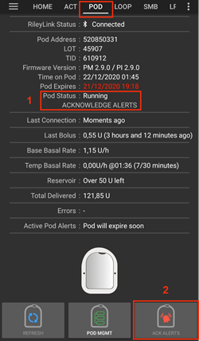
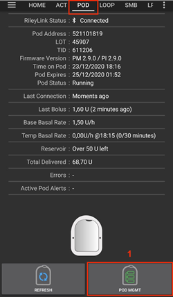
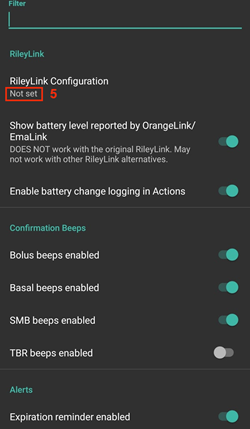

# Omnipod Eros

These instructions are for configuring the Omnipod Eros generation pump (**NOT Omnipod Dash**).

```{admonition} Omnipod Eros is being phased out
:class: note

The [Omnipod System](https://www.omnipod.com/current-podders/resources/omnipod-system) (the original Omnipod, comprising both the Personal Diabetes Manager (PDM) and the Pod) is being discontinued, and the end date varies by country. For example, it will no longer be available in Canada after 30 June 2026. If you rely on the Eros pump, plan ahead for a transition to a supported pump.
```

**Bu yazılım bir DIY (Kendin Yap) yapay pankreas çözümünün bir parçasıdır ve bir ürün değildir, ancak nasıl kullanılacağı da dahil olmak üzere sistemi okumanızı, öğrenmenizi ve anlamanızı gerektirir. Yazılımla yaptıklarınızdan yalnızca siz sorumlusunuz.**

```{contents} Table of contents
:depth: 1
:local: true
```

## Donanım ve yazılım gereksinimleri

- **Pod İletişim Cihazı**

> AAPS Omnipod Eros sekmesi üzerinden yapılandırıp etkinleştirdiğiniz, telefonunuz ile Eros podları arasında iletişimi sağlayan cihaz.
> 
> > -   [OrangeLink Websitesi](https://getrileylink.org/product/orangelink)
> > -  [433MHz RileyLink](https://getrileylink.org/product/rileylink433)
> > -   [Emalink Websitesi](https://github.com/sks01/EmaLink) - [İletişim Bilgileri](mailto:getemalink@gmail.com)
> > -   DiaLink - [İletişim bilgileri](mailto:Boshetyn@ukr.net)
> > -   [LoopLink Websitesi](https://www.getlooplink.org/) - [İletişim Bilgileri](https://jameswedding.substack.com/) - Test edilmedi

-   **Cep Telefonu Cihazı**

> AAPS'i çalıştıracak ve Pod iletişim cihazına kontrol komutları gönderecek eklenti.
> 
> > - Supported [Android phone](#Phones-list-of-tested-phones) with **AAPS** and related components set up.

-   **İnsülin İletim Cihazı**

> AAPS kurulu telefonunuz tarafından Pod iletişim cihazına gönderilen komutları yorumlayacak bileşen.
> 
> > - Yeni bir Omnipod podu (Eros - **DASH DEĞİL**)

These instructions assume that you are starting a new pod session. If this is not the case, please be patient and start this process at your next pod change.

In this page, **RileyLink** means any of the pod communication devices listed above.

## Başlamadan önce

**ÖNCE GÜVENLİK** - bir hatadan kurtulamayacağınız bir ortamda bu işlemi denemeyin (ekstra pod, insülin ve telefon cihazları olmazsa olmazdır).

**Omnipod PDM'niz, AAPS Omnipod sürücüsü podunuzu etkinleştirdikten sonra artık çalışmayacaktır**. Önceden Omnipod Eros Podunuz'a komutlar göndermek için Omnipod PDM'nizi kullanıyordunuz. Bir Omnipod Eros podu, yalnızca tek bir cihazın kendisine iletişim göndermesine izin verir. The device that successfully activates the pod is the only device allowed to communicate with it from that point forward. Bu AAPS Omnipod sürücüsü aracılığıyla RileyLink'inizle bir Omnipod Eros podunu etkinleştirdiğinizde, ** artık PDM'niz ile podunuzu kullanamayacağınız anlamına gelir**. RileyLink'li AAPS Omnipod sürücüsü artık bir nevi yeni PDM'niz olur. *Bu, PDM'nizi çöpe atmanız gerektiği anlamına GELMEZ, yedek olarak saklamanız şiddetle önerilir ve AAPS düzgün çalışmadığı acil durumlar için gereklidir.*

**Only one RileyLink at a time can communicate with a pod.** **AAPS** remembers one paired RileyLink. If you pair a different one, it replaces the previous one.

**RileyLink kapsama alanı dışındayken podunuz kapanmaz.** RileyLink'iniz kapsama alanı dışında olduğunda veya sinyalin aktif podunuz ile iletişim kurması engellendiğinde, podunuz bazal insülin iletmeye devam edecektir. Bir podu etkinleştirdikten sonra, AAPS'de tanımlanan bazal profil yeni poda programlanacaktır. Pod ile teması kaybederseniz, bu bazal profile geri dönecektir. RileyLink menzile girip bağlantıyı yeniden kurana kadar yeni komutlar veremezsiniz.

**30 dakikalık Bazal Oran Profilleri AAPS'de DESTEKLENMEZ.** AAPS'de yeniyseniz ve bazal oran profilinizi ilk kez oluşturuyorsanız, lütfen saatlik bazal oran profilinizi ayarlayın ve yarım saatlik bazal oranların desteklenmediğini unutmayın. Örneğin, 09:30'da başlayan ve 11:30'da biten 2 saatlik bir süresi olan 1,1 ünitelik bir bazal oranınız varsa, bu çalışmayacaktır.  Bu 1,1 ünite bazal oranını 9:00-11:00 veya 10:00-12:00 zaman aralığına güncellemeniz gerekecektir.  30 dakikalık bazal oran profili artışları Omnipod donanımının kendisi tarafından desteklense de, AAPS şu anda algoritmaları ile bunları hesaba katamamaktadır.

## AAPS'de Omnipod Sürücüsünü Etkinleştirme

Dash sürücüsünü AAPS'de **iki şekilde** etkinleştirebilirsiniz:

### Seçenek 1: Kurulum Sihirbazı

After installing a new version of AAPS, the **Setup Wizard** starts automatically. If you have already exported your settings from a previous installation, you can import them in the wizard. For new installations, continue below.

Go through the [Setup Wizard](../SettingUpAaps/SetupWizard.md) until you reach the **Pump** step, then select **Omnipod Eros** (the description reads "Pump integration for Omnipod Eros").


The Setup Wizard does not pair your RileyLink. After finishing the wizard, open the Omnipod pump screen and pair it as described in the [RileyLink Setup section](#OmnipodEros-rileylink-setup).

**VEYA**

### Option 2: The Configuration screen

Open the top-left **menu** (☰) > **Configuration** > **Pump** and select the **radio button** of **Omnipod Eros**.

Once it is selected, the **Omnipod Eros** card shows two buttons, **Settings** and **Open plugin**:


**Settings** opens the settings of the Omnipod driver (see [Omnipod Settings](#OmnipodEros-omnipod-settings)):


**Open plugin** opens the Omnipod pump screen. You can also open it at any time from the main screen with **Manage** > **Pump**. This page calls it the **Omnipod pump screen**. Before a RileyLink is paired and a pod is activated, it looks like this:


### Verification of Omnipod Driver Selection

To verify that you have enabled the Omnipod driver, open **Manage** > **Pump** from the main screen. You should see the **Omnipod Eros** pump screen shown above. If you have not paired a RileyLink yet, **RileyLink Status** shows **Not Started** and **Pod Status** shows **No Active Pod**.

## Omnipod Kanfigürasyonu

All pod and RileyLink functions are buttons on the [Omnipod pump screen](#OmnipodEros-omnipod-pod-tab) (**Manage** > **Pump**). Some buttons only appear in certain situations, for example when a pod is active.

>  Pod bağlantısını ve durumunu yenileyin
> 
>  Pod Yönetimi (Etkinleştir, Devre Dışı Bırak, Test bip sesini çal, RileyLink İstatistikleri ve Pod geçmişi)

```{admonition} Older screenshot
:class: note
The screenshots above are from an earlier **AAPS** version. In **AAPS** 4 there is no **POD MGMT** button or Pod Management menu: **Refresh** and all pod management actions are buttons on the Omnipod pump screen.
```

(OmnipodEros-rileylink-setup)=

### RileyLink Kurulumu

If you have already paired your RileyLink, continue to the [Activating a Pod section](#OmnipodEros-activating-a-pod) below.

*Note: A good visual indicator that the RileyLink is not connected is that the treatment buttons (QuickLaunch toolbar) on the main screen will be missing. Bu, RileyLink'e aktif olarak bağlanıp, AAPS başladıktan sonraki ilk 30 saniye boyunca da böyle olacaktır.*

1. Make sure that your RileyLink is fully charged and powered on.

2. Place the RileyLink [close to your phone](#OmnipodEros-optimal-omnipod-and-rileylink-positioning) (~30 cm away or less).

3. Open the Omnipod pump screen (**Manage** > **Pump**) and press **Pair RileyLink**.

4. The **Pair RileyLink** screen starts scanning for Bluetooth devices right away. Tap your RileyLink in the list of found devices.

   

5. When **RileyLink paired successfully** is shown with the name and address of your device, press **OK**.

6. Back on the Omnipod pump screen, check that **RileyLink Status** changes to **Connected**. **Pod Status** should show **No Active Pod**. If the RileyLink does not connect, press **Reset RileyLink**, or restart **AAPS**.

 

 


```{admonition} Older screenshot
:class: note
The six screenshots above (after step 6) are from an earlier **AAPS** version. In **AAPS** 4 you pair the RileyLink with the **Pair RileyLink** button on the Omnipod pump screen instead of **RileyLink Configuration** in the Omnipod settings, and scanning starts automatically.
```

```{note}
To switch to another RileyLink (for example a backup device), press **Pair RileyLink** again and select the new device. It replaces the one paired before. You do not need to remove the old device first.
```

(OmnipodEros-activating-a-pod)=

### Pod Etkinleştirme

Before you can activate a pod, make sure your RileyLink is paired and **RileyLink Status** shows **Connected**. The **Activate Pod** button stays disabled until the RileyLink is ready.

*HATIRLATICI: Güvenlik güvenlik önlemleri nedeniyle, pod aktivasyon eşleştirmesi için pod iletişimi sınırlı mesafede gerçekleşir. Eşleştirmeden önce Pod'un radyo sinyali daha zayıftır, ancak eşleştirildikten sonra tam sinyal gücünde çalışacaktır. During these procedures, make sure that your pod is* [within close proximity](#OmnipodEros-optimal-omnipod-and-rileylink-positioning) *(~30 cm away or less) but not on top of or right next to the RileyLink.*

01. Open the Omnipod pump screen (**Manage** > **Pump**) and press **Activate Pod**.

    If you have never activated a profile, a **Profile required** step appears first. Select the profile to apply on activation.

    >   
    > 
    > ```{admonition} Older screenshot
    >     :class: note
    >     The screenshots above are from an earlier **AAPS** version. In **AAPS** 4 **Activate Pod** is a button on the Omnipod pump screen instead of in the **POD MGMT** menu.
    > ```

02. **Podu Doldur** ekranı görüntülenir. Fill a new pod with enough insulin for 3 days and listen for two beeps. They mean that the minimum amount of 80 units has been filled. Empty the fill syringe completely, even after hearing the two beeps. 3 gün boyunca ihtiyacınız olan toplam insülin miktarını hesaplarken, pod hazırlamanın ilave12 ile 15 ünite kullanacağını lütfen göz önünde bulundurun. Do not remove the pod's needle cap yet.

    > 
    > 
    > Ensure the new pod and RileyLink are within close proximity of each other (~30cm or less) and press **Next**.

03. **Select Insulin** (only shown if you have more than one insulin configured): select the insulin you are filling the pod with and press **Next**. A profile switch with this insulin is applied after activation.

04. **Pod'u Başlat** ekranında, pod hazırlanmaya başlar (pod kendini hazırlarken bir tıklama ve ardından bir dizi tıkırtı sesi duyarsınız). RileyLink etkinleştirilmekte olan podun kapsama alanı dışındaysa **Pod yanıt vermiyor** hata mesajı alırsınız. If this occurs, [move the RileyLink closer](#OmnipodEros-optimal-omnipod-and-rileylink-positioning) (~30 cm away or less) to but not on top of or right next to the Pod and press **Retry**.

    >  

05. When priming is successful, a green checkmark is shown and the **Next** button becomes enabled. Press **Next**.

    > 

06. **Site location** (only shown if **Manage pump site rotation** is enabled in [Site Rotation](#Aapsscreens-site-rotation)): select where you place the pod on your body and press **Next**.

07. The **Attach Pod** screen is displayed. Prepare the infusion site of the new pod. Remove the pod's plastic needle cap and white paper backing from the adhesive and apply the pod to your chosen site on your body. If the cannula sticks out, press **Cancel** and discard the pod. When finished, press **Next**.

    > 

08. A confirmation dialog appears: "When you press OK, the cannula will be inserted". **ONLY press OK if you are ready to deploy the cannula**.

    > 

09. On the **Insert Cannula** screen, it may take some time before the Omnipod responds and inserts the cannula (1-2 minutes maximum), so be patient.

    > RileyLink etkinleştirilmekte olan podun kapsama alanı dışındaysa **Pod yanıt vermiyor** hata mesajı alırsınız. If this occurs, move the RileyLink closer (~30 cm away or less) to but not on top of or right next to the Pod and press **Retry**.
    > 
    > RileyLink, Bluetooth kapsama alanı dışındaysa veya telefonla etkin bir bağlantısı yoksa **RileyLink yanıt vermiyor** hata mesajı alırsınız. If this occurs, move the RileyLink closer to the phone and press **Retry**.
    > 
    > *NOT: Kanül takılmadan önce, kanül yerleştirme noktasının etrafındaki cildi sıkıştırmak iyi bir uygulamadır. Bu iğnenin düzgün bir şekilde yerleştirilmesini sağlar ve tıkanıklık oluşturma şansınızı azaltır.*
    > 
    > 
    > 
    >  

10. Başarılı bir kanül yerleştirilmesinden sonra yeşil bir onay işareti görünür ve **İleri** butonu aktif olur. Press **Next**.

    > 

11. The **Pod Activated** screen is displayed. Check that the cannula has been inserted correctly, and change your pod if you think it has not. Press **Finish**. Tebrikler! Artık yeni bir aktif pod oturumu başlattınız.

    >  
    > 
    > ```{admonition} Older screenshot
    >     :class: note
    >     The screenshots in steps 2 to 11 are from an earlier **AAPS** version and may look different in **AAPS** 4. The **Select Insulin** and **Site location** steps are not pictured.
    > ```

12. You are returned to the Omnipod pump screen. The **Activate Pod** button is replaced by **Deactivate Pod**, because you cannot activate another pod without deactivating the active one first.

    The pump screen now shows information about your active pod, including the current basal rate, reservoir level, insulin delivered, pod errors and alerts. For more details, see the [Omnipod pump screen](#OmnipodEros-omnipod-pod-tab) section.

     

    ```{admonition} Older screenshot
    :class: note
    The screenshots above are from an earlier **AAPS** version. In **AAPS** 4 there is no Pod Management menu: you return directly to the Omnipod pump screen, where **Deactivate Pod** replaces **Activate Pod**.
    ```

```{note}
If activation was interrupted after priming (for example the app was closed), press **Activate Pod** again. The wizard continues from the cannula insertion steps.
```

### Pod'u Devre Dışı Bırakma

Normal şartlar altında toplam 80 saatlik pod kullanımı için, üç günlük (72 saat) pod kullanım ömrüne ilaveten, sona erme uyarısından sonra 8 saat daha çalışmalıdır.

To deactivate a pod (either from expiration or from a pod failure):

1. Open the Omnipod pump screen (**Manage** > **Pump**) and press **Deactivate Pod**.

   >   
   > 
   > ```{admonition} Older screenshot
   >    :class: note
   >    The screenshots above are from an earlier **AAPS** version. In **AAPS** 4 **Deactivate Pod** is a button on the Omnipod pump screen instead of in the **POD MGMT** menu.
   > ```

2. On the **Deactivate Pod** screen, first make sure the RileyLink is in close proximity to the pod but not on top of or right next to the pod. Then press **Next**. A dialog asks *A deactivated Pod can not be used again. Deactivate this Pod now?* Press **OK** to start deactivating the pod, or **Cancel** to keep it. Deactivation suspends all insulin delivery and cannot be undone.

   > 

3. The **Deactivating Pod** screen appears, and you will receive a confirmation beep from the pod that deactivation was successful.

   > 
   > 
   > **IF deactivation fails** and you do not receive a confirmation beep, you may receive a **No response from RileyLink** or **No response from Pod** message. Press **Retry** to attempt deactivation again. If deactivation keeps failing, press **Discard Pod** and confirm. **AAPS** then forgets the pod. Insulin delivery has **not** been suspended, so remove the pod from your body. If your pod has a screaming alarm, you may need to silence it manually (using a pin or a paperclip), because **Discard Pod** does not silence it.
   > 
   > >   

4. A green checkmark appears when deactivation is successful. Press **Next** to display the **Pod Deactivated** screen. Etkin oturum devre dışı bırakıldığı için artık podunuzu çıkartabilirsiniz.

   > 

5. Press **Finish** to return to the Omnipod pump screen.

   >  
   > 
   > ```{admonition} Older screenshot
   >    :class: note
   >    The screenshots in steps 2 to 5 are from an earlier **AAPS** version and may look different in **AAPS** 4.
   > ```

6. On the Omnipod pump screen, check that **RileyLink Status** shows **Connected** and **Pod Status** shows **No Active Pod**.

   >    
   > 
   > ```{admonition} Older screenshot
   >    :class: note
   >    The screenshots above are from an earlier **AAPS** version. In **AAPS** 4 **Finish** returns you directly to the Omnipod pump screen; there is no Pod Management menu or **Omnipod (POD)** tab.
   > ```

### İnsülin İletimini Askıya Alma ve Devam Ettirme

The process below shows you how to suspend and resume insulin delivery.

*NOTE - if you do not see a **Suspend** button*, it is hidden by default. Enable **Show Suspend Delivery button in Omnipod tab** in the [Omnipod settings](#OmnipodEros-omnipod-settings) under **Other**.

#### İnsülin İletiminin Askıya Alınması

Etkin podu askıya alınmış duruma getirmek için bu komutu kullanın. Bu askıya alınmış durumda, pod artık herhangi bir insülin iletmeyecektir. Bu komut orijinal Omnipod PDM'nin etkin bir poda verdiği askıya alma işlevini taklit eder.

1. Open the Omnipod pump screen (**Manage** > **Pump**) and press **Suspend**. The suspend command is sent through the RileyLink to the active pod.

2. When the pod has suspended all insulin delivery, **Pod Status** shows **Suspended** and the **Suspend** button is replaced by **Resume Delivery**.

   >  
   > 
   > 
   > 
   >  
   > 
   > ```{admonition} Older screenshot
   >    :class: note
   >    The screenshots above are from an earlier **AAPS** version. In **AAPS** 4 these steps take place on the Omnipod pump screen instead of the **Omnipod (POD)** tab, and the result is shown in **Pod Status**.
   > ```

If the command fails, a **Warning** dialog shows "Failed to suspend delivery" with the reason. Check the RileyLink connection and try again.

#### Resuming Insulin Delivery

Use this command to instruct the active, currently suspended pod to resume insulin delivery. Komut başarıyla işlendikten sonra, aktif bazal profildeki geçerli zamana dayalı mevcut bazal oranı kullanılarak normal insülin iletimi sürdürülecektir. Pod bolus, GBO ve SMB için komutları tekrar kabul edecektir.

1. Open the Omnipod pump screen and check that **Pod Status** shows **Suspended**. Press **Resume Delivery**.

2. When the command succeeds, **Pod Status** shows **Running** again and the **Resume Delivery** button disappears (the **Suspend** button is shown again if you have enabled it).

   >  
   > 
   > 
   > 
   >  
   > 
   > ```{admonition} Older screenshot
   >    :class: note
   >    The screenshots above are from an earlier **AAPS** version. In **AAPS** 4 these steps take place on the Omnipod pump screen instead of the **Omnipod (POD)** tab, and the result is shown in **Pod Status**.
   > ```

If the command fails, a **Warning** dialog shows "Failed to resume delivery" with the reason. Check the RileyLink connection and try again.

### Silencing Pod Alerts

*NOTE - The **Silence Alerts** button is only shown on the Omnipod pump screen while the pod has an active alert (for example the pod expiration or low reservoir alert), and only if **Automatically silence Pod alerts** is disabled.*

The process below shows you how to silence pod beeps that start when the pod reaches the warning time before it expires. This warning time is set with **Alert at hours before shutdown (80 Hours)** in the Omnipod **Alerts** settings. Bir pod'un maksimum ömrü 80 saattir (3 gün 8 saat), ancak Insulet 72 saat (3 gün) sınırının aşılmamasını önermektedir.

*NOTE - If you have enabled **Automatically silence Pod alerts** in the Omnipod **Alerts** settings, **AAPS** silences the alert automatically at the next communication with the pod, and you do NOT need to do it manually.*

1. When the warning time is reached, the pod beeps to tell you that it will soon expire and needs to be changed. On the Omnipod pump screen, **Pod Expires** shows the exact time the pod expires (72 hours after activation); it turns **yellow** 4 hours before. **Pod Hard End** shows when the pod stops delivering insulin. **Active Pod Alerts** shows **Pod will expire soon**, and the **Silence Alerts** button appears. **AAPS** also shows a notification about the upcoming pod expiration.

   >   
   > 
   > ```{admonition} Older screenshot
   >    :class: note
   >    The screenshots above are from an earlier **AAPS** version. In **AAPS** 4 the **ACK ALERTS** button is called **Silence Alerts** and is on the Omnipod pump screen.
   > ```

2. Press **Silence Alerts**. The RileyLink sends the command to the pod to stop the expiration warning beeps.

   >  
   > 
   > ```{admonition} Older screenshot
   >    :class: note
   >    The screenshot above is from an earlier **AAPS** version. In **AAPS** 4 the button is called **Silence Alerts**.
   > ```

3. When the alerts are silenced, the pod beeps twice. **Active Pod Alerts** no longer shows the warning, the **Silence Alerts** button disappears and the pod stops its expiration warning beeps.

   >  
   > 
   > ```{admonition} Older screenshot
   >    :class: note
   >    The screenshot above is from an earlier **AAPS** version. In **AAPS** 4 the result is shown on the Omnipod pump screen: the warning disappears from **Active Pod Alerts**.
   > ```

If the command fails (for example the RileyLink is out of range of the pod), a **Warning** dialog shows "Failed to silence alerts" with the reason. Move the RileyLink closer to the pod and try again.


```{admonition} Older screenshot
:class: note
The screenshot above is from an earlier **AAPS** version. In **AAPS** 4 the **Warning** dialog shows "Failed to silence alerts" with the reason.
```

(OmnipodEros-view-pod-history)=

### View Pod History

Bu bölüm, aktif pod geçmişinizi nasıl gözden geçireceğinizi ve farklı eylem kategorilerine göre nasıl filtreleyeceğinizi gösterir. Pod geçmişi aracı, üç günlük (72 - 80 saat) ömrü boyunca şu anda etkin olan pod'unuza yönelik eylemleri ve sonuçları görüntülemenize olanak tanır.

Bu özellik ile verilen bolusları, GBO'larını, bazal değişiklikleri doğrulamak için kullanışlıdır ancak tamamlandıklarından emin olamayabilirsiniz. Kalan kategoriler, genel olarak sorunları gidermek ve bir arızaya yol açan olayların sırasını belirlemek için kullanışlıdır.

*NOT:* **Belirsiz** komutlar pod geçmişinde görünür, ancak yapıları gereği doğruluklarından emin olamazsınız.

1. Open the Omnipod pump screen (**Manage** > **Pump**) and press **Pod History**.

   >   
   > 
   > ```{admonition} Older screenshot
   >    :class: note
   >    The screenshots above are from an earlier **AAPS** version. In **AAPS** 4 **Pod History** is a button on the Omnipod pump screen instead of in the **POD MGMT** menu.
   > ```

2. The **Pod History** screen lists all pod actions and their results, newest first, grouped by day. By default **All** is selected. Tap one of the filter buttons at the top to show only one category. Use the back arrow at the top left to return to the Omnipod pump screen.

   > 

   >  
   > 
   > ```{admonition} Older screenshot
   >    :class: note
   >    The second screenshot is from an earlier **AAPS** version and may look different in **AAPS** 4.
   > ```

### RileyLink Ayarlarını ve Geçmişini Görüntüle

The **RileyLink Stats** screen shows the settings of your RileyLink and active pod, and the communication history of both. It has two tabs: **Settings** and **History**.

The **RileyLink Stats** button is hidden by default. To show it on the Omnipod pump screen, enable **Show RileyLink Stats button in Pod Management menu** in the [Omnipod settings](#OmnipodEros-omnipod-settings) under **Other**.

#### Pod İletişim Bluetooth İletişim Aygıtını Manuel Olarak Yeniden-kurun

If your pod communication device was out of Bluetooth range of your phone for a while, **RileyLink Status** may report **RileyLink unreachable** on the Omnipod pump screen. **AAPS** normally reconnects by itself when the device is back in range. If it does not:

1. Make sure the RileyLink is powered on, charged and close to your phone.

2. On the Omnipod pump screen, press **Reset RileyLink**. A message confirms **RileyLink configuration reset**. See the [Reset RileyLink notes](#OmnipodEros-reset-rileylink-config-notes) below.

3. **Bluetooth bağlantısı** yeniden kurulmazsa, telefonunuzdaki Bluetooth işlevini manuel olarak **kapatmayı** ve ardından tekrar **açmayı** deneyin.

4. If it still does not reconnect, press **Pair RileyLink** and select your RileyLink again.

5. After a successful reconnection, **RileyLink Status** shows **Connected**. You can also check **Connection Status** on the **Settings** tab of the **RileyLink Stats** screen. Tebrikler, artık yapılandırılmış pod iletişim cihazınızı (örn. RileyLink) AAPS'ye yeniden bağladınız!

 


```{admonition} Older screenshot
:class: note
The screenshots above are from an earlier **AAPS** version. In **AAPS** 4 you reconnect with **Reset RileyLink** or **Pair RileyLink** on the Omnipod pump screen instead of the refresh button on the RileyLink Settings screen.
```

#### Pod İletişim Cihazı (örn. RileyLink) ve Aktif Pod Ayarları

This screen shows information and status for both the currently paired pod communication device and the currently active Omnipod Eros pod. The information refreshes automatically.

1. Open the Omnipod pump screen (**Manage** > **Pump**) and press **RileyLink Stats**. The **Settings** tab shows your currently paired **RileyLink** and the active pod (**Device**).

   >   
   > 
   > ```{admonition} Older screenshot
   >    :class: note
   >    The screenshots above are from an earlier **AAPS** version. In **AAPS** 4 **RileyLink Stats** is a button on the Omnipod pump screen instead of in the **POD MGMT** menu.
   > ```

   > 

##### RileyLink fields

> - **Address:** MAC address of the paired pod communication device.
> - **Name:** Bluetooth name of the paired pod communication device.
> - **Battery Level:** The current battery level of the connected pod communication device. Only shown when **Show battery level reported by OrangeLink/EmaLink/DiaLink** is enabled.
> - **Bağlantı Durumu**: Pod iletişim cihazı ile AAPS çalıştıran telefon arasındaki Bluetooth bağlantısının mevcut durumu.
> - **Connection Error:** If there is an error with the pod communication device Bluetooth connection, details are displayed here.
> - **Pod yazılımı:** Aktif olarak bağlı pod iletişim cihazında kurulu mevcut yazılım sürümüdür.

##### Device fields - With an Active Pod

> - **Device Type:** The type of device communicating with the pod communication device (Omnipod (Eros)).
> - **Configured Device Model:** The model of the device configured to communicate with the pod communication device.
> - **Connected Device Model:** The model of the device currently communicating with the pod communication device.
> - **Pump Serial Number:** Serial number of the currently activated pod.
> - **Pump Frequency:** Radio frequency used to communicate with the pod.
> - **Last Used Frequency:** Last known radio frequency the pod used to communicate with the pod communication device.
> - **Son Cihaz İletişimi:** Pod ile pod iletişim cihazı (örn. RilyLink) arasında yapılan son iletişimin tarihi ve saati.

(omnipod-eros-rileylink-and-active-pod-history)=
#### RileyLink ve Aktif Pod Geçmişi

This tab lists, newest first, each state or action of the RileyLink or the currently connected pod. The history is only available for the currently active pod. After a pod change, this history is erased and only events from the newly activated pod are recorded and shown.

1. Open the Omnipod pump screen (**Manage** > **Pump**), press **RileyLink Stats** and then tap the **History** tab.

   >   
   > 
   > ```{admonition} Older screenshot
   >    :class: note
   >    The screenshots above are from an earlier **AAPS** version. In **AAPS** 4 **RileyLink Stats** is a button on the Omnipod pump screen instead of in the **POD MGMT** menu.
   > ```

   > 

##### Fields

Each entry shows:

> - **Device:** The device to which the action or state refers.
> - **Time:** The time of the event.
> - **State or Action:** The state of the device or the action it performed.

(OmnipodEros-omnipod-pod-tab)=

## Omnipod pump screen

Below is an explanation of the status fields and buttons on the **Omnipod pump screen** (**Manage** > **Pump**, or **Configuration** > **Pump** > **Open plugin**).

The gear icon at the top right opens the [Omnipod settings](#OmnipodEros-omnipod-settings).

*NOTE: If any status field shows (uncertain), press **Refresh** to refresh the pod status and clear it.*


```{admonition} Older screenshot
:class: note
The screenshot above is from an earlier **AAPS** version, where this screen was the **Omnipod (POD)** tab. In **AAPS** 4 it is the Omnipod pump screen, and some field names and buttons differ.
```

### Fields

- **RileyLink Status:** Displays the current connection status of the RileyLink. Errors are shown in red.

- *Not Started* - no RileyLink is paired yet, or the connection has not started.
- *RileyLink unreachable* - pod communication device is either not within Bluetooth range of the phone, powered off or has a failure preventing Bluetooth communication.
- *RileyLink ready* - pod communication device is powered on and actively initializing the Bluetooth connection.
- *Bağlı* Pod iletişim cihazı açık, bağlı ve Bluetooth aracılığıyla aktif olarak iletişim kurabiliyor.

- **Unique ID:** Displays the address of the active pod.

- **LOT Number:** Displays the LOT number of the active pod.

- **Sequence Number:** Displays the serial number (TID) of the pod.

- **Yyazılımı Sürümü:** Etkin podun donanım yazılımı sürümünü görüntüler.

- **Pod üzerindeki zaman:** Aktif poddaki geçerli saati görüntüler. It is highlighted when it differs from the phone time by more than 5 minutes.

- **Pod Expires:** Displays the date and time when the active pod will expire. The text turns yellow in the last 4 hours before this time. It never turns red, because the pod keeps delivering insulin after it.

- **Pod Hard End:** Displays the end of the pod's grace period (8 hours after **Pod Expires**, for a maximum pod life of 80 hours). The text turns yellow when the grace period starts (at **Pod Expires**) and red in the last 4 hours before the hard end. During the grace period it also shows the time left, for example *(17m remaining)*. The pod stops delivering insulin at the hard end and must be changed.

- **Pod Status:** Displays the status of the active pod (for example **No Active Pod**, **Running** or **Suspended**).

- **Last Connection:** Displays the last time communication with the active pod was achieved. The text turns red when the [pump unreachable threshold](#OmnipodEros-troubleshooting) is exceeded.

- *Biraz önce* - 20 saniyeden kısa bir süre önce.
- *Bir dakikadan kısa bir süre önce* - 20 saniyeden uzun, ancak 60 saniyeden kısa bir süre önce.
- *1 dakika önce* - 60 saniyeden uzun ancak 120 saniyeden kısa (2 dakika)
- *XX dakika önce* - XX değeriyle tanımlanan 2 dakikadan daha uzun bir süre önce

- **Last Bolus:** Displays the dosage of the last bolus sent to the active pod and how long ago it was issued in parenthesis.

- **Base Basal Rate:** Displays the basal rate programmed for the current time from the basal rate profile.

- **Temp Basal Rate:** Only shown while a Temporary Basal Rate is running. Displays it in the following format:

- Ünite / saat @ GBO'nın verildiği zaman (çalışma dakikası / GBO'nın çalıştırılacağı toplam dakika)
- *Örnek:* 0,00Ü/s @18:25 ( 90/120 dakika)

- **Reservoir:** Displays **Over 50 U left** when more than 50 units are left in the reservoir. Below this value the approximate number of units is displayed. The text turns red below the low reservoir threshold set in the [Alerts settings](#OmnipodEros-omnipod-settings).

- **Total Delivered:** Displays the total number of units of insulin delivered from the reservoir. *Pod mutlak kesinlikle hazırlanıp ve doldurulmadığı için bunun bir tahmin olduğunu unutmayın.*

- **Active Pod Alerts:** Reserved for currently running alerts on the active pod. Genellikle pod son kullanma tarihi 72 saat sonraysa ve pod yerel bip sesleri çıkardığında kullanılır.

- **Errors:** Displays the last error encountered (shown in red). Review the [Pod history](#OmnipodEros-view-pod-history), [RileyLink history](#omnipod-eros-rileylink-and-active-pod-history) and log files for past errors and more detailed information.

### Buttons

The buttons at the bottom of the pump screen change depending on the situation. Buttons that cannot be used right now are greyed out, for example while the RileyLink is not connected.

**Pod status buttons** (shown when a pod is active):

- **Refresh:** Sends a refresh command to the active pod to update its status. Use it to refresh the pod status and clear status fields that contain the text (uncertain). See the [Troubleshooting section](#OmnipodEros-troubleshooting) below for additional information.

  

  ```{admonition} Older screenshot
  :class: note
  The screenshot above is from an earlier **AAPS** version. In **AAPS** 4 this is a text button named **Refresh** on the Omnipod pump screen.
  ```

- **Silence Alerts:** Silences the pod expiration and low reservoir beeps and notifications. Only shown when the pod has an active alert and **Automatically silence Pod alerts** is disabled. After the alerts are silenced, the button disappears.

  

  ```{admonition} Older screenshot
  :class: note
  The screenshot above is from an earlier **AAPS** version. In **AAPS** 4 this button is called **Silence Alerts**.
  ```

- **Set time:** Updates the time on the pod with the current time on your phone. Only shown when the time on the pod differs from the phone time by more than 5 minutes.

  

  ```{admonition} Older screenshot
  :class: note
  The screenshot above is from an earlier **AAPS** version. In **AAPS** 4 this is a text button named **Set time** on the Omnipod pump screen.
  ```

- **Suspend:** Suspends insulin delivery on the active pod. Only shown if enabled in the settings (**Show Suspend Delivery button in Omnipod tab**).

  

  ```{admonition} Older screenshot
  :class: note
  The screenshot above is from an earlier **AAPS** version. In **AAPS** 4 this is a text button named **Suspend** on the Omnipod pump screen.
  ```

- **Resume Delivery:** Resumes insulin delivery on the currently suspended, active pod. Only shown while the pod is suspended.

  

  ```{admonition} Older screenshot
  :class: note
  The screenshot above is from an earlier **AAPS** version. In **AAPS** 4 this is a text button named **Resume Delivery** on the Omnipod pump screen.
  ```

**Pod and RileyLink management buttons:**


```{admonition} Older screenshot
:class: note
The screenshot above is from an earlier **AAPS** version. In **AAPS** 4 there is no Pod Management menu: these actions are buttons directly on the Omnipod pump screen.
```

- **Activate Pod:** Primes and activates a new pod. Shown when no pod is active. It is enabled only when the RileyLink is connected.

  

  ```{admonition} Older screenshot
  :class: note
  The screenshot above is from an earlier **AAPS** version. In **AAPS** 4 **Activate Pod** is a button on the Omnipod pump screen instead of in the Pod Management menu.
  ```

- **Deactivate Pod:** Deactivates the currently active pod. Shown as soon as a pod is paired, also when an activation stopped part-way (for example because the pod failed during activation). It is enabled only when the RileyLink is connected. **AAPS** asks you to confirm before it deactivates the pod.

- Çığlık atan bir podu devre dışı bırakmak için bu komutu kullanın (hata 49).
- If deactivation fails, the deactivation wizard offers a **Discard Pod** option.

  

  ```{admonition} Older screenshot
  :class: note
  The screenshot above is from an earlier **AAPS** version. In **AAPS** 4 **Deactivate Pod** is a button on the Omnipod pump screen instead of in the Pod Management menu.
  ```

- **Play Test Beep:** Plays a single test beep on the pod when pressed. Shown when a pod is paired.

  

  ```{admonition} Older screenshot
  :class: note
  The screenshot above is from an earlier **AAPS** version. In **AAPS** 4 **Play Test Beep** is a button on the Omnipod pump screen instead of in the Pod Management menu.
  ```

- **Pod History:** Displays the active pod activity history. See [View Pod History](#OmnipodEros-view-pod-history).

  

  ```{admonition} Older screenshot
  :class: note
  The screenshot above is from an earlier **AAPS** version. In **AAPS** 4 **Pod History** is a button on the Omnipod pump screen instead of in the Pod Management menu.
  ```

- **Pair RileyLink:** Scans for your pod communication device and pairs it. See [RileyLink Setup](#OmnipodEros-rileylink-setup).

- **RileyLink Stats:** Opens the RileyLink Stats screen with two tabs. Only shown if enabled in the settings (**Show RileyLink Stats button in Pod Management menu**).

- **Ayarlar** - RileyLink ve aktif pod ayarları bilgilerini görüntüler
- **Geçmiş** - RileyLink ve Pod iletişim geçmişini görüntüler

  

  ```{admonition} Older screenshot
  :class: note
  The screenshot above is from an earlier **AAPS** version. In **AAPS** 4 **RileyLink Stats** is a button on the Omnipod pump screen instead of in the Pod Management menu.
  ```

- **Reset RileyLink:** Resets the configuration of the currently connected pod communication device. When communication is started, specific data is sent to and set in the RileyLink:

- Memory Registers are set
- Communication Protocols are set
- Tuned Radio Frequency is set
  > 
  > See [additional notes](#OmnipodEros-reset-rileylink-config-notes) below.

  

  ```{admonition} Older screenshot
  :class: note
  The screenshot above is from an earlier **AAPS** version. In **AAPS** 4 this button is called **Reset RileyLink** and is on the Omnipod pump screen.
  ```

- **Discard Pod:** Discards the pod state of an unresponsive pod, after a confirmation. Only shown when a pod has been started but not fully paired, as proper deactivation is no longer possible:

- Bir **pod tam olarak eşlenmemiş** ve dolayısıyla devre dışı bırakma komutları yok sayar.
- A **pod is stuck** during the pairing process between steps.
- **Pod hiç bir şekilde eşleşmiyorsa.**
  > 
  > After you discard a pod, **AAPS** can no longer communicate with it. Remove the pod from your body.

  

  ```{admonition} Older screenshot
  :class: note
  The screenshot above is from an earlier **AAPS** version. In **AAPS** 4 **Discard Pod** is a button on the Omnipod pump screen instead of in the Pod Management menu.
  ```

(OmnipodEros-reset-rileylink-config-notes)=

#### *Reset RileyLink Notes*

- Bu özelliğin birincil kullanımı, o anda etkin olan pod iletişim cihazının yanıt vermediği ve iletişimin takılı kaldığı durumlardır.
- If the pod communication device is turned off and then back on, press **Reset RileyLink** so that these communication parameters are set again in the pod communication device.
- Bu YAPILMAYACAK OLURSA, pod iletişim cihazı kapatıldıktan sonra AAPS'nin yeniden başlatılması gerekecektir.
- This button **DOES NOT** need to be pressed when switching between different pod communication devices.

(OmnipodEros-omnipod-settings)=

## Omnipod Ayarları

To open the Omnipod driver settings, either:

- press the gear icon at the top right of the Omnipod pump screen (**Manage** > **Pump**), or
- open the top-left **menu** (☰) > **Configuration** > **Pump** and press **Settings** on the **Omnipod Eros** card.


```{admonition} Older screenshot
:class: note
The screenshot above is from an earlier **AAPS** version. In **AAPS** 4 you open the settings with **Settings** on the **Omnipod Eros** card or the gear icon on the Omnipod pump screen, instead of the settings gear in **Configuration** or the 3-dot menu.
```

The settings are grouped as listed below. Tap a group to expand it. Most entries are switches you can enable or disable:


*NOT: Yıldız işareti (\*), bir ayarın varsayılan olarak etkin olduğunu belirtir.*

### RileyLink

Settings for the pod communication device. You pair the device itself with the **Pair RileyLink** button on the pump screen (see [RileyLink Setup](#OmnipodEros-rileylink-setup)).

- **Use Scanning:** Scans before connecting to the OrangeLink. This can improve connections. It can also be used with other RileyLink clones if needed.

- **Show battery level reported by OrangeLink/EmaLink/DiaLink:** Reports the actual battery level of the OrangeLink/EmaLink/DiaLink. Tüm OrangeLink/EmaLink/DiaLink kullanıcılarının bu ayarı etkinleştirmesi **şiddetle önerilir**.

- Orijinal RileyLink ile ÇALIŞMAZ.
- RileyLink alternatifleriyle çalışmayabilir.
- Etkin - Desteklenen pod iletişim cihazları için mevcut pil seviyesini raporlar.
- Devre Dışı - n/a değerini gösterir.

- **Enable battery change logging in Actions:** Only available when the battery reporting setting above is enabled. Some pod communication devices can use regular batteries that you can change. With this setting enabled, you can record a **Pump Battery Change** [careportal entry](#aaps-screens-careportal) to note the change and reset the battery age.

### Confirmation Beeps

Provides confirmation beeps from the pod for bolus, basal, SMB, and TBR delivery and changes.

- **\*Bolus bip seslerini etkinleştir:** Bolus iletildiğinde onay biplerini etkinleştirin veya devre dışı bırakın.
- **Basal beeps enabled:** Enable or disable confirmation beeps when a new basal rate is set, active basal rate is canceled or current basal rate is changed.
- **\*SMB bip seslerini etkinleştir:** Bir SMB teslim edildiğinde onay biplerini etkinleştirin veya devre dışı bırakın.
- **GBO (TBR) bip seslerini etkinleştir:** Bir GBO ayarlandığında veya iptal edildiğinde onay biplerini etkinleştirin veya devre dışı bırakın.

### Alerts

Tanımlanan eşik birimlerine dayalı olarak pod sona erme, kapatma, düşük rezervuar için AAPS uyarıları ve Nightscout duyuruları sağlar.

*Note an AAPS notification will ALWAYS be issued for any alert after the initial communication with the pod since the alert was triggered. Dismissing the notification will NOT silence the alert UNLESS **Automatically silence Pod alerts** is enabled. To silence the alert MANUALLY, open the Omnipod pump screen and press **Silence Alerts**.*

- **\*Expiration reminder enabled:** When enabled, the pod beeps when the time set below is reached.
- **Alert at hours before shutdown (80 Hours):** The number of hours before the pod shuts down (80 hours after activation) at which the expiration reminder is triggered (1 to 8 hours, default 8).
- **\*Düşük rezervuar uyarısını etkinleştir:** Pod, ünite satırında belirlenen alt rezervuar sınırına ulaştığında bir alarm etkinleştirin veya devre dışı bırakın.
- **Number of units:** The number of units at which to trigger the pod low reservoir alert (5 to 50, default 20).
- **Automatically silence Pod alerts:** When enabled, a notification is still issued, but the alert is silenced automatically at the next communication with the pod after the alert started.

### Notifications

GBO, SMB veya bolus olaylarının başarılı olup olmadığı yani belirsiz olduğunda AAPS bildirimleri ve sesli telefon uyarıları sağlar.

*NOTE: These are notifications only, no audible beep alerts are made.*

- **\*Sound for uncertain TBR notifications enabled:** Enable or disable this setting to trigger an audible alert and visual notification when AAPS is uncertain if a TBR was successfully set.
- **\*Belirsiz SMB bildirimleri için sesi etkinleştir:** Bir SMB'nin başarıyla teslim edilip edilmediğinden AAPS emin olmadığında sesli bir uyarı ve görsel bildirimi tetiklemek için bu ayarı etkinleştirin veya devre dışı bırakın.
- **\*Belirsiz bolus bildirimleri için sesi etkinleştir:** AAPS'nin bir bolusun başarıyla iletildiğinden emin olmadığı durumlarda sesli uyarı ve görsel bildirimi tetiklemek için bu ayarı etkinleştirin veya devre dışı bırakın.

### Diğer

Hata ayıklamaya yardımcı olmak için gelişmiş ayarlar sağlar.

- **Show Suspend Delivery button in Omnipod tab:** Hide or display the **Suspend** button on the Omnipod pump screen.
- **Show Pulse Log button in Pod Management menu:** This setting is still listed, but the current version of the pump screen has no **Pulse Log** button.

- **Show RileyLink Stats button in Pod Management menu:** Hide or display the **RileyLink Stats** button on the Omnipod pump screen.
- **\*DST/Time zone detection enabled:** Allows time zone changes to be automatically detected if the phone is used in an area where DST is observed.

### Aktif Pod İletişim Aygıtını Değiştirme veya Çıkarma (RileyLink)

With many alternative models to the original RileyLink available (such as OrangeLink or EmaLink), or the need to have multiple or backup versions of the same pod communication device, you may need to switch to another device.

To switch, open the Omnipod pump screen (**Manage** > **Pump**), press **Pair RileyLink** and select the new device, as described in [RileyLink Setup](#OmnipodEros-rileylink-setup). The new device replaces the previously paired one.

 


 

```{admonition} Older screenshot
:class: note
The screenshots above are from an earlier **AAPS** version. In **AAPS** 4 you add a device with **Pair RileyLink** on the Omnipod pump screen instead of **RileyLink Configuration** in the Omnipod settings, and scanning starts automatically.
```

There is no separate button to remove a paired device. If you stop using a RileyLink, simply pair the new one when you need it.




```{admonition} Older screenshot
:class: note
The screenshots above are from an earlier **AAPS** version. In **AAPS** 4 there is no **Remove** button: pairing a new RileyLink replaces the previous one.
```

## Status row and careportal

There are a few items that are specific to how the Omnipod pod differs from tube based pumps, especially after applying a new pod.

The **insulin** and **cannula** ages in the [status row](#screens-sensor-level-battery) of the main screen are **reset** to 0 days and 0 hours **after each pod change**. Bu Omnipod pompasının çalışma şekli nedeniyle böyle yapılmaktadır. **Pompa pili** ve **insülin rezervuarı**, her pod içinde yer almaktadır. Pod, kanülü doğrudan pod uygulama bölgesinde deriye yerleştirdiği için, Omnipod pompalarında hortum kullanılmaz. *Bu nedenle, bir pod değişikliğinden sonra bu değerlerin her birinin yaşı otomatik olarak sıfırlanır.* **Pompa pil yaşı** pod pili her zaman kendi ömründen daha fazla olacağı için (maksimum 80 saat) rapor edilmez.


### Dolum seviyeleri

**Insulin Level**

Omnipod Eros Pod'daki insülin bildirim miktarı kesin değil. This is because it is not known exactly how much insulin was put in the pod, only that when the 2 beeps are triggered while filling the pod at least 80 units have been filled. Bir Pod en fazla 200 ünite alabilir. Priming can also introduce variance as it is not an exact process. Bu faktörlerin her ikisiyle birlikte, Omnipod sürücüsü rezervuarda kalan insülinin en iyi yaklaşık değerini verecek şekilde yazılmıştır.

> - **50 Ünitenin Üzerinde** - Şu an rezervuarda 50 üniteden fazla insülin olduğunda 50+Ü değeri bildirilir.
> - **50 Ünitenin Altında** - Rezervuarda kalan insülinin yaklaşık hesaplanmış değerini bildirir.
> - **SMS** - SMS yanıtlarında insülin seviyesi 50+Ü veya değer görünür.
> - **Nightscout** - Nightscout'a (sürüm 14.07 ve daha eski) 50 üniteden fazla olduğunda 50 değerini yükler.  Daha yeni sürümler, 50 ünite üzerinde olduğunda 50+ değerini bildirir.

**Pil seviyesi**

Pil seviyesi bildirimi, OrangeLink, EmaLink veya DiaLink gibi pod iletişim cihazlarının mevcut pil düzeyini görüntülemek için etkinleştirilebilen bir ayardır.  RileyLink donanımı, pil seviyesini bildiremez.  Pil seviyesi, pod ile her iletişimden sonra rapor edilir, bu nedenle şarj olurken doğrusal bir artış gözlemlenmeyebilir.  El ile yenileme, mevcut pil seviyesini güncelleyecektir.  Desteklenen bir Pod iletişim cihazının bağlantısı kesildiğinde %0 değeri rapor edilecektir.

> - **RileyLink donanımı, pil seviyesini bildirme özelliğine sahip değildir**
> - **Pil seviyesi değerlerini bildirmek için Omnipod ayarlarında "OrangeLink/EmaLink/DiaLink tarafından bildirilen pil seviyesini göster" Ayarı MUTLAKA etkinleştirilmelidir**
> - **Pil seviyesi raporlaması YALNIZCA OrangeLink, EmaLink ve DiaLink Cihazları için geçerlidir**
> - **Pil Düzeyi raporlaması diğer cihazlarda da çalışabilir (RileyLink hariç)**
> - **SMS** - Gerçek bir seviye mevcut olduğunda yanıt olarak mevcut pil seviyesini döndürür, n/a değeri döndürülmez
> - **Nightscout** - Gerçek bir seviye mevcut olduğunda pil seviyesi rapor edilir, n/a değeri rapor edilmez

(OmnipodEros-troubleshooting)=

## Troubleshooting

### Pod Failures

Pods fail occasionally due to a variety of issues, including hardware issues with the Pod itself. It is best practice not to call these into Insulet, since AAPS is not an approved use case. Nedeni belirlemeye yardımcı olması için [burada](https://github.com/openaps/openomni/wiki/Fault-event-codes) hata kodlarının bir listesi bulunmaktadır.

### Preventing error 49 pod failures

This failure is related to an incorrect pod state for a command or an error during an insulin delivery command. We recommend that you set Nightscout synchronization to *upload only*: keep all the "Receive ... from NS" options disabled in the synchronization settings of the Nightscout client (see [Nightscout](../SettingUpAaps/Nightscout.md)) to prevent possible failures.

### Pump Unreachable Alerts

We recommend setting pump unreachable alerts to **120 minutes**. Press the **Settings** (gear) icon at the top right of the main screen, select **Local alerts** > **Pump unreachable threshold** and set it to **120**.

(OmnipodEros-import-settings-from-previous-aaps)=
### Önceki AAPS ayarlarını içe aktarın

```{admonition} Importing settings can end your active Pod
:class: warning
On the phone that is already running the Pod, leave **Also replace pump settings** unticked: the Pod session is kept and only the other settings are imported. Tick it only with a file exported during the Pod you are wearing now. See [Tubeless pumps](#ExportImportSettings-tubeless-pumps).
```

The safest way to reinstall **AAPS** is between two Pods:

1. Pod oturumunuzu devre dışı bırakın. Etkin bir pod oturumunuz olmadığına emin olun.
2. Ayarlarınızı dışa aktarın ve bir kopyasını güvenli bir yerde saklayın.
3. AAPS'nin önceki sürümünü kaldırın ve telefonunuzu yeniden başlatın.
4. AAPS'nin yeni sürümünü yükleyin ve etkin bir pod oturumunuz olmadığını doğrulayın.
5. Ayarlarınızı içe aktarın ve yeni podunuzu etkinleştirin.

### Omnipod driver alerts

Please note that the Omnipod driver presents a variety of unique alerts on the **main screen**, most of them are informational and can be dismissed while some provide the user with an action to take to resolve the cause of the triggered alert. A summary of the main alerts that you may encounter is listed below:

#### Aktif Pod Yok

Aktif bir Pod oturumu algılanamadı. Bu uyarı, **ERTELE**'ye basılarak geçici olarak kapatılabilir, ancak yeni bir pod etkinleştirilmedikçe tetiklenmeye devam edecektir. Etkinleştirildiğinde bu uyarı otomatik olarak susacaktır.

#### Pod askıya alındı

Pod'un askıya alındığına dair bilgi uyarısı.

#### Bazal profil ayarlanamadı. İletim durdurulmuş olabilir! Please manually refresh the Pod status from the Omnipod tab and resume delivery if needed.

Informational alert that the Pod basal profile setting has failed. Open the Omnipod pump screen and press **Refresh**, then **Resume Delivery** if needed.

#### SMB bolusunun başarılı olup olmadığı doğrulanamıyor. Bolus'un başarılı olmadığından eminseniz, SMB girişini Tedaviler'den manuel olarak kaldırmalısınız.

Alert that the SMB bolus success could not be verified. Check the **Last Bolus** field on the Omnipod pump screen to see if the SMB succeeded. If it did not, remove the entry from the treatments.

#### "Görev bolus/GBO/SMB"nin tamamlanıp tamamlanmadığı belirsizse, lütfen başarılı olup olmadığını manuel olarak doğrulayın.

RileyLink ve Omnipod'un iletişim kurma biçimi nedeniyle, bir komutun başarıyla işlenip işlenmediğinin *belirsiz* olduğu durumlar ortaya çıkabilir. Kullanıcıyı bu belirsizlik hakkında bilgilendirme önemlidir.

Aşağıda, belirsiz bir bildirimin ne zaman ortaya çıkabileceğine dair birkaç örnek verilmiştir.

- **Bolus** - Belirsiz boluslar otomatik olarak doğrulanamaz. Bildirim, bir sonraki bolusa kadar kalacak ancak manuel Pod yenilemesi mesajı silecektir. *Varsayılan olarak, kullanıcının manuel olarak onaylaması gerektiğinden, bu tür bir bildirim için uyarı bip sesleri etkinleştirilir.*
- **GBO'lar, Pod Durumları, Profil Anahtarları, Zaman Değişiklikleri** - manuel bir pod güncellemesi mesajı siler.
- **Pod Time Deviation -** When the time on the pod and the time on your phone differ too much, it is difficult for the AAPS loop to function and make accurate predictions and dosage recommendations. If the time difference between the pod and the phone is more than 5 minutes, a **Set time** button appears on the Omnipod pump screen. Press **Set time** to synchronize the time on the pod with the time on the phone. If **Pod Status** shows **Suspended** afterwards, press **Resume Delivery** to continue normal pod operations.

## En İyi Uygulamalar

(OmnipodEros-optimal-omnipod-and-rileylink-positioning)=

### En İyi Omnipod ve RileyLink Konumlandırılması

Bir Omnipod pod ile iletişim kurmak için RileyLink'te kullanılan anten, 433 MHz sarmal spiral antendir. Yapı özelliklerinden dolayı, dikey duran anteni temsil eden z ekseni ile üç boyutlu bir halka gibi çok yönlü bir sinyal yayar. Bu özellikle pod etkinleştirme ve devre dışı bırakma rutinleri sırasında, RileyLink'in yerleştirilmesi için en uygun konumdırmanın olduğu anlamına gelir.


> *(Şek 1. Çok yönlü bir düzende sarmal sarmal antenin grafik çizimi*)

Hem güvenlik hem de emniyet endişeleri nedeniyle pod *aktivasyonu*, bolus verme, bir GBO ayarlama veya sadece bölme durumunu yenilemek gibi diğer işlemlerden *daha yakın (~30 cm veya daha kısa)* bir mesafede yapılmalıdır. RileyLink anteninden sinyal iletiminin doğası gereği, podun doğrudan RileyLink'in üzerine veya hemen yanına yerleştirilmesi ÖNERİLMEZ.

Aşağıdaki resim, pod etkinleştirme ve devre dışı bırakma prosedürleri sırasında RileyLink'i konumlandırmanın en uygun yolunu göstermektedir. Pod başka pozisyonlarda aktif olabilir ama en başarılı olanı aşağıdaki resimdeki pozisyonu kullanarak elde edersiniz.

*Not: Pod en uygun şekilde yerleştirdikten sonra ve RileyLink iletişimi başarısız olursa, bunun nedeni, RileyLink anteninin iletim menzilini azaltan düşük pil seviyesi olabilir. Bu sorunu önlemek için, bu işlem sırasında RileyLink'in doğru şekilde şarj edildiğinden veya doğrudan bir şarj kablosuna bağlandığından emin olun.*


## Where to get help

Omnipod sürücüsü için tüm geliştirme çalışmaları topluluk tarafından gönüllü olarak yapılır; Yardım talep ederken lütfen düşünceli olmanızı ve aşağıdaki yönergeleri kullanmanızı rica ediyoruz:

- **Seviye 0:** Sorun yaşadığınız işlevin nasıl çalışması gerektiğini anladığınızdan emin olmak için bu dokümantasyonun ilgili bölümünü okuyun.
- **Seviye 1:** Bu dokümantasyonu kullanmanıza rağmen hâlâ çözemediğiniz sorunlarla karşılaşıyorsanız, lütfen [bu davet bağlantısını](https://discord.gg/4fQUWHZ4Mw) kullanarak **Discord**'da * #androidaps* kanalına gidin.
- **Level 2:** Search existing issues to see if your issue has already been reported; if not, please create a new [issue](https://github.com/nightscout/AndroidAPS/issues) and attach your [log files](../GettingHelp/AccessingLogFiles.md).
- **Sabırlı olun - topluluğumuzun üyelerinin çoğu iyi huylu gönüllülerden oluşur ve sorunları çözmek genellikle hem kullanıcılar hem de geliştiriciler için zaman ve sabır gerektirir.**
