# Omnipod Eros

Bu talimatlar Omnipod Eros nesli pompanın yapılandırılması içindir (**Omnipod Dash DEĞİL**).

```{admonition} Omnipod Eros is being phased out
:class: note

[Omnipod Sistemi](https://www.omnipod.com/current-podders/resources/omnipod-system) (hem Kişisel Diyabet Yöneticisi (PDM) hem de Pod'dan oluşan orijinal Omnipod) üretimden kaldırılıyor ve bitiş tarihi ülkeye göre değişiyor. Örneğin, Kanada'da 30 Haziran 2026'dan sonra artık bulunmayacak. Eros pompaya güveniyorsanız, desteklenen bir pompaya geçişi önceden planlayın.
```

**Bu yazılım bir DIY (Kendin Yap) yapay pankreas çözümünün bir parçasıdır ve bir ürün değildir, ancak nasıl kullanılacağı da dahil olmak üzere sistemi okumanızı, öğrenmenizi ve anlamanızı gerektirir. Yazılımla yaptıklarınızdan yalnızca siz sorumlusunuz.**

```{contents} Table of contents
:depth: 1
:local: true
```

## Donanım ve yazılım gereksinimleri

- **Pod İletişim Cihazı**

> AAPS Omnipod Eros sekmesi üzerinden yapılandırıp etkinleştirdiğiniz, telefonunuz ile Eros podları arasında iletişimi sağlayan cihaz.
> 
> > -   [OrangeLink Websitesi](https://getrileylink.org/product/orangelink)
> > -  [433MHz RileyLink](https://getrileylink.org/product/rileylink433)
> > -   [Emalink Websitesi](https://github.com/sks01/EmaLink) - [İletişim Bilgileri](mailto:getemalink@gmail.com)
> > -   DiaLink - [İletişim bilgileri](mailto:Boshetyn@ukr.net)
> > -   [LoopLink Websitesi](https://www.getlooplink.org/) - [İletişim Bilgileri](https://jameswedding.substack.com/) - Test edilmedi

-   **Cep Telefonu Cihazı**

> AAPS'i çalıştıracak ve Pod iletişim cihazına kontrol komutları gönderecek bileşen.
> 
> > - **AAPS** ve ilgili bileşenleri kurulmuş, desteklenen bir [Android telefon](#Phones-list-of-tested-phones).

-   **İnsülin İletim Cihazı**

> AAPS kurulu telefonunuzdan gelen ve Pod iletişim cihazı tarafından alınan komutları yorumlayacak bileşen.
> 
> > - Yeni bir Omnipod podu (Eros - **DASH DEĞİL**)

Bu talimatlar, yeni bir Pod oturumu başlattığınızı varsayar. Durum böyle değilse, lütfen sabırlı olun ve bu işleme bir sonraki Pod değişiminizde başlayın.

Bu sayfada **RileyLink**, yukarıda listelenen Pod iletişim cihazlarından herhangi biri anlamına gelir.

## Başlamadan önce

**ÖNCE GÜVENLİK** - bir hatayı düzeltemeyeceğiniz bir ortamda bu işlemi denemeyin (yedek Pod'lar, insülin, şarjı dolu RileyLink ve telefon mutlaka yanınızda olmalıdır).

**Omnipod PDM'niz, AAPS Omnipod sürücüsü podunuzu etkinleştirdikten sonra artık çalışmayacaktır**. Önceden Omnipod Eros Podunuz'a komutlar göndermek için Omnipod PDM'nizi kullanıyordunuz. Bir Omnipod Eros podu, yalnızca tek bir cihazın kendisine iletişim göndermesine izin verir. Pod'u başarıyla etkinleştiren cihaz, o andan sonra Pod ile iletişim kurabilen tek cihazdır. Bu AAPS Omnipod sürücüsü aracılığıyla RileyLink'inizle bir Omnipod Eros podunu etkinleştirdiğinizde, ** artık PDM'niz ile podunuzu kullanamayacağınız anlamına gelir**. RileyLink'li AAPS Omnipod sürücüsü artık bir nevi yeni PDM'niz olur. *Bu, PDM'nizi çöpe atmanız gerektiği anlamına GELMEZ; yedek olarak ve AAPS düzgün çalışmadığında acil durumlar için saklamanız önerilir.*

**Bir Pod ile aynı anda yalnızca bir RileyLink iletişim kurabilir.** **AAPS** eşleştirilmiş bir RileyLink'i hatırlar. Başka bir RileyLink eşleştirirseniz, bu öncekinin yerini alır.

**RileyLink kapsama alanı dışındayken podunuz kapanmaz.** RileyLink'iniz kapsama alanı dışında olduğunda veya sinyalin aktif podunuz ile iletişim kurması engellendiğinde, podunuz bazal insülin iletmeye devam edecektir. Bir Pod'u etkinleştirdiğinizde, AAPS'te tanımlanan bazal profil yeni Pod'a programlanır. Pod ile teması kaybederseniz, bu bazal profile geri dönecektir. RileyLink menzile girip bağlantıyı yeniden kurana kadar yeni komutlar veremezsiniz.

**30 dakikalık Bazal Oran Profilleri AAPS'te DESTEKLENMEZ.** AAPS'te yeniyseniz ve bazal oran profilinizi ilk kez oluşturuyorsanız, yarım saatte başlayan bazal oranların desteklenmediğini unutmayın. Bazal oran profilinizi tam saatte başlayacak şekilde ayarlamanız gerekir. Örneğin, 09:30'da başlayan ve 11:30'da biten 2 saatlik bir süresi olan 1,1 ünitelik bir bazal oranınız varsa, bu çalışmayacaktır.  Bu 1,1 ünite bazal oranını 9:00-11:00 veya 10:00-12:00 zaman aralığına güncellemeniz gerekecektir.  30 dakikalık bazal oran profili artışları Omnipod donanımının kendisi tarafından desteklense de, AAPS şu anda algoritmaları ile bunları hesaba katamamaktadır.

## AAPS'te Omnipod Sürücüsünü Etkinleştirme

Omnipod sürücüsünü AAPS'te **iki şekilde** etkinleştirebilirsiniz:

### Seçenek 1: Kurulum Sihirbazı

AAPS'in yeni bir sürümünü yükledikten sonra **Kurulum Sihirbazı** otomatik olarak başlar. Ayarlarınızı önceki bir kurulumdan zaten dışa aktardıysanız, sihirbazda bunları içe aktarabilirsiniz. Yeni kurulumlar için aşağıdan devam edin.

**Pompa** adımına gelene kadar [Kurulum Sihirbazı](../SettingUpAaps/SetupWizard.md)'nı izleyin, sonra **Omnipod Eros**'u seçin (açıklamada "Omnipod Eros için pompa entegrasyonu" yazar).


Kurulum Sihirbazı RileyLink'inizi eşleştirmez. Sihirbazı bitirdikten sonra Omnipod pompa ekranını açın ve RileyLink'i [RileyLink Kurulumu bölümünde](#OmnipodEros-rileylink-setup) anlatıldığı gibi eşleştirin.

**VEYA**

### Seçenek 2: Konfigürasyon ekranı

Sol üstteki **menüyü** (☰) açın > **Konfigürasyon** > **Pompa** bölümünde **Omnipod Eros**'un **seçim düğmesini** seçin.

Seçildiğinde **Omnipod Eros** kartında iki düğme görünür: **Ayarlar** ve **Eklentiyi aç**:


**Ayarlar**, Omnipod sürücüsünün ayarlarını açar (bkz. [Omnipod Ayarları](#OmnipodEros-omnipod-settings)):

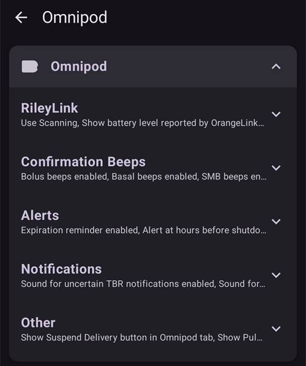

**Eklentiyi aç**, Omnipod pompa ekranını açar. Bu ekranı ana ekrandan **Yönet** > **Pompa** ile istediğiniz zaman da açabilirsiniz. Bu sayfada bu ekrana **Omnipod pompa ekranı** denir. Bir RileyLink eşleştirilmeden ve bir Pod etkinleştirilmeden önce ekran şöyle görünür:


### Verification of Omnipod Driver Selection

Omnipod sürücüsünü etkinleştirdiğinizi doğrulamak için ana ekrandan **Yönet** > **Pompa** bölümünü açın. Yukarıda gösterilen **Omnipod Eros** pompa ekranını görmelisiniz. Henüz bir RileyLink eşleştirmediyseniz, **RileyLink Durumu** **Başlatılmadı**, **Pod Durumu** ise **Aktif Pod Yok** gösterir.

## Omnipod Konfigürasyonu

Tüm Pod ve RileyLink işlevleri, [Omnipod pompa ekranındaki](#OmnipodEros-omnipod-pod-tab) (**Yönet** > **Pompa**) düğmelerdir. Bazı düğmeler yalnızca belirli durumlarda görünür, örneğin bir Pod etkinken.

>  Pod bağlantısını ve durumunu yenileyin
> 
>  Pod Yönetimi (Etkinleştir, Devre Dışı Bırak, Test bip sesini çal, RileyLink İstatistikleri ve Pod geçmişi)

```{admonition} Older screenshot
:class: note
Yukarıdaki ekran görüntüleri daha eski bir **AAPS** sürümüne aittir. **AAPS** 4'te **POD MGMT** düğmesi veya Pod Yönetimi menüsü yoktur: **Yenile** ve tüm Pod yönetimi işlemleri Omnipod pompa ekranındaki düğmelerdir.
```

(OmnipodEros-rileylink-setup)=

### RileyLink Kurulumu

RileyLink'inizi zaten eşleştirdiyseniz, aşağıdaki [Pod'u Etkinleştirme bölümüne](#OmnipodEros-activating-a-pod) geçin.

*Not: RileyLink'in bağlı olmadığını gösteren iyi bir görsel işaret, ana ekrandaki tedavi düğmelerinin (Hızlı Başlatma araç çubuğu) görünmemesidir. Bu, RileyLink'e aktif olarak bağlanıp, AAPS başladıktan sonraki ilk 30 saniye boyunca da böyle olacaktır.*

1. RileyLink'inizin tamamen şarj edildiğinden ve açık olduğundan emin olun.

2. RileyLink'i [telefonunuza yakın](#OmnipodEros-optimal-omnipod-and-rileylink-positioning) (~30 cm veya daha az) yerleştirin.

3. Omnipod pompa ekranını açın (**Yönet** > **Pompa**) ve **RileyLink'i Eşleştir**'e basın.

4. **RileyLink'i Eşleştir** ekranı hemen Bluetooth cihazlarını taramaya başlar. Bulunan cihazlar listesinde RileyLink'inize dokunun.

   

5. Cihazınızın adı ve adresiyle birlikte **RileyLink başarıyla eşleştirildi** gösterildiğinde **Tamam**'a basın.

6. Omnipod pompa ekranına döndüğünüzde **RileyLink Durumu**'nun **Bağlandı** olarak değiştiğini kontrol edin. **Pod Durumu**, **Aktif Pod Yok** göstermelidir. RileyLink bağlanmazsa **RileyLink'i Sıfırla**'ya basın veya **AAPS**'i yeniden başlatın.

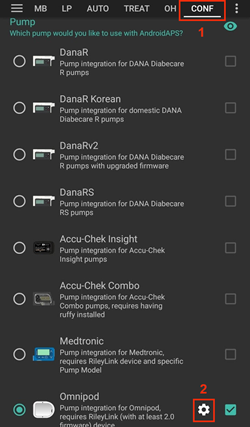 

 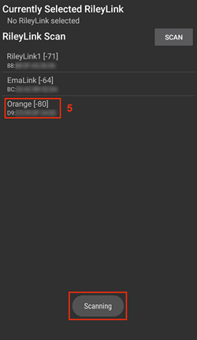


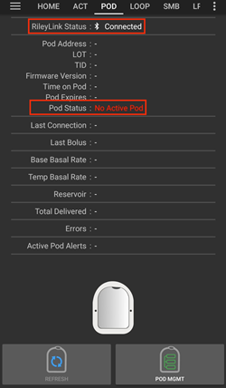

```{admonition} Older screenshot
:class: note
Yukarıdaki altı ekran görüntüsü (6. adımdan sonra) daha eski bir **AAPS** sürümüne aittir. **AAPS** 4'te RileyLink'i Omnipod ayarlarındaki **RileyLink Yapılandırması** yerine Omnipod pompa ekranındaki **RileyLink'i Eşleştir** düğmesiyle eşleştirirsiniz ve tarama otomatik olarak başlar.
```

```{note}
Başka bir RileyLink'e (örneğin yedek bir cihaza) geçmek için tekrar **RileyLink'i Eşleştir**'e basın ve yeni cihazı seçin. Yeni cihaz, önceden eşleştirilmiş olanın yerini alır. Önce eski cihazı kaldırmanız gerekmez.
```

(OmnipodEros-activating-a-pod)=

### Pod'u Etkinleştirme

Bir Pod'u etkinleştirmeden önce RileyLink'inizin eşleştirildiğinden ve **RileyLink Durumu**'nun **Bağlandı** gösterdiğinden emin olun. RileyLink hazır olana kadar **Pod'u Etkinleştir** düğmesi devre dışı kalır.

*HATIRLATMA: Güvenlik önlemleri nedeniyle, Pod etkinleştirme eşleştirmesi sırasında Pod iletişimi yalnızca kısa mesafede çalışır. Eşleştirmeden önce Pod'un radyo sinyali daha zayıftır, ancak eşleştirildikten sonra tam sinyal gücünde çalışacaktır. Bu işlemler sırasında Pod'unuzun* [RileyLink'e yakın](#OmnipodEros-optimal-omnipod-and-rileylink-positioning) *(~30 cm veya daha az) olduğundan, ancak RileyLink'in üzerinde veya hemen yanında olmadığından emin olun.*

01. Omnipod pompa ekranını açın (**Yönet** > **Pompa**) ve **Pod'u Etkinleştir**'e basın.

    Daha önce hiç profil etkinleştirmediyseniz, önce bir **Profil gerekli** adımı görünür. Etkinleştirme sırasında uygulanacak profili seçin.

    >   
    > 
    > ```{admonition} Older screenshot
    >     :class: note
    >     Yukarıdaki ekran görüntüleri daha eski bir **AAPS** sürümüne aittir. **AAPS** 4'te **Pod'u Etkinleştir**, **POD MGMT** menüsü yerine Omnipod pompa ekranındaki bir düğmedir.
    > ```

02. **Pod'u Doldur** ekranı görüntülenir. Yeni bir Pod'u 3 gün yetecek kadar insülinle doldurun ve iki bip sesini dinleyin. Bu sesler, en az 80 ünite insülin doldurulduğu anlamına gelir. İki bip sesini duyduktan sonra bile doldurma şırıngasını tamamen boşaltın. 3 gün için gereken toplam insülin miktarını hesaplarken, Pod'u hazırlamanın (prime) 12 ile 15 ünite kullanacağını göz önünde bulundurun. Pod'un iğne kapağını henüz çıkarmayın.

    > 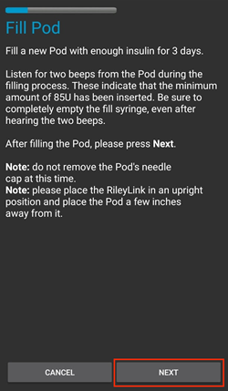
    > 
    > Yeni Pod ile RileyLink'in birbirine yakın olduğundan (~30 cm veya daha az) emin olun ve **İleri**'ye basın.

03. **İnsülin Seçin** (yalnızca birden fazla insülin yapılandırdıysanız gösterilir): Pod'a doldurduğunuz insülini seçin ve **İleri**'ye basın. Etkinleştirmeden sonra bu insülinle bir profil değişimi uygulanır.

04. **Pod'u Başlat** ekranında, pod hazırlanmaya başlar (pod kendini hazırlarken bir tıklama ve ardından bir dizi tıkırtı sesi duyarsınız). RileyLink etkinleştirilmekte olan podun kapsama alanı dışındaysa **Pod yanıt vermiyor** hata mesajı alırsınız. Böyle bir durumda [RileyLink'i Pod'a yaklaştırın](#OmnipodEros-optimal-omnipod-and-rileylink-positioning) (~30 cm veya daha az), ancak Pod'un üzerine veya hemen yanına koymayın ve **Tekrar dene**'ye basın.

    >  

05. Hazırlama (prime) başarılı olduğunda yeşil bir onay işareti görünür ve **İleri** düğmesi etkin hale gelir. **İleri**'ye basın.

    > 

06. **Bölge konumu** (yalnızca [Bölge Rotasyonu](#Aapsscreens-site-rotation) bölümünde **Pompa bölge rotasyonunu yönetin** etkinse gösterilir): Pod'u vücudunuzda nereye yerleştirdiğinizi seçin ve **İleri**'ye basın.

07. **Pod'u Tak** ekranı görüntülenir. Yeni Pod için infüzyon bölgesini hazırlayın. Pod'un plastik iğne kapağını ve yapışkan yüzeyin beyaz koruyucu kağıdını çıkarın ve Pod'u vücudunuzda seçtiğiniz bölgeye yapıştırın. Kanül dışarı çıkıyorsa **Vazgeç**'e basın ve Pod'u atın. Bitirdiğinizde **İleri**'ye basın.

    > 

08. Bir onay penceresi görünür: "Tamam'a bastığınızda kanül yerleştirilecektir". **Kanülü yerleştirmeye hazırsanız YALNIZCA o zaman Tamam'a basın**.

    > 

09. **Kanül Yerleştir** ekranında Omnipod'un yanıt verip kanülü yerleştirmesi biraz zaman alabilir (en fazla 1-2 dakika), bu yüzden sabırlı olun.

    > RileyLink etkinleştirilmekte olan podun kapsama alanı dışındaysa **Pod yanıt vermiyor** hata mesajı alırsınız. Böyle bir durumda RileyLink'i Pod'a yaklaştırın (~30 cm veya daha az), ancak Pod'un üzerine veya hemen yanına koymayın ve **Tekrar dene**'ye basın.
    > 
    > RileyLink, Bluetooth kapsama alanı dışındaysa veya telefonla etkin bir bağlantısı yoksa **RileyLink yanıt vermiyor** hata mesajı alırsınız. Böyle bir durumda RileyLink'i telefona yaklaştırın ve **Tekrar dene**'ye basın.
    > 
    > *NOT: Kanül takılmadan önce, kanül yerleştirme noktasının etrafındaki cildi sıkıştırmak iyi bir uygulamadır. Bu iğnenin düzgün bir şekilde yerleştirilmesini sağlar ve tıkanıklık oluşturma şansınızı azaltır.*
    > 
    > 
    > 
    > 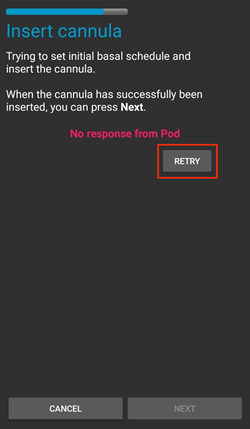 

10. Başarılı bir kanül yerleştirilmesinden sonra yeşil bir onay işareti görünür ve **İleri** butonu aktif olur. **İleri**'ye basın.

    > 

11. **Pod Etkinleştirildi** ekranı görüntülenir. Kanülün doğru yerleştirildiğini kontrol edin; doğru yerleştirilmediğini düşünüyorsanız Pod'unuzu değiştirin. **Bitir**'e basın. Tebrikler! Artık yeni bir aktif pod oturumu başlattınız.

    >  
    > 
    > ```{admonition} Older screenshot
    >     :class: note
    >     2 ile 11 arasındaki adımlardaki ekran görüntüleri daha eski bir **AAPS** sürümüne aittir ve **AAPS** 4'te farklı görünebilir. **İnsülin Seçin** ve **Bölge konumu** adımları resimde gösterilmemiştir.
    > ```

12. Omnipod pompa ekranına geri dönersiniz. **Pod'u Etkinleştir** düğmesinin yerini **Pod'u Devre Dışı Bırak** alır, çünkü etkin olanı devre dışı bırakmadan başka bir Pod etkinleştiremezsiniz.

    Pompa ekranında artık etkin Pod'unuzla ilgili bilgiler görünür: geçerli bazal oran, rezervuar seviyesi, iletilen insülin, Pod hataları ve uyarıları. Daha fazla ayrıntı için [Omnipod pompa ekranı](#OmnipodEros-omnipod-pod-tab) bölümüne bakın.

     

    ```{admonition} Older screenshot
    :class: note
    Yukarıdaki ekran görüntüleri daha eski bir **AAPS** sürümüne aittir. **AAPS** 4'te Pod Yönetimi menüsü yoktur: doğrudan Omnipod pompa ekranına dönersiniz ve orada **Pod'u Etkinleştir** yerine **Pod'u Devre Dışı Bırak** görünür.
    ```

```{note}
Etkinleştirme, hazırlamadan (prime) sonra yarıda kaldıysa (örneğin uygulama kapatıldıysa), tekrar **Pod'u Etkinleştir**'e basın. Sihirbaz, kanül yerleştirme adımlarından devam eder.
```

### Pod'u Devre Dışı Bırakma

Normal şartlar altında toplam 80 saatlik pod kullanımı için, üç günlük (72 saat) pod kullanım ömrüne ilaveten, sona erme uyarısından sonra 8 saat daha çalışmalıdır.

Bir Pod'u devre dışı bırakmak için (süresi dolduğunda veya Pod hatasında):

1. Omnipod pompa ekranını açın (**Yönet** > **Pompa**) ve **Pod'u Devre Dışı Bırak**'a basın.

   >  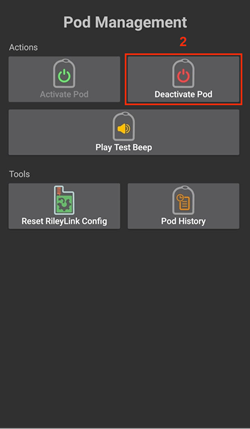 
   > 
   > ```{admonition} Older screenshot
   >    :class: note
   >    Yukarıdaki ekran görüntüleri daha eski bir **AAPS** sürümüne aittir. **AAPS** 4'te **Pod'u Devre Dışı Bırak**, **POD MGMT** menüsü yerine Omnipod pompa ekranındaki bir düğmedir.
   > ```

2. **Pod'u Devre Dışı Bırak** ekranında önce RileyLink'in Pod'a yakın olduğundan, ancak Pod'un üzerinde veya hemen yanında olmadığından emin olun. Sonra **İleri**'ye basın. Bir iletişim kutusu şunu sorar: *Devre dışı bırakılmış bir Pod tekrar kullanılamaz. Bu Pod'u şimdi devre dışı bırakmak istiyor musunuz?* Pod'u devre dışı bırakmaya başlamak için **Tamam**'a, Pod'u korumak için **Vazgeç**'e basın. Devre dışı bırakma tüm insülin iletimini askıya alır ve geri alınamaz.

   > 

3. **Pod Devre dışı bırakılıyor** ekranı görünür ve devre dışı bırakma başarılı olduğunda Pod'dan bir onay bip sesi duyarsınız.

   > 
   > 
   > **Devre dışı bırakma BAŞARISIZ olursa** ve onay bip sesi duymazsanız, **RileyLink yanıt vermiyor** veya **Pod yanıt vermiyor** mesajını alabilirsiniz. Devre dışı bırakmayı yeniden denemek için **Tekrar dene**'ye basın. Devre dışı bırakma başarısız olmaya devam ederse **Pod'u Çıkar**'a basın ve onaylayın. Bunun üzerine **AAPS** Pod'u unutur. İnsülin iletimi askıya **alınmamıştır**, bu yüzden Pod'u vücudunuzdan çıkarın. Pod'unuz yüksek sesli bir alarm (çığlık) veriyorsa, alarmı elle (bir iğne veya ataş ile) susturmanız gerekebilir, çünkü **Pod'u Çıkar** alarmı susturmaz.
   > 
   > >   

4. Devre dışı bırakma başarılı olduğunda yeşil bir onay işareti görünür. **Pod Devre dışı bırakıldı** ekranını görmek için **İleri**'ye basın. Etkin oturum devre dışı bırakıldığı için artık podunuzu çıkartabilirsiniz.

   > 

5. Omnipod pompa ekranına dönmek için **Bitir**'e basın.

   >  
   > 
   > ```{admonition} Older screenshot
   >    :class: note
   >    2 ile 5 arasındaki adımlardaki ekran görüntüleri daha eski bir **AAPS** sürümüne aittir ve **AAPS** 4'te farklı görünebilir.
   > ```

6. Omnipod pompa ekranında **RileyLink Durumu**'nun **Bağlandı**, **Pod Durumu**'nun ise **Aktif Pod Yok** gösterdiğini kontrol edin.

   >    
   > 
   > ```{admonition} Older screenshot
   >    :class: note
   >    Yukarıdaki ekran görüntüleri daha eski bir **AAPS** sürümüne aittir. **AAPS** 4'te **Bitir** sizi doğrudan Omnipod pompa ekranına götürür; Pod Yönetimi menüsü veya **Omnipod (POD)** sekmesi yoktur.
   > ```

### İnsülin İletimini Askıya Alma ve Devam Ettirme

Aşağıdaki işlem, insülin iletimini nasıl askıya alacağınızı ve nasıl devam ettireceğinizi gösterir.

*NOT - **Askıya al** düğmesini görmüyorsanız*, bu düğme varsayılan olarak gizlidir. [Omnipod ayarlarında](#OmnipodEros-omnipod-settings) **Diğer** altında **Pompa ekranında İletimi Askıya Al düğmesini göster** ayarını etkinleştirin.

#### İnsülin İletiminin Askıya Alınması

Etkin podu askıya alınmış duruma getirmek için bu komutu kullanın. Bu askıya alınmış durumda, pod artık herhangi bir insülin iletmeyecektir. Bu komut orijinal Omnipod PDM'nin etkin bir poda verdiği askıya alma işlevini taklit eder.

1. Omnipod pompa ekranını açın (**Yönet** > **Pompa**) ve **Askıya al**'a basın. Askıya alma komutu RileyLink üzerinden etkin Pod'a gönderilir.

2. Pod tüm insülin iletimini askıya aldığında **Pod Durumu** **Askıya Alındı** gösterir ve **Askıya al** düğmesinin yerini **İletime devam et** alır.

   >  
   > 
   > 
   > 
   >  
   > 
   > ```{admonition} Older screenshot
   >    :class: note
   >    Yukarıdaki ekran görüntüleri daha eski bir **AAPS** sürümüne aittir. **AAPS** 4'te bu adımlar **Omnipod (POD)** sekmesi yerine Omnipod pompa ekranında yapılır ve sonuç **Pod Durumu** alanında gösterilir.
   > ```

Komut başarısız olursa, bir **Uyarı** penceresi nedeniyle birlikte "İletim askıya alınamadı" mesajını gösterir. RileyLink bağlantısını kontrol edin ve tekrar deneyin.

#### İnsülin İletimine Devam Etme

Etkin ve şu anda askıya alınmış Pod'a insülin iletimine devam etmesini bildirmek için bu komutu kullanın. Komut başarıyla işlendikten sonra, aktif bazal profildeki geçerli zamana dayalı mevcut bazal oranı kullanılarak normal insülin iletimi sürdürülecektir. Pod bolus, GBO ve SMB için komutları tekrar kabul edecektir.

1. Omnipod pompa ekranını açın ve **Pod Durumu**'nun **Askıya Alındı** gösterdiğini kontrol edin. **İletime devam et**'e basın.

2. Komut başarılı olduğunda **Pod Durumu** yeniden **Çalışıyor** gösterir ve **İletime devam et** düğmesi kaybolur (etkinleştirdiyseniz **Askıya al** düğmesi yeniden görünür).

   >  
   > 
   > 
   > 
   >  
   > 
   > ```{admonition} Older screenshot
   >    :class: note
   >    Yukarıdaki ekran görüntüleri daha eski bir **AAPS** sürümüne aittir. **AAPS** 4'te bu adımlar **Omnipod (POD)** sekmesi yerine Omnipod pompa ekranında yapılır ve sonuç **Pod Durumu** alanında gösterilir.
   > ```

Komut başarısız olursa, bir **Uyarı** penceresi nedeniyle birlikte "İletim devam ettirilemedi" mesajını gösterir. RileyLink bağlantısını kontrol edin ve tekrar deneyin.

### Silencing Pod Alerts

*NOT - **Alarmları Sustur** düğmesi Omnipod pompa ekranında yalnızca Pod'da etkin bir uyarı varken (örneğin Pod süre sonu veya düşük rezervuar uyarısı) ve yalnızca **Pod uyarılarını otomatik olarak sustur** kapalıysa gösterilir.*

Aşağıdaki işlem, Pod süresi dolmadan önceki uyarı zamanına geldiğinde başlayan Pod bip seslerini nasıl susturacağınızı gösterir. Bu uyarı zamanı, Omnipod **Alarmlar** ayarlarındaki **Pompa kapanmadan önce uyar (80 Saat)** ile ayarlanır. Bir pod'un maksimum ömrü 80 saattir (3 gün 8 saat), ancak Insulet 72 saat (3 gün) sınırının aşılmamasını önermektedir.

*NOT - Omnipod **Alarmlar** ayarlarında **Pod uyarılarını otomatik olarak sustur** ayarını etkinleştirdiyseniz, **AAPS** uyarıyı Pod ile bir sonraki iletişimde otomatik olarak susturur ve sizin bunu elle yapmanız GEREKMEZ.*

1. Uyarı zamanına gelindiğinde Pod, süresinin yakında dolacağını ve değiştirilmesi gerektiğini bildirmek için bip sesi çıkarır. Omnipod pompa ekranında **Pod Sona Erme**, Pod'un süresinin tam olarak dolacağı zamanı gösterir (etkinleştirmeden 72 saat sonra); bu alan 4 saat önce **sarı** olur. **Pod Zorunlu Sonu**, Pod'un insülin iletimini durduracağı zamanı gösterir. **Etkin Pod Alarmları** alanında **Pod yakında sona erecek** görünür ve **Alarmları Sustur** düğmesi belirir. **AAPS** ayrıca Pod süresinin yakında dolacağı hakkında bir bildirim gösterir.

   >   
   > 
   > ```{admonition} Older screenshot
   >    :class: note
   >    Yukarıdaki ekran görüntüleri daha eski bir **AAPS** sürümüne aittir. **AAPS** 4'te **ACK ALERTS** düğmesinin adı **Alarmları Sustur**'dur ve Omnipod pompa ekranındadır.
   > ```

2. **Alarmları Sustur**'a basın. RileyLink, süre sonu uyarı bip seslerini durdurmak için Pod'a komut gönderir.

   >  
   > 
   > ```{admonition} Older screenshot
   >    :class: note
   >    Yukarıdaki ekran görüntüsü eski bir **AAPS** sürümüne aittir. **AAPS** 4'te bu düğmenin adı **Alarmları Sustur**'dur.
   > ```

3. Uyarılar susturulduğunda Pod iki kez bip sesi çıkarır. **Etkin Pod Alarmları** artık uyarıyı göstermez, **Alarmları Sustur** düğmesi kaybolur ve Pod süre sonu uyarı bip seslerini durdurur.

   >  
   > 
   > ```{admonition} Older screenshot
   >    :class: note
   >    Yukarıdaki ekran görüntüsü eski bir **AAPS** sürümüne aittir. **AAPS** 4'te sonuç Omnipod pompa ekranında gösterilir: uyarı **Etkin Pod Alarmları** alanından kaybolur.
   > ```

Komut başarısız olursa (örneğin RileyLink Pod'un menzili dışındaysa), bir **Uyarı** penceresi nedeniyle birlikte "Uyarılar susturulamadı" mesajını gösterir. RileyLink'i Pod'a yaklaştırın ve tekrar deneyin.


```{admonition} Older screenshot
:class: note
Yukarıdaki ekran görüntüsü eski bir **AAPS** sürümüne aittir. **AAPS** 4'te **Uyarı** penceresi nedeniyle birlikte "Uyarılar susturulamadı" mesajını gösterir.
```

(OmnipodEros-view-pod-history)=

### Pod Geçmişini Görüntüleme

Bu bölüm, aktif pod geçmişinizi nasıl gözden geçireceğinizi ve farklı eylem kategorilerine göre nasıl filtreleyeceğinizi gösterir. Pod geçmişi aracı, üç günlük (72 - 80 saat) ömrü boyunca şu anda etkin olan pod'unuza yönelik eylemleri ve sonuçları görüntülemenize olanak tanır.

Bu özellik, verilen ancak tamamlanıp tamamlanmadığından emin olmadığınız bolusları, GBO'ları ve bazal değişiklikleri doğrulamak için kullanışlıdır. Kalan kategoriler, genel olarak sorunları gidermek ve bir arızaya yol açan olayların sırasını belirlemek için kullanışlıdır.

*NOT:* **Belirsiz** komutlar pod geçmişinde görünür, ancak yapıları gereği doğruluklarından emin olamazsınız.

1. Omnipod pompa ekranını açın (**Yönet** > **Pompa**) ve **Pod Geçmişi**'ne basın.

   >   
   > 
   > ```{admonition} Older screenshot
   >    :class: note
   >    Yukarıdaki ekran görüntüleri daha eski bir **AAPS** sürümüne aittir. **AAPS** 4'te **Pod Geçmişi**, **POD MGMT** menüsü yerine Omnipod pompa ekranındaki bir düğmedir.
   > ```

2. **Pod Geçmişi** ekranı tüm Pod işlemlerini ve sonuçlarını, en yenisi en üstte olacak şekilde, güne göre gruplanmış olarak listeler. Varsayılan olarak **Tümü** seçilidir. Yalnızca bir kategoriyi göstermek için üstteki filtre düğmelerinden birine dokunun. Omnipod pompa ekranına dönmek için sol üstteki geri okunu kullanın.

   > 

   >  
   > 
   > ```{admonition} Older screenshot
   >    :class: note
   >    İkinci ekran görüntüsü daha eski bir **AAPS** sürümüne aittir ve **AAPS** 4'te farklı görünebilir.
   > ```

### RileyLink Ayarlarını ve Geçmişini Görüntüle

**RileyLink İstatistikleri** ekranı, RileyLink'inizin ve etkin Pod'un ayarlarını ve her ikisinin iletişim geçmişini gösterir. İki sekmesi vardır: **Ayarlar** ve **Geçmiş**.

**RileyLink İstatistikleri** düğmesi varsayılan olarak gizlidir. Bu düğmeyi Omnipod pompa ekranında göstermek için [Omnipod ayarlarında](#OmnipodEros-omnipod-settings) **Diğer** altında **Pod Yönetimi menüsünde RileyLink İstatistikleri düğmesini göster** ayarını etkinleştirin.

#### Pod İletişim Cihazının Bluetooth Bağlantısını Elle Yeniden Kurma

Pod iletişim cihazınız bir süre telefonunuzun Bluetooth menzili dışında kaldıysa, Omnipod pompa ekranındaki **RileyLink Durumu** **RileyLink'e erişilemiyor** gösterebilir. Cihaz yeniden menzile girdiğinde **AAPS** normalde kendiliğinden yeniden bağlanır. Bağlanmazsa:

1. RileyLink'in açık, şarjlı ve telefonunuza yakın olduğundan emin olun.

2. Omnipod pompa ekranında **RileyLink'i Sıfırla**'ya basın. Bir mesaj **RileyLink yapılandırması sıfırlandı** bilgisini verir. Aşağıdaki [RileyLink'i Sıfırla notlarına](#OmnipodEros-reset-rileylink-config-notes) bakın.

3. **Bluetooth bağlantısı** yeniden kurulmazsa, telefonunuzdaki Bluetooth işlevini manuel olarak **kapatmayı** ve ardından tekrar **açmayı** deneyin.

4. Yine de yeniden bağlanmazsa **RileyLink'i Eşleştir**'e basın ve RileyLink'inizi yeniden seçin.

5. Yeniden bağlantı başarılı olduktan sonra **RileyLink Durumu** **Bağlandı** gösterir. **RileyLink İstatistikleri** ekranının **Ayarlar** sekmesinde **Bağlantı durumu** alanını da kontrol edebilirsiniz. Tebrikler, yapılandırılmış Pod iletişim cihazınızı AAPS'e yeniden bağladınız!

 

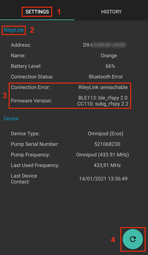


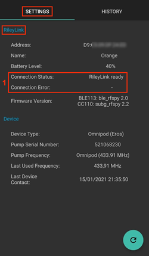

```{admonition} Older screenshot
:class: note
Yukarıdaki ekran görüntüleri daha eski bir **AAPS** sürümüne aittir. **AAPS** 4'te RileyLink Ayarları ekranındaki yenileme düğmesi yerine Omnipod pompa ekranındaki **RileyLink'i Sıfırla** veya **RileyLink'i Eşleştir** ile yeniden bağlanırsınız.
```

#### Pod İletişim Cihazı (örn. RileyLink) ve Aktif Pod Ayarları

Bu ekran, hem şu anda eşleştirilmiş Pod iletişim cihazı hem de şu anda etkin olan Omnipod Eros Pod'u için bilgi ve durumu gösterir. Bilgiler otomatik olarak yenilenir.

1. Omnipod pompa ekranını açın (**Yönet** > **Pompa**) ve **RileyLink İstatistikleri**'ne basın. **Ayarlar** sekmesi şu anda eşleştirilmiş **RileyLink**'inizi ve etkin Pod'u (**Cihaz**) gösterir.

   > 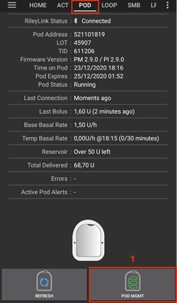 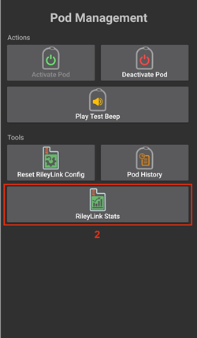 
   > 
   > ```{admonition} Older screenshot
   >    :class: note
   >    Yukarıdaki ekran görüntüleri daha eski bir **AAPS** sürümüne aittir. **AAPS** 4'te **RileyLink İstatistikleri**, **POD MGMT** menüsü yerine Omnipod pompa ekranındaki bir düğmedir.
   > ```

   > 

##### RileyLink alanları

> - **Adres:** Eşleştirilmiş Pod iletişim cihazının MAC adresi.
> - **Ad:** Eşleştirilmiş Pod iletişim cihazının Bluetooth adı.
> - **Pil seviyesi:** Bağlı Pod iletişim cihazının güncel pil seviyesi. Yalnızca **OrangeLink/EmaLink/DiaLink tarafından bildirilen pil seviyesini göster** etkinse gösterilir.
> - **Bağlantı Durumu**: Pod iletişim cihazı ile AAPS çalıştıran telefon arasındaki Bluetooth bağlantısının mevcut durumu.
> - **Bağlantı Hatası:** Pod iletişim cihazının Bluetooth bağlantısında bir hata varsa, ayrıntılar burada gösterilir.
> - **Üretici yazılımı sürümü:** Bağlı olan Pod iletişim cihazında kurulu üretici yazılımının sürümü.

##### Cihaz alanları - Etkin bir Pod varken

> - **Cihaz Tipi:** Pod iletişim cihazıyla iletişim kuran cihazın tipi (Omnipod (Eros)).
> - **Yapılandırılan Cihaz Modeli:** Pod iletişim cihazıyla iletişim kurmak üzere yapılandırılmış cihazın modeli.
> - **Bağlı Cihaz Modeli:** Şu anda Pod iletişim cihazıyla iletişim kuran cihazın modeli.
> - **Pompa Seri Numarası:** Şu anda etkinleştirilmiş olan podun seri numarası.
> - **Pompa Frekansı:** Pod ile iletişim için kullanılan radyo frekansı.
> - **Son Kullanılan Frekans:** Pod'un Pod iletişim cihazıyla iletişimde kullandığı bilinen son radyo frekansı.
> - **Son Cihaz İletişimi:** Pod'un Pod iletişim cihazıyla kurduğu son iletişimin tarihi ve saati.

(omnipod-eros-rileylink-and-active-pod-history)=
#### RileyLink ve Aktif Pod Geçmişi

Bu sekme, RileyLink'in veya şu anda bağlı Pod'un her durumunu veya işlemini en yenisi en üstte olacak şekilde listeler. Geçmiş yalnızca şu anda etkin olan Pod için kullanılabilir. Pod değişiminden sonra bu geçmiş silinir ve yalnızca yeni etkinleştirilen Pod'un olayları kaydedilip gösterilir.

1. Omnipod pompa ekranını açın (**Yönet** > **Pompa**), **RileyLink İstatistikleri**'ne basın ve sonra **Geçmiş** sekmesine dokunun.

   >  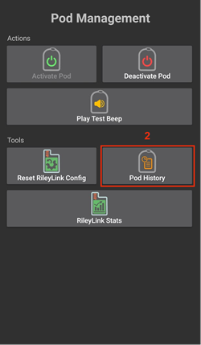 
   > 
   > ```{admonition} Older screenshot
   >    :class: note
   >    Yukarıdaki ekran görüntüleri daha eski bir **AAPS** sürümüne aittir. **AAPS** 4'te **RileyLink İstatistikleri**, **POD MGMT** menüsü yerine Omnipod pompa ekranındaki bir düğmedir.
   > ```

   > 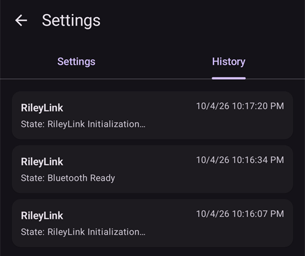

##### Fields

Her kayıt şunları gösterir:

> - **Cihaz:** İşlemin veya durumun ait olduğu cihaz.
> - **Zaman:** Olayın zamanı.
> - **Durum veya Eylem:** Cihazın durumu veya yaptığı işlem.

(OmnipodEros-omnipod-pod-tab)=

## Omnipod pompa ekranı

Aşağıda **Omnipod pompa ekranındaki** (**Yönet** > **Pompa** veya **Konfigürasyon** > **Pompa** > **Eklentiyi aç**) durum alanlarının ve düğmelerin açıklaması yer alır.

Sağ üstteki dişli simgesi [Omnipod ayarlarını](#OmnipodEros-omnipod-settings) açar.

*NOT: Herhangi bir durum alanında (belirsiz) yazıyorsa, Pod durumunu yenilemek ve bu yazıyı kaldırmak için **Yenile**'ye basın.*


```{admonition} Older screenshot
:class: note
Yukarıdaki ekran görüntüsü, bu ekranın **Omnipod (POD)** sekmesi olduğu daha eski bir **AAPS** sürümüne aittir. **AAPS** 4'te bu ekran Omnipod pompa ekranıdır ve bazı alan adları ile düğmeler farklıdır.
```

### Fields

- **RileyLink Durumu:** RileyLink'in mevcut bağlantı durumunu görüntüler. Hatalar kırmızı renkte gösterilir.

- *Başlatılmadı* - henüz bir RileyLink eşleştirilmedi veya bağlantı başlamadı.
- *RileyLink'e erişilemiyor* - Pod iletişim cihazı telefonun Bluetooth menzili dışında, kapalı ya da Bluetooth iletişimini engelleyen bir arızası var.
- *RileyLink hazır* - Pod iletişim cihazı açık ve Bluetooth bağlantısını kuruyor.
- *Bağlı* Pod iletişim cihazı açık, bağlı ve Bluetooth aracılığıyla aktif olarak iletişim kurabiliyor.

- **Özgün kimlik:** Etkin Pod'un adresini gösterir.

- **Parti Numarası:** Etkin Pod'un LOT (parti) numarasını gösterir.

- **Sıra Numarası:** Pod'un seri numarasını (TID) gösterir.

- **Üretici yazılımı sürümü:** Etkin Pod'un üretici yazılımı sürümünü gösterir.

- **Pod saati:** Etkin Pod'daki geçerli saati gösterir. Telefon saatinden 5 dakikadan fazla farklıysa vurgulanır.

- **Pod Sona Erme:** Etkin Pod'un süresinin dolacağı tarihi ve saati gösterir. Bu zamandan önceki son 4 saatte metin sarıya döner. Pod bu zamandan sonra da insülin vermeye devam ettiği için metin hiçbir zaman kırmızıya dönmez.

- **Pod Zorunlu Sonu:** Pod'un ek süresinin sonunu gösterir (**Pod Sona Erme** zamanından 8 saat sonra; Pod en fazla 80 saat kullanılabilir). Ek süre başladığında (**Pod Sona Erme** zamanında) metin sarıya, zorunlu sondan önceki son 4 saatte kırmızıya döner. Ek süre boyunca kalan süreyi de gösterir, örneğin *(17dk kaldı)*. Pod, zorunlu sonda insülin vermeyi durdurur ve değiştirilmesi gerekir.

- **Pod Durumu:** Etkin Pod'un durumunu gösterir (örneğin **Aktif Pod Yok**, **Çalışıyor** veya **Askıya Alındı**).

- **Son Bağlantı:** Etkin Pod ile en son ne zaman iletişim kurulduğunu gösterir. [Pompa ulaşılamaz eşiği](#OmnipodEros-troubleshooting) aşıldığında yazı kırmızı olur.

- *Az önce* - 20 saniyeden kısa bir süre önce.
- *Bir dakikadan az bir süre önce* - 20 saniyeden uzun, ancak 60 saniyeden kısa bir süre önce.
- *1 dakika önce* - 60 saniyeden uzun ancak 120 saniyeden kısa (2 dakika)
- *XX dakika önce* - XX değeriyle tanımlanan 2 dakikadan daha uzun bir süre önce

- **Son Bolus:** Etkin Pod'a gönderilen son bolusun dozunu ve parantez içinde ne kadar zaman önce verildiğini gösterir.

- **Bazal Oranı:** Bazal oran profilinde geçerli saat için programlanmış bazal oranı gösterir.

- **Geçici Bazal Oranı:** Yalnızca bir geçici bazal oranı (GBO) çalışırken gösterilir. Şu biçimde gösterilir:

- Ünite / saat @ GBO'nun verildiği saat (çalıştığı dakika / GBO'nun toplam çalışma süresi, dakika)
- *Örnek:* 0,00Ü/sa @18:25 ( 90/120 dakika)

- **Rezervuar:** Rezervuarda 50 üniteden fazla insülin kaldığında **50 Ü üzeri kaldı** gösterir. Bu değerin altında yaklaşık ünite sayısı gösterilir. Yazı, [Alarm ayarlarında](#OmnipodEros-omnipod-settings) belirlenen düşük rezervuar eşiğinin altında kırmızı olur.

- **Toplam İletilen:** Rezervuardan iletilen toplam insülin ünitesini gösterir. *Pod mutlak kesinlikle hazırlanıp ve doldurulmadığı için bunun bir tahmin olduğunu unutmayın.*

- **Etkin Pod Alarmları:** Etkin Pod'da şu anda çalan uyarılar için ayrılmıştır. Genellikle Pod 72 saati geçtiğinde ve Pod'un kendi bip uyarıları çalarken kullanılır.

- **Hatalar:** Karşılaşılan son hatayı gösterir (kırmızı renkte). Geçmiş hatalar ve daha ayrıntılı bilgi için [Pod geçmişini](#OmnipodEros-view-pod-history), [RileyLink geçmişini](#omnipod-eros-rileylink-and-active-pod-history) ve günlük dosyalarını inceleyin.

### Düğmeler

Pompa ekranının altındaki düğmeler duruma göre değişir. Şu anda kullanılamayan düğmeler gri görünür, örneğin RileyLink bağlı değilken.

**Pod durumu düğmeleri** (bir Pod etkinken gösterilir):

- **Yenile:** Durumunu güncellemek için etkin Pod'a bir yenileme komutu gönderir. Pod durumunu yenilemek ve (belirsiz) yazan durum alanlarını temizlemek için kullanın. Daha fazla bilgi için aşağıdaki [Sorun giderme bölümüne](#OmnipodEros-troubleshooting) bakın.

  

  ```{admonition} Older screenshot
  :class: note
  Yukarıdaki ekran görüntüsü daha eski bir **AAPS** sürümüne aittir. **AAPS** 4'te bu, Omnipod pompa ekranında **Yenile** adlı bir metin düğmesidir.
  ```

- **Alarmları Sustur:** Pod süre sonu ve düşük rezervuar bip seslerini ve bildirimlerini susturur. Yalnızca Pod'da etkin bir uyarı varken ve **Pod uyarılarını otomatik olarak sustur** kapalıyken gösterilir. Uyarılar susturulduktan sonra düğme kaybolur.

  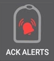

  ```{admonition} Older screenshot
  :class: note
  Yukarıdaki ekran görüntüsü daha eski bir **AAPS** sürümüne aittir. **AAPS** 4'te bu düğmenin adı **Alarmları Sustur**'dur.
  ```

- **Saati ayarla:** Pod'daki saati telefonunuzdaki geçerli saatle günceller. Yalnızca Pod'daki saat telefon saatinden 5 dakikadan fazla farklıysa gösterilir.

  

  ```{admonition} Older screenshot
  :class: note
  Yukarıdaki ekran görüntüsü daha eski bir **AAPS** sürümüne aittir. **AAPS** 4'te bu, Omnipod pompa ekranında **Saati ayarla** adlı bir metin düğmesidir.
  ```

- **Askıya al:** Etkin Pod'da insülin iletimini askıya alır. Yalnızca ayarlarda etkinleştirilmişse gösterilir (**Pompa ekranında İletimi Askıya Al düğmesini göster**).

  

  ```{admonition} Older screenshot
  :class: note
  Yukarıdaki ekran görüntüsü daha eski bir **AAPS** sürümüne aittir. **AAPS** 4'te bu, Omnipod pompa ekranında **Askıya al** adlı bir metin düğmesidir.
  ```

- **İletime devam et:** Şu anda askıya alınmış, etkin Pod'da insülin iletimine devam eder. Yalnızca Pod askıya alınmışken gösterilir.

  

  ```{admonition} Older screenshot
  :class: note
  Yukarıdaki ekran görüntüsü daha eski bir **AAPS** sürümüne aittir. **AAPS** 4'te bu, Omnipod pompa ekranında **İletime devam et** adlı bir metin düğmesidir.
  ```

**Pod ve RileyLink yönetim düğmeleri:**

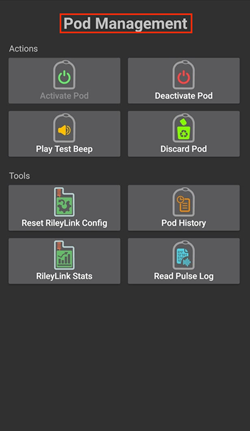

```{admonition} Older screenshot
:class: note
Yukarıdaki ekran görüntüsü eski bir **AAPS** sürümüne aittir. **AAPS** 4'te Pod Yönetimi menüsü yoktur: bu işlemler doğrudan Omnipod pompa ekranındaki düğmelerdir.
```

- **Pod'u Etkinleştir:** Yeni bir Pod'u hazırlar (prime) ve etkinleştirir. Etkin Pod olmadığında gösterilir. Yalnızca RileyLink bağlıyken etkindir.

  

  ```{admonition} Older screenshot
  :class: note
  Yukarıdaki ekran görüntüsü daha eski bir **AAPS** sürümüne aittir. **AAPS** 4'te **Pod'u Etkinleştir**, Pod Yönetimi menüsü yerine Omnipod pompa ekranındaki bir düğmedir.
  ```

- **Pod'u Devre Dışı Bırak:** Şu anda etkin olan Pod'u devre dışı bırakır. Bir Pod eşleştirilir eşleştirilmez gösterilir; bir etkinleştirme yarıda kaldığında da gösterilir (örneğin Pod etkinleştirme sırasında arızalandığı için). Yalnızca RileyLink bağlıyken etkindir. **AAPS**, Pod'u devre dışı bırakmadan önce onaylamanızı ister.

- Çığlık atan bir podu devre dışı bırakmak için bu komutu kullanın (hata 49).
- Devre dışı bırakma başarısız olursa, devre dışı bırakma sihirbazı **Pod'u Çıkar** seçeneği sunar.

  

  ```{admonition} Older screenshot
  :class: note
  Yukarıdaki ekran görüntüsü daha eski bir **AAPS** sürümüne aittir. **AAPS** 4'te **Pod'u Devre Dışı Bırak**, Pod Yönetimi menüsü yerine Omnipod pompa ekranındaki bir düğmedir.
  ```

- **Test Bip Sesi Çal:** Basıldığında Pod'da tek bir test bip sesi çalar. Bir Pod eşleştirildiğinde gösterilir.

  

  ```{admonition} Older screenshot
  :class: note
  Yukarıdaki ekran görüntüsü daha eski bir **AAPS** sürümüne aittir. **AAPS** 4'te **Test Bip Sesi Çal**, Pod Yönetimi menüsü yerine Omnipod pompa ekranındaki bir düğmedir.
  ```

- **Pod Geçmişi:** Etkin Pod'un işlem geçmişini gösterir. Bkz. [Pod Geçmişini Görüntüleme](#OmnipodEros-view-pod-history).

  

  ```{admonition} Older screenshot
  :class: note
  Yukarıdaki ekran görüntüsü daha eski bir **AAPS** sürümüne aittir. **AAPS** 4'te **Pod Geçmişi**, Pod Yönetimi menüsü yerine Omnipod pompa ekranındaki bir düğmedir.
  ```

- **RileyLink'i Eşleştir:** Pod iletişim cihazınızı arar ve eşleştirir. Bkz. [RileyLink Kurulumu](#OmnipodEros-rileylink-setup).

- **RileyLink İstatistikleri:** İki sekmeli RileyLink İstatistikleri ekranını açar. Yalnızca ayarlarda etkinleştirilmişse gösterilir (**Pod Yönetimi menüsünde RileyLink İstatistikleri düğmesini göster**).

- **Ayarlar** - RileyLink ve aktif pod ayarları bilgilerini görüntüler
- **Geçmiş** - RileyLink ve Pod iletişim geçmişini görüntüler

  

  ```{admonition} Older screenshot
  :class: note
  Yukarıdaki ekran görüntüsü daha eski bir **AAPS** sürümüne aittir. **AAPS** 4'te **RileyLink İstatistikleri**, Pod Yönetimi menüsü yerine Omnipod pompa ekranındaki bir düğmedir.
  ```

- **RileyLink'i Sıfırla:** Şu anda bağlı Pod iletişim cihazının yapılandırmasını sıfırlar. İletişim başlatıldığında, belirli veriler RileyLink'e gönderilir ve ayarlanır:

- Bellek yazmaçları ayarlanır
- İletişim protokolleri ayarlanır
- Ayarlanmış radyo frekansı ayarlanır
  > 
  > Aşağıdaki [ek notlara](#OmnipodEros-reset-rileylink-config-notes) bakın.

  

  ```{admonition} Older screenshot
  :class: note
  Yukarıdaki ekran görüntüsü daha eski bir **AAPS** sürümüne aittir. **AAPS** 4'te bu düğmenin adı **RileyLink'i Sıfırla**'dır ve Omnipod pompa ekranındadır.
  ```

- **Pod'u Çıkar:** Yanıt vermeyen bir Pod'un durumunu, onay alındıktan sonra siler. Yalnızca bir Pod başlatılmış ancak tam olarak eşleştirilmemişse gösterilir, çünkü bu durumda normal devre dışı bırakma artık mümkün değildir:

- Bir **Pod tam olarak eşleştirilmemiştir** ve bu nedenle devre dışı bırakma komutlarını yok sayar.
- Eşleştirme işlemi sırasında adımlar arasında bir **Pod takılı kalmıştır**.
- **Pod hiç bir şekilde eşleşmiyorsa.**
  > 
  > Bir Pod'u çıkardıktan sonra **AAPS** artık onunla iletişim kuramaz. Pod'u vücudunuzdan çıkarın.

  

  ```{admonition} Older screenshot
  :class: note
  Yukarıdaki ekran görüntüsü daha eski bir **AAPS** sürümüne aittir. **AAPS** 4'te **Pod'u Çıkar**, Pod Yönetimi menüsü yerine Omnipod pompa ekranındaki bir düğmedir.
  ```

(OmnipodEros-reset-rileylink-config-notes)=

#### *RileyLink'i Sıfırla Notları*

- Bu özelliğin birincil kullanımı, o anda etkin olan pod iletişim cihazının yanıt vermediği ve iletişimin takılı kaldığı durumlardır.
- Pod iletişim cihazı kapatılıp yeniden açılırsa, bu iletişim parametrelerinin Pod iletişim cihazında yeniden ayarlanması için **RileyLink'i Sıfırla**'ya basın.
- Bu YAPILMAZSA, Pod iletişim cihazı kapatılıp açıldıktan sonra AAPS'in yeniden başlatılması gerekir.
- Farklı Pod iletişim cihazları arasında geçiş yaparken bu düğmeye basmanız **GEREKMEZ**.

(OmnipodEros-omnipod-settings)=

## Omnipod Ayarları

Omnipod sürücü ayarlarını açmak için:

- Omnipod pompa ekranının (**Yönet** > **Pompa**) sağ üstündeki dişli simgesine basın veya
- sol üstteki **menüyü** (☰) açın > **Konfigürasyon** > **Pompa** ve **Omnipod Eros** kartında **Ayarlar**'a basın.

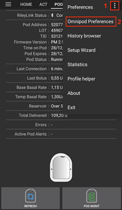

```{admonition} Older screenshot
:class: note
Yukarıdaki ekran görüntüsü eski bir **AAPS** sürümüne aittir. **AAPS** 4'te ayarları, **Konfigürasyon** içindeki ayar dişlisi veya 3 nokta menüsü yerine **Omnipod Eros** kartındaki **Ayarlar** ile veya Omnipod pompa ekranındaki dişli simgesiyle açarsınız.
```

Ayarlar aşağıda listelendiği gibi gruplanmıştır. Bir grubu açmak için üzerine dokunun. Çoğu ayar, etkinleştirip devre dışı bırakabileceğiniz anahtarlardır:


*NOT: Yıldız işareti (\*), bir ayarın varsayılan olarak etkin olduğunu belirtir.*

### RileyLink

Pod iletişim cihazı ayarları. Cihazın kendisini pompa ekranındaki **RileyLink'i Eşleştir** düğmesiyle eşleştirirsiniz (bkz. [RileyLink Kurulumu](#OmnipodEros-rileylink-setup)).

- **Taramayı Kullan:** OrangeLink'e bağlanmadan önce tarama yapar. Bu, bağlantıları iyileştirebilir. Gerekirse diğer RileyLink klonlarıyla da kullanılabilir.

- **OrangeLink/EmaLink/DiaLink tarafından bildirilen pil seviyesini göster:** OrangeLink/EmaLink/DiaLink'in gerçek pil seviyesini bildirir. Tüm OrangeLink/EmaLink/DiaLink kullanıcılarının bu ayarı etkinleştirmesi **şiddetle önerilir**.

- Orijinal RileyLink ile ÇALIŞMAZ.
- RileyLink alternatifleriyle çalışmayabilir.
- Etkin - Desteklenen pod iletişim cihazları için mevcut pil seviyesini raporlar.
- Devre Dışı - n/a değerini gösterir.

- **Eylemler'de pil değişikliği günlüğünü etkinleştir:** Yalnızca yukarıdaki pil bildirimi ayarı etkinse kullanılabilir. Bazı Pod iletişim cihazları, değiştirebileceğiniz normal piller kullanabilir. Bu ayar etkinken, değişikliği kaydetmek ve pil yaşını sıfırlamak için bir **Pompa Pil Değişimi** [careportal kaydı](#aaps-screens-careportal) girebilirsiniz.

### Onay Bipleri

Bolus, bazal, SMB ve GBO iletimi ve değişiklikleri için Pod'dan onay bip sesleri gelir.

- **\*Bolus bip seslerini etkinleştir:** Bolus iletildiğinde onay biplerini etkinleştirin veya devre dışı bırakın.
- **Bazal bip seslerini etkinleştir:** Yeni bir bazal oran ayarlandığında, aktif bazal oran iptal edildiğinde veya mevcut bazal oran değiştirildiğinde onay biplerini etkinleştirin veya devre dışı bırakın.
- **\*SMB bip seslerini etkinleştir:** Bir SMB iletildiğinde onay biplerini etkinleştirin veya devre dışı bırakın.
- **GBO (TBR) bip seslerini etkinleştir:** Bir GBO ayarlandığında veya iptal edildiğinde onay biplerini etkinleştirin veya devre dışı bırakın.

### Alerts

Tanımlanan eşik birimlerine dayalı olarak pod sona erme, kapatma, düşük rezervuar için AAPS uyarıları ve Nightscout duyuruları sağlar.

*Not: Bir alarm tetiklendikten sonra Pod ile ilk iletişimde, her alarm için HER ZAMAN bir AAPS bildirimi verilir. Bildirimi kapatmak, **Pod uyarılarını otomatik olarak sustur** etkin DEĞİLSE uyarıyı susturMAZ. Uyarıyı ELLE susturmak için Omnipod pompa ekranını açın ve **Alarmları Sustur**'a basın.*

- **\*Süre sonu hatırlatıcısını etkinleştir:** Etkinleştirildiğinde, aşağıda ayarlanan zamana gelindiğinde Pod bip sesi çıkarır.
- **Pompa kapanmadan önce uyar (80 Saat):** Süre sonu hatırlatıcısının, Pod kapanmadan (etkinleştirmeden 80 saat sonra) kaç saat önce tetikleneceği (1 ile 8 saat arası, varsayılan 8).
- **\*Düşük rezervuar uyarısını etkinleştir:** Pod'da kalan insülin, Ünite sayısı alanında belirlenen düşük rezervuar sınırına ulaştığında verilen uyarıyı etkinleştirin veya devre dışı bırakın.
- **Ünite sayısı:** Pod düşük rezervuar uyarısının tetikleneceği ünite sayısı (5 ile 50 arası, varsayılan 20).
- **Pod uyarılarını otomatik olarak sustur:** Etkinleştirildiğinde yine de bir bildirim verilir, ancak uyarı, başladıktan sonra Pod ile ilk iletişimde otomatik olarak susturulur.

### Notifications

GBO, SMB veya bolus işlemlerinin başarılı olup olmadığı belirsiz olduğunda AAPS bildirimleri ve sesli telefon uyarıları verir.

*NOTE: These are notifications only, no audible beep alerts are made.*

- **\*Belirsiz GBO bildirimleri için sesi etkinleştir:** AAPS bir GBO'nun başarıyla ayarlanıp ayarlanmadığından emin olmadığında sesli bir uyarı ve görsel bildirim vermek için bu ayarı etkinleştirin veya devre dışı bırakın.
- **\*Belirsiz SMB bildirimleri için sesi etkinleştir:** AAPS bir SMB'nin başarıyla iletilip iletilmediğinden emin olmadığında sesli bir uyarı ve görsel bildirim vermek için bu ayarı etkinleştirin veya devre dışı bırakın.
- **\*Belirsiz bolus bildirimleri için sesi etkinleştir:** AAPS'in bir bolusun başarıyla iletildiğinden emin olmadığı durumlarda sesli uyarı ve görsel bildirim vermek için bu ayarı etkinleştirin veya devre dışı bırakın.

### Diğer

Hata ayıklamaya yardımcı olmak için gelişmiş ayarlar sağlar.

- **Pompa ekranında İletimi Askıya Al düğmesini göster:** Omnipod pompa ekranındaki **Askıya al** düğmesini gizler veya gösterir.
- **Pod Yönetimi menüsünde Darbe Günlüğü düğmesini göster:** Bu ayar hâlâ listede bulunur, ancak pompa ekranının güncel sürümünde **Darbe Günlüğü** düğmesi yoktur.

- **Pod Yönetimi menüsünde RileyLink İstatistikleri düğmesini göster:** Omnipod pompa ekranındaki **RileyLink İstatistikleri** düğmesini gizler veya gösterir.
- **\*DST/Saat dilimi algılamayı etkinleştir:** Telefon yaz saati (DST) uygulanan bir bölgede kullanılıyorsa saat dilimi değişikliklerinin otomatik olarak algılanmasını sağlar.

### Aktif Pod İletişim Aygıtını Değiştirme veya Çıkarma (RileyLink)

Orijinal RileyLink'e alternatif birçok model (OrangeLink veya EmaLink gibi) bulunduğundan veya aynı Pod iletişim cihazından birden fazla ya da yedek cihaz gerektiğinden, başka bir cihaza geçmeniz gerekebilir.

Geçmek için Omnipod pompa ekranını açın (**Yönet** > **Pompa**), **RileyLink'i Eşleştir**'e basın ve [RileyLink Kurulumu](#OmnipodEros-rileylink-setup) bölümünde anlatıldığı gibi yeni cihazı seçin. Yeni cihaz, önceden eşleştirilmiş olanın yerini alır.

 


 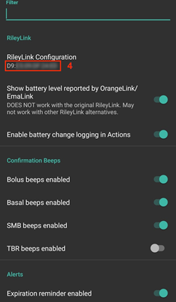

```{admonition} Older screenshot
:class: note
Yukarıdaki ekran görüntüleri daha eski bir **AAPS** sürümüne aittir. **AAPS** 4'te bir cihazı Omnipod ayarlarındaki **RileyLink Yapılandırması** yerine Omnipod pompa ekranındaki **RileyLink'i Eşleştir** ile eklersiniz ve tarama otomatik olarak başlar.
```

Eşleştirilmiş bir cihazı kaldırmak için ayrı bir düğme yoktur. Bir RileyLink'i artık kullanmıyorsanız, gerektiğinde yenisini eşleştirmeniz yeterlidir.


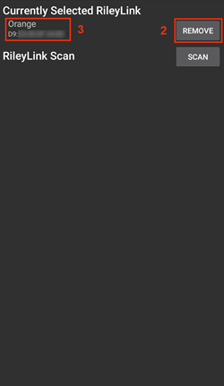

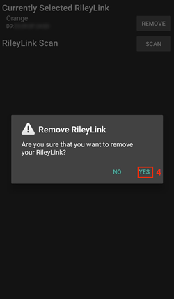

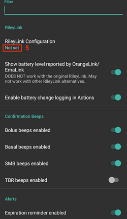

```{admonition} Older screenshot
:class: note
Yukarıdaki ekran görüntüleri daha eski bir **AAPS** sürümüne aittir. **AAPS** 4'te **Kaldır** düğmesi yoktur: yeni bir RileyLink eşleştirmek öncekinin yerini alır.
```

## Durum satırı ve careportal

Omnipod Pod'unun hortumlu pompalardan farklı olmasından kaynaklanan, özellikle yeni bir Pod taktıktan sonra görülen birkaç özel durum vardır.

Ana ekranın [durum satırındaki](#screens-sensor-level-battery) **insülin** ve **kanül** yaşları **her Pod değişiminden sonra** 0 gün 0 saate **sıfırlanır**. Bu Omnipod pompasının çalışma şekli nedeniyle böyle yapılmaktadır. **Pompa pili** ve **insülin rezervuarı**, her pod içinde yer almaktadır. Pod, kanülü doğrudan pod uygulama bölgesinde deriye yerleştirdiği için, Omnipod pompalarında hortum kullanılmaz. *Bu nedenle, bir pod değişikliğinden sonra bu değerlerin her birinin yaşı otomatik olarak sıfırlanır.* **Pompa pil yaşı** pod pili her zaman kendi ömründen daha fazla olacağı için (maksimum 80 saat) rapor edilmez.


### Dolum seviyeleri

**Insulin Level**

Omnipod Eros Pod'daki insülin miktarının bildirimi kesin değildir. Bunun nedeni, Pod'a tam olarak ne kadar insülin konduğunun bilinmemesidir; yalnızca Pod doldurulurken 2 bip sesi duyulduğunda en az 80 ünite doldurulmuş olduğu bilinir. Bir Pod en fazla 200 ünite alabilir. Hazırlama (prime) kesin bir işlem olmadığı için o da farklılık yaratabilir. Bu faktörlerin her ikisiyle birlikte, Omnipod sürücüsü rezervuarda kalan insülinin en iyi yaklaşık değerini verecek şekilde yazılmıştır.

> - **50 Ünitenin Üzerinde** - Şu an rezervuarda 50 üniteden fazla insülin olduğunda 50+Ü değeri bildirilir.
> - **50 Ünitenin Altında** - Rezervuarda kalan insülinin yaklaşık hesaplanmış değerini bildirir.
> - **SMS** - SMS yanıtlarında insülin seviyesi 50+Ü veya değer görünür.
> - **Nightscout** - Nightscout'a (sürüm 14.07 ve daha eski) 50 üniteden fazla olduğunda 50 değerini yükler.  Daha yeni sürümler, 50 ünite üzerinde olduğunda 50+ değerini bildirir.

**Pil seviyesi**

Pil seviyesi bildirimi, OrangeLink, EmaLink veya DiaLink gibi pod iletişim cihazlarının mevcut pil düzeyini görüntülemek için etkinleştirilebilen bir ayardır.  RileyLink donanımı, pil seviyesini bildiremez.  Pil seviyesi, pod ile her iletişimden sonra rapor edilir, bu nedenle şarj olurken doğrusal bir artış gözlemlenmeyebilir.  El ile yenileme, mevcut pil seviyesini güncelleyecektir.  Desteklenen bir Pod iletişim cihazının bağlantısı kesildiğinde %0 değeri rapor edilecektir.

> - **RileyLink donanımı, pil seviyesini bildirme özelliğine sahip değildir**
> - **Pil seviyesi değerlerini bildirmek için Omnipod ayarlarında "OrangeLink/EmaLink/DiaLink tarafından bildirilen pil seviyesini göster" Ayarı MUTLAKA etkinleştirilmelidir**
> - **Pil seviyesi raporlaması YALNIZCA OrangeLink, EmaLink ve DiaLink Cihazları için geçerlidir**
> - **Pil Düzeyi raporlaması diğer cihazlarda da çalışabilir (RileyLink hariç)**
> - **SMS** - Gerçek bir seviye mevcut olduğunda yanıt olarak mevcut pil seviyesini döndürür, n/a değeri döndürülmez
> - **Nightscout** - Gerçek bir seviye mevcut olduğunda pil seviyesi rapor edilir, n/a değeri rapor edilmez

(OmnipodEros-troubleshooting)=

## Troubleshooting

### Pod Failures

Pod'lar, Pod'un kendi donanım sorunları da dahil olmak üzere çeşitli nedenlerle ara sıra arızalanabilir. It is best practice not to call these into Insulet, since AAPS is not an approved use case. Nedeni belirlemeye yardımcı olması için [burada](https://github.com/openaps/openomni/wiki/Fault-event-codes) hata kodlarının bir listesi bulunmaktadır.

### Preventing error 49 pod failures

Bu hata, bir komut için yanlış Pod durumu veya bir insülin iletim komutu sırasında oluşan bir hata ile ilgilidir. Olası hataları önlemek için Nightscout senkronizasyonunu *yalnızca yükleme* olarak ayarlamanızı öneririz: Nightscout istemcisinin senkronizasyon ayarlarındaki tüm "NS'den ... al" seçeneklerini kapalı tutun (bkz. [Nightscout](../SettingUpAaps/Nightscout.md)).

### Pump Unreachable Alerts

Pompaya ulaşılamıyor uyarılarını **120 dakika** olarak ayarlamanızı öneririz. Ana ekranın sağ üstündeki **Ayarlar** (dişli) simgesine basın, **Yerel uyarılar** > **Pompa ulaşılamaz eşiği** seçin ve **120** olarak ayarlayın.

(OmnipodEros-import-settings-from-previous-aaps)=
### Önceki AAPS ayarlarını içe aktarın

```{admonition} Importing settings can end your active Pod
:class: warning
Pod'u zaten çalıştıran telefonda **Pompa ayarlarını da değiştir** seçeneğini işaretlemeden bırakın: Pod oturumu korunur ve yalnızca diğer ayarlar içe aktarılır. Bunu yalnızca şu anda taktığınız Pod'un kullanımı sırasında dışa aktarılmış bir dosyayla işaretleyin. Bkz. [Hortumsuz pompalar](#ExportImportSettings-tubeless-pumps).
```

**AAPS**'i yeniden yüklemenin en güvenli yolu iki Pod arasında yapmaktır:

1. Pod oturumunuzu devre dışı bırakın. Etkin bir pod oturumunuz olmadığına emin olun.
2. Ayarlarınızı dışa aktarın ve bir kopyasını güvenli bir yerde saklayın.
3. AAPS'in önceki sürümünü kaldırın ve telefonunuzu yeniden başlatın.
4. AAPS'in yeni sürümünü yükleyin ve etkin bir Pod oturumunuz olmadığını doğrulayın.
5. Ayarlarınızı içe aktarın ve yeni podunuzu etkinleştirin.

### Omnipod driver alerts

Omnipod sürücüsünün **ana ekranda** çeşitli özel uyarılar gösterdiğini unutmayın. Bunların çoğu bilgilendirme amaçlıdır ve kapatılabilir; bazıları ise uyarının nedenini gidermek için kullanıcıya yapması gereken bir işlem bildirir. A summary of the main alerts that you may encounter is listed below:

#### Aktif Pod Yok

Aktif bir Pod oturumu algılanamadı. Bu uyarı, **ERTELE**'ye basılarak geçici olarak kapatılabilir, ancak yeni bir pod etkinleştirilmedikçe tetiklenmeye devam edecektir. Etkinleştirildiğinde bu uyarı otomatik olarak susacaktır.

#### Pod askıya alındı

Pod'un askıya alındığına dair bilgi uyarısı.

#### Bazal profil ayarlanamadı. İletim durdurulmuş olabilir! Lütfen pompa ekranında Pod durumunu elle yenileyin ve gerekirse iletime devam edin.

Pod bazal profil ayarının başarısız olduğunu bildiren bilgi uyarısı. Omnipod pompa ekranını açın ve **Yenile**'ye, gerekirse ardından **İletime devam et**'e basın.

#### SMB bolusunun başarılı olup olmadığı doğrulanamıyor. Bolus'un başarılı olmadığından eminseniz, SMB girişini Tedaviler'den manuel olarak kaldırmalısınız.

SMB bolusunun başarılı olup olmadığının doğrulanamadığını bildiren uyarı. SMB'nin başarılı olup olmadığını görmek için Omnipod pompa ekranındaki **Son Bolus** alanını kontrol edin. Başarılı olmadıysa kaydı tedavilerden silin.

#### "Görev bolus/GBO/SMB"nin tamamlanıp tamamlanmadığı belirsizse, lütfen başarılı olup olmadığını manuel olarak doğrulayın.

RileyLink ve Omnipod'un iletişim kurma biçimi nedeniyle, bir komutun başarıyla işlenip işlenmediğinin *belirsiz* olduğu durumlar ortaya çıkabilir. Kullanıcıyı bu belirsizlik hakkında bilgilendirme önemlidir.

Aşağıda, belirsiz bir bildirimin ne zaman ortaya çıkabileceğine dair birkaç örnek verilmiştir.

- **Bolus** - Belirsiz boluslar otomatik olarak doğrulanamaz. Bildirim, bir sonraki bolusa kadar kalacak ancak manuel Pod yenilemesi mesajı silecektir. *Varsayılan olarak, kullanıcının manuel olarak onaylaması gerektiğinden, bu tür bir bildirim için uyarı bip sesleri etkinleştirilir.*
- **GBO'lar, Pod Durumları, Profil değişimleri, Saat Değişiklikleri** - Pod'u elle yenilemek mesajı siler.
- **Pod Saat Sapması -** Pod'daki saat ile telefonunuzdaki saat çok farklı olduğunda, AAPS döngüsünün çalışması ve doğru tahminler ile doz önerileri yapması zorlaşır. Pod ile telefon arasındaki saat farkı 5 dakikadan fazlaysa Omnipod pompa ekranında **Saati ayarla** düğmesi görünür. Pod'daki saati telefondaki saatle eşitlemek için **Saati ayarla**'ya basın. Sonrasında **Pod Durumu** **Askıya Alındı** gösterirse, normal Pod işleyişine devam etmek için **İletime devam et**'e basın.

## En İyi Uygulamalar

(OmnipodEros-optimal-omnipod-and-rileylink-positioning)=

### En İyi Omnipod ve RileyLink Konumlandırılması

Bir Omnipod pod ile iletişim kurmak için RileyLink'te kullanılan anten, 433 MHz sarmal spiral antendir. Yapı özelliklerinden dolayı, dikey duran anteni temsil eden z ekseni ile üç boyutlu bir halka gibi çok yönlü bir sinyal yayar. Bu, özellikle Pod etkinleştirme ve devre dışı bırakma sırasında RileyLink için en uygun konumlar olduğu anlamına gelir.


> *(Şek 1. Çok yönlü desende sarmal spiral antenin grafik çizimi*)

Hem güvenlik hem de emniyet nedeniyle, Pod *etkinleştirme* işlemi, bolus verme, GBO ayarlama veya sadece Pod durumunu yenileme gibi diğer işlemlerden *daha yakın bir mesafede (~30 cm veya daha az)* yapılmalıdır. RileyLink anteninden sinyal iletiminin doğası gereği, podun doğrudan RileyLink'in üzerine veya hemen yanına yerleştirilmesi ÖNERİLMEZ.

Aşağıdaki resim, pod etkinleştirme ve devre dışı bırakma prosedürleri sırasında RileyLink'i konumlandırmanın en uygun yolunu göstermektedir. Pod başka pozisyonlarda aktif olabilir ama en başarılı olanı aşağıdaki resimdeki pozisyonu kullanarak elde edersiniz.

*Not: Pod ve RileyLink en uygun şekilde yerleştirildikten sonra iletişim yine başarısız olursa, nedeni RileyLink anteninin iletim menzilini azaltan düşük pil olabilir. Bu sorunu önlemek için, bu işlem sırasında RileyLink'in doğru şekilde şarj edildiğinden veya doğrudan bir şarj kablosuna bağlandığından emin olun.*


## Nereden yardım alabilirsiniz?

Omnipod sürücüsü için tüm geliştirme çalışmaları topluluk tarafından gönüllü olarak yapılır; Yardım talep ederken lütfen düşünceli olmanızı ve aşağıdaki yönergeleri kullanmanızı rica ediyoruz:

- **Seviye 0:** Sorun yaşadığınız işlevin nasıl çalışması gerektiğini anladığınızdan emin olmak için bu dokümantasyonun ilgili bölümünü okuyun.
- **Seviye 1:** Bu dokümantasyonu kullanmanıza rağmen hâlâ çözemediğiniz sorunlarla karşılaşıyorsanız, lütfen [bu davet bağlantısını](https://discord.gg/4fQUWHZ4Mw) kullanarak **Discord**'da * #androidaps* kanalına gidin.
- **Seviye 2:** Sorununuzun daha önce bildirilip bildirilmediğini görmek için mevcut sorunlarda (issues) arama yapın; bildirilmediyse yeni bir [sorun (issue)](https://github.com/nightscout/AndroidAPS/issues) oluşturun ve [günlük dosyalarınızı](../GettingHelp/AccessingLogFiles.md) ekleyin.
- **Sabırlı olun - topluluğumuzun üyelerinin çoğu iyi huylu gönüllülerden oluşur ve sorunları çözmek genellikle hem kullanıcılar hem de geliştiriciler için zaman ve sabır gerektirir.**
