# AAPS ekranları

```{contents}
:backlinks: entry
:depth: 2
```

(the-homescreen)= (AapsScreens-the-homescreen)=

## Ana ekran

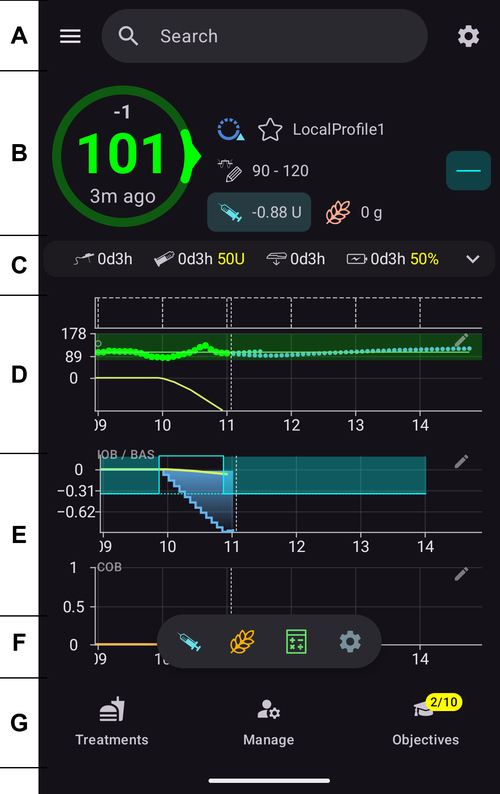

Bu, **AAPS**'i açtığınızda karşılaşacağınız ilk ekrandır ve günlük olarak ihtiyaç duyacağınız bilgilerin çoğunu içerir.

### Bölüm A - Üst çubuk

* Soldaki **menü** (☰), **Tedavi geçmişi**, **Geçmiş tarayıcısı**, **İstatistikler**, **Profil yardımcısı**, **Bakım**, **Kurulum Sihirbazı**, **Konfigürasyon** ve diğer öğeleri içeren gezinme çekmecesini açar.
* **Arama çubuğu** ayarları, iletişim kutularını ve dokümantasyonu bulur; yazmaya başlamanız yeterlidir (bkz. [Genel arama](../DailyLifeWithAaps/GlobalSearch.md)).
* Sağdaki **Ayarlar** (dişli) simgesi tüm [ayarları](../SettingUpAaps/Preferences.md) açar.

(aaps-screens-profile--target)=

### Bölüm B - Durum bloğu

#### Current blood glucose

CGM'nizden gelen son kan şekeri ölçümü, soldaki büyük dairede gösterilir; yanında önceki ölçüme göre fark (delta) ve ölçümün yaşı yer alır.

KŞ değerinin rengi, tanımlanan [aralığa](#Preferences-range-for-visualization) göre durumu yansıtır.

* yeşil = aralık içerisinde
* kırmızı = aralığın altında
* sarı = aralığın üstünde

  

(loop-status)= (AapsScreens-loop-status)=

#### Loop status


KŞ dairesinin yanındaki bir simge, döngünün çalışma modunu gösterir (resimde yukarıdan aşağıya):

1. Yeşil daire = [kapalı döngü](#KeyAapsFeatures-ClosedLoop), döngü çalışıyor
2. Noktalı çizgili mor daire = [düşük glikoz duraklatma (LGS)](#KeyAapsFeatures-LGS)
3. Noktalı çizgili mavi daire = [açık döngü](#KeyAapsFeatures-OpenLoop)
4. Çarpılı kırmızı daire = döngü devre dışı (kalıcı olarak çalışmıyor)
5. Kırmızı duraklatma simgesi = döngü askıya alındı (geçici olarak durdu ama bazal insülin verilir) - kalan süre simgenin yanında gösterilir
6. Fişli gri daire = pompa bağlantısı kesildi (geçici olarak hiç insülin verilmez) - kalan süre simgenin yanında gösterilir

Döngü iletişim kutusunu açmak için simgeye basın. İletişim kutusunun içeriği mevcut duruma bağlıdır:

* Döngü **çalışırken** (kapalı, açık veya LGS), çalışma modunu değiştirebilir (Kapalı Döngü, Düşük Glikoz Duraklatma, Açık Döngü veya Döngüyü devre dışı bırak), seçilen bir süre için döngüyü **askıya alabilir** veya pompanın **bağlantısını kesebilirsiniz**.
* Döngü **devre dışıyken**, bir çalışma modu seçerek onu yeniden etkinleştirebilir veya pompanın bağlantısını kesebilirsiniz.
* Döngü **askıya alınmışken**, ona **devam edebilir**, pompanın bağlantısını kesebilir veya askıya almayı uzatmak için **Döngüyü askıya al** altında yeni bir süre seçebilirsiniz.
* Pompanın **bağlantısı kesilmişken**, pompayı **tekrar bağlayabilir** veya bağlantı kesmeyi uzatmak için **Pompa bağlantısını kes** altında yeni bir süre seçebilirsiniz.

Askıya almayı veya bağlantı kesmeyi uzattığınızda yeni süre **şimdiden başlar**: kalan sürenin yerine geçer, ona eklenmez. Önce devam etmeniz veya tekrar bağlamanız gerekmez.

Döngü kapalı döngüde çalışırken iletişim kutusu:


Döngü askıya alınmışken, **Devam et** ve askıya almayı uzatma süreleriyle iletişim kutusu:


Pompanın bağlantısı kesilmişken, **Pompayı tekrar bağla** ve bağlantı kesmeyi uzatma süreleriyle iletişim kutusu:


Düşük Glikoz Duraklatma modunda, açık döngüde ve döngü devre dışıyken iletişim kutusu yalnızca sunduğu çalışma modlarında farklıdır:


Ana ekran her modda böyle görünür. Grafiğin üstündeki renk şeridi, geçiş anında değişir.

Düşük Glikoz Duraklatma:


Açık Döngü:


Döngü devre dışı:


Döngü askıya alındı — kalan süre simgenin yanında gösterilir:


Pompa bağlantısı kesildi — kalan süre simgenin yanında gösterilir. Tedavi düğmeleri Hızlı Başlatma araç çubuğunda kalır; böylece kalemle verilen insülini veya karbonhidratları yine de kaydedebilirsiniz:


Her seçimden sonra bir onay gerekir.

```{admonition} Alarm: pompa sıfır geçici bazalı kabul etmedi :class: warning Pompanın bağlantısı kesilmişken **AAPS** pompada sıfır geçici bazal tutar ve eksikse yeniden ayarlar. Bu 10 dakika sonra hâlâ başarısız olursa **AAPS** acil bir alarm verir: *"Pompa sıfır geçici bazalı kabul etmedi. Hâlâ bazal insülin veriyor olabilir. Pompayı kontrol edin."* Alarm, sıfır geçici bazal ayarlanana veya bağlantı kesme bitene kadar her 15 dakikada bir tekrarlanır. Bu alarmı görürseniz pompanızı kontrol edin: **AAPS** bağlantının kesildiğini gösterse de pompa bazal insülin veriyor olabilir.

    <br />Not: Sunulan modlar [Görevler](../SettingUpAaps/CompletingTheObjectives.md) içindeki ilerlemenize bağlıdır — Kapalı Döngü ve LGS ancak görevleri tamamladıkça kullanılabilir hale gelir.
    
    (aaps-screens-bg-warning-sign)=
    #### KŞ uyarı işareti
    
    **AAPS** aldığı KŞ ölçümlerinde bir sorun algılarsa, ana ekranın alt çubuğunda KŞ kaynağınıza giden bir kısayol (kaynağın adını taşır, örneğin **xDrip+ KŞ**) kırmızı bir uyarı rozetiyle görünür. [KŞ kaynağı ekranını](#aaps-screens-bg-source) açmak için ona dokunun.
    
    ##### Yinelenen KŞ verileri
    
    Kırmızı uyarı işareti, hemen harekete geçmeniz gerektiğini bildirir: **Yinelenen KŞ verileri** alıyorsunuz ve bu, döngünün işini doğru yapmasını engeller. **AAPS** yinelenen ölçümlerden KŞ eğiliminizi güvenilir şekilde hesaplayamaz, bu yüzden düzeltme yapmayı durdurur.
    
    Döngünüz kapalıysa **AAPS** onu [Düşük Glikoz Duraklatma (LGS)](#KeyAapsFeatures-LGS) moduna geçirir: döngü simgesi mor olur.
    
      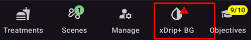
    
    Döngü simgesine basın: üstteki **Kısıtlamalar** kartı nedenini söyler: "BgQualityCheck: KŞ kaynağında iki katına çıkmış değerler nedeniyle LGS modu".
    
      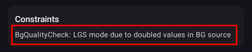
    
    ```{admonition} Döngünüz Düşük Glikoz Duraklatma modunda çalışıyor
    :class: note
    Döngünüz çalışmaya devam eder, ancak yalnızca sizi düşük şekerlere karşı korumak için: **AAPS** bazalınızı yine azaltabilir veya durdurabilir, ancak bu sorunu çözene kadar hiç düzeltme insülini vermez!
    

Neden yinelenen KŞ verileri aldığınızı bulmanız gerekiyor:

* Nightscout sitenizde Dexcom bridge etkin mi? Nightscout kurulumunuzun yönetim panelinde "enable" değişkenini düzenleyin ve oradaki "bridge" kısmını silerek bridge'i devre dışı bırakın. (Heroku için [ayrıntıları burada bulabilirsiniz](https://nightscout.github.io/troubleshoot/troubleshoot/#heroku).)
* KŞ'nizi Nightscout'a birden fazla kaynak mı yüklüyor? BYODA uygulamasını kullanıyorsanız, yüklemeyi **AAPS**'te etkinleştirin, ancak xDrip kullanıyorsanız orada etkinleştirmeyin.
* KŞ'nizi alan ama onu Nightscout sitenize tekrar yükleyen takipçileriniz var mı?
* Son çare: [NSClient ayarlarında](#Preferences-nsclient) Senkronizasyon ayarlarını seçin ve "NS'den CGM verilerini al" seçeneğini devre dışı bırakın.

Uyarıyı hemen kaldırmak ve döngünün yeniden düzeltme yapmasını sağlamak için yinelenen kayıtları KŞ kaynağı ekranından silin: alt çubuktaki kısayola dokunun. Yinelenen ölçüm kırmızı ile vurgulanır. Seçmeye başlamak için bir ölçüme uzun basın, yinelenenleri işaretleyin ve sağ üstteki çöp kutusu simgesine dokunun.


Ancak, çok sayıda kopya olduğunda, aşağıdakileri yapmak daha kolay olabilir

* [ayarlarınızı yedekleyin](../Maintenance/ExportImportSettings.md),
* bakım menüsünde veritabanınızı sıfırlayın ve
* [ayarlarınızı](../Maintenance/ExportImportSettings.md) tekrar içe aktarın

    {admonition} Kapalı Döngü'ye kendiniz geri dönün
    :class: important
    Yinelenen veriler gittikten sonra **AAPS** kendiliğinden **Kapalı Döngü**'ye geri dönmez. Ana ekrandaki döngü simgesine basın ve tekrar **Kapalı Döngü**'yü seçin.

##### Düz KŞ verileri

Bazı KŞ kaynaklarında (Libre 1, AiDEX, Glutec, Medtronic ve sensör tipini bildirmeyen kaynaklar) **AAPS** değişmeyen ölçümleri de kontrol eder: KŞ'niz 45 dakika boyunca 2 mg/dL'den (0,1 mmol/L) az değiştiyse veriler yanlış kabul edilir. Bu durumda KŞ kaynağı kısayolunda kırmızı bir düz eğilim rozeti görünür ve döngü, ölçümler tekrar değişene kadar yüksek geçici bazalları durdurur ve hiç düzeltme insülini vermez. Sensörünüzü ve ölçümleri gönderen uygulamayı kontrol edin.

##### Düzensiz KŞ verileri

Ölçümler düzensiz aralıklarla geldiğinde veya bazıları eksik olduğunda **AAPS**, elindeki ölçümlerden 5 dakikalık değerleri yeniden hesaplar. Bu örneğin bir sensör değişiminden sonra veya zamanlaması birkaç saatte bir bir iki dakika kayan Libre sensörlerinde olur. Döngü çalışmaya devam eder ve sizin bir şey yapmanız gerekmez. **AAPS** 4 bunun için artık sarı bir uyarı işareti göstermez.

#### Current Profile

Geçerli profil yıldız simgesinin yanında gösterilir.

Profil ayrıntılarını görebileceğiniz ve [farklı profiller arasında geçiş yapabileceğiniz](../DailyLifeWithAaps/ProfileSwitch-ProfilePercentage.md) [Profil ekranını](#aaps-screens-profile) açmak için profil adına dokunun.

**Profil yüzdesini değiştirmek** (ve süresini ayarlamak) için profil adına dokunun, sonra Profil ekranının sağ altındaki yuvarlak **▶** (Etkinleştir) düğmesine dokunun. **AAPS** 3.x'te bu ekran profil adına uzun basılarak açılırdı; **AAPS** 4'te uzun basmanın bir etkisi yoktur. Adım adım: [Profil yüzdesini değiştirme](#ProfileSwitch-change-percentage).


1. Standart profil etkinleştirmesiyle normal görünüm.
2. %90 yüzdeli ve 9 dakika kalan süreli profil değişimi — geçici bir profil değişimi çalışırken profil adı sarıya döner.
3. 1 saatlik zaman kaydırmalı ve 9 dakika kalan süreli profil değişimi.

#### Target


Geçerli hedef kan şekeri seviyesi profil adının altında gösterilir.

**[Geçici Hedef](../DailyLifeWithAaps/TempTargets.md)** ekranını açmak için hedefe kısa basın.

1. Normal görünüm: profilinizde tanımlanan hedef aralığı.
2. Geçici hedef ayarlıysa hedef, kullanılan ön ayarın simgesiyle birlikte sarı/turuncu olur ve kalan süre dakika olarak parantez içinde gösterilir.

(AapsScreens-visualization-of-dynamic-target-adjustment)=

#### Visualization of Dynamic target adjustment

[SMB algoritması](#Config-Builder-aps) ve [Otoduyarlılık](#Open-APS-features-autosens) işlevi kullanıldığında **AAPS**, hedefinizi duyarlılığa göre dinamik olarak ayarlayabilir.

[OpenAPS SMB ayarlarında](#Preferences-openaps-smb-settings) aşağıdaki seçeneklerden birini veya ikisini etkinleştirin:

* "Duyarlılık hedefi yükseltir" ve/veya
* "Direnç hedefi düşürür"

**AAPS** direnç veya duyarlılık algılarsa hedef, profilde ayarlanandan farklı olur ve gösterilen hedefin rengi bu ayarlamayı belirtmek için değişir.

(aaps-screens-iob-cob-basal-sens)=

#### AİNS, AKRB, bazal ve duyarlılık


1. **Şırınga**: aktif insülin (AİNS) - vücudunuzdaki aktif insülin miktarı  
    Yalnızca standart bazalınız çalışıyor olsaydı ve önceki boluslardan kalan insülin olmasaydı, aktif insülin değeri sıfır olurdu. 
    * Yakın zamanda bazalınız düşürülmüşse, (AİNS) aktif insülin negatif olabilir.
    * Bolus ve bazal insülinin dağılımını görmek için çipe basın (resimdeki ilk iletişim kutusu — burada azaltılmış bazal döneminden sonra negatif AİNS ile)
2. **Başak**: [aktif karbonhidrat (AKRB)](../DailyLifeWithAaps/CobCalculation.md) - daha önce yediğiniz, henüz emilmemiş karbonhidratlar
3. Sağdaki camgöbeği düğme **mevcut bazal iletimini** yansıtır: profil bazalı çalışırken düz bir çizgi, geçici bazal oranı etkinken değişen bir simge
4. **Yüzde satırı** mevcut duyarlılığı gösterir ([Otoduyarlılık](#Open-APS-features-autosens) / [Dinamik İDF](../DailyLifeWithAaps/DynamicISF.md)). Döngü İDF'nizi değiştirdiğinde satır, profil İDF'sini, bir oku ve döngünün şu anda kullandığı İDF'yi de gösterir, örneğin "80% 2,0 ↗ 2,5". Otoduyarlılık değerini ve etkin İDF'yi görmek için ona basın (resimdeki ikinci iletişim kutusu). Döngü son Otoduyarlılık sonucundan farklı bir değerle çalışıyorsa (örneğin geçici bir hedef duyarlılığınızı değiştirdiği için), iletişim kutusu bu değeri **Algoritmadaki otoduyarlılık** olarak da gösterir. Otoduyarlılık kapalıyken döngü profil İDF'nizi korur ve etkin İDF gösterilmez.

AİNS çipine basılarak açılan AİNS iletişim kutusu:


Çalışan geçici bazal oranını, ne zaman başladığını ve ne kadar süredir çalıştığını görmek için camgöbeği düğmeye basın:


(aaps-screens-carbs-required)=

#### Karbonhidrat İhtiyacı


Referans tasarım karbonhidrat gerektiğini algıladığında karbonhidrat önerileri verilir.

Bu durumda oref algoritması sizi sıfır geçici bazal ile kurtaramayacağını düşünür ve düzeltmek için karbonhidrat almanız gerekir.

Karbonhidrat bildirimleri, bolus hesaplayıcısının bildirimlerinden çok daha gelişmiştir. Bolus hesaplayıcısı eksik karbonhidrat göstermezken bir karbonhidrat önerisi görebilirsiniz.

İstenirse karbonhidrat ihtiyacı bildirimleri Nightscout'a gönderilebilir; bu durumda bir duyuru gösterilir ve yayınlanır.

### Bölüm C - Durum satırı


Durum satırı şunlar için görsel uyarı verir

* Kanül yaşı
* İnsülin yaşı (rezervuarın kaç gündür kullanıldığı) ve rezervuar seviyesi (ünite)
* Sensör yaşı
* Pompa pili yaşı ve seviyesi (%)

Eşik uyarısı aşılırsa değerler sarı renkte gösterilecektir.

Kritik eşik aşılırsa değerler kırmızı ile gösterilir.

Yaş, ekran boyutu ne olursa olsun her zaman kısa biçimde gösterilir: ilk gün *4h*, daha sonra *3d4h*.

Eşikler, durum satırı **genişletildiğinde** (sağdaki ok) görünen küçük **Ayarlar** simgesiyle değiştirilebilir — bkz. [Durum ışıkları](#Preferences-status-lights).

Genişletilmiş durum panelinde bazı satırların sonunda, bir değişimi kaydeden ve ilgili yaşı sıfırlayan bir düğme de vardır: **Sensör** satırındaki **Ekle** bir sensör yerleştirmeyi kaydeder. Pompanız destekliyorsa **Kanül** (veya **Patch pompa**) ve **İnsülin** satırlarında **Hazırla/doldur**, **Pompa pili** satırında ise **Ekle** görünür.


Kullandığınız pompaya bağlı olarak bu simgelerin hepsini göremeyebilirsiniz.

(screens-sensor-level-battery)=

#### Sensör seviyesi (pil)

MiaoMiao 2 gibi ek bir vericisi olan CGM'lerde çalışır. (Teknik olarak sensörün pil seviyesi bilgisini xDrip'e göndermesi gerekir.)

Eşikler [Durum ışıkları](#Preferences-status-lights) içinde ayarlanabilir.

(aaps-screens-main-graph)=

### Bölüm D - Ana grafik

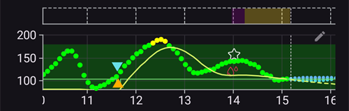

Grafik, glikoz monitörünüzden (CGM) okunan kan şekerinizi (KŞ) gösterir.

Görünen zaman aralığını değiştirmek için grafikte kaydırma ve iki parmakla yakınlaştırma hareketlerini kullanın.

Yeşil alan hedef aralığınızı yansıtmaktadır.

Bu bilgiler de bu grafikte gösterilir:

* Manuel boluslar: KŞ eğrisinin hemen üstünde, o anki ölçümü aşağı doğru gösteren, insülin miktarıyla birlikte mavi üçgen
* Karbonhidrat girişleri: KŞ eğrisinin hemen altında, ölçümü yukarı doğru gösteren, karbonhidrat miktarıyla birlikte turuncu üçgen. Bolusuyla birlikte girilen bir öğün, ölçümle ikiye ayrılmış tek bir işaret gibi görünür.
* Üçgenler, günün en büyük miktarına göre üç boyutta (küçük, orta, büyük) gösterilir. O anda KŞ ölçümü yoksa (sensör boşluğu), üçgen grafiğin altına çizilir.
* KŞ kontrolleri ve kalibrasyonlar: sensör eğrisiyle karşılaştırabilmeniz için kendi ölçülen değerlerinde çizilir
* Profilde tanımlanan veya geçici hedefle değiştirilen hedef: yeşil çizgi
* Profil değişimleri: grafiğin üstünde yıldız simgeleri
* Döngü durumu: [çalışma modu](#AapsScreens-loop-status) kapalı döngüden farklı olduğunda grafiğin üstünde renk şeridi: mavi = açık döngü, mor = LGS, kırmızı = döngü devre dışı, sarı = döngü askıya alındı, gri = pompa bağlantısı kesildi, turuncu = süperbolus (ekran görüntüsünde: önce mor, sonra sarı). Bu değişikliklerin geçmişi [Çalışma modu](#AapsScreens-running-mode) bölümünde listelenir
* [SMB'ler](#Open-APS-features-super-micro-bolus-smb) KŞ grafiğine çizilmez (birkaç dakikada bir tane olurdu): [AİNS grafiğinde](#aaps-screens-iob) gösterilir.

Değerini ve yazdıysanız notunu görmek için grafikteki bir **KŞ kontrolüne** dokunun.

(aaps-screens-graph-press-and-hold)=

#### Belirli bir zamandaki değerleri görme

Bir ölçümdeki değerleri görmek için KŞ grafiğine bir süre **basılı tutun**. Bir nokta en yakın ölçümü işaretler, tüm grafiklerde o zamana kesikli bir çizgi çizilir ve grafiğin üstündeki bir açılır pencere şunları gösterir:

* saat ve KŞ değeri
* O andaki AİNS, AKRB (yalnızca 0 g'ın üstündeyse) ve bazal oranı — bazal simgesi, ana ekrandaki gibi, geçici bazal oranının çalışıp çalışmadığını gösterir
* o andaki bolus, SMB veya karbonhidratlar, grafiklerdekiyle aynı üçgenlerle

Bir ölçümden diğerine geçmek için parmağınızı ekranda tutun ve sola veya sağa kaydırın. Her ölçümde hafif bir titreşim hissedersiniz ve bunu yaparken grafik kaymaz. Açılır pencere, parmağınızı kaldırdıktan sonra 2 saniye kalır.

Bu, KŞ grafiğinin altındaki [ek grafiklerde](#aaps-screens-additional-graphs) (AİNS, AKRB...) de aynı şekilde çalışır: herhangi birine basılı tutun.

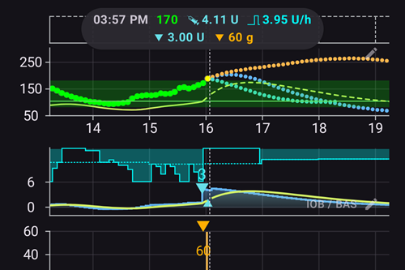

(aaps-screens-graph-clock-change)=

#### Saat değişiklikleri

Telefonun saati ileri veya geri atladığında (yaz saati değişikliğinde veya yeni bir saat diliminde), KŞ grafiğinde bu anı kesikli dikey bir çizgi gösterir; çizginin altında küçük bir saat simgesi vardır. Aynı kesikli çizgi, aşağıdaki [ek grafiklerden](#aaps-screens-additional-graphs) de geçer.


(AapsScreens-activate-optional-information)=

#### İsteğe bağlı bilgileri etkinleştir

Grafik ayarlarını açmak için grafiğin sağ üst köşesindeki **kalem** simgesine basın:


* **Grafik yüksekliği**, grafiğin ne kadar yüksek çizileceğini ayarlar.
* **AKTİVİTE**, insülin aktivite eğrisini üste ekler: düz sarı-yeşil bir çizgi <span style="background:#141218;color:#D3F166;padding:0 0.3em;border:1px solid #141218;border-radius:4px">━━━━</span> (noktalı sarı UAM tahminiyle karıştırılmamalıdır)
* **TAHMİN**, [tahmin çizgilerini](#aaps-screens-prediction-lines) üste ekler (aşağıya bakın)

(aaps-screens-prediction-lines)=

#### Tahmin çizgileri

**TAHMİN** açıkken AAPS, tahminlerini "şimdi" çizgisinin sağında **noktalı çizgiler** olarak çizer. Her tahminin kendi rengi vardır. Koyu tema aynı renklerin daha açık tonlarını kullanır ve yeşil hedef aralığının içindeki bir çizgi biraz daha yeşil görünebilir.

| Çizgi                    | Açık tema                                                                                                                         | Koyu tema                                                                                                                          | Neyi tahmin eder                        |
| ------------------------ | --------------------------------------------------------------------------------------------------------------------------------- | ---------------------------------------------------------------------------------------------------------------------------------- | --------------------------------------- |
| **AİNS** (mavi)          | <span style="background:#FFFFFF;color:#1E88E5;padding:0 0.3em;border:1px solid #CCCCCC;border-radius:4px">●●●●</span>             | <span style="background:#141218;color:#64B5F6;padding:0 0.3em;border:1px solid #141218;border-radius:4px">●●●●</span>              | yalnızca insülin                        |
| **AKRB** (turuncu)       | <span style="background:#FFFFFF;color:#FB8C00;padding:0 0.3em;border:1px solid #CCCCCC;border-radius:4px">●●●●</span>             | <span style="background:#141218;color:#FFB74D;padding:0 0.3em;border:1px solid #141218;border-radius:4px">●●●●</span>              | aktif karbonhidrat                      |
| **UAM** (sarı)           | <span style="background:#FFFFFF;color:#C9BD60;padding:0 0.3em;border:1px solid #CCCCCC;border-radius:4px">●●●●</span>             | <span style="background:#141218;color:#E6D39A;padding:0 0.3em;border:1px solid #141218;border-radius:4px">●●●●</span>              | bildirilmemiş öğün                      |
| **ZT** (camgöbeği)       | <span style="background:#FFFFFF;color:#00D2D2;padding:0 0.3em;border:1px solid #CCCCCC;border-radius:4px">●●●●</span>             | <span style="background:#141218;color:#4DD4D4;padding:0 0.3em;border:1px solid #141218;border-radius:4px">●●●●</span>              | sıfır geçici bazal (insülin durduruldu) |
| **aCOB** (soluk turuncu) | <span style="background:#FFFFFF;color:rgba(251,140,0,0.5);padding:0 0.3em;border:1px solid #CCCCCC;border-radius:4px">●●●●</span> | <span style="background:#141218;color:rgba(255,183,77,0.5);padding:0 0.3em;border:1px solid #141218;border-radius:4px">●●●●</span> | yalnızca eski AMA algoritması           |

İki tahmin aynı değerleri verdiğinde noktaları üst üste biner ve renklerden yalnızca birini görürsünüz (örneğin KŞ düz olduğunda AİNS'in üstünde UAM).

* **AKRB** çizgisi (turuncu): [aktif karbonhidrat](CobCalculation.md) (turuncu, AAPS'in her yerinde AKRB ve karbonhidratlar için kullanılır)
    
    Bu tahmin çizgisi, karbonhidrat emiliminden kaynaklanan sapmaların sabit kaldığı varsayılarak, geçerli **Profil** ayarlarına göre KŞ'nizin (AKRB'nin kendisinin değil!) nereye gideceğini gösterir. Bu çizgi yalnızca bilinen AKRB (Aktif Karbonhidrat) varsa görünür.

* **AİNS** çizgisi (mavi): aktif insülin (mavi, AAPS'in her yerinde AİNS ve insülin için kullanılır)
    
    Bu tahmin çizgisi, yalnızca insülinin etkisi altında ne olacağını gösterir. Örneğin biraz insülin verdiyseniz ve sonra hiç karbonhidrat yemediyseniz.

* **ZT** çizgisi (camgöbeği): sıfır geçici bazal (%0 geçici bazal oranı ayarlansaydı tahmin edilen KŞ)
    
    Bu tahmin çizgisi, pompa tüm insülin iletimini durdursaydı (%0 GBO) KŞ eğrisinin nasıl değişeceğini gösterir. Çizgi, hedefinizin üstüne çıktığında biter.
    
    *Bu çizgi yalnızca [SMB](#Config-Builder-aps) algoritması kullanıldığında görünür.*

* **UAM** çizgisi (sarı): [bildirilmemiş öğünler](#SensitivityDetectionAndCob-sensitivity-oref1)
    
    Bildirilmemiş öğünlerin anlamı, öğün, adrenalin veya diğer etkiler nedeniyle glikoz seviyelerinde önemli bir artışın tespit edilmesidir. Tahmin çizgisi **turuncu AKRB çizgisine** benzer, ancak sapmaların sabit bir hızla azalacağını varsayar (mevcut azalma hızını uzatarak).
    
    *Bu çizgi yalnızca [SMB](#Config-Builder-aps) algoritması kullanıldığında, OpenAPS SMB ayarlarında **UAM (Bildirilmemiş Öğünler) etkinleştir** açık olduğunda ve KŞ, yalnızca insülinin açıklayabileceğinden fazla yükseldiğinde görünür.*

* **aCOB** çizgisi (soluk, yarı saydam turuncu): hızlandırılmış karbonhidrat emilimi
    
    AKRB'ye benzer, ancak sabit 10 mg/dL/5dk (0,555 mmol/L/5dk) karbonhidrat emilim hızı varsayar. Kullanımdan kaldırıldı ve yararı sınırlıdır.
    
    *Bu çizgi yalnızca eski [AMA](#Config-Builder-aps) algoritması kullanıldığında görünür.*

Genellikle gerçek glikoz eğriniz bu çizgilerin ortasında veya durumunuza en çok benzeyen varsayımlarda bulunanın yakınında biter.

(aaps-screens-how-predictions-become-a-dosing-decision)=

#### AAPS tahminleri nasıl bir doz kararına dönüştürür

AAPS insülin dozunu yalnızca mevcut KŞ'nize göre vermez — her döngü çalışmasında (yaklaşık 5 dakikada bir) yukarıdaki tüm tahmin çizgilerine birlikte bakar ve en güvenli yolu belirler.

Temel kural **önce güvenlik**tir: *herhangi bir* tahmin çizgisi, herhangi bir zaman diliminde düşük güvenlik eşiğinizin altına inerse, mevcut KŞ'niz yüksek olsa bile AAPS sıfır geçici bazal (%0 geçici bazal oranı) uygular ve daha fazla insülin vermez. AAPS, ancak tüm tahmin çizgileri bu eşiğin üstünde kaldığında daha fazla insülin vermeyi düşünür.

Daha fazla insülin vermek güvenli olduğunda AAPS, birleştirilmiş tahminlere göre KŞ'nin sonunda nereye varacağına (**nihai KŞ**) bakar ve bu nihai KŞ'yi hedefe geri getirmek için ne kadar düzeltme gerektiğini hesaplar — bu düzeltme ya artırılmış bir geçici bazal oranı olarak ya da (oref1/[SMB](#Open-APS-features-super-micro-bolus-smb) algoritması etkinse) küçük, hemen verilen bir bolus olarak iletilir. KŞ şu anda yüksek ama zaten kendiliğinden yeterince düşüyorsa AAPS, daha sonraki bir düşük şekeri daha da düşürecek insülin eklemek yerine bekler, hatta bazal oranını azaltabilir.

Bu karar mantığının gerçek ekran görüntüleriyle çalışılmış örnekleri için [Klinisyen kılavuzundaki doz senaryolarına](#clinicianguide-dosing-scenarios) bakın — klinisyenler için yazılmıştır, ancak her AAPS kullanıcısı için geçerlidir.

*Bu tahminlerin ve sonuçtaki doz kararının nasıl hesaplandığına dair tam teknik açıklama için [OpenAPS determine-basal dokümantasyonuna](https://openaps.readthedocs.io/en/latest/docs/While%20You%20Wait%20For%20Gear/Understand-determine-basal.html) bakın.*

#### Bazallar

**Sürekli mavi** çizgi, pompanızın bazal iletimini gösterir ve zaman içindeki gerçek iletimi yansıtır.

**noktalı mavi** çizgi, geçici bazal ayarlamalar (GBO'lar) olmasaydı bazal oranın ne olacağıdır.

Standart bazal oran verildiğinde, eğrinin altındaki alan koyu mavi gösterilir. Bazal oran geçici olarak değiştirildiğinde (artırıldığında veya azaltıldığında), eğrinin altındaki alan açık mavi gösterilir.

#### Aktivite

**İnce sarı** çizgi, insülin aktivitesini gösterir.

Başka hiçbir etken (karbonhidrat gibi) yoksa, vücudunuzdaki insülinin KŞ'de yol açması beklenen düşüşe dayanır.

(AapsScreens-section-g-additional-graphs)= (aaps-screens-additional-graphs)=

### Bölüm E - Ek grafikler

Ana grafiğin altında ek grafikleri etkinleştirebilirsiniz. [Basit mod](#preferences-simple-mode)'dayken ek grafikler önceden ayarlıdır ve değiştirilemez. Ek grafikleri kendiniz yapılandırmak istiyorsanız **Basit mod**'u kapatın.

Ek grafikler ana grafiği takip eder: KŞ grafiğini kaydırdığınızda veya yakınlaştırdığınızda onlar da birlikte hareket eder. Bir ek grafikte yana doğru sürükleme de tüm grafikleri kaydırır. Kendi zaman etiketleri yoktur — zamanı KŞ grafiğinden okuyun.

Bir ek grafiği yapılandırmak için sağ üst köşesindeki **kalem** simgesine basın:


Bu grafikte görmek istediğiniz verilere karşılık gelen çipleri seçin; **Kaldır** düğmesi grafiği siler.

Bir grafik daha oluşturmak için son grafiğin altındaki **Grafik ekle**'ye basın ve çiplerini aynı şekilde seçin:


Yeni grafik diğerlerinin altına eklenir — burada **DYRLLK%** ve **SAPMA** içeren ikinci bir ek grafik:


Çoğu kullanıcı ek grafikler için aşağıdaki yapılandırmayı yeterli bulur:

* Graph 1 with IOB, BAS
* Graph 2 with COB, Sensitivity change
* Graph 3 with Deviations and BGI.

#### Mutlak insülin (MUTLAK)

Boluslar dahil aktif insülin **ve bazal**.

(aaps-screens-iob)=

#### Aktif insülin (AİNS)

Aktif insülini gösterir (= vücudunuzdaki aktif insülin). Bolus ve geçici bazaldan alınan insülini içerir (**ancak profilinizde ayarlanan bazal oranları hariçtir**).

İES süresi boyunca hiç [SMB](#Open-APS-features-super-micro-bolus-smb), bolus ve GBO olmasaydı bu değer sıfır olurdu.

SMB'ler bu grafikte, günün en büyük SMB'sine göre üç boyutta mavi üçgenler olarak gösterilir.

Daha uzun bir süre boyunca bolus kalmazsa ve sıfır/düşük geçici bazal devam ederse AİNS negatif olabilir.

Azalma, [İES ve insülin tipi ayarlarınıza](#Config-Builder-insulin-dia) bağlıdır.

#### Aktif Karbonhidrat (AKRB)

Aktif karbonhidratları gösterir (= vücudunuzdaki aktif, henüz emilmemiş karbonhidratlar).

Azalma, [algoritmanın algıladığı sapmalara](../DailyLifeWithAaps/CobCalculation.md) bağlıdır.

Beklenenden daha yüksek bir karbonhidrat emilimi algılanırsa insülin verilir ve bu AİNS'i artırır (güvenlik ayarlarınıza bağlı olarak daha fazla veya daha az).

#### Duyarlılık değişikliği (DYRLLK%)

[Otoduyarlılığın](#Open-APS-features-autosens) algıladığı duyarlılığı gösterir.

Duyarlılık, egzersiz, hormonlar vb. sonucunda insüline duyarlılığın hesaplanmasıdır.

Duyarlılık algılaması/[Otoduyarlılık](#Open-APS-features-autosens) özelliğinin verilen insülin miktarını otomatik olarak ayarlayabilmesi için [8. Görev](#objectives-objective8) aşamasında olmanız gerektiğini unutmayın. Bu göreve ulaşmadan önce grafiğinizdeki çizgi yalnızca bilgi amaçlı gösterilir.

### Değişken duyarlılık (DDYRLLK)

[Dinamik İDF](../DailyLifeWithAaps/DynamicISF.md) tarafından hesaplanan duyarlılığı gösterir. Yalnızca bu özelliği kullanıyorsanız doldurulur.

(screen-heart-rate-steps)=

#### Nabız & Adımlar

Bu veriler bir [Wear akıllı saat](../WearOS/WearOsSmartwatch.md) kullanırken mevcut olabilir. Bunları **AAPS** Wear uygulamasında etkinleştirin ve sağlık verileri için izin verin.

Adımlar sütun olarak, kalp atış hızı ise saatin veri göndermediği yerlerde kesilen eğri bir çizgi olarak çizilir.

#### Sapmalar (SAPMA)

* **Gri** çubuklar karbonhidrattan kaynaklanan bir sapmayı gösterir.
* **Yeşil** çubuklar, KŞ'nin algoritmanın beklediğinden yüksek olduğunu gösterir. Yeşil çubuklar, [Otoduyarlılıkta](#Open-APS-features-autosens) direnci artırmak için kullanılır.
* **Kırmızı** çubuklar, KŞ'nin algoritmanın beklediğinden düşük olduğunu gösterir. Kırmızı çubuklar, [Otoduyarlılıkta](#Open-APS-features-autosens) duyarlılığı artırmak için kullanılır.
* **Sarı** çubuklar UAM'dan kaynaklanan bir sapmayı gösterir.
* **Siyah** çubuklar duyarlılık için dikkate alınmayan küçük sapmaları gösterir

#### Kan Şekeri Etkisi (KŞEtkisi)

Bu çizgi, yalnızca insülin aktivitesine göre KŞ'nin ne kadar yükselmesi veya düşmesi ‘gerektiğini’ gösterir.


Bu çizgiyi Sapma çubuklarıyla birlikte göstermek iyi bir kombinasyondur. Aynı ölçeği paylaşırlar, ancak bu ölçek diğer isteğe bağlı verilerinkinden farklıdır; bu yüzden onları yukarıda gösterildiği gibi ayrı bir grafikte göstermek iyi bir fikirdir. KŞ etkisi çizgisini ve Sapma çubuklarını karşılaştırmak, **KŞ**'nin nasıl dalgalandığını anlamanın başka bir yoludur. Burada **1** ile işaretlenen zamanda Sapma çubukları KŞ etkisi çizgisinin çok üstündedir: KŞ, yalnızca insülin aktivitesinin açıklayabileceğinden fazla yükselir (örneğin karbonhidrattan sonra). **2** ile işaretlenen zamanda Sapma çubukları sıfırın altındadır (kırmızı): KŞ, algoritmanın beklediğinden düşüktür.

### Bölüm F - Hızlı Başlatma araç çubuğu


Ekranın altındaki kayan araç çubuğu **[Hızlı Başlatma](../DailyLifeWithAaps/QuickLaunch.md)** eylemlerinizi içerir. Küçük **dişli**, hangi düğmelerin gösterileceğini seçtiğiniz Hızlı Başlatma yapılandırmasını açar (tedaviler, careportal kayıtları, CGM eylemleri, **Yönet** panelinin ekranları, [Hızlı Asistan](../DailyLifeWithAaps/QuickWizards.md) düğmeleri, [Senaryolar](../DailyLifeWithAaps/Scenes.md) ve daha fazlası).

Yukarıda tipik bir yapılandırma gösterilmiştir: **İnsülin**, **Karbonhidrat** ve **Bolus sihirbazı**.

Pompanın **bağlantısı kesilmişken** tedavi düğmeleri araç çubuğunda kalır, örneğin kalemle verilen insülini kaydetmek için (aşağıdaki [İnsülin](#aaps-screens-buttons-insulin) bölümüne bakın). Aynı eylemler alt gezinme çubuğundaki [Tedaviler panelinde](#aaps-screens-treatments-sheet) de bulunur.

(aaps-screens-buttons-insulin)=

#### İnsülin


[Bolus hesaplayıcısını](#aaps-screens-bolus-wizard) kullanmadan belirli bir miktarda insülin vermek için.

**Yakında Yenecek GH başlat** seçeneğini etkinleştirerek [yakında yemek geçici hedefinizi](#TempTargets-eating-soon-temp-target) otomatik olarak başlatabilirsiniz.

Pompa üzerinden bolus yapmak istemiyor, yalnızca bir insülin miktarını kaydetmek istiyorsanız (örneğin kalemle verilen insülin) "**Bolus yalnızca kaydedilecektir (pompa ile iletilmez)**" seçeneğini etkinleştirin. **Şimdi** olarak ayarlı ek bir **Zaman** satırı, geçmişte yapılmış bir insülin enjeksiyonunu kaydetmenizi sağlar: değiştirmek için **-** / **+** kullanın veya dakikaları yazmak ya da bir tarih ve saat seçmek için oka dokunun.

 

İnsülin miktarını hızlıca artırmak için **+0,5 / +1,0 / +2,0** düğmelerini kullanabilirsiniz. Artış değerleri [Bolus sihirbazı ayarlarında](#Preferences-deliver-this-part-of-bolus-wizard-result) değiştirilebilir.

İnsülin iletişim kutusu, pompa askıya alınmışken veya bağlantısı kesilmişken de kullanılabilir; örneğin kalemle enjekte edilen insülini kaydetmek için. Bu durumda "**Bolus yalnızca kaydedilecektir (pompa ile iletilmez)**" zorunlu olarak açıktır (kırmızı gösterilir) ve insülin tipini ve geçmişte yapılmış bir enjeksiyon için **Zaman** farkını seçmek üzere ek alanlar görünür:

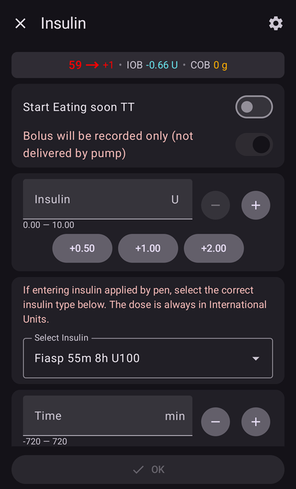

#### Karbonhidrat


Karbonhidratları bolus olmadan kaydetmek için kullanılır.

Bazı [ön ayarlı geçici hedefler](#TempTargets-hypo-temp-target) (Hipo, Yakında Yenecek, Aktivite) doğrudan üstteki anahtarlarla başlatılabilir.

**Karb. zamanı**: Karbonhidratları ne zaman yiyeceksiniz / ne zaman yediniz.

**Süre**: ["yayma karbonhidratlar"](ExtendedCarbs.md) için kullanılır. Bu satır, gramları yanlışlıkla içine yazmamanız için kapalıdır: değiştirmek için **-** / **+** kullanın veya açmak ve bir değer yazmak için oka dokunun.

Karbonhidrat miktarını hızlıca artırmak için **+5 / +10 / +20** düğmelerini kullanabilirsiniz.

#### Hızlı Asistan

Önceden yapılandırılmış tek bir düğmeyle karbonhidrat miktarını kolayca girin ve hesaplama temellerini ayarlayın.

Ayrıntılar [Hızlı Asistan](../DailyLifeWithAaps/QuickWizards.md) içinde ayarlanır.

(aaps-screens-treatments-sheet)=

### Bölüm G - Alt gezinme çubuğu

Alt gezinme çubuğu şunlara erişim sağlar:

* **Tedaviler** — tedavi eylemlerinizi içeren hızlı eylem paneli:
    
    

* **Senaryolar** — yalnızca en az bir [senaryonuz](../DailyLifeWithAaps/Scenes.md) veya **Kullanıcı eylemi** olarak işaretlenmiş bir **Otomasyon** kuralınız varsa gösterilir. Bunları başlatabileceğiniz bir panel açar; bir rozet şu anda kaç tanesini başlatabileceğinizi gösterir. Panelin üstündeki **kalem**, **Yönet → Senaryolar** ekranını açar.

* **Yönet** — **AAPS**'te yönettiğiniz her şeyin merkezi: Profil, İnsülin ayarları, Geçici Hedef, Hızlı Asistan, Senaryolar, Otomasyon, Yiyecek, Bölge Rotasyonu, Pompa ve Yetkili istemciler. Bunların altında Sensör yerleştirme ve Geçici Bazal gibi cihaz ve bazal eylemleri bulunur. Bazı öğeler yalnızca kurulumunuz için geçerli olduklarında görünür — örneğin Hazırla/doldur ve pil değişimi pompanıza bağlıdır; Geçici Bazal, Yayma Bolus ve Careportal kayıtları ise [Basit mod](#preferences-simple-mode)'da gizlenir:
    
    

* **Görevler** — [Görevler](../SettingUpAaps/CompletingTheObjectives.md) içindeki ilerlemeniz; bir rozet kaç tanesinin tamamlandığını gösterir. Bu öğe tüm görevler bitince kaybolur ve **AAPSClient**'ta bulunmaz.

(aaps-screens-notifications)=

#### Notifications

Alt çubuğun üstünde, sağda bir **bildirim balonu** görünebilir. Balon **AAPS**'in etkin bildirimlerini toplar; küçük sayı kaç tane olduğunu gösterir. Rengi en önemli bildirime göre değişir: acil bir mesaj için kırmızı, basit bir bilgi için yeşil.


**Bildirim** panelini açmak için balona dokunun. Her mesaj oluştuğu zamanı gösterir. Bir mesajı kaldırmak için altındaki **Kapat**'a basın; bazı mesajlarda bunun yerine, sizi ilgilenmeniz gereken ayara götüren başka bir düğme vardır.

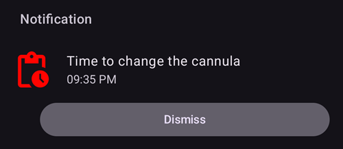

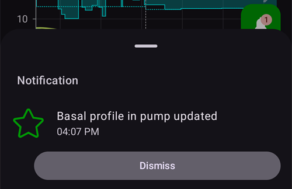

(bolus-wizard)= (aaps-screens-bolus-wizard)=

## Bolus Sihirbazı

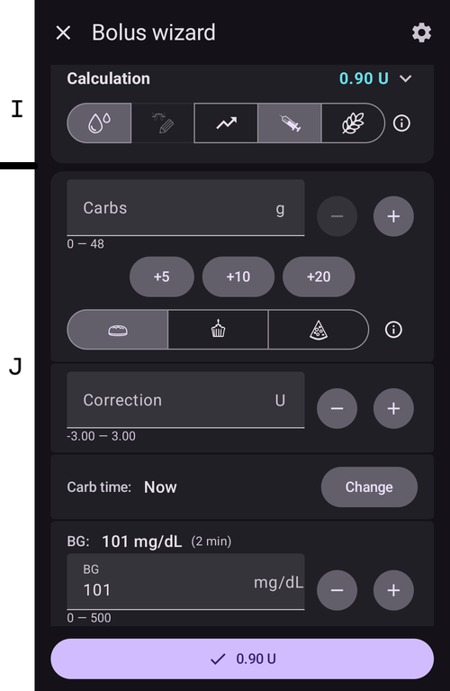

Yemek bolusu yapmak istediğinizde normalde bunu buradan yaparsınız.

### Bölüm I

**Hesaplama** başlığı hesaplanan bolusu gösterir. Aktif insülin miktarı hesaplanan bolusu aşarsa, o zaman sadece gerekli olan karbonhidrat miktarını gösterecektir.

Bolus hesaplayıcısı, mevcut **KŞ**'niz ne olursa olsun kullanılabilir; çok yüksek veya çok düşük olduğunda da. **KŞ** hedefin üstündeyse yemek bolusuna bir düzeltme eklenir. **KŞ** hedefin altındaysa bolus azaltılır ve vücuttaki aktif insülin gerekenden fazlaysa hesaplayıcı, insülin önermek yerine hâlâ kaç gram karbonhidrat gerektiğini söyler.

Başlığın altındaki simge satırı, hesaplamaya hangi girdilerin katıldığını gösterir (KŞ, eğilim, AİNS, geçici hedef, AKRB). Bir simgeye basmak bu girdiyi hesaplamaya dahil eder / hesaplamadan çıkarır; **(i)** simgesi hesaplamanın arkasındaki ayrıntılı sayıları gösterir.

#### AKRB ve AİNS kombinasyonları ve ne anlama geldikleri

* Güvenlik nedeniyle AKRB etkinken AİNS girdisi devre dışı bırakılamaz; çünkü **AAPS** önceden verilmiş insülini hesaba katmazsa çok fazla insülin alma riskiyle karşılaşabilirsiniz.
* AKRB ve AİNS'i etkinleştirirseniz, henüz insülinle karşılanmamış emilmemiş karbonhidratlar + GBO veya SMB olarak verilmiş tüm insülin hesaba katılır.
* AKRB olmadan AİNS'i etkinleştirirseniz **AAPS** önceden verilmiş insülini hesaba katar, ancak bunu henüz emilecek karbonhidratlarla dengelemez. Bu, 'eksik karbonhidrat' bildirimine yol açar.
* Bir yemek bolusundan kısa süre sonra **ek yiyecek** için bolus yaparsanız (örneğin ek tatlı), **tüm girdileri devre dışı bırakmak** faydalı olabilir. Bu şekilde, ana öğün henüz tam olarak emilmemiş olduğundan yalnızca yeni karbonhidratlar ilave edilir, bu nedenle aktif insülin, yemek bolusundan kısa bir süre sonra aktif karbonhidrat ile tam olarak eşleşmeyecektir.
* Güvenlik nedeniyle **geçici hedef**, yalnızca girdisini elle etkinleştirirseniz hesaplamaya dahil edilir.

(AapsScreens-section-j)=

### Bölüm J - Giriş alanları

**Karbonhidrat** alanına, bolus yapmak istediğiniz karbonhidrat miktarının tahminini **gram olarak** girersiniz; altındaki **+** düğmeleri hızlıca karbonhidrat ekler. **AAPS** yalnızca gramla çalışır: ekmek birimi veya değişim birimi (*örneğin* DAFNE "CHO" değişimleri) sayıyorsanız, girmeden önce bunları grama çevirin. Profil sayfasındaki [ekmek birimleriyle ilgili nota](#your-aaps-profile-insulin-to-carbs-ratio) bakın.

#### Karbonhidrat tipi: ekmek, kek veya pizza

**Karbonhidrat** alanının altındaki **Ekmek**, **Kek** ve **Pizza** düğmeleri **AAPS**'e öğünün ne kadar hızlı emileceğini söyler. **Kek** ve **Pizza** ile bolus şimdi karbonhidratların yalnızca bir kısmını karşılar, geri kalanı daha sonra yKarb olarak eklenir. Yüzdeler ve zamanlama için Yayma karbonhidratlar sayfasındaki [Karbonhidrat tipi: ekmek, kek veya pizza](#AapsScreens-carbs-type) bölümüne bakın.

**Düzeltme** satırı, herhangi bir nedenle son dozu değiştirmek istediğinizde kullanılır.

Yalnızca **Karbonhidrat** alanı her zaman açıktır. Diğer satırlar (**Düzeltme**, **Karb. zamanı**, **KŞ** ve **Yüzde kullanın**) kapalıdır: değerlerini **-** / **+** düğmeleriyle gösterirler, böylece değeri küçük adımlarla değiştirebilirsiniz. Bir satırı açıp değer yazmak için oka dokunun, satırı kapatmak için tekrar dokunun. Bu, **Düzeltme** alanına yanlışlıkla gram yazmanızı önler.

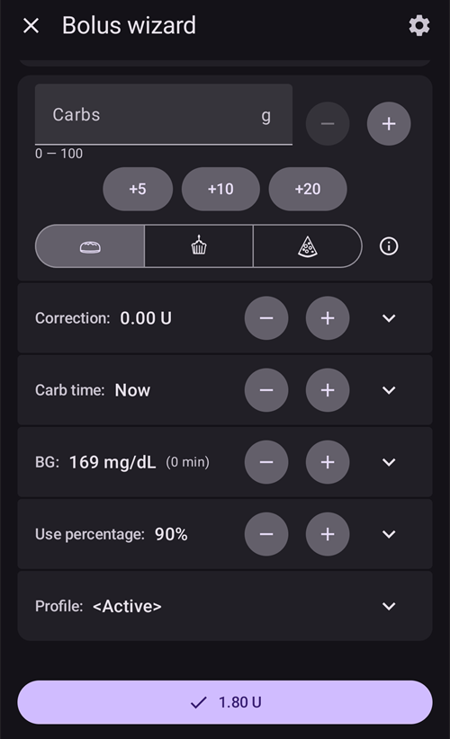

Profillerinizin listesini açmak için **Profil** satırının herhangi bir yerine dokunun, sonra bu hesaplamada o profili kullanmak için bir ada dokunun.


**Karb. zamanı** alanı ön bolus içindir; böylece sisteme karbonhidratların gelmesinden önce bir gecikme olacağını söyleyebilirsiniz. Yenmiş karbonhidratlar için bolus yapıyorsanız, bu alana negatif bir sayı girebilirsiniz.

**Alarmı ayarla** (yemek hatırlatıcısı): gelecekte bir karbonhidrat zamanı girildiğinde, **AAPS**'e girdiğiniz karbonhidratları ne zaman yiyeceğinizin belirtilen zamanda size hatırlatılması için "**Alarmı ayarla**" anahtarı görünür:


Hatırlatıcı, bolus iletildiğinde başlar. Hatırlatıcı çalışırken ana ekrandaki **Yemek vakti** çubuğu geri sayar; çubukta **Durdur** ve **+5 dk** düğmeleri vardır. **+5 dk**, beklemenin sonunu beş dakika ileri alır ve çubuk toplam bekleme süresini gösterir. Süre dolduğunda hatırlatıcı kendi sesiyle, yumuşak bir mutfak zamanlayıcısı sesiyle çalar. Alarm ekranında **Alarmı sessize al** (ekran açık kalır) ve **Sessize al ve kapat** düğmelerinin yanında, yeni bir beş dakikalık bekleme başlatan **+5 dk** düğmesi de vardır. Alarm çaldıktan sonra çubukta *Süre doldu* yazar ve **+5 dk** ile **Kapat** düğmeleri görünür; **Sessize al ve kapat** çubuğu da kaldırır. Çubuk ve alarm **AAPSClient**'ta ve [saatte](#WearOsSmartwatch-wizard-carb-time) de gösterilir. Hatırlatıcı, telefonunuzun saat uygulamasında bir zamanlayıcı oluşturmaz. Android, **AAPS**'in alarm ayarlamasına izin vermiyorsa, sihirbaz sizden Android ayarlarında **AAPS** için *Alarmlar ve hatırlatıcılar* iznini vermenizi ister. Geçmişteki bir karbonhidrat zamanı için zil seçeneği sunulmaz.


**KŞ** alanı normalde CGM'nizden gelen son ölçümle zaten doldurulmuştur. Çalışan bir CGM'niz yoksa boş olacaktır. Ölçüm yeniyse **KŞ** satırı kapalı kalır. Sihirbaz açıkken, siz kendiniz değiştirene kadar bu alan yeni değerleri takip eder.

Alttaki sonuç düğmesi önerilen bolusu gösterir; ona basınca herhangi bir insülin verilmeden önce onay istenir. Onay beklenirken döngü SMB vermez; böylece onayladığınız bolus hâlâ doğrudur. O anda bir SMB iletiliyorsa, **Tamam** bu SMB bitene kadar bekler.

Bilmekte fayda var:

* Hesaplanan bolus **[Maksimum bolus](#Preferences-maximum-bolus)** değerinizin üstündeyse maksimum bolusa düşürülür ve onay ekranında "Bolus kısıtlaması uygulandı" uyarısı gösterilir. Bir [Hızlı Asistan](../DailyLifeWithAaps/QuickWizards.md) ise bunun yerine reddedilir.
* Bolus yalnızca kaydedildiğinde (örneğin pompanın bağlantısı kesilmişken), "**Bolus yalnızca kaydedilecektir (pompa ile iletilmez)**" uyarısı, kaydırdığınızda da iletişim kutusunun üstünde kalır.
* Elle verdiğiniz bir bolus, iletilmeyi bekleyen bir [SMB](#Open-APS-features-super-micro-bolus-smb)'den önceliklidir: SMB iptal edilir ve döngü yeniden hesaplar. Şu anda bir SMB iletiliyorsa bolusunuz "Şu anda bir SMB iletiliyor. İşlem tamamlandığında tekrar deneyin." mesajıyla reddedilir. Hiç insülin verilmez ve o bolusla girilen karbonhidratlar kaydedilmez: biraz bekleyin ve onları tekrar girin.

(AapsScreens-wrong-cob-detection)=

#### Yanlış AKRB tespiti

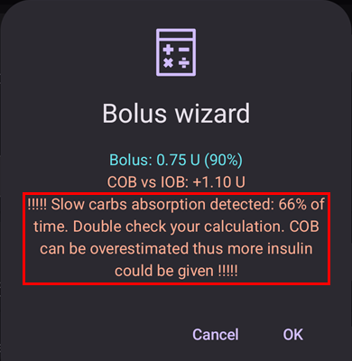

Bolus sihirbazını kullandıktan sonra yukarıdaki uyarıyı görürseniz, **AAPS** hesaplanan AKRB değerinin yanlış olabileceğini algılamıştır. Yani önceki bir öğünden sonra AKRB varken tekrar bolus yapmak isterseniz aşırı doza karşı dikkatli olun!

Ayrıntılar için [AKRB hesaplaması sayfasındaki](#CobCalculation-detection-of-wrong-cob-values) ipuçlarına bakın.

**AAPS** 3.x'in **Eylemler** sekmesini mi arıyorsunuz? İşlevleri ana ekrana, **Yönet** paneline ve Hızlı Başlatma araç çubuğuna taşındı: bkz. [Eylemler sekmesi nereye gitti?](#screens-action-tab).

(aaps-screens-careportal)=

## Careportal kayıtları

[Durum satırında](#screens-sensor-level-battery) gösterilen yaşlar ve seviyeler (sensör, insülin, kanül, pompa pili) careportal kayıtlarına dayanır: **Hazırla/doldur** (pompa bölgesi ve insülin kartuşu değişimlerini kaydeder), **Sensör yerleştirme** ve **Pompa Pil Değişimi**.

Bunları ana ekrandaki genişletilmiş durum panelinden, **Yönet** panelinden veya [Hızlı Başlatma](../DailyLifeWithAaps/QuickLaunch.md) düğmeleriyle kaydedebilirsiniz.

**Hazırla/doldur** bir pompa bölgesi değişimini ve/veya insülin kartuşu değişimini kaydeder ve bir doldurma miktarı verebilir:


**Sensör yerleştirme** ve **Pompa Pil Değişimi** yalnızca olayın zamanını sorar:


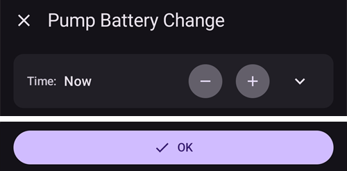 Egzersiz, duyuru, soru ve not kayıtları Nightscout careportal'ını yansıtır ve notların özel biçimleridir.

Bu kayıtları göstermek için **Yönet** panelinde aşağı kaydırın ve **Careportal**'a basın: **KŞ Kontrol**, **Not**, **Egzersiz**, **Soru** ve **Duyuru**.


**KŞ Kontrol**, **Soru** ve **Duyuru**, bir glikoz değeri (glikometreden, sensörden veya başka bir kaynaktan), bir not ve olayın zamanını girmenizi sağlar. **Soru** ve **Duyuru**'da glikoz satırı kapalıdır ve değerin yanında ölçüm tipini gösterir: değeri değiştirirseniz tip **Sensör**'den **GlkMetre**'ye değişir.


**Not** ve **Egzersiz**, bir süre (kapalı bir satır: **-** / **+** kullanın veya yazmak için oka dokunun), bir not ve olayın zamanını girmenizi sağlar:


Tüm bu iletişim kutularında (**Hazırla/doldur**, **Sensör yerleştirme**, **Pompa Pil Değişimi** ve careportal kayıtları) olayın zamanı, [insülin iletişim kutusu](#aaps-screens-buttons-insulin) ve bolus sihirbazıyla aynı **Zaman** satırını kullanır: zamanı 5 dakikalık adımlarla (bir hafta geriye ve 12 saat ileriye kadar) değiştirmek için **-** / **+** kullanın veya herhangi bir tarih ve saat seçmek için oka dokunun.

## Bölge Rotasyonu

**Yönet → Bölge Rotasyonu**, her kanülün ve sensörün vücut haritasında nereye yerleştirildiğini kaydeder; böylece bölgelerinizi değiştirebilirsiniz: Pompalar ve kanüller sayfasındaki [Bölge Rotasyonu](#Aapsscreens-site-rotation) bölümüne bakın.

**GTD** (günlük toplam doz) ve bazal/bolus oranı için genel kural [İstatistikler İnsülin sekmesi](#reviewing-tdd) ile açıklanır.

(AapsScreens-insulin-profile)=

## İnsülin


**Yönet → İnsülin ayarları** insülin yapılandırmalarınızı gösterir ve yönetir. Her yapılandırma, **tepe zamanı** ve **[İES](#Config-Builder-insulin-dia)** değeriyle bir kartta gösterilir; kullanımdaki **AKTİF** olarak işaretlenir. Kartın altında aktivite eğrisini görürsünüz. Etkin olan dışındaki herhangi bir yapılandırmanın takma adını, tepe zamanını ve İES'ini düzenleyebilirsiniz: kullandığınız insülini değiştirmek için [yeni bir yapılandırma ekleyin ve etkinleştirin](#Config-Builder-insulin-change-active).

Ne olduğu ve nasıl ayarlanacağı hakkında daha fazla bilgi için [İnsülin etki süresi](#Config-Builder-insulin-dia) bölümüne bakın.

## Pompa Durumu


**Yönet → Pompa** (veya **Konfigürasyon → Pompa → Eklentiyi aç**) pompanızın durumunu gösterir: son bağlantı, temel bazal oranı, pil, rezervuar...

* Görüntülenen bilgiler pompa modelinize bağlıdır.
* Ayrıntılar için [pompalar sayfasına](../Getting-Started/CompatiblePumps.md) bakın.

## Döngü, AMA / SMB

**Konfigürasyon → Döngü → Eklentiyi aç** (ve **Konfigürasyon → APS (YPS) → Eklentiyi aç**), algoritmanın hesaplamaları ve **AAPS**'in neden böyle davrandığı hakkında ayrıntıları gösterir: son çalışma, sonuçtaki istek ve kısıtlamalar. **Döngü** ekranı yalnızca verilen geçici bazal oranını veya SMB'yi gerçekten sınırlayan kısıtlamaları (ve geçerliyse kapalı döngüye neden izin verilmediğini) listeler; **APS (YPS)** ekranı ise hesaplamaya giren tüm kısıtlamaları listeler.

Hesaplamalar, sistem CGM'den her yeni ölçüm aldığında yapılır.

Daha fazla ayrıntı için [Konfigürasyon sayfasının APS bölümüne](#Config-Builder-aps) bakın.

(aaps-screens-profile)=

## Profile


**Yönet → Profil** (veya ana ekranda profil adına dokunmak) Profil ekranını açar: profilleriniz kaydırılabilir kartlar halinde gösterilir; bir profili eklemek, düzenlemek, klonlamak, silmek ve **etkinleştirmek** için düğmeler vardır.

Profil, kişisel diyabet ayarlarınızla ilgili bilgileri içerir; daha fazla bilgi için ayrıntılı **[Profil](../SettingUpAaps/YourAapsProfile.md)** sayfasına bakın.

## Otomasyon

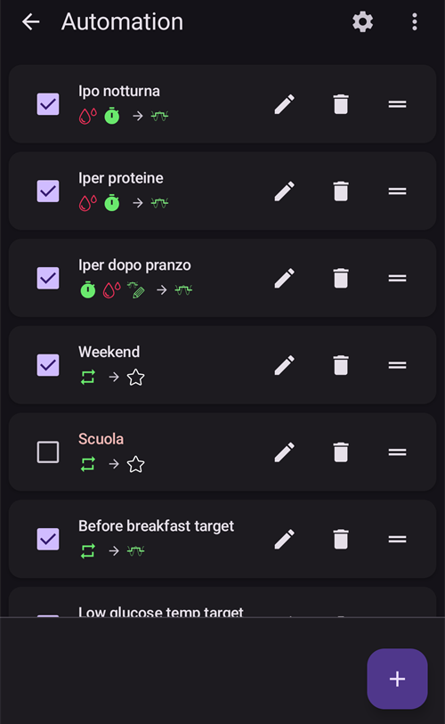

**Yönet → Otomasyon** otomasyon kurallarınızı listeler. [Buradaki](../DailyLifeWithAaps/Automations.md) ayrı sayfaya bakın.

## NSClient


**Konfigürasyon → İletişim → NSClientV3 → Eklentiyi aç**, Nightscout sitenizle bağlantının durumunu gösterir: URL, websocket durumu, kuyruk ve senkronizasyon etkinliğinin günlüğü.

Ayarlar [NSClient ayarlarında](#Preferences-nsclient) değiştirilebilir.

Sorun giderme için bu [sayfaya](../GettingHelp/TroubleshootingNsClient.md) bakın.

(aaps-screens-bg-source)=

## KŞ kaynağı - xDrip, BYODA...


**Konfigürasyon → KŞ kaynağı → Eklentiyi aç**, CGM ölçümlerinin geçmişini gösterir ve hata (örneğin sıkışmaya bağlı düşük değer) veya yinelenen ölçüm durumunda ölçümleri silme seçeneği sunar.

## Tedavi geçmişi

**AAPS**'in kaydettiği her şeyi görmek, kontrol etmek ve düzeltmek için **menüyü** (☰) açın ve **Tedavi geçmişi**'ni seçin: karbonhidratlar ve boluslar, geçici bazallar, geçici hedefler, profil değişimleri, careportal kayıtları, döngü modu değişiklikleri ve kullanıcı girdileri. Verilerinizi inceleme sayfasındaki [Tedavi geçmişi](#aaps-screens-treatments) bölümüne bakın.

## Geçmiş Tarayıcısı

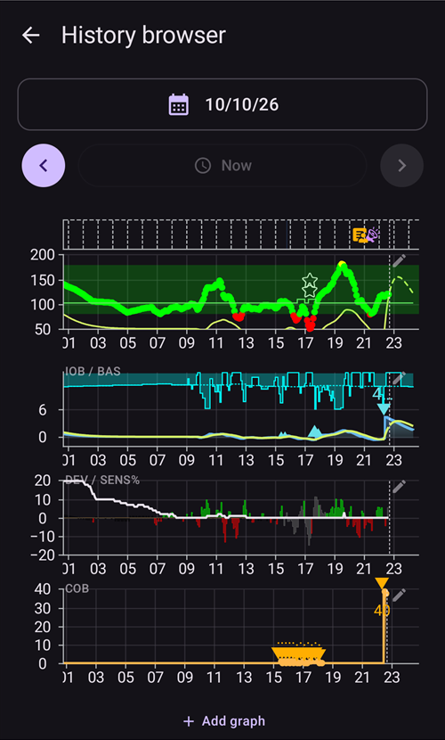

**Menüyü** (☰) açın ve **Geçmiş tarayıcısı**'nı seçin.

**AAPS** geçmişinde geriye gitmenizi sağlar. [Verilerinizi inceleme > Geçmiş tarayıcısı](../Maintenance/Reviewing.md) sayfasına bakın.

(aaps-screens-statistics)=

## Statistics

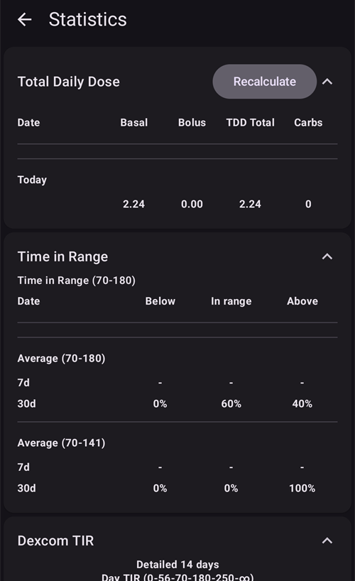

**Menüyü** (☰) açın ve **İstatistikler**'i seçin.

Dört sekmede günlük toplam dozunuz, hedef aralıktaki süreniz, gün içindeki glikoz profiliniz (AGP) ve insülin döngüsü düzeniniz hakkında istatistikler verir. [Verilerinizi inceleme > İstatistikler](#reviewing-statistics) sayfasına bakın.

(aaps-screens-profile-helper)=

## Profil yardımcısı

**Menüyü** (☰) açın ve **Profil yardımcısı**'nı seçin.


Profil yardımcısı, profilleri karşılaştırmanızı ve çocuklar için başlangıç profilleri oluşturmanızı sağlar. [AAPS profiliniz](../SettingUpAaps/YourAapsProfile.md) sayfasına bakın — [Bir çocuk için sıfırdan profil oluşturma](#your-aaps-profile-profile-from-scratch-for-a-kid) ve [İki profili karşılaştırma](#your-aaps-profile-compare-profiles) bölümleri.

(aaps-screens-widgets)=

## Ana ekran widget'ları

**AAPS**, uygulamayı açmadan verilerinizi görmek için telefonunuzun ana ekranına ekleyebileceğiniz beş widget sunar. [Ana ekran widget'ları](../DailyLifeWithAaps/Widgets.md) sayfasına bakın.

