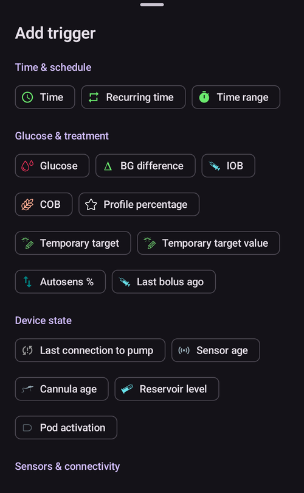
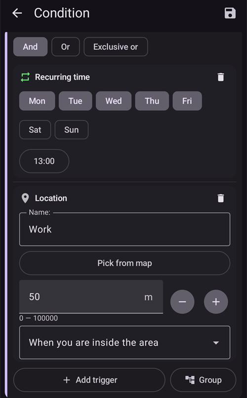

# Otomasyon

```{contents} In this page
:backlinks: entry
:depth: 2
```

## Otomasyon nedir?

"**Otomasyon**", AAPS'teki görevleri otomatik hale getirebilen bir özelliktir.

Otomasyon, bir veya daha fazla koşula ya da tetikleyiciye göre belirli eylemleri gerçekleştirir. Tetikleyiciler, düşük veya yüksek kan şekeri (KŞ) seviyeleri ya da belirli bir miktarda negatif aktif insülin (AİNS) gibi düzensiz olayları içerebilir. Otomasyonlar ayrıca günün belirli saatlerindeki öğünler veya egzersiz gibi yinelenen olayları ya da kullanıcının bir GPS konumuna veya bir Wi-Fi SSID alanına belirli bir uzaklıkta olduğu durumları da yönetebilir. Otomasyon, AAPS ayarlarını bir zaman planına göre veya her Pod değişiminde yedekleyebilir.

Otomasyon kuralları **Otomasyon** ekranından (**Yönet → Otomasyon**) oluşturulur ve değiştirilir. Her kural iki özellikle tanımlanır:

- Bir eylemi başlatan bir veya daha fazla koşul ya da 'tetikleyici'.

    Belirli bir zaman planı, bir olay veya AAPS'teki bir değer gibi düşünün

- Yapılacak bir veya daha fazla eylem.

    Örneğin bir alarm, bir profil yüzdesi ayarlamak veya Pod değişiminde AAPS ayarlarını dışa aktarmak.


Çok çeşitli Otomasyon seçenekleri vardır. Kullanıcıların bunları AAPS uygulamasının Otomasyon bölümünde incelemeleri önerilir. Diğer kullanıcıların Otomasyon örnekleri için [**Facebook**](https://www.facebook.com/groups/AndroidAPSUsers) ve [**Discord**](https://discord.gg/4fQUWHZ4Mw) üzerindeki AAPS kullanıcı gruplarında da arama yapabilirsiniz.

## Otomasyon nasıl yardımcı olabilir

1. **Yinelenen görevleri otomatikleştirmek:** Programlanmış eylemleri kullanıcı müdahalesi olmadan otomatik olarak gerçekleştirmek.

1. **Karar yorgunluğunu azaltmak:** **Otomasyonların** temel faydası, kullanıcıyı **AAPS**'te elle müdahale yapma yükünden kurtarmasıdır. [Araştırmalara](https://www.ncbi.nlm.nih.gov/pmc/articles/PMC6286423/#ref4) göre tip 1 diyabetle yaşayan kişiler her gün ortalama 180 ek karar vermek zorundadır. **Otomasyonlar** zihinsel yükü azaltabilir ve kullanıcının zihinsel enerjisini hayatın diğer alanlarına ayırmasını sağlar.

1. **Glisemik kontrolü iyileştirme olasılığı:** örneğin **Otomasyonlar**, yoğun zamanlarda veya unutkanlık dönemlerinde bile **Geçici Hedeflerin** gerektiğinde her zaman ayarlanmasına yardımcı olabilir. Örneğin, diyabetli bir çocuğun okulda salı günleri saat 10:00'da ve perşembe günleri saat 14:00'te spor dersi varsa ve spordan 30 dakika önce yüksek bir Geçici Hedef ('GH') başlatılması gerekiyorsa, bu **Geçici Hedef** bir **Otomasyon** ile etkinleştirilebilir.

1. **AAPS'in büyük ölçüde kişiselleştirilebilmesi:** kullanıcının tercihine göre belirli durumlarda daha fazla veya daha az agresif olması. Örneğin, gece ortasında negatif **AİNS** oluşursa belirli bir süre için geçici olarak azaltılmış bir **Profil** % başlatmak. Negatif AİNS, mevcut **Profil**'in çok güçlü olabileceğini gösterir.

Aşağıdaki örnek, bir **Otomasyonun** bazı adımları nasıl ortadan kaldırabileceğini gösterir.

Kullanıcı her sabah saat 6'da egzersiz yapıyor: egzersizden önce, saat 5'te AAPS'te elle bir "Geçici Hedef-Aktivite" ayarlamayı hatırlaması gerekiyor.


Kullanıcı, saat 6'daki egzersize hazırlık olarak **KŞ** ve **AİNS** değerlerinin en uygun düzeyde olması için saat 5'te bir ‘Geçici Hedef-Aktivite’ tetikleyen bir **Otomasyon** ayarlamıştır:


## Otomasyonlara başlamadan önce dikkat edilmesi gereken önemli noktalar

1. Bazı Otomasyonları kurmadan önce **AAPS** ile makul bir **KŞ** kontrolünüz olmalıdır. Otomasyonlar, uygun olmayan bazal, **İDF** veya **IC** ayarlarını telafi etmek için kullanılmamalıdır (aşağıda ayrıca ele alınmıştır). **KŞ** yükselmelerini (_ör._ yemek nedeniyle) dengelemek için otomatik bir **Profil değişimi** ayarlamaktan kaçının. Bunlar başka yöntemlerle (SMB'ler vb.) daha iyi yönetilir.

1. Her teknolojide olduğu gibi **CGM'ler**, **Pompalar** ve telefonlar arızalanabilir: Teknik sorunlar veya sensör hataları **Otomasyon** eylemlerini bozabilir ve elle müdahale gerekebilir.

1. **Rutinler değiştikçe Otomasyon gereksinimleri de büyük olasılıkla değişir**. İş/okul/tatil dönemleri arasında geçiş yaparken, hangi **Otomasyonların** şu anda etkin olduğunu gözden geçirmek için takviminize bir hatırlatıcı koyun (bunları etkinleştirmek ve devre dışı bırakmak kolaydır). Örneğin tatile çıktığınızda ve okul sporu veya günlük egzersiz için kurulan bir Otomasyona artık ihtiyacınız olmadığında ya da zamanlamaları ayarlamanız gerektiğinde.

1. **Otomasyonlar** birbiriyle çakışabilir. Yeni **Otomasyon** ayarlarını güvenli bir ortamda dikkatle gözden geçirmek ve bir **Otomasyonun** beklediğiniz şekilde neden tetiklendiğini veya tetiklenmediğini anlamak iyi olur.

1. Otoduyarlılık kullanıyorsanız, **Profil değişimleri** yerine **Geçici Hedefleri** kullanmaya çalışın. **Geçici Hedefler** Otoduyarlılık'ı 0'a sıfırlamaz. **Profil değişimleri** Otoduyarlılık'ı sıfırlar.

1. Çoğu **Otomasyon** yalnızca **sınırlı bir süre** için ayarlanmalıdır. Bu sürenin sonunda **AAPS** durumu yeniden değerlendirebilir ve gerekirse, koşul hâlâ sağlanıyorsa **Otomasyonu** tekrarlayabilir. Örneğin, "30 dk için 7,0 mmol/L geçici hedef başlat" veya "10 dk için **Profil** %110 başlat" _ve_ "10 dk için 5,0 mmol/L geçici hedef başlat". **Otomasyonları** kalıcı değişiklikler yapmak için kullanmak (ör. daha güçlü bir profil yüzdesine geçmek) hipoglisemi riski taşır.

## Otomasyonu ne zaman kullanmaya başlayabilirim?

**Otomasyonlar** **10. görevde** kullanılmaya başlanabilir.

## Otomasyonlar AAPS'te nerede bulunur?

Ana ekranın alt gezinme çubuğunda **Yönet**'i açın ve **Otomasyon**'u seçin.

## Bir Otomasyonu nasıl kurabilirim?

Bir **Otomasyon** kurmak için Otomasyon ekranındaki **+** düğmesine basarak bir ‘kural’ oluşturun:


* ‘kuralınıza’ bir başlık verin (Görev adı);
* **Koşul** altındaki "**DÜZENLE**"ye basın. **Koşul** ekranında tetikleyicilerin nasıl birleştirileceğini seçin (**Ve**, **Veya**, **Özel veya**) ve "**Tetikleyici ekle**"ye basın:


* en az bir tetikleyici ekleyin:



* **Eylem** altındaki "**EKLE**"ye basın ve bir eylem seçin:


* kuralı **Kaydet** düğmesiyle kaydedin ve **Otomasyonu** etkinleştirmek için kural adının solundaki kutunun ‘işaretli’ olduğundan emin olun:


Bir **Otomasyon** kuralını devre dışı bırakmak için **Otomasyon** adının solundaki kutunun işaretini kaldırın. Aşağıdaki örnek, etkinleştirilmiş (‘işaretli’) veya devre dışı bırakılmış (‘işaretsiz’) bir **Otomasyonu** gösterir:


Bir **Otomasyon** kurarken, önce "Eylemler" altındaki ‘bildirim’ seçeneğini etkinleştirerek onu test edebilirsiniz. Bu, **AAPS**'in bir eylemi gerçekten otomatik yapmak yerine önce bir bildirim göstermesini sağlar. Bildirimin doğru zamanda/koşullarda tetiklendiğinden emin olduğunuzda, **Otomasyon** kuralını güncelleyerek ‘Bildirim’i bir ‘Eylem’ ile değiştirebilirsiniz.


```{admonition} Important note
:class: note

**Otomasyonlar**, Döngü devre dışıyken de etkindir!
```


## Kurallar ne zaman kontrol edilir

**AAPS**, her yeni glikoz ölçümü işlendiğinde tüm **Otomasyon** kurallarını kontrol eder. Böylece kurallar, telefon ekranı kapalıyken de CGM'nizin hızında değerlendirilir. Kurallar ayrıca telefon şarj olmaya başladığında, ağ veya konum değiştiğinde ve bir Bluetooth cihazı bağlandığında da kontrol edilir. Aynı anda yalnızca bir kontrol çalışır. Bu yüzden eylemleri biraz zaman alan bir kural (örneğin bir pompa komutu) iki kez çalıştırılamaz.

## Güvenlik sınırları

**Otomasyonlar** için güvenlik sınırları vardır:

* Bir **Otomasyon** tarafından ayarlanan **Geçici Hedef** 72 ile 180 mg/dL (veya 4 ile 10 mmol/L) arasında olmalıdır.
* **Profil yüzdesi** %50 ile %130 arasında olmalıdır.
* **Otomasyon** çalışmaları arasında (ve ilk çalışmada) 5 dakikalık bir süre sınırı vardır.

## Negatif değerlerin doğru kullanımı

```{admonition} Warning
:class: warning

Lütfen **Otomasyonda** negatif bir değer seçerken dikkatli olun
```

**Otomasyonlarda** ‘Koşul’ içinde "küçükse" gibi bir ‘negatif değer’ seçerken dikkatli olunmalıdır. Örneğin:


**Örnek 1:** **"küçükse"** "-0,1mmol/L" (veya "-2mg/dL") Koşulu oluşturmak şunu yapar:

**-0,1 (-2)'den kesinlikle küçük** olan her sayı için bir **Otomasyon** tetikler. Buna -0,2, -0,3, -0,4 (-4, -6, -8) gibi sayılar dahildir. -0,1 (-2) değerinin kendisinin bu koşula **dahil olmadığını** unutmayın. ("-0,1mmol/L (-2 mg/dL) ile eşit veya küçükse" koşulu, -0,1 mmol/L veya -2 mg/dL değerini _dahil ederdi_).

**Örnek 2:** "büyükse" -0,1mmol/L (-2mg/dL) Koşulu oluşturmak şunu yapar:

-0,1mmol/L (-2mg/dL) değerinden **büyük** olan her sayı için bir **Otomasyon** tetikler. Buna 0, 0,2, 0,4mmol/L (0, 4, 8mg/dL) gibi sayılar ve diğer tüm pozitif sayılar dahildir.

Bu koşulları ve değerleri seçerken **Otomasyonunuzun** tam olarak ne yapmasını istediğinizi dikkatle düşünmeniz önemlidir.

(automations-automation-triggers)=
## Otomasyon Tetikleyicileri


Listenin geri kalanını görmek için aşağı kaydırın:


Kullanıcının seçebileceği çeşitli ‘Tetikleyiciler’ vardır. Tetikleyiciler, otomasyonun çalışması için sağlanması gereken koşullardır. Aşağıdaki liste eksiksiz değildir:

**Tetikleyici:** koşulları bağlama

**Seçenekler:**

Birkaç koşul şunlarla bağlanabilir:
* “And”
* “Or”
* “Özel veya” (koşullardan biri, ve yalnızca biri geçerliyse eylem(ler) gerçekleşir)

**Tetikleyici:** zaman ve yinelenen zaman

**Seçenekler:**

* zaman = tek seferlik zaman olayı
* yinelenen zaman = düzenli olarak gerçekleşen bir şey (yani haftada bir, her iş günü vb.)

**Tetikleyici:** konum

**Seçenekler:**

* Kullanıcı [Ayarlar > Otomasyon](#preferences-maintenance-settings) içinde kullanmak istediği konum servisini seçebilir.

**Tetikleyici:** konum servisi

**Seçenekler:**

* Pasif konumu kullan: **AAPS** konumu yalnızca başka uygulamalar istediğinde alır.
* Use network location: Location of your Wi-Fi.
* GPS konumunu kullan (Dikkat! Bu, pilin çok hızlı bitmesine neden olabilir!)

**Tetikleyiciler**: pompa ve sensör verileri

* Kanül yaşı tetikleyicisi: Tüm pompalarda kullanılabilir
* İnsülin yaşı tetikleyicisi: Desteklenen pompalarda kullanılabilir
* Pil yaşı tetikleyicisi: Desteklenen pompalarda kullanılabilir
* Sensör yaşı tetikleyicisi: her zaman kullanılabilir
* Pod aktivasyonu tetikleyicisi: Patch pompalarda kullanılabilir

Yaşla ilgili tüm tetikleyicilerde eşitlik karşılaştırmasının tetiklenmesi pek olası değildir. Bu durumda bir aralık oluşturmak için iki tetikleyici gerekir

* Rezervuar seviyesi tetikleyicisi: Tüm pompalarda kullanılabilir. Değer **AAPS**'te her zaman dolu olduğu için "NOT\_AVAILABLE" karşılaştırması bu tetikleyicide çalışmaz
* Pompa pil seviyesi tetikleyicisi: Desteklenen pompalarda kullanılabilir. Değer **AAPS**'te her zaman dolu olduğu için "NOT\_AVAILABLE" karşılaştırması bu tetikleyicide çalışmaz

(automations-automation-action)=
## Eylem


Listenin geri kalanını görmek için aşağı kaydırın:


**Eylemler:** **Geçici Hedef** başlat

**Seçenekler:**

* **KŞ** 72 mg/dL ile 180 mg/dL (4 mmol/L ile 10 mmol/L) arasında olmalıdır
* **GH** yalnızca önceden bir Geçici Hedef yoksa çalışır. **AAPS** bunu kurala otomatik olarak "**Ön koşullar: Geçici Hedef mevcut değil**" satırı olarak ekler

**Eylemler:** **Geçici Hedef** durdur

**Seçenekler:**

none

**Eylemler:** **Profil yüzdesi**

**Seçenekler:**

* **Profil** %50 ile %130 arasında olmalıdır
* yalnızca önceki yüzde %100 ise çalışır

**Eylemler:** **Yumuşatmayı değiştir** (**Döngü & insülin** grubunda)

**Seçenekler:**

* geçilecek [yumuşatma yöntemini](../CompatibleCgms/SmoothingBloodGlucoseData.md) seçin. Liste, **Konfigürasyon** > **Yumuşatma** altındaki listeyle aynıdır ve eylem, orada yapılan bir değişikliğin yaptığının tam olarak aynısını yapar: yeni yöntem kaydedilir, eşleştirilmiş istemcilerle senkronize edilir ve KŞ verileri hemen yeniden yumuşatılır.
* yalnızca bu yumuşatma yöntemi zaten etkin değilse çalışır. **AAPS** bunu kurala otomatik olarak "**Ön koşullar: Yumuşatma … etkin değil**" satırı olarak ekler. Seçilen yumuşatma etkin olduğunda kural sessizce atlanır.
* Örnek: yeni bir sensör ilk gününde çoğu zaman gürültülüdür. **Sensör yaşı** tetikleyicisini kullanan iki kural, sensör otururken daha güçlü filtreleme, sonrasında ise gecikmesiz yumuşatma sağlar:
  * **Sensör yaşı** 24 saatten az: **Yumuşatmayı değiştir** → **Kokusuz Kalman Filtresi**
  * **Sensör yaşı** 24 saatten fazla: **Yumuşatmayı değiştir** → **Ortalama yumuşatma**

**Eylemler:** **Not** (listenin **Alarmlar** grubunda)

**Seçenekler:**

* kaydedilecek olayı seçin: **Not**, **Egzersiz**, **Soru**, **Duyuru** veya **Pompa Kanül Değişimi**, ve isteğe bağlı bir not. Eylemin adı, seçtiğiniz olaya göre değişir.
* **Süre**: **Not**, **Egzersiz** ve **Pompa Kanül Değişimi** için kullanılır. **Soru** ve **Duyuru** için süre yoktur: bunun yerine mevcut KŞ'nizi kaydederler.
* **Pompa Kanül Değişimi**, kanül değişimini elle kaydetmişsiniz gibi kanül yaşını sıfırlar. Örnek: bazı pompalar (Combo gibi) rezervuar değişimini kendileri kaydeder, ama kanül değişimini kaydetmez. Her ikisini her zaman birlikte değiştiriyorsanız, **İnsülin yaşı** 1 saatten az ve **Kanül yaşı** 24 saatten fazla olan bir kural, kanül değişimini sizin yerinize kaydedebilir.

 

**Eylemler:** **Tüm numaralara SMS gönder** (**Alarmlar** grubunda)

**Seçenekler:**

* mesajın metnini girin. Mesaj, [SMS Komünikatör](../RemoteFeatures/SMSCommands.md) ayarlarında izin verilen tüm telefon numaralarına gönderilir. SMS Komünikatör eklentisi etkin olmalıdır.

**Eylemler:** **Profili değiştir** (**Profil** grubunda)

**Seçenekler:**

* etkinleştirilecek **Profil**'i seçin. Profil %100 olarak, zaman kaydırması olmadan etkinleştirilir. Bu profil zaten etkinse eylem hiçbir şey yapmaz.

**Eylemler:** **SMB'yi etkinleştir/devre dışı bırak** (**Döngü & insülin** grubunda)

**Seçenekler:**

* **Açık** veya **Kapalı** seçin. Bu, OpenAPS SMB'nin **SMB etkinleştir** ayarını, **Ayarlar**'da değiştirmişsiniz gibi aynen değiştirir. Siz veya başka bir kural geri değiştirene kadar böyle kalır.

**Eylemler:** **OtoAyar'ı Çalıştır** (**Döngü & insülin** grubunda)

**Seçenekler:**

* ayarlanacak profili ve gün sayısını seçin: bkz. [Otomasyon kuralı ile OtoAyar'ı çalıştırma](#autotune-run-autotune-with-an-automation-rule).

**Eylemler:** **İşlemeyi durdur** (**Döngü & insülin** grubunda)

**Seçenekler:**

* yok. Bu eylemi içeren bir kuralın koşulları doğru olduğu sürece, **AAPS** listede bu kuralın altındaki kuralları kontrol etmez. Koşulları yeniden yanlış olduğunda, alttaki kurallar her zamanki gibi kontrol edilir. Bu eylemi, altındaki kurallardan öncelikli olması gereken bir kurala ekleyin (bkz. [Otomasyonların sırası](#Automations-the-order-of-the-automations-in-the-list-matters)).

**Eylemler:** **Senaryoyu çalıştır**, **Senaryoyu etkinleştir**, **Senaryoyu devre dışı bırak** (**Senaryolar** grubunda)

**Seçenekler:**

* çalıştırılacak, etkinleştirilecek veya devre dışı bırakılacak [senaryoyu](Scenes.md) seçin.

‘Eylem’ eklendikten sonra, varsayılan değerlere tıklayıp onları ayarlayarak istenen sayıya değiştirmeniz gerekir.


(Automations-the-order-of-the-automations-in-the-list-matters)=
## Listedeki **Otomasyonların** sırası önemlidir
 **AAPS**, oluşturulan kuralları **Otomasyon** listesinin en üstünden başlayarak öncelik sırasına göre uygular. Örneğin, ‘Düşük’ **Otomasyonu** diğer tüm kurallardan daha önemli olan **Otomasyon** ise, bu **Otomasyon** aşağıda gösterildiği gibi kullanıcının **Otomasyon** listesinin en üstünde olmalıdır:


**Otomasyon** kurallarını yeniden önceliklendirmek için kuralın sağ tarafındaki **=** tutamacına dokunup basılı tutun. **Otomasyonları** kuralları yukarı veya aşağı taşıyarak yeniden sıralayın.


## Otomasyon kuralları nasıl silinir

Bir **Otomasyon** kuralını silmek için çöp kutusu simgesine tıklayın.


## Otomasyon örnekleri

Aşağıda **Otomasyon** örnekleri verilmiştir. **Otomasyonlar** ve kullanıcıların **Otomasyonlarını** kendilerine göre nasıl uyarladıkları hakkında daha fazla tartışmayı Facebook tartışma gruplarında veya Discord'da bulabilirsiniz. Aşağıdaki örnekler, kullanıcı **Otomasyonun** nasıl çalışacağını iyi anlamadan kopyalanmamalıdır.

(automations-low-glucose-temp-target)=
### Düşük Glikoz Geçici Hedefi

Bu **Otomasyon**, **KŞ** belirli bir eşiğin altına düştüğünde otomatik bir **Geçici Hedef** başlatır. Burada glikoz 70 mg/dL'den küçük olduğunda 30 dakika için 110 mg/dL hedef başlatılır:


### Öğle Yemeği Geçici Hedefi (‘Konum’ ile)


Bu **Otomasyon**, her hafta içi öğle yemeğini işte aşağı yukarı aynı saatte yiyen bir kullanıcı için oluşturulmuştur. Ancak yalnızca kullanıcı belirlenen bir ‘konum’ içindeyse tetiklenir.  Yani kullanıcı bir gün işte değilse bu **Otomasyon** etkinleşmez.

Bu **Otomasyon**, öğle yemeğine hazırlık olarak KŞ'yi 90 mg/dL'ye (veya 5 mmol/L'ye) getirmek için saat 13:00'te düşük bir **Geçici Hedef** (Yakında Yenecek) ayarlar.

Konum ‘Tetikleyicisinin’ bir adı, bir konumu (**Haritadan seç**'e dokunun veya mevcut konumunuzu kullanın) ve metre cinsinden bir yarıçapı vardır. Alanın içindeyken (veya dışındayken) tetiklenir:



‘Ve’ bağlantısı nedeniyle **Otomasyon** yalnızca ‘seçilen zaman’ içinde ve kullanıcı seçilen konumdaysa çalışır.

**Otomasyon** bu konumda başka bir zamanda veya bu zamanda seçilen konumun çevresindeki 50 metrelik yarıçapın dışında tetiklenmez.

### Wi-Fi SSID Konum Otomasyonu

Bir Wi-Fi SSID kullanmak, belirli bir Wi-Fi ağının menzilindeyken bir **Otomasyon** tetiklemek için (GPS'e göre) iyi bir seçenektir: oldukça hassastır, daha az pil kullanır ve GPS ile diğer konum servislerinin kullanılamayabileceği kapalı alanlarda çalışır.

İşte yalnızca iş günlerinde kahvaltıdan önce (1) bir **Geçici Hedef** ayarlamanın başka bir örneği.


**Otomasyon** yalnızca pazartesi-cuma günleri saat 05:30'da (2)  
ve bir ev Wi-Fi ağına bağlıyken (3) tetiklenir.


Ardından 30 dakika için 75 mg/dL'lik bir **Geçici Hedef** ayarlar (4). Konumu eklemenin avantajlarından biri, örneğin kullanıcı tatilde seyahat ederken tetiklenmemesidir.


Eylemi görmek için aşağı kaydırın: 30 dakika için 75 mg/dL'lik bir **Geçici Hedef** (4).


**Otomasyon** tetikleyicilerini ayrıntılı gösteren ekran görüntüsü:

1) Ana “VE” altında (tetiklenmesi için iki koşulun da sağlanması gerekir) 1) Yinelenen zaman = Pts,Sal,Çrş,Prş,Cum Saat 05:30  
1) Wi-Fi SSID = My_Home_WiFi_Name


(automating-preference-settings-export)=

## Tercih Ayarlarının Dışa Aktarımını Otomatikleştirme

### Gözetimsiz Dışa Aktarmalar: zamanlanmış (günlük)

Otomasyon tetikleyicilerini ayrıntılı gösteren ekran görüntüleri:

1) Koşul: Yinelenen zaman = Pts,Sal,Çrş,Prş,Cum Saat 08:00 1) Eylem: Ayarları dışa aktar ("Tedavi metinleri:" için "Günlük" girin)


Not: Dışa aktarma işlemi Careportal'a kaydedilir

### Gözetimsiz Dışa Aktarmalar: Pod aktivasyonu (yalnızca Patch pompa)

Otomasyon tetikleyicilerini ayrıntılı gösteren ekran görüntüleri:

1) Koşul: Pod aktivasyonu 1) Eylem: Ayarları dışa aktar ("Tedavi metinleri:" için "Pod aktivasyonu: ayarların dışa aktarımı" girin)


Not: Dışa aktarma işlemi Careportal'a kaydedilir. Not: Daha önce elle bir ayar dışa aktarımı yapmadıysanız Otomasyon **hiç** tetiklenmez. Gözetimsiz ayar dışa aktarımını doğru etkinleştirmek için [Ayarlar → Bakım](#preferences-maintenance-settings) bölümüne bakın.


## Otomasyon Günlükleri

**AAPS**, son **Otomasyon** olaylarının günlüğünü **Otomasyon** ekranının altında, kuralların altında gösterir. Kurallarınızın beklediğiniz zamanda tetiklendiğini doğrulamak için bunu kullanın.

Aşağıdaki örnekte **Düşük glikoz geçici hedefi** kuralı (1) (yukarıdaki [Düşük Glikoz Geçici Hedefi](#automations-low-glucose-temp-target) bölümüne bakın) etkindir. Günlük (2), saat 03:09 PM'de (15:09) glikozun 70 mg/dL'nin altına düştüğünü ve kuralın tetiklendiğini gösterir:
* eylem "Geçici hedefi başlat: 110mg/dL@30 dk" idi: 30 dakika için 110 mg/dL'lik bir **Geçici Hedef**;
* Sondaki **Tamam**, eylemin başarıyla gerçekleştirildiği anlamına gelir.


(automations-troubleshooting)=

## Troubleshooting

* Sorun: __Otomasyonlarım AAPS tarafından tetiklenmiyor mu?__

Kuralın etkin olduğundan emin olmak için **Otomasyon** adının solundaki kutunun ‘işaretli’ olduğunu kontrol edin:


* Sorun: __Otomasyonlarım yanlış sırayla tetikleniyor.__

Yukarıda anlatılan kural öncelik sıranızı kontrol edin.

* Sorun: __Bir koşul "Bilinmeyen tetikleyici … - asla doğru değil" gösteriyor.__

Kural, **AAPS**'in bu sürümünün okuyamadığı bir tetikleyici içeriyor; örneğin daha eski bir sürüme döndükten veya daha yeni bir sürümden ayarları içe aktardıktan sonra. Böyle bir tetikleyici asla doğru olmaz, bu yüzden kural çalışmaz. Tetikleyici değiştirilmeden saklanır, böylece daha yeni bir sürüm onu hâlâ kullanabilir. Kuralı düzenleyip tetikleyiciyi değiştirin veya **AAPS**'i güncelleyin.

## Otomasyonlara alternatifler

For advanced users, there are other possibilities to automate tasks using IFTTT or a third party Android app called Automate. 
