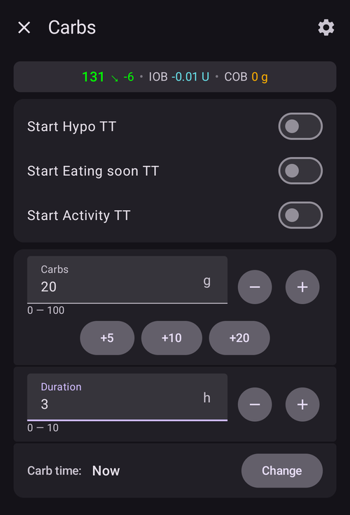
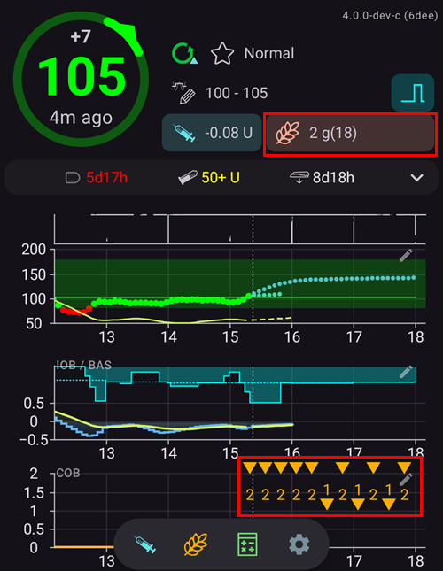

(Extended-Carbs-extended-carbs-ecarbs)=
# Yayma karbonhidratlar / "yKarb"

## yKarb nedir ve ne zaman faydalıdır?

Düzenli bir pompa tedavisinde yayma boluslar, kan şekerini insülinin etkisinden daha uzun sürede artıran yağlı veya başka türlü yavaş emilen yemeklerle baş etmenin iyi bir yoludur. Ancak döngü kullanırken yayma boluslar pek anlamlı değildir (ve teknik zorluklar yaratır), çünkü yayma bolus temelde sabit ve yüksek bir geçici bazal orandır. Bu, döngünün çalışma şekline aykırıdır, çünkü döngü bazal oranı dinamik olarak ayarlar. Ayrıntılar için aşağıdaki [yayma bolus](#extended-bolus-and-why-they-wont-work-in-closed-loop-environment) bölümüne bakın.

Döngü kullansanız da bu tür öğünlerle başa çıkma ihtiyacı hâlâ vardır. Bu nedenle AAPS, yayma karbonhidrat veya yKarb denen özelliği destekler.

yKarb, birkaç saate bölünen karbonhidratlardır. Yağ/proteinden çok karbonhidrat içeren standart öğünlerde, karbonhidratları önceden girmek (ve gerekirse ilk bolusu azaltmak) genellikle insülinin çok erken verilmesini önlemek için yeterlidir.  Ancak, tam karbonhidrat girişinin SMB etkisiyle çok fazla AİNS ile sonuçlandığı daha yavaş emilen yemekler için, yKarb, karbonhidratların (ve diğer makrobesinler için girdiğiniz karbonhidrat eşdeğerlerinin) nasıl emildiğini ve kan şekerini nasıl etkilediğini daha doğru bir şekilde simüle etmek için kullanılabilir. Bu bilgi ile döngü, bu karbonhidratlarla başa çıkmak için SMB'leri daha kademeli verebilir. Bu, dinamik bir yayma bolus gibi görülebilir (bu yöntem SMB'ler olmadan da çalışmalıdır, ancak muhtemelen daha az etkilidir).

**Not:** yKarb yalnızca yağlı / protein ağırlıklı öğünlerle sınırlı değildir: kan şekerini yükselten etkilerin olduğu her durumda da yardımcı olabilir, örneğin kortikosteroidler gibi başka ilaçlarda.

## yKarb kullanmanın mekaniği

yKarb girmek için **Karbonhidrat** iletişim kutusunu açın (**Tedaviler** → **Karbonhidrat**), toplam karbonhidratı girin, bir **Süre** ayarlayın ve isterseniz başlangıcı **Karb. zamanı** ile kaydırın (*aşağıdaki sayılar yalnızca örnektir; kendi kullanımınız için tatmin edici bir glikoz yanıtı elde etmek üzere kendi değerlerinizi denemeniz gerekir*):

Ana ekrandaki yKarb: **AKRB** alanındaki parantez içindeki sayı henüz gelecek karbonhidratları gösterir. **AKRB** grafiği ise gelecekteki her yKarb girdisini turuncu bir işaretle gösterir. **AKRB** grafiğini görmüyorsanız, grafiklerin altındaki **Grafik ekle** ile bir tane ekleyin (bkz. [AAPS ekranları](../DailyLifeWithAaps/AapsScreens.md)).

(AapsScreens-carbs-type)=
## Bolus sihirbazında öğün türü: ekmek, kek veya pizza

[Bolus sihirbazında](#aaps-screens-bolus-wizard), **Karbonhidrat** alanının altındaki üç düğme ile öğününüzün ne kadar hızlı emileceğini seçebilirsiniz. Onaylamadan önce birini seçin. Türe bağlı olarak **AAPS**, girdiğiniz karbonhidratın bir kısmını normal karbonhidrat olarak alır ve yavaş emilen, zengin öğünler için daha sonra [yayma karbonhidrat ("yKarb")](#Extended-Carbs-extended-carbs-ecarbs) ekler. Seçili türün tipik yiyeceklerini ve karbonhidratlarınıza ne yaptığını görmek için düğmelerin yanındaki **(i)** simgesine basın.

| Tür                    | Tipik yiyecekler (uygulamadaki örnekler)                                                                                      | Şimdiki karbonhidrat (bolus için kullanılır) | Eklenen yKarb                                |
| ---------------------- | ----------------------------------------------------------------------------------------------------------------------------- | -------------------------------------------- | -------------------------------------------- |
| **Ekmek** (varsayılan) | Ekmek, tuzlu hamur işleri, yoğurt, meyve, patates, pirinç, yulaf ezmesi, sebzeler                                             | %100                                         | None                                         |
| **Kek**                | Mantılar, makarnalar, karbonhidrat ve yağ açısından zengin Asya yemekleri, tatlı ve mayalı hamur işleri, tahıllar, bal, reçel | %90                                          | %20, 60 dakika sonra başlar, 2 saate yayılır |
| **Pizza**              | Lazanya, pizza, hamburger, patates kızartması, fırın patates, cips                                                            | %80                                          | %35, 60 dakika sonra başlar, 3 saate yayılır |

**Örnek**: 100 g girip **Pizza** seçiyorsunuz. Bolus 80 g için hesaplanır ve bu karbonhidrat şimdi kaydedilir. 35 g yKarb 1 saat sonra başlar ve 3 saate yayılır.

Bilmekte fayda var:
* Bu basit bir bölme değildir: **Kek** ve **Pizza** ile kaydedilen karbonhidratların toplamı **girdiğinizden fazladır** (%110 ve %115). Fazlası yalnızca yKarb içindedir.
* Bolus yalnızca şimdi alınan karbonhidratları karşılar. **AAPS**, yKarb için önceden bolus yapmaz: diğer tüm [yKarb](#Extended-Carbs-extended-carbs-ecarbs) gibi, döngü bunları başladıklarında hesaba katar.
* Bir **Karb. zamanı** ayarlarsanız, yKarb bu zamandan 60 dakika sonra başlar.
* Onay iletişim kutusu yKarb'ı ayrı bir satırda gösterir, _örneğin_ "yKarb 35 g / 3 sa (+60 dk)".
* Gramlar aşağı yuvarlanarak tam sayıya çevrilir.
* Yüzdeler, gecikmeler ve süreler sabittir; ayarlardan değiştirilemez.
* Seçim hatırlanmaz: sihirbaz her seferinde **Ekmek** ile açılır.

______________________________________________________________________

Aşağıdaki linkte özellikle yağ ve proteini işlemenin bir yolu açıklanmaktadır: [https://adriansloop.blogspot.com/2018/04/page-margin-0.html](https://adriansloop.blogspot.com/2018/04/page-margin-0.html)

______________________________________________________________________

## Önerilen kurulum, örnek senaryo ve önemli notlar

Önerilen kurulum, OpenAPS SMB APS eklentisini SMB'ler etkin ve *SMB'yi AKRB ile etkinleştir* tercihi de etkin olarak kullanmaktır.

Örneğin pizza için bir senaryo şöyle olabilir: *Bolus sihirbazı* ile önceden (kısmi) bir bolus yapın, sonra kalan karbonhidratları *Karbonhidrat* iletişim kutusu ile 4-6 saatlik bir süre için, 1 veya 2 saat sonra başlayacak şekilde girin.

Daha hızlı başlamak için *Bolus sihirbazı* yKarb'ı sizin için ekleyebilir: **Karbonhidrat** alanının altında [öğün türü](#AapsScreens-carbs-type) olarak **Kek** veya **Pizza** seçin (yukarıya bakın). Miktarlar ve zamanlama sabittir; başka değerler istiyorsanız bunun yerine *Karbonhidrat* iletişim kutusunu kullanın.

**Önemli notlar:** Elbette sizin için hangi somut değerlerin işe yaradığını denemeniz ve görmeniz gerekecek. Algoritmayı daha fazla veya daha az agresif hale getirmek için *SMB'yi sınırlamak için maksimum bazal dakika* ayarını dikkatli bir şekilde ayarlayabilirsiniz. Düşük karbonhidratlı, yüksek yağlı/proteinli öğünlerde, manuel bolus olmadan yalnızca yKarb kullanmak yeterli olabilir (yukarıdaki blog gönderisine bakın). yKarb oluşturulduğunda, girdileri yinelemeyi ve iyileştirmeyi kolaylaştırmak için tüm girdileri belgelemek için bir Careportal notu da oluşturulur.

(extended-bolus-and-why-they-wont-work-in-closed-loop-environment)=
## Yayma boluslar ve neden kapalı döngü ortamında çalışmazlar

Yukarıda belirtildiği gibi, yayma veya çok dalgalı boluslar kapalı döngü ortamında gerçekten çalışmaz. Ayrıntılar için [aşağıya bakın](#why-extended-boluses-won-t-work-in-a-closed-loop-environment)

(Extended-Carbs-extended-bolus-and-switch-to-open-loop-dana-and-insight-pump-only)=
### Yayma bolus ve açık döngüye geçiş - yalnızca Dana ve Insight pompası

Bazı kişiler, özel yiyecekleri alıştıkları şekilde tedavi etmek istedikleri için AAPS'te yine de yayma bolus kullanma seçeneği istedi.

Bu nedenle **AAPS**, Dana ve Insight pompası kullananlar için yayma bolus sunar: **Yönet** menüsünü açın ve **Yayma Bolus** seçeneğini seçin.

**AAPS** önce, yayma bolus çalışırken kapalı döngünün durdurulacağı konusunda sizi uyarır. Devam etmek için **Tamam**'a dokunun:

**İnsülin** miktarını ve **Süre** değerini girin, ardından alttaki onay düğmesine ve **Tamam**'a dokunun:

Insight pompasında [GBO emülasyonu](#Accu-Chek-Insight-Pump-settings-in-aaps) kullanılıyorsa yayma bolus *kullanılamaz*.

Yayma bolus çalışırken döngü **Açık Döngü** modunda çalışır (ana ekrandaki döngü simgesi değişir). Yayma bolus bittiğinde kapalı döngü otomatik olarak yeniden açılır:

**Yönet** menüsünde, oranı ve geçen / toplam süreyi gösteren bir **Vazgeç** düğmesi görünür (örneğin **Vazgeç 2,00 Ü/sa 1/60'**). Yayma bolusu erken durdurmak için bu düğmeye dokunun:

(why-extended-boluses-won-t-work-in-a-closed-loop-environment)=
### Yayma boluslar neden kapalı döngü ortamında çalışmaz?

1. Döngü şimdi 1,55 Ü/sa verilmesi gerektiğine karar verir. Bunun yayma bir bolus olarak mı yoksa GBO olarak mı iletildiği, algoritma için önemli değildir. Aslında, bazı pompalar yayma bolusu kullanır. O zaman ne olmalı? Çoğu pompa sürücüsü daha sonra yayma bolusu durdurur -> Başlatmanıza bile gerek yoktur.

2. Girdi olarak yayma bolus yaptıysanız, modelde ne olması gerekir?

   1. Bazal oran ile birlikte nötr olarak kabul edilmeli ve döngüye devam mı edilmeli? O zaman, örneğin, düşük yaşarsanız ve tüm "nötr" insülin alınırsa, döngü de bolusu azaltabilmelidir?
   2. Yayma bolus basitçe eklenmeli mi? Yani döngünün devam etmesine izin verilmeli mi? En kötü hipoda bile mi? Bunun çok iyi olduğunu düşünmüyorum: Bir hipo öngörülüyor ama önlenmemeli mi?

3. Yayma bolusun oluşturduğu AİNS, algoritmanın bir sonraki çalışmasında yani 5 dakika sonra eklenir. Buna göre, döngü daha az bazal verecektir. Yani fazla bir değişiklik yok... hipodan kaçınma olasılığı dışında.
