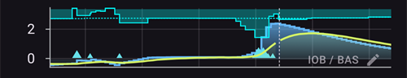

# AAPS'in temel özellikleri

## Döngü modu

Döngü durumu ana ekranda aşağıdaki simgelerden biriyle gösterilir.

**AAPS** birkaç döngü modu sunar: Kapalı Döngü (1), Düşük Glikoz Duraklatma (LGS - 2) ve Açık Döngü (3).

Döngü modunu nasıl seçeceğiniz ve resimdeki diğer simgeler (4 ile 6 arası) hakkında bilgi için [AAPS ekranları > Ana ekran > Döngü durumu](#AapsScreens-loop-status) bölümüne bakın.

(KeyAapsFeatures-OpenLoop)=

### Open Loop

**AAPS** mevcut tüm verileri (AİNS, AKRB, KŞ...) sürekli değerlendirir ve gerekirse tedavinizin nasıl ayarlanacağına dair öneriler (geçici bazal oranlar) sunar.

Öneriler (kapalı döngüde olduğu gibi) otomatik olarak uygulanmaz. Öneriler, kullanıcı tarafından elle pompaya girilmeli (sanal pompa kullanılıyorsa) veya **AAPS** gerçek bir pompaya bağlıysa bir düğme ile uygulanmalıdır.

**AAPS**'in bir önerisi olduğunda, ana ekranın alt gezinme çubuğunda rozetli bir **Döngü** girdisi görünür. Öneriyi ("Yeni geçici bazalı kabul et") oranı, süresi ve sebebiyle okumak için buna basın, sonra öneriyi uygulamak için **Uygula**'ya basın:

Bir öneri yalnızca birkaç dakika geçerlidir. Öneri yaklaşık 9 dakikadan eskiyse veya bu arada döngü askıya alındıysa ya da pompa bağlantısı kesildiyse, **AAPS** öneriyi reddeder ve pompaya hiçbir şey gönderilmez (*"Bu öneri çok eski. Pompaya hiçbir şey gönderilmedi. Bir sonrakini bekleyin."*). Bir sonraki öneriyi bekleyin.

Bu seçenek, **AAPS**'in nasıl çalıştığını tanımak için veya desteklenmeyen bir pompa kullanıyorsanız uygundur. Burada ne seçerseniz seçin, **[5. Görev](#objectives-objective5)** bitene kadar Açık Döngü'de kalırsınız.

(KeyAapsFeatures-LGS)=

### Düşük Glikoz Duraklatma (LGS)

Bu modda [maxIOB](#Open-APS-features-maximum-total-iob-openaps-cant-go-over) sıfıra ayarlanır.

Bu, kan şekeri düşüyorsa **AAPS**'in bazali sizin için azaltabileceği anlamına gelir. Ancak kan şekeri yükseliyorsa otomatik düzeltme yapılmaz. Bazal oranlarınız mevcut **Profil**'inizde tanımlandığı gibi kalır. Yalnızca AİNS negatifse (önceki bir Düşük Glikoz Duraklatma nedeniyle) **KŞ**'yi düşürmek için ek insülin verilir.

Bu mod **[6. Görev](#objectives-objective6)**'den itibaren kullanılabilir.

Bunu kendiniz seçmenin yanı sıra **AAPS** da bu moda kendi kendine geçebilir: **[6. Görev](#objectives-objective6)** üzerinde çalışırken ve yinelenen KŞ ölçümleri algıladığında (bkz. [KŞ uyarı işareti](#aaps-screens-bg-warning-sign)).

(KeyAapsFeatures-ClosedLoop)=

### Closed Loop

**AAPS** mevcut tüm verileri (AİNS, AKRB, KŞ...) sürekli değerlendirir ve ayarlanan [hedef aralığa veya değere](#profile-glucose-targets) ulaşmak için gerekirse tedaviyi otomatik olarak (*yani* sizin ayrıca müdahale etmenize gerek kalmadan) ayarlar (bolus iletimi, geçici bazal oran, hipoyu önlemek için insülini kapatma vb.).

Kapalı Döngü, ayrı ayrı ayarlanabilen çok sayıda güvenlik sınırı içinde çalışır.

Kapalı Döngü yalnızca **[7. Görev](#objectives-objective7)** veya sonrasındaysanız ve desteklenen bir pompa kullanıyorsanız mümkündür.

(autosens)= (Open-APS-features-autosens)=

## Autosens

- Otoduyarlılık, kan şekeri sapmalarına (pozitif/negatif/nötr) bakan bir algoritmadır.
- Bu sapmalara dayanarak sizin ne kadar hassas/dirençli olduğunuzu anlamaya çalışacaktır.
- **OpenAPS**'teki oref uygulaması, 24 ve 8 saatlik verilerin bir birleşimini kullanır. Hangisi daha duyarlıysa onu kullanır.
- Kullanıcılar oref1'den geldiyse, 24 veya 8 saatlik hassasiyetin değişmesi nedeniyle muhtemelen sistemin değişikliklere karşı daha az dinamik olabileceğini fark edeceklerdir.
- Kanül değişimi veya profil değişimi, Otoduyarlılık oranını tekrar %100'e sıfırlar (süreli bir yüzde profil değişimi Otoduyarlılık'ı sıfırlamaz).
- Otoduyarlılık, bazal ve İDF'nizi ayarlar (yani, bir Profil kaydırmanın yaptığını taklit eder).
- Uzun bir süre boyunca sürekli karbonhidrat yerseniz, karbonhidratlar **KŞ** delta hesaplamalarından çıkarıldığı için Otoduyarlılık o süre boyunca daha az etkili olur.
- Sapmalar bir **duyarlılık oranına** (yüzde) dönüştürülür: %100'ün altındaki bir oran, AAPS'in sizi insüline **Profil**'inizin varsaydığından daha duyarlı bulduğu anlamına gelir (bu yüzden etkin bazali düşürür ve İDF değerini yükseltir). %100'ün üstündeki bir oran ise daha dirençli olduğunuz anlamına gelir (bu yüzden bazali yükseltir ve İDF değerini düşürür).
- Varsayılan olarak bu oran 0,7 (%70, daha duyarlı) ile 1,2 (%120, daha dirençli) arasında tutulur. Böylece bir dizi olağandışı veri, dozlamanızı **Profil**'inizden çok fazla uzaklaştıramaz. Bu sınırlar, Duyarlılık algılamasının gelişmiş ayarlarından değiştirilebilir.
- Otoduyarlılık ve [OtoAyar](../AdvancedOptions/Autotune.md) aynı temel sorunu farklı zaman ölçeklerinde ele alır: Otoduyarlılık, son 8-24 saate göre *anlık* dozlamanızı dakika dakika hafifçe ayarlar; OtoAyar ise haftalarca süren geçmişe göre *Profil*'inizin kendisini yavaş yavaş yeniden yazar. İkisini birlikte çalıştırmak normaldir ve beklenen bir durumdur: birbirinin tekrarı değil, tamamlayıcısıdırlar.

*Otoduyarlılık algoritmasının tam teknik açıklaması için [OpenAPS Autosens dokümantasyonuna](https://openaps.readthedocs.io/en/latest/docs/Customize-Iterate/autosens.html) bakın.*

(Open-APS-features-super-micro-bolus-smb)=

## Super Micro Bolus (SMB)

**SMB**, **Super micro bolus** (Süper Mikro Bolus) ifadesinin kısaltmasıdır. 2018'den beri Oref1 algoritmasının içinde yer alan bir OpenAPS özelliğidir. **AMA**'dan farklı olarak **SMB**, glikoz seviyelerini kontrol etmek için geçici bazal oranları değil, çoğunlukla **küçük süper mikro bolusları** kullanır. **AMA**'nın geçici bazal oranla 1,0 Ü insülin ekleyeceği durumlarda **SMB**, **5 dakikalık aralıklarla** küçük adımlarla birkaç süper mikro bolus verir, ör. 0,4 Ü, 0,3 Ü, 0,2 Ü ve 0,1 Ü. Aynı zamanda (güvenlik nedeniyle) aşırı dozu önlemek için gerçek bazal oran belirli bir süre için 0 Ü/sa olarak ayarlanır (**'sıfır geçici bazal'**). Bu, sistemin kan şekerini **AMA**'daki geçici bazal oran artışından daha hızlı ayarlamasını sağlar.

SMB sayesinde, yalnızca "yavaş" karbonhidrat içeren öğünlerde sisteme planlanan karbonhidrat miktarını bildirmek ve gerisini **AAPS**'e bırakmak yeterli olabilir. Ancak ön bolus yapılamadığı için bu, yemek sonrası (postprandiyal) daha yüksek tepelere yol açabilir. Ya da gerekirse ön bolusla, karbonhidratları **yalnızca kısmen** karşılayan (ör. tahmini miktarın 2/3'ü) bir **başlangıç bolusu** verebilir ve insülinin geri kalanını **SMB**'ye bırakabilirsiniz.

SMB'ler [AİNS grafiğinde](#aaps-screens-iob) mavi üçgenlerle gösterilir. Ne kadar insülin verildiğini görmek için grafikte bir üçgenin üzerine [basılı tutun](#aaps-screens-graph-press-and-hold) ya da [Tedavi geçmişini](#aaps-screens-treatments) kullanın.

**SMB** özelliklerinde bazı güvenlik mekanizmaları vardır:

1. **En büyük tek SMB dozu**  
  En büyük tek SMB dozu, en fazla şu değerlerin en küçüğü kadar olabilir:
  
        * "SMB'yi sınırlamak için maksimum bazal dakika" ayarındaki süre boyunca mevcut bazal orana (otoduyarlılık ile ayarlanmış) karşılık gelen değer, ör. sonraki 30 dakikanın bazal miktarı veya
        * şu anda gereken insülin miktarının yarısı veya
        * ayarlardaki maxIOB değerinizin kalan kısmı.
      

2. **Düşük geçici bazal oranlar**  
  Düşük geçici bazal oranlar ('düşük geçici bazal' olarak adlandırılır) veya 0 Ü/sa geçici bazal oranlar ('sıfır geçici bazal' olarak adlandırılır) **SMB**'de daha sık etkinleşir. Bu, güvenlik nedeniyle bilerek böyle tasarlanmıştır ve **Profil** doğru ayarlanmışsa olumsuz bir etkisi yoktur. Ana grafikte AİNS eğrisi (ince sarı çizgi), geçici bazal oranların seyrinden daha anlamlıdır.

3. **Bildirilmemiş Öğünler**  
  Glikozun seyrini tahmin etmek için ek hesaplamalar, ör. **UAM** (bildirilmemiş öğünler) ile. Kullanıcı elle karbonhidrat girmese bile **UAM**, öğünler, adrenalin veya başka etkiler nedeniyle glikoz seviyelerindeki belirgin bir artışı otomatik olarak algılayabilir ve bunu **SMB** ile düzeltmeye çalışır. Güvenilir olması için bu aynı zamanda tam tersi şekilde çalışır ve glikozda beklenmedik bir şekilde hızlı bir düşüş meydana gelirse SMB'yi daha erken durdurabilir. Bu nedenle UAM, SMB'de her zaman aktif olmalıdır.

SMB, insülin gerektiğine kendi başına karar vermez: [AAPS tahminleri nasıl bir doz kararına dönüştürür](#aaps-screens-how-predictions-become-a-dosing-decision) bölümünde açıklanan aynı birleşik KŞ tahminlerini (nihai KŞ, sıfır geçici bazal, AKRB, UAM) kullanır. SMB ve sıfır geçici bazal, AAPS'in bu kararı uygulamak için kullandığı iki araçtır.

**SMB kullanmak için [9. görev](#objectives-objective9)'e başlamış olmanız gerekir.**

Tam teknik açıklama için [OpenAPS oref1/SMB dokümantasyonuna](https://openaps.readthedocs.io/en/latest/docs/Customize-Iterate/oref1.html#understanding-super-micro-bolus-smb), topluluk tarafından yazılmış bir anlatım için [Tim'in SMB hakkındaki yazısına](https://www.diabettech.com/artificial-pancreas/understanding-smb-and-oref1/) da bakın.

OpenAPS SMB ayarları aşağıda açıklanmıştır.

(Open-APS-features-max-u-h-a-temp-basal-can-be-set-to)=

### Maksimum bazal oran

Bu güvenlik ayarı, insülin pompasının iletebileceği maksimum geçici bazal oranını belirler. **max-basal** olarak da bilinir.

Değer saat başına ünite (Ü/sa) olarak ölçülür. It is advised to set this to something sensible. Bu parametreyi ayarlamak için iyi bir öneri:

**MAX-BASAL = EN YÜKSEK BAZAL ORAN x 4**

Örneğin, profilinizdeki en yüksek bazal oran 0,5 Ü/sa ise, bunu 4 ile çarparak 2 Ü/sa değerini elde edebilirsiniz.

**AAPS** bu değeri [Ayarlar > Güvenlik > Hasta yaşı](#preferences-patient-type) ayarına göre bir 'sert sınır' ile sınırlar. Sert sınırlar şunlardır:

- Çocuk: 2
- Genç: 5
- Yetişkin: 10
- İnsüline dirençli yetişkin: 12
- Hamile: 25

*Ayrıca bkz. [sabit kodlanmış sınırlara genel bakış](#Open-APS-features-overview-of-hard-coded-limits).*

(Open-APS-features-maximum-total-iob-openaps-cant-go-over)=

### SMB için maks AİNS

Bu değer, **AAPS**'in kapalı döngü modunda çalışırken altında kalacağı maksimum **Aktif İnsülin** (bazal ve bolus AİNS) değerini belirler. **maxIOB** olarak da bilinir.

If the current IOB (e.g. after a meal bolus) is above the defined value, the loop stops dosing insulin until the IOB limit is below the given value.

Bu parametreyi ayarlamak için iyi bir başlangıç:

      maxIOB = ortalama öğün bolusu + 3 x maksimum günlük bazal
    

**max-IOB** değerinizi ayarlarken dikkatli ve sabırlı olun. Bu değer herkes için farklıdır ve ortalama günlük toplam doza (GTD) da bağlı olabilir.

**AAPS** bu değeri [Ayarlar > Güvenlik > Hasta yaşı](#preferences-patient-type) ayarına göre bir 'sert sınır' ile sınırlar. Sert sınırlar şunlardır:

- Çocuk: 7
- Genç: 13
- Yetişkin: 22
- İnsüline dirençli yetişkin: 30
- Hamile: 70

*Ayrıca bkz. [sabit kodlanmış sınırlara genel bakış](#Open-APS-features-overview-of-hard-coded-limits).*

Not: **SMB** kullanılırken **max-IOB**, AMA'dakinden farklı hesaplanır. **AMA**'da maxIOB, bazal **AİNS** için bir güvenlik parametresidir. SMB modunda ise bolus AİNS değerini de içerir.

### Dinamik hassasiyet kullanın

Bu, [Dinamik İDF](../DailyLifeWithAaps/DynamicISF.md) özelliğidir. Etkinleştirildiğinde yeni ayarlar kullanılabilir hale gelir. Ayarlar [Dinamik İDF](#dyn-isf-preferences) sayfasında açıklanmıştır.

### Otoduyarlılık kullanın

Bu, [Otoduyarlılık](#Open-APS-features-autosens) özelliğidir. Dinamik İDF kullanılırken Otoduyarlılık kullanılamaz, çünkü ikisi aynı değişkeni (duyarlılık) değiştiren iki farklı algoritmadır.

Otoduyarlılık, kan şekeri sapmalarına (pozitif/negatif/nötr) bakar. Bu sapmalara göre ne kadar duyarlı/dirençli olduğunuzu bulmaya çalışır ve bazal oranı ve İDF'yi bu sapmalara göre ayarlar.

Etkinleştirildiğinde yeni ayarlar kullanılabilir hale gelir.

#### Sensitivity raises target

Bu seçenek etkinse, duyarlılık algılama (otoduyarlılık) duyarlılık algılandığında (%100'ün altında) hedefi yükseltebilir. Bu durumda hedefiniz, algılanan duyarlılık yüzdesi kadar yükseltilir.

Hedef, duyarlılık algılama nedeniyle değiştirilirse ana ekranınızda yeşil arka planla gösterilir.

Bu ayar, "Dinamik hassasiyet kullanın" veya "Otoduyarlılık kullanın" seçeneklerinden biri etkin olduğunda kullanılabilir.

#### Resistance lowers target

Bu seçenek etkinse, duyarlılık algılama (otoduyarlılık) direnç algılandığında (%100'ün üstünde) hedefi düşürebilir. Bu durumda hedefiniz, algılanan direnç yüzdesi kadar düşürülür.

Bu ayar, "Dinamik hassasiyet kullanın" veya "Otoduyarlılık kullanın" seçeneklerinden biri etkin olduğunda kullanılabilir.

### SMB etkinleştir

SMB işlevini kullanmak için bunu etkinleştirin. Devre dışıysa hiç **SMB** verilmez.

Etkinleştirildiğinde yeni ayarlar kullanılabilir hale gelir.

(Open-APS-features-enable-smb-with-high-temp-targets)=

#### Yüksek geçici hedefte SMB'yi etkinleştir

Bu ayar etkinse, kullanıcı yüksek bir **Geçici Hedef** (**Profil** hedefinden bağımsız olarak 100 mg/dL veya 5,6 mmol/L ve üzeri) seçmiş olsa bile **SMB**'ler yine de verilir. Bunu etkinleştirirken dikkatli olun: ayarlarınız iyi yapılmamışsa veya **Profil**'iniz sık değişiyorsa (örneğin çocuklarda) **SMB**'ler aşırı agresif olabilir.

Bu ayar devre dışıyken yüksek bir **Geçici Hedef**, **SMB**'leri kapatır. Örneğin bu seçenek devre dışıysa, 100 mg/dL veya 5,6 mmol/L ve üzeri bir **Geçici Hedef** ayarlayarak **SMB**'leri devre dışı bırakabilirsiniz. Bu seçenek, SMB'yi etkinleştirmeye çalışan diğer koşullardan bağımsız olarak da **SMB**'leri devre dışı bırakır. İstisna, **Yakında Yenecek** gibi düşük bir **Geçici Hedef**'tir (veya 98 mg/dL ya da 5,4 mmol/L ve altındaki herhangi bir **Geçici Hedef**): bu durumda **KŞ**'yi hedefe doğru çekmek için yine **SMB**'ler verilebilir.

Bu ayar **SMB**'yi tek başına açmaz. Yüksek bir geçici hedefle **SMB** yalnızca aşağıdaki diğer ayarlardan biri (örneğin **SMB'yi her zaman etkinleştir** veya **SMB'yi AKRB ile etkinleştir**) de izin veriyorsa verilir.

(Open-APS-features-enable-smb-always)=

#### Enable SMB always

Bu ayar etkinse SMB her zaman etkindir (AKRB, geçici hedefler veya boluslardan bağımsız olarak). Bu ayar etkinse, aşağıdaki diğer etkinleştirme ayarlarının hiçbir etkisi olmaz. Ancak **Yüksek geçici hedefte SMB'yi etkinleştir** devre dışıysa ve yüksek bir geçici hedef ayarlanmışsa, SMB'ler devre dışı kalır.

Bu ayar yalnızca **AAPS**, gelişmiş filtrelemeye sahip [güvenilir bir KŞ kaynağı](#GettingStarted-TrustedBGSource) kullandığınızı algılarsa kullanılabilir. FreeStyle Libre 1, sensör arızası durumunda eski KŞ verilerini sonsuza kadar tekrarlama riski nedeniyle güvenilir bir kaynak olarak kabul edilmez.

Gürültülü veriler **AAPS**'in KŞ'nin çok hızlı yükseldiğini düşünmesine ve gereksiz SMB'ler vermesine neden olabilir. Gürültü ve veri yumuşatma hakkında daha fazla bilgi için [buraya](../CompatibleCgms/SmoothingBloodGlucoseData.md) bakın.

#### Enable SMB with COB

Bu ayar etkinse, AKRB 0'dan büyük olduğunda SMB etkinleşir.

"SMB'yi her zaman etkinleştir" açıksa bu ayar görünmez.

#### Düşük geçici hedefle SMB'yi etkinleştir

Bu ayar etkinse, bir geçici hedef (yakında yenecek, aktivite, hipo, özel) ayarlandığında SMB etkinleşir. Bu ayar etkin ama **Yüksek geçici hedefte SMB'yi etkinleştir** devre dışıysa, düşük bir geçici hedef (98 mg/dL veya 5,4 mmol/L ve altı) ayarlandığında SMB etkinleşir, yüksek bir geçici hedef ayarlandığında ise devre dışı kalır.

"SMB'yi her zaman etkinleştir" açıksa bu ayar görünmez.

#### Karbonhidratlardan sonra SMB'yi etkinleştir

Etkinse, AKRB 0'a inmiş olsa bile karbonhidrat bildirildikten sonra 6 saat boyunca SMB etkin olur.

Güvenlik nedeniyle bu ayar yalnızca **AAPS**, güvenilir bir KŞ kaynağı kullandığınızı algılarsa kullanılabilir. "SMB'yi her zaman etkinleştir" açıksa görünmez.

Bu ayar yalnızca **AAPS**, gelişmiş filtrelemeye sahip [güvenilir bir KŞ kaynağı](#GettingStarted-TrustedBGSource) kullandığınızı algılarsa kullanılabilir. FreeStyle Libre 1, sensör arızası durumunda eski KŞ verilerini sonsuza kadar tekrarlama riski nedeniyle güvenilir bir kaynak olarak kabul edilmez.

Gürültülü veriler **AAPS**'in KŞ'nin çok hızlı yükseldiğini düşünmesine ve gereksiz SMB'ler vermesine neden olabilir. Gürültü ve veri yumuşatma hakkında daha fazla bilgi için [buraya](../CompatibleCgms/SmoothingBloodGlucoseData.md) bakın.  
"SMB'yi her zaman etkinleştir" açıksa bu ayar görünmez.

#### SMB Aralığı

Bu özellik SMB'lerin sıklığını sınırlar. Bu değer, SMB'ler arasındaki minimum süreyi belirler. Döngünün her yeni glikoz değeri geldiğinde (genellikle 5 dakikada bir) çalıştığını unutmayın. Döngünün işini bitirmesi için ek süre kalması amacıyla 2 dakika çıkarın. Ör. her döngü çalışmasında SMB verilmesini istiyorsanız bunu 3 dakikaya ayarlayın.

Varsayılan değer: 3 dk.

(Open-APS-features-max-minutes-of-basal-to-limit-smb-to)=

#### SMB'yi sınırlamak için maksimum bazal dakika

This is an important safety setting. Bu değer, AKRB ile karşılandığında, belirli bir süredeki bazal insülin miktarına göre ne kadar SMB verilebileceğini belirler.

Bu değeri büyütmek SMB'nin daha agresif olmasını sağlar. Varsayılan değer olan 30 dakika ile başlamalısınız. Biraz deneyim kazandıktan sonra değeri 15'er dakikalık adımlarla artırın ve etkisini birkaç öğün boyunca gözlemleyin.

Değerin 90 dakikadan yüksek ayarlanmaması önerilir. Aksi halde algoritma, düşen bir KŞ'yi 0 Ü/sa bazal ('sıfır geçici bazal') ile karşılayamayabilir. Özellikle yeni ayarları hâlâ deniyorsanız, sizi bir hipodan çok önce uyaracak alarmlar da ayarlamalısınız.

Varsayılan değer: 30 dk.

#### SMB'yi sınırlamak için UAM maksimum bazal dakika

Bu ayar, artık karbonhidrat kalmadığında UAM sırasında SMB'nin gücünü ayarlamanızı sağlar.

Varsayılan değer: **SMB'yi sınırlamak için maksimum bazal dakika** ile aynı.

Bu ayar yalnızca "SMB etkinleştir" ve "UAM (Bildirilmemiş Öğünler) etkinleştir" açıksa görünür.

(enable-uam)=

### UAM (Bildirilmemiş Öğünler) etkinleştir

Bu seçenek etkinse SMB algoritması bildirilmemiş öğünleri algılayabilir. Bu, karbonhidratlarınızı **AAPS**'e bildirmeyi unuttuğunuzda, karbonhidratlarınızı yanlış tahmin ettiğinizde ve girilen miktar yanlış olduğunda ya da çok yağlı ve proteinli bir öğün beklenenden uzun sürdüğünde yararlıdır. UAM, hiç karbonhidrat girişi olmadan da karbonhidrat, adrenalin vb. kaynaklı hızlı glikoz artışını algılayabilir ve bunu SMB'lerle düzeltmeye çalışır. Bu ters yönde de çalışır: glikoz hızlı düşüyorsa SMB'leri daha erken durdurabilir.

**Therefore, UAM should always be activated when using SMB.**

(key-aaps-features-minimal-carbs-required-for-suggestion)=

### Gerekli karbonhidrat eşiği

Karbonhidrat önerisi uyarısı göstermek için gereken minimum karbonhidrat gramı. Eating of additional carbs will be suggested when the reference design detects that it requires carbs. In this case you will receive a notification which can be snoozed for 5, 15 or 30 minutes.

İstenirse karbonhidrat ihtiyacı bildirimleri Nightscout'a gönderilebilir; bu durumda bir duyuru gösterilir ve yayınlanır.

Her durumda, gereken karbonhidrat ana ekranınızdaki AKRB bölümünde gösterilir.

### Advanced Settings

Tam parametre başvurusu için (burada ele alınmayan ayarlar dahil) [OpenAPS tercihler ve güvenlik ayarları dokümantasyonuna](https://openaps.readthedocs.io/en/latest/docs/While%20You%20Wait%20For%20Gear/preferences-and-safety-settings.html) bakın.

**Basit delta yerine her zaman kısa ortalama delta kullanın** Bu özelliği etkinleştirirseniz **AAPS**, son 15 dakikanın kısa ortalama delta/kan şekeri değerini kullanır. Bu genellikle son üç değerin ortalamasıdır. Bu, **AAPS**'in xDrip ve Libre gibi gürültülü veri kaynaklarında daha dengeli olmasına yardımcı olur.

**Max daily safety multiplier** This is an important safety limit. Varsayılan ayar 3'tür (büyük olasılıkla değiştirmeniz gerekmez). Bu, **AAPS**'in hiçbir zaman, kullanıcının pompasında ve/veya profilinde programlanmış en yüksek saatlik bazal oranın 3 katından fazla bir geçici bazal oran ayarlamasına izin verilmeyeceği anlamına gelir. Örnek: en yüksek bazal oranınız 1,0 Ü/sa ve maks günlük güvenlik çarpanı 3 ise, **AAPS** en fazla 3,0 Ü/sa (= 3 x 1,0 Ü/sa) geçici bazal oran ayarlayabilir.

Varsayılan değer: 3 (gerçekten gerekmedikçe ve ne yaptığınızı bilmedikçe değiştirilmemelidir)

**Mevcut bazal güvenlik çarpanı** Bu da önemli bir güvenlik limitidir. Varsayılan ayar 4'tür (bunu da büyük olasılıkla değiştirmeniz gerekmez). Bu, **AAPS**'in hiçbir zaman, kullanıcının pompasında ve/veya profilinde programlanmış mevcut saatlik bazal oranın 4 katından fazla bir geçici bazal oran ayarlamasına izin verilmeyeceği anlamına gelir.

Varsayılan değer: 4 (gerçekten gerekmedikçe ve ne yaptığınızı bilmedikçe değiştirilmemelidir)

* * *

(Open-APS-features-auto-isf)=

## OtoİDF

**OtoİDF**, ileri düzey kullanıcılar için **deneysel** bir algoritmadır. OpenAPS SMB üzerine kuruludur ve glikozunuzun davranışına göre insülin duyarlılık faktörünü (İDF) güçlendiren veya zayıflatan kurallar ekler.

Bir geliştirme özelliğidir: yalnızca **Mühendislik modu** (Engineering Mode) etkin olan bir [dev sürümünde](../AdvancedOptions/DevBranch.md) açılabilir. Normal bir sürümde zorla kapalı kalır ve bu nedenle **Konfigürasyon → APS (YPS)** içinde gösterilmez. [Görevleri](../SettingUpAaps/CompletingTheObjectives.md) tamamlamak bu özelliği açmaz.

Seçtikten sonra **Ayarlar** bölümünde OpenAPS SMB ayarlarına ek olarak bir **OtoİDF Ayarları** grubu bulunur:

- **OtoİDF'yi Etkinleştir**: İDF ayarlamalarını açar. Bu olmadan algoritma OpenAPS SMB gibi davranır.
- **OtoİDF min** ve **OtoİDF maks**: İDF'nin ne kadar zayıf ve ne kadar güçlü olabileceğini Otoduyarlılık sınırlarıyla aynı şekilde belirler. Varsayılan 1,0 değeriyle bu etki kapalıdır.
- **Ağırlıklar**: her biri bir kuralı yönetir ve varsayılan 0,0 değeri o kuralı kapatır. 
  - glikoz **hızlanırken** İDF güçlendirilir (daha fazla insülin);
  - glikoz **yavaşlarken** İDF zayıflatılır (daha az insülin);
  - glikoz **hedefin altındayken** İDF zayıflatılır;
  - glikoz **hedefin üstündeyken** İDF güçlendirilir;
  - bir **yemek sonrası** ağırlığı ve bir **süre** ağırlığı, yemeklerden sonra ve glikoz uzun süre yüksek kaldığında etki eder.
- **SMB iletim oranı** (bir minimum, bir maksimum ve bir KŞ aralığı ile): gereken insülinin ne kadarının SMB olarak verilebileceği.
- **SMB maks menzil genişletme**: olağan SMB boyut sınırının ([maksimum bazal dakika](#Open-APS-features-max-minutes-of-basal-to-limit-smb-to), varsayılan olarak 30 dakika) hangi katsayıyla aşılabileceği. Varsayılan 1 değeri hiçbir şeyi değiştirmez; en fazla 5 olabilir. Bu deneysel değeri yavaş yavaş ve dikkatle artırın.
- **AİNS yüzde eşiği**: maks AİNS değerinin yüzdesi; bu yüzdenin üstünde SMB'ler devre dışı kalır.

    {admonition} Yalnızca deneyimli kullanıcılar için
    :class: danger
    Varsayılan değerleriyle OtoİDF hiçbir şeyi değiştirmez. Yükselttiğiniz her değer **AAPS**'i daha agresif yapar. Bir seferde tek bir değeri, küçük adımlarla değiştirin ve sonucu birkaç gün izleyin. 2,5'in üzerindeki bir **OtoİDF maks** değeriyle son derece dikkatli olun.

(Open-APS-features-advanced-meal-assist-ama)=

## Gelişmiş Öğün Yardımı (AMA)

AMA, the short form of "advanced meal assist" is an OpenAPS feature from 2017 (oref0). OpenAPS Gelişmiş Öğün Yardımı (AMA), karbonhidratları güvenilir şekilde girerseniz, yemek bolusundan sonra sistemin daha hızlı yüksek geçici bazal başlatmasını sağlar.

Daha fazla bilgiyi [OpenAPS dokümantasyonunda](https://newer-docs.readthedocs.io/en/latest/docs/walkthrough/phase-4/advanced-features.html#advanced-meal-assist-or-ama) bulabilirsiniz.

### Maksimum bazal oran (OpenAPS "max-basal")

Bu güvenlik ayarı, **AAPS**'in tehlikeli derecede yüksek bir bazal oran vermesini önler ve geçici bazal oranı x Ü/sa ile sınırlar. It is advised to set this to something sensible. A good recommendation is to take the highest basal rate in your profile and multiply it by 4 and at least 3. Örneğin, profilinizdeki en yüksek bazal oran 1,0 Ü/sa ise, bunu 4 ile çarparak 4 Ü/sa değerini elde edebilir ve güvenlik parametreniz olarak 4'ü ayarlayabilirsiniz.

Herhangi bir değeri seçemezsiniz: Güvenlik nedeniyle hastanın yaşına bağlı bir 'sert sınır' vardır. maxIOB için 'sert sınır' AMA'da SMB'ye göre daha düşüktür. For children, the value is the lowest while for insulin resistant adults, it is the biggest.

**AAPS**'teki sabit kodlanmış parametreler şunlardır:

- Çocuk: 2
- Genç: 5
- Yetişkin: 10
- İnsüline dirençli yetişkin: 12
- Hamile: 25

*Ayrıca bkz. [sabit kodlanmış sınırlara genel bakış](#Open-APS-features-overview-of-hard-coded-limits).*

### AMA için maks AİNS

Bu parametre, **AAPS**'in hâlâ çalıştığı maksimum bazal AİNS değerini sınırlar. AİNS daha yüksekse, bazal AİNS sınırın altına düşene kadar ek bazal insülin vermeyi durdurur.

Varsayılan değer 2'dir, ancak sizi ne kadar etkilediğini ve hangi değerin size en uygun olduğunu görmek için bu parametreyi yavaş yavaş artırmalısınız. Bu değer herkes için farklıdır ve ortalama günlük toplam doza (GTD) da bağlıdır. Güvenlik nedeniyle, hastanın yaşına bağlı olarak bir sınır vardır. maxIOB için 'sert sınır' AMA'da SMB'ye göre daha düşüktür.

- Çocuk: 3
- Genç: 5
- Yetişkin: 7
- İnsüline dirençli yetişkin: 12
- Hamile: 25

*Ayrıca bkz. [sabit kodlanmış sınırlara genel bakış](#Open-APS-features-overview-of-hard-coded-limits).*

### Otoduyarlılık kullanın (AMA)

Burada [duyarlılık algılama](../DailyLifeWithAaps/SensitivityDetectionAndCob.md) (otoduyarlılık) özelliğini kullanmak isteyip istemediğinizi seçebilirsiniz.

### Otoduyarlılık hedefleri ayarlar

If you have this option enabled, autosens can adjust targets (next to basal and ISF), too. Bu, **AAPS**'in daha 'agresif' çalışıp çalışmayacağını belirler. The actual target might be reached faster with this.

### Advanced Settings

- Normalde bu iletişim kutusundaki ayarları değiştirmeniz gerekmez!
- Yine de değiştirmek istiyorsanız, ne yaptığınızı anladığınızdan emin olun: [OpenAPS tercihler ve güvenlik ayarları dokümantasyonundaki](https://openaps.readthedocs.io/en/latest/docs/While%20You%20Wait%20For%20Gear/preferences-and-safety-settings.html) tam parametre başvurusuna bakın.

**Basit delta yerine her zaman kısa ortalama delta kullanın** Bu özelliği etkinleştirirseniz **AAPS**, son 15 dakikanın kısa ortalama delta/kan şekeri değerini kullanır. Bu genellikle son üç değerin ortalamasıdır. Bu, **AAPS**'in xDrip ve Libre gibi gürültülü veri kaynaklarında daha dengeli çalışmasına yardımcı olur.

**Max daily safety multiplier** This is an important safety limit. Varsayılan ayar 3'tür (büyük olasılıkla değiştirmeniz gerekmez). Bu, **AAPS**'in hiçbir zaman, kullanıcının pompasında programlanmış en yüksek saatlik bazal oranın 3 katından fazla bir geçici bazal oran ayarlamasına izin verilmeyeceği anlamına gelir. Örnek: en yüksek bazal oranınız 1,0 Ü/sa ve maks günlük güvenlik çarpanı 3 ise, **AAPS** en fazla 3,0 Ü/sa (= 3 x 1,0 Ü/sa) geçici bazal oran ayarlayabilir.

Varsayılan değer: 3 (gerçekten gerekmedikçe ve ne yaptığınızı bilmedikçe değiştirilmemelidir)

**Mevcut bazal güvenlik çarpanı** Bu da önemli bir güvenlik limitidir. Varsayılan ayar 4'tür (bunu da büyük olasılıkla değiştirmeniz gerekmez). Bu, **AAPS**'in hiçbir zaman, kullanıcının pompasında programlanmış mevcut saatlik bazal oranın 4 katından fazla bir geçici bazal oran ayarlamasına izin verilmeyeceği anlamına gelir.

Varsayılan değer: 4 (gerçekten gerekmedikçe ve ne yaptığınızı bilmedikçe değiştirilmemelidir)

**Bolus erteleme İES böleni** “Bolus erteleme” özelliği bir yemek bolusundan sonra çalışır. **AAPS**, yemekten sonra İES'nin “bolus erteleme” parametresine bölünmesiyle bulunan süre boyunca düşük geçici bazal oran ayarlamaz. The default value is 2. Bu, 5 saatlik bir İES ile “bolus erteleme”nin 5 sa : 2 = 2,5 sa süreceği anlamına gelir.

Default value: 2

* * *

(Open-APS-features-overview-of-hard-coded-limits)=

## Sabit kodlanmış sınırlara genel bakış

|            | Çocuk | Genç | Yetişkin | İnsüline dirençli yetişkin | Hamile |
| ---------- | ----- | ---- | -------- | -------------------------- | ------ |
| MAXBOLUS   | 5     | 10   | 17       | 25                         | 60     |
| MINDIA     | 5     | 5    | 5        | 5                          | 5      |
| MAXDIA     | 9     | 9    | 9        | 9                          | 10     |
| MINIC      | 2     | 2    | 2        | 2                          | 0,3    |
| MAXIC      | 100   | 100  | 100      | 100                        | 100    |
| MAXIOB_AMA | 3     | 5    | 7        | 12                         | 25     |
| MAXIOB_SMB | 7     | 13   | 22       | 30                         | 70     |
| MAXBASAL   | 2     | 5    | 10       | 12                         | 25     |