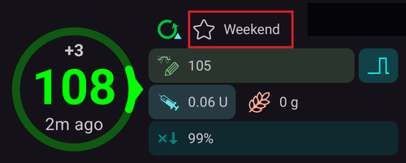

# Profil değişimi ve profil yüzdesi

Bu bölüm **Profil değişimi** ve **Profil yüzdesi**nin ne olduğunu açıklar. Bir **Profil**'in nasıl oluşturulacağını [AAPS profiliniz](#your-aaps-profile-create-and-edit-profiles) sayfasında öğrenebilirsiniz.

**AAPS** yolculuğunuza başlarken bir **Profil** oluşturmanız, **Profil değişimi**'nin nasıl yapıldığını anlamanız ve **AAPS**'teki **Profil yüzdesi**nin etkisini öğrenmeniz gerekir. **Profil değişimi** veya **Profil yüzdesi** özellikleri özellikle şu durumlarda faydalı olabilir:

- Adet döngüsü - **AAPS**'in hormon döngüsünün farklı evrelerine ve beklenen insülin direncine uyum sağlaması için **Otomasyonlar** içinde bir **Profil** yüzde ayarı kurulabilir.

- Egzersiz - bazal insülini azaltmak için **Otomasyonlar** içinde egzersize yönelik bir **Profil** yüzde ayarı kurulabilir.

- Gece veya vardiyalı çalışanlar - vardiyalı çalışanlar için **Profil**'de bir zaman kaydırma kurulabilir. Bunun için **Profil**'deki saat sayısı, kullanıcının ne kadar geç/erken yatacağına veya kalkacağına göre değiştirilir.

Neden geçici bazal ayarı yerine **Profil yüzdesi** kullanılmalı? Daha etkili olması için **Profil yüzdesi** bazal, İDF ve IC değerlerini aynı oranda azaltır veya artırır. Böylece **AAPS**, kullanıcının insülinini verirken dengeli bir hesaplama yapar. Algoritma İDF ve IC için aynı oranları kullanmaya devam ederse, kullanıcının **AAPS**'teki **Profil**'inde yalnızca bazali azaltmanın faydası azdır.

(ProfileSwitch-change-percentage)=

## Profil yüzdesini ana ekrandan değiştirme

En az bir kayıtlı **Profil**'e ihtiyacınız var. **Profil yüzdesi** her zaman bir **Profil değişimi** ile uygulanır: bir **Profil**'i yeniden etkinleştirirsiniz, bu kez bir yüzdeyle.

```{admonition} AAPS 3'ten mi geçiyorsunuz? :class: note Profil adına uzun basmak artık profil değişimi iletişim kutusunu açmıyor. Profil adına **dokunun**, ardından sağ alttaki yuvarlak **▶** düğmesine dokunun: aynı ayarlar açılır (yüzde, süre, Aktivite geçici hedefi).

    <br />1. Ana ekranda **profil adına dokunun** (yıldız simgesinin yanında). [Profil ekranı](#ProfileSwitch-manage-v4), çalışan **Profil**'in **AKTİF** olarak işaretli kartında açılır.
    
       
    
    2. Aynı **Profil**'i korumak için **AKTİF** kartı seçili bırakın. Aynı anda **Profil**'i de değiştirmek için başka bir karta kaydırın.
    3. Sağ alttaki yuvarlak **▶** düğmesine (**Etkinleştir**) dokunun. **Etkinleştir** ekranı açılır.
    4. **Yüzde** değerini **−** / **+** ile (%5'lik adımlarla) ayarlayın veya yazarak girin (%30 ile %250 arası). Alan her zaman **%100** ile başlar: şu anda çalışan yüzdeyi göstermez. Örneğin %20 daha az insülin için **80**, %20 daha fazla insülin için **120** girin.
    5. **Süre** değerini dakika olarak ayarlayın:
       * **0**, siz başka bir **Profil değişimi** yapana kadar yeni yüzdeyi korur;
       * başka herhangi bir değer, değişimi bu sürenin sonunda bitirir ve **AAPS** önceden çalışan **Profil**'e geri döner.
    
       
    
    6. Ekranın altındaki **▶ Etkinleştir** düğmesine dokunun. **Profil değişimi** iletişim kutusundaki özeti kontrol edin ve **Tamam**'a dokunun.
    
       
    
    Ana ekrana döndüğünüzde profil adı yüzdeyi ve kalan süreyi gösterir, örneğin *Normal (80%) (59')*. Süreli bir değişim çalışırken ad sarı renkte görünür. Glikoz grafiğinde değişim bir yıldızla işaretlenir. Bkz. [ana ekran](#aaps-screens-profile--target).
    
    
    
    Süre bitmeden **%100'e geri dönmek** için adımları tekrarlayın ve **Yüzde** değerini 100, **Süre** değerini 0 olarak bırakın.
    
    ```{admonition} Tek dokunuşla yüzdeler
    :class: tip
    Aynı yüzdeyi sık kullanıyorsanız (spor, hastalık), Hızlı Başlatma çubuğuna bir [Profil kısayolu](#profile-shortcuts) ekleyin veya bir [senaryo](Scenes.md) oluşturun. İkisi de tek dokunuşla, önceden ayarlanmış bir yüzde ve süreyle bir profil uygular.
    

(ProfileSwitch-manage-v4)=

## Profilleri yönetme ve etkinleştirme (Yönet → Profil)

**AAPS** v4'te profiller **Yönet** ekranından (alt gezinme çubuğu) → **Profil** (*“Profilleri yönetin ve etkinleştirin”*) ile yönetilir ve etkinleştirilir.

Profil ekranı profillerinizi **kaydırılabilir bir kart karuseli** olarak gösterir. Çalışan profilin kartı **AKTİF** olarak işaretlenir ve toplam günlük bazalını gösterir (ör. *∑ 30,15 Ü*). Seçili kartın altında o profilin ayrıntılarını görürsünüz — **İnsülin** türü ve grafikleriyle birlikte **IC**, **İDF**, **bazal** ve **hedef** programları.

Geçici bir değişim çalışırken **AKTİF** kart, bir ilerleme çubuğunun üstünde yüzdeyi ve zaman kaydırmayı kalan süreyle birlikte gösterir, örneğin *110% +2 h · 2 h 40 min*. İkisi de 30 saniyede bir yenilenir. Aşağıdaki ayrıntılar bu durumda iki sütunda gösterilir: profilin değerleri mavi, yüzdeyle birlikte kullanılan değerler kırmızı renktedir.


Alttaki düğmeler **seçili** profil üzerinde çalışır: **➕ Ekle**, **✏️ Düzenle**, **⧉ Klon** ve **‘️ Sil**, sağda ise yuvarlak **▶ Etkinleştir** düğmesi. Düzenleyicide dört programın (IC / İDF / BAZAL / HDF) nasıl doldurulacağı için [Profil oluşturma ve düzenleme](#your-aaps-profile-create-and-edit-profiles) bölümüne bakın.

**⧉ Klon**, genellikle *kopyalama* için kullanılan iki kare simgesini kullanır, ancak yapıştırılacak bir şey yoktur: kopyayı tek adımda oluşturur. *"Normal" profili kopyalansın mı?* sorusunu onaylayın. *Normal kopya* adlı yeni bir profil karuselin sonuna eklenir ve seçilir; **✏️ Düzenle** ile düzenlemeye hazırdır (burada adını da değiştirebilirsiniz). Bu, Tedavi geçmişinden geçmiş bir **Profil değişimi**'ni kopyalamakla aynı şey değildir. O işlem *yüzde ve zaman kaydırma uygulanmış* yeni bir profil oluşturur. Bkz. [Bir profil değişimini daha sonra kullanmak üzere saklama](#ProfileSwitch-keep-for-later).

(ProfileSwitch-read-only-mode)= **Yalnızca ▶ Etkinleştir düğmesi mi var?** Ayarlarınız korunuyor, bu yüzden ekran salt okunur açılır. Üst çubuktaki **✏️ kaleme** dokunun ve ayarlar parolanızı girin. Bkz. [Ayar koruması artık yönetim ekranlarını da kilitler](#v4changes-read-only-management).

### Profilleri yeniden sıralama

Birden fazla profiliniz varsa karuseldeki sıralarını seçebilirsiniz: üst çubuktaki **Yeniden sırala** simgesine (⇅, yukarı ve aşağı bakan iki ok) dokunun. Sayfa göstergesinin yerine *konum / toplam* bilgisiyle birlikte **◀ / ▶ taşıma düğmeleri** gelir — ortadaki kartı öne veya arkaya taşıyın, ardından **✓** ile onaylayın (veya **✕** ile vazgeçin). Yeni sıra, onayladığınızda bir kez kaydedilir.


### Bir profili etkinleştirme

Bir profil seçin ve **▶ Etkinleştir** düğmesine dokunun. **Etkinleştir** ekranında **Profil değişimi**'nin nasıl uygulanacağını ayarlayabilirsiniz:


- **Yüzde** (%30–250, her seferinde %100 ile başlar) — tüm profili ölçekler. %100 profili olduğu gibi kullanır; örneğin %70, bazali ve hesaplanan insülin dozunu (hem yemek bolusları hem düzeltmeler) %30 azaltır. Glikoz hedeflerinizi veya karbonhidrat emilimini değiştirmez. Tüm etkisi için [Profil yüzdesi](#ProfileSwitch-profile-percentage) bölümüne bakın.
- **Süre** (0–10080 dakika, yani en fazla 7 gün) — değişimin ne kadar süreceği. **0 = süresiz** (yeniden değiştirene kadar); sıfır dışındaki bir değer, süre bitince önceki profile geri döner.
- **Geçici hedef / Aktivite** — yalnızca bir **Süre** ve %100'ün altında bir **Yüzde** ayarladığınızda görünür. Egzersizden önce yapacağınız gibi, aynı süre için bir [Aktivite geçici hedefi](#TempTargets-activity-temp-target) de başlatmak için bunu açın.
- **Zaman kaydırma** — *0h* gösterir; programı en fazla 23 saat ileri veya geri almak için **Değiştir**'e dokunun (vardiyalı çalışma veya seyahat için faydalıdır). Bkz. [Zaman kaydırma](#ProfileSwitch-ProfilePercentage-time-shift-of-the-circadian-percentage-profile).
- **Yeniden kullan** — çalışan değişimin yüzdesi %100'den farklıysa veya bir zaman kaydırması varsa görünür, örneğin **80% 0sa yeniden kullan**. Aynı yüzde ve zaman kaydırmayı doldurmak için buna dokunun, örneğin bitmek üzere olan bir değişimi uzatmak için.
    
    

- **Zaman** — varsayılan olarak *Şimdi*. Şimdiden en fazla 24 saat önce veya sonra başka bir zaman seçebilirsiniz. Gelecekteki bir zamana ayarlanan değişim o zaman başlar; onunla birlikte ayarlanan bir Aktivite geçici hedefi de o zaman başlar.
    
    

- **Notlar** — yalnızca [Diyaloglarda notları göster](#Preferences-show-notes-field-in-treatments-dialogs) açıksa gösterilir.

Seçilen yüzdedeki bazal oranlar pompanızla uyumlu değilse, üstte bir uyarı görünür ve **▶ Etkinleştir** devre dışı kalır: başka bir yüzde seçin.

**▶ Etkinleştir**'e, ardından onay iletişim kutusunda **Tamam**'a dokunun. Çalışan profilin kartında artık **AKTİF** rozeti görünür.

```{admonition} Pompanız bazal oranları yuvarlayabilir :class: note Her pompa bazal oranları yalnızca kendi adımlarıyla (örneğin 0,05 Ü/sa) verebilir, bu yüzden **Profil**'inizdeki oranları yuvarlar. Ardından **AAPS** pompanın gerçekten verdiği bazali kullanır, böylece AİNS ve GTD doğru kalır. Pompa günlük olarak **Profil**'inizden biraz daha fazla veya daha az insülin veriyorsa, *"Pompadaki bazal profili güncellendi"* bildirimi farkı söyler, örneğin *"günlük 10,12 Ü yerine 10,00 Ü değerini uygular"*.

Pompa **Profil**'inizden çok farklı bir bazal bildirirse, **AAPS** **Profil** bazalini korur ve pompadaki bazal oranları kontrol etmenizi ister.

    <br />```{admonition} Yüzde ve zaman kaydırma ile tek profil birçok durumu karşılar
    :class: note
    Birbirine benzeyen birçok profil oluşturmak yerine bir temel profil tutun ve tekrarlayan durumlar (hastalık, egzersiz, seyahat) için onu farklı bir **yüzde** veya **zaman kaydırma** ile uygulayın. [Senaryolar](Scenes.md) tam olarak bunu otomatikleştirir.
    

Profil değişimi yalnızca bu ekranla sınırlı değildir. Aynı değişim bir **Wear OS saatinden**, eşleştirilmiş bir **istemciden** (bkz. [Ana birim ↔ İstemci kontrolü](../RemoteFeatures/ClientMasterControl.md)), bir **[senaryodan](Scenes.md)** veya bir **Otomasyon** kuralından da başlatılabilir.

(ProfileSwitch-profile-percentage)=

## Profile Percentage

Kullanıcının bir **Profil yüzdesi**nin temel özelliklerini anlaması önemlidir. Bir **Profil değişimi**'ne yüzde artış veya azalış uygulandığında, kullanıcının **Profil**'de ayarlı parametreleri aynı yüzdeyle yükseltilir veya düşürülür.

Örneğin: %130'luk bir **Profil değişimi** (kullanıcının insüline %30 daha dirençli olduğu anlamına gelir) **AAPS**'e şunları yaptırır:

- bazal oranı %30 **artırır**; 
- **İDF**'yi 1,3'e bölerek **düşürür**;
- **IC**'yi 1,3'e bölerek **düşürür**.

Unutmayın: **İDF** veya **IC** değerini düşürmek, daha güçlü bir oran ve daha fazla insülin verilmesi anlamına gelir. Bu durum, **AAPS**'e yeni başlayan kullanıcılar tarafından kolayca gözden kaçırılabilir.

Seçimden sonra **AAPS** varsayılan bazal oranı yeniden ayarlar ve **AAPS** (açık veya kapalı döngü) seçilen yüzdeli **Profil** üzerinden çalışmaya devam eder.

Bir **Profil** yüzdesinin etkisi aşağıdaki tabloda özetlenmiştir:

| Profil değişimi  
Yüzdesi |     Etki     |     IC  
g/Ü      | Örnek  
15 g |          İDF  
mmol/L/Ü  
mg/dL/Ü          | Düşürmek için gereken Ü  
2mmol/L  
40mg/dL |
|:-------------------------:|:------------:|:-----------------:|:------------:|:------------------------------------------:|:-------------------------------------------:|
|            %90            |  Daha zayıf  | 5/0,9  
=**5,55** |    2,7 Ü     | 2,2/0,9  
=**2,4**  
  
40/0,9  
=**44,4** |                    0,8 Ü                    |
|         **%100**          | **Standart** |       **5**       |   **3 Ü**    |                **2,2  
40**                |                  **0,9** Ü                  |
|           %130            |  Daha güçlü  | 5/1,3  
=**3,85** |    3,9 Ü     | 2,2/1,3  
=**1,7**  
  
40/1,3  
=**30,8** |                    1,2 Ü                    |

(ProfileSwitch-ProfilePercentage-time-shift-of-the-circadian-percentage-profile)=

## Sirkadiyen Yüzde Profilinin zaman kaydırması

Kullanıcının **Profil**'indeki ‘zaman kaydırma’ özelliği, **Profil**'in ayarlarını günlük saat (‘sirkadiyen’) üzerinde girilen saat sayısı kadar kaydırır. Bu şu durumlarda faydalı olabilir:

- **gece veya vardiyalı çalışanlar**: gece vardiyasında çalışırken **Profil**'deki saat sayısı, kullanıcının ne kadar geç/erken yatacağına veya kalkacağına göre değiştirilir; 
- **seyahatte saat dilimi değiştiren kullanıcılar**; veya
- **tip 1 diyabetli çocuklar**: belirli bir yatma rutini olan ve insülin direnci **Profil**'lerinde hesaba katılmış çocuklar. Herhangi bir nedenle çocuğun daha geç yatması bekleniyorsa, bakım veren kişi çocuğun **Profil**'ine bir ‘zaman kaydırma’ uygulayabilir. Böylece **AAPS**, insülin direncine kullanıcının belirlediği zaman diliminde tepki verir.

Her zaman şu sorudur: hangi saatin **Profil** ayarları, şimdiki saatin ayarlarının yerine geçmeli? Bu saat x saat kaydırılmalıdır. Bu nedenle lütfen aşağıdaki örnekte anlatılan yönlere dikkat edin:

- Mevcut zaman: 12:00
- **Pozitif** zaman kaydırma 
    - 2:00 **+10 sa** -> 12:00
    - Pozitif zaman kayması nedeniyle normalde 12:00'de kullanılan ayarlar yerine 2:00'den itibaren olan ayarlar kullanılacaktır.
- **Negatif** zaman kaydırma 
    - 22:00 **-10 sa** -> 12:00
    - Negatif zaman kayması nedeniyle normalde 12:00'de kullanılan ayarlar yerine 22:00 (akşam 10) ayarları kullanılacaktır.


**Profil**'in anlık görüntülerini alan bu mekanizma, geçmişin çok daha kesin hesaplanmasını ve **Profil** değişikliklerinin izlenebilmesini sağlar.

(ProfileSwitch-keep-for-later)=

## Bir profil değişimini daha sonra kullanmak üzere saklama

Yüzde ve/veya zaman kaydırma ile bir profil değişimi yaptıktan sonra, bu geçici profilin bir kopyasını yeni bir profil olarak kaydedebilirsiniz.

Bunun için menüyü (☰) açın → **Tedaviler** ve **Profil değişimi** sekmesine gidin, bkz. [Bir Profil değişimini yeni bir Profile klonlama](#your-aaps-profile-clone-profile-switch).