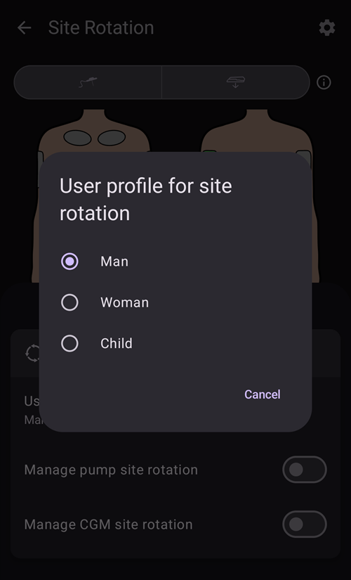

# Pompalar ve kanüller

## İnfüzyon setlerini değiştirme: insülin rezervuarları ve kanüller

Aşağıda anlatılan işlem yalnızca hortumlu pompalar içindir; Omnipod, Medtrum Nano, Accu-Chek Solo gibi patch pompalar için geçerli değildir. Bu işlem bazen "set değişimi" olarak adlandırılır: "tam" set değişimi insülin rezervuarını ve kanülü kapsar, "kısmi" set değişimi ise yalnızca kanülün değiştirilmesidir.

Patch pompalar kendi etkinleştirme sihirbazlarında kendilerini doldurur ve hazırlar; kanülleri zaten vücuttadır. **AAPS** bu pompalar için doldurma sunmaz: **Hazırla/doldur**, **Yönet** panelinde veya Hızlı Başlatma'da gösterilmez. [Uyumlu pompalar](../Getting-Started/CompatiblePumps.md) içinde pompanızın sayfasına bakın.

Kartuş/rezervuarın fiziksel olarak değiştirilmesi **AAPS** üzerinden yapılamaz, doğrudan pompada yapılmalıdır. Bu değişiklikler tamamlandıktan sonra **AAPS**'e elle kaydedilmelidir.

(pumps-cannulas-changing-reservoir-and-cannula)=
### Pompa rezervuarını ve kanülü birlikte değiştirme kılavuzu

1. **AAPS**'te pompanın bağlantısını kesin: ana ekranda [döngü simgesine](#AapsScreens-loop-status) basın ve 1 saat için **Pompa bağlantısını kes**'i seçin. Simge gri bir fiş simgesine dönüşür. Bu, pompa bağlantısının kesildiğini gösterir.

2. İnsülin rezervuarını fiziksel olarak değiştirin: pompanızın vücudunuzla bağlantısını fiziksel olarak ayırın ve rezervuarı/kartuşu ve kanülü üreticinin talimatlarına göre değiştirin.

3. Hortumu ve kanülü hazırlayın/doldurun: bu işlem doğrudan pompada yapılabilir. Hortumdaki tüm hava kabarcıklarını çıkardığınızdan emin olun.

4. Yeni kanülü vücudunuza takın. Kanül yerleştirilip iğne çıkarıldıktan sonra, takılan kanülde küçük bir hava boşluğu kalır; bunun da doldurulması gerekir. Bunu **AAPS**'e bildirmek ve bölgeyi doldurmak için: **Hazırla/doldur**'u açın (ana ekrandaki genişletilmiş durum panelinde, **Yönet** panelinde veya bir [Hızlı Başlatma](QuickLaunch.md) düğmesi olarak) ve değişikliği kaydetmek için duruma göre **İnfüzyon seti değişimini kaydet** ve/veya **Rezervuar değişimini kaydet** seçeneğini işaretleyin. Şimdi varsayılan insülin kanülü doldurma miktarına basın (genellikle yaklaşık 0,3 Ü'dir, ancak bu değerin kanülünüz için doğru olduğunu kontrol edin) ve **Tamam**'ı seçin. Özet mesajını okuyun ve **Tamam**'a dokunarak doldurmanın yapılmasını onaylayın.

   


5. **AAPS**'te pompayı tekrar bağlayın: döngüye devam etmek için gri fiş simgesine basın ve **Pompayı tekrar bağla**'yı seçin.

### İnsülin/kanül değişimiyle ilgili yararlı bilgiler

* Bir pompa kanül değişimini kaydetmek Otoduyarlılık'ı %100'e sıfırlar. Ayrıca **AAPS** ana ekranındaki ilgili kanül/insülin durum ışıklarını ve yaşlarını da sıfırlar.

* Varsayılan doldurma miktarlarını **Hazırla/doldur** ayarlarında belirleyebilir/değiştirebilirsiniz — bu ayarları açmak için ana ekrandaki arama çubuğuna "prime" yazın (bkz. [Tercihler](../SettingUpAaps/Preferences.md)). Kanülünüz için kaç ünite doldurulması gerektiğini (iğne uzunluğuna ve hortum uzunluğuna bağlı olarak) kanül kutusundaki kullanım kılavuzunda bulabilirsiniz.

* Doldurma işleviyle verilen insülin, **AAPS** aktif insülini (AİNS) hesaplarken dikkate alınmaz ve [Tedavi geçmişi](#aaps-screens-treatments)nde "Doldur" olarak işaretlenir.

* Pompa bağlantısı kesikken pompadan verilen bolus insülini de **AAPS** tarafından dikkate alınmaz. **AAPS** bağlantısı kesikken doğrudan pompadan bolus yaparsanız, pompayı tekrar bağladıktan sonra bu insülini **İnsülin** iletişim kutusunda (bolus yapmadan) bildirebilirsiniz (aşağıdaki [Gerçekten bolus yapmadan verilen insülini bildirmek](#pumps-cannulas-announce-insulin) bölümüne bakın).

### Kanül, infüzyon bölgesi, hortum ve/veya pompa sorunları

**AAPS** insülin aldığınızı kaydetmiş olsa da bir süre hiç insülin almadığınızdan eminseniz ve sorunun tam olarak ne zaman başladığını biliyorsanız (_ör._ kanülü çıkarıyorsunuz ve kanülün yerleştirme sırasında büküldüğünü görüyorsunuz), bunu **AAPS**'te düzeltebilirsiniz. Ancak insülinin aslında verilmiş olabileceğini, sadece bir nedenle yavaş etki ediyor olabileceğini de unutmayın.

```{admonition} Caution - Risk of Hypoglycemia
:class: danger
İnsülin iletimini **AAPS**'ten yalnızca ÇOK büyük bir dikkatle silin, çünkü insülin _gerçekten_ verilmiş olabilir; sonraki 24 saat boyunca KŞ'nizi yakından izleyin.
```

Verilmediğini bildiğiniz bolusları ve SMB'leri silmek için **menüyü** (☰) açın, [Tedavi geçmişi](#aaps-screens-treatments)'ni seçin ve **Karbonhidrat ve bolus** sekmesinde, olayın olduğu andan başlayarak kaydedilmiş bolusları dikkatli bir şekilde silin. Bu, **AAPS**'in hesaplamaları için çok önemli olan "aktif insülin" (AİNS) değerini düzeltir; şimdi ana ekrana dönerseniz AİNS değerinin azaldığını görürsünüz. **AAPS**'in verildiğini hesapladığı bazal insülini silemeyeceğinizi unutmayın. Bu nedenle bu insülin **AAPS** tarafından hesaba katılmaya devam eder.

Sızıntı, tıkanıklık veya tünelleşme gibi insülin iletim sorunlarının daha az belirgin olduğu durumlarda _ör._ sorunun ne zaman başladığından emin değilseniz veya insülinin bir kısmının verildiğini düşünüyorsanız dikkatli olmanız gerekir. Bu sorunları insülin "kokusu" alarak, ıslak bir yapışkan görerek, yüksek glikoz değerleriyle karşılaşarak veya bir alarm alarak fark edebilirsiniz. Cildinize ne kadar insülin girdiğini (bir süre sonra etki etmeye başlayabilir) hiçbir zaman bilemeyeceğiniz için, mevcut "aktif insülin" (AİNS) değerinden düşülmesi gereken doğru insülin miktarını belirlemek zor olacaktır. Bir yöntem, insülin iletim sorununu çözdükten sonra döngüyü 5 saat (veya kendi insülin etki sürenizce) duraklatmak ve ardından döngüye devam etmektir. Bu, döngüyü yeniden başlattığınızda AİNS'in doğru olmasını sağlar.

(pumps-cannulas-disconnecting)=
## Duş veya aktivite için pompanın bağlantısını kesme

Duş, banyo, yüzme, temaslı sporlar veya başka etkinlikler için pompanızı çıkarırsanız, AİNS değerinin doğru kalması için **AAPS**'e insülin verilmediğini bildirmeniz gerekir. Pompanın bağlantısı ana ekrandaki [döngü simgesi](#AapsScreens-loop-status) ile kesilebilir: simgeye basın ve ihtiyacınız olan süreyle **Pompa bağlantısını kes**'i seçin. Etkinlik planlanandan uzun sürerse, aynı iletişim kutusunu yeniden açın ve **Pompa bağlantısını kes** altında yeni bir süre seçin: bağlantı kesintisi uzatılır ve yeni süre şimdiden başlar. Önce tekrar bağlamanız gerekmez.

Pompanın bağlantısı kesikken hiç insülin almadığınız için, eksik kalan bazalı tamamlamak üzere her iki saatte bir pompayı yeniden bağlamalısınız. Bunu, pompayı tekrar bağlayıp eksik bazal miktarlarını (_ör._ son iki saatin) bolus olarak verdikten sonra bağlantıyı yeniden keserek yapabilirsiniz. Bu, diyabetik ketoasidoza (DKA) yol açabilecek ciddi bir insülin eksikliğini önlemeye yardımcı olur. Etkinlik sırasında pompayı tekrar bağlamak zorsa (kanül bölgesi bir dalış giysisinin altında kalıyorsa _vb._), bunun yerine kalemle enjeksiyon yapmayı düşünün. Bu elle yapılan enjeksiyon **AAPS**'e kaydedilebilir ve enjeksiyon anında kaydedilmesi gerekmez (enjeksiyonun saatini not etmeniz yeterlidir). Çünkü pompayı tekrar bağladığınızda insülini bildirip insülinin gerçekte verildiği zamanı geriye tarihleyebilirsiniz.

(pumps-cannulas-announce-insulin)=
## Bolus vermeden, verilmiş insülini kaydetmek için

**AAPS** bağlantısı kesikken pompadan verilen insülini veya kalem enjeksiyonlarını bildirmek için: [İnsülin iletişim kutusunu](#aaps-screens-buttons-insulin) açın (alt gezinme çubuğunda **Tedaviler** veya bir Hızlı Başlatma düğmesi), miktarı ünite olarak girin ve **Bolus yalnızca kaydedilecektir (pompa ile iletilmez)** seçeneğini etkinleştirin. Ardından bir **Zaman** satırı (**Şimdi** olarak ayarlı) enjeksiyonun gerçek zamanını kaydetmenizi sağlar: enjeksiyon yakın zamanda yapıldıysa bunu göz ardı edebilirsiniz. Bolus bir süre önce yapıldıysa, zamanı geri almak için **-** kullanın (_ör._ -30 dk) veya tam tarihi ve saati seçmek için satırı ok ile açın. **AAPS** daha sonra insülin etki süresini hesaba katar ve vücutta kalan insülini buna göre hesaplar.

**AAPS**'i bakım veren olarak kullanıyorsanız, "pump disconnect 120" ve "pump connect 120" gibi komutlarla [SMS komutu](../RemoteFeatures/SMSCommands.md) göndererek pompanın bağlantısını uzaktan çok kolay kesebilir (ve tekrar bağlayabilirsiniz). Uzaktan bağlantı kesme süresi 1 - 120 dk arasındadır (bu örnekte 120 dakikadır). Bu, **AAPS** telefonuna erişmeniz zor olduğunda çok faydalıdır: örneğin telefon, yüzme havuzuna doğru koşan bir çocuğun pompa kemerinde duruyorsa ya da bir genç tarafından sıkıca korunuyorsa (veya kullanılıyorsa).

## Aktiviteden sonra pompayı yeniden bağlama

Uzun bir bağlantı kesintisinden (1 - 2 saat) sonra **AAPS**'in artık negatif AİNS hesaplaması oldukça yaygındır. Pompayı yeniden bağladığınızda, tercihinize, güncel glikoz düzeyinize, planladığınız yemeğe veya sonraki aktiviteye bağlı olarak şunlardan birini yapabilirsiniz:

a) Pompayı **AAPS**'te tekrar bağlayın (kapalı döngü için griden yeşile) ve insülin vermeye yeniden başlamayı **AAPS**'e bırakın

_or_

b) Daha agresif olmak istiyorsanız (örneğin hiperglisemiye doğru gidiyorsanız), hesaplanan eksik insülini hemen bolus olarak vermek için [Bolus sihirbazı](#aaps-screens-bolus-wizard)nı açıp sıfır karbonhidrat için bolus yapabilirsiniz.

Hangi yöntemi tercih edeceğiniz tamamen kişiseldir ve en iyi deneme yanılma ile belirlenir.


(Aapsscreens-site-rotation)=
## Bölge Rotasyonu

**Yönet → Bölge Rotasyonu**, Bölge Rotasyonu iletişim kutusunu Görüntüleme modunda açar:

- Üstteki iki düğme (kanül simgesi ve sensör simgesi) ile yalnızca kanül bölgelerini, yalnızca sensör bölgelerini veya ikisini birden gösterebilirsiniz
- Son 45 güne ait tüm Kanül değişimi ve Sensör değişimi olayları kullanılabilir.
- Listeyi yalnızca seçilen alandaki girdilerle filtrelemek için bir bölge alanına veya aşağıdaki listede bir girdiye tıklayın. Seçilen alan açık yeşil renkle vurgulanır.
- Düzenleme görünümünü açmak ve girdinin Bölge konumunu, Okunu veya Notunu güncellemek için bir girdinin yanındaki **kalem** simgesine dokunun


- **Dişli** simgesi (sağ üst) ayarları açar: **Bölge rotasyonu için kullanıcı profili**, **Erkek**, **Kadın** veya **Çocuk** seçtiğiniz bir iletişim kutusu açar. **Pompa bölge rotasyonunu yönetin** ve **CGM bölge rotasyonunu yönetin** anahtarları ise hangi bölgeleri yöneteceğinizi seçer.




*Not: bu ayar, "Hazırla/doldur" düğmesi veya "Sensör yerleştirme" düğmesi ile yeni bir girdi yapıldığında Bölge Rotasyonu iletişim kutusunun (Düzenleme modu) otomatik olarak açılıp açılmayacağını belirler.*

- Doğrudan pompadan yapılan bölge değişimleri için Görüntüleme modunu açmanız ve Konum ile Ok seçmek üzere yeni girdiyi düzenlemeniz gerekir

Düzenleme modu, seçilen girdiyle ilişkili Konum, Ok ve Not seçmenizi sağlar:

- Düzenlenen girdi, vücut resimlerinin altında tür simgesiyle (kanül veya sensör) gösterilir
- Ön ve arka görünümler yan yana gösterilir: yerleştirdiğiniz alana dokunun
- Bir bölge seçildiğinde (yeşil ile vurgulanır), aşağıdaki liste son 45 gün içinde bu bölgede yapılan tüm girdileri gösterir.


- Girdinin sağındaki ok simgesine dokunarak isteğe bağlı bir ok ekleyebilirsiniz: **Ok Seçimi** iletişim kutusu bir alt konum veya Pod yönü belirlemenizi sağlar


- Seçilen bölge hakkında bir **Not** da ekleyebilirsiniz
- Bölgeyi kaydetmek için **kaydet** simgesine (sağ üst) dokunun

Filtreleme, resim üzerinde grafik olarak veya listedeki bir tedavi olayına tıklanarak yapılabilir Filtrelemeyi kaldırmak için resimde herhangi bir bölgenin dışına tıklamanız yeterlidir


