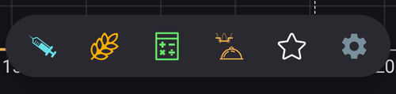
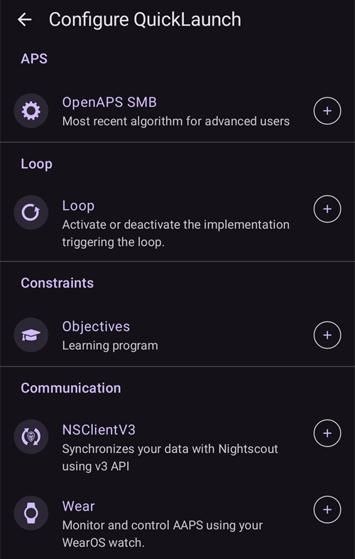

(quicklaunch)=
# Hızlı Başlatma (genel bakış ekranındaki hızlı işlem araç çubuğu)

**Hızlı Başlatma**, **AAPS** genel bakış ekranının altında, alt gezinme çubuğunun hemen üstünde duran küçük **hızlı işlem araç çubuğudur**. Tek dokunuşla çalışan düğmelerden oluşan, özelleştirilebilir bir satırdır: hangi eylemlerin burada olacağına ve sıralarına siz karar verirsiniz. Böylece en sık yaptığınız işler ana ekranda her zaman tek dokunuş uzaklıktadır.

```{contents} Table of contents
:depth: 2
:local: true
```



---

## Araç çubuğunu kullanma

Araç çubuğu **genel bakış ekranında**, grafikler ile alt gezinme çubuğu arasında durur:


- Eylemini çalıştırmak için bir simgeye **dokunun** — tam olarak eylemi normal ekranından açmışsınız gibi çalışır (bolus veya tedavi yine önce olağan onayını gösterir).
- Eylemin adını ve kısa açıklamasını içeren bir **ipucu** görmek için bir simgeye **uzun basın**.
- Ekrana **sığmayacak kadar çok düğme** eklerseniz, fazla olanlar bir **taşma menüsüne** (araç çubuğunun sonundaki **⋮** düğmesi) taşınır.
- Her simge, eyleminin **rengini** korur (ör. insülin, karbonhidrat, geçici hedef), böylece bir bakışta tanınır.

```{admonition} The toolbar is always there
:class: note
Son düğme her zaman **Hızlı Başlatma'yı yapılandırın** düğmesidir (**⚙️** dişli). Bu düğme kaldırılamaz, böylece yapılandırma ekranına her zaman doğrudan araç çubuğundan ulaşabilirsiniz. Varsayılan olarak araç çubuğunda yalnızca iki düğme vardır — **Bolus sihirbazı** ve bu dişli.
```

---

## Hızlı Başlatma'yı yapılandırma

Araç çubuğundaki **⚙️** dişliye dokunarak (veya **[Konfigürasyon](../SettingUpAaps/ConfigBuilder.md) → … → Hızlı Başlatma'yı yapılandırın** yolunu açarak) **Hızlı Başlatma'yı yapılandırın** ekranını açın (*“Genel bakış ekranındaki hızlı işlem düğmelerini özelleştirin”*).


Ekranın iki bölümü vardır:

- **Seçili eylemler** (üstte) — şu anda araç çubuğunuzda olan düğmeler, araç çubuğundaki sırayla.
- Altında bir **katalog** — ekleyebileceğiniz tüm eylemler, kategorilere göre gruplanmış olarak. Her katalog girdisinde, girdiyi eklemek için bir **➕** düğmesi vardır.

### Seçili eylemler — yeniden sıralama, düzenleme, kaldırma

Her seçili eylemde şunlar vardır:

- bir **⠿ sürükleme tutamacı** — düğmeleri **yeniden sıralamak** için basılı tutup sürükleyin (buradaki sıra, araç çubuğundaki sıradır),
- bir **−** düğmesi — eylemi araç çubuğundan **kaldırır**,
- ve yalnızca **Profil** kısayolu için, yüzde/süresini düzenlemek üzere bir **✏️** düğmesi (bkz. [Profil kısayolları](#profile-shortcuts)).

Değişiklikler **hemen** geçerli olur — ayrıca bir *Kaydet* yoktur. Eklenen bir eylem araç çubuğunun sonuna yerleşir; oradan yeniden sıralayabilirsiniz.

---

## Eylem kategorileri

Katalog, ekleyebileceğiniz her şeyi aşağıdaki kategorilerde, bu sırayla gruplar. Sunacak bir şeyi olmayan kategoriler (ör. hiç senaryonuz yoksa) gösterilmez.

### Tedavi

Günlük tedavi ve CGM iletişim kutuları:

- **İnsülin** — elle bolus verir.
- **Karbonhidrat** — insülin olmadan karbonhidrat kaydeder.
- **Bolus sihirbazı** — bolus hesaplayıcısını açar.
- **Tedavi** — insülin ve karbonhidratı birlikte kaydeder.
- **CGM** — CGM uygulamanızı açar (ör. xDrip).
- **Kalibrasyon** — CGM sensörünü kalibre eder.

### Careportal

Careportal olayları ve cihaz bakım kayıtları:

- **KŞ Kontrol**, **Not**, **Egzersiz**, **Soru**, **Duyuru**,
- **Sensör yerleştirme**, **Pompa Pil Değişimi**, **Pompa Kanül Değişimi**, **Hazırla/doldur**, **Bölge Rotasyonu**.

**Hazırla/doldur** ve **Pompa Pil Değişimi** yalnızca pompanız bunları kullanıyorsa sunulur. Örneğin Patch pompalar doldurma ve pil değişimini kendi etkinleştirme adımlarında yapar, bu yüzden bu girdiler onlar için gösterilmez (**Yönet** panelinde olduğu gibi).


Bunlar, normalde **[Tedaviler](#v4changes-treatments)** ve **[Yönet](#v4changes-manage)** panellerinden ulaşacağınız girdilerin aynısıdır — Hızlı Başlatma yalnızca kullandıklarınızı genel bakış ekranına koyar.

### Yönet

**[Yönet](#v4changes-manage)** panelindeki ekranlar, aynı sırayla; böylece en çok kullandığınızı araç çubuğundan açabilirsiniz:

- **Profil**, **İnsülin ayarları** (insülin yapılandırmalarını yönetin ve etkinleştirin — **İnsülin** düğmesinden bilerek farklı adlandırılmıştır, çünkü o düğme bolus verir), **Geçici Hedef**, **Hızlı Asistan**, **Senaryolar**, **Otomasyon**, **Yiyecek**,
- **Çalışma modu** — döngüyü kapatın veya açın, askıya alın ya da pompa bağlantısını kesin,
- **Yetkili istemciler** — yalnızca ana birimde veya eşleştirilmiş bir istemcide.

Bu düğmeler ekranı açar; kendi başlarına hiçbir şey başlatmazlar. Bir senaryoyu veya bir Hızlı Asistan'ı tek dokunuşla başlatmak için onu aşağıdaki **Senaryolar** veya **Hızlı Asistan** kategorisinden ekleyin.

 

### Hızlı Asistan

Her **[Hızlı Asistan](QuickWizards.md)** ön ayarınız bir düğme olarak eklenebilir, böylece düzenli bir öğün genel bakış ekranından tek dokunuş uzaklıkta olur. Düğme ön ayarın adını taşır ve karbonhidrat/insülin miktarını gösterir; düğmeye dokunmak Hızlı Asistan'ı olağan onayıyla çalıştırır.

Yalnızca saatte gösterilecek şekilde ayarlanmış Hızlı Asistan'lar sunulmaz. Araç çubuğundaki bir Hızlı Asistan düğmesi, **Tedaviler** panelindekiyle aynı kurallara uyar: [geçerli zaman aralığı](#quickwizard_validity) dışında ve kullanıldıktan sonra kısa bir süre gizlenir. Araç çubuğu yapılandırmanızda kalır ve Hızlı Asistan yeniden kullanılabilir olduğunda geri gelir.

### Senaryolar

Etkin her **[senaryo](Scenes.md)** bir düğme olarak eklenebilir. Düğmeye dokunduğunuzda onay istenir, ardından senaryo etkinleştirilir (Senaryolar ekranından alacağınız aynı eylem grubu). Bu kategori yalnızca en az bir senaryonuz varsa görünür.

İpucu ve katalog, **Yönet → Senaryolar** ile aynı özeti gösterir, örneğin *"3 eylem, 2 sa → Soğuma"*. Burada oktan sonraki ad, devam senaryosudur.

### Otomasyon

**Kullanıcı eylemi** otomasyon kurallarınız (elle tetiklediğiniz kurallar) düğme olarak eklenebilir. Birine dokunduğunuzda onay istenir, ardından o kuralın eylemleri çalıştırılır.

```{admonition} Automation buttons run on the master
:class: note
Otomasyon **ana birimde** çalışır, bu yüzden otomasyon kısayolları yalnızca ana birimde sunulur ve çalıştırılır. Eşleştirilmiş bir **[istemcide](../RemoteFeatures/ClientMasterControl.md)** kullanılamazlar.
```

### Geçici Hedef Ön Ayarları

Her **[Geçici Hedef](TempTargets.md)** ön ayarınız bir düğme olarak eklenebilir (adı, hedefi ve süresi gösterilir, örneğin *"Yakında Yenecek — 5,0 mmol/L, 45 dk"*). Düğmeye dokunduğunuzda onay istenir, ardından o geçici hedef başlatılır.


(profile-shortcuts)=
### Profile

Her **[profil](ProfileSwitch-ProfilePercentage.md)**, tek dokunuşla bir **profil değişimi** yapan bir **kısayol** olarak eklenebilir. Çoğu kısayoldan farklı olarak, bir Profil kısayolu kendi **yüzdesini** ve **süresini** taşır. Bunları ekledikten sonra **✏️** düğmesiyle ayarlarsınız:

- **Yüzde** (%30–250, %5'lik adımlarla) — profil uygulanırken onu ölçekler. %100 profili olduğu gibi kullanır.
- **Süre** (0–10080 dk, yani en fazla 7 gün, 10 dk'lık adımlarla) — değişimin ne kadar süreceği. **0 = Kalıcı** (yeniden değiştirene kadar).


Bu sayede **aynı** profil için farklı güçlerde birkaç düğme tutabilirsiniz — örneğin *“Profil %100”* ve *“2 sa için Profil %70”* — ve ikisinden birini tek dokunuşla uygulayabilirsiniz. (Aynı profili farklı ayarlarla birden fazla kez ekleyebilirsiniz.)

### Eklentiler



Son olarak, kendi ekranı olan her **etkin eklenti**, ekranını doğrudan açan bir kısayol olarak eklenebilir. Bunlar eklenti türüne göre gruplanır — **Pompa**, **KŞ kaynağı**, **APS**, **Döngü**, **Duyarlılık algılaması**, **Yumuşatma**, **Kalibrasyon**, **Kısıtlamalar**, **İletişim** ve **Genel** — böylece örneğin genel bakış ekranından doğrudan pompa veya döngü ekranınıza geçebilirsiniz.

---

## Hızlı Başlatma ve Ana birim/İstemci

Ayarlarınızın çoğundan farklı olarak **Hızlı Başlatma araç çubuğu cihaz başına yapılandırılır** — ana biriminiz ile eşleştirilmiş istemciler arasında **yerel olarak saklanır ve senkronize edilmez**, böylece her cihaz kendi düğme setini korur. (Ancak ayarların **yedeğine/dışa aktarımına** *dahildir*, böylece geri yükleme onu aynı cihazda geri getirir.)

Her cihazın araç çubuğuna koyabileceği şeyler yine de o cihazda neler olduğuna bağlıdır: Hızlı Asistan'lar, senaryolar, geçici hedef ön ayarları ve profillerin hepsi senkronize edilir, bu yüzden bir istemcinin kataloğu aynı öğeleri sunar — siz yalnızca bunları her cihaz için ayrı seçersiniz. Bilinmesi gereken birkaç ayrıntı:

- Hedefi artık var olmayan düğmeler (silinmiş bir Hızlı Asistan, senaryo veya ön ayar, devre dışı bırakılmış bir kural) **otomatik olarak atlanır**.
- **Otomasyon** kısayolları yalnızca **ana birimde** sunulur ve çalıştırılır (otomasyon ana birimde çalışır). Senaryo, Hızlı Asistan, geçici hedef ve profil düğmeleri bir istemcide kullanılabilir.
- Bir istemcide ana birimde çalışması gereken bir düğmeye (bolus, geçici hedef, profil değişimi veya senaryo) dokunduğunuzda, işlemi **ana birim** yapar ve onayı da o hazırlar. Bkz. [Ana birim ↔ İstemci kontrolü](../RemoteFeatures/ClientMasterControl.md).

---


<!-- =====================================================================
     Screenshots captured from a real master device:
       - quicklaunch_toolbar.png    (cropped close-up of the overview toolbar pill)
       - quicklaunch_overview.png   (full overview showing the toolbar in place)
       - quicklaunch_config.png     (Configure QuickLaunch: Selected actions + Treatment + start of Manage)
       - quicklaunch_dynamic.png    (catalog: Quick Wizard / Scenes / Automation / Temp Target Presets)
       - quicklaunch_categories.png (catalog: Profile shortcuts + plugin categories)
     No QuickLaunch action was actually run (nothing delivered; only scrolled).
     Maintainers: relocate page + images and fix cross-links as needed.
     ===================================================================== -->
